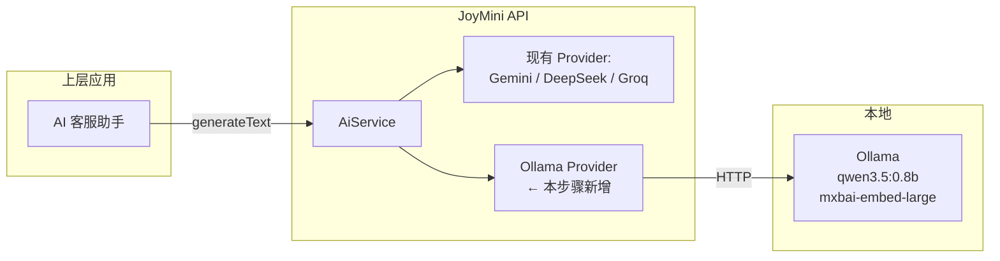
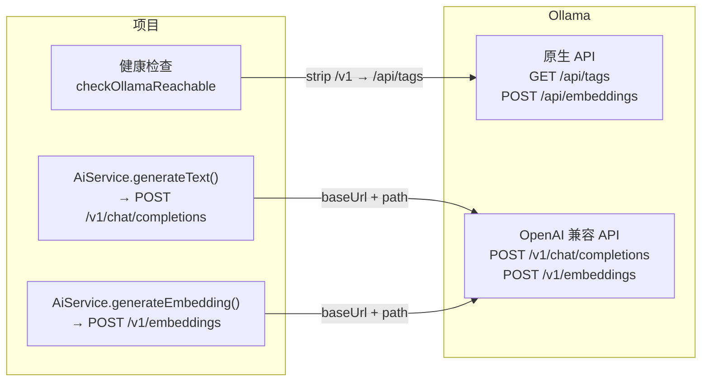
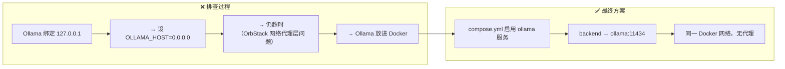

# 01. 配置 AiService 与 Ollama 集成

> **系列**: JoyMini AI 功能开发
> **前置步骤**: 无（本系列第一步）
> **下一步**: [02. 安装 LangGraph 依赖与 DI 修复](02-安装-LangGraph依赖与DI修复.md)
> **对应代码**: [`apps/api/src/common/ai/ai.service.ts`](/apps/api/src/common/ai/ai.service.ts)
> **参考文档**: [`docs/ollama-setup-guide.md`](/docs/ollama-setup-guide.md)

---

## 🎯 本步骤目标

完成本步骤后：

1. Ollama 本地服务已运行，已拉取推理模型和嵌入模型
2. [`deploy/.env.dev`](/deploy/.env.dev) 和 [`apps/api/.env`](/apps/api/.env) 已配置 Ollama 三件套
3. [`AiService`](/apps/api/src/common/ai/ai.service.ts) 可通过 Ollama Provider 调用文本生成和 Embedding
4. 多 Provider 自动降级链路正常

---

## 📖 背景说明

### 整体架构中的位置



JoyMini 的 AI 功能需要一个**本地可用的 LLM 推理服务**。Ollama 提供轻量级的两套 API：
- **原生 API**（`/api/...`）：服务管理、调试
- **OpenAI 兼容 API**（`/v1/...`）：可直接用 OpenAI SDK 格式调用

### 为什么这样做

| 问题 | 方案 | 好处 |
|------|------|------|
| 开发调试需要 LLM | 本地 Ollama | 免费、离线可用、无 API 费用 |
| 生产环境成本控制 | Ollama CPU 推理 | `qwen3.5:0.8b` 仅 873M，CPU 可跑 |
| 多 Provider 降级 | AiService 优先级链 | Ollama → DeepSeek → GroQ → Gemini |

### 设计决策

| 决策点 | 选项 | 选择 | 原因 |
|--------|------|------|------|
| 安装方式 | Docker / Native | **Native（brew）** | Mac 开发环境，brew 更简单 |
| 推理模型 | qwen3.5:0.8b / llama3.2 | **qwen3.5:0.8b** | CPU 可推理，尺寸小(~873M)，速度快 |
| 嵌入模型 | nomic-embed-text / mxbai-embed-large | **mxbai-embed-large** | 334M，F16，768 维（pgvector 兼容） |
| Provider 优先级 | 多种顺序 | **DB config → Ollama → DeepSeek → GroQ → Gemini** | 本地优先，避免 API 费用 |
| API 路径 | `/api` vs `/v1` | **`/v1`** | AiService 使用 OpenAI SDK 格式调用 |

---

## ⚙️ 前置条件

### 环境要求

- [ ] macOS（Apple Silicon M 系列 或 Intel）
- [ ] Homebrew 已安装
- [ ] 至少 2GB 空闲磁盘
- [ ] 终端可访问 `curl`

### 需要了解的概念

- [`AiService`](/apps/api/src/common/ai/ai.service.ts) — 多 Provider AI 服务（Gemini / DeepSeek / Groq / Ollama）
- **Ollama 两套 API** — 原生 API（`/api/`）用于服务管理；OpenAI 兼容 API（`/v1/`）用于应用集成
- **Provider 优先级链** — 依次尝试，失败则降级到下一个

---

## 📝 实现步骤

### Step 1: 安装 Ollama

**在哪里改**：终端

**做什么**：通过 Homebrew 安装 Ollama

```bash
brew install ollama
```

**为什么这样设计**：Homebrew 是 macOS 推荐的包管理器，自动处理路径、服务管理和日志。

---

### Step 2: 启动 Ollama 服务

**在哪里改**：终端

**做什么**：启动 Ollama 后台服务

```bash
# 方式 A：后台 brew 服务（推荐 —— 随系统启动）
brew services start ollama

# 方式 B：前台运行（适合调试，能看到日志输出）
ollama serve
```

**验证**：
```bash
curl http://127.0.0.1:11434/api/tags
# 预期: {"models": []}  — 空列表，服务正常但还没有模型
```

**为什么这样设计**：
- `brew services start` — 后台守护进程，随系统自动启动，日常开发用这个
- `ollama serve` — 前台运行，能看到实时日志，调试时用这个

---

### Step 3: 拉取模型

**在哪里改**：终端

**做什么**：拉取推理模型和嵌入模型

```bash
# 推理模型（用于 AiService.generateText）
ollama pull qwen3.5:0.8b

# 嵌入模型（用于 AiService.generateEmbedding）
ollama pull mxbai-embed-large
```

**验证**：
```bash
curl http://127.0.0.1:11434/api/tags
# 预期: models 列表包含 qwen3.5:0.8b 和 mxbai-embed-large
```

**为什么选这两个模型**：

| 模型 | 大小 | 精度 | 用途 | 速度（M3 CPU） |
|------|------|------|------|---------------|
| `qwen3.5:0.8b` | 873M | Q8_0 | 文本生成（聊天、翻译、分类） | ~20-30 tokens/s |
| `mxbai-embed-large` | 334M | F16 | Embedding（语义搜索、RAG） | ~50ms/次 |

两者合计约 **1.2GB**，适合本地开发。

---

### Step 4: 配置环境变量

**在哪里改**：[`deploy/.env.dev:185`](/deploy/.env.dev:185)

**做什么**：添加 Ollama 配置到开发环境变量文件

```bash
# ==========================================
# Ollama LLM Configuration
# ==========================================
OLLAMA_BASE_URL=http://127.0.0.1:11434/v1
OLLAMA_MODEL=qwen3.5:0.8b
OLLAMA_EMBEDDING_MODEL=mxbai-embed-large
```

同样配置添加到 [`apps/api/.env`](/apps/api/.env)。

**为什么 `OLLAMA_BASE_URL` 用 `/v1` 结尾**？

这是本项目最容易混淆的地方，理清楚一次：



关键代码在 [`ai.service.ts:641`](/apps/api/src/common/ai/ai.service.ts:641)：

```typescript
// AiService 使用 OpenAI SDK 调用 Ollama
// SDK 自动拼接: OLLAMA_BASE_URL + /chat/completions
// 所以 OLLAMA_BASE_URL 必须包含 /v1
// 即: http://localhost:11434/v1 + /chat/completions = http://localhost:11434/v1/chat/completions

// 健康检查则需要去掉 /v1，走原生 API:
// baseUrl.replace('/v1', '') + '/api/tags'
// = http://localhost:11434 + /api/tags
```

所以：
- **`/v1` 是 Ollama 自己实现的 OpenAI 兼容路径**，不是项目的 API 版本号
- 项目中的 AiService 使用 OpenAI SDK 格式调用，所以必须带 `/v1`
- 健康检查走原生 API，代码中先 strip `/v1` 再拼 `/api/tags`

---

### Step 5: 验证完整链路

**在哪里改**：终端（项目根目录）

**做什么**：测试 Ollama 的两套 API 是否都正常工作

```bash
# ── 1. 原生 API：模型管理 ──
# 列出已拉取的模型
curl -s http://127.0.0.1:11434/api/tags | python3 -m json.tool

# 查看模型详情
curl -s http://127.0.0.1:11434/api/show -d '{"model": "qwen3.5:0.8b"}' | python3 -m json.tool

# ── 2. OpenAI 兼容 API：文本生成（对应 AiService.generateText()）──
curl -s http://127.0.0.1:11434/v1/chat/completions \
  -H "Content-Type: application/json" \
  -d '{
    "model": "qwen3.5:0.8b",
    "messages": [{"role": "user", "content": "Hello, what is your name?"}],
    "temperature": 0.7
  }' | python3 -m json.tool

# ── 3. OpenAI 兼容 API：Embedding（对应 AiService.generateEmbedding()）──
curl -s http://127.0.0.1:11434/v1/embeddings \
  -H "Content-Type: application/json" \
  -d '{
    "model": "mxbai-embed-large",
    "input": "Hello world"
  }' | python3 -m json.tool
# 预期: 返回 embedding 数组，长度 768

# ── 4. OpenAI 兼容 API：列出模型 ──
curl -s http://127.0.0.1:11434/v1/models | python3 -m json.tool
```

**预期结果**：

| 测试 | 预期 |
|------|------|
| `/api/tags` | 列出 qwen3.5:0.8b 和 mxbai-embed-large |
| `/api/show` | 显示模型配置、参数、模版 |
| `/v1/chat/completions` | 返回 `choices` 数组，包含回复文本 |
| `/v1/embeddings` | 返回 `data[0].embedding`，长度 768 |
| `/v1/models` | 列出可用模型（OpenAI 兼容格式） |

---

### Step 6: 将 Ollama 加入 Docker Compose deploy 体系

**在哪里改**：项目根目录

**做什么**：创建独立 Compose 文件，同时在主 Compose 中添加注释选项

由于 Ollama 是**可选依赖**（AiService 有自动降级链：Ollama → DeepSeek → GroQ → Gemini），不强制所有环境都启动。所以提供了两种方式：

#### 6.1 创建独立 [`compose.ollama.yml`](/compose.ollama.yml)

独立文件，用于需要 Docker 方式运行 Ollama 的场景（如不想在宿主机装 brew）：

```yaml
# compose.ollama.yml — Standalone Ollama service
# Start:   docker compose -f compose.ollama.yml up -d
# Stop:    docker compose -f compose.ollama.yml down
# Logs:    docker compose -f compose.ollama.yml logs -f

services:
  ollama:
    image: ollama/ollama:latest
    container_name: joymini-ollama
    ports:
      - '11434:11434'
    volumes:
      - ollama_data:/root/.ollama
    healthcheck:
      test: ['CMD', 'curl', '-f', 'http://localhost:11434/api/tags']
      interval: 10s
      timeout: 5s
      retries: 10
      start_period: 30s
    restart: unless-stopped

  ollama-init:
    image: ollama/ollama:latest
    container_name: joymini-ollama-init
    depends_on:
      ollama:
        condition: service_healthy
    entrypoint: >
      sh -c "
        echo '>>> Pulling LLM model: qwen3.5:0.8b ...' &&
        ollama pull qwen3.5:0.8b &&
        echo '>>> Pulling Embedding model: mxbai-embed-large ...' &&
        ollama pull mxbai-embed-large &&
        echo '>>> All models ready!'
      "
    restart: 'no'

volumes:
  ollama_data:
```

**启动命令**：
```bash
# 启动 Ollama
docker compose -f compose.ollama.yml up -d

# 确认模型已拉取
docker exec joymini-ollama ollama list

# 测试 API
curl http://localhost:11434/api/tags
```

**为什么独立文件**：
- Ollama 是可选服务，不强制所有开发者启动
- 独立文件可以通过 `-f` 参数选择性启动
- 不影响主 `compose.yml` 的启动顺序和依赖链

#### 6.2 在 [`compose.yml`](/compose.yml) （开发环境）添加注释选项

在文件末尾 `volumes:` 之前添加以下内容（注释状态，默认不启用）：

```yaml
  # =========================================
  # Ollama 本地 LLM 服务（可选）
  # =========================================
  # 取消注释以下内容以启用 Ollama Docker 方式运行
  # 或在宿主机直接运行: brew services start ollama
  # 启动: uncomment 后 docker compose up -d
  # 注意: backend 的 OLLAMA_BASE_URL 需要改为 http://host.docker.internal:11434/v1
  # ollama:
  #   image: ollama/ollama:latest
  #   container_name: joymini-ollama
  #   ports:
  #     - "11434:11434"
  #   volumes:
  #     - ollama_data:/root/.ollama
  #   healthcheck:
  #     test: ["CMD", "curl", "-f", "http://localhost:11434/api/tags"]
  #     interval: 30s
  #     timeout: 10s
  #     retries: 5
  #     start_period: 60s
  #   restart: unless-stopped
  #   networks: [app]
```

同时需要在 `volumes:` 中添加：
```yaml
  ollama_data:
```

#### 6.3 在 [`compose.prod.yml`](/compose.prod.yml) （生产环境）添加注释选项

在文件末尾 `volumes:` 之前添加以下内容：

```yaml
  # =========================================
  # Ollama 本地 LLM 服务（可选 — 生产环境）
  # =========================================
  # 生产环境建议在宿主机直接安装 Ollama，避免 Docker 额外开销
  # 取消注释以启用 Docker 方式:
  # ollama:
  #   image: ollama/ollama:latest
  #   container_name: joymini-ollama-prod
  #   restart: unless-stopped
  #   deploy:
  #     resources:
  #       limits:
  #         memory: 4G
  #       reservations:
  #         memory: 1G
  #   volumes:
  #     - ollama_data:/root/.ollama
  #   healthcheck:
  #     test: ["CMD", "curl", "-f", "http://localhost:11434/api/tags"]
  #     interval: 30s
  #     timeout: 10s
  #     retries: 5
  #     start_period: 120s
  #   networks: [app]
```

同时需要在 `volumes:` 中添加：
```yaml
  ollama_data:
```

**验证部署集成**：
```bash
# 验证独立文件存在
ls -la compose.ollama.yml

# 验证主 compose 有注释配置
grep -n "ollama" compose.yml compose.prod.yml

# 可选：启动 Ollama Docker
docker compose -f compose.ollama.yml up -d
```

**设计说明**：

| 场景 | 推荐方式 | 原因 |
|------|----------|------|
| 本地开发（brew） | 宿主机直接 brew 安装 | 简单、资源占用少 |
| 本地开发（Docker） | `docker compose -f compose.ollama.yml up -d` | 隔离环境、易于清理 |
| 生产部署 | 宿主机直接安装 + systemd | 避免 Docker 额外内存开销、稳定性更高 |
| 需随主 compose 启动 | 取消注释 compose.yml 中的 ollama 段 | 一次启动所有服务 |

---

## ✅ 验收方式

### 自动验证脚本

```bash
#!/bin/bash
# save as: scripts/verify-ollama.sh
# run: bash scripts/verify-ollama.sh

echo "=== Ollama 验证 ==="

# 1. 服务是否运行
if curl -s http://127.0.0.1:11434/api/tags > /dev/null 2>&1; then
  echo "✅ Ollama 服务运行中"
else
  echo "❌ Ollama 未运行"
  exit 1
fi

# 2. 模型是否已拉取
if curl -s http://127.0.0.1:11434/api/tags | grep -q "qwen3.5"; then
  echo "✅ 推理模型 qwen3.5:0.8b 已就绪"
else
  echo "❌ qwen3.5:0.8b 未拉取"
fi

if curl -s http://127.0.0.1:11434/api/tags | grep -q "mxbai-embed-large"; then
  echo "✅ 嵌入模型 mxbai-embed-large 已就绪"
else
  echo "❌ mxbai-embed-large 未拉取"
fi

# 3. 文本生成 API
CHAT_TEST=$(curl -s http://127.0.0.1:11434/v1/chat/completions \
  -H "Content-Type: application/json" \
  -d '{"model": "qwen3.5:0.8b", "messages": [{"role": "user", "content": "say hi"}]}')
if echo "$CHAT_TEST" | grep -q "choices"; then
  echo "✅ Chat API 正常"
else
  echo "❌ Chat API 异常"
fi

# 4. Embedding API
EMBED_TEST=$(curl -s http://127.0.0.1:11434/v1/embeddings \
  -H "Content-Type: application/json" \
  -d '{"model": "mxbai-embed-large", "input": "test"}')
if echo "$EMBED_TEST" | grep -q "embedding"; then
  echo "✅ Embedding API 正常"
else
  echo "❌ Embedding API 异常"
fi

echo "=== 验证完成 ==="
```

### 手动检查清单

- [ ] `brew services list | grep ollama` 显示 `started`
- [ ] `ollama list` 显示 `qwen3.5:0.8b` 和 `mxbai-embed-large`
- [ ] [`deploy/.env.dev`](/deploy/.env.dev:185) 包含 `OLLAMA_BASE_URL`、`OLLAMA_MODEL`、`OLLAMA_EMBEDDING_MODEL`
- [ ] [`apps/api/.env`](/apps/api/.env) 同样包含上述三行
- [ ] 文本生成 API 返回合理回复
- [ ] Embedding API 返回 768 维向量

---

---

## 🚨 故障排查与经验总结

### 问题：Docker 容器无法调用 Ollama chat API（POST /api/chat 超时）

**现象**：
- `GET /api/tags` 从 Docker 容器中可正常返回（瞬时响应）
- `POST /api/chat` 从 Docker 容器中始终超时（30-60s 无响应）
- `POST /api/chat` 从宿主机（localhost）正常（~10s）

**根因分析**：



**关键教训**：

| 序号 | 教训 | 说明 |
|------|------|------|
| 1 | **`host.docker.internal` 不可靠** | macOS 上（尤其使用 OrbStack 时），`host.docker.internal` 只对轻量请求（GET）有效，带推理负载的 POST 请求会被 OrbStack 网络代理层拦截/超时 |
| 2 | **`OLLAMA_HOST=0.0.0.0` 不足以解决问题** | 即使 Ollama 监听所有接口，OrbStack 的 `host.docker.internal` 仍无法正确转发长连接推理请求 |
| 3 | **macOS Docker 无 GPU 加速** | Docker Desktop/OrbStack for Mac 不支持 GPU 透传，Docker 内的 Ollama 仅为 CPU 推理（~20-30 tokens/s）。Apple Silicon GPU 仅对宿主机原生进程可用 |
| 4 | **Docker 内部网络最可靠** | 将 Ollama 和服务放在同一个 Docker Compose 网络中，通过服务名（`http://ollama:11434`）通信，彻底避免宿主机网络桥接问题 |

### 修复步骤（备忘）

如果以后重装或换环境，需要做：

1. **确保 `compose.yml` 中 ollama 服务已启用**（非注释状态）
2. **确保 `deploy/.env.dev` 中 URL 指向 Docker 服务名**：
   ```bash
   OLLAMA_BASE_URL=http://ollama:11434       # ChatOllama (LangChain)
   AI_OLLAMA_BASE_URL=http://ollama:11434    # OllamaProvider (NestJS)
   ```
3. **首次启动需拉取模型**：
   ```bash
   docker compose exec ollama ollama pull qwen3.5:0.8b
   docker compose exec ollama ollama pull mxbai-embed-large
   ```
4. **验证连通性**（从 backend 容器内测试）：
   ```bash
   # 测试 tags（网络连通性）
   docker compose exec backend curl http://ollama:11434/api/tags
   
   # 测试 chat（推理功能）
   docker compose exec backend node -e "
     const http = require('http');
     const data = JSON.stringify({model:'qwen3.5:0.8b',messages:[{role:'user',content:'hi'}],stream:false});
     const req = http.request({hostname:'ollama',port:11434,path:'/api/chat',method:'POST',
       headers:{'Content-Type':'application/json','Content-Length':Buffer.byteLength(data)}},
       (res) => { let d=''; res.on('data',c=>d+=c); res.on('end',()=>console.log(d.slice(0,200))); });
     req.write(data); req.end();
   "
   ```

### 不同环境的部署策略

| 环境 | Docker? | GPU? | Ollama 部署方式 | URL |
|------|---------|------|----------------|-----|
| 本地开发（macOS） | OrbStack | ❌ 无 GPU | Docker Compose 内 | `http://ollama:11434` |
| 生产（Linux） | Docker | ✅ `--gpus all` | Docker Compose 内 | `http://ollama:11434` |
| 纯宿主机调试 | 无 | ✅ Apple GPU | `brew services` | `http://127.0.0.1:11434` |

**原则**：无论什么环境，Ollama 和 backend 要么都在 Docker 里（通过服务名通信），要么都在宿主机（通过 localhost 通信）。**避免跨宿主机↔Docker 边界调用 LLM 推理**。

---

## 🔜 下一步预告

下一步：[02. 安装 LangGraph 依赖与 DI 修复](02-安装-LangGraph依赖与DI修复.md)

Ollama 已提供本地 LLM 推理和 Embedding API，下一步将安装 LangGraph 依赖，修复模块导出以使 DI 正常工作，为 AI 客服 Agent 引擎搭建基础。
