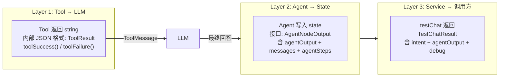

# 07. Wallet Agent + Tools（钱包助手）

## 🎯 本步骤目标

1. 创建 [`graph/tools/wallet-tools.ts`](apps/api/src/client/ai-customer/graph/tools/wallet-tools.ts) — 3 个钱包查询工具的工厂函数（`getWalletBalance`、`getWalletTransactions`、`getKycStatus`）
2. 创建 [`graph/nodes/wallet-agent.node.ts`](apps/api/src/client/ai-customer/graph/nodes/wallet-agent.node.ts) — 手动 Agent 循环的 Wallet ReAct Agent
3. 掌握 **`ClientWalletService`** 和 **`WalletService`** 的区别与协作
4. 理解 **KYC** 实名认证与钱包功能的关系
5. 建立统一的 **3 层类型体系**（Tool 返回 → Agent 返回 → Service 返回）

完成本步骤后，`walletAgent` 节点可以处理"查余额"、"看交易记录"、"查 KYC 状态"等钱包相关查询。

---

## 📖 开发背景

### 承上：上一步做了什么？

[06-OrderAgent与Tools.md](06-OrderAgent与Tools.md) 完成了：
- `graph/tools/order-tools.ts` — 3 个订单工具的工厂函数
- `graph/nodes/order-agent.node.ts` — Order ReAct Agent（手动 Agent 循环）
- **Tool 工厂函数模式** 的设计与实现
- `createLLM` + `bindTools` 的使用方法

### 启下：下一步做什么？

下一步 [08-CouponAgent与Tools.md](08-CouponAgent与Tools.md) 将实现：
- Coupon Agent — 处理优惠券查询、领取
- Coupon Tools — 3 个工具的工厂函数

### 架构中的位置

```
用户输入 → intentRouter (wallet) → walletAgent (本步骤)
                                      ├── getWalletBalance (查询余额)
                                      ├── getWalletTransactions (交易记录)
                                      └── getKycStatus (KYC 状态检查)
                                   → answerSynthesizer
```

### 类型体系全景

本步骤同步建立了 **3 层类型约束体系**，覆盖 Tool → Agent → Service 的全链路：



---

## 🔧 前提条件

- [x] 06 文档已完成（Order Agent、Tool 工厂函数模式）
- [x] `wallet.module.ts` 已正确 exports（`exports: [WalletService, ClientWalletService]`）
- [x] `kyc.module.ts` 已修复 exports（`exports: [KycService]`）
- [x] 了解两个钱包服务的区别
- [x] 类型体系文件已创建：
  - [`tool-result.ts`](apps/api/src/client/ai-customer/graph/tools/tool-result.ts) — `ToolResult<T>` 判别联合
  - [`agent-types.ts`](apps/api/src/client/ai-customer/graph/types/agent-types.ts) — `AgentStep`、`AgentNodeOutput`、`TestChatResult`

### 钱包服务的双 Service 架构

JoyMini 的钱包功能分在两个 Service 中：

| Service | 文件 | 方法 | 职责 |
|---------|------|------|------|
| `WalletService` | [`wallet.service.ts`](apps/api/src/client/wallet/wallet.service.ts) | `balance(userId)` | 查询余额（realBalance, coinBalance, frozenBalance） |
| `ClientWalletService` | [`client-wallet.service.ts`](apps/api/src/client/wallet/client-wallet.service.ts) | `getRechargeHistory()` | 充值记录分页查询 |
| `ClientWalletService` | [`client-wallet.service.ts`](apps/api/src/client/wallet/client-wallet.service.ts) | `getWithdrawalHistory()` | 提现记录分页查询 |

**为什么要分开？** `WalletService` 处理核心账户操作（余额、冻结），`ClientWalletService` 处理客户端展示相关的查询（充值记录、交易历史）。

### KYC 与钱包的关系

用户提现依赖 KYC 实名认证状态，因此 Wallet Agent 需要能查询 KYC 状态。Wallet Agent 的 System Prompt 中已包含 KYC 规则：
- 如果用户问提现 → 告知"功能尚未开放，将在后续版本提供"
- 如果用户问 KYC 状态 → 查询 `getKycStatus` 返回结果

---

## ⚙️ 实现步骤

### Step 1: 创建 Wallet Tools 工厂函数

**文件**: [`apps/api/src/client/ai-customer/graph/tools/wallet-tools.ts`](apps/api/src/client/ai-customer/graph/tools/wallet-tools.ts)

```typescript
import { WalletService } from '@api/client/wallet/wallet.service';
import { ClientWalletService } from '@api/client/wallet/client-wallet.service';
import { KycService } from '@api/client/kyc/kyc.service';
import { TaggedTool } from './tool-registry.service';
import { tool } from '@langchain/core/tools';
import { toLLM } from '@api/common/ai/utils/to-llm';
import { WalletBalanceResponseDto } from '@api/client/wallet/dto/wallet-balance.response.dto';
import { z } from 'zod';
import { TransactionResponseDto } from '@api/client/wallet/dto/transaction-response.dto';
import { WithdrawalItemResponseDto } from '@api/client/wallet/dto/withdrawal-item-response.dto';
import { KycResponseDto } from '@api/client/kyc/dto/kyc.response.dto';
import { plainToInstance } from 'class-transformer';
import { toolSuccess, toolFailure } from './tool-result';

/** getWalletBalance 返回数据 */
interface BalanceData {
  realBalance: string;
  coinBalance: string;
  frozenBalance: string;
  totalRecharge: string;
  totalWithdraw: string;
}

/** 单条交易/提现记录 */
interface RawRecord {
  [key: string]: any;
}

/** getWalletTransactions 返回数据 */
interface TransactionsData {
  recharges?: RawRecord[];
  withdrawals?: RawRecord[];
  rechargeTotal?: number;
  withdrawTotal?: number;
  page: number;
  pageSize: number;
}

export const createWalletTools = (
  walletService: WalletService,
  clientWalletService: ClientWalletService,
  kycService: KycService,
): TaggedTool[] => {
  return [
    {
      tool: tool(
        async ({ userId }: { userId: string }) => {
          try {
            const result = await walletService.balance(userId);
            const dto = plainToInstance(WalletBalanceResponseDto, result);
            const llmResult = toLLM(dto, WalletBalanceResponseDto, 'zh');
            return toolSuccess(llmResult);
          } catch (e) {
            return toolFailure(
              `Failed to query wallet balance: ${(e as Error).message}`,
            );
          }
        },
        {
          name: 'getWalletBalance',
          schema: z.object({
            userId: z.string().describe('The Current user ID'),
          }),
          description:
            'Get the current user wallet balance,including real balance (cash), coin balance,frozen balance,total recharge and total withdraw.',
        },
      ),
      tags: ['wallet'],
    },
    // getWalletTransactions — 查询充值/提现记录
    // getKycStatus — 查询 KYC 实名认证状态
  ];
};
```

#### 关键设计点

| 特性 | 说明 |
|------|------|
| **`toLLM()`** | 将 DTO 对象转换为 LLM 友好的语义化 key-value 格式，LLM 看到的是 `realBalance: "1000.00"` 而非 raw DB 字段 |
| **`toolSuccess()` / `toolFailure()`** | 返回统一格式的 JSON 字符串 `{ ok: true, data: ... }` / `{ ok: false, error: ... }`，LLM 通过 `ok` 字段判断调用结果 |
| **`TaggedTool` 包装** | 每个 tool 包裹 `{ tool, tags: ['wallet'] }`，支持通过 `ToolRegistryService.getToolsByTag('wallet')` 按标签筛选工具 |
| **Phase 1 无提现** | 包含 3 个**查询**工具（余额/交易记录/KYC），不包含提现操作（`wallet_apply_withdraw` 推迟到 Phase 2） |

---

### Step 2: 创建 Wallet Agent 节点

**文件**: [`apps/api/src/client/ai-customer/graph/nodes/wallet-agent.node.ts`](apps/api/src/client/ai-customer/graph/nodes/wallet-agent.node.ts)

```typescript
import { createLLM, LlmProviderConfig } from '../llm-factory';
import { ToolRegistryService } from '../tools/tool-registry.service';
import { AgentState } from '../state';
import { MAX_ITERATIONS } from '../constants';
import { ToolMessage } from '@langchain/core/messages/tool';
import { AgentNodeOutput } from '../types/agent-types';

/**
 * walletAgent 占位节点 — 用于 graph 无条件注册
 * Phase 1 阶段只是透传，等 chatStream 接入后由 createWalletAgentNode 替换
 */
export const walletAgentNode = async (
  state: typeof AgentState.State,
): Promise<Partial<typeof AgentState.State>> => {
  return state;
};

export const createWalletAgentNode = (
  llmConfig: LlmProviderConfig,
  registry: ToolRegistryService,
) => {
  return async (state: typeof AgentState.State): Promise<AgentNodeOutput> => {
    const { messages, userId } = state;
    let iterations = 0;
    let totalToolCalls = 0;
    const tools = registry.getToolsByTag('wallet');
    const llmWithTools = createLLM(llmConfig, {
      temperature: 0,
    }).bindTools(tools);

    let currentMessages: any[] = [
      {
        role: 'system',
        content: `You are a wallet and identity verification assistant...`,
      },
      ...state.messages.slice(-6),
    ];

    try {
      while (iterations < MAX_ITERATIONS) {
        const response = await llmWithTools.invoke(currentMessages);
        currentMessages = [...currentMessages, response];
        if (response.tool_calls) {
          totalToolCalls += response.tool_calls.length;
        }
        if (!response.tool_calls || response.tool_calls.length === 0) {
          break;
        }
        for (const toolCall of response.tool_calls) {
          const foundTool = tools.find((t) => t.name === toolCall.name);
          if (foundTool) {
            const result = await (foundTool as any).invoke(toolCall.args);
            currentMessages = [
              ...currentMessages,
              new ToolMessage(result, toolCall?.id ?? ''),
            ];
          }
        }
        iterations++;
      }
    } catch (error) {
      return {
        agentOutput: 'Sorry, I encountered an issue...',
        messages: state.messages,
        agentSteps: [],
      };
    }

    const lastMessage = currentMessages[currentMessages.length - 1];
    const lastToolCall = (lastMessage as any)?.tool_calls?.[0];

    return {
      agentOutput: typeof lastMessage.content === 'string' ? lastMessage.content : '',
      messages: state.messages,
      agentSteps: [
        {
          node: 'walletAgent',
          totalToolCalls,
          iterations,
          lastToolCall: lastToolCall
            ? { name: lastToolCall.name, args: lastToolCall.args }
            : null,
          totalMessages: currentMessages.length,
        },
      ],
    };
  };
};
```

#### 与 Order Agent 一致的设计

| 特性 | 说明 |
|------|------|
| **手动 Agent 循环** | 不使用 `createReactAgent`，手动 `while` 循环控制 `MAX_ITERATIONS=3` |
| **`AgentNodeOutput` 返回类型** | 函数签名 `Promise<AgentNodeOutput>` 约束返回形状 |
| **`registry.getToolsByTag('wallet')`** | 通过 TaggedTool 标签系统获取注册的工具 |
| **`userId` 注入** | 从 `state.userId` 读取，注入 System Prompt |
| **`agentSteps` 统计** | 记录 `totalToolCalls`、`iterations`、`lastToolCall`、`totalMessages` |

---

### Step 3: 统一类型体系

为了规范 3 层数据流的类型约束，建立了以下类型文件：

#### 3a. [`tool-result.ts`](apps/api/src/client/ai-customer/graph/tools/tool-result.ts) — Tool 统一返回格式

```typescript
export type ToolResult<T extends Record<string, any> = Record<string, any>> =
  | { ok: true; data: T }
  | { ok: false; error: string };

/** 构建成功响应 */
export function toolSuccess<T extends Record<string, any>>(data: T): string {
  return JSON.stringify({ ok: true, data }, null, 2);
}

/** 构建失败响应 */
export function toolFailure(error: string): string {
  return JSON.stringify({ ok: false, error }, null, 2);
}
```

**设计要点**：
- `ok: true` / `ok: false` 使用 literal type 而非 `boolean`，实现 TypeScript 类型收窄（narrowing）
- 泛型 `T extends Record<string, any>` 约束 data 必须是对象
- Tool 返回的是 **string**（JSON 字符串），LLM 读取 `ok` 字段判断结果

#### 3b. [`agent-types.ts`](apps/api/src/client/ai-customer/graph/types/agent-types.ts) — 核心类型定义

```typescript
import { BaseMessage } from '@langchain/core/messages';

export interface AgentStep {
  node: string;                    // 节点名称，如 'orderAgent'
  totalToolCalls: number;          // 本轮总共调用了几次 tool
  iterations: number;              // 循环迭代次数
  lastToolCall: { name: string; args: Record<string, any> } | null;
  totalMessages: number;           // agent 内部总消息数
}

export interface AgentNodeOutput {
  agentOutput: string;             // Agent 生成的纯文本回答
  messages: BaseMessage[];         // 保留原始输入消息
  agentSteps: AgentStep[];         // Agent 执行步骤日志
}

export interface TestChatResult {
  intent: string;
  agentOutput: string;
  debug: {
    toolCalls: number;
    lastToolCall: { name: string; args: Record<string, any> } | null;
    totalMessages: number;
  };
}
```

#### 3c. [`state.ts`](apps/api/src/client/ai-customer/graph/state.ts) — 类型化的 agentSteps

```typescript
import { AgentStep } from './types/agent-types';

agentSteps: Annotation<AgentStep[]>({
  reducer: (a: AgentStep[], b: AgentStep[]) => a.concat(b),
  default: () => [],
}),
```

`agentSteps` 从 `Annotation<any[]>` 改为 `Annotation<AgentStep[]>`，提供编译期类型检查。

#### 3d. wallet-tools.ts — 数据接口类型

在 [`wallet-tools.ts`](apps/api/src/client/ai-customer/graph/tools/wallet-tools.ts) 中定义了每个 tool 返回数据的接口：

```typescript
interface BalanceData {
  realBalance: string;
  coinBalance: string;
  frozenBalance: string;
  totalRecharge: string;
  totalWithdraw: string;
}

interface TransactionsData {
  recharges?: RawRecord[];
  withdrawals?: RawRecord[];
  rechargeTotal?: number;
  withdrawTotal?: number;
  page: number;
  pageSize: number;
}
```

#### 3e. Agent 节点返回类型约束

Agent 节点（`order-agent.node.ts`、`wallet-agent.node.ts`）使用 **函数返回类型** `Promise<AgentNodeOutput>` 约束返回值，确保所有 agent 返回一致的形状：

```typescript
return async (state: typeof AgentState.State): Promise<AgentNodeOutput> => {
  // ... agent 逻辑 ...
  return {
    agentOutput: content,          // 纯文本回答
    messages: state.messages,      // 原始输入消息
    agentSteps: [{                 // 执行步骤统计
      node: 'walletAgent',
      totalToolCalls,
      iterations,
      lastToolCall: ...,
      totalMessages: ...,
    }],
  };
};
```

---

### Step 4: WalletModule 通过 OnApplicationBootstrap 注册 Tools

**文件**: [`apps/api/src/client/wallet/wallet.module.ts`](apps/api/src/client/wallet/wallet.module.ts)

Wallet Tools 的依赖（`WalletService`、`ClientWalletService`、`KycService`）由 WalletModule 管理，因此工具在 WalletModule 中注册。采用 `OnApplicationBootstrap` 编程式注册模式，避免 NestJS `multi:true` 钻石依赖问题：

```typescript
import { Module, OnApplicationBootstrap } from '@nestjs/common';
import { ToolRegistryService } from '@api/client/ai-customer/graph/tools/tool-registry.service';
import { createWalletTools } from '@api/client/ai-customer/graph/tools/wallet-tools';

@Module({
  imports: [KycModule],  // 引入 KycModule 以获取 KycService
  providers: [
    WalletService,
    ClientWalletService,
    PaymentChannelService,
  ],
  exports: [WalletService, ClientWalletService],
})
export class WalletModule implements OnApplicationBootstrap {
  constructor(
    private readonly toolRegistry: ToolRegistryService,
    private readonly walletService: WalletService,
    private readonly clientWalletService: ClientWalletService,
    private readonly kycService: KycService,
  ) {}

  onApplicationBootstrap() {
    this.toolRegistry.registerMany(
      createWalletTools(
        this.walletService,
        this.clientWalletService,
        this.kycService,
      ),
    );
  }
}
```

**设计要点**：
- 实现 `OnApplicationBootstrap` 生命周期钩子，在模块初始化后调用 `registerMany()` 注册工具
- 通过构造函数注入 `KycService`（来自 `KycModule`），避免 WalletModule 直接依赖 KycService 的内部实现
- 弃用 `multi: true` DI 模式 — 该模式在钻石依赖场景（`WalletModule` 被 `OrderModule` 和 `AiCustomerModule` 同时导入）下会导致工具注册丢失
- `ToolRegistryService` 由 `@Global ToolRegistryModule` 提供，无需在 `imports` 中显式导入

---

### Step 5: customer.graph.ts — Graph 编排

**文件**: [`apps/api/src/client/ai-customer/graph/customer.graph.ts`](apps/api/src/client/ai-customer/graph/customer.graph.ts)

将 `walletAgent` 节点注册到 StateGraph，并添加条件路由和边：

```typescript
import { createWalletAgentNode, walletAgentNode } from './nodes/wallet-agent.node';

export function buildCustomerGraph(
  llmConfig: LlmProviderConfig,
  registry: ToolRegistryService,
) {
  const workflow = new StateGraph(AgentState)
    .addNode('intentRouter', createIntentRouterNode(llmConfig))
    .addNode('ragNode', ragNode)
    .addNode('orderAgent', createOrderAgentNode(llmConfig, registry))
    .addNode('walletAgent', createWalletAgentNode(llmConfig, registry))  // 新增
    .addNode('generalChat', createGeneralChatNode(llmConfig))
    .addNode('answerSynthesizer', createAnswerSynthesizerNode(llmConfig))

    .addEdge(START, 'intentRouter')

    .addConditionalEdges('intentRouter', routerByIntent, {
      ragNode: 'ragNode',
      generalChat: 'generalChat',
      orderAgent: 'orderAgent',
      walletAgent: 'walletAgent',   // 新增路由
    })

    .addEdge('orderAgent', 'answerSynthesizer')
    .addEdge('walletAgent', 'answerSynthesizer')  // 新增边
    .addEdge('ragNode', 'answerSynthesizer')
    .addEdge('generalChat', 'answerSynthesizer')
    .addEdge('answerSynthesizer', END);

  return workflow.compile();
}
```

最终 Graph 结构：

```
START → intentRouter → routerByIntent
                          ├── orderAgent → answerSynthesizer → END
                          ├── walletAgent → answerSynthesizer → END  (新增)
                          ├── ragNode → answerSynthesizer → END
                          └── generalChat → answerSynthesizer → END
```

---

## ✅ 验证

### 编译检查

```bash
yarn workspace @lucky/api build
```

### 手动验证步骤

1. **查询余额**
   - 输入："我的钱包余额是多少？"
   - 预期：Intent Router 路由到 `walletAgent`，调用 `getWalletBalance`，返回余额信息

2. **查询交易记录**
   - 输入："最近一笔充值记录"
   - 预期：路由到 `walletAgent`，调用 `getWalletTransactions`，返回充值记录

3. **查 KYC 状态**
   - 输入："我的实名认证状态"
   - 预期：路由到 `walletAgent`，调用 `getKycStatus`，返回 KYC 状态

4. **提现（拒绝提示）**
   - 输入："我要提现 50 美元"
   - 预期：System Prompt 规则触发，告知用户"提现功能尚未开放，将在后续版本提供"

### testChat 验证

```typescript
const result = await aiCustomerService.testChat('查余额', 'user-123');
// result.intent → 'wallet'
// result.agentOutput → '您的现金余额是 1000.00 美元...'
// result.debug → { toolCalls: 1, lastToolCall: { name: 'getWalletBalance', args: { userId: 'user-123' } }, totalMessages: 5 }
```

---

## 📝 技术要点

1. **3 层类型体系**：Tool 返回 `ToolResult<T>` → Agent 返回 `AgentNodeOutput` → Service 返回 `TestChatResult`，每层独立约束
2. **`toolSuccess()` / `toolFailure()`**：替代手写 `JSON.stringify`，保证格式统一，减少模板代码
3. **`TaggedTool` 标签系统**：通过 `tags: ['wallet']` 筛选工具，Agent 节点只需 `registry.getToolsByTag('wallet')` 即可获取
4. **`toLLM()` 语义化**：DTO → 语义化 key-value，避免 LLM 看到 raw DB 字段名
5. **手动 Agent 循环**：不使用 `createReactAgent`，精细控制 `MAX_ITERATIONS` 和错误处理
6. **`AgentNodeOutput` 函数返回类型**：在函数签名上标注 `Promise<AgentNodeOutput>`，确保所有 return 语句自动符合约束
7. **`OnApplicationBootstrap` 编程式注册**：模块通过 `registerMany()` 主动注册工具，避免 `multi: true` DI 在钻石依赖下的作用域问题；`ToolRegistryService` 由 `@Global ToolRegistryModule` 全局提供

---

## 🔜 下一步预告

在 [08-CouponAgent与Tools.md](08-CouponAgent与Tools.md) 中，我们将：
- 创建 Coupon Tools（3 个工具）
- 创建 Coupon Agent
- 使用 `ClientCouponService` 实现优惠券查询和领取
- 继续沿用统一的 3 层类型体系
