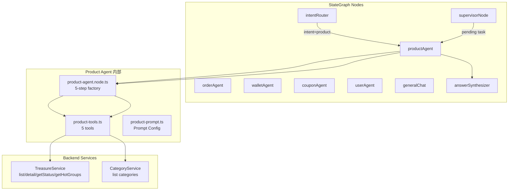
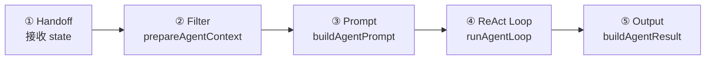
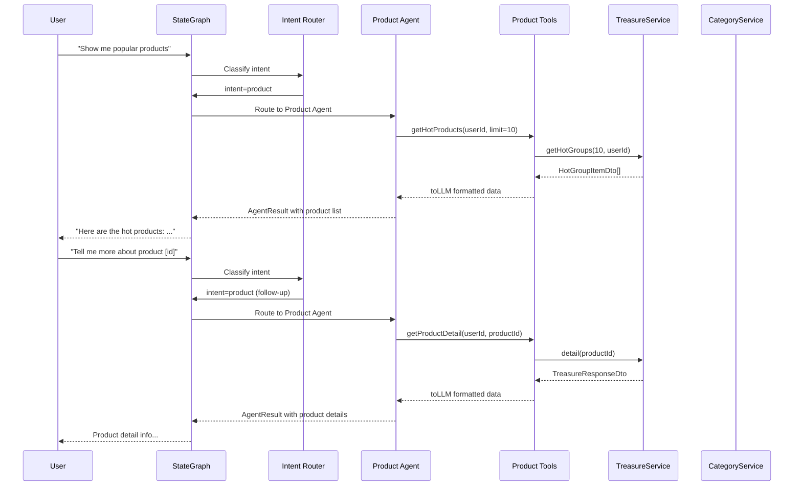

# 09. Product Agent + Tools（商品浏览/搜索助手）

## 🎯 本步骤目标

为用户提供一个 AI 客服助手，能够通过自然语言：
- 搜索和浏览商品（按关键词、分类、销售状态筛选）
- 查看商品详情（价格、库存、描述、图片）
- 查看商品实时状态（库存余量、是否过期）
- 获取热门/推荐商品
- 浏览商品分类

> 注意：本 Agent 是**信息查询型（read-only）**，不涉及购买流程。购买操作由 Order Agent 处理。

---

### 承上：上一步做了什么？

上一步实现了 **Coupon Agent**（优惠券助手），提供了 4 个工具（`getUserCoupons`, `getClaimableCoupons`, `claimCoupon`, `redeemCouponCode`），遵循了 `runAgentLoop` + `buildAgentResult` 的工厂模式。

### 启下：下一步做什么？

完成本 Agent 后，用户可以通过自然语言查询商品。下一步可以实现 **Lucky Draw Agent**（抽奖助手）。

### 架构中的位置



---

## 🔧 前提条件

### TreasureService 方法速查

| 方法 | 参数 | 返回 |
|------|------|------|
| `list(query)` | `TreasureQueryDto`: page, pageSize, q, categoryId, state, filterType | `{ list: TreasureResponseDto[], total, page, pageSize }` |
| `detail(id)` | `treasureId: string` | `TreasureResponseDto \| null` |
| `getStatus(id)` | `treasureId: string` | `{ id, stock, price, isSoldOut, state, isExpired, ... }` |
| `getHotGroups(limit, userId?)` | `limit: number`, `userId?: string` | `HotGroupItemDto[]` |

### CategoryService 方法速查

| 方法 | 参数 | 返回 |
|------|------|------|
| `list(query)` | `CategoryQueryDto`: state?, withCounts? | `{ id, name, state, sortOrder, count? }[]` |

### Prisma 模型

**Treasure**（`treasures` 表）核心字段：

| 字段 | 类型 | 说明 |
|------|------|------|
| `treasureId` | `String` (PK) | 商品 ID |
| `treasureName` | `String` | 商品名称 |
| `productName` | `String?` | 实物产品名称 |
| `treasureCoverImg` | `String?` | 封面图 URL |
| `mainImageList` | `Json?` | 主图列表 |
| `unitAmount` | `Decimal` | 拼团价/每份金额 |
| `marketAmount` | `Decimal?` | 市场划线价 |
| `soloAmount` | `Decimal?` | 单买价 |
| `costAmount` | `Decimal?` | 成本价 |
| `seqShelvesQuantity` | `Int?` | 总库存 |
| `seqBuyQuantity` | `Int` | 已购买数量 |
| `state` | `Int` | 0=下架 1=上架 |
| `salesStartAt` | `DateTime?` | 开售时间 |
| `salesEndAt` | `DateTime?` | 截止时间 |
| `shippingType` | `Int` | 1=实物 2=无需物流 |
| `groupSize` | `Int` | 成团人数 |
| `lotteryMode` | `Int?` | 1=售罄模式 2=定时模式 |
| `lotteryTime` | `DateTime?` | 开奖时间 |
| `hotScore3d` | `Float` | 3日热度分 |
| `hotScore7d` | `Float` | 7日热度分 |
| `fakeSalesCount` | `Int` | 虚拟销量基数 |
| `desc` | `String?` | 产品描述 HTML |
| `ruleContent` | `String?` | 规则说明 HTML |
| `categories` | `TreasureCategory[]` | 多对多分类 |

**ProductCategory**（`product_categories` 表）：

| 字段 | 类型 | 说明 |
|------|------|------|
| `id` | `Int` (PK) | 分类 ID |
| `name` | `String` | 分类名称 |
| `nameEn` | `String?` | 英文名 |
| `icon` | `String?` | 图标 URL |
| `sortOrder` | `Int` | 排序值 |
| `state` | `Int` | 0=禁用 1=启用 |

---

## Step 1: 创建 Product Tools 工厂函数

**文件:** `apps/api/src/client/ai-customer/graph/tools/product-tools.ts`

### 工具清单

共 5 个工具，均为 `read-only`：

#### ① `searchProducts` — 搜索/浏览商品列表

```
参数:
  - userId: string (当前用户 ID)
  - q?: string (关键词搜索)
  - categoryId?: number (分类筛选)
  - filterType?: 'ALL' | 'ON_SALE' | 'PRE_SALE' (销售状态)
  - page?: number (页码，默认 1)
  - pageSize?: number (每页数量，默认 10)
  
返回: 商品列表（含分页信息）
```

#### ② `getProductDetail` — 商品详情

```
参数:
  - userId: string
  - productId: string (商品 ID)
  
返回: 完整商品信息（含描述、图片、分类等）
```

#### ③ `getProductStatus` — 商品实时状态

```
参数:
  - userId: string
  - productId: string
  
返回: 实时库存、价格、上下架状态、是否过期
```

#### ④ `getHotProducts` — 热门商品列表

```
参数:
  - userId: string
  - limit?: number (返回数量，默认 10，最大 20)
  
返回: 热门拼团商品列表
```

#### ⑤ `getProductCategories` — 商品分类列表

```
参数:
  - userId: string
  
返回: 所有启用的商品分类
```

### 工厂函数签名

```typescript
export const createProductTools = (
  treasureService: ITreasureService,
  categoryService: CategoryService,
): TaggedTool[] => { ... }
```

**ITreasureService 接口**（新增，在 `treasure.service.ts` 中定义）：

```typescript
export interface ITreasureService {
  list(query: TreasureQueryDto): Promise<{ list: any[]; total: number; page: number; pageSize: number }>;
  detail(id: string): Promise<any>;
  getStatus(id: string): Promise<any>;
  getHotGroups(limit: number, userId?: string): Promise<any[]>;
}
```

### 数据语义化

使用 `toLLM(dto, DtoClass, 'en')` 将返回数据转换为 LLM 友好的语义格式：

- `TreasureResponseDto` → `toLLM(item, TreasureResponseDto, 'en')`（列表 & 详情）
- `TreasureStatusDto` → `toLLM(status, TreasureStatusDto, 'en')`（状态）
- `HotGroupItemDto` → `toLLM(item, HotGroupItemDto, 'en')`（热门商品）
- Category 数据直接序列化（无 DTO 装饰器，手动格式化）

### 错误处理

- 所有工具使用 `try/catch` + `toolSuccess`/`toolFailure` 模式
- `getProductDetail`: 商品不存在时返回友好的 "Product not found" 消息
- `getProductStatus`: 商品不存在时类似处理

---

## Step 2: 创建 Product Agent Node

**文件:** `apps/api/src/client/ai-customer/graph/nodes/product-agent.node.ts`

遵循标准的 5 步工厂模式：



### 实现要点

```typescript
export const productAgentNode = async (state) => state; // 占位节点

export const createProductAgentNode = (
  llmConfig: LlmProviderConfig,
  registry: ToolRegistryService,
) => {
  const logger = new Logger('ProductAgent');
  return async (state: typeof AgentState.State): Promise<AgentNodeOutput> => {
    // ① 获取工具
    const tools = registry.getToolsByTag('product');
    const llmWithTools = createAgentLLM(llmConfig, tools);
    
    // ② 上下文过滤
    const agentContext = prepareAgentContext(state.messages, state.pendingTasks, state.messageTopics, 'productAgent')
      .slice(-MAX_CONTEXT_MESSAGES);
    
    // ③ Prompt 构造
    const systemPrompt = buildAgentPrompt({ ...productPromptConfig, userId: state.userId });
    const initialMessages = buildInitialMessages(systemPrompt, agentContext);
    
    // ④ ReAct 循环 (最多 3 轮)
    const result = await runAgentLoop({ llmWithTools, initialMessages, tools, agentName: 'productAgent', logger });
    
    // ⑤ 结果输出
    return buildAgentResult('productAgent').from(result, state.messages);
  };
};
```

---

## Step 3: 创建 Product Agent 的 Prompt 配置

**文件:** `apps/api/src/client/ai-customer/graph/agents/prompts/product-prompt.ts`

### 配置结构

```typescript
export const productPromptConfig: Omit<AgentPromptConfig, 'userId'> = {
  role: 'You are the product search and browsing assistant for JoyMini platform. Respond in English.',
  domainName: 'product',
  workflow: `Step 1: Understand what the user needs
- Search/browse products → searchProducts
- View product details → getProductDetail
- Check product status (stock/price) → getProductStatus
- View hot/trending products → getHotProducts
- Browse product categories → getProductCategories

Step 2: Pick the right tool from the list above

Step 3: Call the tool to get real data (must pass userId parameter)

Step 4: Present the tool result to the user in a clear format

Step 5: Respond in English`,
  
  domainRules: `## Product Data Fields
When the user says things like "cheap", "expensive", "hot", "trending", "recent", refer to these product fields:

### Product Fields (from searchProducts/getProductDetail)
- unitAmount: Group buying price per share
- marketAmount: Market price (used to show discount)
- soloAmount: Solo purchase price
- seqShelvesQuantity: Total stock
- seqBuyQuantity: Quantity already sold
- buyQuantityRate: Purchase progress percentage (0-100)
- salesStartAt: Sale start time
- salesEndAt: Sale end time
- state: 0=offline, 1=online
- categories: Array of { id, name } the product belongs to

### Status Fields (from getProductStatus)
- stock: Remaining stock
- price: Current price
- isSoldOut: Whether sold out
- isExpired: Whether sales period has ended
- state: 1=online, 0=offline

### Hot Product Fields (from getHotProducts)
- unitAmount: Group buying price
- marketAmount: Market price
- buyQuantityRate: How fast it's selling
- stockLeft: Remaining stock
- joinCount: Number of buyers

### Category Fields (from getProductCategories)
- id: Category ID
- name: Category name

### How to interpret user requests using the actual data:
- "cheap" or "affordable" → filter/sort by lower unitAmount
- "popular" or "hot" → look for high buyQuantityRate or hot products
- "new" or "recent" → sort by salesStartAt or use filterType=ON_SALE
- "pre-sale" or "upcoming" → use filterType=PRE_SALE
- "category X" → use categoryId parameter with the matching category
- "detail" or "more info" → call getProductDetail for a specific product
- "stock" or "available" → call getProductStatus to check remaining stock
- Use the ACTUAL data from tool results — do NOT make up product names, prices, or stock levels`,
  
  examples: `User: "Show me popular products"
→ You call getHotProducts(userId="[userId]")
→ After getting the result, present the ACTUAL data. Do NOT make up product info.
→ Reply with the real data, for example:
"Here are the hot products:
1. [name from result] — [price from result], [progress from result]% sold, [stock from result] left
2. [name from result] — [price from result], [progress from result]% sold, [stock from result] left"

User: "Search for iPhone"
→ You call searchProducts(userId="[userId]", q="iPhone")
→ Present the actual results. If no results, say so honestly.

User: "Tell me more about product [id]"
→ You call getProductDetail(userId="[userId]", productId="[id]")
→ Present the detailed information from the result`,

  displayFormat: `- For product lists: Show name, price, discount, stock progress, and category
- For product details: Show name, price(s), description, images, stock, and categories
- For status: Show remaining stock, price, and whether it's still available
- For categories: Show category name and ID`,
  
  scopeRestriction: {
    domain: 'product',
    handles: [
      'product search',
      'product details',
      'product status',
      'hot products',
      'product categories',
      'browse products',
    ],
    outside: ['wallet', 'orders', 'coupon', 'user-profile', 'lucky-draw'],
  },
  
  hardRules: [
    '- **If a tool call fails (returns an error/failure), DO NOT retry the same call with the same parameters.** Tell the user why it failed and suggest alternatives.',
    '- If the product is not found or out of stock, tell the user honestly. Do NOT make up product data.',
    '- This is a read-only assistant. You CANNOT process purchases, place orders, or handle payments.',
  ],
};
```

---

## Step 4: 注册流程

### 4.1 TreasureService 接口 + 导出

**文件:** `apps/api/src/client/treasure/treasure.service.ts`

添加 `ITreasureService` 接口（与 `IOrderService` 模式一致）：

```typescript
export interface ITreasureService {
  list(query: TreasureQueryDto): Promise<{ list: any[]; total: number; page: number; pageSize: number }>;
  detail(id: string): Promise<any>;
  getStatus(id: string): Promise<any>;
  getHotGroups(limit: number, userId?: string): Promise<any[]>;
}
```

将 `TreasureService` 改为 `implements ITreasureService`。

**文件:** `apps/api/src/client/treasure/treasure.module.ts`

添加 `exports: [TreasureService]` 使其可注入到其他模块。

### 4.2 CategoryService 导出

**文件:** `apps/api/src/client/category/category.module.ts`

添加 `exports: [CategoryService]` 使其可注入。

### 4.3 工具注册 — TreasureModule / CategoryModule

由于 `TreasureModule` 和 `CategoryModule` 已经默认没有被 AI Customer 模块 imports（仅引用其服务），产品工具的注册需要：

**方案 A（推荐）**：在 `TreasureModule` 中添加 `OnApplicationBootstrap` hook 注册 product 工具（与 `AddressModule` 模式一致）

或者

**方案 B**：在 `AiCustomerModule` 中直接创建工具并注册。

采用方案 A，将工具注册放在各自的服务模块中，保持与现有模式一致。但由于 `TreasureService` 和 `CategoryService` 分布在两个模块中，需要：

**实际方案**：在 `AiCustomerModule` 中注入两个服务并创建 `product-tools.ts` 工厂，通过 `onApplicationBootstrap` 注册。

或者更简洁：创建一个 `ProductToolModule` 或直接在 `AiCustomerModule` 中处理。

最佳实践：参考 `coupon-tools.ts` 在 `CouponModule` 中注册的模式，产品工具也应在一个模块中注册。

但观察 `AddressModule`：
```typescript
// address.module.ts
onApplicationBootstrap() {
  this.toolRegistry.registerMany(createAddressTools(this.addressService));
}
```

同理，对于 Product Agent，可以在 `TreasureModule` 中导入 `CategoryService` 并注册所有 product 工具：

实际上更干净的方案是：在 `AiCustomerModule.onApplicationBootstrap()` 中直接注册 product 工具（因为已经 import 了 `TreasureModule`），但当前 `TreasureModule` 没有导出服务。

**推荐方案**：修改 `TreasureModule` 导出 `TreasureService`，然后在 `AiCustomerModule` 中注入 `TreasureService` + `CategoryService` → 创建 `createProductTools` → 注册。

但更符合现有模式的做法是遵循 `AddressModule` 的方式，单独处理。

实际最简单的做法：

1. `TreasureModule` 添加 `exports: [TreasureService]`
2. `CategoryModule` 添加 `exports: [CategoryService]`
3. `AiCustomerModule` 注入 `TreasureService` + `CategoryService`
4. 在 `AiCustomerModule.onApplicationBootstrap()` 中注册 product 工具

```typescript
// ai-customer.module.ts
constructor(
  private readonly toolRegistry: ToolRegistryService,
  private readonly treasureService: TreasureService,
  private readonly categoryService: CategoryService,
) {}

onApplicationBootstrap() {
  this.toolRegistry.registerMany(createProductTools(this.treasureService, this.categoryService));
  this.toolRegistry.registerMany(createFlowTools());
  this.toolRegistry.validateRegistration(EXPECTED_AGENT_TAGS, { ... });
}
```

### 4.4 添加 Agent Tag

**文件:** `apps/api/src/client/ai-customer/ai-customer.module.ts`

```typescript
const EXPECTED_AGENT_TAGS = ['order', 'wallet', 'coupon', 'flow', 'user', 'product'];
```

### 4.5 AI Customer Module 添加必需的 imports

```typescript
@Module({
  imports: [
    // ... existing imports
    CategoryModule, // 新增
  ],
})
```

注意：`TreasureModule` 已经在 imports 中。

---

## Step 5: 集成到 StateGraph

### 5.1 注册节点

**文件:** `apps/api/src/client/ai-customer/graph/customer.graph.ts`

```typescript
import { createProductAgentNode } from '@api/client/ai-customer/graph/nodes/product-agent.node';

// 在 buildCustomerGraph 中添加节点：
.addNode('productAgent', createProductAgentNode(llmConfig, registry))
```

### 5.2 更新路由映射

**intentGateway** — 添加 `productAgent`：
```typescript
.addConditionalEdges(START, intentGateway, {
  // ... existing
  productAgent: 'productAgent',
})
```

**intentRouter → productAgent** — 将 fallback 改为实际路由：
```typescript
.addConditionalEdges('intentRouter', routerByIntent, {
  // ... existing
  productAgent: 'productAgent',  // 改为实际路由（原来是 'generalChat' fallback）
  luckyAgent: 'generalChat',     // 仍为 fallback
})
```

**productAgent → agentDoneRouter**：
```typescript
.addConditionalEdges('productAgent', agentDoneRouter, {
  supervisorNode: 'supervisorNode',
  answerSynthesizer: 'answerSynthesizer',
})
```

**supervisorRouter → productAgent**（多领域协作时）：
```typescript
.addConditionalEdges('supervisorNode', supervisorRouter, {
  // ... existing
  productAgent: 'productAgent',
})
```

---

## Step 6: 更新校验器

**文件:** `apps/api/src/client/ai-customer/graph/agents/agent-validator.spec.ts`

```typescript
const agentFiles: AgentFile[] = [
  // ... existing
  { path: 'product-agent.node.ts', name: 'productAgent', tag: 'product' },
];
```

---

## Step 7: 完整的数据流



---

## Step 8: 依赖关系更新

### 需要修改的文件清单

| # | 文件 | 修改内容 |
|---|------|----------|
| 1 | `apps/api/src/client/treasure/treasure.service.ts` | 添加 `ITreasureService` 接口 |
| 2 | `apps/api/src/client/treasure/treasure.module.ts` | 添加 `exports: [TreasureService]` |
| 3 | `apps/api/src/client/category/category.module.ts` | 添加 `exports: [CategoryService]` |
| 4 | `apps/api/src/client/ai-customer/ai-customer.module.ts` | 添加 `CategoryModule` import, `TreasureService` + `CategoryService` 注入, product tag 注册 |
| 5 | `apps/api/src/client/ai-customer/graph/customer.graph.ts` | 注册 `productAgent` 节点, 更新路由 |
| 6 | `apps/api/src/client/ai-customer/graph/agents/agent-validator.spec.ts` | 添加 `productAgent` 到 agentFiles |
| 7 | `apps/api/src/client/ai-customer/graph/nodes/product-agent.node.ts` | **新建** — Agent 节点 |
| 8 | `apps/api/src/client/ai-customer/graph/tools/product-tools.ts` | **新建** — 工具工厂 |
| 9 | `apps/api/src/client/ai-customer/graph/agents/prompts/product-prompt.ts` | **新建** — Prompt 配置 |

### 不变的文件

- `intent-router.node.ts` — 已有 `product → productAgent` 映射（line 95）
- `flow-tools.ts` — 无需修改
- `tool-registry.service.ts` — 无需修改
- `state.ts` — 无需修改

---

## 🔜 下一步预告

完成 Product Agent 后，可以：
1. **Lucky Draw Agent** — 抽奖记录查询、中奖结果查看
2. **RAG 增强** — 接入 PDF 商品手册问答
3. **PostgreSQL Checkpointer** — 生产级状态持久化
4. **Agent 上下文共享** — 跨 Agent 传递会话信息（如："把商品 XX 加入购物车"）
