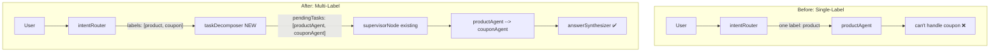
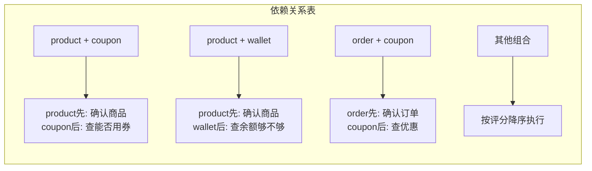

# 10. Multi-Label Intent Classification + Task Decomposition Orchestration

## 🎯 本步骤目标

将 Intent Router 从 **单标签分类**（输出一个意图）升级为 **多标签分类 + 评分**（输出多个意图 + 置信度），并通过新增 Task Decomposer 节点自动拆解为多 Agent 执行计划。

### 承上：上一步做了什么？

[Doc 09](09-ProductAgent与Tools.md) 实现了 Product Agent（商品搜索/浏览），包括 5 个只读工具、Agent Prompt、Agent Node，并注册到 AiCustomerModule 和 CustomerGraph。

### 启下：下一步做什么？

完成本升级后，系统可以自动处理**跨域问题**（如"用优惠券买这个"→ 同时路由到 productAgent + couponAgent），为未来更多 Agent 的协作打下基础。

### 架构中的位置



---

## 🔧 问题回顾

### Bug 复现

```
User Turn 1: "find cheap products"
             → intentRouter: "product"
             → productAgent ✅ 正常返回商品列表

User Turn 2: "can i use coupon to buy this one"
             → intentRouter: "product" ← 误判!
             → productAgent 跑了3轮，查了商品信息
             → 发现问的是优惠券 → "I'm sorry... outside of product search"
```

### 根因

1. **Previous Intent 规则优先级过高**——LLM 看到上一轮是 `product`，认为"buy this one"是继续上一轮，直接输出 `product`
2. **多域检测只在特定例子匹配时触发**——"用优惠券买这个"不是"查余额和订单"的并列结构，不在 multi-domain examples 中
3. **INTENT_PROMPT 无法灵活表达"多个可能"**——只能选一个，不能输出多个标签

---

## 🏗️ 设计：Multi-Label Intent Classification

### 核心思路

让 INTENT_PROMPT 的 LLM 输出多个标签（含置信度分数），而不是只选一个。新增 TaskDecomposer 节点将标签数组转换成 Supervisor 可执行的 pendingTasks。

### 输出格式变化

| 场景 | 当前格式 | 新格式 |
|------|---------|--------|
| 单意图 | `"order"`（一个单词） | `{"intent":"order","labels":[{"name":"order","score":0.95}]}` |
| 多意图 | `{"intent":"supervised","tasks":[{"agent":"...","description":"..."}]}` | `{"intent":"multi","labels":[{"name":"product","score":0.85},{"name":"coupon","score":0.92}]}` |

### 新 INTENT_PROMPT 结构变化

```diff
- ## Output Format
- ### For single-domain requests (one topic only):
- Output ONLY the category name (one word), nothing else.
- ### For multi-domain requests (multiple topics in one sentence):
- Output a JSON object with intent and tasks array

+ ## Output Format
+ Output a JSON object with the following structure:
+ 
+ ### Single-domain: output exactly one label
+ {"intent":"order","labels":[{"name":"order","score":0.95}]}
+ 
+ ### Multi-domain: output multiple labels with scores
+ {"intent":"multi","labels":[
+   {"name":"product","score":0.85,"reason":"user mentions 'buy this one'"},
+   {"name":"coupon","score":0.92,"reason":"user mentions 'use coupon'"}
+ ]}
+ 
+ Rules:
+ 1. For single-domain: intent = the label name, labels array has ONE entry
+ 2. For multi-domain: intent = "multi", labels array has MULTIPLE entries
+ 3. Score 0.0-1.0, higher = more confident
+ 4. Include "reason" for multi-domain entries to help TaskDecomposer
```

```diff
- ## CRITICAL: Multi-domain detection (HIGHEST PRIORITY)
- If the user mentions topics from MULTIPLE independent domains...
+ ## IMPORTANT: Priority Order
+ 1. Multi-domain detection (HIGHEST) - Check FIRST if user mentions multiple domains
+ 2. Single intent classification - Only if clearly one domain
+ 3. Previous Intent (LOWEST) - Only use when current input is vague/ambiguous
```

---

## 🧩 新增组件：Task Decomposer

### 职责

接收 `intentLabels[]` → 按分数排序 + 解析依赖关系 → 生成 `pendingTasks[]`

### 文件

`apps/api/src/client/ai-customer/graph/nodes/task-decomposer.node.ts`

### 逻辑

```typescript
export const createTaskDecomposerNode =
  () =>
  async (
    state: typeof AgentState.State,
  ): Promise<Partial<typeof AgentState.State>> => {
    const labels = state.intentLabels ?? [];

    // Step 1: Filter low-confidence labels (score < 0.5)
    const validLabels = labels.filter((l) => l.score >= 0.5);

    // Step 2: Sort by score descending
    validLabels.sort((a, b) => b.score - a.score);

    // Step 3: Resolve dependencies
    // If "product" is needed as context for "coupon", reorder
    const tasks = resolveDependencies(validLabels);

    // Step 4: Convert labels to pendingTasks format
    const pendingTasks = tasks.map((label) => ({
      agent: labelToAgentMap[label.name],  // product → productAgent
      description: label.reason ?? `Process ${label.name} request`,
    }));

    return {
      intent: 'supervised',
      pendingTasks,
      supervisorRound: 0,
      taskResults: {},
      agentSteps: [],
    };
  };
```

### 依赖解析规则



硬编码依赖规则：

| 前置标签 | 后置标签 | 原因 |
|---------|---------|------|
| `product` | `coupon` | 需要先知道是什么商品，才能查能否用券 |
| `product` | `wallet` | 需要先知道商品价格，才能查余额够不够 |
| `order` | `coupon` | 需要先知道订单内容，才能查优惠适用性 |
| `order` | `wallet` | 需要先知道订单金额，才能查退款到账 |

---

## 🔄 数据流变化

### 完整流程图

```mermaid
flowchart TB
    START --> intentGateway
    intentGateway --> intentRouter

    intentRouter -->|"intent='multi'"| taskDecomposer
    intentRouter -->|"intent='supervised'"| supervisorNode
    intentRouter -->|"single intent"| agentNode
    
    taskDecomposer --> supervisorNode
    
    supervisorNode --> supervisorRouter
    supervisorRouter -->|pendingTasks[0]| productAgent
    supervisorRouter -->|pendingTasks[1]| couponAgent
    supervisorRouter -->|"all done"| answerSynthesizer
    
    productAgent --> agentDoneRouter
    couponAgent --> agentDoneRouter
    
    agentDoneRouter -->|"more tasks"| supervisorNode
    agentDoneRouter -->|"all done"| answerSynthesizer
    
    answerSynthesizer --> END

    style taskDecomposer fill:#4a4,color:#fff
    style intentRouter fill:#66a,color:#fff
```

### 状态变化

| 阶段 | intent | pendingTasks | intentLabels |
|------|--------|-------------|--------------|
| 用户输入 | `""` | `[]` | `undefined` |
| intentRouter 输出 multi | `"multi"` | `[]` | `[{name:"product",score:0.85},{name:"coupon",score:0.92}]` |
| taskDecomposer 输出 | `"supervised"` | `[{agent:"productAgent",...},{agent:"couponAgent",...}]` | `undefined`（已消费） |
| supervisor 执行中 | `"supervised"` | `[{agent:"productAgent",...},{agent:"couponAgent",...}]` | — |
| 全部完成 | `"supervised"` | `[]`（agentDoneRouter 消费） | — |

---

## 📁 受影响文件

### 修改的文件

| 文件 | 改动内容 | 改动量 |
|------|---------|--------|
| [`intent-router.node.ts`](apps/api/src/client/ai-customer/graph/nodes/intent-router.node.ts) | INTENT_PROMPT 输出格式改为 JSON + 解析逻辑适配 | ~40 行 |
| [`state.ts`](apps/api/src/client/ai-customer/graph/state.ts) | 新增 `intentLabels` 字段（被消费后清空） | ~10 行 |
| [`customer.graph.ts`](apps/api/src/client/ai-customer/graph/customer.graph.ts) | 注册 taskDecomposer 节点 + intentRouter→taskDecomposer 边 | ~15 行 |

### 新增的文件

| 文件 | 内容 | 行数 |
|------|------|------|
| `task-decomposer.node.ts` | TaskDecomposer 节点工厂函数 | ~60 行 |

### 不动的文件（完全向后兼容）

| 文件 | 原因 |
|------|------|
| [`supervisor.node.ts`](apps/api/src/client/ai-customer/graph/nodes/supervisor.node.ts) | 只做 round++，无变化 |
| 所有 Agent Node（order/wallet/coupon/user/product） | 不感知路由变化 |
| [`agent-validator.spec.ts`](apps/api/src/client/ai-customer/graph/agents/agent-validator.spec.ts) | 加新测试 case |
| 所有 Tool 文件 | 不变化 |

---

## 📋 实现步骤

### Phase 1: State 扩展

1. 在 [`state.ts`](apps/api/src/client/ai-customer/graph/state.ts) 新增 `intentLabels` 字段
   - 类型：`Array<{name: string, score: number, reason?: string}>`
   - Reducer：覆盖（同 intent）
   - Default：`[]`

### Phase 2: INTENT_PROMPT 升级

2. 修改 [`intent-router.node.ts`](apps/api/src/client/ai-customer/graph/nodes/intent-router.node.ts:58) 的 INTENT_PROMPT
   - 输出格式改为 JSON（永远输出 JSON，不再输出纯文本单词）
   - 多域检测优先级提升到最高
   - Previous Intent 降为最低优先级
   - 增加依赖关系类型的多域例子

3. 修改 intentRouter 的解析逻辑（第 271-304 行）
   - 新增对 `intent: "multi"` JSON 的解析
   - 将 labels 写入 `state.intentLabels`
   - `intent` 字段设为 `"multi"`
   - 保留对旧格式 `"supervised"` 的向后兼容

### Phase 3: Task Decomposer

4. 新建 `task-decomposer.node.ts`
   - 按分数过滤（threshold: 0.5）
   - 按分数排序
   - 依赖解析
   - 转换为 pendingTasks 格式

### Phase 4: Graph 注册

5. 修改 [`customer.graph.ts`](apps/api/src/client/ai-customer/graph/customer.graph.ts)
   - 导入 `createTaskDecomposerNode`
   - 注册 `.addNode('taskDecomposer', ...)`
   - 添加条件边：`intentRouter → taskDecomposer`（当 intent="multi"）
   - 添加边：`taskDecomposer → supervisorNode`
   - 更新 `routerByIntent` 加入 `multi: 'taskDecomposer'`

### Phase 5: Agent Validator 测试

6. 更新 [`agent-validator.spec.ts`](apps/api/src/client/ai-customer/graph/agents/agent-validator.spec.ts)
   - 测试 TaskDecomposer 节点的存在
   - 测试 INTENT_PROMPT 新输出格式的兼容性

### Phase 6: 集成验证

7. 跑 type-check + test
8. 用 testChat API 验证 `"can i use coupon to buy this one"` → 走 supervisor 路径，依次执行 productAgent + couponAgent
9. 验证旧功能不受影响：`"check my balance"` → wallet，`"view my addresses"` → user

---

## 📊 前后对比

### 场景: "can i use coupon to buy this one"

| 步骤 | 当前行为 | 升级后行为 |
|------|---------|-----------|
| Intent Router | `product`（误判） | `multi` + labels: [product:0.85, coupon:0.92] |
| Task Decomposer | N/A | pendingTasks: [productAgent, couponAgent] |
| Supervisor | N/A | 先后派发 productAgent → couponAgent |
| productAgent | 查商品，发现不能处理优惠券 | 正常查商品信息 |
| couponAgent | never reached | 查优惠券 + 该商品能否用券 |
| Answer | "I'm sorry..." | "商品¥250，满200减30券可用，实付¥220" |

### 场景: "check my balance"（单域，不影响）

| 步骤 | 当前行为 | 升级后行为 |
|------|---------|-----------|
| Intent Router | `"wallet"` | `{"intent":"wallet","labels":[{"name":"wallet","score":0.97}]}` |
| routerByIntent | walletAgent | walletAgent（取 intent 字段） |
| 结果 | 正常查余额 | ✅ 完全一致 |

---

## 🔒 向后兼容性

| 旧格式 | 是否仍支持 | 说明 |
|--------|-----------|------|
| 纯文本单词 `"order"` | ❌ 不再支持 | INTENT_PROMPT 改为始终输出 JSON |
| JSON `{"intent":"supervised","tasks":[...]}` | ✅ 保留 | 解析逻辑不会删除，作为 fallback |
| 单域 JSON `{"intent":"order","labels":[{"name":"order","score":0.95}]}` | ✅ 新格式 | 与旧单域行为一致 |

---

## 🧪 测试策略

### 单元测试

1. **INTENT_PROMPT 输出格式测试**（agent-validator 已有框架）
   - 单域输入 → 输出 JSON 包含 `intent` + `labels[0]`
   - 多域输入 → 输出 JSON 包含 `intent: "multi"` + 多个 `labels`
   - 模糊输入 → 输出评分合理的 labels

2. **TaskDecomposer 逻辑测试**
   - 输入 `[product:0.85, coupon:0.92]` → 输出 `[productAgent, couponAgent]`
   - 输入 `[product:0.85]` → 输出 `[productAgent]`
   - 输入 `[general:0.3]`（低于阈值）→ 输出 `[]`（空 pendingTasks）
   - 依赖解析：product + coupon → product 先执行
   - 依赖解析：coupon + wallet（无直接依赖）→ 按评分排序

### 集成测试

3. **Graph 流程测试**
   - intentRouter → multi → taskDecomposer → supervisorNode → agent → agentDoneRouter
   - intentRouter → supervised → supervisorNode（旧格式，向后兼容）
   - intentRouter → order → orderAgent（单域，不受影响）

### 端到端测试

4. **testChat API 验证**
   - `"can i use coupon to buy this one"` → debug.agentSteps 应在 supervisor 路径下
   - `"check my balance"` → 直走 walletAgent，不受影响
   - `"find cheap products"` → 直走 productAgent，不受影响
