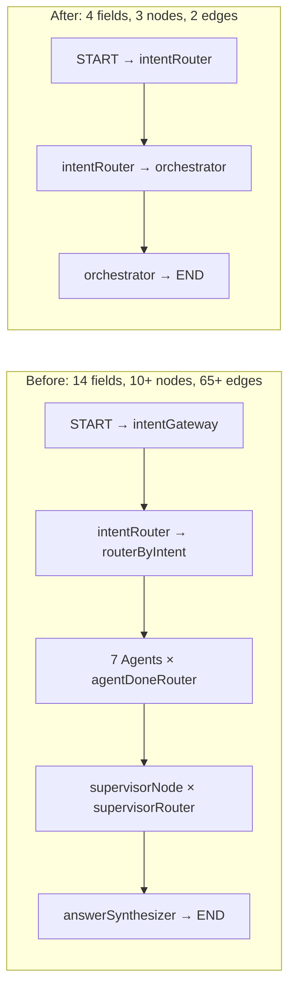
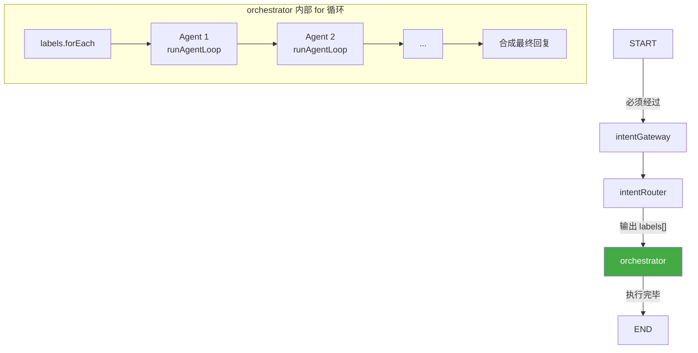

# 10. Pipeline Orchestrator — 多标签路由 + 流水线执行

> **文档状态**: 已更新为 Pipeline/Orchestrator 简化方案（2026-07-04）
> 
> **之前版本**: 记录了旧版 Multi-Label + TaskDecomposer + Supervisor 方案，经讨论后简化为当前方案

## 🎯 本步骤目标

将目前的 **Supervisor + 3 个 Router + 338 行 prepareContext + 65+ 行 Graph 边** 的复杂架构，简化为 **Pipeline Orchestrator**（一个 for 循环驱动多 Agent 执行）。同时将 Intent Router 从单标签分类升级为**多标签分类 + 评分**。

### 承上：上一步做了什么？

[Doc 09](09-ProductAgent与Tools.md) 实现了 Product Agent（商品搜索/浏览），完成 7 个 Agent 的完整注册。

### 启下：下一步做什么？

完成本升级后，系统架构从 **14 个状态字段、10+ 个节点、65+ 行边** 简化为 **4 个状态字段、3 个节点、2 条条件边**，同时解决跨域路由 Bug。

---

## ❓ 为什么要做这次重构？

### 当前架构的问题

| 问题 | 表现 | 根因 |
|------|------|------|
| **状态字段过多** | 14 个字段，新人理解成本高 | 过度设计 |
| **Router 爆炸** | intentGateway + routerByIntent + agentDoneRouter + supervisorRouter 共 4 个路由函数 | 每个节点都要配条件边 |
| **边爆炸** | 65+ 行 `.addConditionalEdges()`，改一个 Agent 要改 4 个地方 | LangGraph 的条件边机制要求显式声明所有可能目标 |
| **消息过滤复杂** | `prepareAgentContext.ts` 338 行，7 个边界条件 | 试图在 Graph 层做消息隔离 |
| **messageTopics Bug** | `'multi'` 标签不匹配任何 `agentToTopic`，消息被误过滤 | prepareContext 的过滤逻辑有遗漏 |
| **维护成本高** | "过两天基本看不懂" | 复杂性在 Graph 层，而非 LLM 层 |
| **扩展难** | 加一个新 Agent 要改 5+ 个文件 | 所有路由函数都要更新路由表 |

### 核心思路

> **把复杂性从 Graph 层移到 LLM 层。**
> 
> Graph 只做 3 件事：分类、执行、结束。
> Agent 的 Scope Restriction Prompt 自行处理"什么该做、什么不该做"。
> 不再在代码层过滤消息——LLM 知道忽略无关内容。

---

## 🏗️ 新架构设计

### 架构对比



### State 变化：14 字段 → 4 字段

| 字段 | 保留/删除 | 原因 |
|------|----------|------|
| `messages` | ✅ **保留** | 核心对话数据 |
| `intent` | ✅ **保留** | 当前意图（orchestrator 用） |
| `previousIntent` | ✅ **保留** | 会话上下文 |
| `userId` | ✅ **保留** | 工具调用必需 |
| `labels` | **🆕 新增** | `[{name, score, reason?}]` 多标签评分 |
| `pendingTasks` | ❌ 删除 | orchestrator 内部变量，不放在 state 中 |
| `taskResults` | ❌ 删除 | orchestrator 内部变量 |
| `supervisorRound` | ❌ 删除 | orchestrator for 循环自然结束 |
| `agentSteps` | ❌ 删除 | 不需要追踪步骤 |
| `sources` | ❌ 删除 | RAG 结果直接放在 messages 中 |
| `flowType` | ❌ 删除 | wallet Agent 自行管理 |
| `flowStatus` | ❌ 删除 | wallet Agent 自行管理 |
| `flowData` | ❌ 删除 | wallet Agent 自行管理 |
| `currentAgent` | ❌ 删除 | orchestrator 内部变量 |
| `messageTopics` | ❌ 删除 | Agent 的 Scope Restriction 自行过滤 |
| `debug` | ❌ 删除 | 不需要 |

### Graph 变化：10+ 节点 → 3 节点



### 被删除的文件

| 文件 | 行数 | 替换方案 |
|------|------|---------|
| [`prepare-context.ts`](apps/api/src/client/ai-customer/graph/utils/prepare-context.ts) | 338 行 | ❌ 删除。Agent 的 Scope Restriction 自行过滤 |
| [`supervisor.node.ts`](apps/api/src/client/ai-customer/graph/nodes/supervisor.node.ts) | 37 行 | ❌ 删除。Orchestrator for 循环替代 |
| [`customer.graph.ts`](apps/api/src/client/ai-customer/graph/customer.graph.ts) 中的 Router 函数 | ~50 行 | ❌ 删除。`agentDoneRouter` + `supervisorRouter` 不再需要 |
| [`state.ts`](apps/api/src/client/ai-customer/graph/state.ts) 中的 10 个字段 | ~200 行 | ❌ 删除 reducer 和文档注释 |
| [`flow-types.ts`](apps/api/src/client/ai-customer/graph/types/flow-types.ts) | 全部 | ❌ 删除或大幅简化 |
| [`flow-tools.ts`](apps/api/src/client/ai-customer/graph/tools/flow-tools.ts) | 全部 | ❌ 删除。wallet Agent 自行管理流程 |

---

## 🔧 Pipeline Orchestrator 详细设计

### 核心逻辑

```typescript
// orchestrator.node.ts — 流水线执行器
export const createOrchestratorNode =
  (llmConfig: LlmProviderConfig, registry: ToolRegistryService) =>
  async (
    state: typeof AgentState.State,
  ): Promise<Partial<typeof AgentState.State>> => {
    const labels = state.labels ?? [];
    const agentResults: string[] = [];

    // Step 1: 按评分排序
    const sorted = [...labels].sort((a, b) => b.score - a.score);

    // Step 2: 依赖解析 — product 必须在 coupon/wallet 之前
    const executionPlan = resolveExecutionOrder(sorted);

    // Step 3: 遍历执行
    for (const item of executionPlan) {
      const agentName = LABEL_TO_AGENT[item.name];
      if (!agentName) continue;

      const result = await runAgent(
        agentName,
        state.messages,
        state.userId,
        llmConfig,
        registry,
      );

      agentResults.push(result.content);
      // 将 Agent 的结果追加到 messages，供下一个 Agent 参考
      state.messages.push(
        new AIMessage({ content: `[${agentName} result]: ${result.content}` }),
      );
    }

    // Step 4: 合成最终回复
    const finalAnswer = agentResults.join('\n\n');
    state.messages.push(
      new AIMessage({ content: finalAnswer }),
    );

    return { messages: state.messages, intent: '', labels: [] };
  };
```

### 依赖解析规则

| 前置标签 | 后置标签 | 原因 |
|---------|---------|------|
| `product` | `coupon` | 需要先知道商品信息，才能查能否用券 |
| `product` | `wallet` | 需要先知道商品价格，才能查余额够不够 |
| `order` | `coupon` | 需要先知道订单内容，才能查优惠适用性 |
| `order` | `wallet` | 需要先知道订单金额，才能查退款到账 |

无依赖关系的标签按评分排序。

### Agent 调用方式

每个 Agent 在 orchestrator 中被调用的方式：

```typescript
async function runAgent(
  agentName: string,
  messages: BaseMessage[],
  userId: string,
  llmConfig: LlmProviderConfig,
  registry: ToolRegistryService,
): Promise<AgentLoopResult> {
  const tools = registry.getToolsByTag(agentName);
  const prompt = buildAgentPromptByConfig(agentName, {
    userId,
    scopeRestriction: config.scopeRestriction,
    // ... Agent 特定配置
  });

  const llmWithTools = createLLM(llmConfig).bindTools(tools);
  
  return runAgentLoop({
    llmWithTools,
    initialMessages: [new SystemMessage(prompt), ...messages],
    tools,
    agentName,
    logger: new Logger(agentName),
  });
}
```

> **关键设计决策**: Agent 看到的不是"过滤后的上下文"，而是**完整对话历史**。
> Agent 的 Scope Restriction Prompt 负责让 LLM 自行忽略无关内容。
> 例如 couponAgent 看到完整的对话，但 Prompt 告诉它"只处理优惠券相关部分"。

---

## 🔄 INTENT_PROMPT 升级

### 输出格式变化

| 场景 | 旧格式 | 新格式 |
|------|--------|-------|
| 单意图 | `"order"`（纯文本） | `{"intent":"order","labels":[{"name":"order","score":0.95}]}` |
| 多意图 | 不支持（Previous Intent 覆盖） | `{"intent":"multi","labels":[{"name":"product","score":0.85},{"name":"coupon","score":0.92}]}` |

### INTENT_PROMPT 变化

```diff
- ## CRITICAL: Previous Intent
- If the user's current input is a follow-up... KEEP the previous intent

- ## Output Format
- For single-domain: Output ONLY the category name (one word)
- For multi-domain: Output JSON with intent and tasks array

+ ## Output Format
+ ALWAYS output JSON with the following structure:
+ 
+ Single-domain:
+ {"intent":"order","labels":[{"name":"order","score":0.95}]}
+ 
+ Multi-domain:
+ {"intent":"multi","labels":[
+   {"name":"product","score":0.85},
+   {"name":"coupon","score":0.92}
+ ]}
+ 
+ ## Rules
+ 1. Score 0.0-1.0, higher = more confident. Only include scores >= 0.3.
+ 2. For multi-domain: set intent="multi", include ALL detected domains
+ 3. For single-domain: set intent=domain name, include ONE label
+ 4. Base classification on CURRENT message content, NOT previous intent.
+    Only use previous intent as context when current message is vague.
```

### Intent Router 解析逻辑变化

```diff
- // 方案 B：尝试解析 JSON（多领域检测）
- // LLM 输出可能有两种格式：
- // 1. JSON 2. Single word
- 
- const trimmed = raw.trim();
- if (trimmed.startsWith('{')) {
-   try {
-     const parsed = JSON.parse(trimmed);
-     ...
-   }
- }
- // 清理一下，转小写
- const singleWord = trimmed.toLowerCase();

+ // 新逻辑：LLM 始终输出 JSON
+ const trimmed = raw.trim();
+ let parsed: IntentOutput;
+ try {
+   parsed = JSON.parse(trimmed);
+ } catch {
+   // fallback: 当作纯文本单词
+   parsed = { intent: trimmed.toLowerCase(), labels: [] };
+ }
+ 
+ if (parsed.intent === 'multi' && parsed.labels?.length > 0) {
+   return {
+     intent: 'multi',
+     labels: parsed.labels,
+     // orchestrator 会处理所有后续逻辑
+   };
+ }
+ 
+ return {
+   intent: parsed.intent,
+   labels: parsed.labels ?? [{ name: parsed.intent, score: 1.0 }],
+ };
```

---

## 📁 受影响文件清单

### 删除的文件

| 文件 | 理由 |
|------|------|
| [`prepare-context.ts`](apps/api/src/client/ai-customer/graph/utils/prepare-context.ts) | Agent 不再需要上下文过滤 |
| [`supervisor.node.ts`](apps/api/src/client/ai-customer/graph/nodes/supervisor.node.ts) | 被 orchestrator 替代 |
| [`flow-types.ts`](apps/api/src/client/ai-customer/graph/types/flow-types.ts) | 不再需要 FlowType/FlowStatus 枚举 |
| [`flow-tools.ts`](apps/api/src/client/ai-customer/graph/tools/flow-tools.ts) | 不再需要 Flow 工具 |

### 修改的文件

| 文件 | 改动 |
|------|------|
| [`state.ts`](apps/api/src/client/ai-customer/graph/state.ts) | 从 14 字段精简为 4 字段 + `labels` 新字段 |
| [`intent-router.node.ts`](apps/api/src/client/ai-customer/graph/nodes/intent-router.node.ts) | INTENT_PROMPT 改 JSON 格式 + 解析逻辑适配 |
| [`customer.graph.ts`](apps/api/src/client/ai-customer/graph/customer.graph.ts) | 简化为 3 节点 + 2 条件边 |
| [`routerByIntent`](apps/api/src/client/ai-customer/graph/nodes/intent-router.node.ts:369) | 增加 `multi` → `orchestrator` 路由 |
| [`answer-synthesizer.node.ts`](apps/api/src/client/ai-customer/graph/nodes/answer-synthesizer.node.ts) | 简化（不再需要 taskResults 聚合） |

### 新增的文件

| 文件 | 内容 |
|------|------|
| [`orchestrator.node.ts`](apps/api/src/client/ai-customer/graph/nodes/orchestrator.node.ts) | Pipeline 执行器 ~100 行 |

### 不动的文件

| 文件 | 原因 |
|------|------|
| 所有 Agent Node（order/wallet/coupon/user/product） | 不感知路由变化 |
| 所有 Tool 文件 | 不变化 |
| [`prompt-builder.ts`](apps/api/src/client/ai-customer/graph/agents/prompt-builder.ts) | Scope Restriction 逻辑不变 |
| [`agent-runner.ts`](apps/api/src/client/ai-customer/graph/agents/agent-runner.ts) | ReAct 循环逻辑不变 |
| [`agent-result.ts`](apps/api/src/client/ai-customer/graph/agents/agent-result.ts) | 结果构建逻辑不变 |
| [`tool-registry.service.ts`](apps/api/src/client/ai-customer/graph/tools/tool-registry.service.ts) | 标签注册逻辑不变 |
| [`agent-validator.spec.ts`](apps/api/src/client/ai-customer/graph/agents/agent-validator.spec.ts) | 加新测试 case |

---

## 📋 实现步骤

### Phase 1: 新增 Orchestrator 节点

1. **新建** [`orchestrator.node.ts`](apps/api/src/client/ai-customer/graph/nodes/orchestrator.node.ts)
   - `createOrchestratorNode` 工厂函数
   - 接收 `llmConfig` + `registry`
   - 内部 for 循环：遍历 labels → resolveExecutionOrder → runAgent → collect results
   - 合成最终回复

### Phase 2: 精简 State

2. **修改** [`state.ts`](apps/api/src/client/ai-customer/graph/state.ts)
   - 保留：`messages`, `intent`, `previousIntent`, `userId`
   - 新增：`labels` — `Array<{name: string, score: number, reason?: string}>`
   - 删除：`pendingTasks`, `taskResults`, `supervisorRound`, `agentSteps`, `sources`, `flowType`, `flowStatus`, `flowData`, `currentAgent`, `messageTopics`, `debug`

### Phase 3: 升级 INTENT_PROMPT

3. **修改** [`intent-router.node.ts`](apps/api/src/client/ai-customer/graph/nodes/intent-router.node.ts)
   - INTENT_PROMPT 始终输出 JSON 格式
   - 删除 Previous Intent 优先级规则
   - 新增多标签分类示例
   - 解析逻辑适配新格式

### Phase 4: 精简 Graph

4. **修改** [`customer.graph.ts`](apps/api/src/client/ai-customer/graph/customer.graph.ts)
   - 注册 orchestrator 节点
   - 删除：agentDoneRouter, supervisorRouter
   - 简化边：START → intentRouter → orchestrator → END
   - 删除 7 个 Agent × agentDoneRouter 的条件边

### Phase 5: 删除无用的文件

5. **删除** [`prepare-context.ts`](apps/api/src/client/ai-customer/graph/utils/prepare-context.ts)
6. **删除** [`supervisor.node.ts`](apps/api/src/client/ai-customer/graph/nodes/supervisor.node.ts)
7. **删除或清理** [`flow-types.ts`](apps/api/src/client/ai-customer/graph/types/flow-types.ts)、[`flow-tools.ts`](apps/api/src/client/ai-customer/graph/tools/flow-tools.ts)

### Phase 6: 适配 wallet Agent

8. **修改** [`wallet-agent.node.ts`](apps/api/src/client/ai-customer/graph/nodes/wallet-agent.node.ts)
   - wallet Agent 之前依赖 `flowType`/`flowStatus`/`flowData` 状态字段
   - 改为自行在 messages 中维护流程状态（或使用本地变量）

### Phase 7: 验证

9. **Type-check**: `yarn workspace @lucky/api typecheck`
10. **单元测试**: `yarn workspace @lucky/api test -- --testPathPattern=agent-validator`
11. **E2E 验证**: 用 testChat API 验证关键场景

---

## 📊 前后对比

### 场景: "can i use coupon to buy this one"

| 步骤 | 当前行为（Bug） | 升级后行为 |
|------|----------------|-----------|
| Intent Router | `product`（Previous Intent 覆盖） | `multi` + labels: [product:0.85, coupon:0.92] |
| Orchestrator | N/A | 按依赖解析：product → coupon |
| productAgent | 查商品 → 发现不能处理优惠券 | 正常查商品信息 |
| couponAgent | never reached | 查该商品能否用券 |
| 最终回答 | "I'm sorry..." | "商品¥250，满200减30券可用，实付¥220" |

### 场景: "check my balance"（单域不受影响）

| 步骤 | 当前行为 | 升级后行为 |
|------|---------|-----------|
| Intent Router | `"wallet"` | `{"intent":"wallet","labels":[{"name":"wallet","score":0.97}]}` |
| routerByIntent → orchestrator | walletAgent | orchestrator 看到 1 个 label → 只跑 walletAgent |
| 结果 | 正常查余额 | ✅ 完全一致 |

### 场景: "hi"（闲聊不受影响）

| 步骤 | 当前行为 | 升级后行为 |
|------|---------|-----------|
| Intent Router | `"general"` | `{"intent":"general","labels":[{"name":"general","score":0.99}]}` |
| orchestrator | generalChat | 1 个 label → 只跑 generalChat |
| 结果 | 正常打招呼 | ✅ 完全一致 |

---

## 📐 代码行数统计

| 类别 | 当前行数 | 升级后行数 | 变化 |
|------|---------|-----------|------|
| state.ts 字段定义 | ~250 行 | ~80 行 | -170 行 |
| customer.graph.ts 边 | ~100 行 | ~30 行 | -70 行 |
| prepare-context.ts | 338 行 | 0 行 | -338 行 |
| supervisor.node.ts | 37 行 | 0 行 | -37 行 |
| flow-types.ts | ~30 行 | 0 行 | -30 行 |
| flow-tools.ts | ~50 行 | 0 行 | -50 行 |
| orchestrator.node.ts | 0 行 | ~100 行 | +100 行 |
| **总计** | **~805 行** | **~210 行** | **-595 行** |

---

## 🧪 测试策略

### 单元测试

1. **Orchestrator 逻辑测试**
   - 单标签输入 → 只执行 1 个 Agent
   - 多标签输入 → 按依赖顺序执行
   - 空标签输入 → 不执行任何 Agent

2. **INTENT_PROMPT 输出格式测试**
   - 单域输入 → 输出 JSON 包含 `intent` + `labels[0]`
   - 多域输入 → 输出 JSON 包含 `intent: "multi"` + 多个 `labels`

### 端到端测试

3. **testChat API 验证**
   - `"can i use coupon to buy this one"` → 依次执行 productAgent + couponAgent
   - `"find cheap products"` → 直走 productAgent
   - `"check my balance"` → 直走 walletAgent
   - `"hi"` → 直走 generalChat
