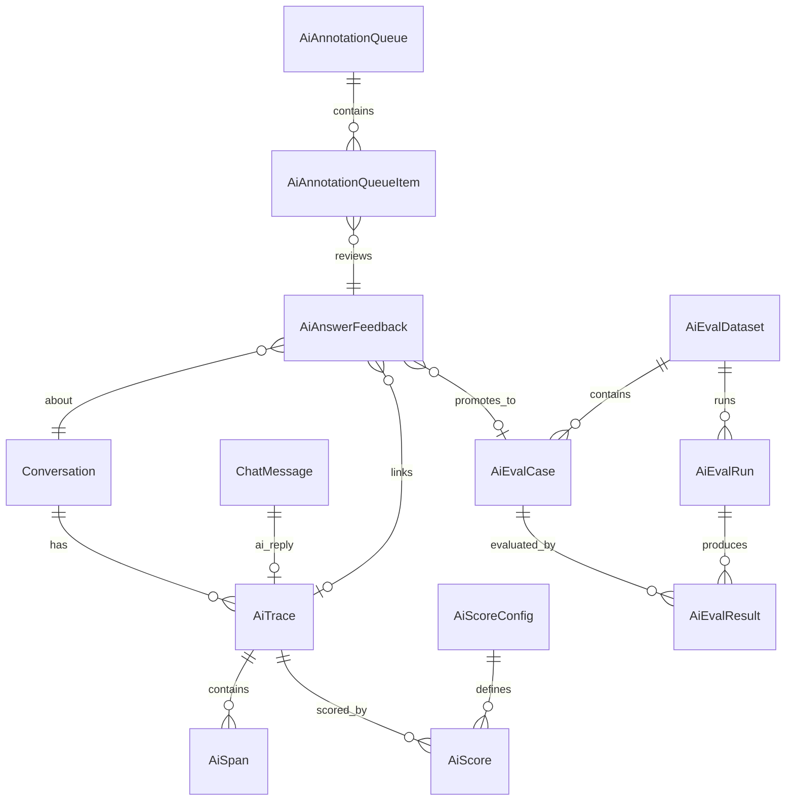

# 113 — AI 质量运营数据模型

> 状态：设计稿
> 负责人：AI 平台
> 更新时间：2026-11-21
> 关联文档：[112 文档规范](./112-AI质量运营-文档规范.md)、[114 Admin 设计](./114-AI质量运营-Admin设计.md)
> 关联数据表：`ai_answer_feedback`、`ai_eval_*`、`ai_traces`、`ai_spans`、`ai_scores`、`ai_score_configs`
> 关联页面：`/ai-ops/quality`

## 1. 目标

在不破坏现有数据的前提下，补上运营分诊需要的四类信息：

```text
发生了什么        → AiTrace / AiSpan
应该怎么判断      → AiScoreConfig / AiScore
这条该怎么处理    → failureKind / resolution
怎么防止再发生    → AiEvalCase / AiEvalResult
```

## 2. 兼容原则

1. **只做加法**：新增表、新增可空字段；不重命名、不删除、不把旧字段改 `NOT NULL`。
2. **旧代码继续能跑**：现有 `AiAnswerFeedback.reviewStatus`、`AiEvalCase.answer`、`AiEvalResult.score` 保持原语义。
3. **新字段可空**：历史数据没有值就保持 `NULL`，由 UI 显示“待判断”，不做危险默认值。
4. **回填异步、分批、幂等**：任何时刻中断都能重跑。
5. **双读兜底**：新字段为空时，回退到 `transferReason`、`verdict`、`signal` 推导。
6. **双写过渡**：新代码同时写旧字段和新字段，旧页面不回退。
7. **先模型、后迁移**：本文只定义设计，不执行 migration。

## 3. 现有模型基线

| 表 | 现在有什么 | 缺什么 |
|---|---|---|
| `ai_answer_feedback` | source/verdict/errorType/signal/input/note/reviewStatus | 失败归因、处理结论、负责人、trace、评测关联 |
| `ai_eval_datasets` | 名称、描述 | 用途、负责人、版本 |
| `ai_eval_cases` | question/answer/expect/tags | 期望答案、来源反馈、元数据 |
| `ai_eval_runs` | 状态、summary | 基线运行、数据集版本 |
| `ai_eval_results` | verdict/score/reason/latency | judge 模型/厂商、trace、实际回答快照 |
| `Conversation` | transferReason/transferredAt/handlerId | 不修改 |
| `ChatMessage` | 输入/输出全文 | 不修改，作为 trace 的全文来源 |
| `KnowledgeDocument` | qualityScore/qualityFlags/activeVersion | 不修改 |

## 4. 目标模型



Phase 1 不建 `AiAnnotationQueue`，先用查询式待办队列；Phase 2 需要多人复核/锁定时再加。

## 5. 新增实体

### 5.1 `AiTrace` — 一次问答的完整链路

表名：`ai_traces`

| 字段 | 类型 | 可空 | 默认 | 说明 |
|---|---|---|---|---|
| `id` | varchar(32) | 否 | cuid | 主键 |
| `conversationId` | varchar(32) | 否 | - | 会话 ID |
| `triggerMessageId` | varchar(32) | 是 | null | 触发本轮的用户消息 |
| `aiMessageId` | varchar(32) | 是 | null | 最终 AI 回复消息 |
| `userId` | varchar(32) | 是 | null | 用户 ID |
| `source` | varchar(16) | 否 | `production` | production / simulation / eval |
| `intent` | varchar(32) | 是 | null | 路由意图 |
| `input` | text | 是 | null | 脱敏后的用户输入快照 |
| `output` | text | 是 | null | AI 最终回答快照 |
| `status` | varchar(16) | 否 | `SUCCESS` | SUCCESS / ERROR / TRANSFERRED / ABORTED |
| `latencyMs` | int | 是 | null | 端到端耗时 |
| `promptTokens` | int | 是 | null | 输入 token |
| `completionTokens` | int | 是 | null | 输出 token |
| `promptName` | varchar(100) | 是 | null | Prompt 名称 |
| `promptVersion` | int | 是 | null | Prompt 版本 |
| `metadata` | jsonb | 是 | null | 模型、工具、RAG sources 等 |
| `createdAt` | timestamptz | 否 | now() | 创建时间 |

索引：

```text
(conversationId, createdAt)
(triggerMessageId) unique where not null
(aiMessageId) unique where not null
(intent, createdAt)
(source, createdAt)
```

约束：

- `input`/`output` 是快照，不替代 `ChatMessage`；全文以 `ChatMessage` 为准。
- 不存 token、密钥、完整手机号；手机号脱敏。
- 一条 AI 回复最多一条 trace。

### 5.2 `AiSpan` — 链路中的一步

表名：`ai_spans`

| 字段 | 类型 | 可空 | 默认 | 说明 |
|---|---|---|---|---|
| `id` | varchar(32) | 否 | cuid | 主键 |
| `traceId` | varchar(32) | 否 | - | 所属 trace |
| `parentSpanId` | varchar(32) | 是 | null | 父步骤 |
| `type` | varchar(24) | 否 | - | intent/rag/tool/llm/guardrail/transfer |
| `name` | varchar(100) | 否 | - | 具体名称 |
| `status` | varchar(16) | 否 | `OK` | OK / ERROR / SKIPPED |
| `input` | jsonb | 是 | null | 步骤输入摘要 |
| `output` | jsonb | 是 | null | 步骤输出摘要 |
| `error` | text | 是 | null | 错误信息（脱敏） |
| `startedAt` | timestamptz | 否 | - | 开始时间 |
| `endedAt` | timestamptz | 是 | null | 结束时间 |
| `durationMs` | int | 是 | null | 耗时 |
| `metadata` | jsonb | 是 | null | 模型、命中文档、工具参数 |
| `createdAt` | timestamptz | 否 | now() | 创建时间 |

索引：

```text
(traceId, startedAt)
(type, startedAt)
(status, startedAt)
```

### 5.3 `AiScoreConfig` — 评分维度定义

表名：`ai_score_configs`

| 字段 | 类型 | 可空 | 默认 | 说明 |
|---|---|---|---|---|
| `id` | varchar(32) | 否 | cuid | 主键 |
| `key` | varchar(64) | 否 | - | 稳定键，如 `answer_correct` |
| `name` | varchar(80) | 否 | - | 运营看到的名称 |
| `description` | varchar(500) | 是 | null | 判断说明 |
| `dataType` | varchar(16) | 否 | - | NUMERIC/CATEGORICAL/BOOLEAN/TEXT/CORRECTION |
| `categories` | jsonb | 是 | null | `[{label,value,description}]` |
| `minValue` | double | 是 | null | NUMERIC 下限 |
| `maxValue` | double | 是 | null | NUMERIC 上限 |
| `isActive` | boolean | 否 | true | 是否可用 |
| `createdAt` | timestamptz | 否 | now() | - |
| `updatedAt` | timestamptz | 否 | now() | - |

约束：

- `key` 唯一。
- CATEGORICAL 必须有 categories，label/value 唯一。
- BOOLEAN 固定两个分类：`是=1`、`否=0`。
- NUMERIC 的 max > min。
- TEXT 无 categories。

### 5.4 `AiScore` — 统一评分

表名：`ai_scores`

| 字段 | 类型 | 可空 | 默认 | 说明 |
|---|---|---|---|---|
| `id` | varchar(32) | 否 | cuid | 主键 |
| `configId` | varchar(32) | 是 | null | 评分维度；CORRECTION 可为空 |
| `traceId` | varchar(32) | 是 | null | 关联 trace |
| `spanId` | varchar(32) | 是 | null | 关联步骤 |
| `conversationId` | varchar(32) | 是 | null | 关联会话 |
| `messageId` | varchar(32) | 是 | null | 关联消息 |
| `source` | varchar(16) | 否 | - | HUMAN/LLM/CODE/API |
| `value` | double | 是 | null | 数值评分 |
| `stringValue` | varchar(500) | 是 | null | 分类/文本/修正值 |
| `comment` | varchar(500) | 是 | null | 评分备注 |
| `adminId` | varchar(32) | 是 | null | 人工评分人 |
| `metadata` | jsonb | 是 | null | judge 模型、置信度等 |
| `createdAt` | timestamptz | 否 | now() | - |

索引：

```text
(traceId, createdAt)
(conversationId, createdAt)
(configId, createdAt)
(source, createdAt)
```

规则：

- NUMERIC/BOOLEAN/CATEGORICAL 写 `value`，同时可写 `stringValue`。
- TEXT/CORRECTION 写 `stringValue`。
- HUMAN 评分必须带 `adminId`。
- LLM 评分在 metadata 记录 `judgeModel`、`judgeVendor`、`promptVersion`。

### 5.5 `AiAnswerFeedback` 扩展

保留现有表，只加可空字段：

| 字段 | 类型 | 可空 | 默认 | 说明 |
|---|---|---|---|---|
| `traceId` | varchar(32) | 是 | null | 关联 trace |
| `failureKind` | varchar(32) | 是 | null | 归因 |
| `resolution` | varchar(24) | 是 | null | 处理结论 |
| `ownerAdminId` | varchar(32) | 是 | null | 负责人 |
| `linkedEvalCaseId` | varchar(32) | 是 | null | 已加入的评测用例 |
| `scoreId` | varchar(32) | 是 | null | 对应标准化评分 |

索引：

```text
(failureKind, createdAt)
(resolution, createdAt)
(ownerAdminId, resolution)
(traceId)
```

**不修改** `reviewStatus`。它继续表示旧语义，新旧映射见 §8。

### 5.6 `AiEvalCase` 扩展

保留 `answer`（实际回答），新增：

| 字段 | 类型 | 可空 | 默认 | 说明 |
|---|---|---|---|---|
| `expected` | jsonb | 是 | null | 期望答案/期望要点 |
| `metadata` | jsonb | 是 | null | 来源、上下文、标签 |
| `sourceFeedbackId` | varchar(32) | 是 | null | 从哪条反馈生成 |
| `source` | varchar(16) | 是 | null | MANUAL/FEEDBACK/IMPORT |

`expect` 保留为评分规则（如 `mustMention`），`expected` 表示完整期望答案，两者不混用。

### 5.7 `AiEvalResult` 扩展

新增：

| 字段 | 类型 | 可空 | 默认 | 说明 |
|---|---|---|---|---|
| `judgeModel` | varchar(100) | 是 | null | 判分模型 |
| `judgeVendor` | varchar(50) | 是 | null | 厂商 |
| `vendorIndependent` | boolean | 是 | null | 是否独立厂商 |
| `traceId` | varchar(32) | 是 | null | 关联 trace |

### 5.8 `AiAnnotationQueue`（Phase 2）

Phase 1 不建。Phase 2 需要多人复核时再加：

```text
ai_annotation_queues
  id, name, description, isActive, createdAt, updatedAt

ai_annotation_queue_configs
  queueId, configId

ai_annotation_queue_items
  id, queueId, feedbackId, traceId, status, assigneeAdminId,
  reservedUntil, completedAt, createdAt
  unique(queueId, feedbackId)
```

状态：`PENDING / IN_PROGRESS / COMPLETED / SKIPPED`。

## 6. 枚举

### failureKind

| 值 | 运营文案 | 含义 |
|---|---|---|
| `MODEL_ERROR` | 模型答错 | 答非所问、事实错误、格式错误 |
| `SERVICE_ERROR` | 服务故障 | `ai_error`、超时、队列失败 |
| `EXPECTED_TRANSFER` | 正常转人工 | 用户明确要求，或政策要求必须转 |
| `UNEXPECTED_TRANSFER` | 误转人工 | 本可 AI 解决却转人工 |
| `USER_ABANDONED` | 用户自己放弃 | 没有服务错误，用户主动离开 |
| `REPEATED_QUESTION` | 重复追问 | 用户重复同一问题 |
| `KNOWLEDGE_GAP` | 知识缺失 | RAG 零命中、知识库没有答案 |
| `ROUTING` | 路由错误 | 意图识别/流程选择错误 |
| `PROMPT` | 提示词问题 | 指令不清、输出约束失效 |
| `PRODUCT_GAP` | 产品流程缺口 | 需要产品/流程改造，不是模型能修 |
| `LANGUAGE` | 语言不一致 | 中文提问英文回答等 |
| `UNKNOWN` | 待判断 | 信息不足，需要人工判断 |

> 后 5 个值只由人工复核写入；系统派生不会自动使用，避免把推断当结论。

### resolution

| 值 | 运营文案 | 含义 |
|---|---|---|
| `OPEN` | 待处理 | 还没人处理 |
| `CONFIRMED` | 已确认问题 | 确认是模型/产品问题 |
| `EXCLUDED` | 已排除 | 服务故障、正常转人工、噪声 |
| `ADDED_TO_EVAL` | 已加入回归 | 已生成评测用例 |
| `FIXED_PENDING_VERIFY` | 已修复待验证 | 改了 Prompt/知识库，等回归 |
| `CLOSED` | 已关闭 | 不再跟进 |
| `NO_ISSUE` | 无问题 | 回答正确或无需处理，自动关闭 |

## 7. 迁移顺序

### Step 1：加可空列

给 `ai_answer_feedback`、`ai_eval_cases`、`ai_eval_results` 加可空列。

PostgreSQL 11+ 加可空列是元数据操作，不重写大表。不要同时加 `NOT NULL`。

### Step 2：建新表

`ai_traces`、`ai_spans`、`ai_score_configs`、`ai_scores`。

索引用 `CREATE INDEX CONCURRENTLY`（在事务外执行），避免锁表。

### Step 3：回填历史反馈

分批 500–1000 条：

```text
WHERE failure_kind IS NULL
ORDER BY created_at
LIMIT 500
```

每批可重跑；只填空，不覆盖已有人工结论。

### Step 4：双写

新反馈写入时：

- 保留旧字段 `source/verdict/signal/reviewStatus`
- 同时写 `failureKind/resolution/traceId`（按 §9.2 派生，不再留 NULL）
- 有评分时写一条 `AiScore`

### Step 5：双读

列表查询：

```text
failureKind ?? deriveFromLegacy(transferReason, verdict, signal)
resolution ?? mapFromReviewStatus(reviewStatus)
```

### Step 6：UI 切换

先只读展示归因和结论，再开放动作。功能是否启用通过 `GET /admin/ai-ops/features` 暴露给页面；不再维护独立的 `AI_QUALITY_V2_ENABLED` 回滚开关。

## 8. 新旧状态映射

| 旧 `reviewStatus` | 新 `resolution` |
|---|---|
| `PENDING` | `OPEN` |
| `REVIEWED` | `CONFIRMED` |
| `IGNORED` | `EXCLUDED` |

新写旧字段时反向映射：

| 新 `resolution` | 旧 `reviewStatus` |
|---|---|
| `OPEN` | `PENDING` |
| `CONFIRMED` | `REVIEWED` |
| `EXCLUDED` | `IGNORED` |
| `ADDED_TO_EVAL` | `REVIEWED` |
| `FIXED_PENDING_VERIFY` | `REVIEWED` |
| `CLOSED` | `REVIEWED` |
| `NO_ISSUE` | `REVIEWED` |

## 9. 历史回填规则

按优先级判断，命中即停：

| 条件 | failureKind |
|---|---|
| `Conversation.transferReason = 'ai_error'` | `SERVICE_ERROR` |
| `Conversation.transferReason = 'explicit_request'` | `EXPECTED_TRANSFER` |
| `feedback.verdict = 'incorrect'` | `MODEL_ERROR` |
| `feedback.signal = 'abandoned'` 且无 ai_error | `USER_ABANDONED` |
| `feedback.signal = 'repeated_question'` | `REPEATED_QUESTION` |
| `feedback.signal = 'transferred'` | 不自动判定；进入信号区，人工确认后才写 `UNEXPECTED_TRANSFER` |
| `feedback.verdict = 'correct'` | 不填 |
| 其他 | `UNKNOWN` |

注意：

- `repeated_attempts` 不一定是错误；如果最后一条用户消息是“好的/谢谢/麻烦你了”，按误转处理。
- 回填是启发式，允许 `UNKNOWN`，不要为了填满而猜。
- 回填后由运营在页面确认，人工结论优先。

### 9.1 待办与信号分轨（2026-11-21 决策）

归属规则在查询期派生，不新增存储字段：

```text
待办 =
  resolution = OPEN
  AND createdAt ∈ 时间窗
  AND (
    (source = 'explicit' AND verdict = 'incorrect')
    OR failureKind = 'SERVICE_ERROR'
    OR ownerAdminId IS NOT NULL
  )

信号区 =
  source = 'implicit'
  AND resolution NOT IN ('EXCLUDED', 'NO_ISSUE')
  AND failureKind <> 'SERVICE_ERROR'
  AND ownerAdminId IS NULL
```

- 隐式 `transferred / abandoned / repeated_question` 默认只进信号区，不计入待处理。
- 运营在信号区“认领”即写 `ownerAdminId`，该条进入待办。
- `verdict='correct'` → `NO_ISSUE` + `REVIEWED`，不计入确认问题。
- `transferReason='explicit_request'` → `EXPECTED_TRANSFER` + `EXCLUDED`，不打扰运营。
- `UNEXPECTED_TRANSFER` 只能由人工确认写入；信号区可显示“疑似误转”，但不持久化为结论。

### 9.2 新反馈摄入派生规则

按优先级，命中即停：

| 优先级 | 条件 | failureKind | resolution |
|---|---|---|---|
| 1 | `transferReason = 'ai_error'` | `SERVICE_ERROR` | `OPEN` |
| 2 | `verdict = 'incorrect'` | `MODEL_ERROR` | `OPEN` |
| 3 | `transferReason = 'explicit_request'` | `EXPECTED_TRANSFER` | `EXCLUDED` |
| 4 | `verdict = 'correct'` | — | `NO_ISSUE`（`reviewStatus=REVIEWED`） |
| 5 | `signal = 'abandoned'` | `USER_ABANDONED` | `OPEN`（仅信号区） |
| 6 | `signal = 'repeated_question'` | `REPEATED_QUESTION` | `OPEN`（仅信号区） |
| 7 | `signal = 'transferred'` | `UNKNOWN`（疑似误转待确认） | `OPEN`（仅信号区） |
| 8 | 其他 | `UNKNOWN` | `OPEN` |

来源可辨认：派生写入不写 `reviewedBy`（系统推断）；人工动作才写 `reviewedBy`，并在页面标注“人工确认”。

历史数据补救（与代码实现同批执行）：

- 旧回填把 `verdict='correct'` 的行留成 `resolution='OPEN'`，需修正为 `NO_ISSUE` + `REVIEWED`。
- 旧回填把 `signal='transferred'` 直接写成 `UNEXPECTED_TRANSFER`，需降级为 `UNKNOWN` 并回到信号区，等待人工确认后才恢复为 `UNEXPECTED_TRANSFER`。
- 修正只改系统推断的行；已有 `reviewedBy` 的人工结论不覆盖。

## 10. 回滚

1. 关闭 `AI_FEEDBACK_UI_ENABLED` / `AI_EVAL_ENABLED`，页面显示未启用并隐藏写操作。
2. 停止写新表/新字段；旧字段继续写。
3. 保留新表和新列，不删数据。
4. 旧代码不读新字段，因此不受影响。
5. 如需重新上线，从回填步骤继续。

## 11. 保留与隐私

| 数据 | 保留 | 说明 |
|---|---|---|
| `AiTrace` | 30 天 | 排查窗口；之后聚合或删除 |
| `AiSpan` | 30 天 | 随 trace 删除 |
| `AiScore` | 长期 | 质量趋势和评测依据 |
| `AiAnswerFeedback` | 长期 | 运营记录 |
| `AiEvalResult` | 长期 | 回归证据 |

隐私：

- `AiTrace.input/output` 只存脱敏快照，完整原文以 `ChatMessage` 为准。
- 不存 access token、refresh token、API key。
- trace 写入时对手机号、邮箱、18 位身份证号做文本脱敏；订单号等排障标识保留。
- trace/span 按 `AI_TRACE_RETENTION_DAYS`（默认 30 天）由每日 03:00 UTC 任务清理；LLM `AiScore` 同步清理，HUMAN 分数长期保留。
- 只有 ADMIN/运营角色可看完整对话；VIEWER 只看聚合。

## 12. 指标口径

```text
服务故障率 = SERVICE_ERROR / 全部反馈
模型错误率 = MODEL_ERROR / (MODEL_ERROR + UNEXPECTED_TRANSFER)
误转率     = UNEXPECTED_TRANSFER / 全部转人工
正常转人工率 = EXPECTED_TRANSFER / 全部转人工
回归通过率 = solved / total
```

`SERVICE_ERROR` 和 `EXPECTED_TRANSFER` 不进入模型错误率分母。

## 13. 验收

- [ ] 现有页面不传新字段仍能工作
- [ ] 旧 `reviewStatus` 读写不受影响
- [ ] 回填可重复执行，不覆盖人工结论
- [ ] `SERVICE_ERROR` 不计入模型错误率
- [ ] 一条 Feedback 可以生成一条 Eval Case
- [ ] 关闭开关后旧路径完整可用
- [ ] Trace 30 天清理不删除 Feedback/Score
