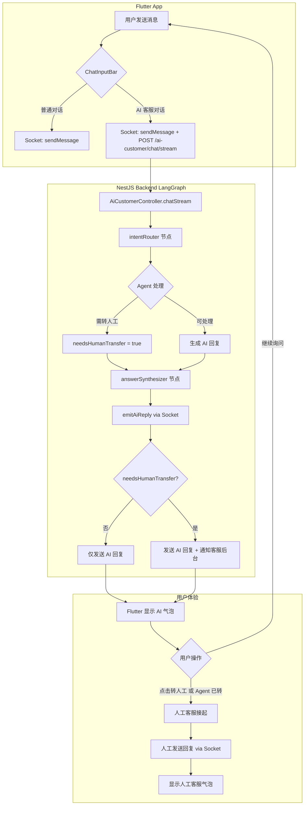
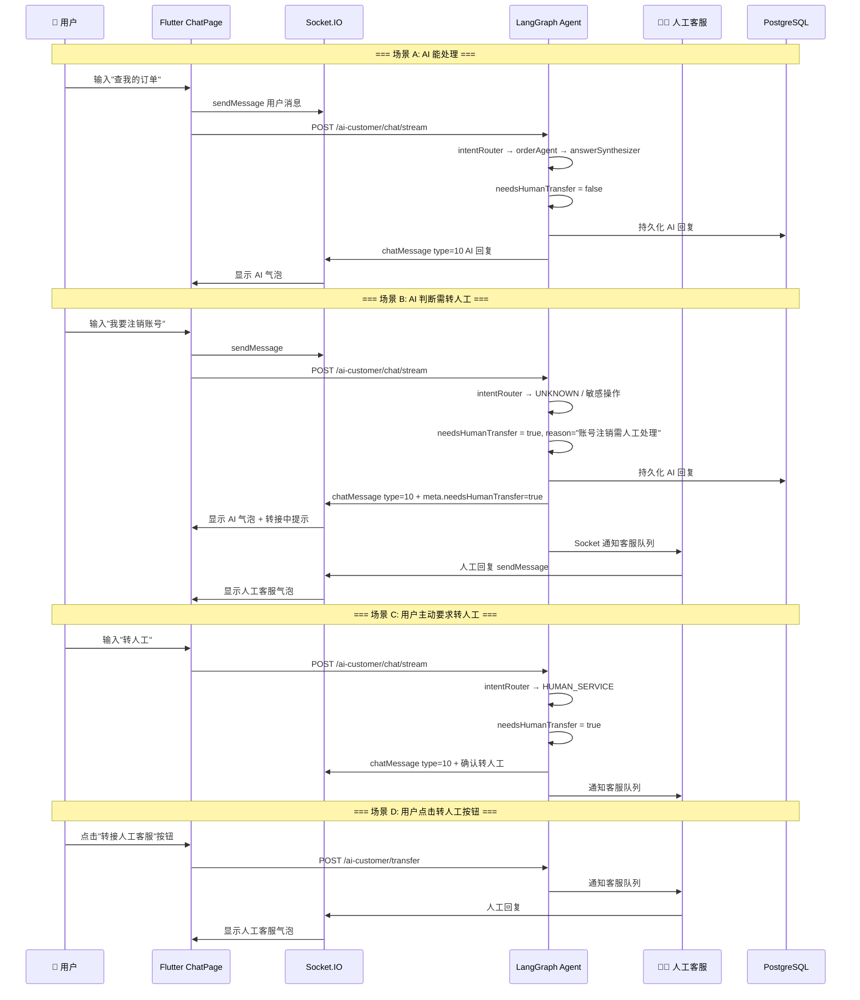

# 20. Flutter Chat - AI 与人工客服融合方案

## 🎯 本步骤目标

设计如何在现有 Flutter Chat 框架中，将 AI 客服回复和人工客服回复**无缝融合到同一个对话界面**，用户无需切换页面即可获得完整客服体验。

---

## 📖 背景说明

### 现有 Flutter Chat 架构概览

| 维度 | 实现 |
|------|------|
| **通信协议** | Socket.IO（实时消息）+ REST API（历史/操作） |
| **状态管理** | Riverpod（`StateNotifier` + `Provider.family.autoDispose`） |
| **消息模型** | [`ChatUiModel`](lib/ui/chat/models/chat_ui_model.dart) — id, seqId, content, type, isMe, status, createdAt |
| **消息类型** | text(0), image(1), audio(2), video(3), recalled(4), file(5), location(6), system(99) |
| **对话类型** | DIRECT, GROUP, **SUPPORT**, **BUSINESS** |
| **客服入口** | [`CustomerServiceHelper`](lib/core/services/customer_service/customer_service_helper.dart) → `Api.chatBusinessApi()` → `/chat/room/{conversationId}` |
| **消息流** | 用户发送 → Socket `sendMessage` → 服务器分发 → Socket `chatMessage` 事件接收 |
| **UI 组件** | [`ChatPage`](lib/ui/chat/chat_room/chat_page.dart) → [`ChatViewModel`](lib/ui/chat/providers/chat_view_model.dart) → [`ChatBubble`](lib/ui/chat/components/chat_bubble.dart) |
| **输入栏** | [`ModernChatInputBar`](lib/ui/chat/components/chat_input/modern_chat_input_bar.dart) |

### 核心发现

1. **`ConversationType.support` / `ConversationType.business` 已经是正确的抽象** — 客服对话已经有独立类型
2. **`CustomerServiceHelper.startChat()`** 已经处理了创建/进入客服对话的逻辑
3. **Socket.IO 已连接**，实时消息通道已经存在，AI 消息可以直接复用这个通道
4. **消息模型 `ChatUiModel` 有 `meta` 字段**（`Map<String, dynamic>?`），可用于携带 AI 元数据（推理步骤、意图等）
5. **`MessageType` 是可扩展的 enum** — 可以添加新的 `ai` 类型

---

## ⚙️ 设计原则

1. **最小侵入** — 不改动现有 ChatPage 和 ChatViewModel 的核心逻辑，通过扩展而非修改
2. **统一消息流** — AI 回复和人工回复走**同一个 Socket 通道**，客户端无需区分消息来源
3. **AI Agent 判断转人工** — 转人工决策由 LangGraph Agent 在 graph 执行过程中做出，而非仅由客户端按钮触发
4. **消息类型可区分** — AI 消息有独立 UI 样式（机器人头像、推理步骤展开），但在对话列表中和其他消息平级

---

## 📝 实现方案

### 架构总览



### AI Agent 判断转人工的核心逻辑

转人工**不是**Flutter 端的独立功能，而是 LangGraph graph 执行流程中 AI Agent 的**主动决策**。

在 [`answerSynthesizer` 节点](plans/joymini-nest-monorepo/05-AnswerSynthesizer与Graph组装.md)中，基于以下条件判断是否需转人工：

| 条件 | 判断来源 | 示例 |
|------|----------|------|
| **意图无法识别** | `intentRouter` 输出 `intent: UNKNOWN` | 用户问非平台相关问题 |
| **Agent 工具调用失败** | ReAct Agent 的 tool 返回错误或超时 | 查询订单时 API 不可达 |
| **LLM 自判无法处理** | `answerSynthesizer` Prompt 要求 LLM 输出 `needsHumanTransfer` 标志 | 用户要求修改已支付订单金额 |
| **用户明确要求转人工** | `intentRouter` 识别 `intent: HUMAN_SERVICE` | 用户说"叫你们经理来"、"转人工" |
| **敏感操作需人工确认** | 继承 [`19-MultiAgentSupervisor与HITL.md`](plans/joymini-nest-monorepo/19-MultiAgentSupervisor与HITL.md) 的 HITL 模式 | 大额退款、账户注销 |

---

## 🔧 LangGraph State 扩展

在现有 State 中增加转人工相关字段：

```typescript
// apps/api/src/client/ai-customer/graph/state.ts
export const AiCustomerState = Annotation.Root({
  // ... 现有字段：messages, intent, agentOutputs, ...
  
  // 新增：AI Agent 判断是否需要转人工
  needsHumanTransfer: Annotation<boolean>({
    reducer: (a, b) => b,
    default: () => false,
  }),
  
  // 新增：转人工原因，方便客服后台了解上下文
  transferReason: Annotation<string>({
    reducer: (a, b) => b,
    default: () => '',
  }),
  
  // 新增：转人工目标部门（如果有多部门客服）
  transferTarget: Annotation<string>({
    reducer: (a, b) => b,
    default: () => 'general', // general | refund | technical | complaint
  }),
});
```

### `answerSynthesizer` 节点 — 转人工判断逻辑

```typescript
// apps/api/src/client/ai-customer/graph/nodes/answer-synthesizer.node.ts
export const createAnswerSynthesizerNode = () => {
  const prompt = ChatPromptTemplate.fromMessages([
    ['system', SYNTHESIZER_PROMPT], // 包含 needsHumanTransfer 输出指令
    ['placeholder', '{messages}'],
  ]);

  const chain = prompt.pipe(llm);

  return async (state: typeof AiCustomerState.State) => {
    // LLM 输出包含 needsHumanTransfer 和 transferReason
    const result = await chain.invoke({
      messages: state.messages,
      intent: state.intent,
      agentOutputs: state.agentOutputs,
      ragResults: state.ragResults,
    });

    // 解析 LLM 输出
    const parsed = parseAiResponse(result.content);
    
    return {
      messages: [new AIMessage(parsed.reply)],
      needsHumanTransfer: parsed.needsHumanTransfer || state.intent === 'HUMAN_SERVICE' || state.intent === 'UNKNOWN',
      transferReason: parsed.transferReason || 'AI 无法处理该请求',
      transferTarget: parsed.transferTarget || 'general',
    };
  };
};
```

### SYNTHESIZER_PROMPT 加入转人工指令

```typescript
const SYNTHESIZER_PROMPT = `你是一个电商客服 AI 助手。你的职责是根据对话历史、意图分析和工具调用结果，生成最终回复。

在生成回复时，你必须输出 JSON 格式：
{
  "reply": "你的回复内容",
  "needsHumanTransfer": true/false,
  "transferReason": "如果需要转人工，说明原因。不需要则为空字符串",
  "transferTarget": "转人工目标部门: general | refund | technical | complaint"
}

以下情况必须将 needsHumanTransfer 设为 true：
1. 用户明确要求转人工或找人工客服
2. 你无法识别用户意图（intent = UNKNOWN）
3. 用户要求的功能不在你的能力范围内
4. 涉及大额退款、账户安全等敏感操作
5. 工具调用连续失败 2 次以上

以下情况不需要转人工：
1. 你能明确回答用户问题
2. 你能通过工具完成用户请求
3. 用户只是询问商品信息、订单状态等常规问题

注意：即使需要转人工，你也要先回复用户，说明情况。`;
```

---

## 🔧 后端改动（NestJS）

### 1. AiCustomerService — graph 执行后处理转人工

```typescript
// apps/api/src/client/ai-customer/ai-customer.service.ts
async chatStream(conversationId: string, userId: string, message: string) {
  const initialState = { messages: [new HumanMessage(message)] };
  
  const eventStream = await this.graph.streamEvents(initialState, {
    version: 'v2',
    configurable: { thread_id: `ai-customer-${userId}` },
  });

  // ... SSE 事件处理 ...

  // graph 执行完毕后，检查是否需要转人工
  const finalState = await this.graph.getState({
    configurable: { thread_id: `ai-customer-${userId}` },
  });

  if (finalState.values.needsHumanTransfer) {
    await this.notifyHumanServiceQueue({
      conversationId,
      userId,
      reason: finalState.values.transferReason,
      target: finalState.values.transferTarget,
      aiContext: finalState.values.messages, // 完整 AI 对话上下文
    });
  }
}

private async notifyHumanServiceQueue(data: TransferRequest) {
  // 1. 将转人工请求写入客服队列
  await this.prisma.customerServiceQueue.create({
    data: {
      conversationId: data.conversationId,
      userId: data.userId,
      reason: data.reason,
      target: data.target,
      status: 'waiting',
      aiContext: JSON.stringify(data.aiContext),
    },
  });

  // 2. Socket 通知客服后台有新请求
  this.chatGateway.sendToStaffRoom('new-transfer-request', {
    conversationId: data.conversationId,
    reason: data.reason,
    priority: data.target === 'complaint' ? 'high' : 'normal',
  });
}
```

### 2. 新增 `POST /ai-customer/transfer` — 用户主动请求转人工

```typescript
// apps/api/src/client/ai-customer/ai-customer.controller.ts
@Post('transfer')
@ApiOperation({ summary: '用户主动请求转接人工客服' })
async transferToHuman(
  @CurrentUserId() userId: string,
  @Body() dto: TransferToHumanDto,
) {
  return this.aiCustomerService.notifyHumanServiceQueue({
    conversationId: dto.conversationId,
    userId,
    reason: dto.reason || '用户主动请求转人工',
    target: dto.target || 'general',
    aiContext: [],
  });
}
```

### 3. AI 回复通过 Socket 推送到对话

```typescript
// apps/api/src/client/ai-customer/ai-customer.service.ts
private async emitAiReply(
  conversationId: string,
  reply: string,
  metadata: {
    needsHumanTransfer: boolean;
    transferReason?: string;
    agentSteps?: any[];
    intent?: string;
  }
) {
  const message = {
    id: uuid(),
    conversationId,
    content: reply,
    type: 10,  // AI 消息类型
    senderId: 'ai-bot',
    senderName: '🤖 JoyMini AI 助手',
    senderAvatar: '/avatars/ai-bot.png',
    createdAt: Date.now(),
    meta: {
      intent: metadata.intent,
      agentSteps: metadata.agentSteps,
      needsHumanTransfer: metadata.needsHumanTransfer,
      transferReason: metadata.transferReason,
    },
  };

  // 持久化 AI 消息
  await this.persistAiMessage(message);

  // Socket 推送到对话
  this.chatGateway.sendToConversation(conversationId, {
    type: 'chatMessage',
    data: message,
  });
}

private async persistAiMessage(message: AiChatMessage) {
  await this.prisma.chatMessage.create({
    data: {
      id: message.id,
      conversationId: message.conversationId,
      senderId: 'ai-bot',
      content: message.content,
      type: 10,
      seqId: await this.getNextSeqId(message.conversationId),
      meta: message.meta,
    },
  });
}
```

### 4. 扩展现有 Chat Gateway

```typescript
// 在 ChatGateway 中新增
sendToConversation(conversationId: string, event: ChatEvent) {
  this.server.to(`conversation:${conversationId}`).emit('dispatch', {
    type: event.type,
    data: event.data,
  });
}

sendToStaffRoom(eventType: string, data: any) {
  this.server.to('staff-room').emit('dispatch', {
    type: eventType,
    data,
  });
}
```

---

## 🔧 Flutter 端改动

### 1. 新增 `MessageType.ai` (值 10)

```dart
// lib/ui/chat/models/chat_ui_model.dart
enum MessageType {
  text(0, label: '[Text]'),
  image(1, label: '[Image]'),
  audio(2, label: '[Audio]'),
  video(3, label: '[Video]'),
  recalled(4, label: '[Recalled]'),
  file(5, label: '[File]'),
  location(6, label: '[Location]'),
  system(99, label: '[System]'),
  ai(10, label: '[AI]');  // ← 新增

  String getPreviewText(String content, {bool isRecalled = false}) {
    if (isRecalled || this == MessageType.recalled) return '[Message Recalled]';
    if (this == MessageType.text || this == MessageType.system) return content;
    if (this == MessageType.ai) return content;
    return label;
  }
}
```

### 2. AI 消息气泡组件

```dart
// lib/ui/chat/components/bubbles/ai_msg_bubble.dart
class AiMsgBubble extends StatelessWidget {
  final ChatUiModel message;
  final VoidCallback? onTransferToHuman;

  @override
  Widget build(BuildContext context) {
    final meta = message.meta ?? {};
    final steps = meta['agentSteps'] as List<dynamic>? ?? [];
    final hasSteps = steps.isNotEmpty;
    final needsTransfer = meta['needsHumanTransfer'] == true;
    final transferReason = meta['transferReason'] as String? ?? '';

    return Row(
      crossAxisAlignment: CrossAxisAlignment.start,
      children: [
        // AI 头像（左侧）
        CircleAvatar(
          backgroundImage: AssetImage('assets/ai-avatar.png'),
          radius: 20,
        ),
        SizedBox(width: 8),
        Expanded(
          child: Column(
            crossAxisAlignment: CrossAxisAlignment.start,
            children: [
              Text('🤖 JoyMini AI',
                  style: TextStyle(fontWeight: FontWeight.bold, fontSize: 13)),
              SizedBox(height: 4),
              Container(
                padding: EdgeInsets.all(12),
                decoration: BoxDecoration(
                  color: Color(0xFFF0F4FF),
                  borderRadius: BorderRadius.circular(12),
                ),
                child: SelectableText(message.content),
              ),
              // Agent 推理步骤（可展开折叠）
              if (hasSteps) _buildReasoningSteps(context, steps),
              // AI 主动判断需要转人工 → 自动显示转人工状态
              if (needsTransfer) ...[
                SizedBox(height: 8),
                Container(
                  padding: EdgeInsets.symmetric(horizontal: 12, vertical: 8),
                  decoration: BoxDecoration(
                    color: Colors.orange.shade50,
                    borderRadius: BorderRadius.circular(8),
                    border: Border.all(color: Colors.orange.shade200),
                  ),
                  child: Row(
                    children: [
                      Icon(Icons.support_agent, color: Colors.orange, size: 18),
                      SizedBox(width: 8),
                      Expanded(
                        child: Text(
                          transferReason.isNotEmpty
                              ? '$transferReason\n正在为您转接人工客服...'
                              : '正在为您转接人工客服...',
                          style: TextStyle(fontSize: 12, color: Colors.orange.shade800),
                        ),
                      ),
                    ],
                  ),
                ),
              ],
              // 用户主动转人工按钮（AI 未判断需转人工时显示）
              if (!needsTransfer)
                TextButton.icon(
                  onPressed: onTransferToHuman,
                  icon: Icon(Icons.support_agent, size: 16),
                  label: Text('转接人工客服', style: TextStyle(fontSize: 12)),
                ),
            ],
          ),
        ),
      ],
    );
  }
}
```

### 3-7. 其余 Flutter 改动与之前的方案一致

（省略重复内容，详情见下方改动清单）

---

## 💬 完整用户体验流程



---

## 📋 完整改动清单

### Flutter 端

| 文件 | 改动类型 | 说明 |
|------|----------|------|
| [`chat_ui_model.dart`](lib/ui/chat/models/chat_ui_model.dart) | 修改 | 新增 `MessageType.ai(10)` |
| [`chat_view_model.dart`](lib/ui/chat/providers/chat_view_model.dart) | 修改 | 新增 `isAiResponding` 状态 |
| [`chat_bubble.dart`](lib/ui/chat/components/chat_bubble.dart) | 修改 | 新增 AI 类型分支 |
| **新建** `ai_msg_bubble.dart` | **新增** | AI 消息气泡 + 推理步骤 + 转人工状态 |
| [`modern_chat_input_bar.dart`](lib/ui/chat/components/chat_input/modern_chat_input_bar.dart) | 修改 | AI 对话双通道发送 |
| [`customer_service_helper.dart`](lib/core/services/customer_service/customer_service_helper.dart) | 修改 | 新增 AI 参数 |
| [`lucky_api.dart`](lib/core/api/lucky_api.dart) | 修改 | 新增 AI API 方法 |

### NestJS 端

| 文件 | 改动类型 | 说明 |
|------|----------|------|
| [`graph/state.ts`](plans/joymini-nest-monorepo/03-创建AiCustomerModule与GraphState.md) | 修改 | 新增 `needsHumanTransfer`, `transferReason`, `transferTarget` 字段 |
| [`graph/nodes/answer-synthesizer.node.ts`](plans/joymini-nest-monorepo/05-AnswerSynthesizer与Graph组装.md) | 修改 | LLM 输出 JSON 包含转人工判断 |
| [`ai-customer.service.ts`](plans/joymini-nest-monorepo/14-AIChatAPI与ControllerSSE.md) | 修改 | graph 执行后检查转人工 + Socket 推送 |
| [`ai-customer.controller.ts`](plans/joymini-nest-monorepo/14-AIChatAPI与ControllerSSE.md) | 修改 | 新增 `POST /transfer` 端点 |
| `ChatGateway` | 修改 | 新增 `sendToConversation()`, `sendToStaffRoom()` |
| 新增消息持久化 | 新增 | AI 消息写入 `chat_message` 表 |

---

## ✅ 验收标准

| # | 验收项 | 预期结果 |
|---|--------|----------|
| 1 | AI 可处理的问题 | AI 回复直接显示，无转人工提示 |
| 2 | AI 判断需转人工 | AI 回复 + "正在转接人工客服..." 提示 |
| 3 | 用户主动说"转人工" | intent=HUMAN_SERVICE → 自动转接 |
| 4 | 用户点击"转人工"按钮 | 触发 `POST /transfer` → 通知客服队列 |
| 5 | 转人工后上下文完整 | 客服后台可见 AI 完整对话记录 |
| 6 | AI 消息持久化 | 重新进入对话可回溯 AI 回复 |
| 7 | 双通道无冲突 | AI 回复和人工回复按时间正确排序 |
| 8 | 人工回复后 AI 不再回复 | 人工接管后标记 `human_takeover: true`，AI 静默 |

---

## 🔗 与现有文档的关系

- 核心决策逻辑基于 [`05-AnswerSynthesizer与Graph组装.md`](plans/joymini-nest-monorepo/05-AnswerSynthesizer与Graph组装.md) 的 `answerSynthesizer` 节点扩展
- 转人工的 HITL 模式参考 [`19-MultiAgentSupervisor与HITL.md`](plans/joymini-nest-monorepo/19-MultiAgentSupervisor与HITL.md)
- SSE 流式 API 基于 [`14-AIChatAPI与ControllerSSE.md`](plans/joymini-nest-monorepo/14-AIChatAPI与ControllerSSE.md)
- State 定义基于 [`03-创建AiCustomerModule与GraphState.md`](plans/joymini-nest-monorepo/03-创建AiCustomerModule与GraphState.md)
