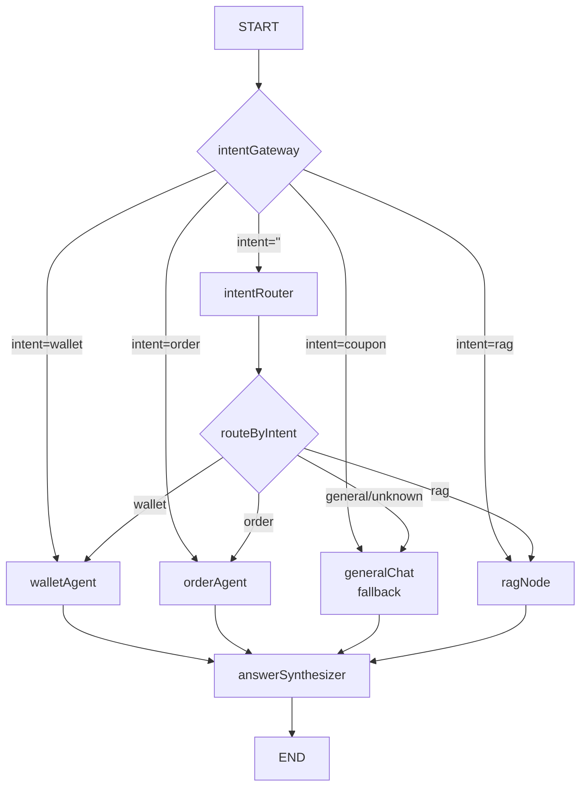
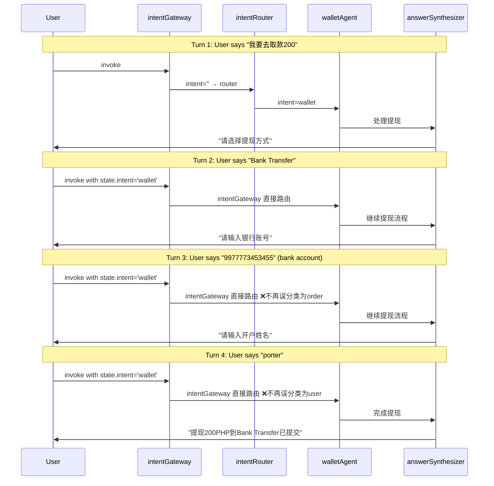

# 21. Intent Gateway — 多轮意图持久化与条件路由

> ✅ **IMPLEMENTED — 代码已实现**
>
> Intent Gateway 模式已在 `intent-router.node.ts` 中实现。
> 核心逻辑: `intentGateway()` 函数始终返回 `'intentRouter'` 强制重新分类。
> `flowState.activeFlow` 用于跨轮流程追踪，`previousIntent` 用于上下文参考。
> 实际代码: [`customer.graph.ts:37`](../../apps/api/src/client/ai-customer/graph/customer.graph.ts)

## 🎯 本步骤目标

解决多轮对话中意图分类器在每轮重新分类时**覆盖已有意图**的问题，实现 Intent Gateway Pattern：当 `state.intent` 已经是一个非终端意图（如 wallet/order）时，跳过意图路由器，直接路由到对应的 Agent 节点。

## 📖 开发背景

### 承上：上一步做了什么？

[07-WalletAgent与Tools.md](07-WalletAgent与Tools.md) 和 [PROGRESS.md](PROGRESS.md) 完成了：

- Wallet Agent Phase 1 MVP 和 Phase 2 OTP 验证
- MemorySaver Checkpointer 多轮状态持久化
- `currentMessages` 审计修复（Agent 节点正确返回 `currentMessages.slice(1)`）
- answerSynthesizer 追加而非覆盖 state.messages

### 启下：下一步做什么？

下一步将在 Code 模式中修改 3 个文件以实施方案 C，并在编译验证后运行多轮测试确认修复。

### 架构中的位置

```
当前架构（有 Bug）:
  START → [intentRouter] → routeByIntent → Agent → answerSynthesizer → END
           ↑ 每轮无条件重新分类，覆盖 state.intent

修复后架构:
  START → [intentGateway] ──┬─ intent 为空/终端 → intentRouter → routeByIntent → Agent
                             └─ intent 为 flow intent → 直接路由到 Agent
```

---

## 🔧 前提条件

- [x] MemorySaver Checkpointer 已实现（`customer.graph.ts:81-83`）
- [x] State 中 `intent` 字段已定义（reducer: `(a, b) => b`）
- [x] 运行时测试已暴露 bug：提现流程第 3-4 轮中断

---

## 问题分析

### Bug 复现

| Turn | User Input | Expected | Actual | 原因 |
|------|-----------|----------|--------|------|
| 1 | "我要去取款200" | `wallet` ✅ | `wallet` | 语义明确 |
| 2 | "Bank Transfer" | `wallet` ✅ | `wallet` | 语义关联 |
| 3 | "9977773453455" | `wallet` ❌ | `order` | 纯数字 → LLM 以为是订单号 |
| 4 | "porter" | `wallet` ❌ | `user` | 姓名 → LLM 以为是个人信息 |

### 3 层根因分析

```
Level 1 - Surface: intent-router.node.ts:165
  chain.invoke({ input: userInput })
  只传入当前用户输入，没有传递 state.intent 上下文。
  LLM "只见树木不见森林"——只看当前消息，不知道用户正在提现流程中。

Level 2 - Architecture: customer.graph.ts:49
  .addEdge(START, 'intentRouter')
  每次 invoke() 都从 START 无条件走到 intentRouter，
  intentRouter 必然返回一个新的 intent，覆盖 state.intent。
  即使有了 MemorySaver，状态保持了，但路由逻辑仍然每次都重新分类。

Level 3 - Design: 原始设计假设
  所有设计文档（04、05、07、ai-customer-sdd）都基于单轮对话设计。
  MemorySaver Checkpointer 是在 Phase 2 才加入的，
  但 Graph 路由逻辑没有随之演进。
```

### 专业术语

| 术语 | 说明 |
|------|------|
| **Context-free Intent Classification** | 无上下文意图分类。LLM 只看当前用户输入，不看之前对话的意图上下文。 |
| **Dialogue State Tracking Failure** | 对话状态追踪失败。系统丢失了"用户正在做什么"这个跨轮次的状态。 |
| **Intent Gating / Intent Persistence** | 意图门控 / 意图持久化。一旦非终端意图建立，后续输入跳过分类器直接路由。 |
| **Stateful Routing** | 有状态路由。基于 `state.intent` 的条件边，而非无条件边。 |

---

## 解决方案

### 方案 C — Intent Gateway Pattern

修改 2 个文件 + 1 个可选增强：

#### 1. customer.graph.ts — Intent Gateway 条件边

新增 `intentGateway()` 函数判断 `state.intent`：

```typescript
const FLOW_INTENTS = ['wallet', 'order', 'coupon', 'user', 'product', 'lucky-draw', 'rag'];

function intentGateway(state: typeof AgentState.State): string {
  if (state.intent && FLOW_INTENTS.includes(state.intent)) {
    return state.intent; // 跳过 intentRouter，直接路由
  }
  return 'intentRouter'; // 需要重新分类
}
```

Graph 修改：

```typescript
// 之前（无条件边）
.addEdge(START, 'intentRouter')

// 之后（条件边）
.addConditionalEdges(START, intentGateway, {
  intentRouter: 'intentRouter',
  order: 'orderAgent',
  wallet: 'walletAgent',
  coupon: 'couponAgent',
  user: 'userAgent',
  product: 'productAgent',
  'lucky-draw': 'luckyAgent',
  rag: 'ragNode',
})
```

**注意：** `addConditionalEdges` 的映射 key 必须与 `intentGateway` 返回值完全匹配。

#### 2. intent-router.node.ts — Prompt 增加 previousIntent 上下文

修改 INTENT_PROMPT，增加 `{previousIntent}` 变量：

```typescript
// Prompt 中增加
const INTENT_PROMPT = ChatPromptTemplate.fromMessages([
  ['system', `...原有内容...

Previous conversation context: the user's previous intent was "{previousIntent}".
Only change the intent category if the user is EXPLICITLY switching to a new topic.
If the input is a number, account name, channel name, or other detail related to the previous intent, KEEP the previous intent.`],
  ['human', '{input}'],
]);
```

修改 invoke 时传入 `previousIntent`：

```typescript
const raw = await chain.invoke({
  input: userInput,
  previousIntent: state.intent || 'none',
});
```

#### 3. 可选增强 — Agent Yield Pattern

当用户在提现/订单流程中突然切换话题时，Agent 的 System Prompt 增加如下指令：

```
## Topic Interruption
If the user's new input seems to be about a completely different topic 
(e.g., asking about orders during a withdrawal flow), 
set intent="" in your node return to allow re-routing through the intent router.
```

---

## 架构图

### 修复后的 Graph 流程



### 状态变化时序



---

## 预期效果

| Turn | Input | 原结果 | 修复后 | 原理 |
|------|-------|--------|--------|------|
| 1 | "我要去取款200" | `wallet` ✅ | `wallet` ✅ | intentRouter 正常运行 |
| 2 | "Bank Transfer" | `wallet` ✅ | `wallet` ✅ | Gateway 跳过路由器 |
| 3 | "9977773453455" | `order` ❌ | `wallet` ✅ | Gateway 跳过路由器 |
| 4 | "porter" | `user` ❌ | `wallet` ✅ | Gateway 跳过路由器 |

---

## 实施计划

### 修改文件清单

| # | 文件 | 修改内容 |
|---|------|----------|
| 1 | [`customer.graph.ts`](apps/api/src/client/ai-customer/graph/customer.graph.ts) | 新增 `intentGateway()` 函数，`.addEdge(START, 'intentRouter')` → `.addConditionalEdges(START, intentGateway, {...})` |
| 2 | [`intent-router.node.ts`](apps/api/src/client/ai-customer/graph/nodes/intent-router.node.ts) | Prompt 增加 `{previousIntent}` 和上下文指令；invoke 时传入 `previousIntent: state.intent \|\| 'none'` |
| 3 | [`wallet-agent.node.ts`](apps/api/src/client/ai-customer/graph/nodes/wallet-agent.node.ts) | System Prompt 增加 Topic Interruption 指令（Agent Yield 模式） |
| 4 | [`order-agent.node.ts`](apps/api/src/client/ai-customer/graph/nodes/order-agent.node.ts) | System Prompt 增加 Topic Interruption 指令（Agent Yield 模式） |

### 验证步骤

1. `yarn workspace @lucky/api build` — 编译检查
2. 启动 server，调用 `testChat` API 多轮提现流程
3. 确认 Turn 3 "9977773453455" 不再被分类为 `order`
4. 确认 Turn 4 "porter" 不再被分类为 `user`

---

## 设计决策

| 决策 | 选项 | 选择 | 理由 |
|------|------|------|------|
| Gateway 位置 | START / intentRouter 前 | **START 后** | 从入口拦截最干净，任何节点都不需要感知 Gateway 存在 |
| Gateway 逻辑 | 硬编码列表 / 动态从 routeMap 读取 | **硬编码可迭代列表** | `addConditionalEdges` 需要静态映射表，不能动态生成 |
| Prompt 上下文 | 仅 previousIntent / 全对话摘要 | **仅 previousIntent** | 最小入侵，足够避免误分类；全对话摘要会增加 token 成本和复杂度 |
| Agent Yield | 必选 / 可选 | **可选增强** | 边界情况，初期以 Gateway 为主，后续可根据测试结果补充 |

---

## 边界情况

### Topic Interruption（用户中途切换话题）

用户可能在提现流程中突然问订单问题：

```
User: "我要去取款200"
AI: "请选择提现方式: 1. GCash 2. Bank Transfer"
User: "等一下，先帮我看看我昨天的订单到了没有"  ← topic switch
```

**Agent Yield Pattern 处理流程：**

1. Gateway 检测到 `state.intent='wallet'` → 直接路由到 walletAgent
2. walletAgent 的 LLM 检测到用户想查订单（Agent Yield 指令）
3. walletAgent 返回 `{ intent: '', agentOutput: '...' }` 清除 intent
4. 下一轮 `state.intent=''` → Gateway 走 intentRouter 重新分类
5. intentRouter 分类为 `order` → 路由到 orderAgent

这需要 walletAgent 和 orderAgent 的 System Prompt 中增加 Topic Interruption 指令。

---

## 未来扩展

| 方向 | 说明 |
|------|------|
| 降级到 `unknown` 时自动重置 intent | 如果 intentRouter 连续多次返回 `unknown`，自动重置为 `general` |
| Gateway 日志埋点 | 在 Gateway 中加入日志，记录"跳过 intentRouter"的次数，用于评估 Gateway 命中率 |
| PostgreSQL Checkpointer | 生产环境从 MemorySaver 迁移到数据库持久化，同时保留 Gateway 逻辑 |
