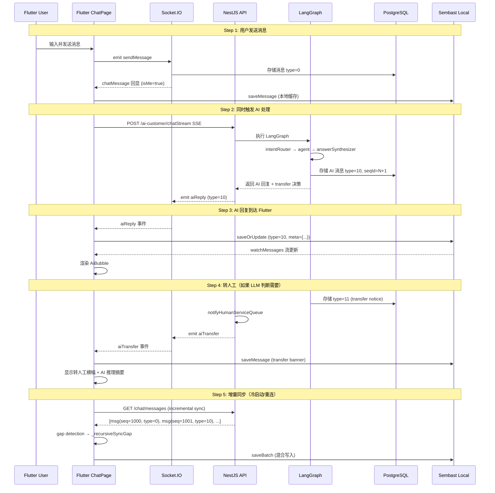

# 21. 数据层融合方案 — Spec-Coding 深度分析

> 对应问题："聊天历史如何跟 Ai 聊天这些融合呢？都是同一个表？"

## 🎯 本步骤目标

全面分析 **Prisma（PostgreSQL）→ 网络传输（Socket/HTTP）→ Flutter 本地（Sembast/SQLite）** 三层数据链路，验证 AI 消息与人工消息在**同一张表、同一条 seqId 时间线、同一个本地存储**中融合的可行性。

---

## 一、核心结论

### ✅ 零新表、零 Schema 变更

| 层 | 存储 | 结论 |
|---|---|---|
| 服务端 | PostgreSQL (`ChatMessage`) | `type: Int` + `meta: Json?` + `senderId: String?` — 直接兼容 |
| 传输层 | Socket.IO + JSON | `type: 10` + `meta: {steps, intent, ...}` — 协议字段天然支持 |
| 客户端 | Sembast（NoSQL 文档） | 无 Schema 约束，直接存 JSON — 无需迁移 |

**不需要新建任何表**。AI 消息与人工消息共享：

- ✅ 同一张 `ChatMessage` 表（PostgreSQL）
- ✅ 同一套 `seqId` 全局序列号（统一时间线排序）
- ✅ 同一个 `@@index([conversationId, seqId])` 索引（历史查询）
- ✅ 同一个 `Conversation.lastMsgContent/Type/Time` 快照（列表渲染）
- ✅ 同一个 Flutter Sembast `_messageStore`（本地存储）
- ✅ 同一个 `ChatViewModel.watchMessages` 流（UI 实时更新）

---

## 二、服务端数据模型分析（Prisma / PostgreSQL）

### 2.1 ChatMessage 模型 — 关键字段兼容性

```prisma
model ChatMessage {
  id             String   @id @default(cuid())
  conversationId String
  senderId       String?  // Null = 系统消息
  type           Int      @default(0) // 0:Text, 1:Image, 2:Audio, 3:Video, 99:System
  content        String   // 文本或 URL
  meta           Json?    // {w, h, duration, size, blurHash}
  seqId          Int      // 序列号 — 统一排序
  clientTempId   String?  // 前端去重
  isRecalled     Boolean  @default(false)
  createdAt      DateTime @default(now())

  @@index([conversationId, seqId])
}
```

**逐字段分析：**

| 字段 | 当前用途 | AI 消息兼容策略 | 冲突风险 |
|---|---|---|---|
| `type` | 0=Text, 1=Image, 99=System | **`type=10`** 定义为 `MessageType.ai` | 无。Int 类型可任意扩展 |
| `meta` | 图片宽高、音频时长 | **`meta={steps, intent, transferReason, needsHumanTransfer, ...}`** LLM 推理元数据 | 无。Json 字段无 Schema 约束 |
| `senderId` | 发送者 User ID | **`null`**（系统消息）或 AI 专用虚拟用户 ID | 无。`senderId: String?` 已经允许 null |
| `content` | 文本内容 | **AI 回复文本** | 无 |
| `seqId` | 统一序列号 | **AI 消息也分配 seqId**，与人工消息共用发号器 | 无。同时间线排序 |
| `clientTempId` | 前端去重 | AI 消息不需要 clientTempId（服务端生成） | 无 |
| `isRecalled` | 消息撤回 | AI 消息不可被撤回 | 无 |
| `createdAt` | 时间戳 | AI 消息生成时的时间戳 | 无 |

### 2.2 新增 type 常量

在现有 types 基础上扩展（已有：0=Text, 1=Image, 2=Audio, 3=Video, 99=System）：

```typescript
// apps/api/src/client/ai-customer/constants.ts
export const MessageType = {
  TEXT: 0,
  IMAGE: 1,
  AUDIO: 2,
  VIDEO: 3,
  SYSTEM: 99,
  AI: 10,         // [新增] AI 客服回复
  AI_TRANSFER: 11, // [新增] 转人工通知消息（系统级，显示转人工横幅）
} as const;
```

### 2.3 Conversation 模型兼容性

```prisma
model Conversation {
  type         ConversationType  // GROUP, DIRECT, SUPPORT, BUSINESS
  businessId   String?           // 客服会话存 userId
  lastMsgContent String?         // 列表快照
  lastMsgType    Int?            // 列表快照类型
  lastMsgSeqId   Int             // 列表快照 seqId
  lastMsgSenderId String?        // 列表快照发送者
  // ...
}
```

**关键发现：** `ConversationType` 已经有 `SUPPORT` 类型。

```prisma
enum ConversationType {
  GROUP    // 手动创建的群
  DIRECT   // 私聊
  SUPPORT  // 客服聊天 ← 客服会话直接用这个类型！
  BUSINESS // 自动业务群
}
```

**AI 客服会话使用策略：**

- `type` = `SUPPORT`（已有，无需新增）
- `businessId` = `userId`（关联用户，方便查找用户的客服会话）
- `lastMsgContent` = AI 回复内容（与人工消息共用快照字段）
- `lastMsgType` = `10`（AI 类型，列表页显示 🤖 图标）
- `lastMsgSenderId` = `null`（或 AI 虚拟用户 ID）

### 2.4 CONFIRMED: 不需要新表

ChatMessage 表当前设计完全覆盖 AI 消息需求：

```
┌─────────────────────────────────────────────────────────┐
│                    ChatMessage (单表)                     │
├───────────┬──────────┬──────────┬────────────────────────┤
│  人工消息   │  系统消息  │  AI 回复  │  转人工通知            │
│ type=0     │ type=99  │ type=10  │ type=11               │
│ senderId=X │ senderId=│ senderId=│ senderId=null          │
│            │ =null    │ =null    │ meta={reason, target}  │
│ meta={}    │ meta={}  │ meta={   │                        │
│            │          │   steps, │                        │
│            │          │   intent,│                        │
│            │          │   transfer│                       │
│            │          │ }        │                        │
└───────────┴──────────┴──────────┴────────────────────────┘
           ↑ 全部共享 seqId 全局排序 ↑
```

---

## 三、传输层分析（Socket.IO + HTTP）

### 3.1 双通道架构

```
用户发送消息
     │
     ├──▶ Socket.IO ──▶ 人工客服可见
     │      事件: sendMessage
     │
     └──▶ HTTP POST /ai-customer/chatStream (SSE) ──▶ LangGraph 处理
              │
              ▼
         answerSynthesizer 节点（JSON 输出）
              │
              ├── needsHumanTransfer=false ──▶ emit aiReply (Socket) ──▶ 用户可见
              └── needsHumanTransfer=true  ──▶ emit aiReply + notifyHumanServiceQueue
                                                    │
                                                    ▼
                                              emit aiTransfer (Socket) ──▶ 用户可见转人工横幅
```

### 3.2 新 Socket 事件定义

```typescript
// 服务端 → 客户端
interface ServerToClientEvents {
  // 现有事件
  chatMessage: (msg: ChatMessageDto) => void;

  // [新增] AI 回复事件
  aiReply: (data: {
    conversationId: string;
    messageId: string;
    content: string;           // AI 回复文本
    type: 10;                  // MessageType.AI
    seqId: number;
    meta: {
      steps?: Array<{         // 推理步骤（可选，前端可折叠显示）
        label: string;
        content: string;
      }>;
      intent?: string;         // 识别的用户意图
      needsHumanTransfer: boolean;  // 是否需要转人工
      transferReason?: string;      // 转人工原因
    };
    createdAt: number;         // unix ms
  }) => void;

  // [新增] 转人工通知事件
  aiTransfer: (data: {
    conversationId: string;
    messageId: string;
    reason: string;
    agentId?: string;          // 目标客服（可选）
    estimatedWait?: number;    // 预计等待时间（秒）
  }) => void;
}

// 客户端 → 服务端
interface ClientToServerEvents {
  sendMessage: (data: SendMessageDto) => void;
  // 不需要新增 — 用户消息走现有 sendMessage 事件
}
```

### 3.3 序列化兼容性

`aiReply` 事件的 JSON 结构可以直接映射到 Prisma `ChatMessage` 的字段：

```json
{
  "id": "cm-xxxx",
  "conversationId": "conv-xxx",
  "senderId": null,
  "type": 10,
  "content": "您的订单 #12345 当前状态是: 已发货...",
  "meta": {
    "intent": "order_query",
    "steps": [
      {"label": "查询订单", "content": "正在查询订单 #12345..."},
      {"label": "获取物流", "content": "从物流接口获取最新状态..."}
    ],
    "needsHumanTransfer": false,
    "transferReason": null
  },
  "seqId": 1042,
  "createdAt": "2026-06-24T14:20:00.000Z"
}
```

→ **直接可以 `INSERT INTO ChatMessage`，无需转换。**

---

## 四、Flutter 本地存储分析（Sembast）

### 4.1 存储引擎：Sembast（NoSQL 文档型）

```dart
class LocalDatabaseService {
  static final _messageStore = stringMapStoreFactory.store('messages');
  // messages 是一个 NoSQL 集合，每条记录是一个 JSON 文档
}
```

**关键特性：** Sembast 是 Schema-less 文档数据库。不需要建表、不需要迁移。

### 4.2 ChatUiModel 序列化兼容性

```dart
enum MessageType {
  text(0),
  image(1),
  audio(2),
  video(3),
  recalled(4),
  file(5),
  location(6),
  system(99);
  // [即将添加] ai(10)
}

class ChatUiModel extends Equatable {
  final int? seqId;
  final String content;
  final MessageType type;
  final bool isMe;
  final String? senderName;
  final String? senderAvatar;
  final Map<String, dynamic>? meta;  // ← 已经有这个字段！
  // ...
}
```

**序列化到 JSON：**

```dart
Map<String, dynamic> toJson() => {
  'id': id,
  'seqId': seqId,
  'content': content,
  'type': type.value,       // ← type=10 作为 int 存储，Sembast 完全支持
  'isMe': isMe,
  'meta': meta,              // ← Map 自动序列化为 JSON 对象
  // ...
};
```

**从 JSON 反序列化：**

```dart
factory ChatUiModel.fromJson(Map<String, dynamic> json) {
  return ChatUiModel(
    type: json['type'] is int
        ? MessageType.fromValue(json['type'] as int)  // ← fromValue(10) 需要支持
        : /* ... */,
    meta: json['meta'] as Map<String, dynamic>? ?? {},  // ← 直接解析
    // ...
  );
}
```

### 4.3 需要的最小改动

```dart
// 文件: chat_ui_model.dart
// 1. 在 MessageType 枚举中新增
enum MessageType {
  text(0),
  image(1),
  audio(2),
  video(3),
  recalled(4),
  file(5),
  location(6),
  ai(10),       // [新增] AI 客服回复
  aiTransfer(11), // [新增] 转人工通知
  system(99);
}
```

**注意：** `MessageType.fromValue()` 方法已经支持通过 `.value` 查找，新增 `ai(10)` 后自动兼容：

```dart
static MessageType fromValue(int value) => MessageType.values.firstWhere(
      (e) => e.value == value,
  orElse: () => MessageType.text,  // 未知类型 fallback 到 text
);
```

### 4.4 存储流程（无需迁移）

当 `aiReply` Socket 事件到达时：

```
Socket 事件 aiReply
    │
    ▼
ChatRoomController / ChatEventHandler
    │ 构造 ChatUiModel(... type: MessageType.ai, meta: {...})
    ▼
MessageRepository.saveOrUpdate(chatUiModel)
    │
    ▼
LocalDatabaseService.saveMessage(ChatUiModel)
    │  msg.toJson() → {'id': '...', 'type': 10, 'meta': {...}, ...}
    │  _messageStore.record(id).put(txn, jsonMap)
    ▼
Sembast 存储成功（无需 Schema 变更！）
    │
    ▼
watchMessages 流触发
    │
    ▼
ChatViewModel state 更新 → UI 重建 → AiBubble 渲染
```

### 4.5 `_mergeMessageData` 的 Meta 深度合并 — 天然优势

```dart
Map<String, dynamic> _mergeMessageData(oldData, newData) {
  // ...
  // Defense: Deep merge Meta information
  final oldMeta = oldData['meta'] as Map<String, dynamic>? ?? {};
  final newMeta = merged['meta'] as Map<String, dynamic>? ?? {};
  merged['meta'] = {...oldMeta, ...newMeta};
  // ...
}
```

当 AI 消息分多次推送（streaming）时，`meta` 字段可以逐步合并：
- 第一次推送：`meta = {intent: "order_query", steps: [{...}]}`
- 第二次推送：`meta = {intent: "order_query", steps: [{...}, {...}]}`
- 合并结果：`meta = {intent: "order_query", steps: [step1, step2]}`
- **旧字段保留，新字段追加** — 不会丢失数据。

---

## 五、同步算法分析（Gap Detection + seqId）

### 5.1 现有同步流程

```
ChatViewModel._init()
  ├── Step 0: 初始化 DB
  ├── Step 1: 从本地预加载（getHistory，立即显示缓存）
  ├── Step 2: 订阅 reactive stream（watchMessages，实时更新）
  └── Step 3: 增量同步（performIncrementalSync，从服务器拉取最新）
```

### 5.2 AI 消息如何融入同步

```
performIncrementalSync()
    │
    ├── 1. 获取本地最大 seqId: localMaxSeqId = getMaxSeqId()
    │
    ├── 2. 从服务器拉取最新消息: GET /api/chat/messages?conversationId=X&cursor=null
    │     ↓
    │     返回的消息列表中包含: 人工消息(type=0) + AI 消息(type=10) + 系统消息(type=99)
    │     所有消息按 seqId 排序（服务器端）
    │
    ├── 3. gap 检测: serverMaxSeqId > localMaxSeqId 吗？
    │     ├── 是 → 调用 _recursiveSyncGap() 填充缺失消息
    │     └── 否 → 没有新消息
    │
    └── 4. _saveApiMessages() → ChatUiModelMapper.fromApiModel() → saveBatch()
```

**AI 消息的 `seqId` 分配策略：**

```
现有 seqId 分配（已有机制）:
  用户发送消息 → 服务端 ChatMessage 创建 → seqId = 当前 max + 1

AI 消息 seqId 分配（同一机制）:
  LangGraph 生成回复 → AiCustomerService 创建 ChatMessage →
  seqId = 当前 max + 1 ← 与人工消息共用发号器！

结果: 时间线上 AI 消息和人工消息按创建顺序混合排列
```

### 5.3 混合时间线示例

```
seqId   type   senderId     content
──────────────────────────────────────────
1000    0      user1        "你好，我想查一下我的订单"
1001    10     null         [AI] "好的，正在为您查询..."
1002    0      user1        "还有我的优惠券"
1003    10     null         [AI] "您有 3 张优惠券可用..."
1004    0      agent1       [人工] "您好，我是客服小王，有什么可以帮助您的？"
1005    0      user1        "我要退款"
1006    10     null         [AI] "检测到退款请求，正在为您转接人工..."
1007    11     null         [系统] "已转接人工客服，请稍候..."
```

> 💡 **注意：** 人工客服 `agent1` 的回复（seqId=1004）出现在 AI 回复（seqId=1003）之后，是因为人力客服回复需要时间。seqId 保证了**全局插入顺序**。

### 5.4 现有代码无需改动同步逻辑

```dart
// ChatUiModelMapper.fromApiModel — 当前映射逻辑
static ChatUiModel fromApiModel(ChatMessage apiMsg, String conversationId, [String? currentUserId]) {
  MessageType uiType = MessageType.fromValue(apiMsg.type);  // ← 传入 type=10，返回 MessageType.ai
  // ... 其他字段映射 ...
  return ChatUiModel(
    id: apiMsg.id.toString(),
    seqId: apiMsg.seqId,        // ← 统一 seqId
    type: uiType,               // ← 自动映射
    content: apiMsg.content,    // ← AI 回复内容
    meta: meta,                 // ← AI 推理步骤等元数据
    isMe: false,                // ← AI 消息不是自己发的
    status: MessageStatus.success,
    // ...
  );
}
```

---

## 六、ChatRoomController 初始化与事件流分析

### 6.1 当前初始化流程

```
chatControllerProvider (Riverpod Provider)
    │
    └── ChatRoomController(socketService, conversationId, ref, currentUserId, repo)
            │
            ├── constructor:
            │     _eventHandler = ChatEventHandler(conversationId, ref, socketService, currentUserId)
            │     WidgetsBinding.instance.addObserver(this)
            │
            └── activate():
                  ├── _eventHandler.init()   ← 订阅 Socket 事件
                  └── checkAndMarkRead()     ← 检查未读
```

### 6.2 AI 事件集成点

AI 事件不需要修改 `ChatRoomController` 本身，只需要在 `ChatEventHandler` 中扩展：

```dart
// 在 ChatEventHandler.init() 中新增监听
class ChatEventHandler {
  void init() {
    // 现有监听
    _socketService.on('chatMessage', _handleChatMessage);

    // [新增] AI 回复监听
    _socketService.on('aiReply', _handleAiReply);
    // [新增] 转人工通知监听
    _socketService.on('aiTransfer', _handleAiTransfer);
  }

  void _handleAiReply(Map<String, dynamic> data) {
    final msg = ChatUiModel(
      id: data['messageId'],
      seqId: data['seqId'],
      content: data['content'],
      type: MessageType.ai,
      isMe: false,
      createdAt: data['createdAt'],
      conversationId: data['conversationId'],
      senderName: 'AI 客服',
      senderAvatar: 'ai_bot_avatar_url',
      meta: data['meta'] as Map<String, dynamic>?,
      status: MessageStatus.success,
    );
    _repo.saveOrUpdate(msg);
  }

  void _handleAiTransfer(Map<String, dynamic> data) {
    // 保存一条转人工系统消息
    final msg = ChatUiModel(
      id: data['messageId'],
      seqId: data['seqId'],   // 从服务器获取
      content: '🔄 已为您转接人工客服，请稍候...',
      type: MessageType.aiTransfer,  // 或 system(99)
      isMe: false,
      createdAt: DateTime.now().millisecondsSinceEpoch,
      conversationId: data['conversationId'],
      meta: {
        'reason': data['reason'],
        'agentId': data['agentId'],
        'estimatedWait': data['estimatedWait'],
      },
      status: MessageStatus.success,
    );
    _repo.saveOrUpdate(msg);
    // 触发 UI 状态：展示转人工横幅
  }
}
```

### 6.3 双通道消息去重

用户消息发出后，同时进入 Socket（人工可见）和 HTTP AI 端点（AI 处理）。可能出现：

- **场景：** 用户消息通过 Socket 回显（chatMessage 事件）和 AI 回复（aiReply 事件）先后到达
- **结论：** 不冲突。`chatMessage` 事件回显的是用户自己的消息（`isMe=true`），`aiReply` 事件是 AI 消息（`type=10, isMe=false`），两个事件写入不同消息记录。

---

## 七、完整数据流图



---

## 八、AI 消息 `meta` 字段规范

### 8.1 服务端存储格式（PostgreSQL JsonB）

```json
{
  "intent": "order_query",
  "confidence": 0.95,
  "steps": [
    {
      "label": "查询订单",
      "content": "正在查询订单 #12345...",
      "duration_ms": 320
    },
    {
      "label": "获取物流信息",
      "content": "从物流接口获取最新状态...",
      "duration_ms": 450
    }
  ],
  "needsHumanTransfer": false,
  "transferReason": null,
  "transferTarget": null,
  "agentId": null,
  "model": "qwen3.5:0.8b",
  "tokensUsed": {
    "prompt": 1240,
    "completion": 320
  }
}
```

### 8.2 Flutter 端使用

```dart
// 在 AiBubble widget 中读取
final meta = message.meta ?? {};
final steps = meta['steps'] as List<dynamic>? ?? [];
final intent = meta['intent'] as String? ?? '';
final needsTransfer = meta['needsHumanTransfer'] as bool? ?? false;
final transferReason = meta['transferReason'] as String?;
```

---

## 九、需要修改的文件清单

### 9.1 Flutter 端（最小修改集）

| 文件 | 修改内容 | 风险 |
|---|---|---|
| `chat_ui_model.dart` | `MessageType` 枚举新增 `ai(10)`, `aiTransfer(11)` | 低。纯枚举扩展 |
| `chat_event_handler.dart` | 新增 `_handleAiReply`, `_handleAiTransfer` 方法 | 低。新方法独立 |
| `chat_bubble.dart` 或新建 `ai_bubble.dart` | 新增 `AiBubble` widget（机器头像+折叠步骤+转人工横幅） | 中。UI 组件 |
| `chat_page.dart` | 在 `MessageType.ai` 时渲染 `AiBubble` 而非 `ChatBubble` | 低。条件分支 |
| `modern_chat_input_bar.dart` | 新增 AI 状态指示器（isAiResponding 时显示打字动画） | 低。UI 状态 |

**不需要修改：**

- ❌ `LocalDatabaseService` — Sembast 自动兼容
- ❌ `MessageRepository` — `saveOrUpdate` / `saveBatch` 通用
- ❌ `ChatViewModel` — `watchMessages` 流通用
- ❌ `ChatRoomController` — 事件由 `ChatEventHandler` 处理
- ❌ `ChatUiModelMapper` — `MessageType.fromValue(10)` 自动返回 `MessageType.ai`

### 9.2 服务端（NestJS）

| 文件 | 修改内容 |
|---|---|
| `ai-customer.service.ts` | `chatStream()` 方法：graph 执行后检查 `needsHumanTransfer`，如需要则调用 `notifyHumanServiceQueue()` |
| 新增 `POST /ai-customer/transfer` | 用户主动请求转人工端点 |
| `chat.gateway.ts` | 新增 `emitAiReply()` 和 `emitAiTransfer()` 方法 |
| `socket-io.gateway.ts` | 注册新事件 |

---

## 十、边界情况与风险分析

### 10.1 AI 回复延迟导致 seqId 插入顺序异常

**现象：** 用户连续发送两条消息，AI 对第一条的回复可能在第二条之后到达。

```
seqId 1000: 用户消息 "查订单"
seqId 1001: 用户消息 "还有我的优惠券"  ← 第二条消息先入库
seqId 1002: AI 回复 "正在查询订单..."  ← AI 回复后到达
```

**影响：** 本地增量同步时，seqId=1002 会触发 gap detection，填充 seqId=1001 的消息。**这是正常行为**，现有 gap detection 算法已经处理。

### 10.2 手动转人工 + AI 同时判断转人工

**场景：** 用户点击"转人工"按钮的同时，AI 也判断需要转人工。

**处理：** 服务端做幂等处理。检查该 conversation 是否已经有 `needsHumanTransfer=true` 的消息，如果有则跳过重复通知。

### 10.3 AI 流式回复（SSE streaming）与 Socket 冲突

**场景：** AI 回复通过 SSE 流式返回，同时也通过 Socket `aiReply` 推送。

**设计决策：** **不使用 SSE 流式回复给 Flutter 客户端。** Flutter 通过 Socket `aiReply` 接收完整 AI 回复（非流式）。SSE 只在服务端内部使用（LangGraph streaming 用于日志/监控），最终结果通过 Socket 推送。

### 10.4 AI 消息的 isMe 字段

AI 消息的 `isMe` 始终为 `false`。这影响：
- 气泡对齐方式（AI 气泡靠左，与人工客服一致）
- 未读计数（`isMe=false` 的消息会计入未读）
- 已读回执（AI 消息不需要已读回执）

---

## 十一、验收标准

### AC-01: AI 消息与人工消息同表存储

1. 在 PostgreSQL 中 `ChatMessage` 表插入一条 `type=10` 和一条 `type=0` 的消息
2. 查询 `WHERE conversationId=X ORDER BY seqId ASC`
3. ✅ 两条消息按 seqId 混合排序返回

### AC-02: Flutter 本地同时存储两种类型

1. 模拟收到 `chatMessage` 事件（type=0）和 `aiReply` 事件（type=10）
2. 检查 Sembast `_messageStore` 中两条记录
3. ✅ 两条记录均成功持久化

### AC-03: 增量同步包含 AI 消息

1. 服务端有 type=0 和 type=10 的消息混合
2. Flutter 执行 `performIncrementalSync()`
3. ✅ `_saveApiMessages()` 成功映射并保存所有类型

### AC-04: gap detection 跨类型工作

1. 本地有 seqId=1000, 1002；服务端有 1000, 1001(type=10), 1002
2. Flutter 执行增量同步
3. ✅ `_recursiveSyncGap()` 获取 seqId=1001，写入本地，`MessageType.fromValue(10)` 返回 `MessageType.ai`

### AC-05: meta 字段深度合并

1. 本地 AI 消息的 `meta = {intent: "order_query", steps: [step1]}`
2. 服务端同步后 `meta = {intent: "order_query", steps: [step1, step2]}`
3. ✅ `_mergeMessageData` 深度合并，旧步骤不丢失

---

## 十二、与现有文档的关系

| 文档 | 关系 |
|---|---|
| [`20-Flutter-AI-人工融合方案.md`](plans/joymini-nest-monorepo/20-Flutter-AI-人工融合方案.md) | 本分析是 20 号文档的**数据层深度补充**。20 号文档侧重架构和业务逻辑，本文档侧重数据模型的逐字段兼容性验证 |
| [`15-Flutter-AI-Chat页面集成.md`](plans/joymini-nest-monorepo/15-Flutter-AI-Chat页面集成.md) | 本文档验证了 Page 集成中数据层改动的最小性 |
| [`16-Flutter-AI-ChatClient与Socket集成.md`](plans/joymini-nest-monorepo/16-Flutter-AI-ChatClient与Socket集成.md) | 本文档验证了 Socket 事件中的序列化兼容性 |
| [`spec-coding-analysis.md`](plans/joymini-nest-monorepo/spec-coding-analysis.md) | 本文档是本项目 Spec-Coding 分析系列在数据层的延续 |

---

## 十三、关键设计决策记录

| 决策 | 选择 | 替代方案 | 理由 |
|---|---|---|---|
| AI 消息存储 | 同一张 ChatMessage 表 | 新建 ai_messages 表 | 零 Schema 变更，自然融入现有 seqId 排序、增量同步、本地缓存 |
| AI 消息 type 值 | 10 | 使用 System(99) + 子类型 | 独立 type 便于前端条件渲染，不与 System 消息混淆 |
| 传输协议 | Socket.IO `aiReply` 事件 | SSE 流式直推 Flutter | Flutter 已有完善的 Socket 架构，复用现有事件处理流程；避免 SSE 断线重连的复杂性 |
| AI 消息发送者 | `senderId=null`（系统消息） | 创建 AI 虚拟用户 | 无需创建虚拟用户，系统消息模式已经成熟 |
| 本地存储迁移 | 无需迁移 | 需要 DB migration | Sembast 是 NoSQL 文档型存储，无 Schema 约束 |

---

## 十四、总结

**一句话结论：** 聊天历史与 AI 聊天使用**同一张 `ChatMessage` 表**，服务端零 Schema 变更，Flutter 端只需在 `MessageType` 枚举新增一个值、在 `ChatEventHandler` 新增两个事件处理方法，即可实现 AI 消息与人工消息在同一个时间线、同一个存储、同一个同步算法中的完整融合。

**最小修改集（Flutter 端）：**
- 1 个枚举扩展（`MessageType.ai`）
- 2 个事件处理方法（`_handleAiReply`, `_handleAiTransfer`）
- 1 个 UI 组件（`AiBubble`）
- 1 个条件分支（在 ChatPage 中根据 type 选择渲染组件）

**服务端修改集：**
- `AiCustomerService` 新增 post-graph 转人工检查
- `ChatGateway` 新增 `emitAiReply` 方法
- 新增 `POST /ai-customer/transfer` 端点
