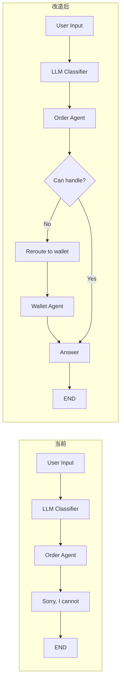
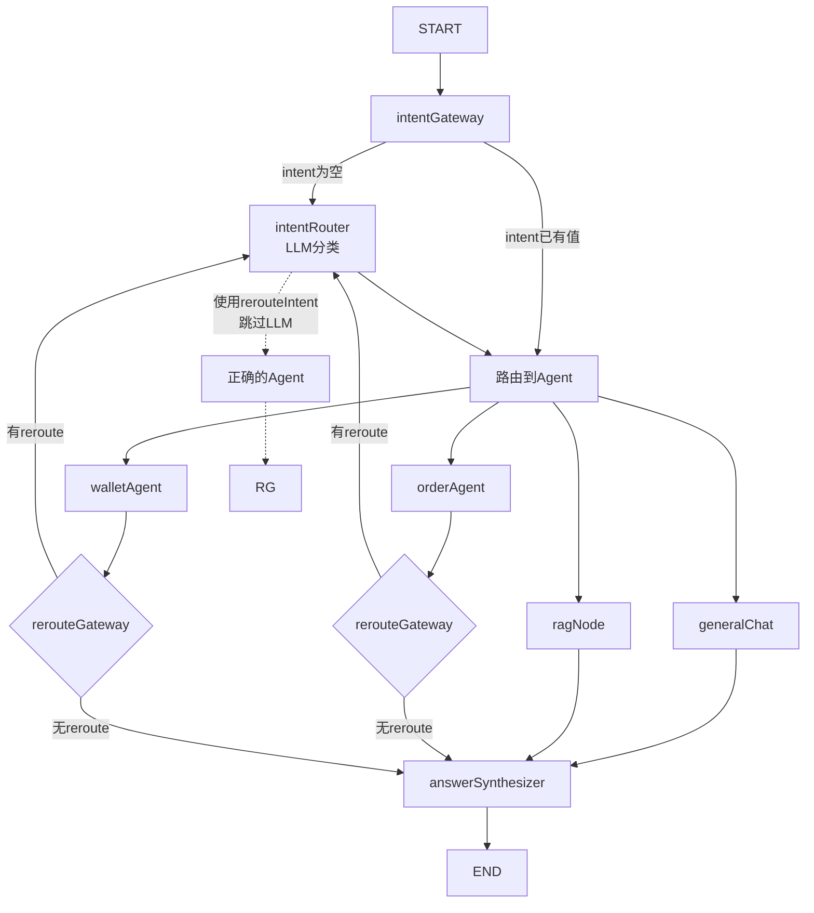
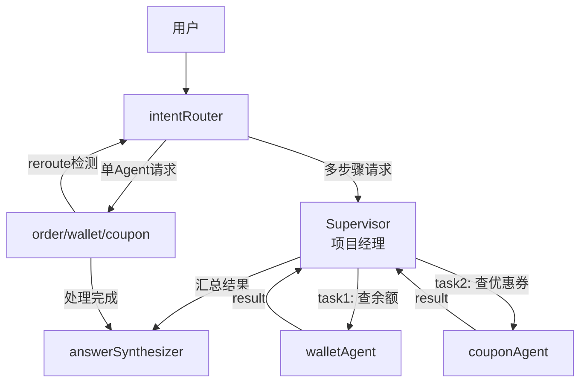

# 23 — Agent Re-routing 架构：解决意图分类误判

> ⛔ **DEPRECATED — 此架构已被 orchestrator 流水线取代**
>
> Reroute 机制已被移除。当前架构通过多标签意图分类 + orchestrator 依赖排序解决意图误判问题。
> 详见: [`orchestrator.config.ts`](../../apps/api/src/client/ai-customer/graph/config/orchestrator.config.ts)
>
> 本文档描述的 reroute 机制（`rerouteIntent` + `rerouteGateway`）已在 Supervisor Pattern 实现过程中被删除。
> - `rerouteIntent` 字段已从 state.ts 中移除
> - `rerouteGateway` 条件边已从 customer.graph.ts 中移除
> - Agent Prompt 中的 Reroute Rule 已被删除
>
> Supervisor Pattern 通过 `isSupervised` + `tasks` + `supervisorRound` 指针式路由处理所有多步骤请求，不再需要 reroute 纠错机制。
>
> **新文档**：[`24-Supervisor架构完整总结`](24-Supervisor架构完整总结.md)
>
> **2026-06-30 更新 — 方案 B 决策：** Supervisor Node 将去掉 LLM 分解代码，降级为纯 round 计数器（方案 B / 单轮单 Agent）。
> 因此 reroute 机制不会再被需要。详见 [`33-工作流型智能体16挑战对标.md`](33-工作流型智能体16挑战对标.md)

## 🎯 目标

解决 LLM 意图分类器在跨语言场景下的误判问题，不依赖 per-language 关键词或 prompt 补丁。

## 问题分析

### 当前架构

```
User input → LLM classifier → Agent → Agent says sorry → END (dead end)
```

这是一个 **单点故障** 架构。整个对话质量取决于一次 LLM 分类调用的准确性。一旦分类错误，没有恢复路径。

### 真实案例

| 输入 | 预期 | 实际 | 根因 |
|------|------|------|------|
| `购买记录` | order | wallet ❌ | LLM 将"记录"匹配到 transaction records |
| `充值记录` | wallet | order ❌ | LLM 将"记录"匹配到 purchase records |
| `商品记录` | order | wallet ❌ | LLM 将"商品"匹配到 product category |

### 根因

1. **语言鸿沟**：Prompt 是英文，输入是中文，LLM 需要内部翻译，翻译有损
2. **名词优先**：LLM 倾向匹配名词（"记录"）而非动词/动作（"充值"、"购买"）
3. **无反馈回路**：一次分类错误 → 不可恢复

### 错误思路

- 加英文示例 → 还是不理解中文
- 加语义轴 Include/Exclude → 区分不了"充值记录"vs"购买记录"
- 加中文关键词 → "世界那么多语言，每个都要写一次？"
- Embedding 分类 → 仍然是"一次分类完美"的错误思路，"X记录"的 embedding 本身就相近

**核心结论**：任何单次分类器（LLM / Embedding）都有误差率。正确架构是**接受误差，加反馈回路**。

## 架构设计：Agent Re-routing

### 核心思想

**Agent 自己最清楚自己能做什么。** 如果用户问"充值记录"但被路由到 order Agent，order Agent 发现自己没有充值工具，就应该触发**重新路由**。

### 数据流对比



### 状态变更

在 [`AgentState`](apps/api/src/client/ai-customer/graph/state.ts) 中新增字段：

```typescript
export const AgentState = Annotation.Root({
  // ... 现有字段 ...
  
  // Agent Re-routing:
  // 当 Agent 发现用户请求不在自己工具范围内时，
  // 设置此字段为正确的 intent 名称
  // Intent Router 发现此字段有值 → 跳过 LLM，直接使用
  rerouteIntent: Annotation<string>({
    reducer: (a: string, b: string) => b,
    default: () => '',
  }),
});
```

### Agent 修改

每个 Agent 的 system prompt 末尾加上：

```text
## Reroute Rule
If the user's request is clearly outside the scope of your available tools and belongs to another service category, output exactly:
[REROUTE:intent_name]

Valid intent names: order, wallet, coupon, user, product, lucky-draw, rag, general

Examples:
- User asks about recharge records → you have no recharge tools → [REROUTE:wallet]
- User asks about purchase history → you have no order tools → [REROUTE:order]
```

Agent 返回前检测输出中是否包含 `[REROUTE:...]` 模式，如果命中则提取 intent 并设置 `rerouteIntent`。

### Intent Router 修改

在 [`createIntentRouterNode`](apps/api/src/client/ai-customer/graph/nodes/intent-router.node.ts) 中：

```typescript
export const createIntentRouterNode =
  (llmConfig: LlmProviderConfig) =>
  async (state: typeof AgentState.State) => {
    // Step 1: 检查是否有 reroute 请求
    if (state.rerouteIntent) {
      const reroute = state.rerouteIntent;
      logger.log(`[intentRouter] reroute detected: ${reroute}`);
      return {
        intent: reroute,
        rerouteIntent: '', // 清除 reroute，防止死循环
      };
    }
    
    // Step 2: 正常 LLM 分类（保持现有逻辑）
    // ... 现有代码 ...
  };
```

### Graph 修改

在 [`customer.graph.ts`](apps/api/src/client/ai-customer/graph/customer.graph.ts) 中：

```typescript
// 新增：检查是否需要 reroute 的条件边函数
const rerouteGateway = (state: typeof AgentState.State): string => {
  return state.rerouteIntent ? 'intentRouter' : 'answerSynthesizer';
};

// 修改 Agent → AnswerSynthesizer 的直连边
// 改为 Agent → rerouteGateway → intentRouter（如果有 reroute）
//                   → answerSynthesizer（如果没有）
.addConditionalEdges('orderAgent', rerouteGateway, {
  intentRouter: 'intentRouter',
  answerSynthesizer: 'answerSynthesizer',
})
.addConditionalEdges('walletAgent', rerouteGateway, {
  intentRouter: 'intentRouter',
  answerSynthesizer: 'answerSynthesizer',
})
```

### 完整流程图



### 执行示例

```
Turn 1: User says "充值记录"

1. START → intentGateway (intent='' → intentRouter)
2. intentRouter → LLM classifies "充值记录" → "order" (错误)
3. routerByIntent → orderAgent
4. orderAgent 检查工具：只有 order tools，没有 recharge tools
5. orderAgent 输出: "..." + [REROUTE:wallet]
6. rerouteGateway 检测到 rerouteIntent='wallet' → intentRouter
7. intentRouter 看到 rerouteIntent='wallet' → 直接返回 intent='wallet'
8. routerByIntent → walletAgent ✅
9. walletAgent 有充值和余额工具 → 返回充值记录
10. answerSynthesizer → END
```

## 涉及文件

| 文件 | 修改类型 | 说明 |
|------|----------|------|
| [`state.ts`](apps/api/src/client/ai-customer/graph/state.ts) | 新增字段 | 添加 `rerouteIntent` |
| [`intent-router.node.ts`](apps/api/src/client/ai-customer/graph/nodes/intent-router.node.ts) | 修改逻辑 | 优先检查 `rerouteIntent` |
| [`customer.graph.ts`](apps/api/src/client/ai-customer/graph/customer.graph.ts) | 新增边 | 添加 `rerouteGateway` 条件边 |
| [`order-agent.node.ts`](apps/api/src/client/ai-customer/graph/nodes/order-agent.node.ts) | 修改 prompt + 检测逻辑 | 加 reroute 指令，检测输出 |
| [`wallet-agent.node.ts`](apps/api/src/client/ai-customer/graph/nodes/wallet-agent.node.ts) | 修改 prompt + 检测逻辑 | 加 reroute 指令，检测输出 |
| [`agent-types.ts`](apps/api/src/client/ai-customer/graph/types/agent-types.ts) | 可选：类型定义 | 可加 RerouteResult 类型 |

## 不涉及的文件

- 不需要修改 tools
- 不需要修改 answerSynthesizer
- 不需要修改 ai-customer.service / controller
- 不需要安装新依赖

## 验收标准

| 测试输入 | 预期行为 |
|----------|----------|
| `"充值记录"` | orderAgent → 检测到不能处理 → reroute → walletAgent → 返回充值记录 |
| `"购买记录"` | 直接路由到 orderAgent → 返回购买记录 |
| `"提现"` | 直接路由到 walletAgent → 正常提现流程 |
| `"退款"` | direct路由到 orderAgent → 正常退款流程 |
| `"你好"` | 路由到 generalChat → 正常问候 |

## 下一步进化：Supervisor Pattern（多 Agent 协作）

### 为啥要升级

Reroute 解决了 **单 Agent 选错**的问题，但处理不了 **多 Agent 协作**的场景：

| 请求 | Reroute 能处理？ | 需要 Supervisor？ |
|------|:---------------:|:----------------:|
| "查余额" | ✅ 直接路由到 wallet | ❌ |
| "充值记录" | ✅ reroute 到 wallet | ❌ |
| "查余额后看看有没有优惠券" | ❌ 需要先查 wallet 再查 coupon | ✅ |
| "最近订单，超时的话申请退款" | ❌ 需要 order + wallet 协作 | ✅ |

### 架构：IntentRouter 分流 + Supervisor

不是替换 IntentRouter，而是让 IntentRouter 做**分流**：



### 关键原则：零开销

- **简单请求**: IntentRouter → Agent → answerSynthesizer（和现在一样，1 次 LLM）
- **错误请求**: IntentRouter → Agent → reroute → IntentRouter → 正确 Agent（2 次 LLM，和现在一样）
- **复杂请求**: IntentRouter → Supervisor → Agent1 → Supervisor → Agent2 → answerSynthesizer（3+ 次 LLM，只有复杂请求才多花）

### Supervisor Node 核心逻辑

```typescript
// supervisor.node.ts — 项目经理节点
// 输入: 用户消息 + 历史
// 输出: { action: "route" | "finalize", tasks: [...], finalResponse?: string }

const supervisorLlm = llm.withStructuredOutput({
  type: "object",
  properties: {
    action: { type: "string", enum: ["route", "finalize"] },
    tasks: {
      type: "array",
      items: {
        type: "object",
        properties: {
          agent: { type: "string", enum: ["order", "wallet", "coupon", "rag", "general"] },
          description: { type: "string" },
        }
      }
    },
    finalResponse: { type: "string" },
  },
});
```

### 与 Reroute 的关系

| 层级 | 角色 | 触发条件 |
|------|------|---------|
| **IntentRouter** | 第一层分类 | 每次请求 |
| **Reroute** | Agent 自检纠错 | Agent 发现处理不了 |
| **Supervisor** | 多 Agent 协作 | 请求需要多个 Agent 配合 |

**三者叠加** → 单 Agent 错误有 reroute 兜底，多 Agent 协作有 Supervisor 管理。

### 参考文档

完整设计方案见 [`docs/AI-joymini/19-MultiAgentSupervisor与HITL.md`](docs/AI-joymini/19-MultiAgentSupervisor与HITL.md)

涉及核心文件：
- 新增: `graph/nodes/supervisor.node.ts`
- 修改: `graph/state.ts`（+ `tasks` / `supervisorOutput` 字段）
- 修改: `graph/customer.graph.ts`（Supervisor 路由逻辑）
- 保留: 现有 reroute 逻辑（`rerouteIntent` / `rerouteGateway`）
