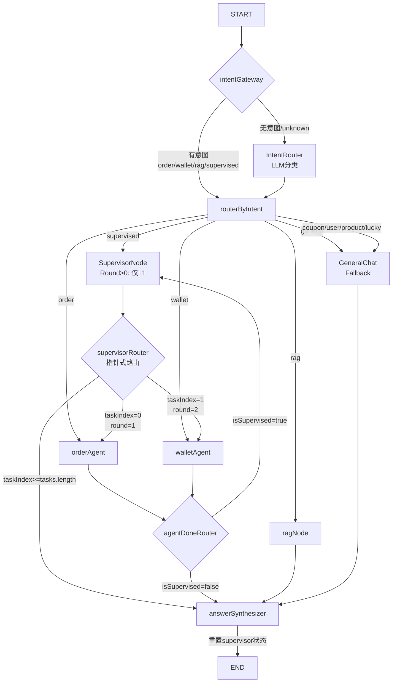

# 24 — Supervisor Pattern 架构完整总结

> **文档状态**：⚠️ **待更新 — 方案 B 决策后需重构**
> >
> > 本文档描述的是 **Plan A（Supervisor LLM 分解）** 的架构。经过 Bug 5（supervisor 幻觉）分析后，团队决定采用 **方案 B（单轮单 Agent）**，详见下文"方案 B 变更说明"。
> >
> **对应代码**：[`customer.graph.ts`](../../apps/api/src/client/ai-customer/graph/customer.graph.ts) | [`supervisor.node.ts`](../../apps/api/src/client/ai-customer/graph/nodes/supervisor.node.ts) | [`state.ts`](../../apps/api/src/client/ai-customer/graph/state.ts)
> **前置文档**：[`04-9Intent路由节点`](04-创建9Intent路由节点.md) | [`05-AnswerSynthesizer与Graph组装`](05-AnswerSynthesizer与Graph组装.md) | [`23-AgentReroute架构`](23-AgentReroute架构.md)（已废弃）
> **关联对标**：[`33-工作流型智能体16挑战对标`](33-工作流型智能体16挑战对标.md)

---

## 一、概述

### 1.1 解决什么问题

用户可能在一个消息中提出**多个领域**的请求，例如：

| 用户输入 | 涉及 Agent | 说明 |
|----------|-----------|------|
| "查我的余额和订单" | walletAgent + orderAgent | 两个独立领域 |
| "查取款和优惠券" | walletAgent + couponAgent | 取款 + 优惠券 |
| "看看我最近的订单和余额" | orderAgent + walletAgent | 订单 + 钱包 |

单 Agent 路由（IntentRouter → 一个 Agent）无法处理这类请求。**Supervisor Pattern** 解决的就是这个问题——把多步骤请求分解成独立任务，按顺序派发给对应的 Specialist Agent。

### 1.2 核心原则

1. **一次只派一个** — Supervisor 不是广播，每次只派发一个任务给对应的 Agent
2. **指针式路由** — 用 `supervisorRound` 作为数组指针，`supervisorRouter` 根据指针取任务
3. **分解只做一次** — round 0 调用 LLM 分解任务，round > 0 只做轮次递增（O(1)）
4. **状态用完即清理** — AnswerSynthesizer 输出后重置所有 supervisor 状态

---

## 二、架构总览

### 2.1 完整流程图



### 2.2 两条路径

| 路径 | 触发条件 | 节点序列 |
|------|---------|---------|
| **单Agent路径** | IntentRouter 返回非 `supervised` 意图 | START → intentGateway → intentRouter → routerByIntent → Agent → answerSynthesizer → END |
| **Supervisor路径** | IntentRouter 返回 `supervised` | START → intentGateway → intentRouter → routerByIntent → supervisorNode → supervisorRouter → Agent → agentDoneRouter → supervisorNode → supervisorRouter → ... → answerSynthesizer → END |

---

## 三、核心组件

### 3.1 State 定义（[`state.ts`](../../apps/api/src/client/ai-customer/graph/state.ts)）

```typescript
export const AgentState = Annotation.Root({
  messages: Annotation<BaseMessage[]>({
    reducer: messagesStateReducer,    // 追加模式
    default: () => [],
  }),
  intent: Annotation<string>({
    reducer: (a: string, b: string) => b,  // 覆盖模式
    default: () => '',
  }),
  // Supervisor 标记 — IntentRouter 设置
  isSupervised: Annotation<boolean>({
    reducer: (a: boolean, b: boolean) => b,
    default: () => false,
  }),
  // Supervisor 任务列表 — SupervisorNode 设置
  tasks: Annotation<Array<{ agent: string; description: string }>>({
    reducer: (a, b) => b,    // 整体替换
    default: () => [],
  }),
  // Agent 执行结果 — 每个 Agent 写入自己的 key
  taskResults: Annotation<Record<string, any>>({
    reducer: (a, b) => ({ ...a, ...b }),  // 合并模式！不覆盖
    default: () => ({}),
  }),
  // Supervisor 轮次指针 — 每次+1
  supervisorRound: Annotation<number>({
    reducer: (a: number, b: number) => b,
    default: () => 0,
  }),
  agentSteps: Annotation<AgentStep[]>({
    reducer: (a: AgentStep[], b: AgentStep[]) => a.concat(b),
    default: () => [],
  }),
  sources: Annotation<any[]>({
    reducer: (a: any[], b: any[]) => a.concat(b),
    default: () => [],
  }),
  userId: Annotation<string>({
    reducer: (a: string, b: string) => b,
    default: () => '',
  }),
  debug: Annotation<boolean>({
    reducer: (a: boolean, b: boolean) => b,
    default: () => false,
  }),
});
```

**关键设计：`taskResults` 使用合并 reducer `{...a, ...b}`**

- `walletAgent` 写入 `{ walletAgent: "余额 500" }`
- `orderAgent` 写入 `{ orderAgent: "最近订单..." }`
- 结果：`{ walletAgent: "余额 500", orderAgent: "最近订单..." }` — 两个结果都保留

### 3.2 Supervisor Node（[`supervisor.node.ts`](../../apps/api/src/client/ai-customer/graph/nodes/supervisor.node.ts)）

**核心逻辑 — 两段式设计：**

```typescript
const currentRound = state.supervisorRound ?? 0;

// 分支 1: round > 0（O(1) — 只递增轮次）
if (currentRound > 0) {
  logger.log(`[supervisorNode] round ${currentRound} done`);
  return { supervisorRound: currentRound + 1 };
}

// 分支 2: round === 0（调用 LLM 分解任务）
const chain = SUPERVISOR_PROMPT.pipe(llm).pipe(new StringOutputParser());
const raw = await chain.invoke({ messages: state.messages });
// 解析 JSON → tasks
return {
  tasks,
  supervisorRound: 1,  // 从 0 → 1
};
```

**性能优化**：round > 0 时不调用 LLM，仅做 `supervisorRound + 1`。LLM 调用只在 round 0 发生一次。

**Prompt 定义：**

```text
Available agents:
- orderAgent: Order queries (status, delivery, returns)
- walletAgent: Wallet/balance/withdraw/recharge
- ragNode: Policy/rules questions
- generalChat: Casual chat, greetings
- couponAgent: Coupon queries (available offers, claiming discounts)

Output ONLY a valid JSON object with a "tasks" array.
```

**LLM 输出示例：**
```json
{
  "tasks": [
    { "agent": "walletAgent", "description": "查询钱包余额和取款记录" },
    { "agent": "orderAgent", "description": "查询商品订单" }
  ]
}
```

### 3.3 Supervisor Router（[`customer.graph.ts`](../../apps/api/src/client/ai-customer/graph/customer.graph.ts:55)）

```typescript
const supervisorRouter = (state: typeof AgentState.State): string => {
  const maxRounds = 5;
  const round = state.supervisorRound ?? 0;
  const taskIndex = round - 1;          // round=1 → index=0, round=2 → index=1
  if (round >= maxRounds || taskIndex >= (state.tasks.length ?? 0)) {
    return 'answerSynthesizer';         // 所有任务完成 → 总结
  }
  return state.tasks[taskIndex].agent;  // 派发当前任务
};
```

**指针机制：**

| round | taskIndex | 行为 |
|-------|-----------|------|
| 0 | — | supervisorNode 正在分解，不会到达 router |
| 1 | 0 | 派发 `tasks[0].agent`（第一个 Agent） |
| 2 | 1 | 派发 `tasks[1].agent`（第二个 Agent） |
| 3 | 2 | 如果 tasks.length=2, 2>=2 → answerSynthesizer |

### 3.4 Agent Done Router（[`customer.graph.ts`](../../apps/api/src/client/ai-customer/graph/customer.graph.ts:44)）

```typescript
const agentDoneRouter = (state: typeof AgentState.State): string => {
  if (state.isSupervised) return 'supervisorNode';      // 循环回 supervisor
  return 'answerSynthesizer';                            // 单 Agent → 结束
};
```

**注意**：`ragNode` 和 `generalChat` 暂未使用 `agentDoneRouter`（直接 `.addEdge` 到 `answerSynthesizer`），这是一个**待修复的不一致问题**（见下节）。

---

## 四、完整执行示例

以用户输入 "查取款和商品订单" 为例：

| Step | 节点 | 做的事情 | State 变化 |
|------|------|----------|-----------|
| 1 | intentRouter | LLM 分类 → `supervised` | `intent='supervised'`, `isSupervised=true` |
| 2 | supervisorNode | round=0 → LLM 分解 → 2 个任务 | `tasks=[{agent:'walletAgent'}, {agent:'orderAgent'}]`, `supervisorRound=1` |
| 3 | supervisorRouter | round=1 → taskIndex=0 → `walletAgent` | 不变 |
| 4 | walletAgent | 查余额/取款记录 | `taskResults.walletAgent='余额 500'` |
| 5 | agentDoneRouter | `isSupervised=true` → `supervisorNode` | 不变 |
| 6 | supervisorNode | round=1 > 0 → 只 +1 | `supervisorRound=2` |
| 7 | supervisorRouter | round=2 → taskIndex=1 → `orderAgent` | 不变 |
| 8 | orderAgent | 查商品订单 | `taskResults.orderAgent='最近订单...'` |
| 9 | agentDoneRouter | `isSupervised=true` → `supervisorNode` | 不变 |
| 10 | supervisorNode | round=2 > 0 → 只 +1 | `supervisorRound=3` |
| 11 | supervisorRouter | round=3 → taskIndex=2 ≥ 2 → `answerSynthesizer` | 不变 |
| 12 | answerSynthesizer | 整合结果 + 重置状态 | 输出最终回答, `isSupervised=false`, `tasks=[]`, `supervisorRound=0` |

---

## 五、涉及文件

| 文件 | 类型 | 说明 |
|------|------|------|
| [`state.ts`](../../apps/api/src/client/ai-customer/graph/state.ts) | 核心 | 增加 `isSupervised`, `tasks`, `taskResults`, `supervisorRound` 字段 |
| [`supervisor.node.ts`](../../apps/api/src/client/ai-customer/graph/nodes/supervisor.node.ts) | **新建** | Supervisor Node — 两段式设计（round 0 LLM 分解 / round > 0 仅递增） |
| [`customer.graph.ts`](../../apps/api/src/client/ai-customer/graph/customer.graph.ts) | 核心 | 添加 `supervisorNode`, `supervisorRouter`, `agentDoneRouter` 节点和路由 |
| [`intent-router.node.ts`](../../apps/api/src/client/ai-customer/graph/nodes/intent-router.node.ts) | 修改 | 增加 `supervised` 意图分类，优化中文示例 |
| [`answer-synthesizer.node.ts`](../../apps/api/src/client/ai-customer/graph/nodes/answer-synthesizer.node.ts) | 修改 | 读取 `taskResults` 替代 `agentOutput`，重置 supervisor 状态 |
| [`order-agent.node.ts`](../../apps/api/src/client/ai-customer/graph/nodes/order-agent.node.ts) | 修改 | 写入 `taskResults` 替代 `agentOutput`, 删除 reroute 指令 |
| [`wallet-agent.node.ts`](../../apps/api/src/client/ai-customer/graph/nodes/wallet-agent.node.ts) | 修改 | 同上 |
| [`general-chat.node.ts`](../../apps/api/src/client/ai-customer/graph/nodes/general-chat.node.ts) | 修改 | 写入 `taskResults` 替代 `agentOutput` |
| [`rag.node.ts`](../../apps/api/src/client/ai-customer/graph/nodes/rag.node.ts) | 修改 | 写入 `taskResults` 替代 `agentOutput` |

---

## 六、与旧架构的对比

### 6.1 删除的机制

| 旧机制 | 位置 | 状态 | 替代方案 |
|--------|------|------|---------|
| `rerouteGateway` | customer.graph.ts | ❌ 删除 | 不再需要，`agentDoneRouter` 直接处理 |
| `rerouteIntent` 字段 | state.ts | ❌ 删除 | Supervisor 接管多步骤路由 |
| Reroute Rule（Agent prompt） | order-agent.node.ts, wallet-agent.node.ts | ❌ 删除 | Agent 不再需要自检 reroute |

### 6.2 解决的问题

| 问题 | 根因 | 解决方案 |
|------|------|---------|
| 多步骤请求无法处理 | IntentRouter 只能返回单意图 | Supervisor 分解 → 依次派发 |
| Agent 输出被覆盖 | reducer `(a, b) => b` | `taskResults` 改为合并 `{...a, ...b}` |
| 第二轮回话 supervisor 状态残留 | MemorySaver 保留上一轮状态 | AnswerSynthesizer 结束时重置 |
| 单 Agent 路径多一步 LLM 调用 | supervisorNode 总是调用 LLM | round > 0 只做 O(1) 递增 |

---

## 七、方案 B 变更说明

### 7.1 为什么需要方案 B

原 Supervisor Pattern 的 **Bug 5**：LLM 分解存在严重幻觉，例如：

| 用户输入 | 期望分解 | 实际分解 |
|---------|---------|---------|
| "购买商品订单和优惠券" | `[orderAgent, couponAgent]` | `[walletAgent, orderAgent, generalChat]` ❌ |

根因分析见 [`33-工作流型智能体16挑战对标.md`](33-工作流型智能体16挑战对标.md) 的 **#10 工具选择与参数生成错误**。

### 7.2 方案 B 核心变更

**企业标准 Router Pattern：**
```
用户输入 → 意图分类 → 选一个 Agent → 执行 → 验证 → 输出
                      → 如果涉及多个领域 → 拆成多次对话
```

| 变更 | 做什么 |
|------|--------|
| **supervisor.node.ts** | 去掉 LLM 分解代码（SUPERVISOR_PROMPT, createLLM, StringOutputParser），保留 round 递增 |
| **intent-router.node.ts** | prompt 加入多领域检测规则，检测到多领域 → 只输出主意图 |
| **新建 coupon-agent.node.ts** | 创建优惠券 Agent 节点（Bug 1） |
| **customer.graph.ts** | FLOW_INTENTS 加 'coupon' + couponAgent 路由 + agentDoneRouter 统一（Bug 2+3） |
| **taskResults 重置** | Bug 4 已修复：intentRouter + answerSynthesizer 无条件重置 taskResults |

### 7.3 已知问题与待修复

| Bug | 说明 | 状态 | 方案 B 如何解决 |
|-----|------|:----:|---------------|
| Bug 1 | 缺少 `coupon-agent.node.ts` | ❌ 待创建 | Task 1：新建 coupon-agent.node.ts |
| Bug 2 | ragNode/generalChat 不走 agentDoneRouter | ❌ 待修 | Task 4：统一改为 conditional edges |
| Bug 3 | FLOW_INTENTS 缺 'coupon' | ❌ 待修 | Task 4：添加 'coupon' |
| Bug 4 | taskResults 跨轮污染 | ✅ **已修复** | intentRouter + answerSynthesizer 双重重置 |
| Bug 5 | supervisor LLM 幻觉 | ❌ 待修 | Task 2：去掉 LLM 分解，supervisor 降级为 round 计数器 |
| Bug 6 | **Supervisor 上下文污染** — AI 纯文本跨 Agent 残留导致 context 混乱 | ✅ **已修复 2026-06-30** | `filterAgentMessages()` 共享函数，Supervisor 模式过滤其他 Agent 的 AI 纯文本 |

### 7.4 完整 16 挑战对标

详见 [`33-工作流型智能体16挑战对标.md`](33-工作流型智能体16挑战对标.md)：

| 挑战 | 状态 | 当前做法 |
|------|:----:|---------|
| #03 循环终止 | ✅ | MAX_ITERATIONS=3 + supervisorRound≤5 |
| #04 并行合并 | ⚠️ 方案B后不需要 | 改为单轮单 Agent |
| #07 幂等性 | ⚠️ 仅提现 | 30s 内存窗口 |
| #08 持久化 | ⚠️ MemorySaver | 缺 PostgreSQL Checkpointer |
| #10 工具选择 | ❌ **方案B解决** | 消除 LLM 分解环节 |

---

## 八、面试话术

### Q1: 你们是怎么实现多 Agent 协作的？

> 我们使用了 LangGraph 的 **Supervisor Pattern**。核心思路是：当一个请求涉及多个领域（比如"查余额和订单"），IntentRouter 会把它标记为 `supervised`，然后交给 Supervisor Node。Supervisor Node 调用 LLM 把请求分解成独立任务列表，比如 `[{agent: 'walletAgent'}, {agent: 'orderAgent'}]`。然后通过一个**指针式路由**机制，按顺序逐个派发给对应的 Specialist Agent。每个 Agent 执行完后，通过 `agentDoneRouter` 回到 Supervisor Node 取下一个任务，直到所有任务完成。这样做的好处是每个 Agent 只关注自己的领域，Prompt 不会膨胀，而且新增 Agent 只需要在 Supervisor 的可用列表里加一行描述就行。

### Q2: 这个"指针式路由"怎么工作的？

> Supervisor Node 会维护一个 `supervisorRound` 计数器和一个 `tasks` 数组。`supervisorRound` 从 0 开始：round 0 调用 LLM 分解任务，round 1 派发 `tasks[0]`，round 2 派发 `tasks[1]`，以此类推。当 `round - 1 >= tasks.length` 时，说明所有任务都派发完了，就跳转到 AnswerSynthesizer 做最终汇总。**关键优化**：round 0 之后，supervisorNode 不再调用 LLM，只是做一次 `round + 1` 操作，所以性能开销几乎为零。

### Q3: 多个 Agent 的结果会不会互相覆盖？

> 这是一个好问题。LangGraph 的 reducer 默认是覆盖模式 `(a, b) => b`。如果两个 Agent 都往同一个字段写，后执行的会覆盖前面的。我们的解决方案是把所有 Agent 的结果存到一个对象里，reducer 改成合并模式 `{...a, ...b}`。这样 `walletAgent` 写入 `{ walletAgent: '余额 500' }`，`orderAgent` 写入 `{ orderAgent: '最近订单...' }`，两个结果都在，不会丢失。

### Q4: 这个架构有什么缺点？

> 主要有两点：一是多了一步 LLM 调用（Supervisor 分解），增加了 1-2 秒的延迟；二是架构相对复杂，需要理解 Graph 的边缘路由机制，调试起来不如传统代码直观。如果未来需求变化不大，可以考虑用 IntentRouter 直接返回多意图数组的方案来简化。

---

## 九、参考

- [Supervisor Pattern 代码实现](../../apps/api/src/client/ai-customer/graph/customer.graph.ts)
- [Supervisor Node 实现](../../apps/api/src/client/ai-customer/graph/nodes/supervisor.node.ts)
- [State 定义](../../apps/api/src/client/ai-customer/graph/state.ts)
- [Intent Router 实现](../../apps/api/src/client/ai-customer/graph/nodes/intent-router.node.ts)
- [清理计划 - supervisor-clean-arch.md](../../plans/supervisor-clean-arch.md)
