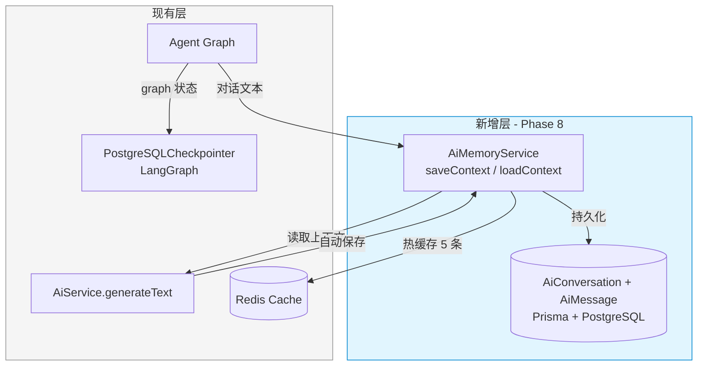

# 30. 实现 AiConversation 长期记忆持久化

> **系列**: JoyMini AI 功能开发 — Phase 8 工程优化
> **前置步骤**: [18. PostgreSQL Checkpointer（持久化记忆）](18-PostgreSQL-Checkpointer持久化记忆.md), [01. 配置 AiService 与 Ollama 集成](01-配置-AiService与Ollama集成.md)
> **下一步**: [31. 实现 LLM 结果缓存](31-实现-LLM结果缓存.md)
> **对应代码**: `apps/api/prisma/schema.prisma`, `apps/api/src/common/ai/ai-memory.service.ts`
> **设计文档**: [`plans/arch-3-missing-features.md`](/plans/arch-3-missing-features.md)

---

## 🎯 本步骤目标

完成本步骤后：

1. 新增 `AiConversation` + `AiMessage` Prisma 数据模型，用于持久化 AI 对话文本
2. 创建 `AiMemoryService`，提供 `saveContext` / `loadContext` / `listConversations` / `deleteConversation` 四个接口
3. 集成 Redis 热缓存：最近 N 条消息走缓存，历史记录从 DB 加载
4. 与 LangGraph `PostgreSQLCheckpointer` 互补：checkpointer 存 graph 状态，AiMemoryService 存对话文本
5. `AiService.generateText()` 支持 `threadId` 参数，自动加载/保存上下文

---

## 📖 背景说明

### 为什么需要对话文本持久化

| 现有能力 | 作用 | 不足 |
|---------|------|------|
| LangGraph `PostgreSQLCheckpointer` | 保存 graph 运行时状态（节点执行轨迹、中间变量） | ❌ 不保存对话文本，无法做对话历史查询 |
| `ChatMessage` 模型（IM 聊天） | 保存用户与人工客服的聊天记录 | ❌ 面向 IM 场景，不是 AI Agent 对话 |
| `MemoryService`（travel-agent） | 内存级会话历史 | ❌ 服务重启丢失，无法跨会话持久 |

**AiConversation + AiMessage 模型填补了这个空白**——它是专门为 AI Agent 对话设计的持久化层，存储完整的对话文本树（user/assistant/system/tool 消息），支持按用户查询、按时间排序、按 token 数裁剪。

### 架构关系



### 与 Phase 5 Checkpointer 的互补关系

| 维度 | PostgreSQLCheckpointer (Phase 5) | AiMemoryService (Phase 8) |
|------|----------------------------------|--------------------------|
| 存储内容 | Graph 状态（节点执行轨迹、中间变量、checkpoint） | 对话文本（user/assistant/system/tool 消息） |
| 查询能力 | 按 threadId 恢复 graph 执行 | 按 userId 列出会话，按 threadId 加载文本历史 |
| 裁剪策略 | LangGraph 内置的 checkpoint 管理 | Token 数裁剪 + 最近 N 条热缓存 |
| 用途 | Agent 执行引擎需要 | 前端对话历史展示、上下文加载、面试话术 |

**两者互补，不是替代关系。**

---

## ⚙️ 前置条件

### 环境要求

- [x] NestJS 项目已配置 Prisma + PostgreSQL
- [x] Redis CacheModule 已全局注册（参考 `cache.constants.ts`）
- [x] `AiService` 已配置并可用（Phase 0）
- [x] LangGraph 已配置 `PostgreSQLCheckpointer`（Phase 5）

### 需要了解的概念

| 概念 | 说明 |
|------|------|
| Prisma Model | ORM 数据模型定义 |
| Cache-Aside 模式 | 读时先查缓存，miss 则查 DB 并回填缓存 |
| BaseMessage | LangChain 消息基类，含 role/content 字段 |

---

## ⚙️ 实现步骤

### Step 1: 新增 Prisma Schema

在 [`apps/api/prisma/schema.prisma`](/apps/api/prisma/schema.prisma) 中新增两个模型：

```prisma
// ===== AI Agent 对话持久化 =====
// 设计目的：与 LangGraph PostgreSQLCheckpointer 互补
// Checkpointer 存 graph 状态，此处存对话文本

model AiConversation {
  id        String   @id @default(cuid())
  threadId  String   @unique @map("thread_id")   // 对应 LangGraph thread_id
  userId    String?  @map("user_id")              // 可选，关联用户
  title     String?                               // 自动生成或用户命名
  metadata  Json?                                 // 自定义元数据（locale, agentType 等）
  createdAt DateTime @default(now()) @map("created_at")
  updatedAt DateTime @updatedAt @map("updated_at")
  messages  AiMessage[]

  @@index([userId])
  @@index([updatedAt])
  @@map("ai_conversations")
}

model AiMessage {
  id             String         @id @default(cuid())
  conversationId String         @map("conversation_id")
  conversation   AiConversation @relation(fields: [conversationId], references: [id], onDelete: Cascade)
  role           String         // "user" | "assistant" | "system" | "tool"
  content        String
  tokenCount     Int?           @map("token_count")
  metadata       Json?          // tool_calls, tool_call_id, function responses
  createdAt      DateTime       @default(now()) @map("created_at")

  @@index([conversationId, createdAt])
  @@map("ai_messages")
}
```

**关键设计决策**：

| 决策 | 方案 | 理由 |
|------|------|------|
| 唯一约束 | `threadId` 唯一 | LangGraph 的 thread_id 天然唯一标识 |
| 用户关联 | `userId` 可选 | 支持匿名对话 + 登录用户两种场景 |
| 消息排序 | `@@index([conversationId, createdAt])` | 按时间顺序加载历史 |
| 级联删除 | `onDelete: Cascade` | 删会话时自动清理消息 |
| Token 统计 | `tokenCount` 可选 | 用于上下文裁剪逻辑 |

执行迁移：

```bash
npx prisma migrate dev --name add_ai_conversation_models
```

---

### Step 2: 创建 AiMemoryService

新建 [`apps/api/src/common/ai/ai-memory.service.ts`](/apps/api/src/common/ai/ai-memory.service.ts)：

```typescript
import { Injectable } from '@nestjs/common'
import { PrismaService } from '../../prisma/prisma.service'
import { InjectRedis } from '@nestjs-modules/ioredis'
import Redis from 'ioredis'
import { BaseMessage } from '@langchain/core/messages'

@Injectable()
export class AiMemoryService {
  private readonly HOT_CACHE_SIZE = 5      // 最近 5 条走 Redis 缓存
  private readonly HOT_CACHE_TTL = 300     // 5 分钟
  private readonly HOT_CACHE_PREFIX = 'ai:hot:'
  private readonly MAX_CONTEXT_TOKENS = 4000  // 上下文最大 token 数

  constructor(
    private readonly prisma: PrismaService,
    @InjectRedis() private readonly redis: Redis,
  ) {}

  /**
   * 保存对话上下文到 PostgreSQL + Redis 热缓存
   */
  async saveContext(threadId: string, messages: BaseMessage[]): Promise<void> {
    // 1. 查找或创建 AiConversation
    const conversation = await this.prisma.aiConversation.upsert({
      where: { threadId },
      update: { updatedAt: new Date() },
      create: { threadId },
    })

    // 2. 批量创建 AiMessage
    await this.prisma.aiMessage.createMany({
      data: messages.map((m) => ({
        conversationId: conversation.id,
        role: this.mapRole(m._getType()),
        content: typeof m.content === 'string' ? m.content : JSON.stringify(m.content),
        tokenCount: undefined, // 可选：调用 LLM 估算
        metadata: m.additionalkwargs ?? {},
      })),
    })

    // 3. 更新 Redis 热缓存（最近 N 条）
    const recentMessages = messages.slice(-this.HOT_CACHE_SIZE)
    await this.redis.setex(
      `${this.HOT_CACHE_PREFIX}${threadId}`,
      this.HOT_CACHE_TTL,
      JSON.stringify(recentMessages),
    )
  }

  /**
   * 加载对话上下文
   * @param maxTokens 可选，超过此 token 数自动裁剪
   */
  async loadContext(threadId: string, maxTokens?: number): Promise<BaseMessage[]> {
    const limit = maxTokens ?? this.MAX_CONTEXT_TOKENS

    // 1. 尝试读取热缓存
    const cached = await this.redis.get(`${this.HOT_CACHE_PREFIX}${threadId}`)
    if (cached) {
      const recent = JSON.parse(cached) as BaseMessage[]
      // 如果缓存足够，直接返回
      if (recent.length >= 10) return recent
    }

    // 2. 从 DB 加载
    const messages = await this.prisma.aiMessage.findMany({
      where: { conversation: { threadId } },
      orderBy: { createdAt: 'asc' },
      take: 100, // 最多加载 100 条
    })

    // 3. 按 token 数裁剪
    let totalTokens = 0
    const trimmed: typeof messages = []
    for (const msg of messages.reverse()) {
      const tokens = msg.tokenCount ?? this.estimateTokens(msg.content)
      if (totalTokens + tokens > limit) break
      totalTokens += tokens
      trimmed.unshift(msg)
    }

    return trimmed.map((m) => this.toBaseMessage(m))
  }

  /**
   * 列出用户的所有会话
   */
  async listConversations(userId: string): Promise<AiConversation[]> {
    return this.prisma.aiConversation.findMany({
      where: { userId },
      orderBy: { updatedAt: 'desc' },
      include: { _count: { select: { messages: true } } },
    })
  }

  /**
   * 删除会话（级联删除消息）
   */
  async deleteConversation(threadId: string): Promise<void> {
    await this.prisma.aiConversation.delete({ where: { threadId } })
    await this.redis.del(`${this.HOT_CACHE_PREFIX}${threadId}`)
  }

  // ===== 私有辅助方法 =====

  private mapRole(type: string): string {
    const ROLE_MAP: Record<string, string> = {
      human: 'user',
      ai: 'assistant',
      system: 'system',
      tool: 'tool',
    }
    return ROLE_MAP[type] ?? 'user'
  }

  private toBaseMessage(msg: AiMessage): BaseMessage {
    return new (this.getMessageClass(msg.role))({
      content: msg.content,
      additionalkwargs: (msg.metadata as Record<string, unknown>) ?? {},
    })
  }

  private getMessageClass(role: string): new (fields: any) => BaseMessage {
    const { HumanMessage, AIMessage, SystemMessage, ToolMessage } = require('@langchain/core/messages')
    const MAP: Record<string, any> = {
      user: HumanMessage,
      assistant: AIMessage,
      system: SystemMessage,
      tool: ToolMessage,
    }
    return MAP[role] ?? HumanMessage
  }

  private estimateTokens(text: string): number {
    return Math.ceil(text.length / 4) // 粗略估计
  }
}
```

---

### Step 3: 注册 AiMemoryModule

新建 [`apps/api/src/common/ai/ai-memory.module.ts`](/apps/api/src/common/ai/ai-memory.module.ts)：

```typescript
import { Module } from '@nestjs/common'
import { PrismaModule } from '../../prisma/prisma.module'
import { AiMemoryService } from './ai-memory.service'

@Module({
  imports: [PrismaModule],
  providers: [AiMemoryService],
  exports: [AiMemoryService],
})
export class AiMemoryModule {}
```

将 `AiMemoryModule` 导入到 `AiCustomerModule`（或其他使用 AI 的模块）：

```typescript
// ai-customer.module.ts
@Module({
  imports: [AiMemoryModule, /* existing imports */],
  // ...
})
```

---

### Step 4: 集成到 AiService.generateText

在 [`AiService`](/apps/api/src/common/ai/ai.service.ts) 中注入 `AiMemoryService`，增加 `threadId` 支持：

```typescript
// 在 AiService 类中添加
constructor(
  // ... existing deps
  private readonly aiMemoryService?: AiMemoryService, // 可选注入
) {}

// 修改 generateText 方法签名
async generateText(
  prompt: string,
  options?: GenerateTextOptions & {
    threadId?: string           // 新增：自动加载/保存上下文
    useCache?: boolean          // 新增：是否使用结果缓存（下一文档）
    cacheTTL?: number
  },
): Promise<string> {
  let contextMessages: BaseMessage[] = []

  // 1. 加载历史上下文
  if (options?.threadId && this.aiMemoryService) {
    contextMessages = await this.aiMemoryService.loadContext(options.threadId)
  }

  // 2. 执行 LLM 调用（带上历史）
  const result = await this.callProvider(prompt, {
    ...options,
    contextMessages,
  })

  // 3. 保存上下文
  if (options?.threadId && this.aiMemoryService) {
    const allMessages = [
      ...contextMessages,
      new HumanMessage(prompt),
      new AIMessage(result),
    ]
    await this.aiMemoryService.saveContext(options.threadId, allMessages)
  }

  return result
}
```

---

### Step 5: 验证集成

```bash
# 1. 验证新模型已创建
npx prisma studio

# 2. 启动服务
yarn workspace @lucky/api start:dev

# 3. 测试持久化
curl -X POST http://localhost:3000/api/ai/chat \
  -H "Content-Type: application/json" \
  -d '{
    "threadId": "test-thread-001",
    "message": "我的订单状态是什么？",
    "userId": "user-001"
  }'

# 4. 查询数据库验证
npx prisma db execute \
  --stdin <<< "SELECT * FROM ai_conversations;"
```

---

## 📁 新增文件清单

| 文件 | 说明 |
|------|------|
| `apps/api/prisma/migrations/xxx_add_ai_conversation_models/` | Prisma 迁移 |
| `apps/api/src/common/ai/ai-memory.service.ts` | AiMemoryService 实现 |
| `apps/api/src/common/ai/ai-memory.module.ts` | AiMemoryModule 注册 |

## 📊 与现有架构的关系

```
AiCustomerController
  └─ AiCustomerService
       └─ AgentGraph (LangGraph)
            ├─ PostgreSQLCheckpointer (graph 状态)
            └─ AiMemoryService ★ NEW ★ (对话文本)
                 ├─ Prisma AiConversation + AiMessage
                 └─ Redis 热缓存
```

## 🗣️ 面试话术

> **问：你们的 AI 对话怎么做到长期记忆的？**
>
> "我们设计了 `AiConversation` + `AiMessage` 两层 Prisma 模型。每次 Agent Graph 执行完后，`AiMemoryService` 把完整对话树存到 PostgreSQL。加载时配合 Redis 热缓存——最近 5 条直接走缓存，历史记录按 token 数自动裁剪后从 DB 加载。LangGraph 的 `PostgreSQLCheckpointer` 存 graph 状态，我们存对话文本，两者互补。"

## ✅ 验证清单

- [ ] `npx prisma migrate dev` 成功
- [ ] `AiMemoryService` 单元测试覆盖 save/load/list/delete
- [ ] Redis 热缓存命中后跳过 DB 查询
- [ ] Token 数超过阈值时自动裁剪
- [ ] 删除会话时级联删除消息
- [ ] `AiService.generateText({ threadId })` 自动加载/保存上下文

---

## 🔜 下一步预告

完成对话持久化后，下一步是 [31. 实现 LLM 结果缓存](31-实现-LLM结果缓存.md)——为 AI 响应添加 Redis 缓存层，避免相同请求重复调用 LLM，降低成本。
