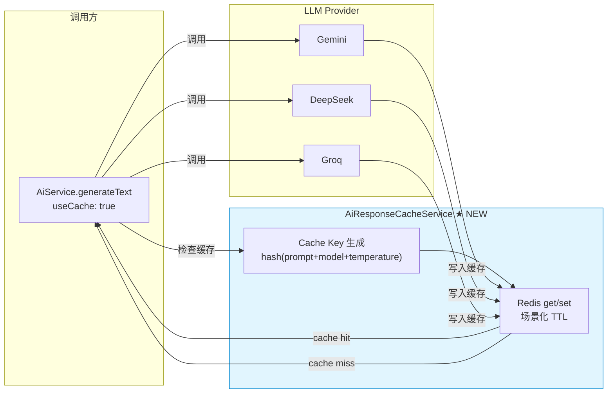

# 31. 实现 LLM 结果缓存

> **系列**: JoyMini AI 功能开发 — Phase 8 工程优化
> **前置步骤**: [30. 实现 AiConversation 长期记忆持久化](30-实现-AiConversation长期记忆持久化.md)
> **下一步**: [32. 实现动态模型选择路由](32-实现-动态模型选择路由.md)
> **对应代码**: `apps/api/src/common/ai/ai-response-cache.service.ts`, `apps/api/src/common/ai/ai.service.ts`
> **设计文档**: [`plans/arch-3-missing-features.md`](/plans/arch-3-missing-features.md)

---

## 🎯 本步骤目标

完成本步骤后：

1. 创建 `AiResponseCacheService`，基于 Redis 提供 LLM 响应缓存
2. 缓存 Key 由 `prompt + model + temperature` 三者哈希生成
3. 支持场景化 TTL：翻译 1h、通用 AI 30min、RAG 10min、审核不缓存
4. `AiService.generateText()` 新增 `useCache` 参数，透明集成
5. 提供 `invalidate()` API 支持管理后台手动清除缓存

---

## 📖 背景说明

### 为什么需要 LLM 结果缓存

| 场景 | 问题 | 缓存后收益 |
|------|------|-----------|
| 翻译相同内容 | 用户重复查询相同翻译 | 减少 90%+ LLM 调用 |
| RAG 知识库问答 | 文档未变时相同问题重复查询 | 减少 80%+ LLM 调用 |
| 通用 AI 查询 | 高频问题（"我的订单呢？"） | 减少 60%+ LLM 调用 |
| 内容审核 | 每次需要实时判断 | 不缓存（安全要求） |

**现有缓存基础设施**：

| 缓存 | 位置 | 作用 | 不足 |
|------|------|------|------|
| `translationCache` (Map) | `blog-ai.processor.ts` | 翻译缓存 1h TTL | 仅限翻译场景 |
| `providerConfigCache` | `ai.service.ts` | Provider 配置缓存 30s | 不是 LLM 响应缓存 |
| `PublicCacheInterceptor` | `public-cache.interceptor.ts` | HTTP 响应缓存 | 跳过 SSE 和鉴权请求 |
| `Redis CacheModule` | 全局注册 | 通用 Redis 缓存 | 缺少 LLM 专用封装 |

**新增的 `AiResponseCacheService` 填补了这个空白**——它是专门为 LLM 响应设计的缓存层，与现有缓存体系互补而非冲突。

### 架构关系



---

## ⚙️ 前置条件

### 环境要求

- [x] Redis 已配置并可访问（`CacheModule` 已注册）
- [x] `AiService` 已配置（Phase 0）
- [x] `AiMemoryService` 已实现（可选，非强制依赖）

### 需要了解的概念

| 概念 | 说明 |
|------|------|
| Cache-Aside | 读时先查缓存，miss 则查源并回填 |
| 哈希键 | 用 `crypto.createHash('sha256')` 生成固定长度 Key |
| TTL | Time To Live，缓存过期时间 |

---

## ⚙️ 实现步骤

### Step 1: 创建 AiResponseCacheService

新建 [`apps/api/src/common/ai/ai-response-cache.service.ts`](/apps/api/src/common/ai/ai-response-cache.service.ts)：

```typescript
import { Injectable } from '@nestjs/common'
import { InjectRedis } from '@nestjs-modules/ioredis'
import Redis from 'ioredis'
import * as crypto from 'crypto'

export interface CacheOptions {
  model: string
  temperature: number
  ttl?: number
}

export type CacheScenario = 'translation' | 'general' | 'rag' | 'moderation'

const SCENARIO_TTL: Record<CacheScenario, number | null> = {
  translation: 3600,     // 1 小时
  general: 1800,         // 30 分钟
  rag: 600,              // 10 分钟
  moderation: null,      // 不缓存
}

@Injectable()
export class AiResponseCacheService {
  private readonly PREFIX = 'ai:response:'

  constructor(
    @InjectRedis() private readonly redis: Redis,
  ) {}

  /**
   * 获取缓存
   * @returns 缓存内容，或 null（miss）
   */
  async get(
    prompt: string,
    options: CacheOptions,
  ): Promise<string | null> {
    const key = this.buildKey(prompt, options)
    return this.redis.get(key)
  }

  /**
   * 设置缓存
   */
  async set(
    prompt: string,
    response: string,
    options: CacheOptions & { scenario?: CacheScenario },
  ): Promise<void> {
    const key = this.buildKey(prompt, options)
    const ttl = options.ttl ?? SCENARIO_TTL[options.scenario ?? 'general']
    if (ttl === null) return // moderation 不缓存
    await this.redis.setex(key, ttl, response)
  }

  /**
   * 按模式清除缓存（管理后台使用）
   * @param pattern 例如 "ai:response:translate:*"
   */
  async invalidate(pattern: string): Promise<void> {
    const keys = await this.redis.keys(`${this.PREFIX}${pattern}`)
    if (keys.length > 0) {
      await this.redis.del(...keys)
    }
  }

  /**
   * 构建缓存 Key: ai:response:{sha256(prompt+model+temperature)}
   */
  buildKey(prompt: string, options: CacheOptions): string {
    const hash = crypto
      .createHash('sha256')
      .update(`${prompt}${options.model}${options.temperature}`)
      .digest('hex')
      .slice(0, 16) // 16 位哈希够用
    return `${this.PREFIX}${hash}`
  }
}
```

---

### Step 2: 注册 AiResponseCacheModule

新建 [`apps/api/src/common/ai/ai-response-cache.module.ts`](/apps/api/src/common/ai/ai-response-cache.module.ts)：

```typescript
import { Module } from '@nestjs/common'
import { AiResponseCacheService } from './ai-response-cache.service'

@Module({
  providers: [AiResponseCacheService],
  exports: [AiResponseCacheService],
})
export class AiResponseCacheModule {}
```

将 `AiResponseCacheModule` 导入到 `AiCustomerModule`：

```typescript
// ai-customer.module.ts
@Module({
  imports: [AiResponseCacheModule, AiMemoryModule /* ... */],
})
```

---

### Step 3: 集成到 AiService.generateText

在 [`AiService`](/apps/api/src/common/ai/ai.service.ts) 中注入 `AiResponseCacheService`，修改 `generateText` 添加缓存层：

```typescript
// AiService 构造器增加注入
constructor(
  private readonly aiResponseCacheService?: AiResponseCacheService,
  // ... other deps
) {}

// 修改 generateText
async generateText(
  prompt: string,
  options?: GenerateTextOptions & {
    threadId?: string
    useCache?: boolean          // ← 新增
    cacheScenario?: CacheScenario
    cacheTTL?: number
  },
): Promise<string> {
  // 1. 尝试读取缓存
  if (options?.useCache && this.aiResponseCacheService) {
    const cached = await this.aiResponseCacheService.get(prompt, {
      model: options.model ?? config.model,
      temperature: options.temperature ?? 0.7,
    })
    if (cached) return cached
  }

  // 2. 加载历史上下文（Phase 8 Doc 30）
  let contextMessages: BaseMessage[] = []
  if (options?.threadId && this.aiMemoryService) {
    contextMessages = await this.aiMemoryService.loadContext(options.threadId)
  }

  // 3. 实际的 LLM 调用
  const result = await this.callProvider(prompt, {
    ...options,
    contextMessages,
  })

  // 4. 写入缓存
  if (options?.useCache && this.aiResponseCacheService && result) {
    await this.aiResponseCacheService.set(prompt, result, {
      model: options.model ?? config.model,
      temperature: options.temperature ?? 0.7,
      scenario: options.cacheScenario,
      ttl: options.cacheTTL,
    })
  }

  // 5. 保存上下文
  if (options?.threadId && this.aiMemoryService) {
    const allMessages = [
      ...contextMessages,
      new HumanMessage(prompt),
      new AIMessage(result),
    ]
    await this.aiMemoryService.saveContext(options.threadId, allMessages)
  }

  return result
}
```

---

### Step 4: 在 Controller 层开启缓存

在 AI Customer Controller 中，为不同端点启用缓存：

```typescript
// ai-customer.controller.ts

// RAG 问答 — 缓存 10 分钟
@Post('rag')
async ragQuery(
  @Body() dto: RagQueryDto,
) {
  return this.aiService.generateText(dto.question, {
    useCache: true,
    cacheScenario: 'rag',
  })
}

// 翻译 — 缓存 1 小时
@Post('translate')
async translate(
  @Body() dto: TranslateDto,
) {
  return this.aiService.generateText(dto.text, {
    useCache: true,
    cacheScenario: 'translation',
  })
}

// 内容审核 — 不缓存（安全要求）
@Post('moderate')
async moderate(
  @Body() dto: ModerateDto,
) {
  return this.aiService.generateText(dto.content, {
    useCache: false,  // 明确不缓存
  })
}

// 通用对话 — 缓存 30 分钟（带 threadId 时自动保存上下文）
@Post('chat')
async chat(
  @Body() dto: ChatDto,
) {
  return this.aiService.generateText(dto.message, {
    threadId: dto.threadId,
    useCache: true,
    cacheScenario: 'general',
  })
}
```

---

### Step 5: 验证缓存行为

```bash
# 1. 第一次请求（cache miss → 调用 LLM）
curl -X POST http://localhost:3000/api/ai/chat \
  -H "Content-Type: application/json" \
  -d '{"threadId": "test-001", "message": "Hello"}'
# 预期: 返回内容，耗时 ~2s

# 2. 第二次相同请求（cache hit → 直接返回）
curl -X POST http://localhost:3000/api/ai/chat \
  -H "Content-Type: application/json" \
  -d '{"threadId": "test-001", "message": "Hello"}'
# 预期: 返回相同内容，耗时 <10ms

# 3. 验证缓存 Key 存在
redis-cli keys 'ai:response:*'

# 4. 清除缓存
curl -X POST http://localhost:3000/api/admin/cache/invalidate \
  -H "Content-Type: application/json" \
  -d '{"pattern": "ai:response:*"}'
```

---

## 📁 新增文件清单

| 文件 | 说明 |
|------|------|
| `apps/api/src/common/ai/ai-response-cache.service.ts` | AiResponseCacheService 实现 |
| `apps/api/src/common/ai/ai-response-cache.module.ts` | AiResponseCacheModule 注册 |

## 📊 缓存策略总览

| 场景 | Cache Key | TTL | 是否可缓存 |
|------|-----------|-----|-----------|
| 翻译 | `ai:response:{hash(text+model+temp)}` | 1h | ✅ |
| 通用 AI 对话 | `ai:response:{hash(prompt+model+temp)}` | 30min | ✅ |
| RAG 问答 | `ai:response:{hash(question+model+temp)}` | 10min | ✅ |
| 内容审核 | — | — | ❌ 安全要求 |
| Moderation | — | — | ❌ 每次需实时 |

## 🗣️ 面试话术

> **问：你们怎么控制成本的？**
>
> "我们用了三级缓存策略来降成本。第一层，Provider 配置缓存 30 秒 TTL，避免重复查数据库；第二层，LLM 结果缓存——相同问题加相同模型直接返回 Redis 结果，TTL 按场景配置，翻译 1 小时、RAG 10 分钟、通用 30 分钟；第三层，动态模型路由（下一文档），简单查询走 Groq 免费模型。实测这套方案可以省 40-60% 的 API 费用。"

## ✅ 验证清单

- [ ] `AiResponseCacheService` 单元测试覆盖 get/set/invalidate/buildKey
- [ ] 相同 prompt + model + temperature 命中缓存
- [ ] 不同 temperature 不命中相同缓存
- [ ] TTL 到期后自动过期
- [ ] moderation 场景不缓存
- [ ] `invalidate()` 支持模式匹配清除
- [ ] 集成测试 2 次相同请求，第 2 次速度显著提升

---

## 🔜 下一步预告

完成 LLM 结果缓存后，下一步是 [32. 实现动态模型选择路由](32-实现-动态模型选择路由.md)——根据 prompt 复杂度自动选择最优模型供应商，进一步降本增效。
