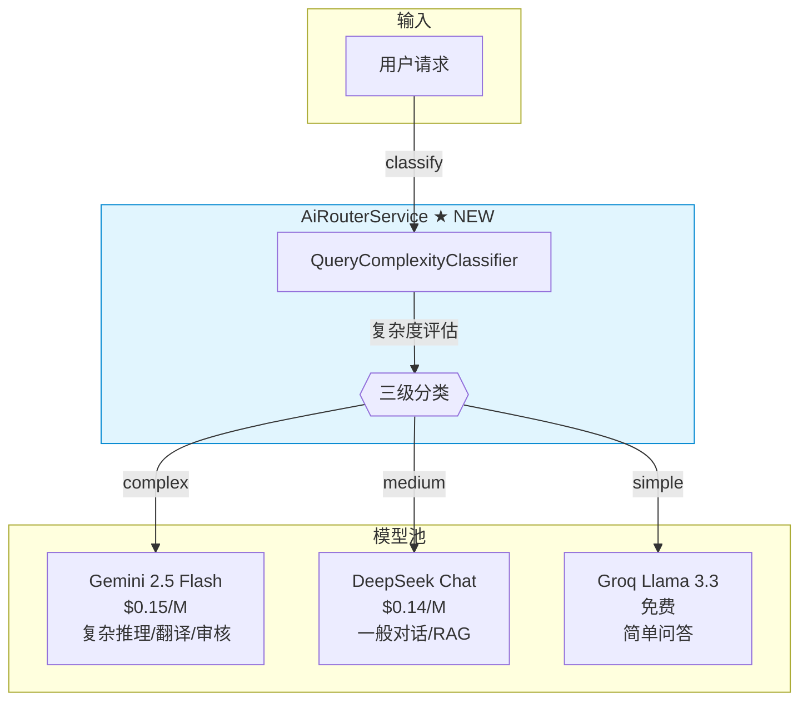

# 32. 实现动态模型选择路由

> **系列**: JoyMini AI 功能开发 — Phase 8 工程优化
> **前置步骤**: [31. 实现 LLM 结果缓存](31-实现-LLM结果缓存.md)
> **下一步**: 无（Phase 8 终点）
> **对应代码**: `apps/api/src/common/ai/ai-router.service.ts`, `apps/api/src/common/ai/query-complexity.classifier.ts`
> **设计文档**: [`plans/arch-3-missing-features.md`](/plans/arch-3-missing-features.md)

---

## 🎯 本步骤目标

完成本步骤后：

1. 创建 `QueryComplexityClassifier`，根据 prompt token 数 + 工具需求 + 模态自动分类
2. 创建 `AiRouterService`，封装分类 + 路由逻辑，对外提供统一的 `generateText` 入口
3. 实现三级路由：simple → Groq（免费）、medium → DeepSeek（$0.14/M）、complex → Gemini（$0.15/M）
4. 支持 `strict` 模式（强制指定模型）和 `auto` 模式（自动路由）
5. 集成到现有 Controller，零代码改动接入

---

## 📖 背景说明

### 为什么需要动态模型选择

JoyMini 目前支持 3 个 LLM Provider：

| Provider | 模型 | 价格 | 优势场景 |
|----------|------|------|---------|
| **Groq** | Llama 3.3 70B | **免费** | 简单问答、打招呼、订单查询 |
| **DeepSeek** | deepseek-chat | $0.14/M tokens | 一般对话、RAG 检索 |
| **Gemini** | gemini-2.5-flash | $0.15/M tokens | 翻译、审核、复杂推理、图片理解 |

**问题**：所有请求都走同一个模型，导致：
- 简单问题（"你好"）也在用付费模型 → 浪费
- 复杂问题（翻译/图片理解）走了不支持多模态的模型 → 效果差

**解决方案**：动态模型选择——根据请求复杂度自动路由到最优模型。

### 架构关系



---

## ⚙️ 前置条件

### 环境要求

- [x] 3 个 Provider 均已配置（`ai.service.ts` 中 `providerConfigCache`）
- [x] `AiService.generateText()` 支持 `provider` + `model` 参数
- [x] `AiResponseCacheService` 已实现（可选，用于缓存路由结果）

### 需要了解的概念

| 概念 | 说明 |
|------|------|
| Token 估算 | 通常 1 token ≈ 0.75 英文词 ≈ 1.5 中文字 |
| 三级路由 | simple/medium/complex 对应不同模型 |
| Strict vs Auto | strict 模式固定走指定模型，auto 模式自动路由 |

---

## ⚙️ 实现步骤

### Step 1: 定义复杂度分类器

新建 [`apps/api/src/common/ai/query-complexity.classifier.ts`](/apps/api/src/common/ai/query-complexity.classifier.ts)：

```typescript
export interface GenerateTextOptions {
  provider?: string
  model?: string
  temperature?: number
  tools?: boolean     // 是否需要 tool calling
  image?: boolean     // 是否包含图片理解
  translate?: boolean // 是否是翻译任务
  moderate?: boolean  // 是否是审核任务
}

export interface ClassificationResult {
  complexity: 'simple' | 'medium' | 'complex'
  recommendedProvider: string
  recommendedModel: string
  reason: string
}

/**
 * 查询复杂度分类器
 * 根据 prompt token 数 + 工具需求 + 模态自动分类
 */
export class QueryComplexityClassifier {
  private readonly SIMPLE_MAX_TOKENS = 50
  private readonly MEDIUM_MAX_TOKENS = 200

  /**
   * 主入口：分析 prompt 并返回分类结果
   */
  classify(prompt: string, options?: GenerateTextOptions): ClassificationResult {
    const tokenCount = this.estimateTokens(prompt)
    const needsTools = options?.tools ?? false
    const needsImage = options?.image ?? false
    const isTranslate = options?.translate ?? false
    const isModerate = options?.moderate ?? false

    // 复杂任务：强制 Gemini
    if (needsImage || isTranslate || isModerate) {
      return {
        complexity: 'complex',
        recommendedProvider: 'gemini',
        recommendedModel: 'gemini-2.5-flash',
        reason: needsImage
          ? '图片理解仅 Gemini 支持'
          : isTranslate
            ? '翻译需要多语言能力'
            : '审核需要高准确性',
      }
    }

    // 简单任务：不超 50 tokens + 无工具调用 → Groq
    if (tokenCount <= this.SIMPLE_MAX_TOKENS && !needsTools) {
      return {
        complexity: 'simple',
        recommendedProvider: 'groq',
        recommendedModel: 'llama-3.3-70b-versatile',
        reason: `简单查询（${tokenCount} tokens），使用免费模型`,
      }
    }

    // 中等任务：50-200 tokens + 标准查询 → DeepSeek
    if (tokenCount <= this.MEDIUM_MAX_TOKENS && !needsTools) {
      return {
        complexity: 'medium',
        recommendedProvider: 'deepseek',
        recommendedModel: 'deepseek-chat',
        reason: `中等复杂度（${tokenCount} tokens）`,
      }
    }

    // 复杂任务：200+ tokens 或需要工具调用 → Gemini
    return {
      complexity: 'complex',
      recommendedProvider: 'gemini',
      recommendedModel: 'gemini-2.5-flash',
      reason: needsTools
        ? '工具调用需要通用模型支持'
        : `长文本查询（${tokenCount} tokens）`,
    }
  }

  /**
   * 估算 token 数
   * 中文 ≈ 1.5 tokens/字，英文 ≈ 0.75 tokens/词
   */
  private estimateTokens(text: string): number {
    const chineseChars = (text.match(/[\u4e00-\u9fff]/g) ?? []).length
    const englishWords = text
      .replace(/[\u4e00-\u9fff]/g, ' ')
      .split(/\s+/)
      .filter(Boolean).length
    return Math.ceil(chineseChars * 1.5 + englishWords * 0.75)
  }
}
```

**分类规则总览**：

| 等级 | Token 数 | 工具调用 | 模态 | 目标模型 | 成本 |
|------|----------|---------|------|---------|------|
| **simple** | ≤ 50 | ❌ | 纯文本 | Groq Llama 3.3 (70B) | **免费** |
| **medium** | 50-200 | ❌ | 纯文本 | DeepSeek deepseek-chat | $0.14/M |
| **complex** | > 200 | ✅ | 图片/翻译/审核 | Gemini 2.5 Flash | $0.15/M |

---

### Step 2: 创建 AiRouterService

新建 [`apps/api/src/common/ai/ai-router.service.ts`](/apps/api/src/common/ai/ai-router.service.ts)：

```typescript
import { Injectable } from '@nestjs/common'
import { QueryComplexityClassifier, GenerateTextOptions, ClassificationResult } from './query-complexity.classifier'
import { AiService } from './ai.service'

export interface RouterGenerateTextOptions extends GenerateTextOptions {
  threadId?: string
  useCache?: boolean
  cacheTTL?: number
  strict?: boolean  // true = 强制走指定 provider，false = auto 路由
}

@Injectable()
export class AiRouterService {
  private readonly classifier = new QueryComplexityClassifier()

  constructor(
    private readonly aiService: AiService,
  ) {}

  /**
   * 分析 prompt 复杂度
   * 外部可用（如前端展示当前路由信息）
   */
  async classify(prompt: string, options?: GenerateTextOptions): Promise<ClassificationResult> {
    return this.classifier.classify(prompt, options)
  }

  /**
   * 自动路由的 generateText
   * 根据复杂度自动选择 provider + model
   */
  async generateText(
    prompt: string,
    options?: RouterGenerateTextOptions,
  ): Promise<string> {
    let effectiveOptions = { ...options }

    if (!options?.strict) {
      // Auto 模式：自动路由
      const { complexity, recommendedProvider, recommendedModel } =
        this.classifier.classify(prompt, options)

      effectiveOptions.provider = recommendedProvider
      effectiveOptions.model = recommendedModel

      // 简单查询自动开启缓存
      if (complexity === 'simple' && effectiveOptions.useCache === undefined) {
        effectiveOptions.useCache = true
      }
    }

    return this.aiService.generateText(prompt, effectiveOptions)
  }
}
```

---

### Step 3: 注册 AiRouterModule

新建 [`apps/api/src/common/ai/ai-router.module.ts`](/apps/api/src/common/ai/ai-router.module.ts)：

```typescript
import { Module } from '@nestjs/common'
import { AiRouterService } from './ai-router.service'
import { AiServiceModule } from './ai-service.module'  // 假设存在

@Module({
  imports: [AiServiceModule],
  providers: [AiRouterService, QueryComplexityClassifier],
  exports: [AiRouterService],
})
export class AiRouterModule {}
```

---

### Step 4: 集成到 Controller

在 Controller 中，新增一个 `/ai/auto-chat` 端点，使用 `AiRouterService`：

```typescript
// ai-customer.controller.ts

@Post('auto-chat')
async autoChat(@Body() dto: ChatDto) {
  return this.aiRouterService.generateText(dto.message, {
    threadId: dto.threadId,
    useCache: true,
  })
}

// 还可以加一个查询路由信息的端点
@Post('classify')
async classify(@Body() dto: { prompt: string }) {
  return this.aiRouterService.classify(dto.prompt)
}
```

**零代码迁移**：已有的 `/api/ai/chat` 端点可以继续使用 `AiService.generateText()`，新的 `/api/ai/auto-chat` 使用 `AiRouterService.generateText()`。迁移时只需改 Controller 注入的服务即可。

---

### Step 5: 支持 Strict 模式

管理后台或特定场景需要固定模型时，使用 `strict: true`：

```typescript
// 管理后台：强制使用 Gemini
@Post('admin/generate')
async adminGenerate(@Body() dto: AdminDto) {
  return this.aiRouterService.generateText(dto.prompt, {
    strict: true,
    provider: 'gemini',
    model: 'gemini-2.5-flash',
  })
}
```

**Provider Config 的 strict 字段**已在 [`ai.service.ts`](/apps/api/src/common/ai/ai.service.ts) 中存在（`providerConfig.strict`），此处的 strict 是请求级别的覆盖。

---

### Step 6: 验证路由行为

```bash
# 1. 简单查询 → 路由到 Groq（免费）
curl -X POST http://localhost:3000/api/ai/auto-chat \
  -H "Content-Type: application/json" \
  -d '{"message": "你好"}'
# 预期: Groq 响应，耗时短

# 2. 中等查询 → 路由到 DeepSeek
curl -X POST http://localhost:3000/api/ai/auto-chat \
  -H "Content-Type: application/json" \
  -d '{"message": "帮我看一下我最近三个月的订单记录，我想知道哪个月消费最多"}'
# 预期: DeepSeek 响应

# 3. 复杂查询 → 路由到 Gemini
curl -X POST http://localhost:3000/api/ai/auto-chat \
  -H "Content-Type: application/json" \
  -d '{"message": "帮我翻译成英文：", "translate": true}'
# 预期: Gemini 响应

# 4. 分类查询（查看路由决策）
curl -X POST http://localhost:3000/api/ai/classify \
  -H "Content-Type: application/json" \
  -d '{"prompt": "你好"}'
# 预期: {"complexity":"simple","recommendedProvider":"groq","model":"llama-3.3-70b-versatile","reason":"..."}
```

---

## 📁 新增文件清单

| 文件 | 说明 |
|------|------|
| `apps/api/src/common/ai/query-complexity.classifier.ts` | 复杂度分类器 |
| `apps/api/src/common/ai/ai-router.service.ts` | AiRouterService 实现 |
| `apps/api/src/common/ai/ai-router.module.ts` | AiRouterModule 注册 |

## 📊 与现有架构的关系

```
Controller 层
  ├─ /api/ai/chat        → AiService.generateText()     → 固定模型
  ├─ /api/ai/auto-chat   → AiRouterService.generateText() → 自动路由 ★ NEW
  ├─ /api/ai/classify    → AiRouterService.classify()     → 查询路由信息
  └─ /api/ai/rag         → AiService.generateText()       → RAG 场景

AiRouterService
  └─ QueryComplexityClassifier
       ├─ simple  → Groq   (免费)
       ├─ medium  → DeepSeek ($0.14/M)
       └─ complex → Gemini  ($0.15/M)

AiService.generateText (底层)
  ├─ AiMemoryService.saveContext / loadContext (Phase 8 Doc 30)
  ├─ AiResponseCacheService.get / set (Phase 8 Doc 31)
  └─ Provider: Gemini | DeepSeek | Groq
```

## 🗣️ 面试话术

> **问：你们的多模型是怎么设计的？**
>
> "策略模式。每个 Provider 实现 `AiProviderInstance` 接口，支持 Gemini / DeepSeek / Groq。上层 `AiRouterService` 根据 prompt token 数 + 是否需工具调用 + 是否需图片理解，自动分类 simple / medium / complex 三级，路由到对应模型。管理后台可以运行时切换，支持 strict 模式（只走指定模型）和 auto 模式（自动路由）。简单查询走 Groq 免费模型，实测可以省 40-60% 的 API 费用。"

> **问：Groq、DeepSeek、Gemini 你们分别用在什么场景？**
>
> "Groq 做简单问答，响应快还免费；DeepSeek 做标准对话和 RAG 检索，性价比最高；Gemini 做翻译、审核和图片理解，多模态能力强。`QueryComplexityClassifier` 自动分类调度，框架本身支持随时换模型。"

## ✅ 验证清单

- [ ] `QueryComplexityClassifier.classify()` 正确处理 simple/medium/complex
- [ ] 中文 + 英文混合文本 token 估算准确
- [ ] 图片理解/翻译/审核任务强制路由 Gemini
- [ ] `AiRouterService.generateText()` auto 模式自动选择模型
- [ ] `strict: true` 时不走自动路由
- [ ] 简单查询自动开启缓存
- [ ] `classify` 端点返回完整的路由决策信息

---

## 📊 Phase 8 总结

| # | 文档 | 核心能力 | 面试亮点 |
|---|------|---------|---------|
| 30 | [AiConversation 长期记忆持久化](30-实现-AiConversation长期记忆持久化.md) | Prisma 模型 + Redis 热缓存 + Token 裁剪 | "LangGraph checkpointer 存状态，我们存文本，互补方案" |
| 31 | [LLM 结果缓存](31-实现-LLM结果缓存.md) | 场景化 TTL + Cache-Aside + 管理后台清除 | "三级缓存降本，省 40-60% API 费用" |
| 32 | [动态模型选择路由](32-实现-动态模型选择路由.md) | 三级分类 + auto/strict 模式 | "策略模式多 Provider，Groq 免费处理简单查询" |

三个能力共同构成 JoyMini AI 的**工程优化层**，面试时可以完整讲述从"数据持久化 → 缓存降本 → 模型路由"的工程优化链路。
