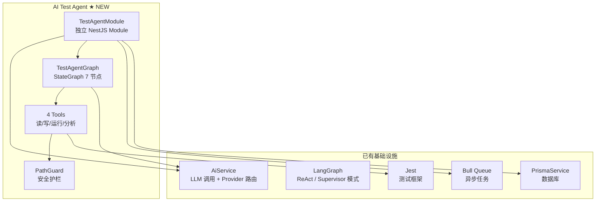
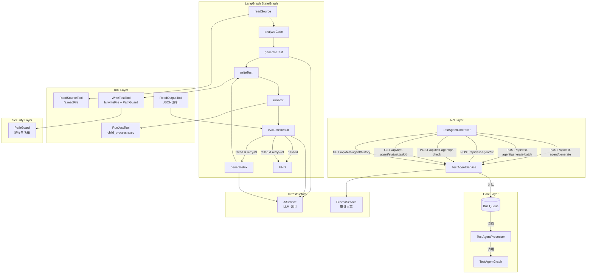
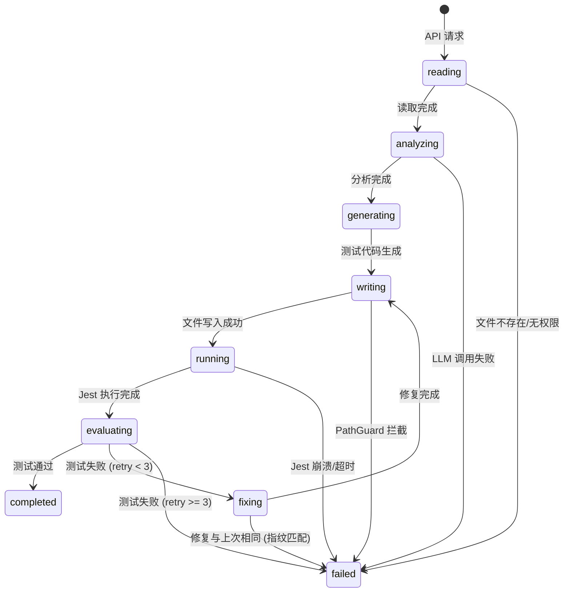

# 33. 架构：AI 测试智能体

> **系列**: JoyMini AI 功能开发 — Phase 9 AI 工程化进阶
> **前置步骤**: [32. 实现动态模型选择路由](32-实现-动态模型选择路由.md)
> **下一步**: [34. 实现 AI 测试智能体 — 基础设施](34-实现-AI测试智能体-基础设施.md)
> **对应代码**: `apps/api/src/langgraph/test-agent/`（新模块）
> **参考文档**: [`plans/arch-general-agent-gaps.md`](/plans/arch-general-agent-gaps.md), [`study/LLM/general-agent/01-autonomous-decomposition.md`](/study/LLM/general-agent/01-autonomous-decomposition.md), [`study/LLM/general-agent/03-react-stability.md`](/study/LLM/general-agent/03-react-stability.md), [`study/LLM/general-agent/07-dangerous-action-guardrails.md`](/study/LLM/general-agent/07-dangerous-action-guardrails.md)

---

## 🎯 本步骤目标

完成本步骤后：

1. 明确 AI Test Agent 的价值主张和功能边界
2. 定义 4 大核心功能的详细规格
3. 完成 LangGraph StateGraph 工作流设计
4. 确定模块边界、目录结构、依赖注入关系
5. 识别所有架构决策（ADR）和风险
6. 制定分步实施计划（共 4 个实施步骤）

> **注意**: 本文档是**架构设计文档**，不包含具体代码实现。实现细节请参考后续的 [34](34-实现-AI测试智能体-基础设施.md) ~ [37](37-实现-AI测试智能体-批量与扩展.md)。

---

## 📖 背景说明

### 为什么需要 AI 测试智能体

JoyMini 是一个全栈电商平台（NestJS + Prisma + Next.js），目前有：

| 指标 | 现状 |
|------|------|
| Service 文件 | ~40+ 个 |
| 有单元测试的 Service | 极少（仅 `lucky-draw.service.spec.ts`, `auth.service.spec.ts` 等） |
| 测试覆盖率 | < 5% |
| 手动补测试 | 不愿意，成本高且枯燥 |

**核心痛点**：开发者知道应该写测试，但手动编写测试的成本远高于"能跑就行"的诱惑。

**AI Test Agent 的价值**：不是替代开发者写测试，而是**消除"从 0 到 1"的启动成本**——AI 生成初版测试，开发者只需要 review 和微调。

### 与现有架构的关系



### 架构决策总览

| 决策 ID | 决策 | 选项 | 选择理由 |
|---------|------|------|----------|
| ADR-01 | 编排模式 | ReAct vs **StateGraph** | 测试生成是有阶段转换的流水线，不是对话-工具循环 |
| ADR-02 | 安全层级 | Graph 层 vs **Tool 层** | 防御深度：Tool 层做最后拦截 |
| ADR-03 | 并发控制 | 直接执行 vs **Bull Queue** | 防止文件系统冲突、Jest 进程冲突 |
| ADR-04 | IO 封装 | 直接 fs vs **独立 Tool 类** | 方便单元测试 + 方便加护栏 |
| ADR-05 | 模块位置 | `apps/api/` 内 | 深度绑定 JoyMini 项目，引用现有 Prisma Schema |
| ADR-06 | LLM 调用 | **AiService.generateText** | 复用现有的 Provider 路由、熔断、降级 |
| ADR-07 | SSE 事件 | **从 Graph 节点发射** | 粒度可控，每个阶段都能推送进度 |
| ADR-08 | 重试控制 | **State 内 retryCount** | 不需要额外的数据库中间状态 |

---

## 📋 功能规格

### F1：单文件测试生成（优先级 P0）

**输入**:
```typescript
{
  sourcePath: string;    // 相对于项目根目录，如 "apps/api/src/client/auth/auth.service.ts"
  testFramework: 'jest'; // 当前只支持 Jest
}
```

**工作流**:
```
读取源码 → LLM 分析代码结构 → LLM 生成测试代码 → 写入文件系统
→ 运行 Jest → 评估结果 → (成功则结束 | 失败则修复重试，最多 3 次)
```

**输出**:
```typescript
{
  testPath: string;      // 生成的测试文件路径
  testCode: string;      // 生成的测试代码
  passed: boolean;       // 最终是否通过
  coverage: {            // 覆盖率信息
    statements: number;
    branches: number;
    functions: number;
    lines: number;
  } | null;
  attempts: number;      // 实际执行次数（含修复）
  errors: string[];      // 失败记录
}
```

**验收标准**:
- [x] 读入的源码正确显示在 LLM prompt 中
- [x] 生成的测试文件写入到 `__tests__/` 目录
- [x] 首次生成后自动运行 Jest
- [x] 如果测试失败，LLM 分析错误并修复，最多重试 3 次
- [x] 成功或达到重试上限后返回完整结果

---

### F2：批量测试生成（优先级 P1）

**输入**:
```typescript
{
  directory: string;       // 目录路径，如 "apps/api/src/client"
  filePattern?: string;    // 文件匹配模式，如 "*.service.ts"
  excludePattern?: string; // 排除模式，如 "*.spec.ts"
}
```

**工作流**:
```
扫描目录 → 过滤文件 → [foreach 文件: 执行 F1 单文件生成] → 聚合报告
```

**输出**:
```typescript
{
  total: number;           // 总文件数
  passed: number;          // 通过的测试数
  failed: number;          // 失败的测试数
  skipped: number;         // 跳过的文件数（已有测试且通过）
  results: Array<F1 输出>;
}
```

**验收标准**:
- [x] 正确扫描目录，不遗漏 .ts 文件
- [x] 跳过已有测试且通过的文件
- [x] 10 个文件 < 5 分钟完成
- [x] 每个文件失败不影响其他文件
- [x] 聚合报告准确汇总通过/失败数

---

### F3：PR Diff 感知测试（优先级 P1）

**输入**:
```typescript
{
  diff: string;            // git diff 输出
  baseBranch?: string;     // 基础分支，默认 origin/main
}
```

**工作流**:
```
解析 diff → 识别改动文件 → 过滤非测试文件(.ts/.tsx 非 .spec)
→ 对每个改动文件执行 F1 或查找已有测试 → 更新已有测试或生成新测试
```

**验收标准**:
- [x] 正确解析 git diff 格式
- [x] 只处理业务代码改动（跳过 .spec, .md, .json 等）
- [x] 已有测试的文件走"更新"模式，无测试的文件走"生成"模式
- [x] 输出报告包含改动的文件列表和测试状态

---

### F4：失败测试修复模式（优先级 P2）

**输入**:
```typescript
{
  testPath: string;        // 测试文件路径
  errorLog: string;        // Jest 错误输出
  sourcePath?: string;     // 对应的源码（可选，自动推测）
}
```

**工作流**:
```
读取测试文件 → 读取对应源码 → 读取错误日志
→ LLM 分析失败原因 → 修复测试代码 → 写入
→ 重新运行 → (成功则结束 | 失败则继续修复，最多 3 次)
```

**与 F1 的区别**: F4 不重新生成整个测试文件，而是**增量修复**，分析具体失败点。

**验收标准**:
- [x] 输入已有测试文件时能正确识别失败的 test block
- [x] 修复后只改动失败的 test block，不修改通过的 test
- [x] 最多重试 3 次
- [x] 修复失败时给出原因分析

---

## 🏗️ 架构设计

### 整体架构图



### 目录结构

```
apps/api/src/langgraph/test-agent/
├── test-agent.module.ts              # NestJS Module
├── test-agent.controller.ts          # REST + SSE 端点
├── test-agent.service.ts             # 核心编排 + 队列调度
├── test-agent.processor.ts           # Bull 队列处理器
├── test-agent.graph.ts               # LangGraph StateGraph 定义
├── test-agent.types.ts               # GraphState + 共享类型
│
├── nodes/                            # 图节点（LLM 推理 + 逻辑）
│   ├── read-source.node.ts           # 读取源代码
│   ├── analyze-code.node.ts          # LLM：分析代码结构
│   ├── generate-test.node.ts         # LLM：生成测试代码
│   ├── write-test.node.ts            # 写入测试文件
│   ├── run-test.node.ts              # 执行 Jest
│   ├── evaluate-result.node.ts       # 评估测试结果
│   └── generate-fix.node.ts          # LLM：修复失败测试
│
├── tools/                            # IO 工具（被图节点调用）
│   ├── read-source.tool.ts           # fs.readFile 封装
│   ├── write-test.tool.ts            # fs.writeFile + 路径门卫
│   ├── run-jest.tool.ts              # child_process.exec 运行 Jest
│   └── read-output.tool.ts           # 解析 Jest JSON 输出
│
├── guards/                           # 安全护栏
│   ├── path-guard.ts                 # 路径白名单校验
│   └── path-guard.spec.ts            # 护栏测试
│
└── dto/                              # API 请求/响应类型
    ├── generate-test.dto.ts
    ├── batch-generate.dto.ts
    ├── fix-test.dto.ts
    ├── pr-check.dto.ts
    ├── task-status.dto.ts
    └── test-history.dto.ts
```

### GraphState 定义

```typescript
// test-agent.types.ts

interface CodeAnalysis {
  dependencies: string[];             // 依赖的服务/模块列表
  mockNeeded: boolean;                // 是否需要 Mock
  testCases: string[];                // 建议的测试用例
  nestDecorators: string[];           // NestJS 装饰器（@Injectable, @Controller 等）
}

interface TestResult {
  success: boolean;
  output: string;                     // Jest 原始输出
  coverage: {
    statements: number;
    branches: number;
    functions: number;
    lines: number;
  } | null;
  errorMessage: string | null;        // 主要错误信息
  duration: number;                   // 运行时长(ms)
}

interface TestAgentState {
  // 输入
  sourcePath: string;
  sourceCode: string;

  // 分析结果 (节点: analyzeCode)
  analysis: CodeAnalysis | null;

  // 生成结果 (节点: generateTest)
  testCode: string;
  testPath: string;

  // 运行结果 (节点: runTest)
  testResult: TestResult | null;

  // 重试控制
  retryCount: number;                 // 当前重试次数
  maxRetries: number;                 // 最大重试次数（固定 3）
  errors: string[];                   // 所有错误记录

  // 进度（用于 SSE 推送）
  phase: TestAgentPhase;
}

type TestAgentPhase =
  | 'reading'
  | 'analyzing'
  | 'generating'
  | 'writing'
  | 'running'
  | 'fixing'
  | 'completed'
  | 'failed';
```

### SSE 事件协议

| 事件名 | 触发时机 | 数据载荷 |
|--------|----------|----------|
| `test_started` | 任务开始 | `{ taskId, sourcePath }` |
| `test_phase` | 每个阶段转换 | `{ phase, message }` |
| `test_llm_start` | LLM 调用开始 | `{ nodeName }` |
| `test_llm_chunk` | LLM 流式输出 | `{ chunk }` |
| `test_llm_end` | LLM 调用结束 | `{ nodeName, tokenCount }` |
| `test_run` | Jest 执行 | `{ duration }` |
| `test_failure` | 测试失败，准备修复 | `{ retryCount, errorSummary }` |
| `test_completed` | 成功完成 | `{ testPath, coverage, attempts }` |
| `test_aborted` | 达到重试上限 | `{ errors }` |
| `test_error` | 系统异常 | `{ error }` |

### 模块依赖（Dependency Injection）

```
TestAgentModule
├── imports
│   ├── BullModule.registerQueue({ name: 'test-agent' })  // Bull 队列
│   └── AiModule  // 已有，提供 AiService
│
├── providers
│   ├── TestAgentService       // 核心编排
│   ├── TestAgentProcessor     // 队列消费者
│   ├── TestAgentGraph         // LangGraph 图定义
│   ├── ReadSourceTool         // 文件读取
│   ├── WriteTestTool          // 文件写入 + PathGuard
│   ├── RunJestTool            // Jest 执行
│   ├── ReadOutputTool         // 输出解析
│   └── PathGuard              // 安全护栏
│
└── controllers
    └── TestAgentController    // REST + SSE 端点
```

### 安全护栏设计（PathGuard）

**核心规则** — 写入测试文件时强制执行：

```
✅ 允许写入:
  apps/api/src/**/__tests__/*.spec.ts
  apps/api/src/**/*.spec.ts
  apps/api/src/**/*.test.ts
  apps/api/test/**/*.ts

❌ 禁止写入:
  apps/api/src/**/*.ts             (非测试文件)
  apps/api/prisma/**/*             (数据库模型)
  apps/api/src/**/dto/*.ts         (DTO 文件)
  apps/api/src/**/node_modules/**  (依赖)
  apps/frontend-blog/**/*          (前端代码)
  packages/**/*                    (共享包)
  任何不以 apps/api 开头的路径
  任何包含 ../../ 的路径
```

**实现逻辑**:
```typescript
class PathGuard {
  private readonly ALLOWED_PREFIXES = ['apps/api'];
  private readonly TEST_PATTERNS = [
    /__tests__\/.*\.spec\.ts$/,
    /\.spec\.ts$/,
    /\.test\.ts$/,
  ];

  validateWritePath(targetPath: string): { allowed: boolean; reason?: string } {
    // 1. 必须在 ALLOWED_PREFIXES 内
    // 2. 必须匹配 TEST_PATTERNS
    // 3. 不能包含路径穿越（..）
    // 4. 不能覆盖已有 .dto.ts / .module.ts 等重要文件
  }
}
```

---

## ⚖️ 架构决策记录（ADR）

### ADR-01：StateGraph 而非 ReAct

| 属性 | 值 |
|------|-----|
| **上下文** | 测试生成有明确的阶段：read → analyze → generate → write → run → evaluate |
| **决策** | 使用 LangGraph StateGraph 定义显式节点和条件路由 |
| **理由** | 每个阶段可独立观测、可独立测试、可单独加超时。ReAct 的"LLM 自主决定下一步"在这里反而增加了不确定性 |
| **代价** | 代码量比 ReAct 多 ~30% |
| **引用** | [`supervisor.service.ts`](/study/LLM/project/langchain/langgraph-backend/src/langgraph/supervisor.service.ts) 的自定义 State 模式 |

### ADR-02：安全拦截在 Tool 层而非 Graph 层

| 属性 | 值 |
|------|-----|
| **上下文** | "不能修改业务代码"是最高优先级约束 |
| **决策** | PathGuard 在 `writeTest.tool.ts` 层面做最后拦截，而非在 Graph 的 writeTest 节点层面 |
| **理由** | 防御深度原则——即使 LLM 生成错误的路径导致 Graph 编排出错，Tool 层仍然能拦截写操作。如果只依赖 Graph 层，一旦 LLM 生成恶意内容直接传给 fs.writeFile，就没有保护了 |
| **引用** | [`GA-07`](/study/LLM/general-agent/07-dangerous-action-guardrails.md) 的五层防御理念 |

### ADR-03：Bull Queue 控制并发

| 属性 | 值 |
|------|-----|
| **上下文** | 并发=1（PRD 要求），防止文件冲突 |
| **决策** | 所有 API 请求入 Bull Queue，processor 设置 concurrency=1 |
| **理由** | 多个测试任务同时进行可能导致：相同的 spec 文件被覆盖、Jest 进程内存争抢、数据库写入冲突 |
| **前提** | Redis 已在项目中配置（用于 Bull） |

### ADR-04：Tool 封装 IO 操作

| 属性 | 值 |
|------|-----|
| **上下文** | 图节点需要读取文件、写入文件、运行命令 |
| **决策** | 将 IO 操作封装为独立的 Tool 类（类似 React Agent 中的 calculatorTool 模式），图节点调用 Tool 而非直接操作 Node API |
| **理由** | 方便单元测试（mock tool）、方便加安全护栏（PathGuard 在 Tool 层）、方便切换实现（如从本地 fs 切换到 mock） |

### ADR-05：AiService 作为 LLM 调用入口

| 属性 | 值 |
|------|-----|
| **上下文** | 需要 LLM 生成测试代码、分析代码结构、修复失败测试 |
| **决策** | 使用现有的 [`AiService.generateText()`](apps/api/src/common/ai/ai.service.ts:363) 而不是直接调用 LangChain ChatOllama |
| **理由** | 复用现有的 Provider 路由、自动降级、熔断、多 Key 轮转。不需要 Test Agent 自己处理 LLM 可用性问题 |
| **注意** | Test Agent 应该使用 `generateTextWithRetry` 方法而不是 `generateText`，因为 LLM 调用失败时自动重试 |

---

## ⚠️ 风险登记

| 风险 | 概率 | 影响 | 缓解措施 |
|------|------|------|----------|
| **R1**: LLM 生成不存在的 Prisma API | 高 | 中 | System Prompt 注入项目实际的 prisma schema 内容 |
| **R2**: Jest 运行超时（如无限循环测试） | 中 | 高 | 每个 `runTest` 设 30s 超时，超时后强制终止进程 |
| **R3**: 修复循环不收敛（LLM 反复生成相同的错误修复） | 中 | 中 | 指纹检测：如果生成的修复与上次>80%相似，视为"无进展"直接终止 |
| **R4**: LLM 生成测试使用了项目中不存在的依赖 | 高 | 低 | 如果 Jest 报 `Cannot find module`，修复节点把这作为错误信号，LLM 会移除该依赖 |
| **R5**: 批量任务用户等待时间过长（10 文件 × 3 次重试 × 每次 30s = 15min） | 中 | 中 | SSE 逐文件推送进度，让用户知道进度 |
| **R6**: AI Service 不可用（所有 Provider 耗尽） | 低 | 高 | Test Agent 返回明确的错误信息，不重试 |

---

## 🔄 重试策略

### 测试修复重试（F1/F4 内部）

```
attempt 0: 首次生成
  └─ 失败 → 记录错误到 state.errors
attempt 1: generateFix → write → run (修正)
  └─ 失败 → 增加 retryCount，再次修复
attempt 2: generateFix → write → run (修正)
  └─ 失败 → 增加 retryCount，再次修复
attempt 3 (max): generateFix → write → run (最后一次)
  └─ 失败 → state.phase = 'failed', 返回所有错误
```

**终止条件**（任意满足则终止）:
1. `retryCount >= maxRetries`（最多 3 次）
2. 测试通过
3. 生成的修复与上一次相同（指纹匹配 > 80%）

### LLM 调用重试（AiService 内部）

使用 [`AiService.generateTextWithRetry`](apps/api/src/common/ai/ai.service.ts:457)（指数退避: 2s, 4s, 8s），最多 2 次重试。

---

## 📊 状态流转图



---

## 📁 新增文件清单

```
apps/api/src/langgraph/test-agent/
├── test-agent.module.ts              ★ 新增
├── test-agent.controller.ts          ★ 新增
├── test-agent.service.ts             ★ 新增
├── test-agent.processor.ts           ★ 新增
├── test-agent.graph.ts               ★ 新增
├── test-agent.types.ts               ★ 新增
├── nodes/
│   ├── read-source.node.ts           ★ 新增
│   ├── analyze-code.node.ts          ★ 新增
│   ├── generate-test.node.ts         ★ 新增
│   ├── write-test.node.ts            ★ 新增
│   ├── run-test.node.ts              ★ 新增
│   ├── evaluate-result.node.ts       ★ 新增
│   └── generate-fix.node.ts          ★ 新增
├── tools/
│   ├── read-source.tool.ts           ★ 新增
│   ├── write-test.tool.ts            ★ 新增
│   ├── run-jest.tool.ts              ★ 新增
│   └── read-output.tool.ts           ★ 新增
├── guards/
│   ├── path-guard.ts                 ★ 新增
│   └── path-guard.spec.ts            ★ 新增
└── dto/
    ├── generate-test.dto.ts          ★ 新增
    ├── batch-generate.dto.ts         ★ 新增
    ├── fix-test.dto.ts              ★ 新增
    ├── pr-check.dto.ts              ★ 新增
    ├── task-status.dto.ts           ★ 新增
    └── test-history.dto.ts          ★ 新增
```

**总计**: 24 个新文件，约 550 行 TypeScript 代码（不含 prompt 模板）

---

## 📐 实施计划（4 步）

### Step 1：基础设施（对应文档 34）
- 创建 `test-agent.module.ts` + `test-agent.types.ts`
- 创建 4 个 Tools（ReadSourceTool / WriteTestTool / RunJestTool / ReadOutputTool）
- 创建 PathGuard + 单元测试
- 创建 TestAgentModule 注册

### Step 2：核心单文件生成图（对应文档 35）
- 创建 7 个图节点（readSource → analyzeCode → generateTest → writeTest → runTest → evaluateResult → generateFix）
- 创建 `test-agent.graph.ts` 组装 StateGraph
- 创建 `test-agent.service.ts` 编排单次执行
- 手动验证：对一个真实 Service 执行测试生成

### Step 3：API + SSE（对应文档 36）
- 创建 `test-agent.controller.ts`（REST + SSE）
- 创建 DTO 文件
- 创建 `test-agent.processor.ts`（Bull Queue）
- 创建 SSE 事件发射
- 验证完整链路：API → Queue → Graph → Tools → SSE

### Step 4：批量 + PR Diff + 修复模式（对应文档 37）
- F2 批量生成（scanDirectory + reduce）
- F3 PR Diff（parse diff + 识别改动）
- F4 修复模式（增量修改，非重新生成）
- 聚合报告生成

---

## ✅ 验证清单

### 架构验证
- [x] 模块是独立的 NestJS Module，不依赖 Supervisor
- [x] PathGuard 在 Tool 层做最后拦截
- [x] AiService 作为唯一的 LLM 调用入口
- [x] Bull Queue 控制并发
- [x] StateGraph 的每个节点可独立测试
- [x] SSE 事件覆盖所有阶段转换
- [x] 重试逻辑有终止条件（指纹检测）

### 功能验证（验收测试）
- [x] F1: `POST /api/test-agent/generate` — 单文件生成 + 运行 + 修复
- [x] F2: `POST /api/test-agent/generate-batch` — 批量 + 聚合报告
- [x] F3: `POST /api/test-agent/pr-check` — git diff 感知
- [x] F4: `POST /api/test-agent/fix` — 失败测试修复

### 安全检查
- [x] PathGuard 拒绝写入 `apps/api/src/**/*.ts` 非测试文件
- [x] PathGuard 拒绝路径穿越 `../../`
- [x] PathGuard 拒绝写入 `prisma/`、`dto/`、`node_modules/`
- [x] 超过 3 次重试自动终止
- [x] 单次 Jest 运行超过 30s 强制终止

---

## 🔜 下一步

本文档完成后，按以下顺序进入实施阶段：

1. **[34. 实现 AI 测试智能体 — 基础设施](34-实现-AI测试智能体-基础设施.md)** — Module + Types + Tools + Guards
2. **[35. 实现 AI 测试智能体 — 核心生成图](35-实现-AI测试智能体-核心生成图.md)** — 7 个节点 + StateGraph + 单文件验证
3. **[36. 实现 AI 测试智能体 — API 与 SSE](36-实现-AI测试智能体-API与SSE.md)** — Controller + Queue + SSE
4. **[37. 实现 AI 测试智能体 — 批量与扩展](37-实现-AI测试智能体-批量与扩展.md)** — F2/F3/F4 + 聚合报告
