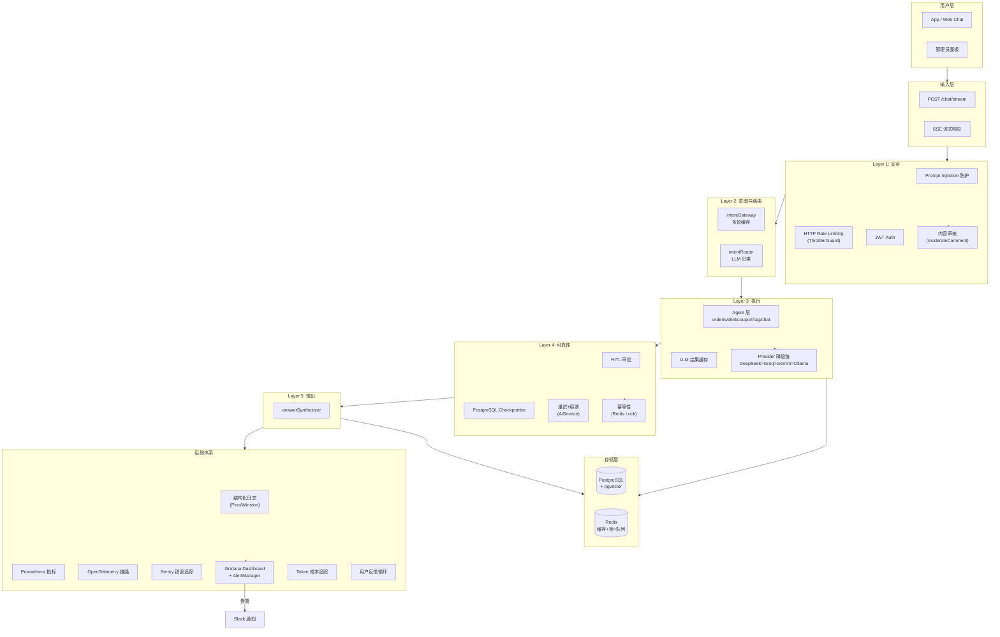

# 36 — 企业级运维与运营规划

> 目标：统一现有分散的运维/运营需求（`ai-customer-sdd.md §4.1-4.4` + `plans/enterprise-roadmap.md §5.1-5.3`），形成完整的企业级可观测性、成本管控、运营面板规划。
>
> 前置文档：`33-工作流型智能体16挑战对标.md`、`34-对话式机器人13挑战对标.md`、`35-通用型智能体19挑战对标.md`
> 关联文档：`ai-customer-sdd.md`、`plans/enterprise-roadmap.md`

---

## 一、现状盘点（2026-06-30）

### 1.1 已实现的运维基础设施

| # | 能力 | 实现位置 | 说明 |
|---|------|---------|------|
| 01 | **Logger 日志** | 所有 Service/Node/Tool 均使用 `NestJS Logger` | 逐模块实例化（`new Logger(ModuleName)`），支持上下文标签 |
| 02 | **AI Service 熔断器** | [`ai.service.ts`](apps/api/src/common/ai/ai.service.ts:42) | 3 级服务等级（FULL→ESSENTIAL→MINIMAL→DISABLED），连续 10 次失败→5min 熔断 |
| 03 | **Provider 自动降级** | [`ai.service.ts`](apps/api/src/common/ai/ai.service.ts) | DeepSeek > Groq > Gemini > Ollama 降级链 |
| 04 | **Provider 级速率限制** | 各 Provider 文件 | 多 Key 轮询、429 冷却（60s）、每日 Key 限额重置、指数退避 |
| 05 | **HTTP 级速率限制** | `@nestjs/throttler` | 全局 `OtpThrottlerGuard`：60 请求/60s |
| 06 | **内容审核** | [`ai.service.ts`](apps/api/src/common/ai/ai.service.ts) `moderateComment()` | 基于 LLM 的输入审核（score 0-100, passed/reason/categories） |
| 07 | **队列监控** | `QueueMonitorService` | BullMQ 队列状态监控 |
| 08 | **分布式锁** | `RedisLockService` | Redis 分布式锁（用于幂等性） |
| 09 | **幂等性（提现）** | [`wallet-tools.ts`](apps/api/src/client/ai-customer/graph/tools/wallet-tools.ts:76) | 30s 内存窗口 `markRecentWithdraw()` |
| 10 | **Token 统计（基础）** | [`ai.service.ts`](apps/api/src/common/ai/ai.service.ts:48) | 每分钟统计 requests/tokens，每日重置 |
| 11 | **Streaming 流式** | [`ai-customer.service.ts`](apps/api/src/client/ai-customer/ai-customer.service.ts:75) | `streamEvents v2` SSE 流式输出 |

### 1.2 缺失的能力（差距分析）

| # | 能力 | 企业级要求 | 当前状态 | 优先级 |
|---|------|-----------|:--------:|:------:|
| 01 | **APM / 性能追踪** | 端到端调用链追踪（如 Sentry Performance、Datadog APM） | ❌ 无 | P1 |
| 02 | **日志聚合** | 集中式日志系统（ELK/Loki/Grafana），支持全文搜索 | ❌ 无 | P1 |
| 03 | **错误追踪** | Sentry/GlitchTip 捕获未处理异常 + 源映射 | ❌ 无 | P1 |
| 04 | **节点级耗时追踪** | 每个 Agent 节点执行时间可观测 | ❌ 无 | P2 |
| 05 | **Token 成本仪表盘** | 每次 LLM 调用记录 model/tokens/cost，统计日/周/月花费 | ❌ 无 | P1 |
| 06 | **管理员运营面板** | 对话记录检索、用户行为分析、服务状态概览 | ❌ 无 | P2 |
| 07 | **A/B 测试框架** | 不同 Prompt/Model 效果对比 | ❌ 无 | P3 |
| 08 | **用户反馈循环** | 点赞/踩 + 原因采集 → 数据集 → 微调 | ❌ 无 | P2 |
| 09 | **告警系统** | 连续失败/高延迟/成本异常 → 多渠道通知 | ❌ 无 | P1 |
| 10 | **Rate Limit 监控** | HTTP + Provider + 全局限流数据可视化 | ❌ 无 | P2 |
| 11 | **HITL 审计日志** | 写操作审批记录（谁、何时、批了什么） | ❌ 无 | P2 |
| 12 | **SLA 监控** | 可用性/响应时间/错误率 SLA 仪表盘 | ❌ 无 | P3 |

### 1.3 已有的分散文档

| 文档 | 内容 | 需迁移/引用 |
|------|------|-----------|
| [`ai-customer-sdd.md §4.1-4.4`](docs/AI-joymini/ai-customer-sdd.md:954) | 性能/安全/可观测性/AI 基础设施要求 | 引用为主，无需重复 |
| [`plans/enterprise-roadmap.md §5.1-5.3`](plans/enterprise-roadmap.md:286) | Step 2 数据安全 + Step 3 生产优化 + 5 层架构 | 引用为主，整合阶段计划 |
| [`PROGRESS.md`](docs/AI-joymini/PROGRESS.md) | 3 个挑战检查清单 | 新增第 4 个运维检查清单 |

---

## 二、运维体系规划

### 2.1 可观测性（Observability）三支柱

#### 2.1.1 日志（Logging）— Phase 1

**现状：** NestJS Logger 在各模块独立实例化，日志分散在 stdout，无法集中检索。

**目标架构：**

```
NestJS Logger (各模块)
       │
       ▼
 Winston / Pino (结构化 JSON)
       │
       ├──→ 文件轮转（保留 30 天）
       └──→ Logstash / Vector → OpenSearch / ELK / Loki
                │
                └──→ Grafana 日志面板
```

**实施要点：**

| 要点 | 说明 | 优先级 |
|------|------|:------:|
| 统一日志格式 | 所有日志输出结构化 JSON（timestamp, level, context, message, metadata） | P1 |
| 请求关联 ID | 每次 API 请求生成 traceId / requestId，贯穿全链路 | P1 |
| 日志级别规范 | ERROR（异常）、WARN（降级/熔断）、LOG（正常）、DEBUG（调试） | P1 |
| 敏感信息脱敏 | userId/phone/email 自动脱敏（参考 wallet-tools 的 `maskPhone`） | P1 |
| 日志聚合 | Docker Compose → Loki + Grafana 或 ELK Stack | P1 |

#### 2.1.2 指标（Metrics）— Phase 1-2

**需要采集的关键指标：**

| 指标类别 | 具体指标 | 采集方式 | 优先级 |
|---------|---------|---------|:------:|
| **业务指标** | 总对话数、活跃用户数、意图分布 | Prometheus Counter/Gauge | P1 |
| **性能指标** | 首 Token 延迟 P50/P95/P99、完整响应延迟 | Prometheus Histogram | P1 |
| **AI 指标** | Provider 调用数、成功率、Token 消耗、熔断次数 | Prometheus Counter | P1 |
| **资源指标** | CPU/内存/Pod 数（K8s 部署时） | Node Exporter / cAdvisor | P2 |
| **队列指标** | BullMQ 队列深度、处理延迟、失败数 | BullMQ Events → Prometheus | P2 |

**Prometheus + Grafana 架构：**

```
Node.js App
    │
    ├──→ @opentelemetry/sdk-node (OTel SDK)
    │         │
    │         ├──→ Prometheus Exporter / OpenTelemetry Collector
    │         └──→ Grafana Tempo (Traces)
    │
    └──→ prom-client (直接暴露 /metrics 端点)
              │
              └──→ Prometheus → Grafana Dashboard
```

#### 2.1.3 链路追踪（Tracing）— Phase 2

**现状：** 无分布式追踪。Agent 调用链（IntentRouter → Supervisor → Agent → AnswerSynthesizer）不可见。

**目标：** OpenTelemetry 自动/手动埋点，Grafana Tempo 或 Jaeger 展示调用链。

| 埋点位置 | 追踪内容 | 优先级 |
|---------|---------|:------:|
| Graph 节点入口/出口 | 节点执行耗时 + 输入/输出大小 | P2 |
| 工具调用 | 工具名、参数、返回 code、耗时 | P2 |
| Provider 调用 | model、prompt 大小、completion 大小、HTTP 状态码 | P2 |

### 2.2 告警体系（Alerting）— Phase 1-2

#### 2.2.1 告警规则

| 规则 | 条件 | 严重度 | 通知渠道 |
|------|------|:------:|---------|
| **AI 服务熔断** | AiService 等级降至 MINIMAL 或 DISABLED | 🔴 P0 | Slack + Email + SMS |
| **连续失败率** | 5 分钟内失败率 > 50% | 🔴 P0 | Slack + Email |
| **高延迟** | P99 首 Token 延迟 > 5s 持续 10 分钟 | 🟡 P2 | Slack |
| **成本异常** | 日 Token 消耗超过预算线 80% | 🟡 P2 | Slack |
| **队列堆积** | BullMQ 队列深度 > 100 持续 5 分钟 | 🟡 P2 | Slack |
| **Rate Limit 命中** | 同一用户 10 分钟内被限流 > 10 次 | 🔵 P3 | 日志记录 |

#### 2.2.2 通知路由

```
Grafana AlertManager
       │
       ├──→ Slack #ai-monitor 频道（主要）
       ├──→ 邮件（On-Call 工程师）
       └──→ Telegram / 飞书（可选）
```

---

## 三、运营体系规划

### 3.1 管理员面板（Admin Dashboard）— Phase 2

#### 3.1.1 概览页

| 卡片 | 数据源 | 刷新频率 |
|------|--------|:--------:|
| 今日对话数 | AiCustomer 对话表 count | 实时 |
| 活跃用户数 (DAU) | 去重 userId | 5 分钟 |
| 意图分布饼图 | intent 字段聚合 | 5 分钟 |
| 平均响应时间 | 节点耗时统计 | 5 分钟 |
| Token 消耗趋势 | ai.service.ts 统计 | 1 小时 |
| Provider 健康状态 | 各 Provider 成功率 | 实时 |

#### 3.1.2 对话检索页

| 功能 | 说明 | 优先级 |
|------|------|:------:|
| 按 userId 搜索 | 输入 userId → 列出该用户所有对话 | P1 |
| 按时间范围筛选 | 日期选择器过滤 | P1 |
| 按意图筛选 | 仅查看 order/wallet/coupon 等分类 | P1 |
| 对话详情展开 | 展示完整消息、工具调用、耗时 | P2 |
| 导出 CSV | 导出搜索结果为 CSV | P3 |

#### 3.1.3 成本管理页

| 功能 | 说明 | 优先级 |
|------|------|:------:|
| 日 Token 消耗趋势图 | 近 30 天趋势线 | P1 |
| 模型级成本分解 | 各 Provider/Model 花费占比 | P2 |
| 用户级成本排行 | Token 消耗 Top 用户 | P2 |
| 预算告警配置 | 设置日/月预算上限 | P2 |

#### 3.1.4 审计日志页

| 功能 | 说明 | 优先级 |
|------|------|:------:|
| 写操作记录 | 谁（userId）在何时执行了什么写操作 | P2 |
| HITL 审批记录 | 审批人、申请内容、审批结果、时间 | P2 |
| 配置变更日志 | 系统配置修改记录 | P3 |

### 3.2 用户反馈循环 — Phase 2-3

#### 3.2.1 反馈采集

```
对话结束后展示：
[👍 有用] [👎 没用] [❓ 不准确]

点击 👎 后：
┌─ 请选择原因 ──────────────────┐
│ ○ 回答不准确/错误              │
│ ○ 回答不完整/遗漏信息          │
│ ○ 回答与问题无关               │
│ ○ 其他: ________              │
└───────────────────────────────┘
```

**存储结构：**

```typescript
interface ChatFeedback {
  sessionId: string;
  userId: string;
  rating: 'helpful' | 'unhelpful' | 'inaccurate';
  reason?: string;
  userComment?: string;
  agentIntent: string;
  createdAt: Date;
}
```

#### 3.2.2 反馈分析面板

| 指标 | 说明 | 优先级 |
|------|------|:------:|
| 整体满意度 | 好评率 = helpful / (helpful + unhelpful) | P2 |
| 意图级满意度 | 各 intent 分别统计好评率 | P2 |
| 不满意原因分布 | 选择原因饼图 | P2 |
| 低分对话回溯 | 查看低分对话完整记录 | P2 |

### 3.3 A/B 测试框架 — Phase 3

| 维度 | 可测试变量 | 说明 |
|------|-----------|------|
| Prompt | System Prompt 不同版本 | 对比回答质量 |
| Model | DeepSeek vs Groq vs Gemini | 对比成本/质量/延迟 |
| Temperature | 0.1 vs 0.3 vs 0.7 | 对比创造性 |
| 缓存策略 | 有语义缓存 vs 无缓存 | 对比成本和速度 |

**A/B 测试实现要点：**

```
路由层根据 userId hash 分配实验组
       │
       ├──→ 实验组 A（实验配置）
       ├──→ 实验组 B（基线配置）
       └──→ 对照组（当前配置）
       
每次对话记录 experiment_id + variant
       │
       └──→ 反馈数据关联分析
```

---

## 四、分阶段实施计划

### Phase 0 — 基础设施补全（当前可做，低投入）

> 与 `plans/enterprise-roadmap.md §5.1` Step 2 并行

| 任务 | 文件/说明 | 预计工时 |
|------|----------|:--------:|
| 统一日志格式 | NestJS Logger → 结构化 JSON（使用 `pino` 或 `winston`） | 2d |
| 注入请求 Trace ID | `nestjs-pino` 或自定义中间件，requestId 贯穿全链路 | 1d |
| 敏感信息脱敏 | Logger 扩展，自动 `maskUserId/phone/email` | 0.5d |
| PostgreSQL Checkpointer | 参照 [`18-PostgreSQLCheckpointer.md`](docs/AI-joymini/18-PostgreSQLCheckpointer.md) | 2d |
| HITL 写操作确认 | 参照 [`19-MultiAgentSupervisor与HITL.md`](docs/AI-joymini/19-MultiAgentSupervisor与HITL.md) | 2d |
| 幂等性扩展 | 所有写工具加唯一请求 ID + 去重 | 1d |
| Zod Schema 校验 | Agent 输出运行时验证 | 1d |

### Phase 1 — 可观测性建设（高价值）

> 与 `plans/enterprise-roadmap.md §5.2` Step 3 并行

| 任务 | 方案选择 | 预计工时 |
|------|---------|:--------:|
| 错误追踪 | **Sentry**（推荐，30min 接入）或 GlitchTip（自托管） | 0.5d |
| 日志聚合 | **Loki + Grafana**（Docker Compose 部署，与现有架构融合） | 3d |
| Prometheus 指标 | `prom-client` 暴露 `/metrics`，意图/延迟/Token 指标 | 2d |
| Grafana Dashboard | 业务 + AI + 系统 3 个 Dashboard | 2d |
| 告警规则配置 | Grafana AlertManager + Slack Webhook | 1d |
| Token 成本追踪 | 每次 LLM 调用记录 model/tokens → 数据库 | 1d |
| LLM 结果缓存 | 参照 [`31-实现-LLM结果缓存.md`](docs/AI-joymini/31-实现-LLM结果缓存.md) | 2d |
| Prompt Injection 防护 | 参照 [`29-实现-PromptInjection三级防护.md`](docs/AI-joymini/29-实现-PromptInjection三级防护.md) | 2d |

### Phase 2 — 运营面板建设（体验提升）

| 任务 | 说明 | 预计工时 |
|------|------|:--------:|
| 管理员概览页 | 对话数/用户数/意图分布/Token 趋势 | 3d |
| 对话检索页 | userId/时间/意图筛选 + 详情展开 | 3d |
| 成本管理页 | Token 日趋势 + 模型级分解 | 2d |
| 审计日志页 | 写操作 + HITL + 配置变更记录 | 2d |
| 用户反馈采集 | 对话结束后 👍👎 + 原因选择 | 2d |
| 反馈分析面板 | 好评率/意图级分析/低分回溯 | 2d |
| 节点级耗时追踪 | OpenTelemetry Agent 节点埋点 | 3d |

### Phase 3 — 高级能力（按需）

| 任务 | 说明 | 预计工时 |
|------|------|:--------:|
| 分布式链路追踪 | OpenTelemetry + Grafana Tempo / Jaeger | 3d |
| A/B 测试框架 | 实验分组 + 指标对比 + 自动分析 | 5d |
| SLA 监控 | 可用性/响应时间/错误率 SLA 仪表盘 | 2d |
| 自动扩缩容 | K8s HPA 基于 Prometheus 指标 | 3d |
| 智能缓存预热 | 高频问题缓存预生成 | 2d |

---

## 五、与已有挑战框架的关联

### 5.1 映射关系

| 36 文档章节 | 33-工作流挑战 | 34-对话式机器人 | 35-通用型智能体 |
|------------|:-------------:|:--------------:|:--------------:|
| §2.1 日志聚合 | #15 延迟累积（日志辅助分析） | #03 Token/延迟（成本监控） | #05 资源消耗 |
| §2.1.2 指标 | #16 成本叠加 | #11 语义缓存 | #17 可观测（强关联） |
| §2.2 告警 | #05 节点容错 | #09 断线重连 | #05 失控资源 |
| §3.1 管理员面板 | #12 可视化 | #06 会话管理 | #17 可观测（强关联） |
| §3.2 反馈循环 | #16 结果质量 | #10 幻觉 | #16 结果质量（强关联） |
| §3.3 A/B 测试 | — | #12 模型切换 | #16 结果不可复现 |
| §4 持久化 | #08 长流程持久化 | #01 上下文丢失 | #09 长期记忆 |

### 5.2 对已有 3 个 Checklist 的补充

在执行以下任务前，额外检查**运维覆盖**：

```
[  ] 这次变更是否需要新的指标/日志？
[  ] 是否会影响 SLA/告警阈值？
[  ] 是否需要在管理员面板展示新数据？
[  ] 是否涉及成本变化（新模型/新 Prompt 长度）？
```

---

## 六、企业级架构总览（完整版）

合并 `plans/enterprise-roadmap.md §5.3` 5 层架构 + 运维体系：



---

## 七、文件索引

| 文件 | 说明 |
|------|------|
| [`ai-customer-sdd.md §4.1-4.4`](docs/AI-joymini/ai-customer-sdd.md:954) | 性能/安全/可观测性/AI 基础设施原始要求 |
| [`plans/enterprise-roadmap.md §5.1-5.3`](plans/enterprise-roadmap.md:286) | Step 2 数据安全 + Step 3 生产优化 + 5 层架构 |
| [`ai.service.ts`](apps/api/src/common/ai/ai.service.ts:42) | AiService 熔断器 + Provider 降级 + Token 统计 |
| [`deepseek.provider.ts`](apps/api/src/common/ai/providers/deepseek.provider.ts) | 多 Key 轮询 + 429 冷却 + 指数退避 |
| [`groq.provider.ts`](apps/api/src/common/ai/providers/groq.provider.ts) | RPM 智能 Key 选择 + 重试风暴预防 |
| [`gemini.provider.ts`](apps/api/src/common/ai/providers/gemini.provider.ts) | 多 Key 轮询 + 429 处理 |
| [`18-PostgreSQLCheckpointer.md`](docs/AI-joymini/18-PostgreSQLCheckpointer.md) | PostgreSQL Checkpointer 实现文档 |
| [`19-MultiAgentSupervisor与HITL.md`](docs/AI-joymini/19-MultiAgentSupervisor与HITL.md) | HITL 中断 + Resume 实现文档 |
| [`31-实现-LLM结果缓存.md`](docs/AI-joymini/31-实现-LLM结果缓存.md) | LLM 结果缓存实现文档 |
| [`29-实现-PromptInjection三级防护.md`](docs/AI-joymini/29-实现-PromptInjection三级防护.md) | Prompt Injection 三级防护 |
| [`33-工作流型智能体16挑战对标.md`](docs/AI-joymini/33-工作流型智能体16挑战对标.md) | 16 项工作流挑战对标 |
| [`34-对话式机器人13挑战对标.md`](docs/AI-joymini/34-对话式机器人13挑战对标.md) | 13 项对话式机器人挑战对标 |
| [`35-通用型智能体19挑战对标.md`](docs/AI-joymini/35-通用型智能体19挑战对标.md) | 19 项通用型智能体挑战对标 |

---

## 八、变更记录

| 日期 | 变更 | 作者 |
|------|------|------|
| 2026-06-30 | 初稿创建：合并 ai-customer-sdd §4 + enterprise-roadmap §5 + 代码审计结果 | Roo |
