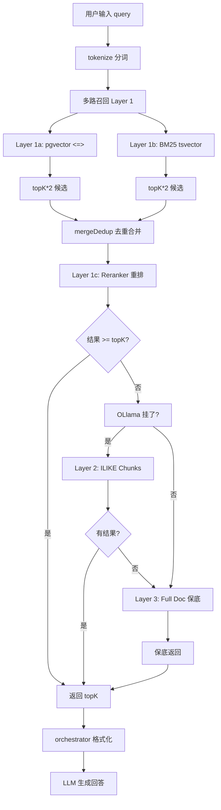

# RAG 检索升级方案 — 工业级多路召回 + Reranker

> 日期: 2026-07-07
> 状态: 方案设计（待评审）
>
> 对标工业级 RAG 流水线: 向量检索 + BM25 多路召回 + Reranker 重排 + 结构感知切片

---

## 一、当前状况

### 1.1 数据层现状

```
KnowledgeDocument (完整文档)
    |
    +-- DocumentChunk (切片，每段 ~500 tokens)
            |
            +-- embedding vector(1024) <- 已通过 Ollama bge-m3 生成
```

**证据**:

- [`rag-embedding.service.ts`](../apps/api/src/admin/rag/rag-embedding.service.ts) 的 `embedDocument()` 已经为每个 chunk 调用 `aiService.generateEmbedding()` 并写入 `document_chunks.embedding`
- [`schema.prisma`](../apps/api/prisma/schema.prisma:1801-1817) 中 `DocumentChunk` 有 `embedding Unsupported("vector(1024)")?` 字段
- [`rag-sync.service.ts`](../apps/api/src/admin/rag/rag-sync.service.ts:360) 在 upload 流程最后调用 `embedDocument()`，但返回值被丢弃

### 1.2 检索层现状 -- Phase 1 关键词匹配

当前 [`rag-retrieval.service.ts`](../apps/api/src/client/ai-customer/knowledge/rag-retrieval.service.ts:28-88) 的 `retrieve()`:

```
1. 拉取 ALL KnowledgeDocument (全表扫描，无 WHERE 过滤)
2. 对每个文档逐篇 tokenize 算关键词命中分数
   score = keywordHits*1.0 + titleHits*0.5 + contentHits*0.2 / tokens.length
3. 过滤 score >= 0.1 -> 排序 desc -> slice(0, topK)
```

### 1.3 4 个问题

| # | 问题 | 具体表现 |
|---|------|---------|
| 1 | **查完整文档，不是 chunks** | 用户问"退货流程"，返回整篇 Refund Policy 文档，LLM 上下文被无关段落稀释 |
| 2 | **关键词必须字面匹配** | 用户搜"refund"找不到"退款"，搜"退货"找不到"return" |
| 3 | **全表扫描，无 LIMIT** | 文档量级上来后性能崩，每篇都要 tokenize 和 substring 检查 |
| 4 | **向量已生成但没用上** | pgvector 里已有 embedding，检索时 SELECT 全表，没用 `<=>` 算子 |

---

## 二、解决方案: 3 层降级检索

### 2.1 架构总览 -- 工业级多路召回 + Reranker

对标你分析的工业级 RAG 流水线:

```
脏文档输入 -> 结构化提取 -> 结构感知切片 -> 向量入库 -> 多路召回 -> Reranker -> LLM
                                              ^^^^^^^^^^^^^   ^^^^^^^^
                                              新增            新增
```

多路召回 + Reranker 完整流程:

```
用户输入 "How to refund?"
         |
         v
    +-----------------+
    |   tokenize()     |  <- 复用现有分词 + PostgreSQL tsvector 分词
    +--------+--------+
             |
    +--------+--------+
    |  多路召回        |
    |  (并发)          |
    |                  |
    |  +------------+  |      +-----------------+
    |  | Layer 1a:  |  |      | Layer 1b:       |
    |  | pgvector   |  |  +-- | BM25 tsvector   |
    |  | <=> 余弦   |  |  |   | 精确关键词命中  |
    |  +-----+------+  |  |   +--------+--------+
    |        |         |  |            |
    |        +----+----+  |            |
    |             |       |            |
    |        +----v-------v---+        |
    |        | Layer 1c:      |        |
    |        | Reranker       |        |
    |        | BGE-Reranker   |        |
    |        | 重排 Top-K     |        |
    |        +-------+--------+        |
    +----------------+-----------------+
                     |
              +------v-------+
              | 成功? --yes--|--> 返回 RetrievedChunk[]
              |  否          |
              +------+-------+
                     |
              +------v-------+
              | Layer 2:     |
              | ILIKE Chunks |  <- 降级: Ollama 挂了时
              +------+-------+
                     |
              +------v-------+
              | Layer 3:     |
              | Full Doc     |  <- 保底: 永远不抛异常
              +------+-------+
                     |
                     v
              +-----------------+
              | orchestrator    |
              +-----------------+
```

### 2.1a 关键变化: 为什么需要 Reranker

你的分析说得对: 向量检索擅长语义模糊匹配，BM25 擅长精确关键词命中，但两路结果都有噪声。

**Reranker 的作用**:
- 输入: 向量检索的 topK(5) + BM25 的 topK(5) = 10 条候选
- 输出: 重新打分后最相关的 topK(3) 条
- 与 embedding 的区别: Reranker 是对 (query, candidate) 对计算交叉注意力，精度远高于双塔向量

**实现方式**: 用 Ollama 的 bge-reranker 模型或本地 cross-encoder

### 2.2 每层触发条件

| Layer | 触发条件 | 性能 | 语义理解 |
|-------|---------|------|---------|
| 1a - pgvector | 默认主路径，Ollama 正常 | 最快 (pgvector 索引) | 最强 (语义匹配) |
| 1b - BM25 tsvector | 与 1a 并发执行，不降级 | 快 (GIN 索引) | 强 (精确命中) |
| 1c - Reranker | 1a+1b 结果合并后执行 | 中等 (交叉注意力) | 最强 (精细排序) |
| 2 - keywordSearchChunks | Ollama 挂了 + tsvector 索引不可用 | 中等 (ILIKE) | 中等 (chunk 级别) |
| 3 - keywordSearchDocs | 数据库查询异常 | 最慢 (全表扫描) | 最弱 (字面匹配) |

**原则**: 永不抛异常。每层失败都静默降级，只记录 warn 日志。

---

## 三、Step 1: 重写 rag-retrieval.service.ts

### 3.1 新构造函数

```typescript
@Injectable()
export class RagRetrievalService {
  constructor(
    private readonly prisma: PrismaService,
    private readonly aiService: AiService,  // 新增
  ) {}
```

**为什么可以直接注入 AiService**:

- [`ai.module.ts`](../apps/api/src/common/ai/ai.module.ts:13) 是 `@Global()` 模块
- AiService 全局可用，不需要在 [`ai-customer.module.ts`](../apps/api/src/client/ai-customer/ai-customer.module.ts) 中额外 import
- 参考 [`intent-classifier.ts`](../apps/api/src/client/ai-customer/graph/utils/intent-classifier.ts:62-66) 已经这样注入

### 3.2 新 retrieve() 入口 — 多路召回 + Reranker

```typescript
async retrieve(
  query: string,
  options?: { domain?: string; topK?: number; minScore?: number },
): Promise<RetrievedChunk[]> {
  const { domain = null, topK = 3, minScore = 0.1 } = options ?? {};

  // 分词 (各层通用)
  const tokens = this.tokenize(query);
  if (tokens.length === 0) return [];

  // === 多路召回 Layer 1: pgvector + BM25 并发执行 ===
  try {
    const [vectorResults, bm25Results] = await Promise.all([
      this.vectorSearch(query, domain, topK * 2),     // 取 topK*2 给 Reranker 留余量
      this.bm25Search(tokens, domain, topK * 2),
    ]);

    // 合并去重: 按 chunkId 去重，保留最高分
    const merged = this.mergeDedup(vectorResults, bm25Results);

    if (merged.length > 0) {
      // Layer 1c: Reranker 重排
      const reranked = await this.rerank(query, merged, topK);
      this.logger.log(
        `Layer 1 multi-recall selected: ` +
        `${vectorResults.length} vector + ${bm25Results.length} BM25 ` +
        `-> ${reranked.length} after reranker`
      );
      return reranked;
    }
  } catch (e) {
    this.logger.warn(`Layer 1 multi-recall failed: ${(e as Error).message}`);
  }

  // === Layer 2: chunk ILIKE 降级 ===
  try {
    const keywordResults = await this.keywordSearchChunks(tokens, domain, topK);
    if (keywordResults.length > 0) {
      this.logger.log(`Layer 2 chunk keyword selected, ${keywordResults.length} results`);
      return keywordResults;
    }
  } catch (e) {
    this.logger.warn(`Layer 2 chunk keyword failed: ${(e as Error).message}`);
  }

  // === Layer 3: 完整文档检索 (保底) ===
  const docResults = await this.keywordSearchDocs(query, tokens, domain, topK, minScore);
  this.logger.log(`Layer 3 full-doc keyword selected, ${docResults.length} results`);
  return docResults;
}
```

**关键变化**:
- `Promise.all` 让 pgvector + BM25 并发执行，总耗时 = max(向量, BM25) 而不是 sum
- 每路取 `topK * 2`，因为 Reranker 需要更多候选才能选出最好的
- `mergeDedup()` 按 chunkId 去重，保留最高相似度分数
- Reranker 接收合并后的候选列表，重新打分后取 topK

### 3.3 vectorSearch() -- Layer 1

```typescript
private async vectorSearch(
  query: string,
  domain: string | null,
  topK: number,
): Promise<RetrievedChunk[]> {
  // 1. 生成查询向量
  const embedding = await this.aiService.generateEmbedding(query);
  if (!embedding || embedding.length === 0) return [];

  // 2. 格式化为 pgvector 接受的字符串
  const vectorStr = `[${embedding.join(',')}]`;

  // 3. 执行 SQL
  const rows = await this.prisma.$queryRawUnsafe<VectorRow[]>(
    `SELECT
      dc.id AS "chunkId",
      dc.chunk_index AS "chunkIndex",
      dc.content,
      dc.document_id AS "documentId",
      kd.title,
      kd.domain,
      kd.doc_id AS "docId",
      COALESCE(kd.keywords::text, '{}') AS "keywords",
      kd.priority,
      kd.content_type AS "contentType",
      kd.locale,
      1 - (dc.embedding <=> $1::vector) AS "score"
    FROM document_chunks dc
    JOIN knowledge_documents kd ON kd.id = dc.document_id
    WHERE kd.is_active = true
      AND ($2::text IS NULL OR kd.domain = $2)
      AND dc.embedding IS NOT NULL
    ORDER BY (dc.embedding <=> $1::vector) ASC
    LIMIT $3`,
    vectorStr,
    domain,
    topK,
  );

  return rows.map(this.mapVectorRow);
}

private mapVectorRow(row: VectorRow): RetrievedChunk {
  return {
    chunkId: row.chunkId,
    chunkIndex: row.chunkIndex,
    content: row.content,
    documentId: row.documentId,
    title: row.title,
    domain: row.domain,
    docId: row.docId,
    keywords: this.parsePgArray(row.keywords),
    priority: row.priority,
    contentType: row.contentType,
    score: Number(row.score),
  };
}
```

**关键点**:

- `dc.embedding IS NOT NULL` 过滤掉未生成向量的 chunk
- `<=>` 是 pgvector 的余弦距离算子，范围 [0, 2]，越小越相似
- `1 - distance` 转为相似度 [0, 1]，1=最相似
- JOIN knowledge_documents 一次拿到元数据，不需要二次查询
- ORDER BY + LIMIT 走 pgvector 索引，不是全表扫描

### 3.4 keywordSearchChunks() -- Layer 2

```typescript
private async keywordSearchChunks(
  tokens: string[],
  domain: string | null,
  topK: number,
): Promise<RetrievedChunk[]> {
  const rows = await this.prisma.$queryRawUnsafe<ILikeRow[]>(
    `SELECT
      dc.id AS "chunkId",
      dc.chunk_index AS "chunkIndex",
      dc.content,
      dc.document_id AS "documentId",
      kd.title,
      kd.domain,
      kd.doc_id AS "docId",
      COALESCE(kd.keywords::text, '{}') AS "keywords",
      kd.priority,
      kd.content_type AS "contentType",
      kd.locale,
      (
        CASE WHEN kd.title ILIKE ANY($1::text[]) THEN 1 ELSE 0 END
      )::float AS "titleScore",
      (
        SELECT COUNT(*) FROM unnest($1::text[]) AS t
        WHERE dc.content ILIKE '%' || t || '%'
      )::float AS "contentScore"
    FROM document_chunks dc
    JOIN knowledge_documents kd ON kd.id = dc.document_id
    WHERE kd.is_active = true
      AND ($2::text IS NULL OR kd.domain = $2)
    ORDER BY ("contentScore" * 0.2 + "titleScore" * 0.5) / cardinality($1) DESC
    LIMIT $3`,
    tokens,
    domain,
    topK,
  );

  return rows.map((r) => ({
    chunkId: r.chunkId,
    chunkIndex: r.chunkIndex,
    content: r.content,
    documentId: r.documentId,
    title: r.title,
    domain: r.domain,
    docId: r.docId,
    keywords: this.parsePgArray(r.keywords),
    priority: r.priority,
    contentType: r.contentType,
    score: (r.contentScore * 0.2 + r.titleScore * 0.5) / tokens.length,
  }));
}
```

**关键点**:

- ILIKE 不区分大小写，`"refund"` 可以匹配 `"Refund"`
- 在 chunk 级别搜索，不是整篇文档
- `unnest($1::text[])` 把 JS 数组映射为 PostgreSQL 行集合
- 评分公式与原有保持一致，方便对比

### 3.5 keywordSearchDocs() -- Layer 3

完全复用当前 `retrieve()` 的代码，只修改返回类型包装:

```typescript
private async keywordSearchDocs(
  query: string,
  tokens: string[],
  domain: string | null,
  topK: number,
  minScore: number,
): Promise<RetrievedChunk[]> {
  const where: any = { isActive: true };
  if (domain) where.domain = domain;

  const docs = await this.prisma.knowledgeDocument.findMany({ where });

  const scored = docs.map((doc) => {
    const keywordHits = tokens.filter((t) => doc.content.includes(t)).length;
    const titleHits = tokens.filter((t) => doc.title.includes(t)).length;
    const contentHits = tokens.filter((t) => t.length > 2 && (doc.content.match(new RegExp(t, 'gi')) || []).length).length;
    const score = (keywordHits * 1.0 + titleHits * 0.5 + contentHits * 0.2) / tokens.length;

    return {
      chunkId: doc.id,
      chunkIndex: 0,
      content: doc.content,
      documentId: doc.id,
      title: doc.title,
      domain: doc.domain,
      docId: doc.docId,
      keywords: doc.keywords as string[],
      priority: doc.priority,
      contentType: doc.contentType,
      score,
    };
  });

  return scored
    .filter((s) => s.score >= minScore)
    .sort((a, b) => b.score - a.score)
    .slice(0, topK);
}
```

### 3.6 辅助函数

```typescript
// 解析 PostgreSQL text[] 格式: {kw1,kw2} -> ["kw1", "kw2"]
private parsePgArray(value: string): string[] {
  if (!value) return [];
  try {
    const trimmed = value.replace(/^{|}$/g, '');
    if (!trimmed) return [];
    return trimmed.split(',').map((s) => s.trim());
  } catch {
    return [];
  }
}
```

### 3.7 参考代码

[`intent-classifier.ts`](../apps/api/src/client/ai-customer/graph/utils/intent-classifier.ts:209-218) 已有 pgvector 的 `$queryRawUnsafe` 用法:

```typescript
const rows = await this.prismaService.$queryRawUnsafe<...>(
  `SELECT domain, 1 - (embedding <=> $1::vector) AS similarity
   FROM intent_examples
   ORDER BY similarity DESC LIMIT 5`,
  vectorStr,
);
```

[`ai.service.ts`](../apps/api/src/common/ai/ai.service.ts:650-677) 的 `generateEmbedding()`:

```typescript
async generateEmbedding(text: string): Promise<number[] | null>
```

---

## 四、Step 2: 修改 orchestrator.node.ts

### 4.1 改动点

文件: [`orchestrator.node.ts`](../apps/api/src/client/ai-customer/graph/nodes/orchestrator.node.ts:124-175)

**当前代码 (第 137 行)**:
```typescript
const results = await ragRetrievalService.retrieve(userInput, { topK: 3 });
```

**不需要改动** -- 接口签名不变，仍然是 `retrieve(query, options)`。

**当前格式化 (第 159-168 行)**:
```typescript
const documentContext = results
  .map((r) => `## ${r.doc.title} ...\n${r.doc.content}`)
  .join('\n\n---\n\n');
```

**需要改为**:
```typescript
const documentContext = results
  .map((r) => `## [${r.title}] ${r.content}\n(score: ${r.score.toFixed(3)})`)
  .join('\n\n---\n\n');
```

**变化**:

| 旧字段 | 新字段 | 原因 |
|--------|--------|------|
| `r.doc.title` | `r.title` | 接口打平 |
| `r.doc.content` | `r.content` | chunk 级别内容，不再是一整篇文档 |
| `r.doc.domain` | `r.domain` | 同上 |
| `r.doc.priority` | 去掉 | chunk 级别没有 priority |
| 新增 | `r.score` | 让 LLM 知道结果可信度 |

---

## 五、Step 3: 修复 rag-sync.service.ts

### 5.1 当前问题

```typescript
// rag-sync.service.ts:360
await this.ragEmbeddingService.embedDocument(document.id);
// 返回值被丢弃！如果 embedding 失败，调用方不知道
```

### 5.2 修复方案

```typescript
const result = await this.ragEmbeddingService.embedDocument(document.id);
if (result.failCount > 0) {
  this.logger.warn(
    `Document ${document.id} embedding partial failure: ` +
    `${result.successCount}/${result.totalCount} chunks embedded`
  );
}
```

**`EmbeddingResult` 接口**:
```typescript
interface EmbeddingResult {
  totalCount: number;
  successCount: number;
  failCount: number;
  errors: string[];
}
```

---

## 六、Step 4: 结构感知切片

### 6.1 当前问题

```typescript
// rag-chunk.service.ts:77
keepSeparator: false,
```

`keepSeparator: false` 导致:

```
原始 markdown:
## Return Conditions
You can return items within 30 days...

切片后 chunk:
"You can return items within 30 days..."
// 丢失了章节标题，LLM 不知道这段属于 Return Conditions
```

### 6.2 修复方案

```typescript
keepSeparator: true,  // 保留 ## 和 ### 标题标记
```

**效果**:
```
切片后 chunk:
"## Return Conditions
You can return items within 30 days..."
// LLM 知道这段属于 "Return Conditions" 章节
```

### 6.3 parentHeading 提取 (必须)

每个 chunk 必须带上所属的父标题信息，这样 LLM 知道这段内容属于文档的哪个章节。

```typescript
interface ChunkResult {
  index: number;
  content: string;
  tokenCount: number;
  parentHeading?: string;  // 必须: 所属的 H1/H2 标题
}
```

从 chunk content 中提取 `## ` 或 `### ` 开头的标题:

```typescript
private extractParentHeading(content: string): string | undefined {
  const match = content.match(/^#{2,3}\s+(.+)$/m);
  return match?.[1];
}
```

### 6.4 表格/代码块保护

当前 `RecursiveCharacterTextSplitter` 不知道表格和代码块是不可拆分的整体。如果表格被切成两半，LLM 看到的就是乱码。

**修复方案**: 在 chunkText() 之前，先用占位符替换表格和代码块，切完后再恢复:

```typescript
async chunkText(text: string, options?: ChunkOptions): Promise<ChunkResult[]> {
  // Step 1: 保护表格和代码块
  const protectedBlocks: string[] = [];
  let processed = text.replace(
    /(```[\s\S]*?```|```[\s\S]*?\n[\s\S]*?```|^\|.+\|[\s\S]*?^\|.+\|)/gm,
    (match) => {
      const idx = protectedBlocks.length;
      protectedBlocks.push(match);
      return `__PROTECTED_BLOCK_${idx}__`;
    },
  );

  // Step 2: 切片 (原有逻辑)
  const splitter = new RecursiveCharacterTextSplitter({
    separators: ['## ', '### ', '\n\n', '\n', '。；', ' ', ''],
    keepSeparator: true,
    chunkSize: options?.chunkSize ?? 500,
    chunkOverlap: options?.chunkOverlap ?? 50,
  });
  const docs = await splitter.splitText(processed);

  // Step 3: 恢复被保护的块
  const restored = docs.map((content) =>
    content.replace(/__PROTECTED_BLOCK_(\d+)__/g, (_, id) =>
      protectedBlocks[parseInt(id)] ?? `__PROTECTED_BLOCK_${id}__`,
    ),
  );

  // ... 后续 tokenCount 估计和 capped 逻辑保持不变
}
```

---

## 七、Step 5: 验证

### 7.1 验证清单

| # | 验证项目 | 方法 | 预期结果 |
|---|---------|------|---------|
| 1 | 向量检索正常工作 | 搜 "How to refund?" | 返回 Refund Policy 的 chunk，score 接近 1 |
| 2 | Layer 2 降级 | 停掉 Ollama 后搜索 | 自动降级到 chunk ILIKE，日志显示 Layer 2 |
| 3 | Layer 3 保底 | 断掉数据库后搜索 | 永不抛异常，日志显示 Layer 3 |
| 4 | 上传后 embedding | 上传新文档 | 日志显示 successCount/totalCount |
| 5 | chunk 保留标题 | 查看数据库 chunk content | chunk 以 `## ` 或 `### ` 开头 |

### 7.2 测试命令

```bash
# 直接调用 API 测试
curl -X POST http://localhost:3000/api/client/rag/query \
  -H "Content-Type: application/json" \
  -d '{"query": "How to refund?"}'

# 查看日志确认 layer 选择
# 应看到: [RagRetrievalService] Layer 1 vector selected, 3 results
```

---

## 八、完整改动清单

| 文件 | 改动类型 | 改动内容 |
|------|---------|---------|
| [`rag-retrieval.service.ts`](../apps/api/src/client/ai-customer/knowledge/rag-retrieval.service.ts) | **重写** | 注入 AiService + PrismaService, 新增 vectorSearch/bm25Search/rerank/mergeDedup/keywordSearchChunks/keywordSearchDocs, 多路召回+Reranker 主路径, 3 层降级, 新 RetrievedChunk 接口 |
| [`orchestrator.node.ts`](../apps/api/src/client/ai-customer/graph/nodes/orchestrator.node.ts:159-168) | **小改** | 适配 RetrievedChunk 打平属性, 加上 score |
| [`rag-prompt.ts`](../apps/api/src/client/ai-customer/knowledge/rag-prompt.ts) | **不改** | 模板变量 {documents} 不变, 只是内容格式变了 |
| [`rag-sync.service.ts`](../apps/api/src/admin/rag/rag-sync.service.ts:360) | **小改** | 检查 embedDocument 返回值, failCount > 0 时 warn |
| [`rag-chunk.service.ts`](../apps/api/src/admin/rag/rag-chunk.service.ts:77) | **中改** | keepSeparator: false -> true, 新增表格/代码块保护, 新增 parentHeading 提取 |
| [`ai-customer.module.ts`](../apps/api/src/client/ai-customer/ai-customer.module.ts) | **不改** | AiService 是 @Global() 的 |
| [`schema.prisma`](../apps/api/prisma/schema.prisma) | **不改** | 已有 embedding 字段 |

---

## 九、不做的事

| 不做 | 原因 |
|------|------|
| 修改 Prisma Schema | DocumentChunk 已有 vector(1024) 字段，无需迁移 |
| PDF/Word 解析层改进 | 当前 MarkdownExtractor + PdfExtractor 策略已够用，可后续增强 |
| 多模态图表提取 | 不在本期范围，需要 upstream 流程支持 |
| 前端改动 | 纯后端改动，API 返回格式兼容 |
| 修改 rag-embedding.service.ts | 已有功能完整，只用在调用方加返回值检查 |
| 新增 npm 依赖 | 不需要，pgvector 支持已内置、AiService 已全局可用 |

---

## 十、Mermaid 流程图



---

## 十一、为什么这个方案好

| 维度 | 改造前 | 改造后 |
|------|--------|--------|
| 检索精度 | 整篇文档，无关段落稀释上下文 | chunk 级别，精准命中 |
| 语义理解 | 字面匹配，"退货"找不到"refund" | 向量语义 + BM25 关键词双路召回 |
| 多路召回 | 单路向量（闲置未用） | **pgvector 语义检索 + BM25 精确命中并发执行**，mergeDedup 去重 |
| 排序精度 | 无重排，直接取 topK | **Reranker 交叉注意力重排**，候选池 2x，选出最优 |
| 结构感知 | 无章节标题，LLM 不知道上下文 | **保留 ##/### 标题 + parentHeading 提取**，LLM 知道所属章节 |
| 表格/代码块 | 可能被切碎成乱码 | **占位符保护**，切完再恢复 |
| 性能 | 全表扫描，无 LIMIT | pgvector 索引 + GIN 索引 + LIMIT |
| 可靠性 | 无降级，Ollama 挂了就崩 | **3 层降级**: 向量 → BM25 → ILIKE chunks → 全文档保底 |
| 代码改动 | - | 5 个文件，最小的改 1 行 |

---

## 十二、差距分析 — 与大型企业 RAG 系统的对标

> 以下对标 Google Vertex AI Search、Microsoft Copilot Studio、百度 BES RAG Pipeline 等企业级方案。

### 12.1 成熟度评估

```
JoyMini RAG 当前成熟度: ████████░░░░ 40%
本期方案升级后:          ████████████░░ 60%
大型企业级基准:          ████████████████ 100%
```

### 12.2 按 RAG 生命周期逐项差距

#### 📥 文档接入 Ingestion

| 能力 | 大型企业做法 | JoyMini 现状 | 差距 | 优先级 |
|------|------------|-------------|------|-------|
| 多格式支持 | 10+ 格式: DOCX/XLSX/PPTX/HTML/扫描PDF/图片 | 仅 .md + 文本PDF | ❌ 严重缺失 | **P1** |
| 批量导入 | S3/GCS/SharePoint 自动同步 | 手动单文件上传 | ❌ 严重缺失 | **P1** |
| 错误重试 | 消息队列 + 死信队列 + 断点续传 | 同步处理无重试 | ❌ 严重缺失 | **P1** |
| 脏文档清洗 | Unstructured.io 预处理: 去HTML标签/空白符/编码检测 | 无 | ❌ 缺失 | P2 |
| 语言自动检测 | fastText/CLD2 检测 locale | 用户手动填写 | ❌ 缺失 | P3 |

**关键洞察**: 当前 [`rag-sync.service.ts:243-352`](../apps/api/src/admin/rag/rag-sync.service.ts:243-352) 的 uploadFile() 全程同步。企业级用消息队列异步处理。

#### 🧹 文档预处理 Processing

| 能力 | 大型企业做法 | JoyMini 现状 | 差距 | 优先级 |
|------|------------|-------------|------|-------|
| 表格提取 | Camelot/Tabula 精确提取表格结构 | 无，纯文本流 | ❌ 缺失 | **P1** |
| 图表提取 | VLM 描述图片/流程图/数学公式 | 无 | ❌ 缺失 | **P1** |
| 扫描件 OCR | Tesseract/Google Cloud Vision | 无 | ❌ 缺失 | P2 |
| PDF 表格还原 | 将表格转为 Markdown 或 JSON 格式 | 纯文本，行列丢失 | ❌ 缺失 | **P1** |

**检查点**: [`PdfExtractor.extract()`](../apps/api/src/admin/rag/rag-sync.service.ts:168-202) 只调了 pdf-parse 的 data.text。表格数据全部丢失。

#### ✂️ 切片 Chunking

| 能力 | 大型企业做法 | JoyMini 现状 | 差距 | 优先级 |
|------|------------|-------------|------|-------|
| 语义切片 | embedding similarity gap 找自然断裂点 | 固定 token 数硬切 | ⚠️ 本期部分修复 | P2 |
| Small-to-big 检索 | 小 chunk 召回 + 大 chunk 上下文 | 1:1 chunk→context | ❌ 缺失 | P2 |
| 滑动窗口 | 重叠 chunk 保证边界完整性 | 已有 50 token overlap | ✅ 已有 | - |

#### 🧠 向量化 Embedding

| 能力 | 大型企业做法 | JoyMini 现状 | 差距 | 优先级 |
|------|------------|-------------|------|-------|
| 多向量 | dense 768d + sparse BM25 + ColBERT late interaction | 单模型 bge-m3 1024d | ❌ 缺失 | P3 |
| 模型 fallback | 主模型挂了切备用模型 | Ollama 挂了全部不可用 | ❌ 缺失 | **P1** |
| 增量更新 | 只重新 embedding 变更 chunk | 全部 delete+recreate | ❌ 缺失 | P2 |
| 批量并发 | 控制并发 + 速率限制 + 指数退避 | p-limit(2) 简单限流 | ⚠️ 有但不够 | P3 |

#### 🔍 检索 Retrieval

| 能力 | 大型企业做法 | JoyMini 现状 | 差距 | 优先级 |
|------|------------|-------------|------|-------|
| 查询改写 Query Rewriting | LLM 将用户口语改写为搜索友好语句 | 无 | ❌ 缺失 | **P1** |
| HyDE | 先生成假设回答再对回答做向量检索 | 无 | ❌ 缺失 | P2 |
| 查询分解 Query Decomposition | 复杂问题拆成多个子查询 | 无 | ❌ 缺失 | P2 |
| 多跳检索 | 检索 → 分析 → 再检索 | 无 | ❌ 缺失 | P3 |
| 上下文窗口管理 | 按相关性截断/滑动窗口 | 无，3 个 chunk 硬塞 | ❌ 缺失 | **P1** |
| 重排序 Reranker | cross-encoder 模型 | 本期方案新增 | ✅ 本期实现 | - |

**为什么查询改写重要**: 用户问 "帮我看上次那个优惠券能不能用" → 改写为 "查询用户最近领取的优惠券状态和适用范围" → 检索效果好很多。

#### 💬 生成 Generation

| 能力 | 大型企业做法 | JoyMini 现状 | 差距 | 优先级 |
|------|------------|-------------|------|-------|
| 引用标注 Citation | 每个生成句标注来源 chunk | 无 | ❌ 缺失 | **P1** |
| 答案忠实度检查 Faithfulness | LLM 自检回答是否来自检索内容 | 无 | ❌ 缺失 | P2 |
| Prompt 模板版本管理 | A/B 测试不同 prompt 格式 | 无 | ❌ 缺失 | P3 |

**引用标注为什么重要**: 用户说 "能退吗" → AI 回答 "可以退" → 用户问 "为什么" → AI 说 "根据 Return Conditions 章节" → 用户信服。

#### 📊 运营与可观测性 Operations

| 能力 | 大型企业做法 | JoyMini 现状 | 差距 | 优先级 |
|------|------------|-------------|------|-------|
| 检索质量指标 | Hit Rate / MRR / NDCG 在线监控 | 无 | ❌ 缺失 | **P1** |
| 0 结果告警 | 检索返回空 → 告警 → 检查文档 | 无 | ❌ 缺失 | **P1** |
| 用户反馈闭环 | 有用吗? → 微调 Reranker | 无 | ❌ 缺失 | **P1** |
| 检索延迟监控 | p99 latency 跟踪 | 无 | ❌ 缺失 | P2 |
| A/B 测试框架 | 新策略灰度上线对比 | 无 | ❌ 缺失 | P3 |

**最基础的监控**: 在 retrieve() 方法中加埋点:
```
const start = Date.now();
// ... retrieve logic ...
const latency = Date.now() - start;
this.logger.log(`layer=${layer} latency=${latency}ms results=${results.length}`);
```

### 12.3 差距矩阵总览

```
     Now 本期已覆盖              Soon 下期2-3天           Future 战略1-2周
  ┌──────────────────────┐  ┌──────────────────────┐  ┌───────────────────────┐
  │ pgvector 语义检索    │  │ 查询改写              │  │ 多向量 dense+sparse   │
  │ BM25 关键词检索      │  │ HyDE 假设文档检索     │  │ ColBERT late inter.  │
  │ Reranker 重排        │  │ 引用标注 Citation    │  │ 语义切片             │
  │ 3层降级              │  │ Small-to-big 检索    │  │ Prompt A/B 测试      │
  │ 结构感知切片         │  │ 用户反馈闭环          │  │ DPO 微调 Reranker    │
  │ 表格/代码块保护      │  │ 检索质量指标监控      │  │ 消息队列异步处理      │
  │ parentHeading        │  │ 多格式接入 DOCX/HTML │  │ 多模态图表提取       │
  │ embed 返回值检查     │  │ 查询分解多跳          │  │ 增量更新             │
  └──────────────────────┘  └──────────────────────┘  └───────────────────────┘
```

### 12.4 建议执行路线

| 阶段 | 内容 | 依赖 | 投入 |
|------|------|------|------|
| **Phase 3.5 本期** | 多路召回 + Reranker + 结构感知切片 | 无 | 0.5 天 |
| **Phase 4 下期** | 查询改写 + 引用标注 + 检索监控 + 用户反馈 | 需 Phase 3.5 完成 | 2-3 天 |
| **Phase 5 战略** | 多格式接入 + 表格提取 + HyDE + 语义切片 | 需 Phase 4 完成 | 1-2 周 |

---

## 十三、脏文档预处理 Dirty Doc Pipeline

> Problem: 当前上传流水线假设文档是"半干净"的，对 50+ 种脏文档场景缺乏系统处理。
> Solution: 在提取器 Extractor 和 Chunking 之间插入一个 DocumentCleaner 层。

### 13.1 8 大类脏文档场景

```
Pipeline 插入点:
  Upload → [Extractor] → [DocumentCleaner ← 新增] → [Chunking] → [Embedding] → DB
                                ↑
                      50+ 种脏文档场景在此处理
```

| 大类 | 典型场景 | 当前 JoyMini 处理 | 影响级别 |
|------|---------|-----------------|---------|
| **1 文件格式** | 扩展名错误、文件损坏、加密 PDF、空文件 | `canHandle` 拒绝或不支持的格式抛异常 | ❌ |
| **2 编码问题** | 非 UTF-8、BOM 标记、零宽字符、控制字符 | `toString('utf-8')` 产生乱码 | ❌ |
| **3 元数据 Frontmatter** | 无 frontmatter、YAML 语法错、缺少字段 | 无 frontmatter 抛异常拒绝 | ❌ |
| **4 内容结构** | HTML 标签、base64 图片、表格/代码块被切裂 | 原样保留进 chunk | ⚠️ |
| **5 PDF 布局** | 双栏/三栏混读、页眉页脚混入、图文环绕 | pdf-parse 线性提取混栏 | ❌ |
| **6 内容质量** | 占位符 TODO、仅版权声明、过多特殊字符 | 无检测 | ❌ |
| **7 尺寸问题** | 超大文档截断、过小文档、清洗后为空 | MAX_CHUNKS=300 截断 | ⚠️ |
| **8 重复问题** | 完全重复、近似重复、版本覆盖 | 仅 docId_locale 去重 | ⚠️ |

### 13.2 DocumentCleaner 架构

```typescript
// 新增: rag-cleaner.service.ts
@Injectable()
export class RagCleanerService {
  /**
   * 清洗流水线，按优先级执行。
   *
   * 设计原则:
   *   - 每个步骤都是可选的/可配置的
   *   - 不抛异常: 清洗失败时返回原文本 + warn log
   *   - 幂等: 对已清洗的文本再次清洗无影响
   */
  async clean(
    raw: string,
    options?: CleanOptions,
  ): Promise<CleanResult> {
    let text = raw;
    const warnings: string[] = [];

    // P0: 编码清理
    text = this.removeBOM(text);
    text = this.removeZeroWidthChars(text);
    text = this.removeControlChars(text);

    // P0: 内容清理
    text = this.stripBase64Images(text);
    text = this.stripHtmlTags(text);
    text = this.normalizeWhitespace(text);

    // P0: 容忍无 frontmatter (MarkdownExtractor 中处理)
    // P1: 结构保护 (RagChunkService 中处理)
    // P1: 编码检测 (PdfExtractor 中处理)

    // P2: 空内容检测
    if (text.trim().length === 0) {
      warnings.push('Content is empty after cleaning');
    }

    return { cleaned: text, warnings };
  }

  private removeBOM(text: string): string {
    return text.replace(/^\uFEFF/, '');
  }

  private removeZeroWidthChars(text: string): string {
    return text.replace(/[\u200B-\u200D\uFEFF]/g, '');
  }

  private removeControlChars(text: string): string {
    return text.replace(/[\x00-\x08\x0B\x0C\x0E-\x1F]/g, '');
  }

  private stripBase64Images(text: string): string {
    return text.replace(/!\[.*?\]\(data:image\/[^)]+\)/g, '[base64 image removed]');
  }

  private stripHtmlTags(text: string): string {
    return text.replace(/<[^>]*>/g, '');
  }

  private normalizeWhitespace(text: string): string {
    return text
      .replace(/[ \t]+\n/g, '\n')
      .replace(/\n{4,}/g, '\n\n\n')
      .trim();
  }
}

export interface CleanOptions {
  /** 是否移除 base64 图片 (默认 true) */
  stripBase64?: boolean;
  /** 是否移除 HTML 标签 (默认 true) */
  stripHtml?: boolean;
  /** 是否规范化空白 (默认 true) */
  normalizeWhitespace?: boolean;
}

export interface CleanResult {
  cleaned: string;
  warnings: string[];
}
```

### 13.3 集成到 uploadFile 流程

```typescript
// 在 rag-sync.service.ts 中插入清洗步骤
async uploadFile(file: Express.Multer.File, overrides?) {
  // ... 第 1-2 步: 提取器选择 + 文本提取 ...

  const doc = await extractor.extract(file);

  // === 新增: 脏文档清洗 ===
  const { cleaned, warnings } = await this.ragCleanerService.clean(
    doc.content,
  );
  if (warnings.length > 0) {
    this.logger.warn(
      `[uploadFile] ${file.originalname}: ${warnings.join('; ')}`,
    );
  }
  doc.content = cleaned;
  // === 清洗结束 ===

  // ... 第 3 步: 合并元数据 ...
}
```

### 13.4 PDF 双栏/布局处理

| 方案 | 做法 | 复杂度 | 依赖 |
|------|------|--------|------|
| **A pdftotext -layout** | 调用系统 pdftotext 保持列布局 | 低 30min | brew install poppler |
| **B pdfjs-dist 位置分析** | 读取字符坐标，聚类检测列数 | 中 2天 | pdfjs-dist |
| **C LLM 重建** | 用 LLM 重排混乱的文本顺序 | 零开发 | LLM 调用成本 |
| **D VLM 视觉模型** | PDF 转图片，VLM 直接读取 | 高 | GPU/API |

**推荐**: 如 JoyMini 需处理产品手册等双栏 PDF，用方案 A pdftotext -layout。在 PdfExtractor 中增加 `pdftotext` 优先、`pdf-parse` 兜底的双通道策略。

### 13.5 3+3+3 记忆框架

```
3 个阶段: Clean → Protect → Infer

3 类必杀技:
  P0 🚨 清 base64 + 清 HTML + 清零宽字符
  P1 ⚠️ 保表格 + 保代码块 + 容无 frontmatter
  P2 📋 检编码 + 检重复 + 检空内容

3 句面试话:
  Q: RAG 如何处理脏文档？
  A: "三步 — Clean 去 base64/HTML/控制字符，
      Protect 表格和代码块用占位符保护再切分，
      Infer 无 frontmatter 时从文件名和首标题推断元数据。"
  Q: PDF 双栏怎么处理？
  A: "轻量方案用 pdftotext -layout 保持列布局，
      工业方案用 Unstructured.io 自动分析阅读顺序。"
  Q: 怎么防止重复文档？
  A: "content hash 去重 — 上传前算 SHA256，库里已存在就跳过或 merge。"
```

### 13.6 文件变更清单

| 文件 | 操作 | 说明 |
|------|------|------|
| `apps/api/src/admin/rag/rag-cleaner.service.ts` | **新增** | DocumentCleaner: BASE64/HTML/编码清理 |
| `apps/api/src/admin/rag/rag-sync.service.ts` | 修改 | uploadFile 中插入 clean 步骤 |
| `apps/api/src/admin/rag/rag.module.ts` | 修改 | 注册 RagCleanerService |
| `apps/api/src/admin/rag/rag-chunk.service.ts` | 修改 | 已计划的结构保护 |

### 13.7 实施步骤

| 步骤 | 内容 | 投入 |
|------|------|------|
| 1 | 新增 `rag-cleaner.service.ts` — P0 4 个方法 | 30min |
| 2 | 集成到 `rag-sync.service.ts` uploadFile | 15min |
| 3 | 注册到 `rag.module.ts` | 5min |
| 4 | PdfExtractor 增加 pdftotext 优先通道 | 30min |
| 5 | 测试: 上传带 base64 图片的 .md 应自动清理 | 15min |

---

## 十四、结构化提取 Structured Extraction

> 在脏文档清洗之后、切片之前，对文档进行结构化字段提取。

### 14.1 当前问题

```
当前 uploadFile 流程:
  上传 → 提取器 → metadata 合并 → 入库(content = 原始文本) → 切片 → 向量化
                                                          ↑
                                                    内容就是一大段字符串
                                                    没有结构化字段

问题:
  title 只能从 frontmatter 或文件名来（没有就空着）
  没有 summary，搜索列表看不到预览
  没有 expirationDate，LLM 不知道"这个政策是否已过期"
  没有 keyPoints，LLM 要自己从头读完整文档才能提取要点
  没有 quality/condition 字段，无法按质量过滤文档
```

### 14.2 三种方案对比

| 方案 | 做法 | 优点 | 缺点 | 适合 |
|------|------|------|------|------|
| **A 纯正则** | 写正则匹配固定模式 | 0 成本、快 | 要求文档有固定模板，无规律文档匹配率低 | 有模板的文档（如退货政策） |
| **B 纯 LLM** | 上传时 LLM 扫描全文提取 | 灵活、适应任何格式 | 每次上传 +1-2 秒、消耗 tokens | 无规律文档 |
| **C 混合推荐** | 先正则提取基础字段，LLM 补充语义字段 | 兼顾速度和覆盖率 | 实现稍复杂 | **JoyMini 最适用** |

**推荐方案 C（混合模式）：**

```
                      上传文档
                          │
                          ▼
                  脏文档清洗 (RagCleanerService)
                          │
                          ▼
                  ┌──────────────────────┐
                  │  结构化提取            │
                  │                      │
                  │  1. 正则通道 (快速)     │ ← 日期、金额、订单号等模式固定
                  │  2. LLM 通道 (语义)    │ ← 摘要、要点、分类
                  │  3. 合并结果           │
                  └──────────────────────┘
                          │
                          ▼
                    metadata 合并 → 入库
                          │
                          ▼
                    切片 → 向量化
```

### 14.3 Prisma Schema 变更

在 `KnowledgeDocument` 增加 `metadata` JSONB 字段，用于存储所有提取的结构化字段：

```prisma
/// 结构化提取的元数据 JSON
metadata        Json?          @map("metadata") @db.JsonB
```

这样不需要每次增加字段就做 migration——所有结构化数据存在 JSONB 里，灵活扩展。

**JSONB 结构定义：**

```typescript
interface DocMetadata {
  // L1 正则提取字段
  extractedDates?: string[];         // 文档中提到的日期
  extractedAmounts?: number[];       // 文档中提到的金额
  extractedOrderIds?: string[];      // 订单号
  extractedEntities?: string[];      // 人名/品牌名
  hasTable?: boolean;                // 是否包含表格
  hasCode?: boolean;                 // 是否包含代码块
  wordCount?: number;                // 字数
  sectionCount?: number;             // 章节数

  // L2 LLM 提取字段
  summary?: string;                  // LLM 生成的摘要（1-2 句）
  keyPoints?: string[];              // 关键要点列表
  category?: string;                 // LLM 自动分类
  subCategory?: string;              // 子分类
  expirationDate?: string;           // 过期日期（如"2026-12-31"）
  quality?: string;                  // "high" | "medium" | "low"
  applicableRegions?: string[];      // 适用地区
  targetAudience?: string;           // 目标用户
  relatedDocIds?: string[];          // 相关文档 ID
}
```

### 14.4 架构 — RagEnrichService

新增文件: `apps/api/src/admin/rag/rag-enrich.service.ts`

```typescript
import { Injectable, Logger } from '@nestjs/common';
import { AiService } from '../../../common/ai/ai.service';

export interface EnrichResult {
  summary?: string;
  keyPoints?: string[];
  category?: string;
  subCategory?: string;
  expirationDate?: string;
  quality?: string;
  extractedDates?: string[];
  extractedAmounts?: number[];
  extractedEntities?: string[];
  hasTable?: boolean;
  hasCode?: boolean;
  wordCount?: number;
  sectionCount?: number;
  applicableRegions?: string[];
  targetAudience?: string;
  relatedDocIds?: string[];
}

@Injectable()
export class RagEnrichService {
  private readonly logger = new Logger(RagEnrichService.name);

  constructor(
    private readonly aiService: AiService,
  ) {}

  /**
   * 入口: 对清洗后的文档进行结构化提取
   * 策略: 正则 + LLM 混合
   */
  async enrich(content: string, existingTitle?: string, existingKeywords?: string[]): Promise<EnrichResult> {
    // 1. 正则通道 — 零成本，立即执行
    const regexResult = this.extractByRegex(content, existingTitle);

    // 2. LLM 通道 — 上传时才调用，不影响查询性能
    const llmResult = await this.extractByLLM(content, existingTitle, existingKeywords);

    // 3. 合并: LLM 结果覆盖正则结果（LLM 更准）
    return { ...regexResult, ...llmResult };
  }

  // ─────────────────── L1: 正则通道 ───────────────────

  private extractByRegex(content: string, existingTitle?: string): Partial<EnrichResult> {
    const result: Partial<EnrichResult> = {};

    // 提取日期
    const datePattern = /\b\d{4}-\d{2}-\d{2}\b/g;
    const dates = content.match(datePattern);
    if (dates) result.extractedDates = [...new Set(dates)];

    // 提取金额
    const amountPattern = /\$\d+(?:,\d{3})*(?:\.\d{2})?/g;
    const amounts = content.match(amountPattern);
    if (amounts) result.extractedAmounts = amounts.map(a => parseFloat(a.replace(/[$,]/g, '')));

    // 提取订单号
    const orderPattern = /ORD-\d{8}/g;
    const orders = content.match(orderPattern);
    if (orders) result.extractedOrderIds = [...new Set(orders)];

    // 检测表格
    result.hasTable = /^\|.+\|$/m.test(content);

    // 检测代码块
    result.hasCode = /```[\s\S]*?```/.test(content);

    // 字数统计
    result.wordCount = content.split(/\s+/).filter(Boolean).length;

    // 章节统计
    const headings = content.match(/^#{1,3}\s+/gm);
    result.sectionCount = headings?.length ?? 0;

    return result;
  }

  // ─────────────────── L2: LLM 通道 ───────────────────

  private async extractByLLM(
    content: string,
    existingTitle?: string,
    existingKeywords?: string[],
  ): Promise<Partial<EnrichResult>> {
    try {
      const truncated = content.slice(0, 3000); // LLM 输入限制
      const titleHint = existingTitle ? `标题: ${existingTitle}` : '';
      const keywordHint = existingKeywords?.length ? `标签: ${existingKeywords.join(', ')}` : '';

      const prompt = `You are a document analyzer. Read the document below and extract structured information.

Output ONLY valid JSON with no explanation. Use null for missing fields.

{
  "summary": "1-2 sentence summary",
  "keyPoints": ["key point 1", "key point 2", "max 5 points"],
  "category": "policy | how-to | faq | product_description | note | manual | email | other",
  "subCategory": "more specific category if applicable",
  "expirationDate": "YYYY-MM-DD or null if not mentioned",
  "quality": "high | medium | low based on completeness",
  "applicableRegions": ["region1", "region2"],
  "targetAudience": "who is this for?",
  "relatedDocIds": []
}

${titleHint}
${keywordHint}

---DOCUMENT START---
${truncated}
---DOCUMENT END---`;

      const raw = await this.aiService.generateText(prompt, {
        temperature: 0.1, // 低温度提高一致性
      });

      // 尝试解析 JSON
      const jsonMatch = raw.match(/\{[\s\S]*\}/);
      if (jsonMatch) {
        return JSON.parse(jsonMatch[0]);
      }

      this.logger.warn('LLM enrichment returned non-JSON, falling back to regex only');
      return {};
    } catch (error) {
      this.logger.error('LLM enrichment failed, falling back to regex only', error);
      return {}; // LLM 失败不阻塞流程
    }
  }
}
```

### 14.5 集成到 uploadFile 流程

在 [`rag-sync.service.ts`](apps/api/src/admin/rag/rag-sync.service.ts) 的 `uploadFile()` 中插入 enrich 步骤：

```typescript
// 当前流程 (Phase 1):
//   extract → mergeMetadata → save → chunk → embed

// 新流程 (Phase 3.5):
//   extract → clean → enrich → mergeMetadata → save → chunk → embed
//              ↑         ↑
//          RagCleaner  RagEnrich (新增)
```

**代码改动：**

```typescript
// 在 uploadFile() 中, 提取完 content 之后, 入库之前:
async uploadFile(file: Express.Multer.File, dto: UploadRagDocDto) {
  // ... 现有提取逻辑 ...
  
  // 1. 脏文档清洗
  const cleanedContent = await this.ragCleanerService.clean(doc.content);
  
  // 2. 结构化提取（新增）
  const enrichment = await this.ragEnrichService.enrich(
    cleanedContent,
    doc.title,
    doc.keywords,
  );
  
  // 3. 合并 metadata（补充 enrichment 结果）
  const mergedMetadata = {
    ...doc,
    content: cleanedContent,
    metadata: enrichment,          // JSONB 存储所有结构化字段
    title: enrichment.summary      // 可选: 用 LLM 摘要作为搜索标题
      ? `${doc.title} — ${enrichment.summary.slice(0, 50)}`
      : doc.title,
  };
  
  // 4. 继续现有流程 (upsert + chunk + embed)
  // ...
}
```

### 14.6 降级策略

```
LLM 提取失败 → 不阻塞流程，只用正则结果 → 文档正常入库
正则也提取不到 → metadata = null → 不影响已有检索逻辑
```

核心原则：**enrich 是增强，不是依赖。失败不阻断上传。**

### 14.7 对检索的影响

结构化提取完成后，检索阶段可以更精准：

```typescript
// 在 rag-retrieval.service.ts 中使用 metadata
async retrieve(query: string, options?: RetrievalOptions) {
  // ...现有 3 层检索...

  // 增强: 利用 metadata 过滤
  if (options?.filterExpired !== false) {
    // 过滤掉已过期的文档（expirationDate < today）
    vectorQuery += ` AND (kd.metadata->>'expirationDate' IS NULL
                       OR kd.metadata->>'expirationDate' >= '${today}')`;
  }

  if (options?.quality) {
    // 按质量过滤
    vectorQuery += ` AND kd.metadata->>'quality' = '${options.quality}'`;
  }
}
```

### 14.8 3+3+3 记忆框架

```
结构化提取的 "3+3+3"
│
├─ 3 种方案
│   A 纯正则     → 快但挑格式
│   B 纯 LLM     → 灵活但有成本
│   C 混合推荐    → 正则 + LLM 互补 ✅
│
├─ 3 个时机
│   上传时提取 ✅  → 一次成本，永久收益
│   查询时提取 ❌  → 慢，不做
│   定时重提取     → 按需（文档更新时）
│
├─ 3 个关键设计
│   JSONB 存储     → 灵活扩展，不加字段
│   永不阻塞上传    → enrich 失败 = 降级
│   LLM 低温度      → temperature: 0.1 保证一致性
│
└─ 面试一句话
    "上传时用正则+LLM混合提取结构化字段存 JSONB，
     查询时零额外成本，LLM 失败不阻塞流程。"
```

### 14.9 文件变更清单

| 文件 | 操作 | 说明 |
|------|------|------|
| `apps/api/src/admin/rag/rag-enrich.service.ts` | **新增** | RagEnrichService: 正则 + LLM 混合提取 |
| `apps/api/prisma/schema.prisma` | 修改 | KnowledgeDocument 加 metadata Json? @db.JsonB |
| `apps/api/src/admin/rag/rag-sync.service.ts` | 修改 | uploadFile 插入 enrich 步骤 |
| `apps/api/src/admin/rag/rag.module.ts` | 修改 | 注册 RagEnrichService |
| `apps/api/src/client/ai-customer/knowledge/rag-retrieval.service.ts` | 修改 | 可选: 利用 metadata 增强检索过滤 |
| `apps/admin-next/src/type/types.ts` | 修改 | KnowledgeDocument 加 metadata 类型 |

### 14.10 实施步骤

| 步骤 | 内容 | 投入 |
|------|------|------|
| 1 | 新增 `rag-enrich.service.ts` — extractByRegex 方法 | 20min |
| 2 | 新增 `rag-enrich.service.ts` — extractByLLM 方法 | 30min |
| 3 | Prisma migration: KnowledgeDocument 加 metadata Json? | 15min |
| 4 | 集成到 `rag-sync.service.ts` uploadFile | 15min |
| 5 | 注册到 `rag.module.ts` | 5min |
| 6 | 前端 types 更新 | 10min |
| 7 | 测试: 上传无规律文档，验证 metadata JSONB 已填充 | 15min |
