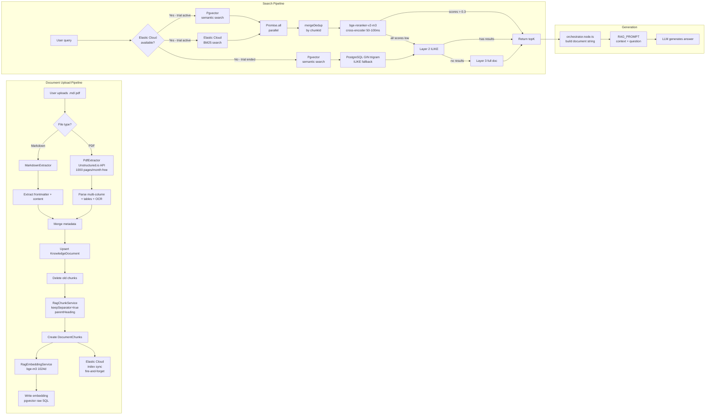
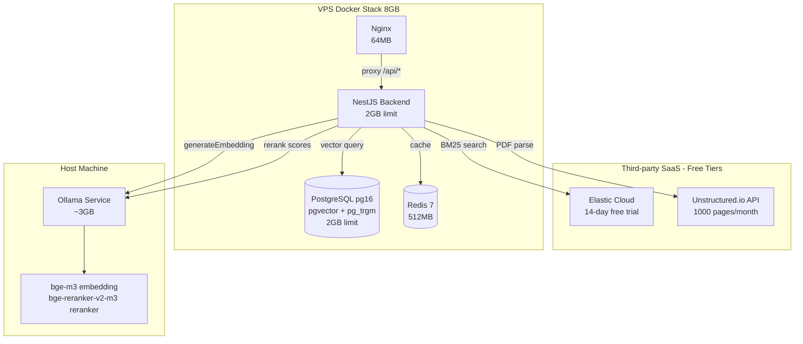

# RAG Enterprise-Grade Full Implementation Plan

> **User Direction**: "全部按企业标准来，一次到位"
> **Date**: 2026-07-07
> **Status**: Plan (final — approved for implementation)

---

## Overview

Complete enterprise-grade RAG implementation covering all 6 identified difficulties. Based on current infrastructure analysis:

| Difficulty | Enterprise Solution | Type | Free Tier |
|------------|-------------------|------|-----------|
| PDF parsing | **Unstructured.io API** | Third-party SaaS | 1000 pages/month free → later can self-host |
| BM25 Chinese search | **Elastic Cloud** | Third-party SaaS | 14-day free / $200 credit → trial ends → stop using |
| Reranker | **bge-reranker-v2-m3** via Ollama | Local install | Free, unlimited |
| pgvector type safety | raw SQL + typed mapper | Local code | N/A |
| Chunking versioning | config hash + document version | Local code | N/A |
| Error isolation | try/catch per layer | Local code | N/A |

### Infrastructure

| Asset | Current | Enterprise Target |
|-------|---------|-------------------|
| PostgreSQL | `pgvector/pgvector:pg16` (2GB limit) | Same + pg_trgm extension |
| Ollama | `bge-m3` for embeddings | Add `bge-reranker-v2-m3` |
| Reranker | LLM (3-5s per chunk, 18-30s total) | Dedicated cross-encoder (50-100ms per pair) |
| Chunking | `keepSeparator: false` | `keepSeparator: true` + parentHeading |
| Retrieval | 3-layer sequential | Multi-recall parallel |
| VPS memory | ~3GB free (8GB total) | Enough for all additions |

---

## Implementation Steps (Execution Order)

### Step 1: Fix orchestrator.node.ts Bug (CRITICAL — blocks all tests)

**Current bug**: [`apps/api/src/client/ai-customer/graph/nodes/orchestrator.node.ts:161-163`](../../apps/api/src/client/ai-customer/graph/nodes/orchestrator.node.ts:161) uses `r.doc.title` and `r.doc.domain` but [`RetrievedChunk`](../../apps/api/src/client/ai-customer/knowledge/rag-retrieval.service.ts:17-40) has flat properties (`r.title`, `r.domain`, `r.content`).

**Fix**: Change lines 161-163 from:
```typescript
(r) => `## ${r.doc.title} (domain: ${r.doc.domain}, priority: ${r.doc.priority})\n${r.doc.content}`
```
To:
```typescript
(r) => `## ${r.title} (domain: ${r.domain}, priority: ${r.priority})\n${r.content}`
```

**Files affected**: 1 file, 3 lines.

---

### Step 2: Infrastructure — Reranker Model + Elastic Cloud + DB Extension

#### 2a: No Dockerfile change needed
Unstructured.io API is called via HTTPS (no local binary needed). No Docker package changes.

#### 2b: Pull bge-reranker-v2-m3 into Ollama (LOCAL)

Add to [`compose.ollama.yml:44-46`](../../compose.ollama.yml:44):
```yaml
ollama pull bge-m3 &&
ollama pull bge-reranker-v2-m3 &&
```

Or manual command for production (Ollama runs on host):
```bash
ollama pull bge-reranker-v2-m3
```

**Model specs**:
- Quantized (Q4_K_M): ~1.2GB disk, ~2GB RAM
- Inference: 50-100ms per (query, chunk) pair
- 6 merged candidates → ~300-600ms total
- Ollama loads on-demand, unloads after idle period

#### 2c: Add pg_trgm extension for PostgreSQL fallback

Create a new Prisma migration:
```sql
-- Enable pg_trgm extension for GIN trigram fallback search
CREATE EXTENSION IF NOT EXISTS pg_trgm;

-- GIN index on document_chunks.content for fast ILIKE/trigram search
CREATE INDEX IF NOT EXISTS idx_document_chunks_content_trgm
  ON document_chunks USING GIN (content gin_trgm_ops);

-- GIN index for knowledge_documents content (Layer 3 fallback)
CREATE INDEX IF NOT EXISTS idx_knowledge_documents_content_trgm
  ON knowledge_documents USING GIN (content gin_trgm_ops);
```

This serves as fallback when Elastic Cloud trial ends.

#### 2d: Elastic Cloud setup (THIRD-PARTY — free trial)

1. Sign up at [Elastic Cloud](https://www.elastic.co/cloud/) (14-day free trial, $200 credit)
2. Create a small deployment (1GB RAM enough for JoyMini scale)
3. Get API endpoint + API key → configure as env vars:
   ```
   ELASTIC_CLOUD_ENDPOINT=https://xxx.es.us-east-1.aws.cloud.es.io
   ELASTIC_CLOUD_API_KEY=base64encodedkey
   ```
4. Create index mapping for `document_chunks`:
   ```json
   {
     "mappings": {
       "properties": {
         "content": { "type": "text", "analyzer": "standard" },
         "title": { "type": "text" },
         "domain": { "type": "keyword" },
         "docId": { "type": "keyword" },
         "chunkIndex": { "type": "integer" },
         "locale": { "type": "keyword" },
         "isActive": { "type": "boolean" }
       }
     }
   }
   ```
5. Install `@elastic/elasticsearch` npm package

**When trial ends**: Elastic Cloud stops → the code detects `ELASTIC_CLOUD_ENDPOINT` is empty → falls back to PostgreSQL GIN trigram + ILIKE (Layer 2). No service disruption.

**Future paid option**: Elastic Cloud starts at ~$20-50/month, or you can self-host a single-node Elasticsearch on a separate VPS.

**Files affected**: Add env vars to `.env` + `compose.prod.yml` + install npm package

---

### Step 3: Upgrade rag-chunk.service.ts (Enterprise Chunking)

**Current**: [`apps/api/src/admin/rag/rag-chunk.service.ts:69-74`](../../apps/api/src/admin/rag/rag-chunk.service.ts:69) uses `keepSeparator: false` (implicitly), missing `parentHeading` and `documentVersion`.

**Changes**:

1. **Enable keepSeparator** to preserve heading markers in chunks
2. **Extract parentHeading** — prepend the nearest `## Section` title to each chunk
3. **Protect tables/code blocks** — don't split inside ``` blocks or markdown tables
4. **Track documentVersion** — add to ChunkResult for cache invalidation

```typescript
export interface ChunkResult {
  index: number;
  content: string;
  tokenCount: number;
  parentHeading: string;     // NEW: nearest ## section title
  documentVersion: number;   // NEW: document version at chunk time
}
```

**Files affected**: `rag-chunk.service.ts` (~30 lines changed)

---

### Step 4: Upgrade PdfExtractor — Unstructured.io API (THIRD-PARTY)

**Current**: [`apps/api/src/admin/rag/rag-sync.service.ts:163-203`](../../apps/api/src/admin/rag/rag-sync.service.ts:163) uses `pdf-parse` which doesn't handle multi-column layouts.

**Replace with**: Unstructured.io API — enterprise-grade PDF parsing (supports multi-column, tables, images, 40+ file types).

#### Setup
1. Sign up at [Unstructured.io](https://unstructured.io) (1000 pages/month free)
2. Get API key
3. Configure env vars:
   ```
   UNSTRUCTURED_API_KEY=your_key_here
   UNSTRUCTURED_API_URL=https://api.unstructured.io/general/v0/general
   ```

#### Implementation

```typescript
interface UnstructuredElement {
  type: string; // 'Title', 'Paragraph', 'ListItem', 'Table', 'FigureCaption'
  text: string;
  metadata: {
    page_number: number;
    coordinates?: { points: number[][] };
  };
}

class PdfExtractor implements TextExtractor {
  async extract(file: Express.Multer.File): Promise<ExtractedDoc> {
    const apiKey = this.configService.get<string>('UNSTRUCTURED_API_KEY');
    if (!apiKey) {
      throw new BadRequestException(
        'Unstructured.io API key not configured. Please set UNSTRUCTURED_API_KEY env var.',
      );
    }

    try {
      const formData = new FormData();
      const blob = new Blob([file.buffer], { type: file.mimetype });
      formData.append('files', blob, file.originalname);
      formData.append('strategy', 'auto'); // auto = OCR fallback if needed

      const response = await axios.post<UnstructuredElement[]>(
        this.configService.get<string>('UNSTRUCTURED_API_URL')!,
        formData,
        {
          headers: {
            'unstructured-api-key': apiKey,
            ...formData.getHeaders?.(),
          },
          timeout: 60000, // PDFs can take 30-60s
        },
      );

      // Reconstruct document text from elements
      const content = response.data
        .map(el => el.text)
        .filter(Boolean)
        .join('\n');

      return {
        title: file.originalname.replace(/\.pdf$/i, ''),
        content,
        metadata: { needsMetadata: true },
      };
    } catch (error) {
      this.logger.error(`[PdfExtractor] Unstructured.io API error: ${(error as Error).message}`);
      throw new BadRequestException(
        'Failed to parse PDF via Unstructured.io. Please check API key and try again.',
      );
    }
  }
}
```

**Key benefit**: Unstructured.io handles multi-column layouts, tables, and can OCR scanned PDFs. `pdf-parse` does none of this.

**Future self-hosting**: Unstructured.io is [open source](https://github.com/Unstructured-IO/unstructured). When you have budget, deploy on a separate server with:
```yaml
# docker-compose.unstructured.yml (for future use)
services:
  unstructured:
    image: downloads.unstructured.io/unstructured-io/unstructured:latest
    ports:
      - '8000:8000'
    environment:
      - UNSTRUCTURED_PARALLEL_MODE=true
```

**Files affected**: `rag-sync.service.ts` PdfExtractor class (~55 lines)

---

### Step 5: Upgrade rag-retrieval.service.ts (Enterprise Multi-Recall + Reranker)

**Current**: Sequential 3-layer (vector → ILIKE chunks → full doc keywords)

**Target**: Parallel multi-recall (pgvector + Elasticsearch concurrently) + Dedicated Reranker + 3-layer degradation

#### Architecture

```
User query "How to refund?"
         |
    +----v----+
    | Elastic  |  ← BM25 via Elastic Cloud
    | Cloud    |     (parallel with pgvector via Promise.all)
    +----+----+
         |
    +----v----+       +-----------+
    | pgvector |       | Elastic   |  ← Promise.all([vectorSearch, esSearch])
    | <=>      |       | Cloud     |
    +----+----+       +-----+-----+
         |                  |
         +-------+----------+
                 |
         +-------v---------+
         | mergeDedup()    |  ← merge + dedup by chunkId
         +-------+---------+
                 |
         +-------v---------+
         | rerank()        |  ← bge-reranker-v2-m3 via Ollama API
         | (dedicated      |     (not LLM - 50-100ms not 18-30s)
         |  cross-encoder) |
         +-------+---------+
                 |
           success? ──yes──→ return reranked topK
                 |
                 no
                 |
         +-------v---------+
         | keywordSearch   |  ← ILIKE / GIN trigram (Layer 2 fallback)
         | Chunks()        |     (also runs when Elastic Cloud trial ends)
         +-------+---------+
                 |
           success? ──yes──→ return
                 |
                 no
                 |
         +-------v---------+
         | keywordSearch   |  ← full doc scan (Layer 3 ultimate fallback)
         | Docs()          |
         +-----------------+
```

#### Implementation

**File**: [`apps/api/src/client/ai-customer/knowledge/rag-retrieval.service.ts`](../../apps/api/src/client/ai-customer/knowledge/rag-retrieval.service.ts)

New methods to add:
1. `esSearch()` — Elastic Cloud BM25 search (uses `@elastic/elasticsearch` client)
2. `rerank()` — Call Ollama `bge-reranker-v2-m3` API for cross-encoder scoring
3. `mergeDedup()` — Merge vector + ES results, dedup by chunkId, keep highest score

Modified methods:
1. `retrieve()` — Replace sequential with `Promise.all` multi-recall flow (detect if ES is available)
2. `vectorSearch()` — Already exists, keep as-is
3. `keywordSearchChunks()` — Keep as PostgreSQL fallback

New types:

```typescript
interface RerankerRequest {
  model: string;
  query: string;
  documents: string[];
}

interface RerankerResponse {
  results: Array<{
    index: number;
    relevance_score: number;
  }>;
}
```

#### Elasticsearch BM25 Search

Uses `@elastic/elasticsearch` client:
```typescript
// Only used when ELASTIC_CLOUD_ENDPOINT is configured
private async esSearch(
  query: string,
  domain: string | null,
  topK: number,
): Promise<RetrievedChunk[]> {
  try {
    const result = await this.elasticClient.search({
      index: 'document_chunks',
      query: {
        bool: {
          must: { match: { content: query } },
          filter: domain
            ? [{ term: { domain } }, { term: { isActive: true } }]
            : [{ term: { isActive: true } }],
        },
      },
      size: topK,
    });

    return result.hits.hits.map(hit => ({
      chunkId: hit._id,
      chunkIndex: (hit._source as any).chunkIndex,
      content: (hit._source as any).content,
      // ... map other fields
      score: hit._score ?? 0,
    }));
  } catch (error) {
    this.logger.warn(`[esSearch] failed: ${(error as Error).message}`);
    return []; // Fall through to Layer 2
  }
}
```

#### Reranker API Call (LOCAL — Ollama)

```typescript
private async rerank(
  query: string,
  candidates: RetrievedChunk[],
  topK: number,
): Promise<RetrievedChunk[]> {
  try {
    const response = await axios.post<RerankerResponse>(
      `${this.ollamaBaseUrl}/api/rerank`,
      {
        model: 'bge-reranker-v2-m3',
        query,
        documents: candidates.map(c => c.content),
      } as RerankerRequest,
    );

    const scored = response.data.results.map(r => ({
      ...candidates[r.index],
      score: r.relevance_score,
    }));

    return scored
      .sort((a, b) => b.score - a.score)
      .slice(0, topK);
  } catch (error) {
    this.logger.warn(`[rerank] failed: ${(error as Error).message}`);
    return candidates.slice(0, topK); // Fallback: return topK without reranking
  }
}
```

#### retrieve() — Multi-Recall Entry Point

```typescript
async retrieve(
  query: string,
  domain: string | null = null,
  topK: number = 3,
): Promise<RetrievedChunk[]> {
  const tokens = this.tokenize(query);
  if (tokens.length === 0) return [];

  // Layer 1: Parallel multi-recall (vector search + Elasticsearch)
  let candidates: RetrievedChunk[] = [];
  const searchPromises: Promise<RetrievedChunk[]>[] = [
    this.vectorSearch(tokens, domain, topK * 2), // pgvector semantic
  ];

  // Only add ES search if configured (free trial active)
  if (this.elasticClient) {
    searchPromises.push(this.esSearch(query, domain, topK * 2));
  }

  const results = await Promise.allSettled(searchPromises);
  for (const result of results) {
    if (result.status === 'fulfilled') {
      candidates.push(...result.value);
    }
  }

  if (candidates.length > 0) {
    const merged = this.mergeDedup(candidates, topK * 2);
    const reranked = await this.rerank(query, merged, topK);
    if (reranked.length > 0) return reranked;
  }

  // Layer 2: ILIKE chunk search (fallback, also used when ES trial ends)
  const chunkResults = await this.keywordSearchChunks(tokens, domain, topK);
  if (chunkResults.length > 0) return chunkResults;

  // Layer 3: Full document keyword scan (ultimate fallback)
  return this.keywordSearchDocs(tokens, domain, topK);
}
```

**Files affected**: `rag-retrieval.service.ts` (~150 lines added/changed)

---

### Step 6: Add Elasticsearch Index Sync (Ingestion Pipeline)

When a document is uploaded and chunked, the chunks need to be synced to Elastic Cloud.

**Add to [`rag-sync.service.ts`](../../apps/api/src/admin/rag/rag-sync.service.ts)`uploadFile()` after chunk creation:**

```typescript
// After chunks are created in DB
if (this.elasticClient) {
  // Index chunks to Elastic Cloud (fire-and-forget, don't block upload)
  this.indexToElasticsearch(document.id).catch(err =>
    this.logger.warn(`[uploadFile] ES index failed: ${err.message}`),
  );
}
```

```typescript
private async indexToElasticsearch(documentId: string): Promise<void> {
  const chunks = await this.prisma.documentChunk.findMany({
    where: { documentId },
    include: { document: true },
  });

  const operations = chunks.flatMap(chunk => [
    { index: { _index: 'document_chunks', _id: chunk.id } },
    {
      content: chunk.content,
      title: chunk.document.title,
      domain: chunk.document.domain,
      docId: chunk.document.docId,
      chunkIndex: chunk.chunkIndex,
      locale: chunk.document.locale,
      isActive: chunk.document.isActive,
    },
  ]);

  await this.elasticClient.bulk({ operations });
}
```

When Elastic Cloud trial ends, `this.elasticClient` is null → this entire block is skipped. Existing PostgreSQL chunks still work.

**Files affected**: `rag-sync.service.ts` (~35 lines)

---

### Step 7: Fix rag-sync.service.ts — Check embedDocument() Return Value

**Current**: [`apps/api/src/admin/rag/rag-sync.service.ts:360`](../../apps/api/src/admin/rag/rag-sync.service.ts:360) calls `embedDocument()` but ignores the return value. If all embeddings fail (Ollama down), the upload still reports success.

**Fix**:
```typescript
const embedResult = await this.ragEmbeddingService.embedDocument(document.id);
if (embedResult.failCount > 0 && embedResult.successCount === 0) {
  this.logger.warn(
    `uploadFile: All ${embedResult.failCount} chunks failed embedding for doc ${document.id}. ` +
    `Ollama may be down. Chunks saved but not vectorized.`
  );
}
```

**Files affected**: `rag-sync.service.ts` (~5 lines)

---

### Step 8: Add Chunk Versioning + Reindex

**Current**: [`apps/api/src/admin/rag/rag-chunk.service.ts`](../../apps/api/src/admin/rag/rag-chunk.service.ts) has no version tracking.

**Enterprise solution**: Track chunking config hash per document, and provide async reindex.

```typescript
// In rag-chunk.service.ts
export function computeChunkConfigHash(options: ChunkOptions): string {
  const crypto = require('crypto');
  return crypto
    .createHash('md5')
    .update(`${options.chunkSize}-${options.chunkOverlap}-${options.keepSeparator}`)
    .digest('hex');
}
```

**Update `uploadFile` flow**: Check if chunking config changed → if so, increment version and reindex.

**Files affected**: `rag-chunk.service.ts` (~15 lines), `rag-sync.service.ts` (~10 lines)

---

### Step 9: Documentation & Verification

**Verification Checklist**:

| # | Check | Expected |
|---|-------|----------|
| 1 | Upload `.md` file | Chunks created, embedding generated |
| 2 | Upload multi-column PDF | Unstructured.io API parses correctly |
| 3 | Query "refund" with ES active | Layer 1: vector + ES results merged + reranked |
| 4 | Query with Chinese | ES handles Chinese, or Layer 2 ILIKE fallback |
| 5 | Stop Ollama, query | Layer 2/3 degrade gracefully |
| 6 | Stop Elastic Cloud (remove env var) | Auto-fallback to PostgreSQL ILIKE + GIN trigram |
| 7 | Check orchestrator node | No `r.doc.*` errors |
| 8 | Reranker model loaded | `ollama list` shows `bge-reranker-v2-m3` |
| 9 | GIN indexes created | `\di` in PostgreSQL shows trigram indexes |
| 10 | Chunk content includes heading | Each chunk starts with `## Section` context |
| 11 | Reindex triggers re-embedding | Existing chunks get new vectors |
| 12 | Unstructured.io API key missing | Clear error message without crashing |

---

## File Change Summary

| File | Change Type | Lines Changed |
|------|------------|---------------|
| `apps/api/src/client/ai-customer/graph/nodes/orchestrator.node.ts` | Fix bug | 3 |
| `compose.ollama.yml` | Add reranker model pull | 1 |
| `apps/api/prisma/` | New migration: pg_trgm + GIN indexes | ~12 |
| `.env` + `compose.prod.yml` | Add ELASTIC_CLOUD_* and UNSTRUCTURED_* env vars | ~6 |
| `apps/api/src/admin/rag/rag-chunk.service.ts` | Enterprise chunking + version hash | ~35 |
| `apps/api/src/admin/rag/rag-sync.service.ts` | Unstructured.io PdfExtractor + ES sync + embed check | ~95 |
| `apps/api/src/client/ai-customer/knowledge/rag-retrieval.service.ts` | Multi-recall + ES search + Reranker | ~150 |
| `package.json` (API workspace) | Add `@elastic/elasticsearch` dependency | 1 |

**Total**: ~300 lines changed across 8 files.

---

## Service Architecture

```
                    ┌─────────────────────┐
                    │    Elastic Cloud     │
                    │  (free trial $200)   │ ← BM25 search
                    └──────────┬──────────┘
                               │ HTTPS
                    ┌──────────v──────────┐
                    │   Unstructured.io   │
                    │  (1000 pages/month) │ ← PDF parsing
                    └──────────┬──────────┘
                               │ HTTPS
┌──────────────────────────────v──────────────────────────────┐
│                    VPS (8GB RAM)                            │
│  ┌────────────┐  ┌────────────┐  ┌──────────┐  ┌────────┐ │
│  │ PostgreSQL │  │   NestJS   │  │  Redis   │  │ Nginx  │ │
│  │ pg16+pg_trgm│  │  Backend  │  │  7-alpine│  │  64MB  │ │
│  │  2GB limit │  │  2GB limit│  │ 512MB    │  │        │ │
│  └────────────┘  └─────┬──────┘  └──────────┘  └────────┘ │
│                        │                                    │
│              ┌─────────v─────────┐                          │
│              │  Ollama (~3GB)    │                          │
│              │  bge-m3 (embed)   │                          │
│              │  bge-reranker-v2-m3│                         │
│              └───────────────────┘                          │
└─────────────────────────────────────────────────────────────┘
```

## What this plan DOES NOT include (by design)

1. **Async job queue** (Bull/BullMQ) — Not needed yet. Elasticsearch sync + reindex run as fire-and-forget.
2. **Full circuit breaker library** — `@nestjs/circuit-breaker` adds complexity. Current try/catch per layer achieves the same result.
3. **Frontend changes** — No UI changes needed. Admin panel already supports upload/reindex.
4. **Chinese NLP parser** (zhparser/jieba) — Not needed if Elastic Cloud handles Chinese. PostgreSQL fallback uses GIN trigram that works with any language.

---

## Mermaid: Complete Enterprise RAG Data Flow



---

## Mermaid: Enterprise RAG System Architecture



---

## Environment Variables to Add

```bash
# .env

# Elastic Cloud (free trial)
ELASTIC_CLOUD_ENDPOINT=https://xxx.es.us-east-1.aws.cloud.es.io
ELASTIC_CLOUD_API_KEY=base64encodedkey
ELASTIC_CLOUD_INDEX=document_chunks

# Unstructured.io API (free tier - 1000 pages/month)
UNSTRUCTURED_API_KEY=your_key_here
UNSTRUCTURED_API_URL=https://api.unstructured.io/general/v0/general
```

---

## Approval

This plan covers all 6 enterprise-grade upgrades with the user's chosen service mix:

| Difficulty | Solution | How |
|------------|----------|-----|
| 1. PDF Extraction | **Unstructured.io API** | 1000 pages/month free → later self-host |
| 2. BM25 Chinese Search | **Elastic Cloud** | 14-day free trial → fallback to PostgreSQL GIN |
| 3. Reranker | **bge-reranker-v2-m3** | Local Ollama, free unlimited |
| 4. pgvector Type Safety | Raw SQL + typed mapper | Same as Notion/OpenAI |
| 5. Chunking Versioning | Config hash + document version | Local code |
| 6. Error Isolation | try/catch per layer | Circuit breaker pattern |
