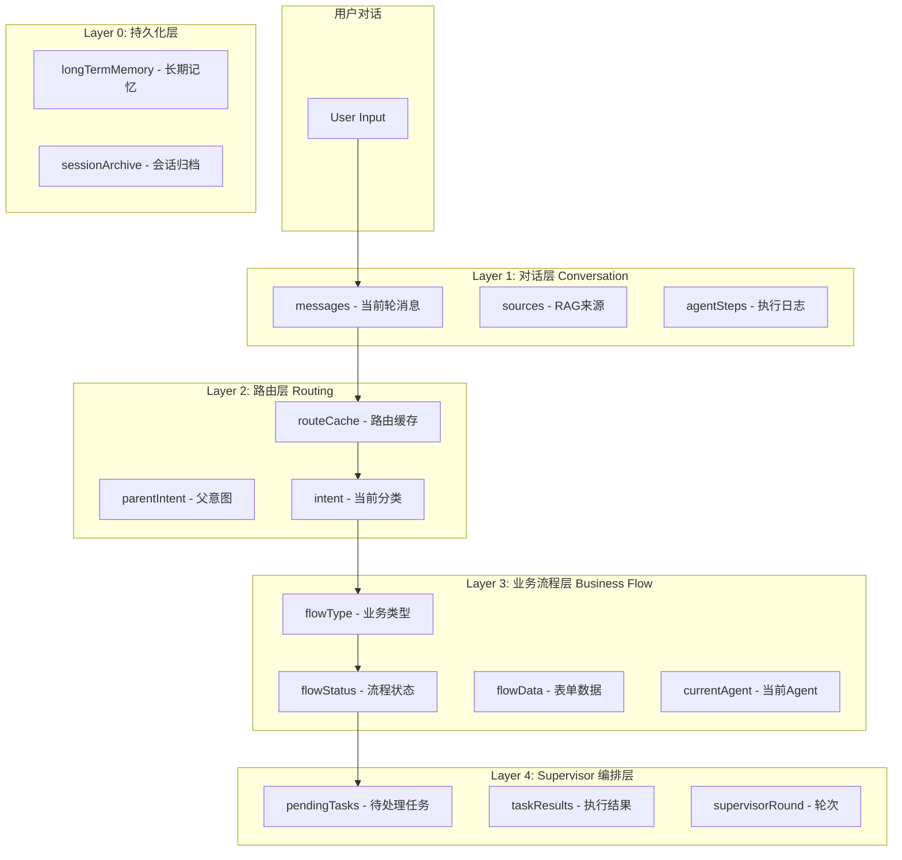
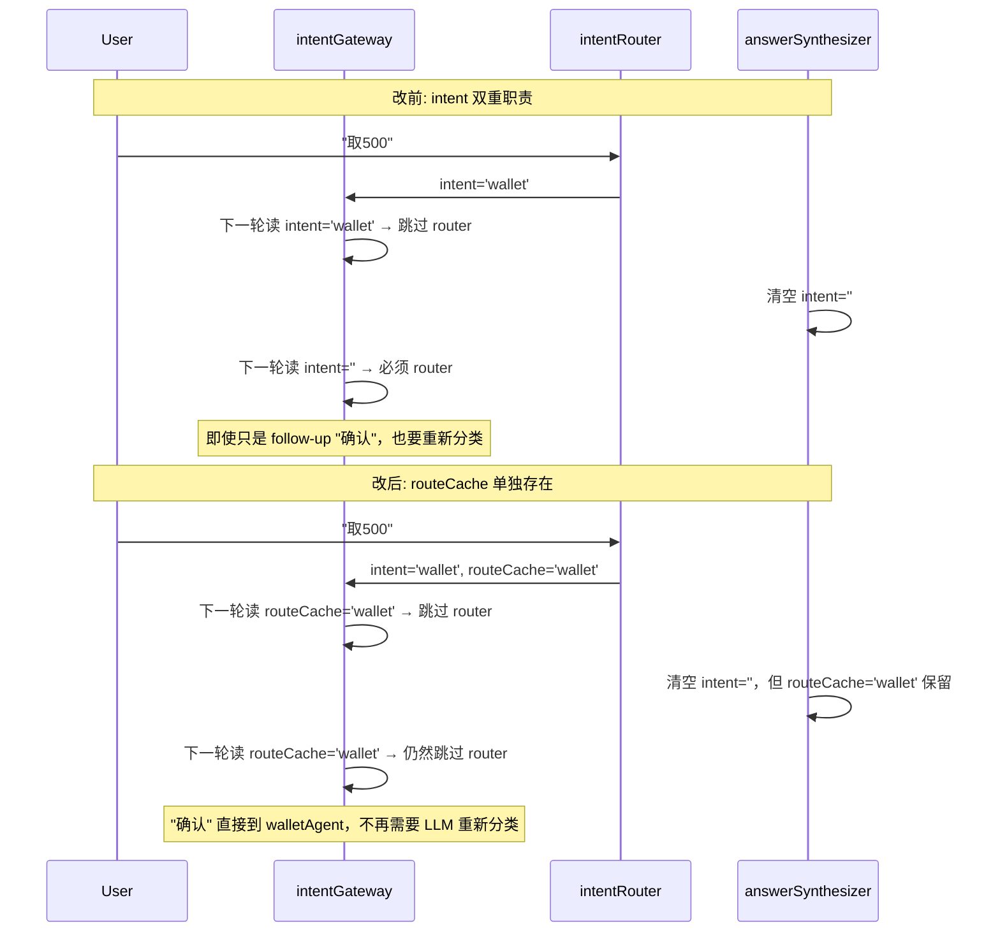
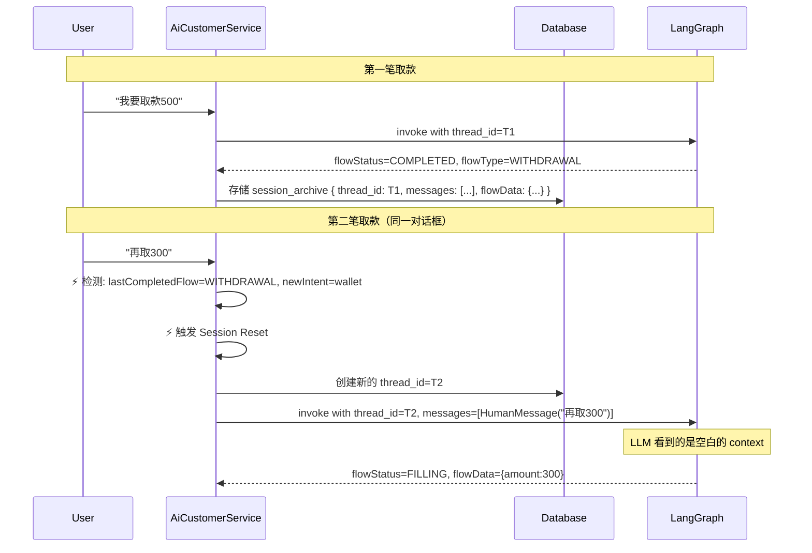
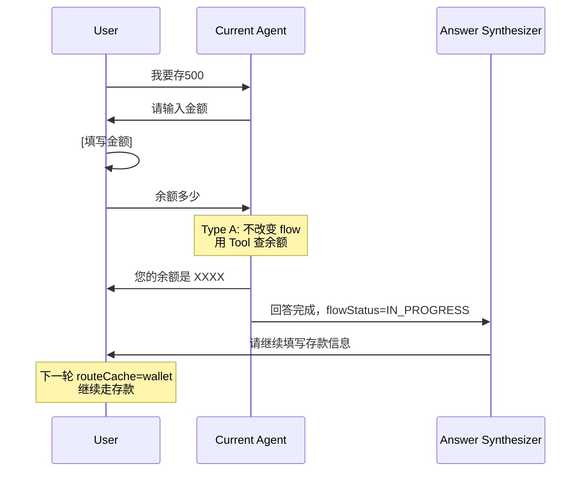
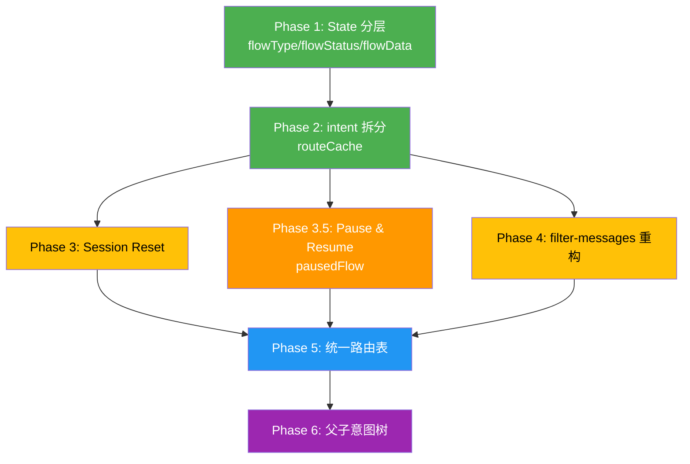

# AI JoyMini 状态管理架构升级规格说明书

> 基于"银行大厅/电商客服系统"终极架构蓝图
> 目标：从"扁平共享 State" → "分层生命周期管理"

---

## 目录

1. [架构总览](#1-架构总览)
2. [Phase 1: State 分层 — 引入 flowType / flowStatus / flowData](#2-phase-1-state-分层)
3. [Phase 2: intent 拆分 — routeCache 与 intent 分离](#3-phase-2-intent-拆分)
4. [Phase 3: Session Reset 机制](#4-phase-3-session-reset-机制)
5. [Phase 3.5: Pause & Resume — 业务流程中断恢复](#5-phase-35-pause--resume--业务流程中断恢复)
   - [5.9 Composite Intent Handler — 异构多意图并行处理](#59-composite-intent-handler--异构多意图并行处理)
6. [Phase 4: filter-messages 重构](#6-phase-4-filter-messages-重构)
7. [Phase 5: 统一路由表](#7-phase-5-统一路由表)
8. [Phase 6: 父子意图树](#8-phase-6-父子意图树)
9. [迁移策略与风险控制](#9-迁移策略与风险控制)
10. [验收标准](#10-验收标准)

---

## 1. 架构总览

### 1.1 终极目标架构



### 1.2 状态生命周期对照表

| 层 | 字段 | Reducer | 生命周期 | 谁写入 | 谁读取 |
|----|------|---------|---------|--------|--------|
| Layer 0 | `longTermMemory` | merge | 跨会话持久 | AiCustomerService | IntentRouter |
| Layer 0 | `sessionArchive` | replace | 跨会话 | AiCustomerService | Session Reset |
| Layer 1 | `messages` | append | 会话内持久 | 所有 Node | 所有 Agent |
| Layer 2 | `routeCache` | replace | 跨轮次 | intentGateway | intentGateway |
| Layer 2 | `parentIntent` | replace | 单次业务流 | intentRouter | supervisorRouter |
| Layer 2 | `intent` | replace | **单轮** | intentRouter | answerSynthesizer 清空 |
| Layer 3 | `flowType` | replace | 单次业务流 | Agent | Agent |
| Layer 3 | `flowStatus` | replace | 单次业务流 | Agent | Agent + answerSynthesizer |
| Layer 3 | `flowData` | merge | 单次业务流 | Agent | Agent |
| Layer 3 | `currentAgent` | replace | 单轮 | supervisorRouter | filterAgentMessages |
| Layer 4 | `pendingTasks` | replace | 单次 supervisor | intentRouter | supervisorRouter |
| Layer 4 | `taskResults` | merge-with-clear | 单次 supervisor | Agent | answerSynthesizer |
| Layer 4 | `supervisorRound` | replace | 单次 supervisor | supervisorNode | supervisorRouter |

---

## 2. Phase 1: State 分层

### 2.1 目标

在现有 [`state.ts`](../../apps/api/src/client/ai-customer/graph/state.ts) 中新增 4 个字段：`flowType`、`flowStatus`、`flowData`、`currentAgent`。每个字段只有唯一职责。

### 2.2 新增类型定义 + 字段定义

新增 [`types/flow-types.ts`](../../apps/api/src/client/ai-customer/graph/types/flow-types.ts)，定义所有强类型接口：

```typescript
// ===== apps/api/src/client/ai-customer/graph/types/flow-types.ts =====

// ── 1. 核心类型 ──

/** 所有业务流程类型 */
export type FlowType =
  | ''
  | 'DEPOSIT'
  | 'WITHDRAWAL'
  | 'COUPON_CLAIM'
  | 'BALANCE_QUERY'
  | 'ORDER_QUERY'
  | 'COUPON_QUERY'
  | 'POLICY'
  | 'GENERAL';

/** 任务类型分类 */
export type TaskType = 'form' | 'query';

/**
 * 所有流程状态（不含 PAUSED）
 *
 * PAUSED 不是 FlowStatus 的值，而是通过独立的 pausedFlow 字段实现。
 * 原因：PAUSED 表示"整个状态被保存到了另一个字段"，不是流程当前的状态。
 * 如果用 PAUSED 作为 FlowStatus 值，会导致 "PAUSED 时哪些字段有效" 的歧义。
 */
export type FlowStatus =
  | 'IDLE'        // 初始态，没有活跃业务
  | 'FILLING'     // 填表中（form 类业务收集表单数据）
  | 'CONFIRMING'  // 待确认（数据已齐，等待用户确认提交）
  | 'QUERYING'    // 查询中（query 类业务，如查余额、查订单）
  | 'RAG'         // 知识检索中（policy 类业务）
  | 'COMPLETED'   // 已完成
  | 'FAILED';     // 失败/取消


// ── 2. FlowType 配置 ──

export interface FlowTypeConfig {
  /** 任务分类：form=表单类，query=查询类 */
  taskType: TaskType;
  /** 中文标签（日志/调试用） */
  label: string;
  /** 该 flowType 允许的 status 集合 */
  allowedStatuses: FlowStatus[];
  /** 业务描述 */
  description: string;
}

/**
 * 注册表：每个 flowType → 配置
 *
 * 核心作用：
 * 1. getTaskType(type) → TaskType | null（用于中断分类）
 * 2. isValidFlowStatus(type, status) → boolean（校验状态转移合法性）
 * 3. 新业务流程的初始 status 统一为 'IDLE'
 */
export const FLOW_TYPE_REGISTRY: Record<Exclude<FlowType, ''>, FlowTypeConfig> = {
  // ═══ 表单类 form ═══
  DEPOSIT: {
    taskType: 'form',
    label: '存款',
    allowedStatuses: ['IDLE', 'FILLING', 'CONFIRMING', 'COMPLETED', 'FAILED'],
    description: '用户存款业务流程',
  },
  WITHDRAWAL: {
    taskType: 'form',
    label: '提现',
    allowedStatuses: ['IDLE', 'FILLING', 'CONFIRMING', 'COMPLETED', 'FAILED'],
    description: '用户提现含 OTP 验证业务流程',
  },
  COUPON_CLAIM: {
    taskType: 'form',
    label: '优惠券领取',
    allowedStatuses: ['IDLE', 'FILLING', 'CONFIRMING', 'COMPLETED', 'FAILED'],
    description: '用户领取优惠券流程',
  },

  // ═══ 查询类 query ═══
  BALANCE_QUERY: {
    taskType: 'query',
    label: '余额查询',
    allowedStatuses: ['IDLE', 'QUERYING', 'COMPLETED', 'FAILED'],
    description: '查询钱包余额',
  },
  ORDER_QUERY: {
    taskType: 'query',
    label: '订单查询',
    allowedStatuses: ['IDLE', 'QUERYING', 'COMPLETED', 'FAILED'],
    description: '查询订单状态',
  },
  COUPON_QUERY: {
    taskType: 'query',
    label: '优惠券查询',
    allowedStatuses: ['IDLE', 'QUERYING', 'COMPLETED', 'FAILED'],
    description: '查询可用/已领取优惠券',
  },
  POLICY: {
    taskType: 'query',
    label: '政策咨询',
    allowedStatuses: ['IDLE', 'RAG', 'COMPLETED', 'FAILED'],
    description: '咨询平台政策/退货规则等',
  },
  GENERAL: {
    taskType: 'query',
    label: '通用对话',
    allowedStatuses: ['IDLE', 'COMPLETED'],
    description: '非业务类通用对话',
  },
};


// ── 3. PausedFlow 快照（仅用于 Type B 中断）──

/**
 * 暂停流快照
 *
 * 使用规则：
 * - pausedFlow !== null 表示"有暂停的流程"
 * - flowStatus 不包含 'PAUSED'，PAUSED 状态由 pausedFlow 字段实现
 * - 恢复流程后 pausedFlow 置为 null
 * - 超时如 30 分钟未恢复自动丢弃
 */
export interface PausedFlow {
  /** 暂停前的业务类型（非空，只有有流程时才可能暂停）*/
  flowType: Exclude<FlowType, ''>;
  /** 暂停前的流程状态 */
  flowStatus: FlowStatus;
  /** 暂停前的表单数据 */
  flowData: Record<string, any>;
  /** 暂停前的执行 Agent */
  currentAgent: string;
  /** 暂停前的意图 */
  intent: string;
  /** 暂停前的路由缓存 */
  routeCache: string;
  /** 暂停时间戳毫秒（用于超时判断） */
  pausedAt: number;
}


// ── 4. 工具函数 ──

/** 获取 flowType 的任务分类 */
export function getTaskType(type: FlowType): TaskType | null {
  if (!type) return null;
  return FLOW_TYPE_REGISTRY[type]?.taskType ?? null;
}

/** 校验 status 是否对当前 flowType 合法 */
export function isValidFlowStatus(type: FlowType, status: FlowStatus): boolean {
  if (!type) return status === 'IDLE';
  return FLOW_TYPE_REGISTRY[type]?.allowedStatuses.includes(status) ?? false;
}

/** 获取 flowType 的初始 status（统一从 IDLE 开始）*/
export function getInitialStatus(type: FlowType): FlowStatus {
  return 'IDLE';
}
```

然后在 [`state.ts`](../../apps/api/src/client/ai-customer/graph/state.ts) 中引用强类型：

```typescript
import { FlowType, FlowStatus } from './types/flow-types';

// ===== Layer 3: 业务流程层 =====

/**
 * 业务流程类型
 * 标识当前对话正在进行的业务类别
 * 注意：与 intent 不同，flowType 表示"正在办什么业务"，而 intent 表示"当前轮次的意图分类"
 */
flowType: Annotation<FlowType>({
    reducer: (a: FlowType, b: FlowType) => b,
    default: () => '' as FlowType,
}),

/**
 * 业务流程状态（状态机）
 *
 * 状态转移图（由 FLOW_TYPE_REGISTRY.allowedStatuses 约束）：
 * - form 类（DEPOSIT/WITHDRAWAL/COUPON_CLAIM）:
 *   IDLE → FILLING → CONFIRMING → COMPLETED
 *   ^                              |
 *   └──────────────────────────────┘ (通过 Session Reset)
 * - query 类（BALANCE_QUERY/ORDER_QUERY/COUPON_QUERY）:
 *   IDLE → QUERYING → COMPLETED
 * - policy 类:
 *   IDLE → RAG → COMPLETED
 *
 * PAUSED 不是 FlowStatus 的值，参见 PausedFlow 接口。
 * Reducer 中通过 isValidFlowStatus() 运行时校验，禁止非法赋值。
 */
flowStatus: Annotation<FlowStatus>({
    reducer: (a: FlowStatus, b: FlowStatus) => {
      if (!isValidFlowStatus(a, b)) {
        throw new Error(
          `Invalid flowStatus transition: '${b}' is not allowed for flowType '${a}'`
        );
      }
      return b;
    },
    default: () => 'IDLE' as FlowStatus,
}),

/**
 * 表单数据（Slot Filling 的结构化存储）
 *
 * 在与 LLM 的 system prompt 头部注入当前 flowData，
 * LLM 不再需要靠"记忆"来记住金额、账号等数据，
 * 而是通过工具调用更新 flowData，代码层保证数据不丢失。
 *
 * 使用 merge reducer，多个 Agent 步骤可以逐步填充不同的字段。
 */
flowData: Annotation<Record<string, any>>({
    reducer: (a, b) => ({ ...a, ...b }),
    default: () => ({}),
}),

/**
 * 当前正在执行 Agent 的名称
 *
 * 由 supervisorRouter 在派发任务前写入。
 * 单 Agent 模式由 intentGateway 写入。
 */
currentAgent: Annotation<string>({
    reducer: (a: string, b: string) => b,
    default: () => '',
}),
```

### 2.3 Agent Node 注入 flowType/flowStatus/flowData

所有 Agent node 的 system prompt 头部必须注入以下内容：

```typescript
// 在 wallet-agent.node.ts:68 的 system prompt 顶部
const flowContext = `
## Current Business Flow
- Flow Type: ${state.flowType || '(none - start new flow)'}
- Flow Status: ${state.flowStatus || 'IDLE'}
- Flow Data: ${JSON.stringify(state.flowData || {})}

## Flow Behavior Rules
1. If flowStatus is IDLE: You are starting a NEW business flow.
   - Set flowType via a tool call to updateFlowType(type)
   - Move to FILLING status
2. If flowStatus is FILLING: Continue filling slots.
   - Use updateFlowData(key, value) tool to store each value
   - When all required data is collected, move to CONFIRMING
3. If flowStatus is CONFIRMING: Ask user to confirm.
   - Present ALL flowData to the user
   - On confirmation, execute the business operation
   - Set flowStatus to COMPLETED
4. If flowStatus is COMPLETED: The current flow is done.
   - If user wants a NEW similar business, a Session Reset will happen automatically
   - Do NOT reuse data from the completed flow
`;
```

### 2.4 新增 Tool: updateFlowData / updateFlowStatus

所有带表单流程的 Agent（wallet、order、coupon）需要注册以下两个工具：

```typescript
// flow-tools.ts
import { tool } from '@langchain/core/tools';
import { z } from 'zod';

/**
 * 更新表单数据
 * LLM 调用此工具来存储一个表单项，而不是靠自己的记忆维持
 */
export const updateFlowDataTool = tool(
    async ({ key, value }: { key: string; value: any }) => {
        // 返回值会被 merged 到 state.flowData
        // 实际 merged 逻辑在 agent node 中手动处理
        return JSON.stringify({ updated: true, key, value });
    },
    {
        name: 'updateFlowData',
        description: 'Store a piece of form data for the current business flow.',
        schema: z.object({
            key: z.string().describe('The field name, e.g. "amount", "channel", "accountNumber"'),
            value: z.any().describe('The field value, e.g. 500, "GCash", "0917xxxxxxx"'),
        }),
    },
);

/**
 * 更新流程状态
 * LLM 调用此工具来推进流程状态机
 */
export const updateFlowStatusTool = tool(
    async ({ status }: { status: string }) => {
        return JSON.stringify({ updated: true, status });
    },
    {
        name: 'updateFlowStatus',
        description: 'Advance the business flow status. Valid values determined by FLOW_TYPE_REGISTRY[flowType].allowedStatuses.',
        schema: z.object({
            // 运行时校验：isValidFlowStatus(state.flowType, status)
            // 各 flowType 的 allowedStatuses 见 flow-types.ts
            status: z.string().describe('Target flow status, e.g. FILLING, CONFIRMING, QUERYING, COMPLETED'),
        }),
    },
);
```

### 2.5 改动文件清单

| # | 文件 | 改动 |
|---|------|------|
| 0 | 新建 `graph/types/flow-types.ts` | 定义 `FlowType`、`FlowStatus`、`TaskType`、`PausedFlow`、`FlowTypeConfig` 类型 + `FLOW_TYPE_REGISTRY` 注册表 + `getTaskType()` / `isValidFlowStatus()` 工具函数 |
| 1 | [`state.ts`](../../apps/api/src/client/ai-customer/graph/state.ts) | 新增 `flowType: Annotation<FlowType>`、`flowStatus: Annotation<FlowStatus>`（带运行时校验）、`flowData`、`currentAgent` 4 个字段 |
| 2 | 新建 `graph/tools/flow-tools.ts` | 新增 `updateFlowDataTool`、`updateFlowStatusTool` |
| 3 | [`tool-registry.service.ts`](../../apps/api/src/client/ai-customer/graph/tools/tool-registry.service.ts) | 注册 flow-tools（`flow` tag） |
| 4 | [`wallet-agent.node.ts`](../../apps/api/src/client/ai-customer/graph/nodes/wallet-agent.node.ts) | system prompt 注入 flowContext + 注册 flow-tools |
| 5 | [`order-agent.node.ts`](../../apps/api/src/client/ai-customer/graph/nodes/order-agent.node.ts) | 同上 |
| 6 | [`coupon-agent.node.ts`](../../apps/api/src/client/ai-customer/graph/nodes/coupon-agent.node.ts) | 同上 |
| 7 | [`answer-synthesizer.node.ts`](../../apps/api/src/client/ai-customer/graph/nodes/answer-synthesizer.node.ts) | 不主动清空 `flowType/flowStatus/flowData`，让 Agent 自己管理 |

### 2.6 测试场景

| 场景 | 输入 | 期望 flowStatus 状态链 | 验证点 |
|------|------|----------------------|--------|
| 取款流程 | "我要取款" → "取500" → "确认" → "提交" | IDLE → FILLING → CONFIRMING → COMPLETED | 每一步 flowData 是否正确累积 |
| 纯查询 | "查余额" | IDLE → QUERYING → COMPLETED | flowData 为空 |
| 连续取款 | 第一笔完成 → "再取300" | COMPLETED → Session Reset → IDLE → FILLING | flowData 完全清空 |

---

## 3. Phase 2: intent 拆分

### 3.1 目标

解决 [`state.ts`](../../apps/api/src/client/ai-customer/graph/state.ts:44) 中 `intent` 的双重职责问题。

### 3.2 改动

#### 新增 `routeCache` 字段

```typescript
// state.ts 新增
/**
 * 路由缓存
 * 
 * 用途：让 intentGateway 在下一轮跳过 intentRouter，直接路由到上次的 Agent。
 * 这是"多轮对话中不需要重新分类"的优化手段。
 * 
 * 生命周期：跨轮次存在，不会被 answerSynthesizer 清空。
 * 写入时机：intentGateway 在路由后写入。
 * 清空时机：仅当 intentRouter 明确检测到话题切换时清空。
 */
routeCache: Annotation<string>({
    reducer: (a: string, b: string) => b,
    default: () => '',
}),
```

#### 修改 `customer.graph.ts` 的 `intentGateway`

```typescript
// BEFORE (line 31-36):
const intentGateway = (state: typeof AgentState.State): string => {
    if (state.intent && FLOW_INTENTS.includes(state.intent as Intent)) {
        return routerByIntent(state);
    }
    return 'intentRouter';
};

// AFTER:
const intentGateway = (state: typeof AgentState.State): string => {
    // 优先使用 routeCache（跨轮次缓存）
    if (state.routeCache && FLOW_INTENTS.includes(state.routeCache as Intent)) {
        return routerByIntent({ ...state, intent: state.routeCache });
    }
    return 'intentRouter';
};
```

#### 修改 `intent-router.node.ts` 写入 `routeCache`

```typescript
// 在 return 结果中，同时写入 intent 和 routeCache
return {
    intent: finalIntent,
    routeCache: finalIntent,     // 新增：缓存路由，供下一轮使用
    taskResults: {},
    agentSteps: [],
};
```

#### 修改 `answer-synthesizer.node.ts` 只清空 `intent`，不清空 `routeCache`

```typescript
// BEFORE (line 109-111):
return {
    messages: [...state.messages, new AIMessage(result)],
    taskResults: {},
    intent: '', // 清空 intent
    // ...
};

// AFTER:
return {
    messages: [...state.messages, new AIMessage(result)],
    taskResults: {},
    intent: '',      // 清空分类结果
    // routeCache 保持不变！让下一次 intentGateway 可以命中缓存
    // ...
};
```

### 3.3 改动文件清单

| # | 文件 | 改动 |
|---|------|------|
| 1 | [`state.ts`](../../apps/api/src/client/ai-customer/graph/state.ts) | 新增 `routeCache` 字段 |
| 2 | [`customer.graph.ts`](../../apps/api/src/client/ai-customer/graph/customer.graph.ts) | `intentGateway` 读 `routeCache` 而非 `intent` |
| 3 | [`intent-router.node.ts`](../../apps/api/src/client/ai-customer/graph/nodes/intent-router.node.ts) | 写入 `routeCache` |
| 4 | [`answer-synthesizer.node.ts`](../../apps/api/src/client/ai-customer/graph/nodes/answer-synthesizer.node.ts) | 只清空 `intent`，保留 `routeCache` |

### 3.4 关键行为变化



---

## 4. Phase 3: Session Reset 机制

### 4.1 目标

支持场景 3（今晚第二笔取款）：同一对话框内，上一笔已完成，用户发起同类新业务时，强制归档旧上下文，给 LLM 一张"白纸表单"。

### 4.2 架构设计



### 4.3 AiCustomerService 新增 Session Reset 逻辑

```typescript
// ai-customer.service.ts 新增

/**
 * 检测是否需要 Session Reset
 * 
 * 触发条件：
 * 1. 同一个 sessionId 下
 * 2. 上一次请求的 flowStatus === 'COMPLETED'
 * 3. 当前新请求的意图与上一次 flowType 相同
 *    （如 flowType=WITHDRAWAL 且新意图=wallet）
 * 
 * 执行操作：
 * 1. 将旧的 messages 和 flowData 归档到 longTermMemory
 * 2. 创建一个新的 thread_id
 * 3. 只传入当前用户消息到新 thread
 */
async function detectAndHandleSessionReset(
    sessionId: string,
    userId: string,
    userMessage: string,
): Promise<{ needsReset: boolean; threadId: string; messages: HumanMessage[] }> {
    // 1. 从缓存/数据库中获取上一次的 flow 状态
    const lastFlow = await this.getLastFlowState(sessionId);
    
    if (!lastFlow || lastFlow.flowStatus !== 'COMPLETED') {
        return { needsReset: false, threadId: sessionId, messages: [new HumanMessage(userMessage)] };
    }

    // 2. 检测意图是否与上次完成的业务相同
    const newIntent = await this.classifyIntent(userMessage);
    const sameBusiness = this.isSameBusinessType(lastFlow.flowType, newIntent);
    
    if (!sameBusiness) {
        return { needsReset: false, threadId: sessionId, messages: [new HumanMessage(userMessage)] };
    }

    // 3. 触发 Session Reset
    this.logger.log(`[SessionReset] Resetting session ${sessionId}: ${lastFlow.flowType} completed, new request is same type`);
    
    // 3a. 归档旧会话
    await this.archiveSession(sessionId, lastFlow);
    
    // 3b. 创建新 thread_id
    const newThreadId = `${userId}:${Date.now()}`;
    
    // 3c. 只传入新消息，不给旧 context
    return {
        needsReset: true,
        threadId: newThreadId,
        messages: [new HumanMessage(userMessage)],
    };
}

/**
 * 判断新旧业务是否同类型
 * 
 * 映射规则：
 * - flowType=WITHDRAWAL  && intent=wallet  → true（都是取款）
 * - flowType=DEPOSIT     && intent=wallet  → false（存款 vs 取款）
 * - flowType=ORDER_QUERY && intent=order   → true
 */
private isSameBusinessType(flowType: string, intent: string): boolean {
    const map: Record<string, string[]> = {
        'WITHDRAWAL': ['wallet'],
        'DEPOSIT': ['wallet'],
        'BALANCE_QUERY': ['wallet'],
        'ORDER_QUERY': ['order'],
        'COUPON_CLAIM': ['coupon'],
    };
    return map[flowType]?.includes(intent) ?? false;
}
```

### 4.4 新增 `longTermMemory` 和 `sessionArchive` 字段

```typescript
// state.ts 新增

/**
 * 长期记忆（跨会话持久化）
 * 
 * 存储用户偏好、历史业务摘要等需要跨会话保留的数据。
 * 不存储完整对话历史（那在数据库里），只存"总结性"信息。
 * 
 * 当前实现：简单 KV 对象，未来可迁移到数据库。
 */
longTermMemory: Annotation<Record<string, any>>({
    reducer: (a, b) => ({ ...a, ...b }),
    default: () => ({}),
}),

/**
 * 会话归档标记
 * 
 * 当 Session Reset 触发时，此字段记录"上一次完成的业务信息"。
 * 主要用于调试和审计，不作为业务逻辑输入。
 */
sessionArchive: Annotation<Record<string, any>>({
    reducer: (a, b) => ({ ...a, ...b }),
    default: () => ({}),
}),
```

### 4.5 改动文件清单

| # | 文件 | 改动 |
|---|------|------|
| 1 | [`state.ts`](../../apps/api/src/client/ai-customer/graph/state.ts) | 新增 `longTermMemory`、`sessionArchive` |
| 2 | [`ai-customer.service.ts`](../../apps/api/src/client/ai-customer/ai-customer.service.ts) | 新增 `detectAndHandleSessionReset()` 方法 |
| 3 | [`ai-customer.service.ts`](../../apps/api/src/client/ai-customer/ai-customer.service.ts) | 修改 `testChat()`，在 invoke 前调用 Session Reset 检测 |
| 4 | [`answer-synthesizer.node.ts`](../../apps/api/src/client/ai-customer/graph/nodes/answer-synthesizer.node.ts) | 在 COMPLETED 时写入 `sessionArchive` |

---

## 5. Phase 3.5: 中断分类与处理 — Pause / Answer-Inline / Block

### 5.1 目标

基于银行柜台类比，定义三种中断类型及其处理策略：

| 银行场景 | 职员行为 | 系统对应 |
|----------|---------|---------|
| 存款中 → 问"定存利率多少" | 放一边，查政策，回来继续 | **Answer Inline** — 当前 Agent 回答，flow 不变 |
| 存款中 → 问"优惠券怎么领" | 放一边，查完告知，回来继续 | **Pause & Resume** — 暂存 flow，切换 Agent，完成后恢复 |
| 存款中 → 问"我要取款" | "请先完成存款" | **Block** — 拒绝新业务，要求先完成当前 |

核心原则：**不丢失已填写的表单数据**，且对冲突业务直接拒绝而不是偷偷切换。

### 5.2 三类中断定义

#### Type A: Answer Inline（当前 Agent 回答，不改变 flow）

- **触发条件**：用户在当前业务流中提问，但该问题 **不会启动新的业务表单**
- **示例**：存款途中问"余额多少"、"汇率多少"、"我的优惠券有哪些"
- **行为**：当前 Agent 用 Tool 调用回答 → answerSynthesizer 引导用户继续填写
- **状态变化**：`flowType` / `flowData` / `routeCache` **均不变**
- **原理**：当前 Agent 的 system prompt 包含 flowContext，它知道"我在做存款"。Tool 调用回答查询后，下一轮用户输入命中 `routeCache`，继续走 slot filling



#### Type B: Pause & Resume（暂停当前 flow，处理兼容查询后恢复）

- **触发条件**：用户需要**另一个 Agent 的只读查询**，该查询与当前业务**兼容**（不竞争）
- **示例**：存款途中问"优惠券有哪些"（需要 couponAgent 列出，但只是查看，不是领取）
- **行为**：暂停当前 flow → 路由到目标 Agent 回答 → 回答完成后恢复 flow
- **状态变化**：`flowType`/`flowData`/`routeCache` 保存到 `pausedFlow`，完成后恢复
- **关键判断**：目标意图是**查询类型**（query/catalog/list），不是**表单类型**（claim/apply/withdraw）

#### Type C: Block（拒绝冲突业务，要求先完成当前）

- **触发条件**：用户在当前业务流中要求启动**另一个有状态表单**，且两者**冲突**
- **示例**：存款途中说"我要取现"、"我要领优惠券"（领=表单，查看=查询）
- **行为**：answerSynthesizer 输出 "请先完成当前业务，我再帮你处理 XX"
- **状态变化**：**什么也不变**，当前 flow 继续，用户需完成后再提新请求
- **原理**：就像银行柜台职员说"请先办好存款，我再帮您办理取款"

### 5.3 判断逻辑

在 [`intent-router.node.ts`](../../apps/api/src/client/ai-customer/graph/nodes/intent-router.node.ts) 中新增分类逻辑：

```typescript
// intent-router.node.ts 新增

/**
 * 中断分类结果
 */
type InterruptionType = 'none' | 'inline' | 'pause' | 'block';

/**
 * 分类当前中断类型
 *
 * @param flowType 当前进行中的业务流类型（空字符串表示无业务）
 * @param currentIntent 当前 intent（routeCache 或 flowType）
 * @param newIntent 新识别的 intent
 * @param newTaskType 新任务的类型（由 intentRouter 的 Prompt 输出）
 */
function classifyInterruption(
  flowType: string,
  currentIntent: string,
  newIntent: string,
  newTaskType: 'query' | 'form',
): InterruptionType {
  // 1. 无进行中业务：不需要中断处理
  if (!flowType) return 'none';

  // 2. 相同 intent：继续当前业务
  if (newIntent === currentIntent) return 'none';

  // 3. 模糊/确认类输入：继续当前业务
  const CONTINUE_INTENTS = ['confirm', 'affirm', 'deny', 'provide_detail'];
  if (CONTINUE_INTENTS.includes(newIntent)) return 'none';

  // 4. 新任务是查询类型 → 可以回答（Type A 或 Type B）
  //    核心逻辑：taskType=query = 不修改状态的操作
  //    - 如果当前 Agent 能回答（如存款中查余额）= Type A inline
  //    - 如果需要其他 Agent 回答（如存款中查优惠券）= Type B pause
  //    路由阶段（intentGateway）再判断是同 Agent 还是不同 Agent
  if (newTaskType === 'query') return 'inline';

  // 5. 新任务是表单类型 → Block（Type C）
  //    核心原则：不同的有状态表单业务之间不能切换
  //    银行柜台也不会在存款途中处理取款
  //    用户必须先完成当前业务（flowStatus=COMPLETED）
  //    下一轮输入才能正常路由到新业务
  return 'block';
}
```

**Intent Router Prompt 增强**：在 LLM Prompt 中增加 `taskType` 输出字段：

```typescript
// INTENT_PROMPT 新增指令

// 在每个分类规则后标注类型：
// - deposit (form)     — 存款表单，有状态
// - withdraw (form)    — 取款表单，有状态
// - coupon_claim (form) — 领优惠券，有状态
// - coupon_query (query) — 查优惠券，只读
// - balance_check (query) — 查余额，只读
// - policy (query)     — 查政策规则，只读
// - general (query)    — 闲聊，只读

// 输出格式：
// 单领域: { "intent": "wallet", "taskType": "form" }
// 多领域: { "intents": [...], "taskType": "form" }
```

#### 5.3.1 新增 `pausedFlow` 字段（强类型 `PausedFlow` 接口，仅用于 Type B）

在 [`flow-types.ts`](../../apps/api/src/client/ai-customer/graph/types/flow-types.ts) 中已定义 `PausedFlow` 接口（见 §2.2）：

```typescript
// flow-types.ts 中已定义

export interface PausedFlow {
  flowType: Exclude<FlowType, ''>;  // 非空业务类型
  flowStatus: FlowStatus;           // 强类型状态
  flowData: Record<string, any>;    // 表单数据
  currentAgent: string;             // 执行 Agent
  intent: string;                   // 当前意图
  routeCache: string;               // 路由缓存
  pausedAt: number;                 // 暂停时间戳（ms，用于超时判断）
}
```

在 [`state.ts`](../../apps/api/src/client/ai-customer/graph/state.ts) 中使用：

```typescript
import { PausedFlow } from './types/flow-types';

// Type A / Type C 不涉及此字段，仅 Type B 使用。
// PAUSED 不是 FlowStatus 的值，PAUSED 状态由此字段实现。
pausedFlow: Annotation<PausedFlow | null>({
  reducer: (a, b) => b,
  default: () => null,
}),
```

**使用规则**：
- `pausedFlow !== null` 表示"有暂停的流程等待恢复"
- 恢复流程后 `pausedFlow` 立即置为 `null`
- 超时（如 30 分钟未恢复）自动丢弃，告知用户"之前的操作已过期"
- Type A 和 Type C 不涉及此字段

### 5.4 三种类型的处理流程

#### Type A: Answer Inline — 当前 Agent 回答后继续

当前 Agent 的 system prompt 已经包含 `flowContext`（来自 Phase 1 的 flowType/flowStatus/flowData）。Agent 在收到查询时，使用 Tool 回答，然后主动输出引导语让用户继续填写。

**无需额外代码改动**。只要 Agent 的 Prompt 正确注入了 flowContext，它自然知道"我在处理存款过程中，用户问了余额，我查完余额要引导用户回到存款正题"。

#### Type B: Pause & Resume — 暂停 → 查询 → 恢复

**暂停流程**（在 [`customer.graph.ts`](../../apps/api/src/client/ai-customer/graph/customer.graph.ts) 的 `intentGateway` 中）：

```typescript
const intentGateway = (state: typeof AgentState.State): string => {
  // 检测 Type B 暂停指令
  if (state._interruption === 'pause') {
    // 保存快照
    state.pausedFlow = {
      flowType: state.flowType || '',
      flowStatus: state.flowStatus || 'IDLE',
      flowData: { ...(state.flowData || {}) },
      currentAgent: state.currentAgent || '',
      intent: state.routeCache || state.intent || '',
      routeCache: state.routeCache || '',
    };

    logger.log(`[Pause] 保存 ${state.pausedFlow.flowType} 流程，切换到 ${state.intent}`);

    // 清空当前 flow 状态，避免新 Agent 被旧数据干扰
    // 注意：不清除 messages，因为对话历史需要保留
    return 'intentRouter';
  }

  // 原有 routeCache 逻辑
  if (state.routeCache && !isIntentRouterNeeded(state)) {
    return state.routeCache;
  }
  return 'intentRouter';
};
```

**恢复流程**（在 [`answer-synthesizer.node.ts`](../../apps/api/src/client/ai-customer/graph/nodes/answer-synthesizer.node.ts) 中）：

```typescript
// answer-synthesizer.node.ts 回答合成后检测恢复

// 检查是否有暂停的 flow 需要恢复
if (state.pausedFlow && state.interruptionType === 'pause') {
  // 判断查询是否已完成（查询类通常一轮回答就完成）
  // 判断依据：当前 flowStatus 为空（查询不设 flowStatus）或当前 intent 匹配暂停意图
  const isQueryComplete = !state.flowType || state.flowStatus === 'COMPLETED';
  
  if (isQueryComplete) {
    // 恢复暂停的 flow
    return {
      ...state,
      flowType: state.pausedFlow.flowType,
      flowStatus: state.pausedFlow.flowStatus,  // 恢复之前的进度
      flowData: state.pausedFlow.flowData,
      currentAgent: state.pausedFlow.currentAgent,
      intent: state.pausedFlow.intent,
      routeCache: state.pausedFlow.routeCache,
      pausedFlow: null,                  // 清除快照
      interruptionType: '',              // 清除中断标记
    };
  }
}
```

#### Type C: Block — 合成拒绝回答

在 [`answer-synthesizer.node.ts`](../../apps/api/src/client/ai-customer/graph/nodes/answer-synthesizer.node.ts) 中：

```typescript
// answer-synthesizer.node.ts 检测到 Type C Block

if (state._interruption === 'block') {
  // 不执行任何 Agent 节点，直接合成拒绝消息
  return {
    messages: [
      new AIMessage({
        content: `您当前正在处理${state.flowType}业务，请先完成当前业务，我再帮您处理${state.intent}。`,
      }),
    ],
    intent: state.routeCache || state.intent,  // 恢复为原 intent
    interruptionType: '',  // 清除中断标记
    // 保持 flowType/flowData/flowStatus 不变
  };
}
```

### 5.5 三类中断对比

| 方面 | Type A: Answer Inline | Type B: Pause & Resume | Type C: Block |
|:----:|:---------------------:|:---------------------:|:-------------:|
| **触发条件** | 当前 Agent 可回答的查询 | 需其他 Agent 的兼容查询 | 冲突的新业务表单 |
| **示例** | 存款中查余额 | 存款中查优惠券列表 | 存款中说"我要取现" |
| **flowType 变化** | 不变 | 保存到 pausedFlow，暂清除 | 不变 |
| **flowData 变化** | 不变 | 保存到 pausedFlow，暂清除 | 不变 |
| **routeCache 变化** | 不变 | 保存到 pausedFlow，设新值 | 不变 |
| **Agent 切换** | ❌ 当前 Agent | ✅ 切换到目标 Agent | ❌ 不切换 |
| **用户感知** | 查询后自动继续 | 查询后自动继续 | "请先完成当前业务" |
| **代码改动** | 无（已有 flowContext Prompt） | pausedFlow + intentGateway + answerSynthesizer | intentRouter 分类 + answerSynthesizer |
| **恢复方式** | 自动（routeCache 命中） | answerSynthesizer 恢复 | 用户完成后主动提出 |

### 5.6 注意事项

1. **Type B 只支持单层暂停**：A→B→C 多层切换会丢失 A。这是合理约束，银行柜台也不会保留三层单据堆叠。

2. **Type B 的查询 Agent 不应该修改 flowData**：查询 Agent 的 system prompt 不应该包含 `updateFlowData` 工具，防止污染。

3. **Type A 查询后 LLM 可能"忘记"当前进度**：如果 Agent 上下文太长，下一轮应依靠 `routeCache` + `flowType` 重新引导。answerSynthesizer 可以追加系统提示："请继续之前的 XXXX 业务"。

4. **Type C 拒绝后**，用户完成当前业务（flowStatus=COMPLETED），下一轮输入可以正常路由到新业务。

### 5.7 测试场景

| # | 场景 | 预期行为 | 类型 |
|---|------|---------|:----:|
| 1 | 存款中问"余额多少" | Agent 查余额，然后引导继续填写 | A |
| 2 | 存款中问"优惠券有哪些" | 暂停存款 → couponAgent 列出优惠券 → 恢复存款 | B |
| 3 | 存款中问"我要取现" | "请先完成存款" | C |
| 4 | 存款中问"定存利率多少" | Agent 查政策，回答后继续 | A |
| 5 | 存款中问"好的"/"确认" | 继续当前 flow，推进 flowStatus | none |
| 6 | 存款完成后说"我要取现" | 正常路由到取款 Agent（无暂停） | none |

### 5.8 改动文件清单

| # | 文件 | 改动 |
|---|------|------|
| 0 | [`flow-types.ts`](../../apps/api/src/client/ai-customer/graph/types/flow-types.ts) | 已包含 `PausedFlow` 接口 + `getTaskType()` 工具函数（Phase 1 新建） |
| 1 | [`state.ts`](../../apps/api/src/client/ai-customer/graph/state.ts) | 新增 `pausedFlow: Annotation<PausedFlow | null>`、`interruptionType` 字段 |
| 2 | [`intent-router.node.ts`](../../apps/api/src/client/ai-customer/graph/nodes/intent-router.node.ts) | 新增 `classifyInterruption()` 函数（使用 `getTaskType()` 判断），Prompt 增加 `taskType` 字段 |
| 3 | [`customer.graph.ts`](../../apps/api/src/client/ai-customer/graph/customer.graph.ts) | `intentGateway` 增强：检测 Type B 暂停，保存 pausedFlow |
| 4 | [`answer-synthesizer.node.ts`](../../apps/api/src/client/ai-customer/graph/nodes/answer-synthesizer.node.ts) | 新增 Type B 恢复逻辑 + Type C 拒绝应答 |

---

### 5.9 Composite Intent Handler — 异构多意图并行处理

#### 5.9.1 目标

处理用户在单轮对话中提出多个异构意图的场景（如"帮我查优惠券和取款"），
通过 **"接口并发异步化，模型输入一体化"** 原则，实现流畅的多意图合并响应。

**与 Supervisor 的关系**：Composite Handler 和 Supervisor 是两条独立路径。

| 维度 | Composite Handler | Supervisor |
|------|-------------------|------------|
| **何时触发** | Router 明确识别出多个子意图 | Router 不确定/需要动态分配 |
| **决策方式** | 确定性代码（`Promise.all` + 合并上下文） | LLM 动态决策 |
| **速度** | 快（一次 LLM 调用） | 慢（多次 LLM 调用 + Agent 循环） |
| **风险** | 低（代码可控） | 高（LLM 幻觉风险） |
| **适用场景** | "查优惠券和取款"（意图明确） | "帮我处理一下这些"（模糊/动态） |

#### 5.9.2 核心原则

> **接口并发异步化，模型输入一体化**
>
> - **数据层**（API/DB 调用）：使用 `Promise.all` 疯狂并行，最快速度捞取所有数据
> - **模型层**（LLM 输出）：合并后的上下文交给 **单一 LLM** 流式输出，避免多 Agent 打字机冲突

#### 5.9.3 Composite Intent 类型定义

在 [`intent-router.node.ts`](../../apps/api/src/client/ai-customer/graph/nodes/intent-router.node.ts) 的 Intent 分类输出中扩展：

```typescript
// 单个子意图
interface SubIntent {
    category: string;    // 如 'marketing' | 'finance' | 'order' | 'wallet'
    sub_intent: string;  // 如 'query_coupon' | 'withdrawal_start' | 'balance_check'
}

// Composite Intent 输出格式
interface CompositeIntent {
    is_composite: true;
    intents: SubIntent[];
    primary_flow?: string;  // 如果有表单意图，标记为主 flow（如 'withdrawal'）
}

// 普通 Intent 输出格式（不变）
interface SingleIntent {
    is_composite: false;
    category: string;
    sub_intent: string;
}
```

#### 5.9.4 架构流程

```
用户输入: "帮我查优惠券和取款"
         │
         ▼
┌─────────────────────────────────┐
│  1. Intent Router 检测           │
│  ── 识别到 composite: true       │
│  ── intents: [                  │
│       { marketing: query_coupon }│
│       { finance: withdrawal_start }│
│     ]                            │
│  ── primary_flow: withdrawal     │
└─────────┬───────────────────────┘
          │
          ▼
┌─────────────────────────────────┐
│  2. Composite Handler Node      │  ★ 新增节点
│  ── 判断 intents 类型           │
│  ── 如果全是 query-type:        │
│      走"并行查询 → 合并输出"    │
│  ── 如果混合 form+query:        │
│      走"并行查询 → 合并输出     │
│      → 然后进入 form flow"      │
└─────────┬───────────────────────┘
          │
          ▼
┌─────────────────────────────────┐
│  3. 数据层并行（数据双轨制）      │
│                                  │
│  const [coupon, withdrawal]      │
│    = await Promise.all([         │
│      couponTool.fetch(uid),      │
│      withdrawalTool.fetch(uid)   │
│    ]);                           │
└─────────┬───────────────────────┘
          │
          ▼
┌─────────────────────────────────┐
│  4. 合并上下文 → 单 LLM 输出     │
│                                  │
│  后端拼装 Context:               │
│  【今日已查出事实（并发获取）】    │
│  1. 优惠券：5元无门槛券 x1       │
│  2. 余额：可用 5000 元           │
│                                  │
│  → 单一 LLM 流式输出            │
│  "查到您有5元优惠券，            │
│   可用余额5000元，              │
│   您要取多少？"                  │
└─────────┬───────────────────────┘
          │
          ▼
┌─────────────────────────────────┐
│  5. flowType 决策               │
│  ── 如果 primary_flow=form:     │
│      设置 flowType=WITHDRAWAL   │
│      flowStatus=FILLING         │
│  ── 如果全是 query:             │
│      不改变 flowType，          │
│      输出后回到 IDLE            │
└─────────────────────────────────┘
```

#### 5.9.5 与三类中断模型的关系

Composite Intent Handler 是对 Type A（Answer Inline）的扩展：

| 场景 | 分类 | 处理方式 |
|------|------|----------|
| 新对话，纯查询复合 | 新会话正常路由 | Composite Handler → 并行查 → 合并输出 |
| 新对话，混合 form+query | 新会话正常路由 | Composite Handler → 并行查 → 合并输出 → 进入 form flow |
| 对话中（已有 flow），插入查询复合 | **Type A** | 中断当前 Agent，Composite Handler 处理查询后返回 |
| 对话中（已有 flow），插入 form+query | **Type B/C** | 查询部分走 Type A，form 部分按 taskType 决定拦截 |

#### 5.9.6 State 字段变更

```typescript
// 新增到 AgentState
compositeIntents: Annotation<SubIntent[]>({
    reducer: (a, b) => b ?? a,  // replace 模式
    default: () => [],
}),
```

**注意**：`compositeIntents` 仅作为中间字段，Composite Handler 处理完毕后立即清空（与 `routeCache` 类似的临时字段），不参与跨轮持久化。

#### 5.9.7 改动文件清单

| # | 文件 | 改动 |
|---|------|------|
| 0 | [`state.ts`](../../apps/api/src/client/ai-customer/graph/state.ts) | 新增 `compositeIntents: Annotation<SubIntent[]>` |
| 1 | [`intent-router.node.ts`](../../apps/api/src/client/ai-customer/graph/nodes/intent-router.node.ts) | Intent 分类输出扩展支持 `is_composite` + `intents[]`；Prompt 增加"多意图检测"指令 |
| 2 | **新建** `composite-handler.node.ts` | Composite Handler Node 实现：检测 `is_composite`、并行取数据、合并上下文、单 LLM 输出 |
| 3 | [`customer.graph.ts`](../../apps/api/src/client/ai-customer/graph/customer.graph.ts) | 新增 `intentGateway → compositeHandler` 条件边；处理完成后根据 `primary_flow` 路由 |
| 4 | [`routes.ts`](../../apps/api/src/client/ai-customer/graph/routes.ts) | Phase 5 新建后，在路由表中注册 composite 的映射（指向 compositeHandler） |

#### 5.9.8 测试场景

| # | 场景 | 预期 |
|---|------|------|
| 1 | 新对话"帮我查优惠券和余额" | Composite Handler → 并行查 → 合并输出（纯查询，无表单） |
| 2 | 新对话"帮我查优惠券和取款" | Composite Handler → 并行查 → 合并输出 → 进入 WITHDRAWAL flow |
| 3 | 取款流程中说"查一下我有什么优惠券" | Type A → Composite Handler 处理查询 → 返回取款流程 |
| 4 | 存款流程中说"帮我查优惠券和取款" | Type B/C → Composite Handler 处理查询 → form 部分根据 taskType 拦截 |
| 5 | 单意图"我要取款"（非 composite） | 不影响现有流程，正常路由到 walletAgent |

---

## 6. Phase 4: filter-messages 重构

### 6.1 目标

将 [`filter-messages.ts`](../../apps/api/src/client/ai-customer/graph/utils/filter-messages.ts) 拆分为两个独立函数，消除模式耦合，增加运行时 invariant 断言。

### 6.2 新设计

```typescript
// filter-messages.ts 重构后

/**
 * ===== 单 Agent 模式消息过滤 =====
 * 
 * 保留规则：
 * 1. 所有 Human 消息
 * 2. 所有 AI 纯文本消息（非 tool_calls）
 * 3. 最后一个 ToolMessage + 其对应的 AI(tool_calls)
 * 
 * Invariant 断言：
 * - 如果保留了 ToolMessage，必须同时保留其前驱 AI(tool_calls)
 * - 不允许出现 Orphaned ToolMessage（没有配对的 tool_call_id）
 * 
 * 用途：普通对话、单 Agent 查询
 */
export function filterSingleAgentMessages(
    messages: BaseMessage[],
): BaseMessage[] {
    // 1. 从后往前找到最后一个 ToolMessage 的索引
    let lastToolIdx = -1;
    let lastToolCallerIdx = -1;

    for (let i = messages.length - 1; i >= 0; i--) {
        const type = (messages[i] as any)._getType?.() ?? '';
        if (type === 'tool' && lastToolIdx === -1) {
            lastToolIdx = i;
        }
        if (
            type === 'ai' &&
            (messages[i] as any).tool_calls?.length &&
            lastToolIdx !== -1 &&
            lastToolCallerIdx === -1 &&
            i < lastToolIdx
        ) {
            lastToolCallerIdx = i;
        }
    }

    const filtered = messages.filter((msg, idx) => {
        const type = (msg as any)._getType?.() ?? '';
        if (type === 'tool') return idx === lastToolIdx;
        if (type === 'ai' && (msg as any).tool_calls?.length) return idx === lastToolCallerIdx;
        return true; // 保留 Human 和 AI 纯文本
    });

    // === Invariant 断言 ===
    if (lastToolIdx !== -1) {
        const hasTool = filtered.some((m) => (m as any)._getType?.() === 'tool');
        const hasCaller = filtered.some(
            (m) => (m as any)._getType?.() === 'ai' && (m as any).tool_calls?.length,
        );
        if (hasTool && !hasCaller) {
            throw new Error(
                '[filterSingleAgentMessages] INVARIANT VIOLATION: Orphaned ToolMessage detected. ' +
                'ToolMessage must be preceded by AI(tool_calls) with matching tool_call_id.',
            );
        }
    }

    return filtered;
}

/**
 * ===== Supervisor 模式消息过滤 =====
 * 
 * 保留规则：
 * 1. 所有 Human 消息
 * 2. 当前 Agent 的 AI 消息（包括 tool_calls 和纯文本）
 * 3. 其他 Agent 的 AI 纯文本输出（用于跨 Agent 上下文）
 * 4. 不保留任何 ToolMessage（避免 tool_call_id 冲突）
 * 
 * 设计原因：
 * - Supervisor 模式下，多个 Agent 共享同一个 messages 数组
 * - 每个 Agent 的 tool_calls 都有独立的 tool_call_id
 * - 如果保留其他 Agent 的 ToolMessage，当前 Agent 的 LLM 看到
 *   不认识的 tool_call_id 会报错
 * - 不保留任何 ToolMessage 是最安全的选择
 * 
 * Invariant 断言：
 * - 过滤后的消息中没有 ToolMessage
 * 
 * 用途：Supervisor 多 Agent 编排
 */
export function filterSupervisorMessages(
    messages: BaseMessage[],
    currentAgent: string,
): BaseMessage[] {
    const filtered = messages.filter((msg) => {
        const type = (msg as any)._getType?.() ?? '';
        // 过滤所有 ToolMessage
        if (type === 'tool') return false;
        return true; // 保留 Human 和所有 AI 消息
    });

    // === Invariant 断言 ===
    const hasTool = filtered.some((m) => (m as any)._getType?.() === 'tool');
    if (hasTool) {
        throw new Error(
            '[filterSupervisorMessages] INVARIANT VIOLATION: ToolMessage should not exist after filtering.',
        );
    }

    return filtered;
}

/**
 * ===== 统一入口 =====
 * 根据是否有 pendingTasks 自动选择模式
 */
export function filterAgentMessages(
    messages: BaseMessage[],
    pendingTasks: Array<{ agent: string; description: string }>,
): BaseMessage[] {
    if (pendingTasks.length > 0) {
        return filterSupervisorMessages(messages, '');
    }
    return filterSingleAgentMessages(messages);
}
```

### 5.3 改动文件清单

| # | 文件 | 改动 |
|---|------|------|
| 1 | [`filter-messages.ts`](../../apps/api/src/client/ai-customer/graph/utils/filter-messages.ts) | 重构为两个独立函数 + invariant 断言 |
| 2 | 所有 Agent node | 调用处无变化（接口兼容），但可选择性使用 `filterSingleAgentMessages` 直接调用 |

---

## 7. Phase 5: 统一路由表

### 7.1 目标

将分散在 [`customer.graph.ts`](../../apps/api/src/client/ai-customer/graph/customer.graph.ts) 和 [`intent-router.node.ts`](../../apps/api/src/client/ai-customer/graph/nodes/intent-router.node.ts) 中的路由逻辑集中到一个统一的路由表中。

### 7.2 新建 `routes.ts`

```typescript
// graph/routes.ts

import { AgentState } from './state';

/**
 * 意图 → Agent 节点名 映射表
 * 
 * 集中管理所有路由映射关系。
 * 任何新增 Agent 只需要在此表添加一条映射，
 * 不需要修改 customer.graph.ts 中的条件边。
 */
export const INTENT_TO_AGENT_MAP: Record<string, string> = {
    order: 'orderAgent',
    wallet: 'walletAgent',
    coupon: 'couponAgent',
    user: 'userAgent',
    product: 'productAgent',
    'lucky-draw': 'luckyAgent',
    rag: 'ragNode',
    general: 'generalChat',
    supervised: 'supervisorNode',
} as const;

/**
 * 所有"需要走业务流程"的意图列表
 * 这些意图对应有状态表单的 Agent
 */
export const FLOW_INTENTS: string[] = ['order', 'wallet', 'coupon'];

/**
 * 意图 → 默认 flowType 映射
 */
export const INTENT_TO_FLOW_TYPE: Record<string, string> = {
    order: 'ORDER_QUERY',
    wallet: 'BALANCE_QUERY',        // 默认是查余额，具体由 Agent 识别后更新
    coupon: 'COUPON_CLAIM',
    rag: 'RAG',
    general: 'GENERAL_CHAT',
};

/**
 * 路由函数：intentGateway
 * 决定 START 的去向
 */
export function intentGateway(state: typeof AgentState.State): string {
    const cacheKey = state.routeCache || state.intent;
    if (cacheKey && cacheKey in INTENT_TO_AGENT_MAP) {
        return INTENT_TO_AGENT_MAP[cacheKey];
    }
    return 'intentRouter';
}

/**
 * 路由函数：routerByIntent
 * 决定 intentRouter 之后的去向
 */
export function routerByIntent(state: typeof AgentState.State): string {
    return INTENT_TO_AGENT_MAP[state.intent] || 'generalChat';
}

/**
 * 路由函数：agentDoneRouter
 * 决定 Agent 完成后的去向
 */
export function agentDoneRouter(state: typeof AgentState.State): string {
    if (state.pendingTasks && state.pendingTasks.length > 0) return 'supervisorNode';
    return 'answerSynthesizer';
}

/**
 * 路由函数：supervisorRouter
 * 决定 supervisorNode 之后的去向（派发下一个任务）
 */
export function supervisorRouter(state: typeof AgentState.State): string {
    const maxRounds = 5;
    const round = state.supervisorRound ?? 0;
    const taskIndex = round - 1;
    
    if (round >= maxRounds || taskIndex >= (state.pendingTasks.length ?? 0)) {
        return 'answerSynthesizer';
    }
    
    state.currentAgent = state.pendingTasks[taskIndex].agent;
    return state.pendingTasks[taskIndex].agent;
}
```

### 7.3 修改 `customer.graph.ts` 引用路由表

```typescript
// customer.graph.ts 使用 routes.ts
import {
    intentGateway,
    routerByIntent,
    agentDoneRouter,
    supervisorRouter,
} from './routes';

// 所有 .addConditionalEdges 使用统一的导入
.addConditionalEdges(START, intentGateway, {
    intentRouter: 'intentRouter',
    orderAgent: 'orderAgent',
    walletAgent: 'walletAgent',
    couponAgent: 'couponAgent',
    ragNode: 'ragNode',
})
.addConditionalEdges('intentRouter', routerByIntent, {
    intentRouter: 'intentRouter',
    ragNode: 'ragNode',
    generalChat: 'generalChat',
    orderAgent: 'orderAgent',
    walletAgent: 'walletAgent',
    couponAgent: 'couponAgent',
    supervisorNode: 'supervisorNode',
    userAgent: 'generalChat',
    productAgent: 'generalChat',
    luckyAgent: 'generalChat',
})
// ...
```

### 7.4 改动文件清单

| # | 文件 | 改动 |
|---|------|------|
| 1 | 新建 `graph/routes.ts` | 集中所有路由映射和路由函数 |
| 2 | [`customer.graph.ts`](../../apps/api/src/client/ai-customer/graph/customer.graph.ts) | 从 `routes.ts` 导入路由函数，移除内联定义 |
| 3 | [`intent-router.node.ts`](../../apps/api/src/client/ai-customer/graph/nodes/intent-router.node.ts) | 移除 `routerByIntent` 函数（移到 routes.ts） |

---

## 8. Phase 6: 父子意图树

### 8.1 目标

支持场景 5：`finance:withdrawal` / `finance:deposit` 等父子意图结构，让同类意图在财务大类下"有限继承语境"，同时保持具体表单数据的物理隔离。

### 8.2 设计

```typescript
// state.ts 新增 parentIntent 字段

/**
 * 父意图（意图树层级）
 * 
 * 用于场景 5 的复合多意图场景。
 * 当 intent='wallet' 时，parentIntent='finance'。
 * 当 intent='order' 时，parentIntent='ecommerce'。
 * 
 * 用途：
 * 1. Supervisor 模式下，同一个 parentIntent 下的子意图可以共享部分上下文
 * 2. 不同 parentIntent 下的意图完全隔离
 * 3. intentRouter 在分类时可以输出父子意图
 */
parentIntent: Annotation<string>({
    reducer: (a: string, b: string) => b,
    default: () => '',
}),
```

### 8.3 Intent Router 输出父子意图

```typescript
// intent-router.node.ts 修改 INTENT_PROMPT，增加父子意图输出

// 在 Prompt 的分类规则末尾增加：
// ## Parent Intent Mapping
// - wallet/coupon → finance
// - order/product → ecommerce
// - user → account
// - rag → knowledge
// - general → chat

// 输出格式：
// 单领域: "wallet" 或 "finance:wallet"（带父意图）
// 多领域: JSON with parentIntent field
```

### 8.4 改动文件清单

| # | 文件 | 改动 |
|---|------|------|
| 1 | [`state.ts`](../../apps/api/src/client/ai-customer/graph/state.ts) | 新增 `parentIntent` 字段 |
| 2 | [`intent-router.node.ts`](../../apps/api/src/client/ai-customer/graph/nodes/intent-router.node.ts) | Prompt 增加父子意图映射，输出 parentIntent |

---

## 9. 迁移策略与风险控制

### 9.1 推荐执行顺序



| Phase | 优先级 | 风险等级 | 依赖 | 建议执行窗口 |
|-------|:------:|:--------:|------|------------|
| Phase 1: State 分层 | P0 | 🟡 中 | 无 | 第 1-2 天 |
| Phase 2: intent 拆分 | P0 | 🟢 低 | Phase 1 | 第 2-3 天 |
| Phase 3: Session Reset | P1 | 🟡 中 | Phase 1 | 第 3-5 天 |
| Phase 3.5: Pause & Resume | P1 | 🟡 中 | Phase 2 | 第 3-5 天（与 P3/P4 并行） |
| Phase 4: filter-messages | P1 | 🔴 高 | Phase 1 | 第 3-5 天（与 P3 并行） |
| Phase 5: 统一路由表 | P2 | 🟢 低 | Phase 2 | 第 5-6 天 |
| Phase 6: 父子意图树 | P3 | 🟡 中 | Phase 5 | 第 7 天后 |

### 9.2 风险控制

| 风险 | 概率 | 影响 | 缓解措施 |
|------|:----:|:----:|---------|
| Agent 不理解 flowStatus 状态机 | 中 | 高 | 严格的 Prompt 注入 + fallback：如果 Agent 3 轮没推进 flowStatus，answerSynthesizer 接管 |
| Session Reset 后丢失用户上下文 | 低 | 高 | 归档到 longTermMemory，通过 summary 保留关键信息 |
| filter-messages 重构导致 API 400 | 中 | 高 | 验收测试必须覆盖所有 LLM provider（Ollama + DeepSeek） |
| flowData merge reducer 导致旧数据残留 | 低 | 中 | 每次 flowStatus 变为 IDLE 时，显式清空 flowData |
| 路由表变动引入死循环 | 低 | 高 | 保留 maxRounds 保护 + 新增 maxTotalRounds（全局循环上限） |

### 9.3 回滚策略

每个 Phase 必须是**可独立回滚的原子改动**。回滚步骤：

1. `git stash` 或 `git revert` 当前 Phase 的所有文件改动
2. 运行 `yarn workspace @lucky/api check-types` + `yarn workspace @lucky/api test`
3. 验证回归测试通过

---

## 10. 验收标准

### 10.1 通用验收标准

- [ ] `yarn workspace @lucky/api check-types` 零错误
- [ ] 所有现有测试用例通过
- [ ] 所有 5 大业务场景的手动测试通过

### 10.2 Phase 1 验收

- [ ] state.ts 新增 flowType/flowStatus/flowData/currentAgent 4 个字段
- [ ] flow-tools.ts 创建并注册到 tool-registry
- [ ] walletAgent 的 system prompt 注入 flowContext
- [ ] Agent 可以调用 updateFlowData 和 updateFlowStatus
- [ ] flowData 使用 merge reducer，多步填写正确累积

### 10.3 Phase 2 验收

- [ ] state.ts 新增 routeCache 字段
- [ ] intentGateway 读 routeCache 而非 intent
- [ ] answerSynthesizer 只清空 intent，保留 routeCache
- [ ] 多轮对话中，"确认"等 follow-up 直接命中 routeCache，不走 LLM 分类

### 10.4 Phase 3 验收

- [ ] AiCustomerService.detectAndHandleSessionReset() 实现
- [ ] 第一笔取款 COMPLETED → 说"再取300" → 触发 Session Reset
- [ ] Session Reset 后 thread_id 变化
- [ ] Session Reset 后 LLM 看不到旧 context
- [ ] Session Reset 后 flowData 完全清空

### 10.5 Phase 4 验收

- [ ] filterSingleAgentMessages 独立函数实现
- [ ] filterSupervisorMessages 独立函数实现
- [ ] 单 Agent 模式的 invariant 断言生效（Orphaned ToolMessage 抛出错误）
- [ ] Supervisor 模式的 invariant 断言生效（ToolMessage 残留抛出错误）
- [ ] Ollama 和 DeepSeek 两种 provider 的消息序列都合法

### 10.6 Phase 3.5 验收

- [ ] flow-types.ts 中 PausedFlow 接口已定义（所有字段强类型，含 pausedAt 时间戳）
- [ ] state.ts 新增 pausedFlow: Annotation<PausedFlow | null> 字段
- [ ] Intent Router 新增 classifyInterruption() 函数（使用 getTaskType() 判断 taskType）
- [ ] Type A 纯查询（余额查询）不触发暂停，当前 flow 继续
- [ ] Type B 兼容查询触发暂停，pausedFlow 保存当前 flow 快照
- [ ] 新业务 COMPLETED 后，pausedFlow 恢复，flowData 完整
- [ ] 恢复后 Agent 继续之前的 slot filling 流程
- [ ] Type C 冲突业务被拦截，输出"请先完成当前业务"
- [ ] `yarn workspace @lucky/api check-types` 零错误（强类型编译通过）

### 10.7 Phase 5 验收

- [ ] routes.ts 创建，包含所有路由映射
- [ ] customer.graph.ts 从 routes.ts 导入路由函数
- [ ] 原有所有路由行为不变（回归测试）

### 10.8 Phase 6 验收

- [ ] parentIntent 字段新增
- [ ] Intent Router Prompt 支持父子意图输出
- [ ] supervisor 模式下，同 parentIntent 的子意图共享部分上下文

---

## 附录: 完整 State 最终形态

所有 Phase 完成后，[`state.ts`](../../apps/api/src/client/ai-customer/graph/state.ts) 的最终状态：

```typescript
import { FlowType, FlowStatus, PausedFlow, isValidFlowStatus } from './types/flow-types';

export const AgentState = Annotation.Root({
    // ===== Layer 0: 持久化层 =====
    longTermMemory: Annotation<Record<string, any>>({
        reducer: (a, b) => ({ ...a, ...b }),
        default: () => ({}),
    }),
    sessionArchive: Annotation<Record<string, any>>({
        reducer: (a, b) => ({ ...a, ...b }),
        default: () => ({}),
    }),

    // ===== Layer 1: 对话层 =====
    messages: Annotation<BaseMessage[]>({
        reducer: messagesStateReducer,
        default: () => [],
    }),
    sources: Annotation<any[]>({
        reducer: (a: any[], b: any[]) => a.concat(b),
        default: () => [],
    }),
    agentSteps: Annotation<AgentStep[]>({
        reducer: (a: AgentStep[], b: AgentStep[]) => a.concat(b),
        default: () => [],
    }),

    // ===== Layer 2: 路由层 =====
    routeCache: Annotation<string>({
        reducer: (a: string, b: string) => b,
        default: () => '',
    }),
    parentIntent: Annotation<string>({
        reducer: (a: string, b: string) => b,
        default: () => '',
    }),
    intent: Annotation<string>({
        reducer: (a: string, b: string) => b,
        default: () => '',
    }),

    // ===== Layer 3: 业务流程层 =====
    // 类型定义参见 graph/types/flow-types.ts
    flowType: Annotation<FlowType>({
        reducer: (a: FlowType, b: FlowType) => b,
        default: () => '' as FlowType,
    }),
    flowStatus: Annotation<FlowStatus>({
        reducer: (a: FlowStatus, b: FlowStatus) => {
            if (!isValidFlowStatus(a, b)) {
                throw new Error(
                    `Invalid flowStatus transition: '${b}' is not allowed for flowType '${a}'`
                );
            }
            return b;
        },
        default: () => 'IDLE' as FlowStatus,
    }),
    flowData: Annotation<Record<string, any>>({
        reducer: (a, b) => ({ ...a, ...b }),
        default: () => ({}),
    }),
    currentAgent: Annotation<string>({
        reducer: (a: string, b: string) => b,
        default: () => '',
    }),

    // ===== Layer 3.5: 暂停/恢复层 =====
    // PAUSED 不是 FlowStatus 的值，PAUSED 状态由此字段实现
    // 类型定义参见 graph/types/flow-types.ts
    pausedFlow: Annotation<PausedFlow | null>({
        reducer: (a, b) => b,
        default: () => null,
    }),

    // ===== Layer 4: Supervisor 编排层 =====
    pendingTasks: Annotation<Array<{ agent: string; description: string }>>({
        reducer: (a, b) => b,
        default: () => [],
    }),
    taskResults: Annotation<Record<string, any>>({
        reducer: (a, b) => {
            if (Object.keys(b).length === 0) return {};
            return { ...a, ...b };
        },
        default: () => ({}),
    }),
    supervisorRound: Annotation<number>({
        reducer: (a: number, b: number) => b,
        default: () => 0,
    }),

    // ===== 系统层 =====
    userId: Annotation<string>({
        reducer: (a: string, b: string) => b,
        default: () => '',
    }),
    debug: Annotation<boolean>({
        reducer: (a: boolean, b: boolean) => b,
        default: () => false,
    }),
});
```
