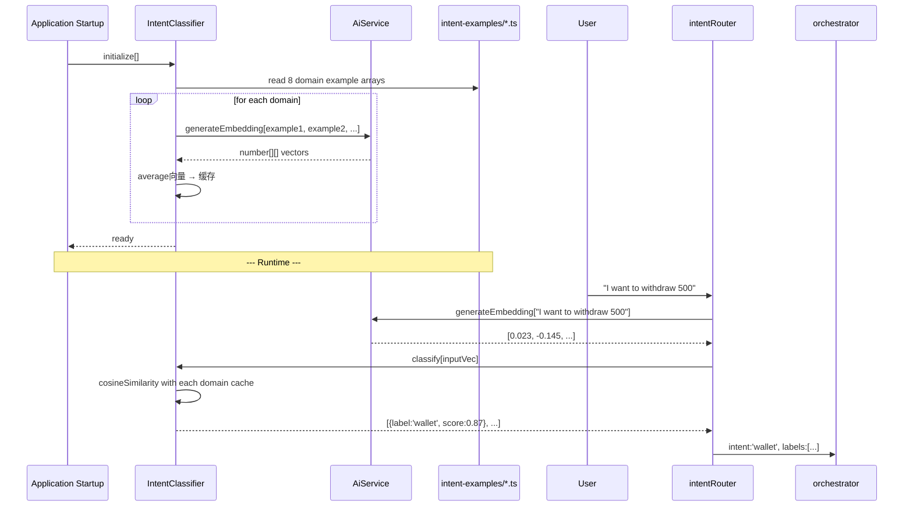
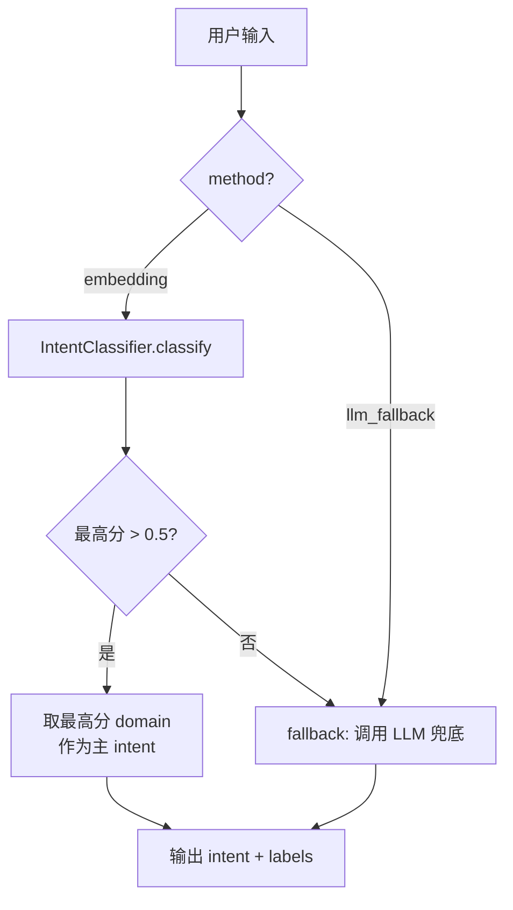

# 41. Embedding 意图分类 — 内存版实现

## 目标

将当前基于 `keywords`（字符串）+ `scoreGuide`（人工阈值）的 LLM 手动打分意图分类，替换为基于 Embedding 余弦相似度的数学计算分类。

## 为什么？

### 当前方案的问题
| 问题 | 表现 |
|------|------|
| keywords 是字符串 | LLM 只理解字面含义，"cash out" 和 "withdraw" 没共同词就识别不了 |
| scoreGuide 阈值人工调 | 每个 domain 的阈值不一致（有的 3 段，有的 4 段），维护困难 |
| 一般人看不懂 | `0.9+: Clear order-related request` 非开发者无法理解 |
| wallet/KYC 混杂 | keywords 里既有金融操作（balance/withdraw）又有身份验证（KYC/real-name） |

### Embedding 方案的优势
- **语义泛化**："cash out" 和 "withdraw" 在向量空间中相近
- **数学计算**：余弦相似度是确定性的，不是 LLM 凭感觉打分
- **配置直观**：写 5-12 条用户可能说的句子就行，任何角色都能看懂
- **自动区分**："verify my identity" 和 "check my balance" 向量距离远，不会混淆

## 总体架构

### 两阶段路线

```
Phase 1 现在: 内存缓存
  intent-examples/*.ts (配置文件)
       ↓ 启动时预计算
  内存 Map<domain, number[]>
       ↓ 运行时
  用户输入 → generateEmbedding → cosineSimilarity → 分数

Phase 2 未来: pgvector (Doc 13 完成后)
  IntentExample 表 (pgvector)
       ↓ SQL 查询
  SELECT ... ORDER BY embedding <=> :inputVec
       ↓ 相同接口
  IntentClassifier 只换实现，业务逻辑不变
```

### 数据流



## 文件结构

### 新建文件

```
apps/api/src/client/ai-customer/graph/agents/prompts/intent-examples/
  index.ts              ← 统一入口，收集所有 domain
  wallet.ts             ← wallet domain 的示例句子
  order.ts              ← order domain 的示例句子
  coupon.ts
  user.ts
  product.ts
  lucky-draw.ts
  rag.ts
  general.ts

apps/api/src/client/ai-customer/graph/utils/intent-classifier.ts
  ← 余弦相似度 + 启动时预计算缓存 + classify() 方法
```

### 修改文件

| 文件 | 改动 |
|------|------|
| `ai.service.ts` | 实现 `generateEmbedding()` — 查找并调用 provider 的 `generateEmbedding` 方法 |
| `ollama.provider.ts` | 新增 `generateEmbedding()` — 调用 Ollama `/api/embeddings` 端点 |
| `intent-router.node.ts` | 使用 IntentClassifier 替代 LLM 分类（Embedding first + LLM fallback） |
| `intent-label-categories.ts` | 移除 `keywords` + `scoreGuide` + `domainType`，仅保留 `name` + `validLabel` |
| `intent-prompt-builder.ts` | 简化模板（不再输出 Label Categories 章节） |
| `customer.graph.ts` | `buildCustomerGraph()` 新增 `aiService: AiService` 参数 |
| `ai-customer.service.ts` | 注入 `AiService`，传递给 `buildCustomerGraph()` |

### 不需要改动的文件

| 文件 | 原因 |
|------|------|
| `orchestrator.node.ts` | 只消费 intent/labels，不关心怎么产生的 |
| `agent-validator.spec.ts` | 验证的是 agent prompt 结构，不涉及 intent 分类 |
| `rag.node.ts` | 仍然是 stub，等 pgvector Phase 2 |
| 所有 agent node 文件 | 不受影响 |

## 每个 Domain 的示例句子

### wallet.ts — 10-12 条

涵盖金融操作 + KYC 状态查询。

```typescript
export const walletExamples: string[] = [
  // 余额查询
  'Check my balance',
  'How much money do I have in my wallet?',
  'What is my current balance?',
  // 提现
  'I want to withdraw 500 pesos',
  'Cash out my earnings',
  'Can I withdraw money?',
  // 充值
  'Deposit money into my account',
  'Top up my wallet',
  // 转账
  'Transfer 200 to another user',
  // 交易记录
  'Show my transaction history',
  // KYC 状态查询（仅状态，非提交）
  'Is my KYC approved?',
  'Check my KYC status',
  // 条件/失败原因
  'Why was my withdrawal rejected?',
  'Can I withdraw without KYC?',
];
```

### order.ts — 8-10 条

```typescript
export const orderExamples: string[] = [
  'Show my orders',
  'Where is my order?',
  'Track my delivery',
  'When will my parcel arrive?',
  'I want to return this item',
  'Did my payment go through?',
  'Can I cancel my order?',
  'Apply for a refund',
  'I have not received anything yet',
];
```

### coupon.ts — 5-8 条

```typescript
export const couponExamples: string[] = [
  'Show my coupons',
  'Apply discount code SAVE50',
  'Do I have any vouchers?',
  'Check my coupon balance',
  'Use my promo code',
  'Any available offers?',
];
```

### user.ts — 8-10 条

```typescript
export const userExamples: string[] = [
  'Update my address',
  'Add a new shipping address',
  'Change my phone number',
  'View my profile',
  'Reset my password',
  'What is my membership level?',
  'Edit personal info',
  'Show my account settings',
];
```

### product.ts — 6-8 条

```typescript
export const productExamples: string[] = [
  'Find me cheap products',
  'Show hot items',
  'Search for running shoes',
  'What is on sale?',
  'Show best sellers',
  'Browse categories',
  'Recommend something for me',
];
```

### lucky-draw.ts — 5-8 条

```typescript
export const luckyDrawExamples: string[] = [
  'Show my lottery tickets',
  'When is the next draw?',
  'Did I win anything?',
  'My winning records',
  'How to join the lucky draw?',
  'What prizes are available?',
];
```

### rag.ts — 8-10 条

```typescript
export const ragExamples: string[] = [
  'What is your return policy?',
  'How does shipping work?',
  'Tell me about VIP benefits',
  'What are the lucky draw rules?',
  'Can I cancel my order after payment?',
  'What is the KYC process?',
  'Privacy policy',
  'How do group purchases work?',
];
```

### general.ts — 3-5 条

```typescript
export const generalExamples: string[] = [
  'Hello',
  'Thank you',
  'Hi how are you?',
  'Goodbye',
  'Help',
];
```

### index.ts — 统一入口

```typescript
import { walletExamples } from './wallet';
import { orderExamples } from './order';
import { couponExamples } from './coupon';
import { userExamples } from './user';
import { productExamples } from './product';
import { luckyDrawExamples } from './lucky-draw';
import { ragExamples } from './rag';
import { generalExamples } from './general';

export interface IntentExampleGroup {
  name: string;
  examples: string[];
}

export const INTENT_EXAMPLE_GROUPS: IntentExampleGroup[] = [
  { name: 'wallet', examples: walletExamples },
  { name: 'order', examples: orderExamples },
  { name: 'coupon', examples: couponExamples },
  { name: 'user', examples: userExamples },
  { name: 'product', examples: productExamples },
  { name: 'lucky-draw', examples: luckyDrawExamples },
  { name: 'rag', examples: ragExamples },
  { name: 'general', examples: generalExamples },
];
```

## IntentClassifier 实现

### intent-classifier.ts（实际实现）

关键设计：
- **零配置**：只需在 `INTENT_EXAMPLE_GROUPS` 中添加示例句子
- **冷启动自动初始化**：首次 `classify()` 调用时自动生成域向量
- **低置信度降级**：最高分 < 0.5 时使用 LLM 作为 fallback
- **线程安全**：初始化使用互斥锁防止并发重复计算
- **过滤低分**：低于 0.3 的标签被过滤

`IntentClassifier` 通过构造函数注入 `AiService`，调用 `aiService.generateEmbedding()` 获取向量。不再接受 `generateEmbedding` 作为参数传入。

## AiService.generateEmbedding 实现

当前实现已接入 Ollama `mxbai-embed-large`（768 维）：

### 1. OllamaProvider.generateEmbedding()
位于 `ollama.provider.ts`，调用 Ollama 原生 `/api/embeddings` 端点：

```
POST {baseUrl}/api/embeddings
Body: { model: "mxbai-embed-large", prompt: text }
```

Ollama base URL 从 `/v1/chat/completions` URL 推导而来（去除 `/v1/chat/completions` 后缀）。

### 2. AiService.generateEmbedding()
位于 `ai.service.ts`，迭代查找第一个具有 `generateEmbedding` 方法的可用 provider：

```typescript
async generateEmbedding(text: string): Promise<number[] | null> {
  if (this.serviceLevel < AiServiceLevel.FULL) return null;
  const ollamaProvider = (this.providers as any[]).find(
    (p: any) => typeof p.generateEmbedding === 'function' && p.isAvailable(),
  );
  if (!ollamaProvider) return null;
  return await ollamaProvider.generateEmbedding(text);
}
```

**注意**：必须统一向量维度。目前使用 `mxbai-embed-large`（768 维）。所有示例句子和用户输入都使用同一模型编码，维度一致。

## Intent Router 改动

### 新流程



- **主路径**：embedding 相似度直接分类（不需要 LLM 调用，更快更便宜）
- **降级条件**（任一触发）：
  - `generateEmbedding` 返回 `null` 或空数组（服务不可用）
  - 所有 domain 分数都 < 0.5（低置信度）
  - 无法初始化（无 domain 向量缓存）
- **降级路径**：调用 LLM + `buildIntentPrompt()` 简化版提示词进行分类

### `createIntentRouterNode` 签名变化

| 之前 | 现在 |
|------|------|
| `createIntentRouterNode(llmConfig)` | `createIntentRouterNode(llmConfig, aiService)` |
| 纯 LLM 分类 | Embedding-first + LLM fallback |
| `INTENT_PROMPT` 包含完整 Label Categories | `INTENT_PROMPT` 使用简化版 `buildIntentPrompt()` |

## 与现有系统的关系

### 涉及文件

```
修改文件:
  intent-label-categories.ts     → 移除 keywords + scoreGuide + domainType
  intent-prompt-builder.ts       → 简化模板（不再输出 Label Categories 章节）
  intent-router.node.ts          → 主逻辑改为 embedding 分类 + LLM fallback
  ai.service.ts                  → 实现 generateEmbedding()
  ollama.provider.ts             → 新增 generateEmbedding()
  customer.graph.ts              → buildCustomerGraph() 新增 aiService 参数
  ai-customer.service.ts         → 注入 AiService 并传递
  
新建文件:
  intent-examples/index.ts       → 统一入口
  intent-examples/wallet.ts      → wallet 示例句子
  intent-examples/order.ts       → order 示例句子
  intent-examples/coupon.ts      → coupon 示例句子
  intent-examples/user.ts        → user 示例句子
  intent-examples/product.ts     → product 示例句子
  intent-examples/lucky-draw.ts  → lucky-draw 示例句子
  intent-examples/rag.ts         → rag 示例句子
  intent-examples/general.ts     → general 示例句子
  utils/intent-classifier.ts     → 余弦相似度 + 缓存
  utils/intent-classifier.spec.ts → 23 个单元测试

总计: 新建 11 个文件，修改 7 个文件
```

### 不涉及的文件

```
orchestrator.node.ts     — 只消费 labels，不关心来源
agent-validator.spec.ts  — 验证 agent prompt，不涉及 intent 分类
rag.node.ts              — 仍然是大纲 stub
所有 agent node          — 不受影响
所有 agent tools         — 不受影响
flow-types.ts            — 不受影响
state.ts                 — state 结构不变
```

## KYC 处理策略

KYC 关键词原先混在 wallet 的 keywords 里。在 embedding 方案中：

| 用户说 | 相似度最高的 domain | 行为 |
|--------|-------------------|------|
| "Is my KYC approved?" | wallet 0.82 | ✅ 路由到 walletAgent（查 KYC 状态） |
| "Check KYC status" | wallet 0.78 | ✅ 路由到 walletAgent |
| "Upload my ID card" | general 0.45 | ❌ 无 domain 匹配 → 走 general（提示去 app） |
| "Verify my identity" | general 0.51 | ❌ 无 domain 匹配 → 走 general |

这是因为 wallet 示例中只包含 KYC **状态查询**的句子（"Is my KYC approved?"），不包含 KYC **提交文档**的句子（"Upload my ID card"）。

如果未来需要支持 KYC 提交，可以：
1. 新建 `kyc` domain + kycAgent（需要实现 kyc tools）
2. 或者在 wallet 示例中添加 KYC 操作句子（但 wallet agent 的 hard rule 不允许提交）

## 未来迁移到 pgvector

当 [Doc 13](13-PrismaKnowledge模型与pgvector.md) 的 pgvector 基础设施完成后，迁移步骤：

1. 新建 Prisma 模型：

```prisma
model IntentExample {
  id        String   @id @default[cuid[]
  domain    String   // 'wallet', 'order', ...
  sentence  String   // 示例句子原文
  embedding Unsupported["vector[1536]"]?  // embedding 向量
  
  @@map["intent_examples"]
}
```

2. 数据迁移脚本：从 `intent-examples/*.ts` 读取句子，生成 embedding，写入 DB

3. 修改 `IntentClassifier` 实现：

```typescript
// Phase 2 — pgvector 版本
async classify[input: string, generateEmbedding: [text: string] => Promise<number[]>] {
  const inputVec = await generateEmbedding[input];
  const rows = await this.prisma.$queryRaw`
    SELECT domain, 1 - [embedding <=> ${inputVec}::vector] AS similarity
    FROM intent_examples
    ORDER BY similarity DESC
    LIMIT 1
  `;
  return rows.map[r => ([ label: r.domain, score: r.similarity ]];
}
```

4. `INTENT_EXAMPLE_GROUPS` 配置保留作为数据源，DB 作为运行时查询

## 实施步骤

### Step 1: 实现 AiService.generateEmbedding

修改 `ai.service.ts`，将 stub 替换为真实的 API 调用。

### Step 2: 创建 intent-examples/ 目录

新建 9 个文件（index.ts + 8 个 domain 文件），每个文件导出示例句子数组。

### Step 3: 创建 intent-classifier.ts

实现 `IntentClassifier` 类 + `cosineSimilarity` + `averageVectors` 函数。

### Step 4: 修改 intent-router.node.ts

将 LLM 分类替换为 IntentClassifier.classify 调用。
保留 LLM 作为降级兜底（所有分数 < 0.6 时）。

### Step 5: 清理 intent-label-categories.ts

移除 `keywords` + `scoreGuide` + `domainType` 字段。
保留 `name` + `validLabel`。
`VALID_INTENTS` 保持不变。

### Step 6: 简化 intent-prompt-builder.ts

移除 Label Categories 章节的生成逻辑（不再需要 LLM 手动打分）。
简化后的 prompt 仅用于 LLM fallback 场景（embedding 置信度 < 0.5 时）。

### Step 7: 更新测试

- `intent-router-prompt.spec.ts`：17 个测试全部通过（未修改，测试的是 JSON 解析逻辑）
- 新增 `intent-classifier.spec.ts`：23 个测试，覆盖：
  - `cosineSimilarity`（7 个数学正确性测试）
  - `averageVectors`（5 个向量平均测试）
  - `IntentClassifier.classify()`（11 个集成测试）

### Step 8: 验证

```bash
npx tsc --noEmit                                          # ✅ 通过
node_modules/.bin/jest --no-coverage --testPathPatterns="intent-classifier"  # ✅ 23/23 通过
node_modules/.bin/jest --no-coverage --testPathPatterns="intent-router-prompt" # ✅ 17/17 通过
node_modules/.bin/jest --no-coverage --testPathPatterns="(intent-router-prompt|state|agent-validator|clean-result)" # ✅ 133/133 通过
# E2E: 需要运行中的 Ollama 实例，通过 testChat API 测试各场景
```

## 政策合规性检查

| 政策 | 检查结果 |
|------|---------|
| 🔴 禁止 `any` 类型 | 所有接口都定义完整类型：`IntentExampleGroup`, `ClassificationResult` |
| 🔴 禁止假设导入存在 | `AiService.generateEmbedding[]` 需要先实现再使用 |
| 🔴 禁止线性思维 | 系统级改动，已考虑全局影响 |
| 🔴 禁止消防员思维 | 解决根本问题（分类不可维护），不是修修补补 |
| 🟡 NestJS 数据库规则 | 不涉及数据库操作（Phase 1 内存缓存） |
| 🟡 组件使用规则 | 后端改动，不涉及前端组件 |
| 🟢 思考流程：系统影响 | 不影响 orchestrator/agent/tools |
| 🟢 思考流程：类型安全 | 所有新类型均有定义 |
| 🟢 思考流程：竞态条件 | 纯计算，无竞态 |
