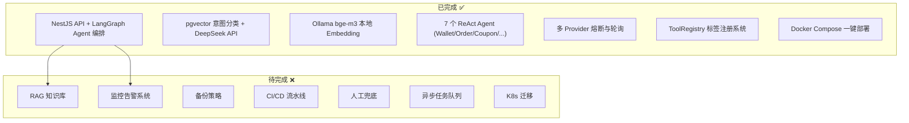
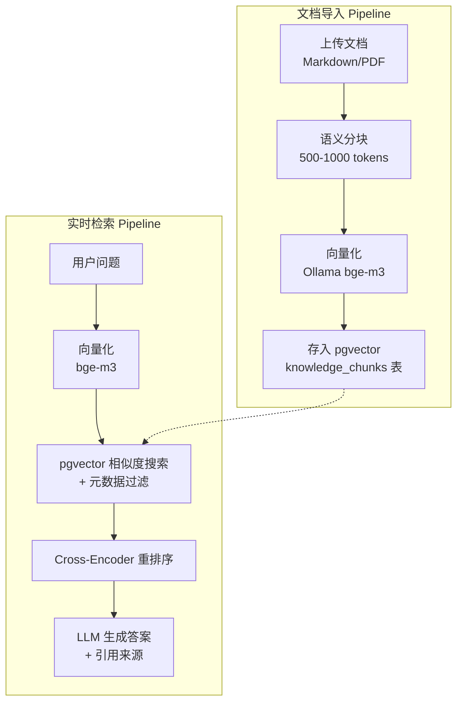
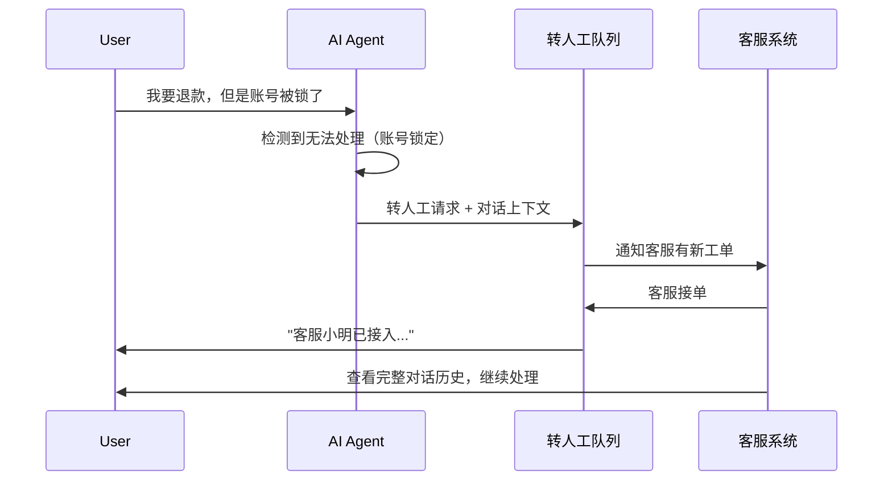
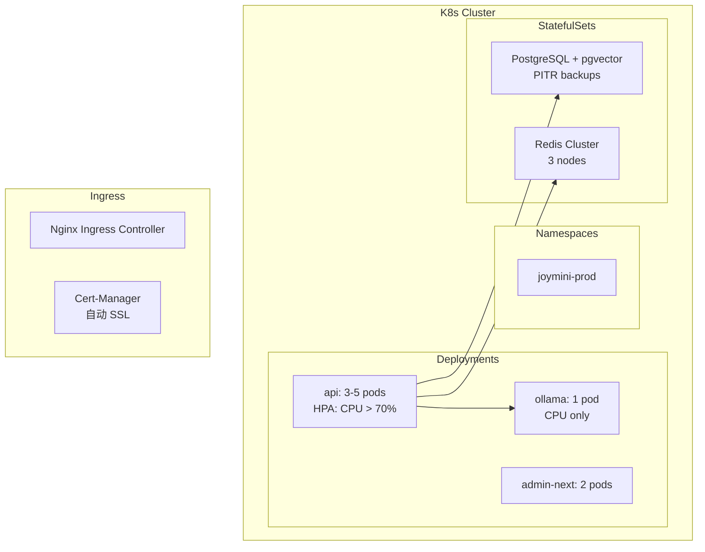
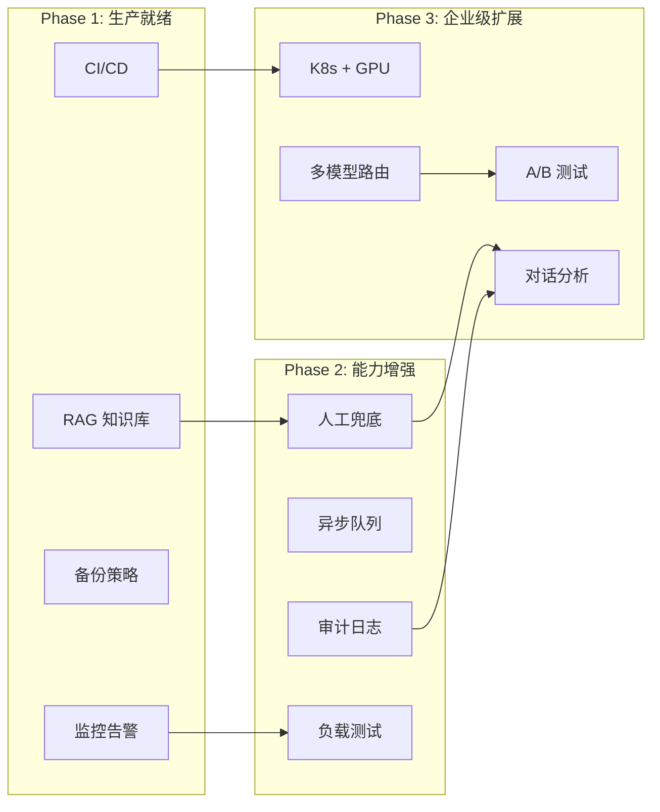

# 42. 企业级 AI 客服架构规划与实施路线图

> 本文档是 JoyMini AI 客服体系的企业级架构升级总规划。基于当前已完成的基础能力（Phase 0-8），按三阶段推进至生产就绪的企业级架构。

---

## 📋 当前架构评估



### 已具备的企业级能力

| 能力 | 当前实现 | 评估 |
|------|---------|------|
| 混合 LLM 策略 | DeepSeek API + Ollama bge-m3 | ✅ 企业级模式 |
| 意图识别 | pgvector + LLM fallback | ✅ 生产可行 |
| Agent 编排 | LangGraph State Machine | ✅ 标准方案 |
| 工具注册 | 编程式 ToolRegistry + 标签系统 | ✅ 灵活可扩展 |
| 多 Provider | 轮询 + 熔断 + 降级 | ✅ 高可用模式 |
| 会话持久化 | MemorySaver Checkpointer | ✅ 多轮对话 |

### 待补齐的能力（按优先级）

| 优先级 | 能力 | 缺失风险 | 预估工作量 |
|--------|------|---------|-----------|
| **P1** | RAG 知识库 | 无法回答产品/政策问题 | 3-5 天 |
| **P1** | 监控告警 | 宕机不知情，无法排查 | 2-3 天 |
| **P1** | 数据库备份 | 数据丢失不可恢复 | 1 天 |
| **P2** | 人工兜底 | AI 无法处理的场景无出口 | 3-5 天 |
| **P2** | 日志审计 | 对话无法追溯 | 2-3 天 |
| **P2** | CI/CD | 部署靠手动，易出错 | 2-3 天 |
| **P3** | K8s 迁移 | 单机故障影响全局 | 5-10 天 |

---

## Phase 1：生产就绪（Now — 2 Months）

> **目标**：从"能跑"到"能上线"。补齐必不可少的生产能力。

### 1.1 RAG 知识库

**为什么**：用户问"你们的退款政策是什么"、"如何充值"这类问题，目前只能靠 LLM 自身知识回答。有了 RAG，可以从公司文档中检索准确答案。

**架构**：



**涉及文件**：

| 文件 | 操作 | 说明 |
|------|------|------|
| [`schema.prisma`](apps/api/prisma/schema.prisma) | 新增 | `KnowledgeChunk` 模型 (id, content, embedding, source, metadata) |
| `apps/api/src/common/ai/rag/rag.service.ts` | 新建 | 分块 + 向量化 + 检索逻辑 |
| `apps/api/src/client/ai-customer/graph/nodes/rag.node.ts` | 已有 | 已创建但未接入，需打通 RAG 检索 |
| `apps/api/src/client/ai-customer/graph/utils/intent-classifier.ts` | 修改 | 新增 `rag` 意图域 |
| `compose.yml` | 确认 | Ollama bge-m3 已在 Docker 中，可直接用于 RAG |

**实施步骤**：

1. Prisma Schema：创建 `KnowledgeChunk` 模型
2. `prisma migrate dev --create-only` + 手动编辑 migration SQL
3. 实现 [`RagService`](apps/api/src/common/ai/rag/rag.service.ts)：`ingestDocument()` + `searchSimilar()`
4. 更新 [`rag.node.ts`](apps/api/src/client/ai-customer/graph/nodes/rag.node.ts)：接入 RAG 检索结果
5. 更新 [`intent-examples/rag.ts`](apps/api/src/client/ai-customer/graph/agents/prompts/intent-examples/rag.ts)：添加 RAG 意图示例
6. 管理员页面：知识库文档上传界面（后续 Phase 2）

---

### 1.2 监控告警系统

**为什么**：生产环境必须知道服务是否健康。用户反馈出问题前先发现。

**架构**：

```
┌─ 8GB VPS ─────────────────────────────────────┐
│  Docker Compose                                │
│  ├── Prometheus (收集指标)                     │
│  ├── Grafana (可视化仪表盘)                     │
│  ├── Node Exporter (系统指标)                   │
│  └── Loki (日志聚合，可选)                     │
└────────────────────────────────────────────────┘
```

**需要采集的指标**：

| 指标 | 类型 | 告警阈值 |
|------|------|---------|
| CPU 使用率 | System | > 80% for 5min |
| 内存使用率 | System | > 85% |
| API P99 延迟 | Application | > 3s |
| API 错误率 | Application | > 1% |
| LLM Token 消耗 | Application | 按预算 |
| pgvector 查询延迟 | Database | > 500ms |
| Ollama 响应时间 | AI | > 2s |

**涉及文件**：

| 文件 | 操作 | 说明 |
|------|------|------|
| `docker-compose.monitor.yml` | 新建 | Prometheus + Grafana + Node Exporter |
| `prometheus/prometheus.yml` | 新建 | 抓取配置 |
| `grafana/dashboards/api.json` | 新建 | NestJS 指标仪表盘 |
| `apps/api/src/common/metrics/metrics.service.ts` | 新建 | Prometheus 指标暴露 |
| `deploy/.env.dev` | 修改 | 添加监控相关配置 |

**实施步骤**：

1. 创建 `apps/api/src/common/metrics/metrics.module.ts` — 暴露 `/metrics` 端点
2. 安装 `@nestjs/terminus` + `prom-client` 依赖
3. 创建 `compose.monitor.yml` — Prometheus + Grafana
4. 配置 Grafana 数据源 + 仪表盘
5. 设置告警规则（邮件 / Telegram / Slack）

---

### 1.3 数据库备份策略

**为什么**：数据是生命线。pgvector 里的意图示例 + RAG 知识库丢失后必须重建。

**策略**：

```bash
# 每日自动备份
0 3 * * * docker exec lucky-db pg_dump -U postgres $DB_NAME > /backups/daily/$(date +%Y%m%d).sql

# 保留最近 30 天
find /backups/daily -type f -mtime +30 -delete

# 可选项：同步到 S3/MinIO
aws s3 sync /backups/ s3://joymini-backups/
```

**涉及文件**：

| 文件 | 操作 | 说明 |
|------|------|------|
| `scripts/backup-db.sh` | 新建 | 备份脚本 |
| `scripts/restore-db.sh` | 新建 | 恢复脚本 |
| `cron/backup.cron` | 新建 | Cron 配置 |

---

### 1.4 CI/CD 流水线

**为什么**：手动部署 = 容易出错 = 凌晨 3 点爬起来修。

**架构**：

```
Git Push → GitHub Actions → Build → Test → Deploy
                                    ↓
                              Docker Image Build
                                    ↓
                              Docker Compose Pull & Restart
```

**涉及文件**：

| 文件 | 操作 | 说明 |
|------|------|------|
| `.github/workflows/deploy.yml` | 新建 | CI/CD 流水线 |
| `deploy/deploy.sh` | 新建 | 服务器部署脚本 |

---

### Phase 1 完成标准

- [ ] RAG 能正确检索文档并生成带引用的答案
- [ ] 任意 5 个文档测试用例通过
- [ ] Prometheus 采集所有关键指标
- [ ] Grafana 仪表盘展示 API 延迟/错误率/Token 消耗
- [ ] CPU > 80% 持续 5 分钟能收到告警
- [ ] 每日凌晨自动备份数据库
- [ ] Git push → 自动部署到测试环境
- [ ] 所有 P1 缺陷（PROGRESS.md 中）已修复

---

## Phase 2：能力增强（2 — 4 Months）

> **目标**：从"能上线"到"好用"。补齐人机协作和异步能力。

### 2.1 人工兜底（Human Handoff）

**为什么**：AI 有置信度阈值。当意图置信度低于阈值（如 < 0.6）、涉及敏感操作、或用户要求"转人工"时，必须能无缝交给人。

**架构**：



**涉及文件**：

| 文件 | 操作 | 说明 |
|------|------|------|
| `apps/api/src/common/chat/chat-ticket.service.ts` | 新建 | 转人工工单服务 |
| `apps/api/src/common/chat/ticket.schema.prisma` | 新增 | Ticket 模型 |
| `apps/api/src/client/ai-customer/graph/nodes/handoff.node.ts` | 新建 | 转人工节点 |
| `apps/admin-next/src/app/support/` | 新建 | 客服后台界面 |

---

### 2.2 异步任务队列

**为什么**：当前 Agent 是同步执行。如果某个工具调用耗时（如查询多笔交易），整个请求被阻塞。异步队列让后端能先返回"正在处理"，然后推送结果。

**技术选型**：

| 方案 | 优点 | 缺点 | 推荐场景 |
|------|------|------|---------|
| Bull (Redis) | 轻量，无需新组件 | 不支持消息持久化重放 | ✅创业期 |
| RabbitMQ | 成熟可靠 | 需要额外部署 | 成长期 |
| Kafka | 超高吞吐 | 太重 | 大规模 |

**涉及文件**：

| 文件 | 操作 | 说明 |
|------|------|------|
| `apps/api/src/common/queue/queue.module.ts` | 新建 | Bull Queue 模块 |
| `apps/api/src/common/queue/agent-queue.service.ts` | 新建 | Agent 异步执行服务 |

---

### 2.3 对话审计日志

**为什么**：合规要求 + 问题排查。必须记录每次对话的完整轨迹。

**记录内容**：

```typescript
interface AuditLog {
  sessionId: string;
  userId: string;
  timestamp: Date;
  userMessage: string;
  intentClassified: string;
  confidence: number;
  agentUsed: string;
  toolsCalled: Array<{
    name: string;
    args: any;
    result: any;
    duration: number;
  }>;
  llmTokens: { prompt: number; completion: number };
  finalAnswer: string;
  humanHandoff: boolean;
}
```

---

### 2.4 负载测试

**工具**：k6 (Grafana 出品，JS 脚本)

```javascript
import http from 'k6/http';
import { check, sleep } from 'k6';

export const options = {
  stages: [
    { duration: '2m', target: 10 },   // 逐步增加到 10 并发
    { duration: '5m', target: 10 },   // 保持 10 并发
    { duration: '2m', target: 50 },   // 增加到 50 并发
    { duration: '5m', target: 50 },   // 保持 50 并发
    { duration: '2m', target: 0 },    // 逐步降回 0
  ],
};

export default function () {
  const res = http.post('http://localhost:3000/client/ai-customer/test-chat', {
    json: { userId: 'test', text: 'I want to withdraw 500 pesos' },
  });
  check(res, { 'status was 200': (r) => r.status == 200 });
  sleep(1);
}
```

---

### Phase 2 完成标准

- [ ] 人工兜底：AI 无法处理的场景自动转人工
- [ ] 客服后台：客服能看到完整对话历史和上下文
- [ ] 异步任务：耗时操作不阻塞用户体验
- [ ] 审计日志：每次对话有完整可追溯记录
- [ ] 负载测试：50 并发用户时 P99 < 5s
- [ ] 所有 P2 缺陷已修复

---

## Phase 3：企业级扩展（4 — 8 Months）

> **目标**：从"好用"到"规模化"。真正进入企业级架构。

### 3.1 Kubernetes 迁移

**为什么**：单机 Docker Compose 有上限。K8s 提供自动扩缩、滚动更新、自愈。



**迁移路径**：

```
Docker Compose
    ↓
Docker Compose + Compose （准备阶段）
    ↓
K8s 清单文件 （手动编写 yaml）
    ↓
Helm Charts （参数化部署）
    ↓
ArgoCD GitOps （声明式运维）
```

---

### 3.2 GPU 推理集群

**为什么**：当用户量增长到一定程度，API 调用成本 > 自建 GPU 成本。

| 模型 | GPU 需求 | 吞吐 | 成本对比 |
|------|---------|------|---------|
| Qwen 2.5 7B | 1× RTX 4090 24GB | ~1000 tokens/s | 自建 vs API: 3 个月回本 |
| DeepSeek V2 Lite | 1× A100 80GB | ~2000 tokens/s | 适合中等规模 |
| Llama 3 70B | 4× A100 80GB | ~500 tokens/s | 大规模时才划算 |

**部署工具**：

| 工具 | 优点 | 适用场景 |
|------|------|---------|
| **vLLM** | 高吞吐，PagedAttention | ⭐推荐：生产推理 |
| **TGI** (HuggingFace) | 与 HF 生态集成好 | 快速实验 |
| **Ollama** | 简单易用 | 开发/测试环境 |

---

### 3.3 多模型负载均衡

**架构**：

```typescript
const modelRouter = {
  // 默认主模型
  primary: { provider: 'deepseek-chat', weight: 0.8 },
  // 备选模型（主模型故障时）
  fallback: { provider: 'groq', weight: 0.2 },
  
  // 路由规则
  rules: [
    // 简单问题 → 便宜模型
    { intent: ['greeting', 'faq'], model: 'gemini-flash' },
    // 复杂金融操作 → 最强模型
    { intent: ['wallet', 'order'], model: 'deepseek-chat' },
    // 高峰期 → 降级到低成本模型
    { condition: 'peak_hours', model: 'qwen2.5:7b' },
  ],
  
  // 成本控制
  budget: {
    dailyLimit: '$5',
    monthlyCap: '$150',
  },
};
```

---

### 3.4 A/B 测试平台

**为什么**：如何知道新 Prompt 更好？新模型更快？新 Agent 更准确？没有 A/B 测试就是拍脑袋。

```
用户
  │
  ▼
分流器 (50/50 Split)
  ├── A 组：当前 Prompt + DeepSeek
  └── B 组：新 Prompt + Qwen 2.5
  
指标对比：
  ├── 解决率 (Resolution Rate)
  ├── 平均对话轮数
  ├── 用户满意度 (Thumbs Up/Down)
  └── 平均处理时间
```

---

### 3.5 对话分析平台

**为什么**：从对话数据中发现用户痛点、热门问题、Agent 薄弱环节。

**分析维度**：

| 维度 | 分析内容 | 价值 |
|------|---------|------|
| 意图分布 | 各意图占比 | 发现用户核心需求 |
| 未解决率 | 转人工/重复提问 | 发现 Agent 盲区 |
| 情绪分析 | 积极/消极/愤怒 | 发现服务瓶颈 |
| 热门查询 | 高频问题 TOP 10 | 优化 FAQ 知识库 |

---

### Phase 3 完成标准

- [ ] K8s 集群正常运行，自动扩缩生效
- [ ] GPU 推理节点部署完成，本地模型可用于文本生成
- [ ] 多模型负载均衡按规则路由
- [ ] A/B 测试平台可实时看到 A/B 组指标对比
- [ ] 对话分析仪表盘展示关键业务指标
- [ ] 所有 P3 缺陷已修复

---

## 架构演进全景图



---

## 资源估算

### 服务器需求

| 阶段 | 服务器 | 规格 | 月成本 |
|------|--------|------|-------|
| 当前 | 1 台 | 8GB RAM, 4 vCPU | ~$40 |
| Phase 1 | 1 台 | 8GB RAM, 4 vCPU | ~$40 (不变) |
| Phase 2 | 2 台 | 16GB + 8GB | ~$80 |
| Phase 3 | 3-5 台 | 含 GPU | ~$300-1000 |

### 人力估算

| 阶段 | 开发者 | 时间 |
|------|--------|------|
| Phase 1 | 1-2 人 | 1-2 月 |
| Phase 2 | 1-2 人 | 2-3 月 |
| Phase 3 | 2-3 人 | 3-6 月 |

---

## 附录：关键决策记录

### 为什么用 pgvector 而不是 Pinecone/Milvus？

| 方案 | 成本 | 维护 | 性能 | 结论 |
|------|------|------|------|------|
| **pgvector** | $0 (已有 PG) | 低 | 中小规模够用 | ✅ 创业期最佳 |
| Pinecone | $70+/月 | 零维护 | 优秀 | ❌ 成本高 |
| Milvus | 免费但需部署 | 高 | 大规模优秀 | ❌ 太重 |
| Qdrant | 免费(自建) | 中 | 优秀 | 备选 |

### 为什么用 LangGraph 而不是别的框架？

| 框架 | 优点 | 缺点 | 结论 |
|------|------|------|------|
| **LangGraph** | 状态机模型清晰 | 调试困难 | ✅ 已在用 |
| AutoGen | 多 Agent 对话强 | 过于复杂 | 备选 |
| CrewAI | 简单易用 | 灵活性差 | ❌ |
| Dify | 低代码 | 不可控 | ❌ 不适合开发团队 |

---

> **下一份文档**：Phase 1.1 — [RAG 知识库实现](./43-RAG-Knowledge-Base-Implementation.md)
