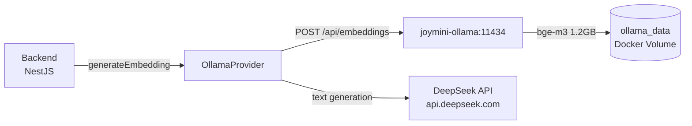

# 43. bge-m3 Embedding 集成 — 问题排查与解决方案

## 🎯 本步骤目标

将 Embedding 从 DeepSeek API 切换到本地 Ollama bge-m3 模型，实现：
- 零成本本地向量生成（无需调用外部 API）
- 1024 维向量（比 DeepSeek 2048 维更轻量）
- 完全离线运行，降低延迟

---

## 🔧 环境架构



- **文本生成** → DeepSeek API（外部，不变）
- **Embedding** → 本地 Ollama bge-m3（新增，独立 URL）

---

## 🐛 问题 1：`docker compose up --build` Docker Hub Bad Gateway

### 症状

```text
ERROR: failed to solve: failed to resolve source metadata for docker.io/library/ollama/ollama:latest:
failed to authorize: failed to fetch oauth token: 502 Bad Gateway from registry-1.docker.io
```

### 原因

`docker compose up --build` 在构建前使用 **HEAD 请求**检查 manifest，而 `auth.docker.io` 的某些节点对 HEAD 请求返回 502。而 `docker pull ollama/ollama:latest` 使用 **GET 请求**，路由到正常节点。

### 解决方案

```bash
# 先手动 pull（GET 请求，路由到正常节点）
docker pull ollama/ollama:latest

# 然后不带 --build 启动（跳过 manifest 检查）
docker compose --env-file deploy/.env.dev up -d
```

### 原理

Docker Hub 的 CDN 架构中，HEAD 和 GET 请求可能路由到不同的后端节点。当某个节点故障时，HEAD 请求失败但 GET 请求仍可正常工作。

---

## 🐛 问题 2：DeepSeek 仍然被用于 Embedding（供应商顺序问题）

### 症状

```text
[DeepSeekProvider] DeepSeek embedding error on key ...ce99: Request failed with status code 404
```

### 原因

[`apps/api/src/common/ai/ai.service.ts`](apps/api/src/common/ai/ai.service.ts) 中 providers 数组的顺序：

```typescript
// ❌ 错误顺序：DeepSeek 排在 Ollama 之前
this.providers = [
  this.geminiProvider,    // ❌ 无 generateEmbedding
  this.groqProvider,      // ❌ 无 generateEmbedding
  this.deepSeekProvider,  // ✅ 有 generateEmbedding ← Array.find() 选中
  this.ollamaProvider,    // ✅ 也有 generateEmbedding，但永远不会到达
];
```

`AiService.generateEmbedding()` 使用 `Array.find()` 查找第一个有 `generateEmbedding` 方法的 provider。DeepSeek 排在 Ollama 前面，所以即使 Ollama 可用，也永远不会被选中。

### 解决方案

交换顺序，让 OllamaProvider 在 DeepSeekProvider 之前：

```typescript
// ✅ 正确顺序：Ollama 排在 DeepSeek 之前
this.providers = [
  this.geminiProvider,
  this.groqProvider,
  this.ollamaProvider,    // ✅ 第一个有 generateEmbedding ← 被选中
  this.deepSeekProvider,  // ✅ 也有，作为后备
];
```

---

## 🐛 问题 3：AI_OLLAMA_BASE_URL 同时控制文本生成和 Embedding

### 症状

切换供应商顺序后，错误从 DeepSeek 404 变为：

```text
[OllamaProvider] Ollama embedding API error: Request failed with status code 401
```

Embedding 请求发送到了 `https://api.deepseek.com/api/embeddings`（DeepSeek 返回 401）。

### 原因

[`deploy/.env.dev`](deploy/.env.dev) 中只有一个 `AI_OLLAMA_BASE_URL` 环境变量：

```yaml
AI_OLLAMA_BASE_URL=https://api.deepseek.com   # ← 指向 DeepSeek！
OLLAMA_MODEL=deepseek-chat
```

而 [`ollama.provider.ts`](apps/api/src/common/ai/providers/ollama.provider.ts) 中，单个 `this.baseUrl` 同时用于：
- **文本生成**: `this.baseUrl.replace(/\/+$/, '') + '/v1/chat/completions'`
- **Embedding**: `this.baseUrl.replace('/v1/chat/completions', '') + '/api/embeddings'`

所以 OllamaProvider 的 embedding URL 也被推导为 `https://api.deepseek.com/api/embeddings`。

### 解决方案

创建独立的 embedding URL 环境变量，与文本生成解耦：

```yaml
# deploy/.env.dev
# DeepSeek (外部 API) — 用于文本生成（不变）
AI_OLLAMA_BASE_URL=https://api.deepseek.com
OLLAMA_MODEL=deepseek-chat

# Ollama Embedding API — 本地 bge-m3（新增，独立）
OLLAMA_EMBEDDING_BASE_URL=http://joymini-ollama:11434
```

修改 [`ollama.provider.ts`](apps/api/src/common/ai/providers/ollama.provider.ts) 的 `generateEmbedding()` 方法：

```typescript
async generateEmbedding(text: string): Promise<number[] | null> {
  // 优先使用专用的 embedding URL
  const embedBaseUrl = this.configService.get<string>('OLLAMA_EMBEDDING_BASE_URL')
    ?? this.baseUrl.replace('/v1/chat/completions', '');
  const url = `${embedBaseUrl.replace(/\/+$/, '')}/api/embeddings`;
  // ... 发送请求
}
```

这样文本生成仍然使用 DeepSeek API，而 embedding 使用本地 Ollama。

---

## 🐛 问题 4：ollama-init 无法连接到 Ollama 服务

### 症状

ollama-init 容器日志：

```text
Error: could not connect to ollama server, run 'ollama serve' to start it
```

### 原因

ollama-init 容器默认的 `OLLAMA_HOST` 是 `localhost:11434`。在没有设置环境变量的情况下，它试图连接 **自身容器** 的 localhost（而不是 joymini-ollama 容器）。

### 解决方案

在 [`compose.yml`](compose.yml) 中为 ollama-init 添加 `OLLAMA_HOST` 环境变量：

```yaml
ollama-init:
  image: ollama/ollama:latest
  depends_on:
    ollama:
      condition: service_healthy
  environment:
    OLLAMA_HOST: http://joymini-ollama:11434  # ← 指向 Ollama 服务
  entrypoint: >
    sh -c "
      ollama pull bge-m3
    "
```

---

## 🐛 问题 5：Docker 容器无法访问 registry.ollama.ai（网络隔离）

### 症状

ollama-init 容器（以及 joymini-ollama 容器内部）无法拉取模型：

```text
Error: pull model manifest: Get "https://registry.ollama.ai/v2/library/bge-m3/manifests/latest":
dial tcp 104.21.75.227:443: connect: connection refused
```

但 **主机（macOS）可以正常访问**：

```bash
curl -sI https://registry.ollama.ai
# HTTP/2 200 ✅
```

### 原因

Docker 的 bridge 网络（`networks: [app]`）存在网络隔离，容器内的 DNS 解析或出站连接被阻断。常见原因：

1. 本地 VPN/代理只配置在宿主机层，Docker 容器不继承
2. Docker bridge 网络的 DNS 解析与宿主机不同
3. 某些 ISP/防火墙限制 Docker 容器的出站流量

### 解决方案（三种方案）

#### 方案 A：`--network host` 临时拉取（推荐 ✅）

利用 Docker 的 host 网络模式，让容器共享宿主机的网络栈：

```bash
# 1. 停止 compose 中的 ollama 服务
docker compose stop ollama

# 2. 使用 host 网络启动临时 Ollama 服务器
docker run -d --name temp-ollama \
  --network host \
  --rm \
  -v joymini_nest_monorepo_ollama_data:/root/.ollama \
  ollama/ollama:latest

# 3. 拉取模型
docker exec temp-ollama ollama pull bge-m3

# 4. 停止临时容器（自动删除）
docker stop temp-ollama

# 5. 重新启动 compose 中的 ollama（模型已存在于共享卷中）
docker compose start ollama
```

**原理**：`--network host` 使容器直接使用宿主机的网络栈，继承宿主机的 DNS、路由和代理配置。

#### 方案 B：配置 DNS（如果 DNS 解析失败）

```yaml
# compose.yml
ollama:
  dns:
    - 8.8.8.8
    - 1.1.1.1
```

#### 方案 C：配置 HTTP 代理（如果有代理）

```yaml
# compose.yml
ollama:
  environment:
    HTTP_PROXY: http://host.docker.internal:7890
    HTTPS_PROXY: http://host.docker.internal:7890
```

---

## 🐛 问题 6：Prisma 向量维度不匹配（2048 → 1024）

### 症状

DeepSeek embedding 返回 2048 维向量，bge-m3 返回 1024 维向量。如果不修改 schema，PostgreSQL 会报错。

### 原因

Prisma schema 中定义的是 `vector(2048)`，而 bge-m3 输出 1024 维。

### 解决方案

修改 [`apps/api/prisma/schema.prisma`](apps/api/prisma/schema.prisma)：

```diff
model IntentExample {
  id        String   @id @default(cuid())
  domain    String
  sentence  String
-  embedding vector(2048)
+  embedding vector(1024)
  createdAt DateTime @default(now()) @map("created_at")
  @@map("intent_examples")
}
```

生成并应用迁移：

```bash
cd apps/api
npx prisma migrate dev --name change_embedding_to_1024d --create-only
npx prisma migrate deploy
```

---

## ✅ 最终验证

### 1. 检查 Ollama 服务状态

```bash
curl http://localhost:11434/api/tags
# 预期: {"models":[{"name":"bge-m3:latest",...}]}
```

### 2. 测试 Embedding API

```bash
curl -s http://localhost:11434/api/embed \
  -d '{"model":"bge-m3","input":"Hello world"}' | head -c 100
# 预期: {"model":"bge-m3","embeddings":[[-0.0399,0.0320,-0.0284,...]]}
```

### 3. 检查后端日志无 DeepSeek embedding 错误

```bash
docker compose logs backend | grep -i "embedding"
# 预期: 无 DeepSeek embedding error 日志
# 如果有 IntentClassifier seeding 日志，应显示正常
```

### 4. 验证向量维度

```bash
docker compose exec db psql -U postgres -d joy_mini \
  -c "SELECT vector_dims(embedding) FROM intent_examples LIMIT 1;"
# 预期: 1024
```

---

## 📋 修改文件总结

| 文件 | 变更类型 | 说明 |
|------|---------|------|
| [`compose.yml`](compose.yml) | ✅ 修改 | 添加 ollama 服务，移除 ollama-init |
| [`deploy/.env.dev`](deploy/.env.dev) | ✅ 修改 | 添加 `OLLAMA_EMBEDDING_BASE_URL` |
| [`apps/api/src/common/ai/ai.service.ts`](apps/api/src/common/ai/ai.service.ts) | ✅ 修改 | 供应商顺序：Ollama 在 DeepSeek 之前 |
| [`apps/api/src/common/ai/providers/ollama.provider.ts`](apps/api/src/common/ai/providers/ollama.provider.ts) | ✅ 修改 | `generateEmbedding` 读取独立环境变量 |
| [`apps/api/src/common/ai/ai.module.ts`](apps/api/src/common/ai/ai.module.ts) | ✅ 修改 | 注册 `OllamaProvider` |
| [`apps/api/prisma/schema.prisma`](apps/api/prisma/schema.prisma) | ✅ 修改 | `vector(2048)` → `vector(1024)` |
| [`compose.ollama.yml`](compose.ollama.yml) | ✅ 修改 | 仅拉取 bge-m3 |

---

## 🔜 下一步

1. **确认 IntentClassifier 重新 seeding 完成** — 后端启动后会自动用 bge-m3 重新生成所有 intent 示例的向量
2. **测试完整的 intent 路由流程** — 发送聊天消息，验证 pgvector 相似度查询是否正常工作
3. **监控内存使用** — bge-m3 1.2GB 在 Docker 中占用约 1.5-2GB 内存（含 Ollama 服务本身）
