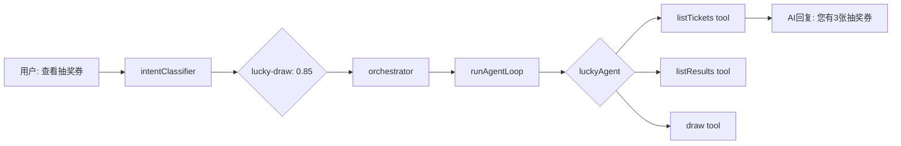

# LuckyDraw / Flash Agent — Spec-Code SDD

> **难度**: ⭐⭐ (中等偏低)  
> **前置依赖**: 无（后端 service 均已就绪）  
> **预计新增代码**: ~300-400 行  
> **预计修改文件**: 3 个

---

## 一、现状分析

### 已就绪的基础设施

| 项目 | 状态 | 说明 |
|------|------|------|
| Intent examples | ✅ 已存在 | [`lucky-draw.ts`](/apps/api/src/client/ai-customer/graph/agents/prompts/intent-examples/lucky-draw.ts) 含 6 条句子 |
| Intent 注册 | ✅ 已注册 | [`intent-examples/index.ts`](/apps/api/src/client/ai-customer/graph/agents/prompts/intent-examples/index.ts:39) 含 `requiredTags: ['lucky-draw']` |
| AGENT_MAP 占位 | ✅ 已存在 | [`orchestrator.config.ts:119`](/apps/api/src/client/ai-customer/graph/config/orchestrator.config.ts:119) 但 `type: 'direct'`, `promptConfig: null` |
| Module 导入 | ✅ 已导入 | [`ai-customer.module.ts:8`](/apps/api/src/client/ai-customer/ai-customer.module.ts:8) `LuckyDrawModule` 已 import |
| FlashSale 模块 | ✅ 已导入 | [`ai-customer.module.ts:12`](/apps/api/src/client/ai-customer/ai-customer.module.ts:12) `FlashSaleModule` 已 import |
| LuckyDrawService | ✅ 完整实现 | 478 行，6 个 public 方法 |
| ClientFlashSaleService | ✅ 完整实现 | 202 行，3 个 public 方法 |

### 问题

1. **lucky-draw 当前是 type:'direct'** → [`orchestrator.node.ts:340`](/apps/api/src/client/ai-customer/graph/nodes/orchestrator.node.ts:340) 走 `else` 分支 log warning 并跳过，用户询问抽奖时 LLM 会 silent skip
2. **无 lucky-tools.ts** → 没有 'lucky-draw' tag 的工具注册，Dynamic Intent-Tool Alignment 阻止 embedding seed
3. **FlashSaleModule 是 admin 模块** → 需确认 [`ClientFlashSaleService`](/apps/api/src/client/flash-sale/flash-sale.service.ts) 的 DI 路径正确

---

## 二、架构设计

### 2.1 设计决策

| 决策 | 选择 | 理由 |
|------|------|------|
| Flash Sale 归属 | 作为 LuckyDraw Agent 的附加工具 | Flash 和 LuckyDraw 都是"活动/促销"域，业务关联度高 |
| Flash 工具标签 | 共用 `'lucky-draw'` 标签 | 减少 AGENT_MAP 条目，无需独立 Agent |
| 是否用 flowContext | ✅ 是 | draw 操作是写操作，需要流程确认 |
| lucky-draw 类型升级 | `'direct'` → `'agent'` | 标准 LLM+Tools ReAct Agent |

### 2.2 数据流



### 2.3 Agent 参数

| 参数 | 值 |
|------|-----|
| label | `'luckyAgent'` |
| tag | `'lucky-draw'` |
| type | `'agent'` |
| flowContext | `true` |

---

## 三、新增文件

### 3.1 `lucky-tools.ts` — 工具定义

**位置**: `/apps/api/src/client/ai-customer/graph/tools/lucky-tools.ts`

**模式**: 纯函数工厂，与 [`wallet-tools.ts`](/apps/api/src/client/ai-customer/graph/tools/wallet-tools.ts)、[`product-tools.ts`](/apps/api/src/client/ai-customer/graph/tools/product-tools.ts) 一致。

```typescript
export const createLuckyTools = (
  luckyDrawService: LuckyDrawService,
  flashSaleService: ClientFlashSaleService,
): TaggedTool[] => [
  // 抽奖相关工具
  tool(listTickets, ...),    // 查询我的抽奖券列表
  tool(listResults, ...),    // 查询我的中奖记录
  tool(draw, ...),           // 消费一张抽奖券
  tool(getTicketByOrder, ...), // 按订单号查抽奖券
  
  // 闪购相关工具
  tool(getActiveSessions, ...),   // 查询当前闪购活动
  tool(getSessionProducts, ...),  // 查询闪购活动商品
  tool(getFlashProductDetail, ...), // 查询闪购商品详情
]
```

#### 工具列表

| 工具名 | 对应 Service 方法 | 参数 | 返回 | 读写 |
|--------|-------------------|------|------|------|
| `listTickets` | `LuckyDrawService.listTickets()` | `userId`, `page?`, `pageSize?` | 抽奖券列表 | R |
| `listResults` | `LuckyDrawService.listResults()` | `userId`, `page?`, `pageSize?` | 中奖记录 | R |
| `draw` | `LuckyDrawService.draw()` | `userId`, `ticketId` | 开奖结果 | W |
| `getTicketByOrder` | `LuckyDrawService.getTicketByOrder()` | `userId`, `orderId` | 订单关联的抽奖券 | R |
| `getActiveSessions` | `ClientFlashSaleService.getActiveSessions()` | 无 | 当前闪购活动列表 | R |
| `getSessionProducts` | `ClientFlashSaleService.getSessionProducts()` | `sessionId` | 闪购活动商品列表 | R |
| `getFlashProductDetail` | `ClientFlashSaleService.getProductDetail()` | `productId` | 闪购商品详情 | R |

**所有工具打 tag**: `['lucky-draw', 'flow']`（draw 工具需 flow 标签用于流程管理）

#### toLLM 格式要求

Service 返回的 DTO 需通过 `toLLM()` 转换为语义化字符串格式供 LLM 消费。参考 [`product-tools.ts`](/apps/api/src/client/ai-customer/graph/tools/product-tools.ts) 的 toolSuccess/toolFailure 包装模式。

### 3.2 `lucky-prompt.ts` — Prompt 配置

**位置**: `/apps/api/src/client/ai-customer/graph/agents/prompts/lucky-prompt.ts`

**模式**: 与 [`wallet-prompt.ts`](/apps/api/src/client/ai-customer/graph/agents/prompts/wallet-prompt.ts) 一致，5-section 模板。

```typescript
export const luckyPromptConfig: Omit<AgentPromptConfig, 'userId'> = {
  role: 'You are the lucky draw and flash sale assistant...',
  domainName: 'lucky-draw',
  flowContext: true,
  workflow: `Step 1: Understand what the user needs
- Check tickets → listTickets
- Check results → listResults
- Draw a ticket → follow the Draw Flow below
- Flash sale info → getActiveSessions / getSessionProducts / getFlashProductDetail

Step 2: Pick the right tool...

Step 3: Call the tool...

Step 4: Present the result...

Step 5: If more info needed, continue conversation...`,
  availableTools: `1. **listTickets** - View my lucky draw tickets (status, expiration, quantity)
2. **listResults** - View my winning records and prizes
3. **draw** - Use a ticket to participate in a draw (requires confirmation)
4. **getTicketByOrder** - Check tickets associated with an order
5. **getActiveSessions** - View current flash sale events
6. **getSessionProducts** - View products in a flash sale session
7. **getFlashProductDetail** - View flash sale product details`,
  domainRules: `## Draw Rules (CONFIRMATION required):

When user says "draw" / "抽奖" / "开奖":
- Step 1: Ask user to confirm which ticket to use
  - If user has multiple tickets, show the list and ask them to pick
- Step 2: After user confirms, call draw(ticketId)
- Step 3: Present the draw result to the user

IMPORTANT: 
- Do NOT draw without user confirmation
- If draw fails (no active activity, ticket expired), explain why`,
  scopeRestriction: {
    domain: 'lucky-draw / flash-sale',
    handles: [
      'lucky draw tickets',
      'winning records',
      'lottery results',
      'flash sale events',
      'flash sale products',
    ],
    outside: ['wallet', 'orders', 'coupons', 'products', 'user-profile'],
  },
  hardRules: [
    '- Only call draw() AFTER user confirms the ticket to use',
    '- Do NOT make up prize amounts — always use real tool results',
    '- Flash sale session IDs are returned from getActiveSessions — use them to call getSessionProducts',
  ],
  examples: `User: "Show my lottery tickets"
→ Call listTickets(userId="[userId]")
→ Present: "You have [quantity] ticket(s): [details]"

User: "Did I win anything?"
→ Call listResults(userId="[userId]")
→ Present winning records or "No wins yet, good luck next time!"`,
  displayFormat: `- Tickets show: status (used/unused), draw time, ticket number
- Results show: prize name, win time, claim status
- Flash sale shows: session name, time range, product list with prices`,
};
```

### 3.3 `lucky-agent.node.ts` — Agent 节点

**位置**: `/apps/api/src/client/ai-customer/graph/nodes/lucky-agent.node.ts`

**模式**: 与 [`order-agent.node.ts`](/apps/api/src/client/ai-customer/graph/nodes/order-agent.node.ts) 一致。由于 LuckyDraw Agent 不使用 flow tools（draw 操作仅需用户确认，不需要复杂的 slot filling），不需要像 wallet 那样传入 flowTools。

```typescript
export const luckyAgentNode = async (state, llmConfig, registry) => {
  const entry = AGENT_MAP['lucky-draw'];
  // 标准 runAgentLoop
  const result = await runAgentLoop({...});
  return { messages: [...state.messages, new AIMessage(result.content)] };
};
```

---

## 四、修改文件

### 4.1 `orchestrator.config.ts`

将 lucky-draw 从 `type: 'direct'` 升级为 `type: 'agent'`，添加 promptConfig。

```diff
  'lucky-draw': {
    label: 'luckyAgent',
    tag: 'lucky-draw',
-   promptConfig: null as unknown as Omit<AgentPromptConfig, 'userId'>,
-   type: 'direct',
+   promptConfig: luckyPromptConfig,
+   type: 'agent',
  },
```

同时添加 import:
```typescript
import { luckyPromptConfig } from '@api/.../prompts/lucky-prompt';
```

### 4.2 `ai-customer.module.ts`

```diff
- const EXPECTED_AGENT_TAGS = ['order', 'wallet', 'coupon', 'flow', 'user', 'product'];
+ const EXPECTED_AGENT_TAGS = ['order', 'wallet', 'coupon', 'flow', 'user', 'product', 'lucky-draw'];

  constructor(
    private readonly toolRegistry: ToolRegistryService,
    private readonly treasureService: TreasureService,
    private readonly categoryService: CategoryService,
+   private readonly luckyDrawService: LuckyDrawService,
+   private readonly flashSaleService: ClientFlashSaleService,
  ) {}

  onApplicationBootstrap() {
    // ... existing registrations ...

+   // 注册 LuckyDraw + Flash Sale 工具
+   this.toolRegistry.registerMany(
+     createLuckyTools(this.luckyDrawService, this.flashSaleService),
+   );
+   this.logger.log('✅ LuckyDraw/Flash tools registered');

    this.toolRegistry.validateRegistration(EXPECTED_AGENT_TAGS, { ... });
  }
```

同时添加 imports:
```typescript
import { LuckyDrawService } from '@api/common/lucky-draw/lucky-draw.service';
import { ClientFlashSaleService } from '@api/client/flash-sale/flash-sale.service';
import { createLuckyTools } from '@api/.../tools/lucky-tools';
```

---

## 五、无需修改的文件

| 文件 | 理由 |
|------|------|
| [`orchestrator.node.ts`](/apps/api/src/client/ai-customer/graph/nodes/orchestrator.node.ts) | 标准 Agent pipeline 自动处理 type:'agent'，无需特殊逻辑 |
| [`customer.graph.ts`](/apps/api/src/client/ai-customer/graph/customer.graph.ts) | 节点注册在 orchestrator 内部，不新增 graph node |
| [`intent-examples/index.ts`](/apps/api/src/client/ai-customer/graph/agents/prompts/intent-examples/index.ts) | 已注册 lucky-draw 条目 |
| [`intent-classifier.ts`](/apps/api/src/client/ai-customer/graph/utils/intent-classifier.ts) | Dynamic Intent-Tool Alignment 会自动识别新注册的 'lucky-draw' 工具后开始 seed |

---

## 六、测试验收标准

### AC-01: 查询抽奖券
- 输入: "Show my lucky draw tickets"
- 预期: 调用 `listTickets`，返回用户抽奖券列表

### AC-02: 查询中奖记录
- 输入: "Did I win anything?"
- 预期: 调用 `listResults`，返回中奖记录

### AC-03: 抽奖操作
- 输入: "I want to draw with ticket #123"
- 预期: Agent 确认 → 用户确认 → 调用 `draw(ticketId)` → 返回开奖结果

### AC-04: Flash Sale 查询
- 输入: "What flash sales are active?"
- 预期: 调用 `getActiveSessions`，返回活动列表

### AC-05: Intent 分类验证
- 输入: "Show my lottery tickets"
- 预期: intentClassifier 返回 `['lucky-draw']`

### AC-06: 跨域验证
- 输入: "Show my lottery tickets and my wallet balance"
- 预期: orchestrator 先执行 luckyAgent 再执行 walletAgent，合成回复

### AC-07: Embedding 种子化
- 启动后: `ensureSeeded()` 应成功为 'lucky-draw' 域生成 embedding 向量
- 日志: `✅ Seeded domain: lucky-draw (6 examples)`

---

## 七、文件变更清单

| 文件 | 操作 | 估计行数 |
|------|------|---------|
| `apps/api/src/client/ai-customer/graph/tools/lucky-tools.ts` | 新增 | ~180-220 行 |
| `apps/api/src/client/ai-customer/graph/agents/prompts/lucky-prompt.ts` | 新增 | ~100-130 行 |
| `apps/api/src/client/ai-customer/graph/nodes/lucky-agent.node.ts` | 新增 | ~50-70 行 |
| `apps/api/src/client/ai-customer/graph/config/orchestrator.config.ts` | 修改 | ~10 行 |
| `apps/api/src/client/ai-customer/ai-customer.module.ts` | 修改 | ~15 行 |
