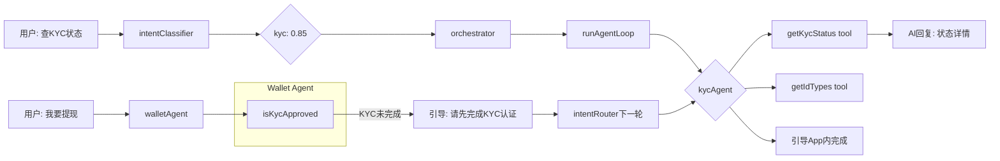

# KYC Agent — Spec-Code SDD

> **难度**: ⭐⭐⭐ (中等)  
> **前置依赖**: LuckyDraw/Flash Agent 完成后进行  
> **预计新增代码**: ~400-500 行  
> **预计修改文件**: 5 个

---

## 一、现状分析

### 已就绪的基础设施

| 项目 | 状态 | 说明 |
|------|------|------|
| KycModule | ✅ 已导入 | [`ai-customer.module.ts:9`](/apps/api/src/client/ai-customer/ai-customer.module.ts:9) |
| KycService | ✅ 完整实现 | [`kyc.service.ts`](/apps/api/src/client/kyc/kyc.service.ts) 474 行，6 个 public 方法 |
| Wallet Agent 含 KYC 查询 | ✅ 已有 | [`wallet-tools.ts`](/apps/api/src/client/ai-customer/graph/tools/wallet-tools.ts) 含 `isKycApproved` 工具 |
| Wallet prompt KYC 规则 | ✅ 已有 | [`wallet-prompt.ts:131`](/apps/api/src/client/ai-customer/graph/agents/prompts/wallet-prompt.ts:131) 限制只能查询 KYC 状态 |

### 问题

1. **KYC 完全不在 AGENT_MAP 中** → intent 分类永远不会产生 'kyc' label
2. **无 kyc-tools.ts** → 无 'kyc' tag 的工具
3. **无 kyc intent examples** → 虽然 wallet 示例含 KYC 查询，但独立 KYC 域无种子
4. **Wallet Agent 已含 isKycApproved** → 功能重叠需处理

### 关键设计决策: KYC 独立 Agent 还是保留在 Wallet 中？

**结论: 独立 KYC Agent + Wallet 保留简单查询**

| 维度 | 保留在 Wallet | 独立 Agent |
|------|--------------|-----------|
| KYC 流程复杂度 | ❌ wallet prompt 已 155 行，再加 KYC 过于臃肿 | ✅ 独立管理 KYC 流程 |
| isKycApproved 查询 | ✅ 提现前快速查状态很自然 | ⚠️ 提现场景需要跨 Agent |
| 用户意图区分 | ❌ "查 KYC 状态" vs "提现" 意图不同，分类更精准 | ✅ 'kyc' label vs 'wallet' label 可区分 |
| 文件上传限制 | ❌ LLM 无法处理文件 | ❌ LLM 也无法处理文件，只能引导 |
| 模块职责 | ❌ Wallet 专注金融操作 | ✅ KYC 专注身份验证 |

**最终方案**:
- Wallet Agent 保留 `isKycApproved` 工具（快速布尔值查询，提现前置检查）
- 新增独立 KYC Agent，提供详细 KYC 状态查询 + 引导用户完成 KYC 流程
- DEPENDENCY_MAP: `wallet → kyc`（提现前需要 KYC，如果未认证引导用户去 KYC Agent）

---

## 二、架构设计

### 2.1 KYC 流程分析

KYC 完整流程:
```
用户 → 创建Session → OCR身份证/护照 → 提交KYC → 等待审核 → 审核通过/拒绝
```

LLM 能力边界:
- ✅ 查询 KYC 状态（已认证/未认证/审核中/被拒绝）
- ✅ 查询支持的证件类型（ID Types）
- ✅ 引导用户完成资料准备
- ❌ 文件上传/OCR扫描（需 App 端完成）
- ❌ 提交 KYC（需用户到 App 操作）

**KYC Agent 定位**: 信息查询 + 流程引导，非操作执行

### 2.2 数据流



### 2.3 Agent 参数

| 参数 | 值 |
|------|-----|
| label | `'kycAgent'` |
| tag | `'kyc'` |
| type | `'agent'` |
| flowContext | `false`（KYC 为查询+引导，无多步操作） |

---

## 三、新增文件

### 3.1 `kyc-tools.ts` — 工具定义

**位置**: `/apps/api/src/client/ai-customer/graph/tools/kyc-tools.ts`

**模式**: 纯函数工厂，与 [`product-tools.ts`](/apps/api/src/client/ai-customer/graph/tools/product-tools.ts) 一致。

```typescript
export const createKycTools = (
  kycService: KycService,
): TaggedTool[] => [
  tool(getKycStatus, ...),    // 查询KYC认证状态详情
  tool(getIdTypes, ...),      // 查询支持的证件类型
]
```

#### 工具列表

| 工具名 | 对应 Service 方法 | 参数 | 返回 | 读写 |
|--------|-------------------|------|------|------|
| `getKycStatus` | `KycService.getMyKyc()` | `userId` | KYC 状态详情（含 status, idType, rejectReason 等） | R |
| `getIdTypes` | `KycService.getIdTypes()` | 无 | 支持的证件类型列表（Passport, Driver License, National ID 等） | R |

**不包含的工具**（LLM 无法处理文件操作）:
| Service 方法 | 不包含原因 |
|-------------|-----------|
| `createSession()` | 需在 App 端通过文件上传流程触发 |
| `ocrIdCard()` | 需上传图片文件，LLM 无法处理 |
| `scanIdCard()` | 同上 |
| `submitKyc()` | 需通过 App 提交，含文件上传 |
| `uploadKycDocument()` | 同上 |
| `validateImageSize()` | 内部工具，无需暴露 |

**所有工具打 tag**: `['kyc']`

#### toLLM 格式参考

KycService.getMyKyc() 返回结构参考 [`kyc.response.dto.ts`](/apps/api/src/client/kyc/dto/kyc.response.dto.ts):
```typescript
class KycResponseDto {
  status: KycStatus; // 'pending' | 'approved' | 'rejected' | 'not_submitted'
  idType?: string;
  idNumber?: string;
  rejectReason?: string;
  submittedAt?: Date;
  approvedAt?: Date;
}
```

工具返回需通过 `toLLM()` 转化为可读文本。

### 3.2 `kyc-prompt.ts` — Prompt 配置

**位置**: `/apps/api/src/client/ai-customer/graph/agents/prompts/kyc-prompt.ts`

**模式**: 与 [`product-prompt.ts`](/apps/api/src/client/ai-customer/graph/agents/prompts/product-prompt.ts) 一致，5-section 模板。

```typescript
export const kycPromptConfig: Omit<AgentPromptConfig, 'userId'> = {
  role: 'You are the KYC identity verification assistant...',
  domainName: 'kyc',
  flowContext: false,
  workflow: `Step 1: Understand what the user needs
- Check KYC status → getKycStatus
- Check supported ID types → getIdTypes
- Guide user through KYC process → provide step-by-step instructions

Step 2: Pick the right tool...

Step 3: Call the tool...

Step 4: Present the result...

Step 5: If more info needed, continue conversation...`,
  availableTools: `1. **getKycStatus** - Check KYC verification status and details
2. **getIdTypes** - List supported ID types for verification`,
  domainRules: `## KYC Status Guide:
- **not_submitted**: User hasn't started KYC → Guide them to complete in App
- **pending**: Under review → Tell user to wait
- **approved**: Verified → No action needed
- **rejected**: Failed → Explain reason and guide resubmission

## IMPORTANT:
- You can ONLY query KYC status and guide users
- Do NOT ask users to upload files in chat
- For document upload, guide users to: Profile > KYC Verification`,
  scopeRestriction: {
    domain: 'KYC / identity verification',
    handles: [
      'KYC status',
      'identity verification',
      'ID types',
      'verification process',
    ],
    outside: ['wallet', 'orders', 'coupons', 'products', 'lucky-draw'],
  },
  hardRules: [
    '- Never ask users to send ID photos in chat',
    '- For KYC submission, always redirect to Profile > KYC Verification in the App',
    '- If KYC is rejected, explain the rejectReason if available',
  ],
  examples: `User: "Is my KYC approved?"
→ Call getKycStatus(userId="[userId]")
→ Present the ACTUAL status

User: "What IDs can I use for verification?"
→ Call getIdTypes()
→ Present the list of accepted ID types`,
  displayFormat: `- KYC Status: "Your verification is [status]"
- If rejected: "Reason: [rejectReason]. Please resubmit in Profile > KYC"
- ID Types: "Accepted documents: [list]"
- Guide text should be clear and step-by-step`,
};
```

### 3.3 `kyc-agent.node.ts` — Agent 节点

**位置**: `/apps/api/src/client/ai-customer/graph/nodes/kyc-agent.node.ts`

**模式**: 与 [`order-agent.node.ts`](/apps/api/src/client/ai-customer/graph/nodes/order-agent.node.ts) 一致。简单 Agent，无需 flow tools。

### 3.4 `intent-examples/kyc.ts` — KYC Intent Examples

**位置**: `/apps/api/src/client/ai-customer/graph/agents/prompts/intent-examples/kyc.ts`

```typescript
export const kycExamples: string[] = [
  'Is my KYC approved?',
  'Check my identity verification status',
  'What documents do I need for KYC?',
  'My KYC was rejected, why?',
  'How to complete KYC verification?',
  'What ID types are accepted?',
];
```

---

## 四、修改文件

### 4.1 `intent-examples/index.ts`

```diff
  import { luckyDrawExamples } from './lucky-draw';
+ import { kycExamples } from './kyc';
  import { ragExamples } from './rag';

  export const INTENT_EXAMPLE_GROUPS: IntentExampleGroup[] = [
    // ... existing entries ...
+   { name: 'kyc', examples: kycExamples, requiredTags: ['kyc'] },
    { name: 'rag', examples: ragExamples, requiredTags: ['rag'] },
  ];
```

### 4.2 `orchestrator.config.ts`

```diff
+ import { kycPromptConfig } from '@api/.../prompts/kyc-prompt';

  export const AGENT_MAP: Record<string, AgentEntry> = {
    // ... existing entries ...
+   kyc: {
+     label: 'kycAgent',
+     tag: 'kyc',
+     promptConfig: kycPromptConfig,
+     type: 'agent',
+   },
  };

  export const DEPENDENCY_MAP: Record<string, string[]> = {
    product: ['coupon', 'wallet'],
    order: ['coupon', 'wallet'],
    coupon: ['product'],
+   wallet: ['kyc'],  // 提现前需要 KYC
  };
```

### 4.3 `ai-customer.module.ts`

```diff
- const EXPECTED_AGENT_TAGS = ['order', 'wallet', 'coupon', 'flow', 'user', 'product', 'lucky-draw'];
+ const EXPECTED_AGENT_TAGS = ['order', 'wallet', 'coupon', 'flow', 'user', 'product', 'lucky-draw', 'kyc'];

  constructor(
    private readonly toolRegistry: ToolRegistryService,
    private readonly treasureService: TreasureService,
    private readonly categoryService: CategoryService,
    private readonly luckyDrawService: LuckyDrawService,
    private readonly flashSaleService: ClientFlashSaleService,
+   private readonly kycService: KycService,
  ) {}

  onApplicationBootstrap() {
    // ... existing registrations ...

+   // 注册 KYC 工具
+   this.toolRegistry.registerMany(
+     createKycTools(this.kycService),
+   );
+   this.logger.log('✅ KYC tools registered');
  }
```

### 4.4 `wallet-prompt.ts` — 微调

Wallet Agent 的 `scopeRestriction.outside` 加上 `'kyc'`:
```diff
  outside: ['coupons', 'orders', 'products', 'lucky-draw'],
+ // KYC status queries: wallet handles isKycApproved
+ // Detailed KYC info goes to kycAgent
```

同时 wallet prompt 的 `hardRules` 更新:
```diff
  hardRules: [
    '- You can ONLY **query** KYC status — do NOT ask users to submit KYC documents',
    '- If KYC is not completed, tell the user: "Please complete KYC verification in your profile first"',
+   '- For detailed KYC info or resubmission, tell user: "Please ask KYC assistant for details"',
  ],
```

---

## 五、无需修改的文件

| 文件 | 理由 |
|------|------|
| [`orchestrator.node.ts`](/apps/api/src/client/ai-customer/graph/nodes/orchestrator.node.ts) | 标准 Agent pipeline 自动处理 'kyc' type:agent |
| [`customer.graph.ts`](/apps/api/src/client/ai-customer/graph/customer.graph.ts) | 不新增 graph node |
| [`wallet-tools.ts`](/apps/api/src/client/ai-customer/graph/tools/wallet-tools.ts) | `isKycApproved` 保留，不变 |
| [`intent-classifier.ts`](/apps/api/src/client/ai-customer/graph/utils/intent-classifier.ts) | Dynamic Intent-Tool Alignment 自动识别 |

---

## 六、测试验收标准

### AC-01: 查询 KYC 状态
- 输入: "Is my KYC approved?"
- 预期: 调用 `getKycStatus`，返回当前状态

### AC-02: 查询支持证件类型
- 输入: "What IDs can I use for KYC?"
- 预期: 调用 `getIdTypes`，返回列表

### AC-03: 引导完成 KYC
- 输入: "How to complete KYC?"
- 预期: Agent 给出逐步指引（在 App 中操作）

### AC-04: 被拒引导
- 输入: "My KYC was rejected"
- 预期: 查询状态后，显示拒绝原因并引导重新提交

### AC-05: Intent 分类验证
- 输入: "Check my KYC status"
- 预期: intentClassifier 返回 `['kyc']`

### AC-06: 跨域协同
- 输入: "I want to withdraw but my KYC is not done"
- 预期: walletAgent 检测到 KYC 未完成 → intentRouter 下一轮 → kycAgent 引导

### AC-07: Wallet KYC 查询保留
- 输入: "What's my balance and KYC status?"
- 预期: orchestrator 先执行 walletAgent（含 isKycApproved），不触发 kycAgent

---

## 七、文件变更清单

| 文件 | 操作 | 估计行数 |
|------|------|---------|
| `apps/api/src/client/ai-customer/graph/tools/kyc-tools.ts` | 新增 | ~120-160 行 |
| `apps/api/src/client/ai-customer/graph/agents/prompts/kyc-prompt.ts` | 新增 | ~100-130 行 |
| `apps/api/src/client/ai-customer/graph/nodes/kyc-agent.node.ts` | 新增 | ~50-70 行 |
| `apps/api/src/client/ai-customer/graph/agents/prompts/intent-examples/kyc.ts` | 新增 | ~15 行 |
| `apps/api/src/client/ai-customer/graph/agents/prompts/intent-examples/index.ts` | 修改 | ~3 行 |
| `apps/api/src/client/ai-customer/graph/config/orchestrator.config.ts` | 修改 | ~15 行 |
| `apps/api/src/client/ai-customer/ai-customer.module.ts` | 修改 | ~10 行 |
| `apps/api/src/client/ai-customer/graph/agents/prompts/wallet-prompt.ts` | 修改 | ~3 行 |
