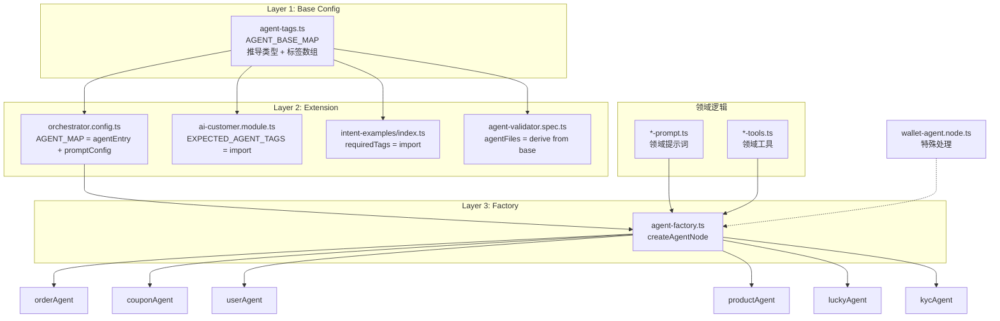

# Agent 配置重构方案 — Base Config + Extension + Factory

See original: [`plans/agent-config-refactor-plan.md`](plans/agent-config-refactor-plan.md)

## 1. 现状分析

### 当前架构痛点

```
手动配置散布在 6 个文件，新增 Agent 需改 6 处：
                   
ai-customer.module.ts ─── EXPECTED_AGENT_TAGS = ['order','wallet',...]  ← 手写
orchestrator.config.ts ─── AGENT_MAP = { order:{...}, wallet:{...}, ...}  ← 手写
intent-examples/index.ts ── requiredTags: ['order'], ['wallet'], ...      ← 手写
agent-validator.spec.ts ─── agentFiles: [{tag:'wallet'}, ...]             ← 手写
*-tools.ts ──────────────── tag: ['wallet']                               ← 手写（可接受）
*-agent.node.ts ─────────── 80 行模板代码 × 7 个 Agent                    ← 重复
```

### 易用性（Usability）评估

| 维度 | 评分 | 说明 |
|------|------|------|
| 新增 Agent 难度 | ❌ | 要知道 6 个文件在哪、改什么 |
| 删除 Agent 难度 | ❌ | 容易漏删某处配置 |
| 认知负担 | ❌ | 没有"在哪里看所有 Agent"的单一入口 |
| 新人上手 | ❌ | 需要通读 6 个文件才能理解架构 |

### 通用性（Generality）评估

| 维度 | 评分 | 说明 |
|------|------|------|
| 标准 Agent 模板 | ✅ | 5-section 模板统一 |
| 特殊 Agent 支持 | ✅ | wallet 可加 flowTools 等特殊逻辑 |
| 无 Agent 路由 | ✅ | general/rag 用 type:'direct' 绕过 |
| 工具复用 | ⚠️ | flow-tools 双 tag 机制灵活但隐式 |

### 维护性（Maintainability）评估

| 维度 | 评分 | 说明 |
|------|------|------|
| 类型安全 | ❌ | tag 是 string，改错不报编译错 |
| 单一数据源 | ❌ | 6 处重复，不一致风险高 |
| 可测试性 | ⚠️ | 测试需 mock 6 处配置 |
| 可发现性 | ❌ | 没有直观的 Agent 清单 |

---

## 2. 目标架构

### 核心设计原则

1. **Single Source of Truth**: Agent tag + label + type 只定义一次
2. **Type Safety**: TypeScript `as const` + `satisfies` 推导类型，改编译错
3. **Auto-derivation**: EXPECTED_AGENT_TAGS、requiredTags、validator 自动推导
4. **Factory Pattern**: 标准 Agent Node 用工厂创建，消除 80 行模板重复
5. **Extension over Mutation**: Base 定义元数据，Extension 加 promptConfig
6. **Graceful Specialization**: Wallet 等特殊 Agent 不强制使用工厂

### 新架构分层

```
┌────────────────────────────────────────────────────────┐
│  Layer 1: Base Config (agent-tags.ts)                  │
│  ┌──────────────────────────────────────────────────┐  │
│  │  AGENT_BASE_MAP = {                              │  │
│  │    'order':       { label:'orderAgent',  type:'agent' },  │
│  │    'wallet':      { label:'walletAgent', type:'agent' },  │
│  │    'coupon':      { label:'couponAgent', type:'agent' },  │
│  │    'user':        { label:'userAgent',   type:'agent' },  │
│  │    'product':     { label:'productAgent',type:'agent' },  │
│  │    'lucky-draw':  { label:'luckyAgent',  type:'agent' },  │
│  │    'kyc':         { label:'kycAgent',    type:'agent' },  │
│  │    'flow':        { label:'flowTools',   type:'tool-only' },  │
│  │    'general':     { label:'generalChat', type:'direct' },  │
│  │    'rag':         { label:'ragNode',     type:'direct' },  │
│  │  } as const satisfies AgentBaseEntry                    │
│  └──────────────────────────────────────────────────┘  │
│  自动推导:                                              │
│    AgentTag — 'order'|'wallet'|...                      │
│    AGENT_TAGS — 只含 type='agent' 的标签数组              │
│    ALL_AGENT_TAGS — 所有标签                              │
│    INTENT_TAG_MAP — 自动生成 requiredTags 映射            │
└────────────────────────┬───────────────────────────────┘
                         │ import
         ┌───────────────┼───────────────────┐
         ▼               ▼                   ▼
┌────────────────┐ ┌────────────┐ ┌──────────────────┐
│ Layer 2:       │ │ Layer 2:   │ │ Layer 2: Module  │
│ orchestrator   │ │ intent-    │ │ ai-customer      │
│ .config.ts     │ │ examples/  │ │ .module.ts       │
│ (Extension)    │ │ index.ts   │ │                  │
│                │ │ (Derive)   │ │ EXPECTED_        │
│ AGENT_MAP =    │ │            │ │ AGENT_TAGS =     │
│ buildAgentMap  │ │ required-  │ │ AGENT_TAGS       │
│ (base + merge  │ │ Tags from  │ │ (自动推导)       │
│  promptConfig) │ │ AGENT_BASE │ │                  │
│                │ │ 自动推导   │ │ onApplication-   │
│                │ │            │ │ Bootstrap 保持   │
│                │ │            │ │ registerMany()   │
└────────────────┘ └────────────┘ └──────────────────┘
                         │
                         ▼
                ┌──────────────────┐
                │ Layer 3: Factory │
                │ createAgentNode()│
                │                  │
                │ import from      │
                │ agent-result.ts, │
                │ agent-runner.ts, │
                │ prompt-builder.ts│
                └──────────────────┘
```

---

## 3. 详细设计

### 3.1 Layer 1: agent-tags.ts（新建）

```typescript
export interface AgentBaseEntry {
  label: string;
  type: 'agent' | 'tool-only' | 'direct';
}

export const AGENT_BASE_MAP = {
  order:       { label: 'orderAgent',   type: 'agent' },
  wallet:      { label: 'walletAgent',  type: 'agent' },
  coupon:      { label: 'couponAgent',  type: 'agent' },
  user:        { label: 'userAgent',    type: 'agent' },
  product:     { label: 'productAgent', type: 'agent' },
  'lucky-draw':{ label: 'luckyAgent',   type: 'agent' },
  kyc:         { label: 'kycAgent',     type: 'agent' },
  flow:        { label: 'flowTools',    type: 'tool-only' },
  general:     { label: 'generalChat',  type: 'direct' },
  rag:         { label: 'ragNode',      type: 'direct' },
} as const satisfies Record<string, AgentBaseEntry>;

export type AgentTag = keyof typeof AGENT_BASE_MAP;
export const ALL_AGENT_TAGS = Object.keys(AGENT_BASE_MAP) as AgentTag[];
export const AGENT_TAGS_FOR_TOOLS = ALL_AGENT_TAGS.filter(
  (t) => AGENT_BASE_MAP[t].type !== 'direct',
);
export const AGENT_TAGS_FOR_INTENT = ALL_AGENT_TAGS.filter(
  (t) => AGENT_BASE_MAP[t].type === 'agent',
);
export const INTENT_REQUIRED_TAGS: Record<string, string[]> = {
  ...Object.fromEntries(AGENT_TAGS_FOR_INTENT.map((t) => [t, [t]])),
  rag: ['rag'],
  general: [],
};
```

### 3.2 Layer 2: 导入 Base 的 3 个修改

- **orchestrator.config.ts**: 用 `agentEntry()` helper 构建 AGENT_MAP
- **ai-customer.module.ts**: `EXPECTED_AGENT_TAGS = AGENT_TAGS_FOR_TOOLS`
- **intent-examples/index.ts**: `requiredTags` 从 `INTENT_REQUIRED_TAGS` 取

### 3.3 Layer 3: createAgentNode() 工厂（新建）

工厂函数替代 6 个标准 Agent 的 80 行模板，wallet 保留特殊处理。

---

## 4. 实施步骤

| 步骤 | 内容 | 风险 |
|------|------|------|
| 1 | 创建 agent-tags.ts | 无 |
| 2 | 修改 orchestrator.config.ts → 用 agentEntry() | 需确保 AGENT_MAP 结构不变 |
| 3 | 修改 ai-customer.module.ts → import 代替手写 | 无 |
| 4 | 修改 intent-examples/index.ts → import 代替手写 | 无 |
| 5 | 修改 agent-validator.spec.ts | 注意 lucky-draw 文件名特判 |
| 6 | 创建 agent-factory.ts | 核心改动，需确保与现有 node 行为一致 |
| 7 | 修改 customer.graph.ts | 替换 6 个标准 Agent node 为工厂调用 |
| 8 | 删除 6 个标准 Agent node 文件 | 确认无其他引用 |
| 9 | tsc --noEmit 验证 | 编译通过 |
| 10 | 更新测试 | agent-validator.spec 需匹配新路径 |

---

## 5. 新增 Agent 流程对比

### Before（6 处修改）
1. EXPECTED_AGENT_TAGS 加 tag         ← 字符串重复
2. AGENT_MAP 加 key                     ← 字符串重复
3. intent-examples 加 requiredTags      ← 字符串重复
4. agent-validator.spec 加 agentFile    ← 字符串重复
5. 创建 *-tools.ts + *-prompt.ts        ← 领域逻辑
6. 创建 *-agent.node.ts + 注册工具     ← 80 行模板

### After（3 处修改）
1. agent-tags.ts 加 1 行                ← 唯一配置点
2. 创建 *-tools.ts + *-prompt.ts        ← 领域逻辑
3. ai-customer.module.ts 注册工具       ← 必要步骤
   + orchestrator.config.ts 加 1 行     ← 关联 promptConfig

---

## 6. 三轴评分对比

| 维度 | Before | After | 提升 |
|------|--------|-------|------|
| 易用性 | 6 处配置，新人难找 | 1 处 base + 3 处领域 | 🟢 |
| 通用性 | 每个 Agent 手写 node | Factory 覆盖 90% 场景 | 🟢 |
| 维护性 | 6 处 string 同步 | TypeScript 编译保证 | 🟢 |
| 类型安全 | string 裸奔 | as const 推导 | 🟢 |
| 灵活性 | 改哪都行 | wallet 保留特殊化 | 🟢 |

---

## 7. 架构图


