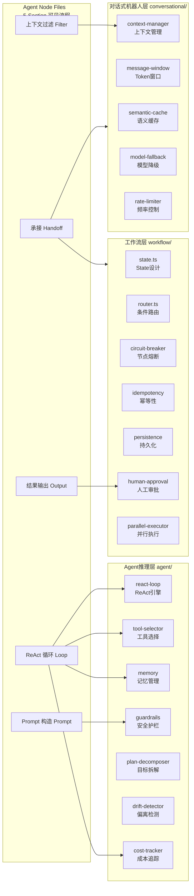
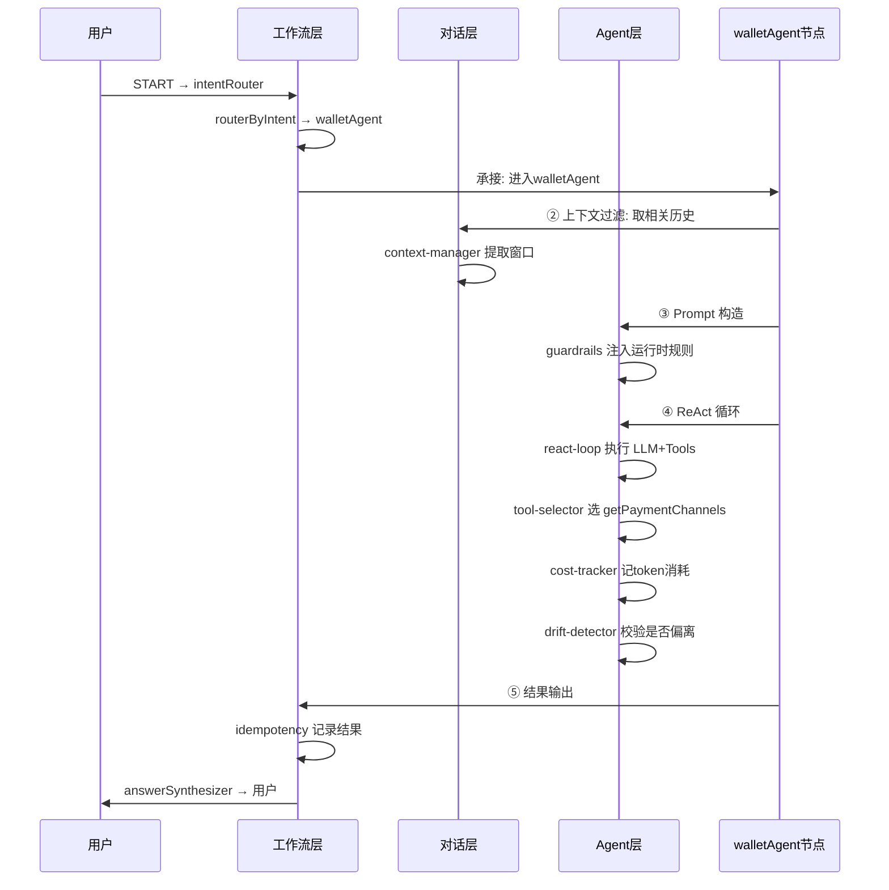

# AI Agent 代码重构计划（v3 — 三层架构 + 面试概念驱动）

> 以 48 项 AI 系统挑战（对话式机器人 / 工作流型智能体 / 通用型 Agent）为架构依据，
> 以面试问答（interview-ai-agent-order-system.md）为代码结构风格，
> 重构 Agent 代码。

---

## 一、覆盖度分析 — 48 项挑战 vs 当前代码

### 对话式机器人（13 项）— 当前覆盖 ~30%

| # | 难点 | 当前代码 | 状态 | Phase 2 方案 |
|---|------|---------|------|-------------|
| 01 | 多轮上下文丢失 | `filter-messages.ts` + `prompt-builder.ts` flowContext | ⚡部分 | `conversational/context-manager.ts` |
| 02 | 流式输出卡顿 | 未实现 | ❌ | 前端/Flutter 层 |
| 03 | Token 成本/首字延迟 | `constants.ts` `MAX_CONTEXT_MESSAGES=20` | ⚡部分 | `conversational/message-window.ts` 动态窗口 |
| 04 | 指代消解 | `flowContext` + `previousIntent` | ⚡部分 | `conversational/context-manager.ts` 增强 |
| 05 | 流式 Markdown 闪烁 | 未实现 | ❌ | 前端层 |
| 06 | 历史消息过多卡顿 | 未实现 | ❌ | 前端层 |
| 07 | 用户中途停止生成 | 未实现 | ❌ | 前端层 |
| 08 | 连续快速发请求竞态 | 未实现 | ❌ | `conversational/rate-limiter.ts` |
| 09 | 流式中途断线重连 | 未实现 | ❌ | 前端层 |
| 10 | 幻觉问题 | `domainRules` + `hardRules` + `toLLM` | ⚡部分 | `agent/guardrails.ts` 运行时校验 |
| 11 | 重复问题反复消耗Token | 未实现 | ❌ | `conversational/semantic-cache.ts` |
| 12 | 多模型切换降级 | `llm-factory.ts` 存在但无自动降级 | ⚡部分 | `conversational/model-fallback.ts` |
| 13 | 打字机效果与流式平滑 | 未实现 | ❌ | 前端层 |

### 工作流型智能体（16 项）— 当前覆盖 ~50%

| # | 难点 | 当前代码 | 状态 | Phase 2 方案 |
|---|------|---------|------|-------------|
| 01 | 节点间状态传递与State设计 | `state.ts` + `customer.graph.ts` | ✅良好 | `workflow/state.ts` 归位 |
| 02 | 条件分支与动态路由 | `intentRouter` + `routerByIntent` + `agentDoneRouter` + `supervisorRouter` | ✅良好 | `workflow/router.ts` 归位 |
| 03 | 循环节点与终止条件 | `agent-runner.ts` `MAX_ITERATIONS=3` | ✅良好 | `agent/react-loop.ts` 归位 |
| 04 | 并行节点与结果合并 | 未实现（串行） | ❌ | `workflow/parallel-executor.ts` |
| 05 | 单节点失败拖垮整条流程 | `answerSynthesizer` 兜底 + agent try-catch | ⚡部分 | `workflow/circuit-breaker.ts` |
| 06 | 工具/API调用不稳定 | Tool try-catch 返回错误字符串 | ✅良好 | `workflow/retry-with-backoff.ts` 增强 |
| 07 | 幂等性——重试不重复执行 | 未实现 | ❌ | `workflow/idempotency.ts` |
| 08 | 长流程持久化/可中断恢复 | `MemorySaver` 基础版 | ⚡部分 | `workflow/persistence.ts` |
| 09 | 结构化输出给下游节点 | `AgentNodeOutput` | ✅良好 | 不变 |
| 10 | 工具选择与参数生成错误 | LLM 自主选择 + Zod 校验 | ⚡部分 | `agent/tool-selector.ts` 智能排序 |
| 11 | 关键节点人工审批确认 | wallet OTP + user address 两阶段确认 | ⚡部分 | `workflow/human-approval.ts` 抽象 |
| 12 | 流程执行过程实时可视化 | 未实现 | ❌ | 前端/监控层 |
| 13 | 中间步骤结果展示+日志 | `agentSteps` + `debug` 模式 | ⚡部分 | `agent/cost-tracker.ts` 增强 |
| 14 | 可视化流程编排器 | 未实现 | ❌ | 非核心 |
| 15 | 多步骤延迟累积 | 未实现 | ❌ | `workflow/latency-monitor.ts` |
| 16 | 多次模型调用成本叠加 | 未实现 | ❌ | `agent/cost-tracker.ts` |

### 通用型Agent（19 项）— 当前覆盖 ~35%

| # | 难点 | 当前代码 | 状态 | Phase 2 方案 |
|---|------|---------|------|-------------|
| 01 | 复杂目标自主拆解 | 未实现（单意图模式） | ❌ | `agent/plan-decomposer.ts` |
| 02 | 规划动态调整/重规划 | 未实现 | ❌ | `agent/replanner.ts` |
| 03 | ReAct推理-行动循环稳定性 | 手动 while 循环 | ✅良好 | `agent/react-loop.ts` 归位 |
| 04 | 死循环/原地打转 | `MAX_ITERATIONS=3` + 无 tool_call break | ✅良好 | 不变 |
| 05 | 失控的资源消耗 | 未监控 | ❌ | `agent/cost-tracker.ts` |
| 06 | 目标偏离/任务漂移 | 仅 `scopeRestriction` | ❌ | `agent/drift-detector.ts` |
| 07 | 危险动作的护栏 | `hardRules` + `scopeRestriction` | ⚡部分 | `agent/guardrails.ts` 运行时拦截 |
| 08 | 短期工作记忆管理 | `currentMessages` 在 `runAgentLoop` | ⚡部分 | `agent/memory.ts` 工作记忆 |
| 09 | 长期记忆存取 | 未实现 | ❌ | `agent/memory.ts` 长期记忆 |
| 10 | 记忆的取舍与遗忘 | 未实现 | ❌ | `agent/memory.ts` 遗忘策略 |
| 11 | 大量工具中自主选择 | `TaggedTool` + `getToolsByTag` | ⚡部分 | `agent/tool-selector.ts` 智能排序 |
| 12 | 工具调用结果理解与纠错 | `toLLM()` + `FieldMeta` + `domainRules` | ✅良好 | 不变 |
| 13 | 多智能体角色分工与编排 | Agent 分离但无协调（supervisor disabled） | ⚡部分 | `agent/multi-agent-coordinator.ts` |
| 14 | 智能体间通信与冲突 | 未实现 | ❌ | 后续 |
| 15 | 多智能体协作成本与收敛 | 未实现 | ❌ | 后续 |
| 16 | 结果质量不稳定/不可复现 | 未实现 | ❌ | `agent/quality-checker.ts` |
| 17 | 执行过程可观测可干预 | `debug` 模式 + `agentSteps` | ⚡部分 | `agent/observability.ts` |
| 18 | Agent思考过程实时展示 | 未实现 | ❌ | 前端层 |
| 19 | 长任务进度感知与随时干预 | 未实现 | ❌ | 前端层 |

---

## 二、核心架构 — 三层分离

三种挑战代表三个**独立变化方向**的架构层：



### 核心原则

1. **Agent 节点文件保持「5-section 可见流程」**（承接→过滤→Prompt→ReAct→输出）
2. **每个 section 调用对应层的共享模块**，不手写重复逻辑
3. **三个层独立演进**，改缓存不影响路由，改护栏不影响 State
4. **模块可增量添加**——今天加缓存，明天加熔断

---

## 三、Phase 1 — 基础设施清理与代码抽取

### Step 1: 创建 `agent-result.ts` — 统一错误/成功结果构建

```typescript
// graph/agents/agent-result.ts
// 面试对应: Q7 "两层防御 — Agent 层兜底"
import { AgentNodeOutput } from '@api/client/ai-customer/graph/types/agent-types';
import { AgentLoopResult } from './agent-runner';
import { BaseMessage } from '@langchain/core/messages';

export function buildErrorResult(
  agentName: string,
  messages: BaseMessage[],
): AgentNodeOutput {
  return {
    taskResults: { [agentName]: ERROR_MESSAGES[agentName] ?? ERROR_MESSAGES.default },
    messages,
    agentSteps: [],
  };
}

export function buildSuccessResult(
  agentName: string,
  result: AgentLoopResult,
  extra?: {
    flowData?: Record<string, any>;
    flowType?: string;
    flowStatus?: string;
    debugSteps?: any[];
  },
): AgentNodeOutput {
  return {
    taskResults: { [agentName]: result.content },
    messages: result.currentMessages.slice(1),
    agentSteps: extra?.debugSteps ?? result.agentSteps,
    ...(extra?.flowData && Object.keys(extra.flowData).length > 0 ? { flowData: extra.flowData } : {}),
    ...(extra?.flowType ? { flowType: extra.flowType } : {}),
    ...(extra?.flowStatus ? { flowStatus: extra.flowStatus } : {}),
  } satisfies AgentNodeOutput;
}

const ERROR_MESSAGES: Record<string, string> = {
  couponAgent: 'Sorry, I encountered an issue processing your coupon request. Please try again later.',
  walletAgent: 'Sorry, I encountered an issue processing your wallet request. Please try again later.',
  userAgent: 'Sorry, I encountered an issue processing your request. Please try again later.',
  orderAgent: 'Sorry, I encountered an issue processing your order request. Please try again later.',
  default: 'Sorry, an error occurred. Please try again later.',
};
```

**变更**: 新增 `graph/agents/agent-result.ts`

### Step 2: 修复 Bug — intentRouter 移除 `taskResults: {}`

从 `intent-router.node.ts:330` 移除 `taskResults: {},`
让 `answerSynthesizer` 成为 taskResults 清空的唯一管理者。

### Step 3: 修复 Bug — 移除 routeCache 死代码

1. 从 `state.ts` 移除 `routeCache` Annotation
2. 从 `intent-router.node.ts:327` 移除 `routeCache: finalIntent`
3. 从 `routerByIntent` 移除 `|| state.routeCache` fallback
4. 清理 `customer.graph.ts` 中 Phase 2 的过时注释

### Step 4: 抽取 Prompt 配置 — 4 个独立文件

```typescript
// graph/agents/prompts/coupon-prompt.ts
// 面试对应: Q6 "数据转换层" + Q7 "规则#7"
import { AgentPromptConfig } from '../prompt-builder';

export const couponPromptConfig: Omit<AgentPromptConfig, 'userId' | 'flowType' | 'flowStatus'> = {
  role: 'You are the coupon inquiry assistant for JoyMini platform. Respond in English.',
  domainName: 'coupon',
  flowContext: true,
  workflow: `Step 1: Understand what the user needs...`,
  domainRules: `## Coupon Data Fields...`,
  examples: `User: "Show me my coupons" → ...`,
  displayFormat: `- Show: coupon name, discount value...`,
  scopeRestriction: { domain: 'coupon', handles: [...], outside: [...] },
  hardRules: [...],
};
```

同理创建 `wallet-prompt.ts`、`user-prompt.ts`、`order-prompt.ts`。

### Step 5: 重写 4 个 Agent 文件 — 5-section 面试概念驱动

每个文件的结构：

```typescript
// ============================================================
// coupon-agent.node.ts — 优惠券 Agent
// ============================================================
// 面试题对应: interview-ai-agent-order-system.md Q3/Q4/Q5/Q6/Q7
//
// 代码结构 = 面试答案结构:
//   ① 承接 (Handoff)     → 从 StateGraph 接收 state
//   ② 上下文过滤 (Filter)  → 提取本 Agent 相关对话
//   ③ Prompt 构造 (Prompt) → 10-section system prompt
//   ④ ReAct 循环 (Loop)   → LLM 思考→工具→结果 最多3轮
//   ⑤ 结果输出 (Output)   → 成功/失败 → AgentNodeOutput
// ============================================================

import { AgentState } from '@api/client/ai-customer/graph/state';
import { createLLM, LlmProviderConfig } from '@api/client/ai-customer/graph/llm-factory';
import { Logger } from '@nestjs/common';
import { ToolRegistryService } from '@api/client/ai-customer/graph/tools/tool-registry.service';
import { AgentNodeOutput } from '@api/client/ai-customer/graph/types/agent-types';
import { filterAgentMessages } from '@api/client/ai-customer/graph/utils/filter-messages';
import { MAX_CONTEXT_MESSAGES } from '@api/client/ai-customer/graph/constants';
import { buildAgentPrompt } from '@api/client/ai-customer/graph/agents/prompt-builder';
import { runAgentLoop } from '@api/client/ai-customer/graph/agents/agent-runner';
import { buildErrorResult, buildSuccessResult } from '@api/client/ai-customer/graph/agents/agent-result';
import { couponPromptConfig } from '@api/client/ai-customer/graph/agents/prompts/coupon-prompt';

export const couponAgentNode = async (state: typeof AgentState.State) => state;

export const createCouponAgentNode = (llmConfig: LlmProviderConfig, registry: ToolRegistryService) => {
  const logger = new Logger('CouponAgent');
  return async (state: typeof AgentState.State): Promise<AgentNodeOutput> => {
    // ================================================================
    // ① 承接 — Flow Handoff（Q3: 从 StateGraph 接收 state）
    // ================================================================
    const userId = state.userId;
    const tools = registry.getToolsByTag('coupon');
    const llmWithTools = createLLM(llmConfig, { temperature: 0 }).bindTools(tools);

    // ================================================================
    // ② 上下文过滤 — Context Filtering（Q5: 历史窗口）
    // ================================================================
    const filteredMessages = filterAgentMessages(
      state.messages, state.pendingTasks, state.messageTopics, 'couponAgent',
    ).slice(-MAX_CONTEXT_MESSAGES);

    // ================================================================
    // ③ Prompt 构造 — System Prompt（Q6: 数据转换 + Q7: 规则）
    // ================================================================
    const systemPrompt = buildAgentPrompt({ ...couponPromptConfig, userId, flowType: state.flowType, flowStatus: state.flowStatus });
    const initialMessages = [{ role: 'system', content: systemPrompt }, ...filteredMessages];

    // ================================================================
    // ④ ReAct 循环 — LLM + Tools 手动循环（Q5: 手动 while）
    // ================================================================
    const result = await runAgentLoop({ llmWithTools, initialMessages, tools, agentName: 'couponAgent', logger });

    // ================================================================
    // ⑤ 结果输出 — Error Handling + Result Output（Q7: 两层防御）
    // ================================================================
    if (result.error) return buildErrorResult('couponAgent', state.messages);
    return buildSuccessResult('couponAgent', result);
  };
};
```

wallet 特殊处理：flowData + flowTools + debug 模式。

---

## 四、Phase 2 — 三层架构能力补齐

### 目录结构调整

```
graph/
├── customer.graph.ts         ← StateGraph 编排（不变）
├── state.ts                  ← AgentState（精简后）
├── constants.ts              ← 常量
├── llm-factory.ts            ← LLM Provider 工厂（不变）
│
├── conversational/           ← 对话式机器人层（NEW）
│   ├── context-manager.ts    ← 多轮上下文 + 指代消解（难点01/04）
│   ├── message-window.ts     ← 动态 Token 窗口（难点03）
│   ├── semantic-cache.ts     ← 语义缓存（难点11）
│   ├── model-fallback.ts     ← 模型自动降级（难点12）
│   └── rate-limiter.ts       ← 请求频率控制（难点08）
│
├── workflow/                 ← 工作流层（NEW）
│   ├── state.ts              ← State 设计（归位，从 graph/ 移入）
│   ├── router.ts             ← 条件路由 + 循环控制（归位）
│   ├── circuit-breaker.ts    ← 节点熔断降级（难点05）
│   ├── idempotency.ts        ← 请求幂等性（难点07）
│   ├── persistence.ts        ← 长流程持久化（难点08）
│   ├── human-approval.ts     ← 人工审批（难点11，从 agent 抽象）
│   └── parallel-executor.ts  ← 并行执行（难点04）
│
├── agent/                    ← Agent推理层（NEW）
│   ├── react-loop.ts         ← ReAct 循环引擎（归位，从 agents/ 移入）
│   ├── tool-selector.ts      ← 智能工具排序选择（难点11）
│   ├── memory.ts             ← 短期+长期+遗忘（难点08/09/10）
│   ├── guardrails.ts         ← 运行时护栏（难点06/07）
│   ├── plan-decomposer.ts    ← 目标拆解（难点01/02）
│   ├── drift-detector.ts     ← 目标偏离检测（难点06）
│   ├── cost-tracker.ts       ← Token/成本追踪（难点05/16）
│   └── quality-checker.ts    ← 结果质量校验（难点16）
│
├── agents/                   ← 保留（重构后精简）
│   ├── agent-result.ts       ← 统一结果构建（Phase 1）
│   ├── prompt-builder.ts     ← 10-section builder（不变）
│   └── prompts/              ← Prompt 配置文件（Phase 1）
│       ├── coupon-prompt.ts
│       ├── wallet-prompt.ts
│       ├── user-prompt.ts
│       └── order-prompt.ts
│
├── nodes/                    ← Agent 节点（5-section 可见流程）
│   ├── coupon-agent.node.ts
│   ├── wallet-agent.node.ts
│   ├── user-agent.node.ts
│   ├── order-agent.node.ts
│   ├── intent-router.node.ts
│   ├── answer-synthesizer.node.ts
│   ├── supervisor.node.ts
│   ├── general-chat.node.ts
│   └── rag.node.ts
│
├── tools/                    ← 不变（业务工具）
├── types/                    ← 不变（类型定义）
└── utils/                    ← 保留（通用工具函数）
```

### 举例：各层模块如何协同工作

**场景：用户说「取款500，用GCash」**（涉及所有三层）



### 模块优先级

```
Phase 2 可分多次迭代实施，按优先级排序：

P0（立即收益）:
  ├── agent/cost-tracker.ts       — 知道每次对话花了多少钱
  ├── conversational/semantic-cache.ts — 相似问题不再重复调 LLM
  └── workflow/circuit-breaker.ts  — 某个 Agent 故障不影响其他

P1（能力增强）:
  ├── agent/tool-selector.ts      — 工具多了之后的智能选择
  ├── agent/guardrails.ts         — 运行时拦截危险操作
  ├── workflow/idempotency.ts     — 重试不重复执行
  └── conversational/model-fallback.ts — LLM 挂了自动切备用

P2（高级能力）:
  ├── agent/plan-decomposer.ts    — 复杂请求自动拆子任务
  ├── agent/memory.ts             — 长期记忆
  ├── workflow/persistence.ts     — 断点续传
  └── agent/drift-detector.ts     — 运行时意图偏离检测
```

---

## 五、改动汇总

### Phase 1（当前实施）

| 步骤 | 改动 | 文件 | 说明 |
|------|------|------|------|
| 1 | **新增** | `graph/agents/agent-result.ts` | 统一 error/success builder |
| 2 | **修改** | `graph/nodes/intent-router.node.ts` | 移除 `taskResults: {}` |
| 3a | **修改** | `graph/state.ts` | 移除 `routeCache` |
| 3b | **修改** | `graph/nodes/intent-router.node.ts` | 移除 routeCache 写入/读取 |
| 3c | **修改** | `graph/customer.graph.ts` | 清理 Phase 2 过时注释 |
| 4a-d | **新增** | `graph/agents/prompts/*-prompt.ts` | 4 个 prompt 配置 |
| 5 | **重写** | `graph/nodes/coupon-agent.node.ts` | 146→55 行 |
| 6 | **重写** | `graph/nodes/wallet-agent.node.ts` | 200→60 行 |
| 7 | **重写** | `graph/nodes/user-agent.node.ts` | 196→55 行 |
| 8 | **重写** | `graph/nodes/order-agent.node.ts` | 132→50 行 |
| 9 | **更新** | `graph/agents/agent-validator.spec.ts` | import 路径 |

### Phase 2（后续迭代）

| 步骤 | 改动 | 层 | 优先级 |
|------|------|---|--------|
| 10 | 新建 `conversational/` 目录 | 对话式 | P0 |
| 11 | 新建 `workflow/` 目录 | 工作流 | P0 |
| 12 | 新建 `agent/` 目录 | Agent推理 | P0 |
| 13-17 | 各层模块增量添加 | 三 | P0→P2 |

---

## 六、验证清单

1. `yarn workspace @lucky/api tsc --noEmit` — type-check 0 error
2. `yarn workspace @lucky/api test agent-validator` — 55/55 pass
3. `yarn workspace @lucky/api test state` — state tests pass
4. `yarn workspace @lucky/api test prompt-builder` — prompt tests pass
5. 多轮对话测试：查看优惠券 → 取款记录 → 查看订单 → 我的地址
6. taskResults 清空验证：切换话题时 answerSynthesizer 正确清空
