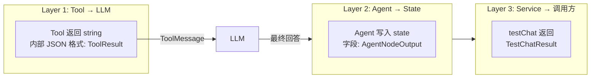

# AI Agent 类型体系规划

## 问题

当前代码中 3 层数据流缺少类型约束，多人协作容易出错：

1. **Tool 返回**：`tool-result.ts` 的 `ToolResult<T>` discriminated union 不严谨，`data` 字段无具体类型
2. **Agent 节点返回**：`wallet-agent.node.ts` 返回 `Partial<State>` 太宽泛，`agentSteps` 用 `string[]`
3. **Service 层**：`ai-customer.service.ts` 的 `testChat` 返回值无类型

## 类型约束全景



## 修改文件清单

| 步骤 | 文件 | 操作 | 说明 |
|------|------|------|------|
| 1 | `tool-result.ts` | **重写** | 修复 discriminated union，`success<T>()`/`failure()` 约束 data 类型 |
| 2 | `agent-types.ts` | **新建** | `AgentStep`, `AgentNode`, `AgentNodeOutput`, `TestChatResult` |
| 3 | `state.ts` | **修改** | `agentSteps: Annotation<AgentStep[]>` 替代 `any[]` |
| 4 | `wallet-tools.ts` | **修改** | 添加 `BalanceData`/`TransactionData`/`KycData` 类型，使用 `success()`/`failure()` |
| 5 | `wallet-agent.node.ts` | **修改** | 返回用 `satisfies AgentNodeOutput` 约束 |
| 6 | `order-agent.node.ts` | **修改** | 返回用 `satisfies AgentNodeOutput` 约束 |
| 7 | `ai-customer.service.ts` | **修改** | `testChat` 返回类型 `TestChatResult` |

## 详细设计

### Step 1: tool-result.ts

```typescript
export interface ToolSuccess<T extends Record<string, any>> {
  ok: true;
  data: T;
}

export interface ToolError {
  ok: false;
  error: string;
}

export type ToolResult<T extends Record<string, any>> =
  | ToolSuccess<T>
  | ToolError;

export function success<T extends Record<string, any>>(data: T): string {
  return JSON.stringify({ ok: true, data } satisfies ToolSuccess<T>, null, 2);
}

export function failure(error: string): string {
  return JSON.stringify({ ok: false, error } satisfies ToolError, null, 2);
}
```

### Step 2: agent-types.ts

```typescript
import { BaseMessage } from '@langchain/core/messages';
import { LlmProviderConfig } from '@api/client/ai-customer/graph/llm-factory';
import { ToolRegistryService } from '@api/client/ai-customer/graph/tools/tool-registry.service';
import { AgentState } from '@api/client/ai-customer/graph/state';

export interface AgentStep {
  node: string;
  totalToolCalls: number;
  iterations: number;
  lastToolCall: {
    name: string;
    args: Record<string, any>;
  } | null;
  totalMessages: number;
}

export interface AgentNodeOutput {
  agentOutput: string;
  messages: BaseMessage[];
  agentSteps: AgentStep[];
}

export type AgentNode = (
  state: typeof AgentState.State,
) => Promise<AgentNodeOutput>;

export type AgentNodeFactory = (
  llmConfig: LlmProviderConfig,
  registry: ToolRegistryService,
) => AgentNode;

export interface TestChatResult {
  intent: string;
  agentOutput: string;
  debug: {
    toolCalls: number;
    lastToolCall: { name: string; args: Record<string, any> } | null;
    totalMessages: number;
  };
}
```

### Step 3: state.ts

将 `agentSteps: Annotation<any[]>` 改为：

```typescript
import type { AgentStep } from './types/agent-types';

agentSteps: Annotation<AgentStep[]>({
  reducer: (a: AgentStep[], b: AgentStep[]) => a.concat(b),
  default: () => [],
}),
```

### Step 4: wallet-tools.ts data 类型

```typescript
interface BalanceData {
  realBalance: string;
  coinBalance: string;
  frozenBalance: string;
  totalRecharge: string;
  totalWithdraw: string;
}

interface TransactionData {
  recharges?: string[];
  withdrawals?: string[];
  rechargeTotal?: number;
  withdrawTotal?: number;
  page: number;
  pageSize: number;
}

interface KycData {
  status: string;
  // ... 其他 KycResponseDto toLLM 字段
}
```

使用方式：

```typescript
const dto = plainToInstance(WalletBalanceResponseDto, result);
const llmResult = toLLM(dto, WalletBalanceResponseDto, 'zh');
return success(llmResult as unknown as BalanceData);
```

### Step 5-6: Agent 节点返回约束

```typescript
import type { AgentNodeOutput } from '../types/agent-types';

// 在 return 处：
return {
  agentOutput: content,
  messages: state.messages,
  agentSteps: [{ node: 'walletAgent', totalToolCalls, iterations, ... }],
} satisfies AgentNodeOutput;
```

### Step 7: testChat 返回值

```typescript
import type { TestChatResult } from './graph/types/agent-types';

async testChat(message: string, userId: string): Promise<TestChatResult> {
  // ... 现有逻辑 ...
  return {
    intent: result.intent ?? '',
    agentOutput: result.agentOutput ?? '',
    debug: {
      toolCalls: agentDebug?.totalToolCalls ?? 0,
      lastToolCall: agentDebug?.lastToolCall ?? null,
      totalMessages: agentDebug?.totalMessages ?? 0,
    },
  } satisfies TestChatResult;
}
```

## 设计决策

### ADR-1: `satisfies` 而非强制类型

Agent 节点返回使用 `satisfies AgentNodeOutput` 而非声明返回类型为 `AgentNodeOutput`，因为 LangGraph 要求返回 `Partial<typeof AgentState.State>`，`satisfies` 在保持兼容的同时提供开发期类型检查。

### ADR-2: ToolResult 的 T 用 `as unknown as` 转换

因为 `toLLM()` 返回 `Record<string, any>`，类型安全由 FieldMeta 装饰器保障，`as unknown as BalanceData` 是合理折中。
