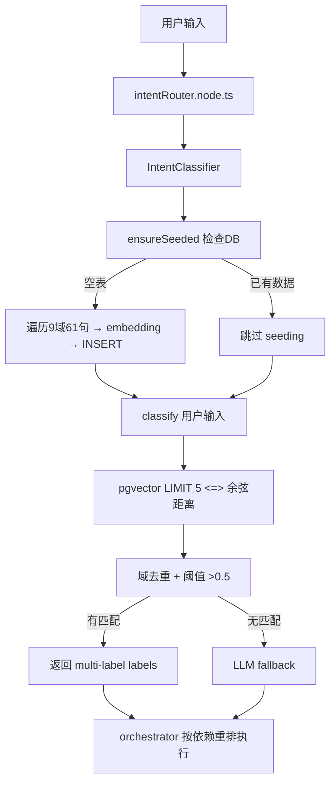
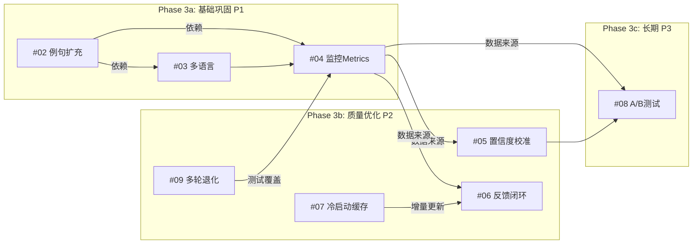

# Embedding 意图分类 Phase 3 生产化计划

> 文档编号: Doc 50
> 状态: 📋 计划中
> 创建日期: 2026-07-06

---

## 1. 背景与当前状态

### 1.1 架构回顾



### 1.2 当前数据

| Domain | 当前例句数 | 目标例句数 | 状态 |
|--------|:----------:|:----------:|:----:|
| wallet | 12 | 100+ | P1 待扩充 |
| order | 10 | 100+ | P1 待扩充 |
| coupon | ~7 | 100+ | P1 待扩充 |
| user | 10 | 100+ | P1 待扩充 |
| product | ~7 | 100+ | P1 待扩充 |
| lucky-draw | ~7 | 100+ | P1 待扩充 |
| kyc | ~7 | 100+ | P1 待扩充 |
| rag | ~7 | 100+ | P1 待扩充 |
| general | ~7 | 100+ | P1 待扩充 |
| **合计** | **61** | **~900+** | |

### 1.3 Defect #01 状态更新

**✅ 已在 Phase 2 修复**

代码实际使用的是 `LIMIT 5` + 域去重 + 阈值过滤，而非 PROGRESS.md 描述的 `LIMIT 1`。详见 [`intent-classifier.ts:237-248`](/apps/api/src/client/ai-customer/graph/utils/intent-classifier.ts:237)：

```typescript
const rows = await this.prismaService.$queryRawUnsafe<...>(
  `SELECT domain, 1 - (embedding <=> $1::vector) AS similarity
   FROM intent_examples
   ORDER BY similarity DESC
     LIMIT 5`,
  vectorStr,
);
```

后续步骤包括域去重 (`domainMap`) 和阈值过滤 (`>= 0.5`)，最终返回多个 labels。

**修复项**：更新 PROGRESS.md 中 Defect #01 的描述，标记为 ✅ 已完成。

---

## 2. 实施计划（按优先级排序）

### P1 — 生产阻塞（必须优先修复）

#### Defect #02: 例句覆盖率不足

| 项目 | 内容 |
|------|------|
| **目标** | 每个 domain 扩充至 100+ 条高质量例句，总计 ~900+ 条 |
| **涉及文件** | [`intent-examples/*.ts`](/apps/api/src/client/ai-customer/graph/agents/prompts/intent-examples/) (9 个文件) |
| **数据来源**| 从真实用户对话日志提取 + 人工编写 + 基于业务规则的合成 |
| **风险** | embedding 生成成本：900 句 × API 调用费；首次 seeding 时间增长 |

**实施步骤**：

1. **审计现有例句质量**：检查每个 domain 的现有例句是否覆盖主要子场景
   - wallet: balance, withdraw, deposit, transfer, history, KYC status
   - order: list, detail, checkout, cancel, refund, status
   - coupon: claim, list, usage, expiry
   - user: profile, login, password, registration
   - product: search, detail, category browse, recommendations
   - lucky-draw: participate, check results, tickets
   - kyc: submit, status, document upload
   - rag: FAQ, platform info, rules
   - general: greetings, chitchat, unrelated

2. **编写扩充例句**：为每个 domain 按子场景编写 10-15 条/场景
   - 每条例句应反映真实用户可能的表达方式
   - 包含同义不同表达的变体
   - 包含带上下文的长句（模拟真实对话）

3. **更新各域文件**：在对应的 [`intent-examples/*.ts`](/apps/api/src/client/ai-customer/graph/agents/prompts/intent-examples/) 文件中添加新例句

4. **验证**：运行 `intent-classifier.spec.ts` 测试确认新例句不影响现有分类逻辑

---

#### Defect #03: 多语言例句支持（Tagalog/Cebuano）

| 项目 | 内容 |
|------|------|
| **目标** | 为每个 domain 添加 Tagalog 和 Cebuano 例句 |
| **涉及文件** | [`intent-examples/*.ts`](/apps/api/src/client/ai-customer/graph/agents/prompts/intent-examples/) |
| **依赖** | Defect #02 完成后进行（可在同一批次扩充中加入多语言） |
| **原理** | bge-m3 原生支持多语言 embedding，无需额外训练 |

**实施步骤**：

1. **评估 embedding 多语言能力**：检查 bge-m3 对 Tagalog/Cebuano 的 embedding 质量
   - 编写 5 条 Tagalog 测试句 → 手动计算余弦相似度 → 确认区分度

2. **编写多语言例句**：为高频场景添加本地化表达
   - Tagalog 示例：`"Mag-withdraw ako ng 500"` (我想要提现 500)
   - Cebuano 示例：`"Unsa akong balance?"` (我的余额是多少？)

3. **更新 Structure**：在 [`IntentExampleGroup`](/apps/api/src/client/ai-customer/graph/agents/prompts/intent-examples/index.ts:27) 接口中判断多语言例句同域存储
   - 不需要额外字段：bge-m3 处理后统一为 1024 维向量，pgvector 统一比较

4. **验证**：用混合语言输入测试（如 `"Pa-check ng order status ko"`）

---

#### Defect #04: 分类监控/Metrics

| 项目 | 内容 |
|------|------|
| **目标** | 每次分类结果记录到数据库 + 提供查询接口 |
| **涉及文件** | [`intent-classifier.ts`](/apps/api/src/client/ai-customer/graph/utils/intent-classifier.ts) (修改) + 新建 `IntentClassificationLog` Prisma 模型 + 新建监控 API |
| **涉及 Prisma** | [`schema.prisma:1702-1718`](/apps/api/prisma/schema.prisma:1702) (添加新模型) |

**实施步骤**：

1. **创建 Prisma 模型** `IntentClassificationLog`：
   ```prisma
   model IntentClassificationLog {
     id            String   @id @default(cuid()) @db.VarChar(32)
     sessionId     String   @db.VarChar(64)
     userInput     String   @db.Text
     primaryIntent String   @db.VarChar(32)
     allLabels     String?  @db.Text          // JSON: [{label, score}]
     method        String   @db.VarChar(16)   // 'embedding' | 'llm_fallback'
     confidence    Float?                     // 最高分
     latencyMs     Int?
     rawTop5       String?  @db.Text          // JSON: debug TOP-5
     createdAt     DateTime @default(now())

     @@index([sessionId], map: "idx_classification_log_session")
     @@index([primaryIntent], map: "idx_classification_log_intent")
     @@index([createdAt], map: "idx_classification_log_created")
     @@map("intent_classification_logs")
   }
   ```

2. **修改 [`intent-classifier.ts`](/apps/api/src/client/ai-customer/graph/utils/intent-classifier.ts)**：
   - 在 `classify()` 方法末尾添加异步日志写入（不阻塞返回）
   - 记录：sessionId（从 state 传入）、userInput、primaryIntent、allLabels、method、confidence、latencyMs、rawTop5

3. **生成 Prisma Migration**：`yarn workspace @lucky/api prisma migrate dev --name add_intent_classification_logs`

4. **添加监控查询 API**（可选）：在 [`ai-customer.controller.ts`](/apps/api/src/client/ai-customer/ai-customer.controller.ts) 中新增 GET endpoint，支持按 sessionId/日期范围查询分类日志

5. **验证**：运行一次对话 → 检查 `intent_classification_logs` 表中有对应记录

---

### P2 — 质量优化

#### Defect #05: 置信度校准

| 项目 | 内容 |
|------|------|
| **目标** | 基于 production 数据为每个 domain 设置独立阈值 |
| **涉及文件** | [`intent-classifier.ts:47`](/apps/api/src/client/ai-customer/graph/utils/intent-classifier.ts:47) |
| **依赖** | Defect #04 部署后，收集至少 1-2 周 production 数据 |

**实施步骤**：

1. **数据收集期**（依赖 Defect #04）：运行至少 1 周，收集真实分类数据
   - 记录每次分类的 domain、confidence、用户后续行为

2. **数据分析**：使用收集到的日志数据绘制每个 domain 的 confidence 分布
   - 识别误分类（LLM fallback 后的实际 domain vs embedding 预测 domain）
   - 计算每个 domain 的最佳精度-召回率阈值

3. **实现 domain 级阈值**：修改 [`intent-classifier.ts`](/apps/api/src/client/ai-customer/graph/utils/intent-classifier.ts)
   ```typescript
   // 域名配置的阈值
   private readonly DOMAIN_THRESHOLDS: Record<string, number> = {
     wallet: 0.45,    // 宽松：wallet 场景多样
     order: 0.50,     // 标准
     coupon: 0.55,    // 严格：避免误匹配到商品相关
     user: 0.50,
     product: 0.50,
     'lucky-draw': 0.55,
     kyc: 0.55,
     rag: 0.50,
     general: 0.40,   // 最宽松：作为兜底
   };
   ```

4. **验证**：用 production 数据回测，比较新阈值 vs 统一 0.5 的准确率差异

---

#### Defect #06: 反馈闭环

| 项目 | 内容 |
|------|------|
| **目标** | 用户反馈 → 自动加入训练集 → 定期重新 seeding |
| **涉及文件** | [`intent-classifier.ts`](/apps/api/src/client/ai-customer/graph/utils/intent-classifier.ts) + 新建 `Feedback` Prisma 模型 + cron job |

**实施步骤**：

1. **创建 Prisma 模型** `IntentFeedback`：
   ```prisma
   model IntentFeedback {
     id             String   @id @default(cuid()) @db.VarChar(32)
     sessionId      String   @db.VarChar(64)
     userInput      String   @db.Text
     originalIntent String   @db.VarChar(32)   // 系统分类的 intent
     correctIntent  String   @db.VarChar(32)   // 用户纠正的 intent
     createdAt      DateTime @default(now())

     @@index([sessionId], map: "idx_intent_feedback_session")
     @@map("intent_feedback_logs")
   }
   ```

2. **添加反馈 API**：在 [`ai-customer.controller.ts`](/apps/api/src/client/ai-customer/ai-customer.controller.ts) 中新增 POST `/ai-customer/intent-feedback`
   - 接收 body: `{ sessionId, userInput, correctIntent }`

3. **前端集成**：在对话界面添加"反馈"按钮（如"这个回答不对" → 选择正确意图）
   - 注意：此项涉及前端修改，需协调 frontend 团队

4. **实现 cron 重新 seeding**：
   - 新建 `IntentClassifierCronService`
   - 每日凌晨执行：查询 `intent_feedback_logs` 中最近一天的新反馈
   - 将反馈句子作为新 example 写入 `intent_examples` 表（加标记 `source: feedback`）
   - 触发 embedding 生成

5. **验证**：提交反馈 → 检查 feedback 表记录 → 次日 cron 执行后检查新 example

---

#### Defect #07: 冷启动 embedding hash 缓存

| 项目 | 内容 |
|------|------|
| **目标** | 避免每次重启都重新 embedding 全部例句 |
| **涉及文件** | [`intent-classifier.ts:65-148`](/apps/api/src/client/ai-customer/graph/utils/intent-classifier.ts:65) (ensureSeeded 方法) |

**当前问题**：`ensureSeeded()` 只检查表是否为空（`COUNT > 0`），如果表不为空直接跳过。但如果有例句变更（新增/修改），现有逻辑不会更新 embedding。新例句只在首次部署时写入。

**实际分析**：当前逻辑并无"每次重启都重新 embedding"的问题，因为 `ensureSeeded()` 是幂等的。但如果未来需要支持增量更新（如 Defect #06 反馈闭环新增例句），则需要 hash 缓存机制。

**实施步骤**：

1. **添加内容 hash 字段**：在 [`schema.prisma`](/apps/api/prisma/schema.prisma:1702) 的 `IntentExample` 模型中添加 `contentHash` 字段：
   ```prisma
   contentHash String? @db.VarChar(64)  // SHA-256 of sentence + domain
   ```

2. **修改 `ensureSeeded()`**：添加 hash 检测逻辑
   - 读取所有现有的 `(domain, sentence, contentHash)` 记录
   - 对比源码中的 `INTENT_EXAMPLE_GROUPS` 内容
   - 仅对新增/变更的句子执行 embedding 并 UPSERT

3. **添加数据库 migration**：生成 Prisma migration

4. **验证**：修改一个例句 → 重启服务 → 检查只有该句被 re-embed

---

#### Defect #09: 多轮对话分类退化

| 项目 | 内容 |
|------|------|
| **目标** | 自动化验证多轮对话中的分类稳定性 |
| **涉及文件** | [`intent-classifier.ts`](/apps/api/src/client/ai-customer/graph/utils/intent-classifier.ts) + [`intent-router.node.ts`](/apps/api/src/client/ai-customer/graph/nodes/intent-router.node.ts) + 新建测试 |

**当前机制**：多轮第 2 轮时，embedding 可能无法匹配到正确 domain（如"确认"）。当前依赖 LLM fallback 解决，但无自动化验证。

**实施步骤**：

1. **审计现有 LLM fallback prompt**：检查 [`intent-router.node.ts:265-313`](/apps/api/src/client/ai-customer/graph/nodes/intent-router.node.ts:265) 中的 `llmFallback()` 函数
   - 确认 prompt 中是否包含历史对话上下文
   - 如果不足，添加最近 2-3 轮对话摘要

2. **实现多轮分类测试**：在 [`intent-classifier.spec.ts`](/apps/api/src/client/ai-customer/graph/utils/intent-classifier.spec.ts) 中新增测试用例
   ```typescript
   describe('multi-turn classification', () => {
     test('follow-up "确认" after coupon context should classify as coupon', async () => {
       // 模拟 state.messageHistory 包含前一轮的优惠券上下文
       // 测试 embedding 或 LLM fallback 的正确分类
     });
   });
   ```

3. **添加上下文注入**（如需要）：修改 [`intent-classifier.ts`](/apps/api/src/client/ai-customer/graph/utils/intent-classifier.ts) 的 `classify()` 方法
   - 新增可选参数 `conversationContext?: string`
   - 在 embedding 查询前附加上下文（如 `"context: user asked about coupon\nuser: 确认"`）
   - 注意：此方案可能引入噪音，需 A/B 测试验证效果

4. **验证**：运行新测试用例 + 人工模拟多轮场景

---

### P3 — 长期优化

#### Defect #08: A/B 测试框架

| 项目 | 内容 |
|------|------|
| **目标** | 分桶对比 embedding 路径 vs LLM fallback 路径的准确率和延迟 |
| **涉及文件** | [`intent-router.node.ts`](/apps/api/src/client/ai-customer/graph/nodes/intent-router.node.ts) + 新建 `ABTestConfig` |
| **优先级** | P3 — 可在 Phase 3 后期或 Phase 4 实施 |

**实施步骤**：

1. **设计分桶逻辑**：在 [`intent-router.node.ts`](/apps/api/src/client/ai-customer/graph/nodes/intent-router.node.ts) 中添加分桶配置
   ```typescript
   // 基于 sessionId hash 分桶
   const bucket = hashSessionId(sessionId) % 100;
   const useNewStrategy = bucket < config.abTestNewStrategyPercent;
   ```

2. **定义对比指标**：
   - 分类准确率（通过用户后续行为判断）
   - 端到端延迟（embedding 路径 vs LLM fallback 路径）
   - LLM fallback 调用成本节省

3. **集成 Defect #04 的监控表**：在 `IntentClassificationLog` 中添加 `abBucket` 字段
   ```prisma
   abBucket Int?  // 0-99 分桶编号
   ```

4. **配置化控制**：通过 DB 配置表控制分桶比例（如 `abTestNewStrategyPercent = 50`）

5. **验证**：运行 2 周对比分析两个路径的准确率和延迟

---

## 3. 执行顺序与依赖关系



### 建议执行顺序

| 序号 | 任务 | 预估影响范围 | 前置依赖 |
|:----:|------|:------------:|:--------:|
| 1 | Defect #01: 更新 PROGRESS.md 标记 ✅ | 1 个文件 | 无 |
| 2 | Defect #02: 例句扩充（61 → ~900）| 9 个文件 | 无 |
| 3 | Defect #03: 多语言例句 | 9 个文件 | #02 |
| 4 | Defect #04: 监控 Metrics | 3 个文件 + Prisma | #02 |
| 5 | Defect #07: 冷启动缓存 | 1 个文件 + Prisma | 无（可并行） |
| 6 | Defect #06: 反馈闭环 | 3 个文件 + Prisma + cron | #04 |
| 7 | Defect #09: 多轮分类测试 | 2 个文件 + 测试 | #02 |
| 8 | Defect #05: 置信度校准 | 1 个文件 | #04（需数据） |
| 9 | Defect #08: A/B 测试框架 | 2 个文件 + Prisma | #04 + #05 |

---

## 4. 测试策略

| 测试层级 | 覆盖范围 | 运行方式 |
|---------|---------|:--------:|
| Unit | 每个 domain 的 TOP-5 匹配正确 | `npx jest intent-classifier` |
| Integration | 混合语言输入 + 多意图输入 | `npx jest intent-router` |
| Regression | 现有 61 条例句的分词结果不变 | `npx jest --changedSince=HEAD` |
| Manual | 菲律宾用户实际场景测试 | 手动 postman/curl |

### 关键测试用例

```typescript
// 测试多意图分类
test('multi-intent: "充值 优惠券 查余额" should return 3 labels', async () => {
  const result = await classifier.classify('充值 优惠券 查余额');
  expect(result.labels.length).toBeGreaterThanOrEqual(3);
  expect(result.method).toBe('embedding');
});

// 测试多语言
test('tagalog: "Mag-withdraw ako" should classify as wallet', async () => {
  const result = await classifier.classify('Mag-withdraw ako ng 500');
  expect(result.intent).toBe('wallet');
});

// 测试低置信度 fallback
test('low confidence should fallback to LLM', async () => {
  const result = await classifier.classify('xjlsakdjflasdf');
  expect(result.method).toBe('llm_fallback');
  expect(result.intent).toBe('general');
});
```

---

## 5. 验证标准

| # | 验证项 | 预期结果 | 验证方法 |
|:-:|--------|---------|---------|
| 1 | 例句总数 | 每个 domain ≥ 100 条 | 统计 `INTENT_EXAMPLE_GROUPS` 总数 |
| 2 | 多意图分类 | "充值 优惠券" → wallet + coupon | 运行测试用例 |
| 3 | 混合语言 | Tagalog/Cebuano 输入正确分类 | 运行测试用例 |
| 4 | 监控日志 | 每次 `classify()` 写入数据库 | curl API + 检查 DB |
| 5 | 冷启动 | 改 1 句只 re-embed 1 句 | 观察日志 + DB |
| 6 | 反馈闭环 | POST feedback → 次日 cron 写入新 example | 端到端测试 |
| 7 | 多轮测试 | "确认"在第 2 轮正确路由 | 运行测试用例 |
| 8 | A/B 测试 | 分桶正确，metrics 可对比 | 检查 `abBucket` 分布 |
| 9 | TypeScript | `tsc --noEmit` 0 errors | CI pipeline |
| 10 | Lint | `yarn lint` 通过 | CI pipeline |

---

## 6. 文件修改清单

| 文件 | 操作 | 涉及 Defect |
|------|:----:|:-----------:|
| [`intent-examples/wallet.ts`](/apps/api/src/client/ai-customer/graph/agents/prompts/intent-examples/wallet.ts) | 修改 | #02, #03 |
| [`intent-examples/order.ts`](/apps/api/src/client/ai-customer/graph/agents/prompts/intent-examples/order.ts) | 修改 | #02, #03 |
| [`intent-examples/coupon.ts`](/apps/api/src/client/ai-customer/graph/agents/prompts/intent-examples/coupon.ts) | 修改 | #02, #03 |
| [`intent-examples/user.ts`](/apps/api/src/client/ai-customer/graph/agents/prompts/intent-examples/user.ts) | 修改 | #02, #03 |
| [`intent-examples/product.ts`](/apps/api/src/client/ai-customer/graph/agents/prompts/intent-examples/product.ts) | 修改 | #02, #03 |
| [`intent-examples/lucky-draw.ts`](/apps/api/src/client/ai-customer/graph/agents/prompts/intent-examples/lucky-draw.ts) | 修改 | #02, #03 |
| [`intent-examples/kyc.ts`](/apps/api/src/client/ai-customer/graph/agents/prompts/intent-examples/kyc.ts) | 修改 | #02, #03 |
| [`intent-examples/rag.ts`](/apps/api/src/client/ai-customer/graph/agents/prompts/intent-examples/rag.ts) | 修改 | #02, #03 |
| [`intent-examples/general.ts`](/apps/api/src/client/ai-customer/graph/agents/prompts/intent-examples/general.ts) | 修改 | #02, #03 |
| [`intent-examples/index.ts`](/apps/api/src/client/ai-customer/graph/agents/prompts/intent-examples/index.ts) | 可能修改 | #03 |
| [`intent-classifier.ts`](/apps/api/src/client/ai-customer/graph/utils/intent-classifier.ts) | 修改 | #04, #05, #07, #09 |
| [`intent-router.node.ts`](/apps/api/src/client/ai-customer/graph/nodes/intent-router.node.ts) | 修改 | #08, #09 |
| [`schema.prisma`](/apps/api/prisma/schema.prisma) | 修改 | #04, #06, #07, #08 |
| [`ai-customer.controller.ts`](/apps/api/src/client/ai-customer/ai-customer.controller.ts) | 修改 | #04, #06 |
| [`ai-customer.module.ts`](/apps/api/src/client/ai-customer/ai-customer.module.ts) | 修改 | #06 (cron) |
| [`intent-classifier.spec.ts`](/apps/api/src/client/ai-customer/graph/utils/intent-classifier.spec.ts) | 修改 | #09 |
| **新建** `IntentClassifierCronService` | 新建 | #06 |
| **新建** Prisma Migration (×4) | 新建 | #04, #06, #07, #08 |
| [`PROGRESS.md`](/docs/AI-joymini/PROGRESS.md) | 修改 | 全部 |

---

## 7. PROGRESS.md 更新

- Defect #01 行: `LIMIT 1` → `✅ 已在 Phase 2 修复 (LIMIT 5 + 域去重)`
- Phase 3 状态: `❌ 未开始` → `🟡 进行中` / `✅ 已完成`
- 各 Defect 状态：根据实施进度更新

---

## 8. 风险与缓解

| 风险 | 影响 | 缓解措施 |
|------|:----:|---------|
| embedding API 调用成本激增（900 句 × 2 次 = 1800 次调用） | 中 | 使用本地 Ollama bge-m3 替代 DeepSeek API，零成本 |
| 例句质量不够导致分类退化 | 高 | 保持旧 61 句不变，仅增量添加新句；上线前用 production 数据回测 |
| 多语言 embedding 效果差 | 中 | 先用 5 条测试句验证 bge-m3 的 Tagalog/Cebuano 能力 |
| 监控表写入影响 classify() 延迟 | 低 | 使用异步写入（fire-and-forget），主流程不 await |
| 反馈闭环 cron 冲突 | 低 | 使用分布式锁（PostgreSQL advisory lock）防止并发 |
