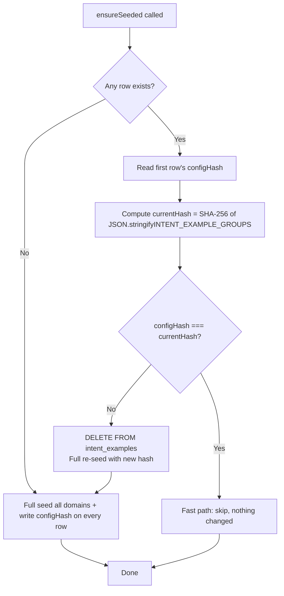

# Defect #07: 冷启动 Embedding Hash Cache — Specification

## 1. Problem Analysis

### 1.1 Current Behavior

[`IntentClassifier.ensureSeeded()`](apps/api/src/client/ai-customer/graph/utils/intent-classifier.ts:71) currently has this flow:

```
SELECT COUNT(*)::bigint AS count FROM intent_examples
  ├── count > 0 → skip (return early, no re-check)
  └── count = 0 → full re-embed ALL ~350 sentences (~9 domains)
```

**This IS idempotent** — once data exists, `ensureSeeded()` is a no-op.

### 1.2 Actual Defects

| # | Scenario | Problem | Severity |
|---|----------|---------|----------|
| 1 | **New examples deployed** (Defect #02 added ~350 sentences) | `ensureSeeded()` never detects `INTENT_EXAMPLE_GROUPS` changed. Old embeddings remain in DB forever; new sentences never get embedded. | **P1** — Code-data drift |
| 2 | **DB truncated during dev** (e.g., `TRUNCATE TABLE "intent_examples"`) | Next restart triggers full re-embed of ~350 sentences × ~300ms each = **~105 seconds** of startup delay + Ollama API calls | **P2** — Dev friction |
| 3 | **Deploy rollback** | If old code rolls back, its `INTENT_EXAMPLE_GROUPS` might differ from DB state. Old sentences stay but new ones created by newer code persist — silent inconsistency. | **P2** — Silent drift |

### 1.3 Root Cause

`ensureSeeded()` **has no mechanism to detect when the source-of-truth** ([`INTENT_EXAMPLE_GROUPS`](apps/api/src/client/ai-customer/graph/agents/prompts/intent-examples/index.ts:39)) **changes**. The only signal it checks is `COUNT(*) > 0`, which conflates "already seeded" with "seeded from the correct version".

### 1.4 Cost of Full Re-Embed

| Metric | Value |
|--------|-------|
| Sentences | ~350 (9 domains, ~30-50 each) |
| Embedding time/sentence | ~100-500ms (Ollama bge-m3) |
| **Total worst case** | **~175s (~3 min)** |
| Startup impact | Blocks first `classify()` call |
| Frequency | Only on code change (rare) |

---

## 2. Solution Design

### 2.1 Approach: Single Config Hash (Approach A)

**Chosen over per-row hash** for simplicity vs complexity trade-off.

| Criterion | Approach A: Single Hash | Approach B: Per-Row Hash |
|-----------|------------------------|-------------------------|
| **Complexity** | ★☆☆☆☆ (trivial) | ★★★☆☆ (UPSERT logic, diff) |
| **Re-embed cost on change** | Full (~350 sentences) | Partial (only changed) |
| **When changes happen** | Only during deploys (rare) | Same |
| **Edge cases** | Minimal | Diff algorithm, partial failures |
| **Maintenance** | Zero | Diff logic needs updates if schema changes |

**Decision**: Approach A. Full re-embed on code change is acceptable because:
- Code changes to `INTENT_EXAMPLE_GROUPS` are **rare** (only during feature work)
- Even a 3-minute delay on first `classify()` after deploy is far better than **never detecting changes** (current behavior)
- Simplicity means fewer bugs

### 2.2 High-Level Flow



### 2.3 Schema Change

Add `configHash` field to the [`IntentExample`](apps/api/prisma/schema.prisma:1702) model:

```prisma
model IntentExample {
  id         String   @id @default(cuid()) @db.VarChar(32)
  domain     String   @db.VarChar(32)
  sentence   String   @db.Text
  embedding  Unsupported("vector(1024)")?
  configHash String   @db.VarChar(64)   // ← NEW: SHA-256 hex of JSON.stringify(INTENT_EXAMPLE_GROUPS)

  @@index([domain], map: "idx_intent_examples_domain")
  @@map("intent_examples")
}
```

**Design notes:**
- `@db.VarChar(64)` — SHA-256 produces 32 bytes = 64 hex chars
- Required field (not `String?`) — every row MUST have this after migration
- No unique index needed — all rows in the same seed batch share the same hash
- Field value: `sha256(JSON.stringify(INTENT_EXAMPLE_GROUPS))` — deterministic hash of the entire config

### 2.4 Algorithm Detail

```typescript
import { createHash } from 'node:crypto';

async ensureSeeded(): Promise<void> {
  // Step 1: Compute current hash
  const currentHash = createHash('sha256')
    .update(JSON.stringify(INTENT_EXAMPLE_GROUPS))
    .digest('hex');

  // Step 2: Check if DB has data with matching hash
  const rows = await this.prismaService.$queryRaw<{ hash: string }[]>`
    SELECT "configHash" AS hash FROM intent_examples LIMIT 1
  `;

  // Step 3: Fast path — hash matches, skip
  if (rows.length > 0 && rows[0].hash === currentHash) {
    logger.log(`IntentExamples already seeded (hash match: ${currentHash.slice(0, 8)}...)`);
    return;
  }

  // Step 4: Hash mismatch or empty DB → full re-seed
  if (rows.length > 0) {
    logger.log(`Config hash changed, re-seeding ${INTENT_EXAMPLE_GROUPS.length} domains...`);
    // Delete old data (use SQL to avoid Prisma model dependency during migration)
    await this.prismaService.$executeRawUnsafe(`DELETE FROM intent_examples`);
  }

  // Step 5: Full seed (existing logic adapted)
  for (const group of INTENT_EXAMPLE_GROUPS) {
    // ... existing Dynamic Intent-Tool Alignment check ...
    for (const example of group.examples) {
      const vec = await this.aiService.generateEmbedding(example);
      if (!vec || vec.length === 0) continue;

      const vectorStr = `[${vec.join(',')}]`;
      await this.prismaService.$executeRawUnsafe(
        `INSERT INTO intent_examples (id, domain, sentence, embedding, "configHash")
         VALUES ($1, $2, $3, $4::vector, $5)`,
        this.generateId(),
        group.name,
        example,
        vectorStr,
        currentHash,  // ← NEW: write hash on every row
      );
    }
  }
}
```

### 2.5 Key Design Decisions

| Decision | Choice | Rationale |
|----------|--------|-----------|
| Hash scope | Entire `INTENT_EXAMPLE_GROUPS` | Simpler than per-row; any change = full re-seed (rare event) |
| Hash algorithm | SHA-256 (Node `crypto`) | Built-in, no deps, 64-char hex, collision-resistant |
| Hash storage | Column on every row | Avoids separate table; fast read via `LIMIT 1` |
| Delete strategy | `DELETE FROM intent_examples` | Simpler than TRUNCATE (no CASCADE needed); same effect |
| Re-seed on mismatch | Full, not incremental | Acceptable cost (~2 min); incremental diff is over-engineering |

---

## 3. Files to Modify

| # | File | Change |
|---|------|--------|
| 1 | [`apps/api/prisma/schema.prisma`](apps/api/prisma/schema.prisma:1702) | Add `configHash String @db.VarChar(64)` to `IntentExample` model |
| 2 | [`apps/api/src/client/ai-customer/graph/utils/intent-classifier.ts`](apps/api/src/client/ai-customer/graph/utils/intent-classifier.ts:71) | Add `createHash` import; rewrite `ensureSeeded()` with hash logic |
| 3 | N/A | **New migration**: `yarn workspace @lucky/api prisma migrate dev --name add_intent_example_config_hash` |
| 4 | [`apps/api/src/client/ai-customer/graph/utils/intent-classifier.spec.ts`](apps/api/src/client/ai-customer/graph/utils/intent-classifier.spec.ts:76) | Update `ensureSeeded` tests + add hash-specific test cases |

---

## 4. Test Plan

### 4.1 Existing Tests to Update

Current tests in [`intent-classifier.spec.ts:79-150`](apps/api/src/client/ai-customer/graph/utils/intent-classifier.spec.ts:79) that need modification:

| Existing Test | What to Change |
|---------------|----------------|
| `should skip seeding when DB already has data` (line 80) | Mock the `SELECT configHash` instead of `SELECT COUNT`. Return matching hash → assert no INSERT |
| `should insert seed data when DB is empty` (line 102) | Mock `SELECT configHash LIMIT 1` → empty. Assert INSERT includes `configHash` |
| `should handle generateEmbedding failure gracefully` (line 133) | Same as above + verify `configHash` in INSERT calls |

### 4.2 New Test Cases to Add

```typescript
it('should skip seeding when config hash matches existing data', async () => {
  // Mock: DB has data with matching hash
  const currentHash = 'abc123...'; // computed SHA-256
  const prismaMock = createMockPrismaService({
    queryRawResults: {
      'SELECT "configHash"': [{ hash: currentHash }],
    },
  });
  // ... assert fast path, no INSERT calls
});

it('should re-seed when config hash differs from existing data', async () => {
  // Mock: DB has data but with DIFFERENT hash
  const prismaMock = createMockPrismaService({
    queryRawResults: {
      'SELECT "configHash"': [{ hash: 'old-hash-value' }],
    },
  });
  // ... assert DELETE + full INSERT
});

it('should write configHash on every inserted row during seeding', async () => {
  // Mock: DB empty
  // ... assert each INSERT call includes configHash as $5 parameter
});
```

### 4.3 Edge Cases

| Edge Case | Expected Behavior |
|-----------|------------------|
| `INTENT_EXAMPLE_GROUPS` is empty array | Hash still computed, inserted; subsequent fast path works |
| `JSON.stringify` ordering differences | Stable — object keys in `INTENT_EXAMPLE_GROUPS` are deterministic (same source code) |
| First migration with existing data | Existing rows have `NULL` configHash → mismatch → full re-seed (one-time cost) |
| Concurrent calls to `ensureSeeded()` | First call deletes + re-seeds; second call sees matching hash → fast path (no double work) |

---

## 5. Migration Steps

> **⚠️ PRISMA.md rule**: NEVER run `prisma migrate reset`. Use `migrate dev --create-only` for development.

```bash
# Step 1: Generate migration file (create-only, don't apply)
docker exec -it lucky-backend-dev sh -lc "\
  cd /app && \
  yarn workspace @lucky/api prisma migrate dev \
    --create-only \
    --name add_intent_example_config_hash \
    --schema prisma/schema.prisma"

# Step 2: Apply migration
docker exec -it lucky-backend-dev sh -lc "\
  cd /app && \
  yarn workspace @lucky/api prisma migrate dev \
    --name add_intent_example_config_hash \
    --schema prisma/schema.prisma"

# Step 3: Generate Prisma client
docker exec -it lucky-backend-dev sh -lc "\
  cd /app && \
  yarn workspace @lucky/api prisma generate \
    --schema prisma/schema.prisma"
```

**Data migration note**: The existing `intent_examples` rows will have `configHash = NULL`. On first `ensureSeeded()` call after deploy, the hash check sees `NULL !== currentHash` → triggers delete + re-seed. This is intentional: existing rows may have been seeded from a different code version.

---

## 6. Execution Order

| Step | Task | Files | Estimated Complexity |
|------|------|-------|---------------------|
| 1 | Add `configHash` field to Prisma schema | [`schema.prisma`](apps/api/prisma/schema.prisma:1702) | ★☆☆☆☆ |
| 2 | Run Prisma migration + generate | Terminal | ★★☆☆☆ |
| 3 | Update `IntentClassifier.ensureSeeded()` with hash logic | [`intent-classifier.ts`](apps/api/src/client/ai-customer/graph/utils/intent-classifier.ts:71) | ★★☆☆☆ |
| 4 | Update existing tests + add new test cases | [`intent-classifier.spec.ts`](apps/api/src/client/ai-customer/graph/utils/intent-classifier.spec.ts:76) | ★★☆☆☆ |
| 5 | Type-check + run tests | Terminal (`tsc --noEmit`, `yarn jest`) | ★☆☆☆☆ |

---

## 7. Risk Assessment

| Risk | Likelihood | Impact | Mitigation |
|------|-----------|--------|------------|
| Migration fails due to existing NULL rows | Low | Medium | Always re-seed on NULL hash (handled in code) |
| `JSON.stringify` produces different output on different Node versions | Very low | Low | SHA-256 is deterministic for same input; Node JSON.stringify is stable |
| Re-seed during peak traffic causes latency spike | Low | Medium | Only happens on deploy; first classify() is delayed, subsequent calls use fast path |
| Multiple backend instances race on re-seed | Low | Low | Only one instance in current architecture |

---

## 8. Verification Criteria

- [ ] `ensureSeeded()` skips entirely when `configHash` matches (verify via test mock)
- [ ] `ensureSeeded()` deletes + re-seeds when `configHash` differs
- [ ] `ensureSeeded()` seeds + writes `configHash` when DB is empty
- [ ] Every inserted row has a valid SHA-256 `configHash`
- [ ] `tsc --noEmit` passes with zero errors
- [ ] `yarn jest` tests pass (existing + new)
- [ ] On dev server restart with unchanged code → logs show "hash match" → no API calls
- [ ] On dev server restart with changed `INTENT_EXAMPLE_GROUPS` → logs show "re-seeding" → new embeddings
