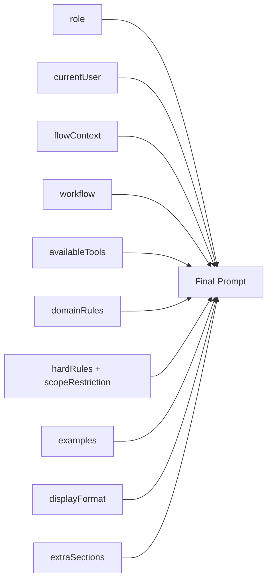
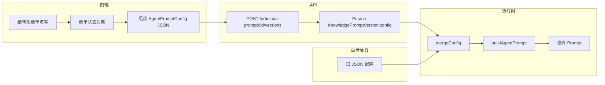

# 52. Prompt 管理后台结构化表单规格说明书

## 1. 现状分析

### 1.1 当前版本编辑器

当前 Prompt 版本编辑器位于 [`AiPromptDetailClient.tsx:793-874`](apps/admin-next/src/components/ai-prompt/AiPromptDetailClient.tsx:793)，核心代码：

```tsx
function VersionFormContent() {
  const [configText, setConfigText] = useState('{\n  \n}');
  // ...
  <textarea
    value={configText}
    onChange={(e) => {
      setConfigText(e.target.value);
      try { JSON.parse(e.target.value); setJsonError(null); }
      catch { setJsonError('Invalid JSON'); }
    }}
    rows={14}
    className="font-mono resize-none"
  />
}
```

运营人员看到的是 raw JSON textarea，需要手写带转义和引号的 JSON。

### 1.2 痛点

| 痛点 | 说明 |
|------|------|
| **JSON 可读性差** | `"role": "...\n..."` 格式，运营看不懂 |
| **无字段提示** | 不知道有哪些字段可配、字段含义 |
| **转义地狱** | 换行必须写 `\n`，中文需在引号内 |
| **无预览** | 无法看到最终渲染效果 |
| **无字段校验** | 只做 `JSON.parse()`，不校验字段名 |
| **无增量编辑** | 每次必须写完整 JSON，不能只改某个字段 |

### 1.3 当前支持的 Prompt 类型

| 类型 | 文件 | 格式 | 能否通过 Admin UI 管理 |
|------|------|------|----------------------|
| **Agent** (7 个) | `product-prompt.ts`, `order-prompt.ts`, `wallet-prompt.ts`, `coupon-prompt.ts`, `user-prompt.ts`, `kyc-prompt.ts`, `lucky-prompt.ts` | `AgentPromptConfig` | ✅ 当前支持 |
| **General** | `general-chat-prompt.ts` | 简单字符串 | ❌ 未接入 |
| **RAG** | `rag-prompt.ts` | `ChatPromptTemplate.fromMessages()` | ❌ 不同格式 |
| **Intent** | `intent-prompt-builder.ts` | 模板字符串 + 占位符 | ❌ 不同格式 |
| **Synthesizer** | `synthesizer-prompt.ts` | 简单字符串 | ❌ 未接入 |

### 1.4 AgentPromptConfig 接口（当前全量字段）

[`prompt-builder.ts:98-131`](apps/api/src/client/ai-customer/graph/agents/prompt-builder.ts:98)

```typescript
export interface AgentPromptConfig {
  role: string;                    // 角色定义
  domainName: string;              // 领域标识
  userId: string;                  // 运行时注入，不在表单中
  workflow: string;                // 工作流步骤
  availableTools?: string;         // 可用工具
  domainRules?: string;            // 领域规则
  examples: string;                // 示例对话
  displayFormat?: string;          // 输出格式
  scopeRestriction: ScopeRestriction;  // { domain, handles[], outside[] }
  hardRules?: string[];            // 硬约束
  flowContext?: boolean;           // 是否注入流程上下文
  flowType?: string;               // 流程类型过滤
  flowStatus?: string;             // 流程状态过滤
  extraSections?: string[];        // 额外自定义章节
}
```

### 1.5 buildAgentPrompt 组装顺序

[`prompt-builder.ts:210-256`](apps/api/src/client/ai-customer/graph/agents/prompt-builder.ts:210)



## 2. 需求

### 2.1 功能需求

| # | 需求 | 优先级 |
|---|------|--------|
| F1 | 版本编辑器去除 raw JSON，改为结构化表单 | P0 |
| F2 | 每个 `AgentPromptConfig` 字段有独立输入框 | P0 |
| F3 | 字段按用途分 Tab 展示，避免信息过载 | P0 |
| F4 | 运营添加/删除 ScopeRestriction 的 tags | P0 |
| F5 | 预留 Extra Sections 动态字段用于未来扩展 | P0 |
| F6 | 表单填写后端自动组装 JSON，API 和 DB 不变 | P0 |
| F7 | 已有 JSON 配置迁移后自动回填到表单各字段 | P0 |
| F8 | 预览 Tab 展示 `buildAgentPrompt()` 渲染后的完整 Prompt | P1 |
| F9 | Diff 视图改为字段级对比而非 JSON 文本对比 | P1 |
| F10 | 支持 General Chat prompt 管理 | P2 |

### 2.2 非功能需求

| # | 需求 |
|---|------|
| NF1 | 向后兼容：现有 JSON 配置不受影响 |
| NF2 | 后端零改动：前端组装成 JSON 后通过现有 API 提交 |
| NF3 | 响应式：在管理后台布局中自适应 |
| NF4 | 暗色模式兼容 |

## 3. 表单设计

### 3.1 布局结构

```
┌──────────────────────────────────────────────────────────────┐
│  版本 v1.2 当前激活                            保存为新版本   │
├──────────────────────────────────────────────────────────────┤
│                                                              │
│  ┌─ Tab Bar ───────────────────────────────────────────────┐ │
│  │  Prompt 内容  │  范围限制  │  高级配置  │  预览         │ │
│  └──────────────────────────────────────────────────────────┘ │
│                                                              │
│  ┌─ Tab Content ────────────────────────────────────────────┐ │
│  │  (各字段输入框)                                           │ │
│  │                                                          │ │
│  │                                                          │ │
│  └──────────────────────────────────────────────────────────┘ │
│                                                              │
│  [保存为新版本]            [↻ 重置为当前版本]                  │
└──────────────────────────────────────────────────────────────┘
```

### 3.2 Tab 1: Prompt 内容

核心编辑区，运营最常修改的部分。

| 字段名 | 标签 | 类型 | rows | 必填 | 映射到 AgentPromptConfig |
|--------|------|------|------|------|------------------------|
| System Prompt | System Prompt / Role | textarea | 6 | ✅ | `role` |
| Workflow | Workflow 步骤 | textarea | 8 | ✅ | `workflow` |
| Available Tools | 可用工具 | textarea | 4 | ❌ | `availableTools` |
| Domain Rules | 领域规则 | textarea | 8 | ❌ | `domainRules` |
| Examples | 示例对话 | textarea | 8 | ✅ | `examples` |
| Output Format | 输出格式 | textarea | 4 | ❌ | `displayFormat` |
| Hard Rules | 硬规则 | textarea | 4 | ❌ | `hardRules` (一条一行) |

```
┌─ Prompt 内容 ────────────────────────────────────────────────┐
│                                                              │
│ System Prompt / Role *                                       │
│ ┌──────────────────────────────────────────────────────────┐ │
│ │ 你是 JoyMini 平台的商品搜索助手。请用中文回答。            │ │
│ └──────────────────────────────────────────────────────────┘ │
│                                                              │
│ Workflow 步骤 *                                              │
│ ┌──────────────────────────────────────────────────────────┐ │
│ │ Step 1: 理解用户需求 → 选择工具                         │ │
│ │ Step 2: 调用工具获取真实数据                              │ │
│ │ Step 3: 将结果呈现给用户                                  │ │
│ └──────────────────────────────────────────────────────────┘ │
│                                                              │
│ 可用工具                                                     │
│ ┌──────────────────────────────────────────────────────────┐ │
│ │ searchProducts - 搜索商品                                │ │
│ │ getProductDetail - 获取商品详情                           │ │
│ └──────────────────────────────────────────────────────────┘ │
│                                                              │
│ 领域规则                                                     │
│ ┌──────────────────────────────────────────────────────────┐ │
│ │ - unitAmount: 团购价格                                   │ │
│ │ - marketAmount: 市场价                                   │ │
│ │ - "便宜" → 按 unitAmount 升序                            │ │
│ └──────────────────────────────────────────────────────────┘ │
│                                                              │
│ 示例对话 *                                                   │
│ ┌──────────────────────────────────────────────────────────┐ │
│ │ User: "显示热门商品"                                     │ │
│ │ → 调用 getHotProducts()                                  │ │
│ └──────────────────────────────────────────────────────────┘ │
│                                                              │
│ 输出格式                                                     │
│ ┌──────────────────────────────────────────────────────────┐ │
│ │ - 商品列表：名称、价格、折扣、库存进度                     │ │
│ │ - 商品详情：名称、价格、描述、图片                         │ │
│ └──────────────────────────────────────────────────────────┘ │
│                                                              │
│ 硬规则（一条一行）                                           │
│ ┌──────────────────────────────────────────────────────────┐ │
│ │ 工具调用失败时不要用相同参数重试                          │ │
│ │ 商品不存在或已售罄时如实告知                              │ │
│ └──────────────────────────────────────────────────────────┘ │
│                                                              │
└──────────────────────────────────────────────────────────────┘
```

### 3.3 Tab 2: 范围限制

Scope Restriction 配置，使用 tag 输入组件。

| 字段名 | 标签 | 类型 | 必填 | 映射 |
|--------|------|------|------|------|
| Scope Domain | 领域标识 | text input | ✅ | `scopeRestriction.domain` |
| Handles | 能处理的内容 | tag input | ✅ | `scopeRestriction.handles` |
| Outside | 不能处理的内容 | tag input | ✅ | `scopeRestriction.outside` |

```
┌─ 范围限制 ───────────────────────────────────────────────────┐
│                                                              │
│ 领域标识 *                                                   │
│ [product                                          ]          │
│                                                              │
│ 能处理的内容（按回车添加）*                                    │
│ ┌──────────────────────────────────────────────────────────┐ │
│ │ [商品搜索] [商品详情] [商品状态] [热门商品] [+ Add]       │ │
│ │     ✕           ✕           ✕           ✕                │ │
│ └──────────────────────────────────────────────────────────┘ │
│                                                              │
│ 不能处理的内容（按回车添加）*                                  │
│ ┌──────────────────────────────────────────────────────────┐ │
│ │ [钱包] [订单] [优惠券] [用户信息] [抽奖] [+ Add]          │ │
│ │   ✕      ✕       ✕        ✕        ✕                    │ │
│ └──────────────────────────────────────────────────────────┘ │
│                                                              │
└──────────────────────────────────────────────────────────────┘
```

### 3.4 Tab 3: 高级配置

面向开发/高级运营的配置项。

| 字段名 | 标签 | 类型 | 必填 | 映射 |
|--------|------|------|------|------|
| Flow Context | 注入流程上下文 | toggle switch | ❌ | `flowContext` |
| Flow Type | 流程类型过滤 | text input | ❌ | `flowType` |
| Flow Status | 流程状态过滤 | text input | ❌ | `flowStatus` |
| Extra Sections | 额外配置项 | dynamic list | ❌ | `extraSections` |

```
┌─ 高级配置 ───────────────────────────────────────────────────┐
│                                                              │
│ [☑] 注入流程上下文 (flowContext)                              │
│ 启用后将在 prompt 中添加 Current Flow Context 章节            │
│                                                              │
│ 流程类型过滤 (flowType)                                       │
│ [order                                           ] 可选     │
│                                                              │
│ 流程状态过滤 (flowStatus)                                     │
│ [pending                                         ] 可选     │
│                                                              │
│ ── 额外配置项 (Extra Sections) ──                             │
│ 当标准字段不满足需求时，在这里添加自定义章节。                 │
│ 章节名称和内容会按顺序追加到 prompt 末尾。                    │
│                                                              │
│ 章节名称                    │ 内容                            │
│ ───────────────────────────┼──────────────────────────────── │
│ [Tone Guidelines          ]│ [友好、专业、简洁             ] │
│ [Brand Voice              ]│ [使用"我们"而不是"平台"       ] │
│                           ││                                 │
│ [+ Add Section]            │                                 │
│                                                              │
└──────────────────────────────────────────────────────────────┘
```

**Extra Sections 设计说明：**

`extraSections: string[]` 数组中的每个元素是一个完整的 Markdown 章节。为了运营友好，UI 上拆分为 `name` + `content`，提交时组装为：

```typescript
`## ${name}\n\n${content}`
```

例如：
- name = "Tone Guidelines", content = "友好、专业、简洁"
- 生成 `extraSections[0]` = `"## Tone Guidelines\n\n友好、专业、简洁"`

### 3.5 Tab 4: 预览

只读展示 `buildAgentPrompt()` 组装后的完整 Prompt。

```
┌─ 预览 ──────────────────────────────────────────────────────┐
│                                                              │
│ 以下为当前配置渲染后的完整 System Prompt：                    │
│                                                              │
│ ┌──────────────────────────────────────────────────────────┐ │
│ │ 你是 JoyMini 平台的商品搜索助手。请用中文回答。            │ │
│ │                                                          │ │
│ │ ## Current User                                          │ │
│ │ The current user's ID is: "{{userId}}".                   │ │
│ │                                                          │ │
│ │ ## Current Flow Context                                  │ │
│ │ - Flow Type: product                                     │ │
│ │ - Flow Status: IDLE                                      │ │
│ │                                                          │ │
│ │ ## Your Workflow                                         │ │
│ │ Step 1: 理解用户需求 → 选择工具                           │ │
│ │ Step 2: 调用工具获取真实数据                              │ │
│ │ ...                                                      │ │
│ └──────────────────────────────────────────────────────────┘ │
│                                                              │
│ [📋 复制到剪贴板]                                            │
└──────────────────────────────────────────────────────────────┘
```

## 4. 数据流

### 4.1 整体流程



### 4.2 表单→JSON 映射

前端提交时将各字段组装为标准 `AgentPromptConfig` JSON：

```typescript
function formToConfig(form: FormState): AgentPromptConfig {
  return {
    role: form.role,
    domainName: form.domainName,
    workflow: form.workflow,
    availableTools: form.availableTools || undefined,
    domainRules: form.domainRules || undefined,
    examples: form.examples,
    displayFormat: form.displayFormat || undefined,
    scopeRestriction: {
      domain: form.scopeDomain,
      handles: form.handles,
      outside: form.outside,
    },
    hardRules: form.hardRules
      ? form.hardRules.split('\n').filter(Boolean)
      : undefined,
    flowContext: form.flowContext || undefined,
    flowType: form.flowType || undefined,
    flowStatus: form.flowStatus || undefined,
    extraSections: form.extraSections?.length
      ? form.extraSections.map(s => `## ${s.name}\n\n${s.content}`)
      : undefined,
  };
}
```

### 4.3 反向：JSON→表单回填

当编辑已有版本时，将 JSON config 回填到表单各字段：

```typescript
function configToForm(config: AgentPromptConfig): FormState {
  return {
    role: config.role ?? '',
    domainName: config.domainName ?? '',
    workflow: config.workflow ?? '',
    availableTools: config.availableTools ?? '',
    domainRules: config.domainRules ?? '',
    examples: config.examples ?? '',
    displayFormat: config.displayFormat ?? '',
    scopeDomain: config.scopeRestriction?.domain ?? '',
    handles: config.scopeRestriction?.handles ?? [],
    outside: config.scopeRestriction?.outside ?? [],
    hardRules: config.hardRules?.join('\n') ?? '',
    flowContext: config.flowContext ?? false,
    flowType: config.flowType ?? '',
    flowStatus: config.flowStatus ?? '',
    extraSections: parseExtraSections(config.extraSections),
  };
}
```

### 4.4 FormState 接口

```typescript
interface FormState {
  role: string;
  domainName: string;
  workflow: string;
  availableTools: string;
  domainRules: string;
  examples: string;
  displayFormat: string;
  scopeDomain: string;
  handles: string[];
  outside: string[];
  hardRules: string;
  flowContext: boolean;
  flowType: string;
  flowStatus: string;
  extraSections: Array<{ name: string; content: string }>;
}

interface ExtraSection {
  name: string;
  content: string;
}
```

### 4.5 向后兼容策略

1. **读路径**：从 API 获取的 `config` JSON 通过 `configToForm()` 回填到表单
2. **写路径**：表单通过 `formToConfig()` 组装为标准 JSON，通过现有 API 提交
3. **遗留 JSON 字段**：如果 JSON 包含表单没有的字段（如旧版本的自定义字段），保留在 `extraSections` 中展示
4. **domainName**：从当前 Prompt 记录继承（`KnowledgePrompt.domain`），不在表单中编辑，只读展示

## 5. Diff 视图增强

### 5.1 当前 Diff

[`DiffView`](apps/admin-next/src/components/ai-prompt/AiPromptDetailClient.tsx:142) 使用 API 返回的 `PromptDiffResult`，字段级对比：

```typescript
// PromptDiffResult
interface PromptDiffItem {
  field: string;
  type: 'added' | 'removed' | 'modified' | 'unchanged';
  oldValue?: string;
  newValue?: string;
}
```

### 5.2 Diff 增强

结构化表单后 Diff 展示字段级变化，而非 JSON 文本对比：

```
┌─ 字段级变更对比 ────────────────────────────────────────────┐
│                                                              │
│  比较 v1.1 ← v1.2                                            │
│                                                              │
│  ┌────────────┬────────────┬────────────┬──────────────────┐ │
│  │ 字段       │ v1.1       │ v1.2       │ 变更             │ │
│  ├────────────┼────────────┼────────────┼──────────────────┤ │
│  │ System     │ You are... │ 你是...     │ 🔶 修改          │ │
│  │ Prompt     │            │            │                  │ │
│  ├────────────┼────────────┼────────────┼──────────────────┤ │
│  │ Workflow   │ Step 1...  │ Step 1...  │ ✅ 未变           │ │
│  ├────────────┼────────────┼────────────┼──────────────────┤ │
│  │ Examples   │ —          │ User:...   │ 🟢 新增           │ │
│  ├────────────┼────────────┼────────────┼──────────────────┤ │
│  │ Handles    │ [search]   │ [搜索]     │ 🔶 修改           │ │
│  └────────────┴────────────┴────────────┴──────────────────┘ │
│                                                              │
└──────────────────────────────────────────────────────────────┘
```

## 6. 组件架构

### 6.1 组件树

```
AiPromptDetailClient (existing)
  ├── PageHeader
  ├── Tabs: Config | Versions | Diff | Metrics (existing)
  ├── VersionList (existing, enhanced)
  ├── VersionFormModal (NEW — replaces JSON textarea)
  │     ├── TabBar: PromptContent | Scope | Advanced | Preview
  │     ├── PromptContentTab (NEW)
  │     │     ├── FieldRow: role
  │     │     ├── FieldRow: workflow
  │     │     ├── FieldRow: availableTools
  │     │     ├── FieldRow: domainRules
  │     │     ├── FieldRow: examples
  │     │     ├── FieldRow: displayFormat
  │     │     └── FieldRow: hardRules
  │     ├── ScopeTab (NEW)
  │     │     ├── FieldRow: scopeDomain
  │     │     ├── TagInput: handles
  │     │     └── TagInput: outside
  │     ├── AdvancedTab (NEW)
  │     │     ├── ToggleSwitch: flowContext
  │     │     ├── FieldRow: flowType
  │     │     ├── FieldRow: flowStatus
  │     │     └── ExtraSectionsList (NEW)
  │     └── PreviewTab (NEW)
  │           └── PromptPreview (read-only rendered prompt)
  ├── DiffView (existing, enhanced with field labels)
  └── MetricsView (existing)
```

### 6.2 新组件清单

| 组件 | 功能 | 文件 |
|------|------|------|
| `VersionFormModal` | 版本编辑弹窗，容器组件 | `AiPromptDetailClient.tsx` 内 |
| `PromptContentTab` | Tab1: 核心字段编辑 | 新建 `PromptContentTab.tsx` |
| `ScopeTab` | Tab2: 范围限制 tags | 新建 `ScopeTab.tsx` |
| `AdvancedTab` | Tab3: 高级配置 | 新建 `AdvancedTab.tsx` |
| `PreviewTab` | Tab4: 渲染预览 | 新建 `PreviewTab.tsx` |
| `TagInput` | 可添加/删除的 tag 输入组件 | 新建 `TagInput.tsx` |
| `FieldRow` | 标签+输入框组合（统一样式） | 新建 `FieldRow.tsx` |
| `ExtraSectionsList` | 动态 key-value 列表 | 新建 `ExtraSectionsList.tsx` |
| `PromptPreview` | buildAgentPrompt 渲染预览 | 新建 `PromptPreview.tsx` |

### 6.3 utils 函数清单

| 函数 | 功能 | 文件 |
|------|------|------|
| `formToConfig(form: FormState): AgentPromptConfig` | 表单→JSON | 新建 `prompt-form-utils.ts` |
| `configToForm(config: AgentPromptConfig): FormState` | JSON→表单 | 同上 |
| `parseExtraSections(sections?: string[]): ExtraSection[]` | 解析 extraSections | 同上 |
| `renderPrompt(config: AgentPromptConfig): string` | 预览渲染 | 同上 |

## 7. 实现步骤

### Step 1: 创建新组件文件

新建文件（7 个组件 + 1 个 utils）：

```
apps/admin-next/src/components/ai-prompt/
├── AiPromptDetailClient.tsx    (MODIFIED — replace VersionFormContent)
├── PromptContentTab.tsx        (NEW)
├── ScopeTab.tsx                (NEW)
├── AdvancedTab.tsx             (NEW)
├── PreviewTab.tsx              (NEW)
├── TagInput.tsx                (NEW)
├── FieldRow.tsx                (NEW)
├── ExtraSectionsList.tsx       (NEW)
├── PromptPreview.tsx           (NEW)
└── prompt-form-utils.ts        (NEW)
```

### Step 2: 实现 FormState hook

在 `prompt-form-utils.ts` 中定义 `FormState` 接口和 `formToConfig` / `configToForm` 转换函数。

### Step 3: 实现基础 UI 组件

- `FieldRow` — 标签 + 输入框 + 错误提示 + 暗色模式
- `TagInput` — input + tag chips + 回车添加 + ✕ 删除

### Step 4: 实现 Tab 组件

- `PromptContentTab` — 7 个 FieldRow
- `ScopeTab` — 1 个 FieldRow + 2 个 TagInput
- `AdvancedTab` — 1 个 Toggle + 2 个 FieldRow + ExtraSectionsList
- `PreviewTab` — 只读渲染 + 复制按钮

### Step 5: 修改 VersionFormModal

将 `VersionFormContent` 中的 raw JSON textarea 替换为 Tab 布局 + 各 Tab 组件。保存时调用 `formToConfig()` → `JSON.stringify()` → 通过现有 API 提交。

### Step 6: 增强 DiffView

将 DiffView 中的 field 名映射为中文标签显示。

### Step 7: 验收测试

- ✅ 创建新版本：填写表单 → 保存 → DB 存储正确 JSON
- ✅ 编辑已有版本：加载 → 回填到表单 → 修改 → 保存
- ✅ 向后兼容：旧 JSON 配置正常回填
- ✅ Extra Sections：添加/删除/保存/回填
- ✅ Tags：添加/删除 handles/outside
- ✅ 预览：显示组装后的完整 Prompt
- ✅ Diff：字段级对比正常

## 8. 涉及文件清单

### 前端（9 个文件）

| 文件 | 操作 | 说明 |
|------|------|------|
| `apps/admin-next/src/components/ai-prompt/AiPromptDetailClient.tsx` | 修改 | 替换 VersionFormContent 为结构化表单 + Tab 布局 |
| `apps/admin-next/src/components/ai-prompt/PromptContentTab.tsx` | 新建 | Tab1 核心字段编辑 |
| `apps/admin-next/src/components/ai-prompt/ScopeTab.tsx` | 新建 | Tab2 范围限制 tags |
| `apps/admin-next/src/components/ai-prompt/AdvancedTab.tsx` | 新建 | Tab3 高级配置 |
| `apps/admin-next/src/components/ai-prompt/PreviewTab.tsx` | 新建 | Tab4 预览 |
| `apps/admin-next/src/components/ai-prompt/TagInput.tsx` | 新建 | Tag 输入组件 |
| `apps/admin-next/src/components/ai-prompt/FieldRow.tsx` | 新建 | 标签+输入框组合 |
| `apps/admin-next/src/components/ai-prompt/ExtraSectionsList.tsx` | 新建 | 动态 key-value 列表 |
| `apps/admin-next/src/components/ai-prompt/prompt-form-utils.ts` | 新建 | FormState + 转换函数 |

### 后端（0 个文件 — 零改动）

后端 API、Prisma 模型、Service、Controller 均不需要修改。结构化表单组装为标准 JSON 后通过现有 API 提交。

## 9. 未来扩展

### 9.1 P2: General Chat Prompt 管理

`general-chat-prompt.ts` 只有简单的 system message。结构化表单只需提供单个 `role` textarea。

### 9.2 P2: RAG Prompt 管理

`rag-prompt.ts` 使用 `ChatPromptTemplate.fromMessages()`，格式完全不同。需要：

- 新增 `RagPromptConfig` 接口
- 后端新增 `parseRagConfig()` 解析器
- 前端新增 RAG 专用表单（System Message + Context Template）

### 9.3 P3: Intent Prompt 管理

`intent-prompt-builder.ts` 使用模板字符串 + 占位符。需要：

- 将模板字符串提取为 DB 可配置字段
- 前端新增 Intent 专用表单

### 9.4 P3: Playground 在线测试

在预览 Tab 旁边加 Playground Tab，输入测试 query 直接调用 API 的 `POST /admin/ai-prompt/:id/test` 查看实际响应。

## 10. 附录

### 10.1 每个 Agent 的 TS 默认值对照

| Agent | role | workflow | domainRules | examples | hardRules | scopeRestriction |
|-------|------|----------|-------------|----------|-----------|-----------------|
| **product** | 英文 | 5 steps | 商品字段 | 3 examples | 3 rules | domain: product, handles: 6, outside: 5 |
| **order** | 英文 | 6 steps | 订单字段 | 3 examples | 3 rules | domain: order, handles: 8, outside: 5 |
| **wallet** | 英文 | 5 steps | 钱包字段 | 3 examples | 3 rules + amount tracking | domain: wallet, handles: 5, outside: 5 |
| **coupon** | 英文 | 5 steps | 优惠券字段 | 3 examples | 3 rules | domain: coupon, handles: 4, outside: 5 |
| **user** | 英文 | 3 steps | 用户字段 | 3 examples | 3 rules | domain: user, handles: 4, outside: 5 |
| **kyc** | 英文 | 6 steps | KYC 字段 | 3 examples | 4 rules | domain: kyc, handles: 5, outside: 5 |
| **lucky-draw** | 英文 | 5 steps | 抽奖字段 | 3 examples | 4 rules | domain: lucky-draw, handles: 5, outside: 5 |

所有 Agent 的 `flowContext` 均为 `true`，`flowType` 和 `flowStatus` 未设置。

### 10.2 中文标签映射

| 字段 | 中文标签 | 提示文案 |
|------|---------|---------|
| role | System Prompt / Role | 定义 AI 助手的角色和行为 |
| workflow | Workflow 步骤 | AI 处理用户请求时的步骤说明 |
| availableTools | 可用工具 | AI 可以调用的工具列表和说明 |
| domainRules | 领域规则 | 业务特定规则和字段说明 |
| examples | 示例对话 | AI 应该遵循的对话示例 |
| displayFormat | 输出格式 | AI 回复的格式要求 |
| hardRules | 硬规则 | AI 绝对不能违反的规则，一行一条 |
| scopeRestriction.domain | 领域标识 | 内部使用的领域标识符 |
| scopeRestriction.handles | 能处理的内容 | AI 能处理的业务范围 |
| scopeRestriction.outside | 不能处理的内容 | AI 不能处理的业务范围 |
| flowContext | 注入流程上下文 | 是否在 prompt 中包含当前流程状态 |
| flowType | 流程类型过滤 | 仅处理指定流程类型的请求 |
| flowStatus | 流程状态过滤 | 仅处理指定流程状态的请求 |
| extraSections | 额外配置项 | 自定义章节，用于标准字段未覆盖的场景 |
