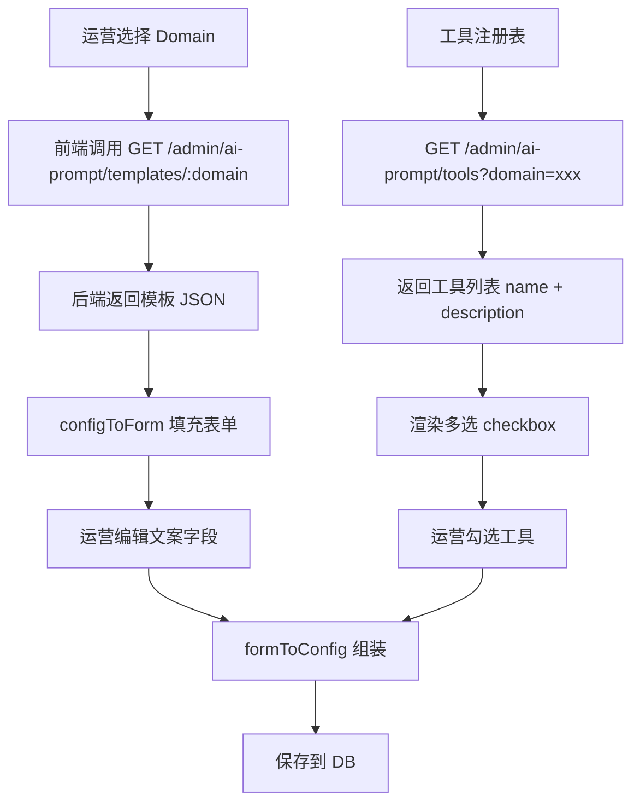
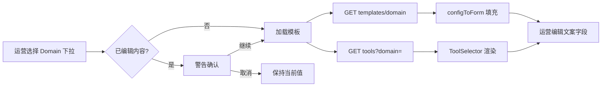
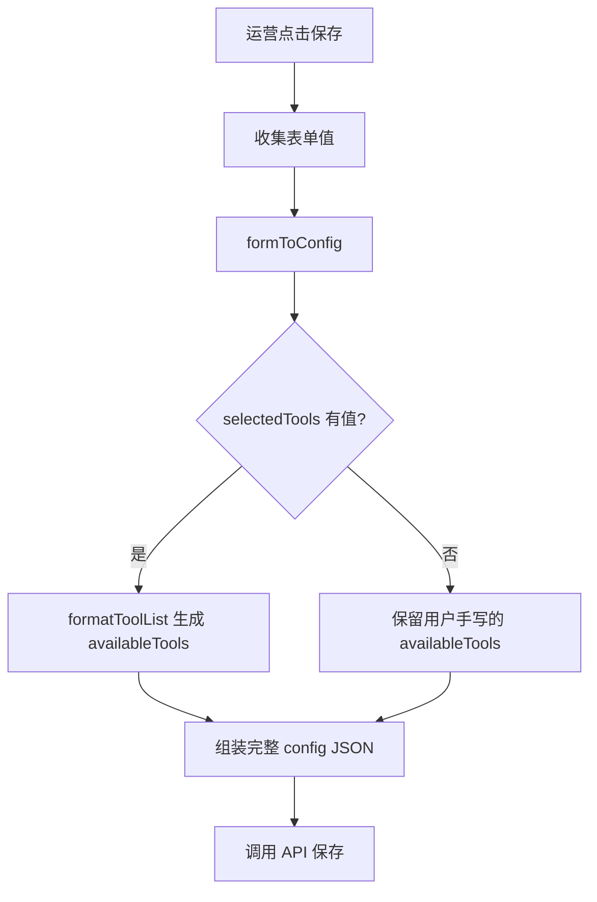
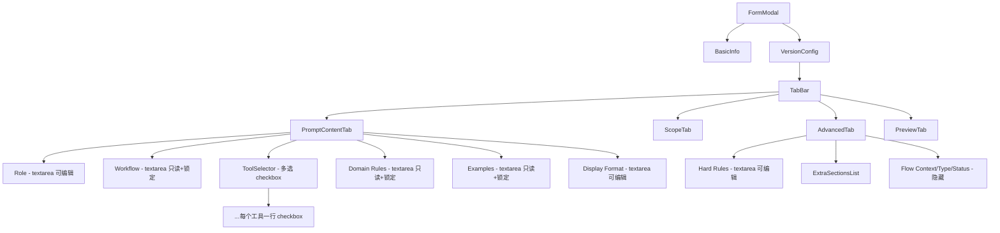

# 53. Prompt 表单升级：模板预填 + 工具选择器架构

> **目标**：运营只需配置文案字段，技术字段（Workflow, Domain Rules, Examples, Tools）从模板自动填充或通过选择器配置。

---

## 1. 问题分析

### 1.1 当前现状

结构化表单已完成（4 Tab 组件），但存在以下问题：

| 问题 | 描述 |
|------|------|
| **字段过多** | 14 个字段全部展示为文本输入框，运营不清楚哪些是必填/可编辑 |
| **技术门槛高** | Workflow、Domain Rules、Examples 需要理解 LLM Prompt 工程 |
| **Tools 手动输入** | availableTools 为 textarea，运营需要知道工具名并手写描述 |
| **无默认模板** | 每次创建需从零填写，没有基于 Domain 的预填数据 |
| **容易出错** | 手写工具名可能拼错，JSON 格式错误等 |

### 1.2 用户需求

> "运营知识配置文案就好，其他tools，看看能不能可以听过option"

运营只需要配：
- **Role**（角色描述）
- **Display Format**（展示格式）
- **Hard Rules**（硬性规则）
- **Extra Sections**（额外章节）
- Scope 相关（scopeDomain, handles, outside）— 可微调

技术字段自动填充：
- **Workflow** → 来自模板
- **Domain Rules** → 来自模板
- **Examples** → 来自模板
- **Available Tools** → 来自工具注册表，多选选择器
- **Flow Context** → 默认 true，隐藏

---

## 2. 现有系统分析

### 2.1 Agent ↔ Tool 映射关系

从 [`orchestrator.config.ts`](apps/api/src/client/ai-customer/graph/config/orchestrator.config.ts:103) 可知 7 个 Agent，每个有对应的 prompt config：

| Agent (tag) | Prompt Config 常量 | 注册的工具 |
|-------------|-------------------|-----------|
| `coupon` | [`couponPromptConfig`](apps/api/src/client/ai-customer/graph/agents/prompts/coupon-prompt.ts:76) | getUserCoupons, claimCoupon, redeemCouponCode, getClaimableCoupons |
| `order` | [`orderPromptConfig`](apps/api/src/client/ai-customer/graph/agents/prompts/order-prompt.ts:62) | getUserOrders, getOrderInfo |
| `product` | [`productPromptConfig`](apps/api/src/client/ai-customer/graph/agents/prompts/product-prompt.ts:64) | searchProducts, getProductDetail, getProductStatus, getHotProducts, getProductCategories |
| `wallet` | [`walletPromptConfig`](apps/api/src/client/ai-customer/graph/agents/prompts/wallet-prompt.ts:78) | getWalletBalance, getWalletTransactions, getKycStatus, getPaymentChannels |
| `user` | [`userPromptConfig`](apps/api/src/client/ai-customer/graph/agents/prompts/user-prompt.ts:91) | getUserProfile, listAddresses, getAddressDetail, createAddress, updateAddress, deleteAddress |
| `kyc` | [`kycPromptConfig`](apps/api/src/client/ai-customer/graph/agents/prompts/kyc-prompt.ts:76) | getKycStatus, getIdTypes |
| `lucky-draw` | [`luckyPromptConfig`](apps/api/src/client/ai-customer/graph/agents/prompts/lucky-prompt.ts:73) | listTickets, listResults, draw, getTicketByOrder, getActiveSessions, getSessionProducts, getFlashProductDetail |

### 2.2 工具注册机制

[`ToolRegistryService`](apps/api/src/client/ai-customer/graph/tools/tool-registry.service.ts:47) 使用标签系统：
- 每个工具通过 `TaggedTool { tool, tags: string[] }` 注册
- 通过 `getToolsByTag(tag)` 按 domain 查询工具
- 所有工具在应用启动时注册（OnApplicationBootstrap）

### 2.3 关键发现

所有 7 个 Agent 的 prompt config 都是静态 `const` 对象，已存在于后端代码中。这意味着：
1. **模板已存在** — 只需通过 API 暴露给前端
2. **工具已注册** — 运行时可通过 ToolRegistry 查询
3. **零冗余** — 不需要额外配置文件

---

## 3. 架构设计

### 3.1 字段分类

| 类别 | 字段 | 当前 Widget | 升级后 | 数据来源 |
|------|------|------------|--------|---------|
| **运营文案** | role | textarea | textarea | 模板预填 + 运营编辑 |
| **运营文案** | displayFormat | textarea | textarea | 模板预填 + 运营编辑 |
| **运营文案** | hardRules | textarea | textarea | 模板预填 + 运营编辑 |
| **运营文案** | extraSections | ExtraSectionsList | ExtraSectionsList | 模板预填 + 运营编辑 |
| **运营可调** | scopeDomain | input | input | 模板预填 + 运营编辑 |
| **运营可调** | handles | TagInput | TagInput | 模板预填 + 微调 |
| **运营可调** | outside | TagInput | TagInput | 模板预填 + 微调 |
| **技术模板** | workflow | textarea | **只读展示 + "还原默认"按钮** | 100% 来自模板 |
| **技术模板** | domainRules | textarea | **只读展示 + "还原默认"按钮** | 100% 来自模板 |
| **技术模板** | examples | textarea | **只读展示 + "还原默认"按钮** | 100% 来自模板 |
| **工具选择** | availableTools | textarea | **多选 checkbox 列表** | 来自工具注册表 |
| **技术固定** | flowContext | checkbox | **隐藏**（始终 true） | 模板固定 |
| **技术固定** | flowType | input | **隐藏** | 模板固定 |
| **技术固定** | flowStatus | input | **隐藏** | 模板固定 |

### 3.2 数据流



### 3.3 后端新端点

#### `GET /admin/ai-prompt/templates`

返回所有可用模板的元数据列表（用于 Domain 下拉的增强提示）：

```json
{
  "templates": [
    {
      "domain": "coupon",
      "label": "Coupon Agent",
      "description": "优惠券查询、领取、兑换"
    },
    { "domain": "order", "label": "Order Agent", "description": "订单查询" },
    { "domain": "product", "label": "Product Agent", "description": "商品搜索、浏览" },
    { "domain": "wallet", "label": "Wallet Agent", "description": "钱包余额、提现" },
    { "domain": "user", "label": "User Agent", "description": "用户资料、地址管理" },
    { "domain": "kyc", "label": "KYC Agent", "description": "KYC 认证查询" },
    { "domain": "lucky-draw", "label": "Lucky Draw Agent", "description": "抽奖、闪购" }
  ]
}
```

#### `GET /admin/ai-prompt/templates/:domain`

返回该 domain 的完整 `AgentPromptConfig` 模板（不含 userId）：

```json
{
  "domain": "coupon",
  "config": {
    "role": "You are the coupon inquiry assistant for JoyMini platform...",
    "workflow": "Step 1: Understand what the user needs...",
    "domainRules": "## Coupon Data Fields...",
    "examples": "User: \"Show me my coupons\"...",
    "displayFormat": "- Show: coupon name, discount value...",
    "scopeRestriction": {
      "domain": "coupon",
      "handles": ["coupon list", "claimable coupons", "claim coupon", "redeem code"],
      "outside": ["wallet", "orders", "products", "lucky-draw"]
    },
    "hardRules": ["- **If a tool call fails...", "- If the conversation history..."],
    "flowContext": true,
    "extraSections": []
  }
}
```

**后端实现思路**：在 [`AiPromptService`](apps/api/src/admin/ai-prompt/ai-prompt.service.ts:8) 中 import 所有 promptConfig 常量，按 domain 返回。

```ts
// ai-prompt.service.ts 新增
import { couponPromptConfig } from '@api/client/ai-customer/graph/agents/prompts/coupon-prompt';
// ... 其他 imports

const TEMPLATE_MAP: Record<string, Omit<AgentPromptConfig, 'userId'>> = {
  coupon: couponPromptConfig,
  order: orderPromptConfig,
  product: productPromptConfig,
  wallet: walletPromptConfig,
  user: userPromptConfig,
  kyc: kycPromptConfig,
  'lucky-draw': luckyPromptConfig,
};

async getTemplate(domain: string) {
  const config = TEMPLATE_MAP[domain];
  if (!config) throw new NotFoundException(`Template not found: ${domain}`);
  return { domain, config };
}
```

#### `GET /admin/ai-prompt/tools?domain=coupon`

返回某个 domain 可用的工具列表：

```json
{
  "domain": "coupon",
  "tools": [
    {
      "name": "getUserCoupons",
      "description": "Get the current user's coupon list. Can filter by status..."
    },
    {
      "name": "claimCoupon",
      "description": "Claim/collect a coupon by coupon template ID..."
    },
    {
      "name": "redeemCouponCode",
      "description": "Redeem a coupon code to claim a specific coupon..."
    },
    {
      "name": "getClaimableCoupons",
      "description": "Get the list of coupons available for claiming..."
    }
  ]
}
```

**后端实现思路**：注入 [`ToolRegistryService`](apps/api/src/client/ai-customer/graph/tools/tool-registry.service.ts:47)，调用 `getToolsByTag(domain)`，映射为 `{ name, description }`。

### 3.4 前端表单增强

#### FormState 接口变更

```ts
// prompt-form-utils.ts
export interface FormState {
  // 运营文案字段（可编辑）
  role: string;
  displayFormat: string;
  hardRules: string;
  extraSections: ExtraSection[];

  // 运营可调字段（可编辑）
  scopeDomain: string;
  handles: string[];
  outside: string[];

  // 技术模板字段（只读，有还原按钮）
  workflow: string;
  domainRules: string;
  examples: string;

  // 工具选择（多选）
  selectedTools: string[];       // <-- NEW: 选中的工具名列表
  availableTools: string;        // <-- 保留，由 selectedTools 自动生成

  // 技术固定字段（隐藏）
  flowContext: boolean;   // 始终 true
  flowType: string;       // 隐藏
  flowStatus: string;     // 隐藏

  // 模板元数据
  templateDomain: string;        // <-- NEW: 当前加载的模板 domain
  isTemplateLoaded: boolean;     // <-- NEW: 模板是否已加载
}
```

#### UI 改动

1. **Domain 选择触发模板加载**
   - 用户选择 Domain → 显示加载状态 → 调用 API 获取模板 → configToForm 填充
   - 模板加载后，技术字段显示锁定图标 + "来自模板" 标签

2. **PromptContentTab 改造**
   - Role：保留 textarea，预填模板值，运营可修改
   - Workflow：变为 `readonly textarea` + 锁定图标 + "还原默认" 按钮
   - Available Tools：变为多选 checkbox 列表（从工具 API 获取）
   - Domain Rules：变为 `readonly textarea` + 锁定图标 + "还原默认" 按钮
   - Examples：变为 `readonly textarea` + 锁定图标 + "还原默认" 按钮
   - Display Format：保留 textarea，预填模板值，运营可修改

3. **AdvancedTab 改造**
   - Hard Rules：保留 textarea，预填模板值
   - Flow Context/Type/Status：隐藏（始终 true/undefined）
   - Extra Sections：保留，可编辑

4. **ScopeTab**
   - scopeDomain, handles, outside：保留，预填模板值

#### 工具选择器行为

- 加载模板时，根据 domain 调用 `GET /admin/ai-prompt/tools?domain=xxx`
- 默认全选该 domain 的所有工具
- 运营可以取消勾选不需要的工具
- 保存时，`formToConfig` 将选中的工具列表格式化为 `availableTools` 文本
- 格式示例：
  ```
  1. **getUserCoupons** - Get the current user's coupon list. Can filter by status: 0=unused, 1=used, 2=expired.
  2. **claimCoupon** - Claim/collect a coupon by coupon template ID.
  ```

### 3.5 兼容性

- **向后兼容**：现有已保存的 prompt config 不受影响（configToForm 仍然可以解析）
- **模板覆盖**：运营编辑文案字段后，如果再选择其他 Domain，会警告"将覆盖当前编辑内容"
- **编辑模式**：编辑已存在的 prompt 时，不会自动重新加载模板（保留已保存的值）

---

## 4. 组件变更清单

### 4.1 后端（4 个文件变更）

| 文件 | 变更 | 说明 |
|------|------|------|
| [`apps/api/src/admin/ai-prompt/ai-prompt.controller.ts`](apps/api/src/admin/ai-prompt/ai-prompt.controller.ts:27) | +4 端点 | `GET /templates`, `GET /templates/:domain`, `GET /tools`, `GET /tools/all` |
| [`apps/api/src/admin/ai-prompt/ai-prompt.service.ts`](apps/api/src/admin/ai-prompt/ai-prompt.service.ts:8) | +2 方法 | `getTemplates()`, `getTools(domain)` |
| [`apps/api/src/admin/ai-prompt/ai-prompt.module.ts`](apps/api/src/admin/ai-prompt/ai-prompt.module.ts:1) | +1 import | import ToolRegistryModule 以注入 ToolRegistryService |
| — | — | 无需新增 DTO（查询参数简单） |

### 4.2 前端（4 个文件变更 + 1 个文件新增）

| 文件 | 变更 | 说明 |
|------|------|------|
| [`apps/admin-next/src/type/types.ts`](apps/admin-next/src/type/types.ts:1691) | +2 类型 | `PromptTemplate`, `PromptToolOption` |
| [`apps/admin-next/src/api/index.ts`](apps/admin-next/src/api/index.ts:1224) | +3 API | `getTemplates()`, `getTemplate(domain)`, `getTools(domain)` |
| [`apps/admin-next/src/components/ai-prompt/prompt-form-utils.ts`](apps/admin-next/src/components/ai-prompt/prompt-form-utils.ts:12) | 修改 | FormState 新增 selectedTools, templateDomain 字段；formToConfig 新增工具列表→文本格式化 |
| [`apps/admin-next/src/components/ai-prompt/PromptContentTab.tsx`](apps/admin-next/src/components/ai-prompt/PromptContentTab.tsx) | 修改 | workflow/domainRules/examples 变只读；availableTools 变多选 checkbox |
| [`apps/admin-next/src/components/ai-prompt/ToolSelector.tsx`](apps/admin-next/src/components/ai-prompt/ToolSelector.tsx) | **新增** | 多选工具选择器组件 |

### 4.3 新增组件：ToolSelector.tsx

```tsx
interface ToolSelectorProps {
  tools: ToolOption[];        // 从 API 获取的工具列表
  selected: string[];         // 当前选中的工具名
  onChange: (tools: string[]) => void;
  disabled?: boolean;
}

interface ToolOption {
  name: string;
  description: string;
}
```

渲染为带 checkbox 的列表，每个工具一行：`[x] getUserCoupons - Get the user's coupon list`

---

## 5. 实施步骤

### Step 1: 后端 — 新增模板 API

1. 在 [`AiPromptService`](apps/api/src/admin/ai-prompt/ai-prompt.service.ts) 中 import 所有 7 个 promptConfig 常量
2. 新增 `getTemplates()` 方法（返回 metadata 列表）
3. 新增 `getTemplate(domain)` 方法（返回完整 config）
4. 新增 `getTools(domain?)` 方法（注入 ToolRegistryService，调用 getToolsByTag）
5. 在 [`AiPromptController`](apps/api/src/admin/ai-prompt/ai-prompt.controller.ts) 注册 3 个新端点
6. 在 [`AiPromptModule`](apps/api/src/admin/ai-prompt/ai-prompt.module.ts) import ToolRegistryModule

### Step 2: 前端 — 类型和 API

1. 在 [`types.ts`](apps/admin-next/src/type/types.ts) 新增 `PromptTemplate` 和 `PromptToolOption` 类型
2. 在 [`api/index.ts`](apps/admin-next/src/api/index.ts) 新增 2 个 API 调用

### Step 3: 前端 — FormState 升级

1. 修改 [`prompt-form-utils.ts`](apps/admin-next/src/components/ai-prompt/prompt-form-utils.ts)
   - FormState 新增 `selectedTools: string[]`, `templateDomain: string`, `isTemplateLoaded: boolean`
   - 新增 `formatToolList(tools: ToolOption[], selected: string[]): string`
   - 修改 `formToConfig`：优先使用 `selectedTools` 生成 availableTools

### Step 4: 前端 — 创建 ToolSelector 组件

1. 新建 [`ToolSelector.tsx`](apps/admin-next/src/components/ai-prompt/ToolSelector.tsx)
   - 带 checkbox 的多选列表
   - 搜索/过滤功能（可选）
   - 全选/取消全选按钮
   - 选中数量显示

### Step 5: 前端 — Tab 组件改造

1. 修改 [`PromptContentTab.tsx`](apps/admin-next/src/components/ai-prompt/PromptContentTab.tsx)
   - Workflow 字段：添加 `readOnly` 属性 + 锁定图标 + "还原默认" 按钮
   - Available Tools 字段：替换为 `<ToolSelector>`
   - Domain Rules 字段：添加 `readOnly` 属性 + 锁定图标 + "还原默认" 按钮
   - Examples 字段：添加 `readOnly` 属性 + 锁定图标 + "还原默认" 按钮
   - 各只读字段旁显示 "来自模板" 标签

2. 修改 [`AdvancedTab.tsx`](apps/admin-next/src/components/ai-prompt/AdvancedTab.tsx)
   - 隐藏 Flow Context / Flow Type / Flow Status
   - 或者放入 "高级技术选项" 可折叠区域

### Step 6: 前端 — 模板加载逻辑

1. 修改 [`AiPromptClient.tsx`](apps/admin-next/src/components/ai-prompt/AiPromptClient.tsx) 的 FormModal
   - Domain 选择变化时调用 `getTemplate(domain)` 和 `getTools(domain)`
   - 加载过程中显示 skeleton/spinner
   - 加载完成后调用 `configToForm` 填充 all fields
   - 如果已有编辑内容，显示确认对话框

2. 修改 [`AiPromptDetailClient.tsx`](apps/admin-next/src/components/ai-prompt/AiPromptDetailClient.tsx) 的 VersionFormContent
   - 同样的模板加载逻辑
   - 编辑已有版本时不自动加载模板

---

## 6. Mermaid 流程图

### 6.1 模板加载流程



### 6.2 保存流程



### 6.3 组件树（更新后）



---

## 7. 边界情况

| 场景 | 处理方式 |
|------|---------|
| 运营修改模板字段后切换 Domain | 弹出确认："切换 Domain 将重置技术字段为默认值，是否继续？" |
| 工具 API 返回空列表 | 显示 "该 Domain 无可用工具" 提示，fallback 到 textarea 手写模式 |
| 模板加载失败 | 显示错误 toast + fallback 到空表单，运营可手填 |
| 编辑已存在的 prompt | 不自动加载模板，保留已保存的值；显示 "已加载已保存配置" 提示 |
| 运营手动修改了只读字段 | 禁用编辑（readOnly），但提供 "覆盖模板值" 切换开关（高级选项） |
| 新增 Agent（未来） | 只需后端加新的 prompt config 和工具注册，API 自动包含新模板 |

---

## 8. 验收标准

1. [ ] 选择 Domain → 自动加载对应模板（Role, Workflow, Tools, 等全部预填）
2. [ ] 技术字段（Workflow, Domain Rules, Examples）显示为只读，带锁定图标
3. [ ] 工具字段显示为多选 checkbox，默认全选当前 domain 的工具
4. [ ] 运营可自由编辑 Role, Display Format, Hard Rules, Extra Sections
5. [ ] 运营可微调 Scope Domain, Handles, Outside
6. [ ] 保存后生成的 JSON config 与原始模板结构一致
7. [ ] 切换 Domain 时有确认提示
8. [ ] 编辑已存在的 prompt 不自动加载模板
9. [ ] 所有后端端点有正确的 Auth guard（AdminJwtAuthGuard + RolesGuard）
10. [ ] TypeScript 编译零错误
