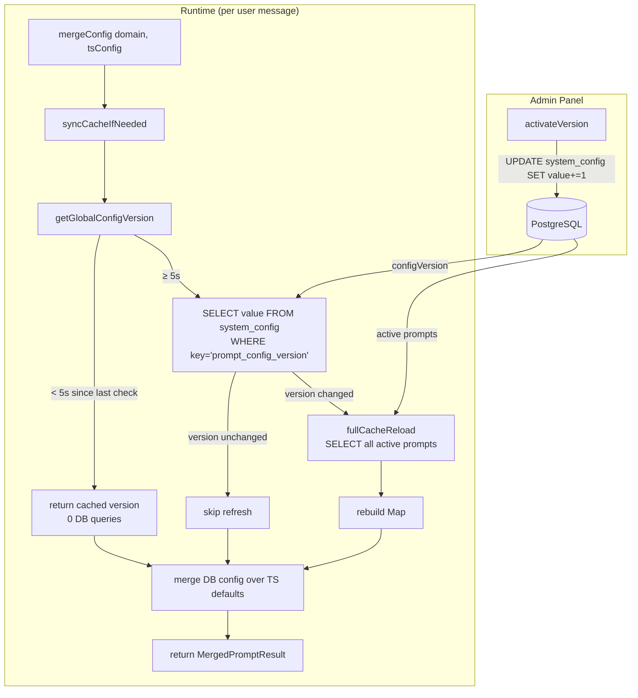

# 54. PromptResolver 缓存热更新方案

> **目标**：为 PromptResolverService 添加内存缓存 + DB 全局版本号 + 5 秒版本号缓存，将运行时 DB 查询从每消息 1 次降至接近 0。

---

## 1. 问题分析

### 1.1 当前现状

[`PromptResolverService.mergeConfig()`](apps/api/src/client/ai-customer/knowledge/prompt-resolver.service.ts:95) 在每次用户消息时都会查询 DB：

```typescript
// 当前：每次调用都查 DB
const dbPrompt = await this.prisma.knowledgePrompt.findFirst({
  where: { name: domain, status: 'active' },
  include: { versions: { where: { isActive: true }, take: 1 } },
});
```

### 1.2 性能数据

| 指标 | 当前值 |
|------|--------|
| 每次用户消息 DB 查询 | **1 次**（`KnowledgePrompt` + `KnowledgePromptVersion` JOIN） |
| 100 并发 × 10 msg/s | **3000 次 DB 查询/秒** |
| 每次查询耗时 | ~3-5ms（主键 + 索引查询） |
| 管理员激活版本频率 | 每天几次（极低） |

### 1.3 痛点

- **不必要的 DB 压力**：管理员可能几小时甚至几天才改一次 Prompt，但每次用户消息都查 DB
- **无热更新机制**：当前代码在 [`ai-prompt.service.ts:262`](apps/api/src/admin/ai-prompt/ai-prompt.service.ts:262) 有 TODO 注释，说明缓存方案是计划内的
- **扩展性限制**：未来用户量增长时，DB 会成为瓶颈

---

## 2. 方案设计

### 2.1 核心思路

```
┌─────────────────────────────────────────────────────────┐
│                    PromptResolverService                  │
│                                                          │
│  mergeConfig(domain, tsConfig)                           │
│    │                                                     │
│    ├── syncCacheIfNeeded()  ← 检查版本号是否变化          │
│    │     │                                                │
│    │     ├── getGlobalConfigVersion()                     │
│    │     │     ├── 距上次检查 < 5s → 返回缓存版本号 (0 DB)│
│    │     │     └── ≥ 5s → SELECT value FROM system_config │
│    │     │              WHERE key='prompt_config_version' │
│    │     │                                                │
│    │     ├── 版本号没变 → return (0 DB)                   │
│    │     └── 版本号变了 → 全量刷新 cache (1 DB)           │
│    │                                                      │
│    └── 从 cache Map 取 domain → 有则合并，无则 TS 默认    │
│                                                          │
│  activateVersion() 触发时 → UPDATE system_config SET     │
│    value = value + 1 WHERE key='prompt_config_version'   │
└─────────────────────────────────────────────────────────┘
```

### 2.2 架构图



### 2.3 缓存数据结构

```typescript
// 内存缓存：domain → CacheEntry
private cache = new Map<string, CacheEntry>();

interface CacheEntry {
  config: Record<string, unknown>;     // DB 中存储的完整 config JSON
  version: number;                      // 活跃版本号
  promptName: string;                   // prompt name（即 domain）
}

// 全局版本号快照
private cachedConfigVersion: number | null = null;

// 上次检查版本号的时间戳
private lastVersionCheck = 0;

// 版本号检查间隔
private readonly VERSION_CHECK_INTERVAL_MS = 5000;
```

---

## 3. 改动清单

### 3.1 文件清单

| # | 文件 | 改动类型 | 说明 |
|---|------|----------|------|
| 1 | [`apps/api/prisma/schema.prisma`](apps/api/prisma/schema.prisma:1944) | **新增模型** | 添加 `SystemConfig` 模型 |
| 2 | [`apps/api/src/admin/ai-prompt/ai-prompt.service.ts`](apps/api/src/admin/ai-prompt/ai-prompt.service.ts:262) | **修改方法** | `activateVersion()` 中递增全局版本号 |
| 3 | [`apps/api/src/client/ai-customer/knowledge/prompt-resolver.service.ts`](apps/api/src/client/ai-customer/knowledge/prompt-resolver.service.ts:71) | **重写类** | 添加缓存逻辑，`mergeConfig()` 改为从缓存读取 |
| 4 | 任意 Module（建议 `AiPromptModule` 或 `AiCustomerModule`） | **新增 seed** | `onModuleInit()` 中 upsert 初始版本号记录 |

### 3.2 详细改动

#### 3.2.1 Prisma Schema — 新增 `SystemConfig` 模型

在 [`apps/api/prisma/schema.prisma`](apps/api/prisma/schema.prisma:1944) 末尾（`KnowledgePromptEvalLog` 之后）追加：

```prisma
/// Global config version for hot-reload cache invalidation
model SystemConfig {
  id        String   @id @default(cuid()) @db.VarChar(32)
  key       String   @unique @db.VarChar(128)
  value     Int      @default(0)
  updatedAt DateTime @updatedAt

  @@map("system_config")
}
```

**字段说明**：

| 字段 | 类型 | 说明 |
|------|------|------|
| `id` | String (CUID) | 主键 |
| `key` | String (unique) | 配置键名，如 `prompt_config_version` |
| `value` | Int | 版本号值，每次激活版本时递增 |
| `updatedAt` | DateTime | 自动更新时间戳 |

**迁移命令**：
```bash
yarn workspace @lucky/api prisma migrate dev --create-only --name add_system_config
```

#### 3.2.2 `ai-prompt.service.ts` — 激活版本时递增版本号

修改 [`apps/api/src/admin/ai-prompt/ai-prompt.service.ts`](apps/api/src/admin/ai-prompt/ai-prompt.service.ts:229) 的 `activateVersion()` 方法：

**当前代码**（第 247-263 行）：
```typescript
await this.prisma.$transaction([
  this.prisma.knowledgePromptVersion.updateMany({
    where: { promptId, isActive: true },
    data: { isActive: false },
  }),
  this.prisma.knowledgePromptVersion.update({
    where: { id: versionRecord.id },
    data: { isActive: true },
  }),
  this.prisma.knowledgePrompt.update({
    where: { id: promptId },
    data: { activeVersion: version },
  }),
]);

// TODO: increment global configVersion for hot-reload (Phase 2c)
```

**修改后**：
```typescript
await this.prisma.$transaction([
  this.prisma.knowledgePromptVersion.updateMany({
    where: { promptId, isActive: true },
    data: { isActive: false },
  }),
  this.prisma.knowledgePromptVersion.update({
    where: { id: versionRecord.id },
    data: { isActive: true },
  }),
  this.prisma.knowledgePrompt.update({
    where: { id: promptId },
    data: { activeVersion: version },
  }),
  // ★ 递增全局 configVersion，触发 PromptResolver 热更新缓存
  this.prisma.systemConfig.update({
    where: { key: 'prompt_config_version' },
    data: { value: { increment: 1 } },
  }),
]);
```

#### 3.2.3 `prompt-resolver.service.ts` — 完整重写

替换 [`apps/api/src/client/ai-customer/knowledge/prompt-resolver.service.ts`](apps/api/src/client/ai-customer/knowledge/prompt-resolver.service.ts:71) 的整个类：

**新增依赖**：
- `OnModuleInit`（从 `@nestjs/common` 导入）

**新增私有成员**：
```typescript
private cache = new Map<string, CacheEntry>();
private cachedConfigVersion: number | null = null;
private lastVersionCheck = 0;
private readonly VERSION_CHECK_INTERVAL_MS = 5000;
private readonly CONFIG_VERSION_KEY = 'prompt_config_version';
```

**核心方法实现**：

```typescript
// ── 启动时初始化缓存 ──
async onModuleInit() {
  await this.fullCacheReload();
  this.logger.log(`Cache initialized with ${this.cache.size} entries`);
}

// ── mergeConfig 改为缓存版本 ──
async mergeConfig(domain: string, tsConfig: Omit<AgentPromptConfig, 'userId'>): Promise<MergedPromptResult> {
  try {
    await this.syncCacheIfNeeded();
    const cached = this.cache.get(domain);
    if (!cached) {
      return { config: tsConfig, version: null, promptName: null };
    }
    // 合并 DB config 到 TS defaults
    const merged: Omit<AgentPromptConfig, 'userId'> = {
      ...tsConfig,
      ...cached.config,
    };
    // scopeRestriction 深度合并
    if (cached.config.scopeRestriction && tsConfig.scopeRestriction) {
      merged.scopeRestriction = {
        ...tsConfig.scopeRestriction,
        ...(cached.config.scopeRestriction as Record<string, unknown>),
      };
    } else if (cached.config.scopeRestriction) {
      merged.scopeRestriction = cached.config.scopeRestriction as any;
    }
    return { config: merged, version: cached.version, promptName: cached.promptName };
  } catch (err) {
    this.logger.error(`mergeConfig(${domain}) failed: ${(err as Error).message}`);
    return { config: tsConfig, version: null, promptName: null };
  }
}

// ── 检查版本号，必要时刷新缓存 ──
private async syncCacheIfNeeded(): Promise<void> {
  const currentVersion = await this.getGlobalConfigVersion();
  if (currentVersion === this.cachedConfigVersion) return;
  await this.fullCacheReload();
  this.cachedConfigVersion = currentVersion;
}

// ── 获取全局版本号（带 5 秒 TTL）──
private async getGlobalConfigVersion(): Promise<number> {
  if (
    this.cachedConfigVersion !== null &&
    Date.now() - this.lastVersionCheck < this.VERSION_CHECK_INTERVAL_MS
  ) {
    return this.cachedConfigVersion;
  }
  try {
    const record = await this.prisma.systemConfig.findUnique({
      where: { key: this.CONFIG_VERSION_KEY },
    });
    this.cachedConfigVersion = record?.value ?? 0;
  } catch {
    if (this.cachedConfigVersion === null) this.cachedConfigVersion = 0;
  }
  this.lastVersionCheck = Date.now();
  return this.cachedConfigVersion;
}

// ── 全量刷新缓存 ──
private async fullCacheReload(): Promise<void> {
  try {
    const allActive = await this.prisma.knowledgePrompt.findMany({
      where: { status: 'active' },
      include: {
        versions: {
          where: { isActive: true },
          take: 1,
          orderBy: { version: 'desc' },
        },
      },
    });
    const newCache = new Map<string, CacheEntry>();
    for (const prompt of allActive) {
      if (prompt.versions.length === 0) continue;
      const activeVersion = prompt.versions[0];
      newCache.set(prompt.name, {
        config: activeVersion.config as Record<string, unknown>,
        version: activeVersion.version,
        promptName: prompt.name,
      });
    }
    this.cache = newCache;
  } catch (err) {
    this.logger.error(`fullCacheReload failed: ${(err as Error).message}`);
  }
}
```

#### 3.2.4 初始化种子数据

在 [`AiPromptModule`](apps/api/src/admin/ai-prompt/ai-prompt.module.ts) 或 [`AiCustomerModule`](apps/api/src/client/ai-customer/ai-customer.module.ts) 中添加：

```typescript
@Module({ ... })
export class AiPromptModule implements OnModuleInit {
  constructor(private readonly prisma: PrismaService) {}

  async onModuleInit() {
    await this.prisma.systemConfig.upsert({
      where: { key: 'prompt_config_version' },
      update: {},
      create: { key: 'prompt_config_version', value: 0 },
    });
  }
}
```

或者直接 SQL：
```sql
INSERT INTO system_config (id, key, value, updated_at)
VALUES (gen_random_uuid(), 'prompt_config_version', 0, NOW())
ON CONFLICT (key) DO NOTHING;
```

---

## 4. 性能对比

### 4.1 DB 查询次数

| 场景 | 改造前 | 改造后 |
|------|--------|--------|
| 每次用户消息（稳态，版本号未变） | 1 次 DB 查询 | **0 次 DB 查询** |
| 每 5 秒（版本号未变） | 5 次 DB 查询 | **1 次 DB 查询**（查版本号） |
| 管理员激活版本后首次请求（≤5s） | 1 次 DB 查询 | **2 次 DB 查询**（版本号 + 全量刷新） |
| 管理员激活版本后首次请求（>5s） | 1 次 DB 查询 | **2 次 DB 查询**（版本号 + 全量刷新） |
| 服务启动时 | 0 次 | **1 次**（`onModuleInit` 全量刷新） |

### 4.2 高并发场景

| 指标 | 改造前 | 改造后 |
|------|--------|--------|
| 100 并发 × 10 msg/s | **3000 次 DB 查询/秒** | **~0 次 DB 查询/秒**（稳态） |
| DB 连接池压力 | 高（每个请求都占用连接） | 极低（仅每 5 秒 1 次） |
| 响应延迟抖动 | 有（DB 查询耗时 3-5ms） | 无（纯内存操作） |

### 4.3 内存开销

| 项目 | 大小 |
|------|------|
| 每个 CacheEntry（config JSON ~2KB） | ~2KB |
| 7 个 Agent 总计 | ~14KB |
| Map 结构开销 | ~1KB |
| **总计** | **< 16KB** |

---

## 5. 关键设计决策

### 5.1 为什么用全量刷新而不是逐条失效？

| 方案 | 优点 | 缺点 |
|------|------|------|
| **全量刷新（选用）** | 实现简单，逻辑可靠 | 版本变化时多查 1 次 DB |
| 逐条失效 | 版本变化时 0 次额外 DB 查询 | 需要记录哪个 domain 变了，复杂度高 |

**决策理由**：管理员激活版本的操作频率极低（每天几次），全量刷新的额外开销可以忽略不计。

### 5.2 为什么版本号检查间隔是 5 秒？

- **用户体验**：管理员激活版本后，最多等 5 秒就能看到效果
- **DB 压力**：5 秒内 0 DB 查询，对 DB 几乎零压力
- **实现简单**：不需要额外的消息队列或事件总线

### 5.3 为什么不用 Redis？

| 方案 | 优点 | 缺点 |
|------|------|------|
| **内存 Map（选用）** | 零外部依赖，延迟 < 0.1ms | 多实例部署时缓存不一致 |
| Redis | 多实例共享缓存 | 引入新中间件，运维成本高 |

**决策理由**：当前是单实例部署，7 个 Agent × ~2KB = ~14KB，内存 Map 足够。如果未来多实例部署，可以升级为 Redis。

### 5.4 异常安全策略

| 失败场景 | 行为 |
|----------|------|
| `getGlobalConfigVersion()` DB 查询失败 | 保留旧版本号，下次重试 |
| `fullCacheReload()` DB 查询失败 | 保留旧缓存，不阻塞对话 |
| `mergeConfig()` 任何异常 | 回退到 TS 默认配置 |
| 服务启动时 DB 不可用 | `onModuleInit` 失败，首次请求时 `syncCacheIfNeeded` 会重试 |

---

## 6. 验收标准

### 6.1 功能验收

| # | 验收项 | 预期结果 |
|---|--------|----------|
| 1 | 管理员激活新版本后，≤5 秒内运行时生效 | 新版本 Prompt 在 5 秒内被使用 |
| 2 | 没有活跃 override 的 Agent 正常使用 TS 默认 | `mergeConfig` 返回 `version: null` |
| 3 | 管理员停用 Prompt 后，≤5 秒内回退到 TS 默认 | 缓存刷新后该 domain 不在 cache 中 |
| 4 | DB 查询失败时不影响对话流程 | 回退到 TS 默认，日志记录错误 |

### 6.2 性能验收

| # | 验收项 | 预期结果 |
|---|--------|----------|
| 1 | 100 次连续 `mergeConfig` 调用 | 0 次 DB 查询（5 秒 TTL 内） |
| 2 | 服务启动后首次调用 | 1 次 DB 查询（`onModuleInit`） |
| 3 | 内存占用 | < 1MB（远低于警戒线） |

### 6.3 回滚方案

如果缓存方案出现问题，可以快速回退到无缓存版本：

1. **临时关闭**：在 `mergeConfig()` 中加一个 feature flag，跳过缓存逻辑
2. **永久回滚**：`git revert` 相关 commit，保留 `SystemConfig` 表（不影响其他功能）

---

## 7. 未来扩展

### 7.1 多实例部署升级

当需要多实例部署时，将内存 Map 替换为 Redis：

```typescript
// 未来：Redis 版本
private async getGlobalConfigVersion(): Promise<number> {
  const version = await this.redis.get('prompt_config_version');
  return version ? parseInt(version, 10) : 0;
}

private async fullCacheReload(): Promise<void> {
  const allActive = await this.prisma.knowledgePrompt.findMany({ ... });
  // 写入 Redis Hash
  for (const prompt of allActive) {
    await this.redis.hset('prompt_cache', prompt.name, JSON.stringify({ ... }));
  }
}
```

### 7.2 更多 SystemConfig 用途

| key | value | 用途 |
|-----|-------|------|
| `prompt_config_version` | `3` | Prompt 缓存版本号 |
| `rag_knowledge_version` | `2` | RAG 知识库版本号（未来） |
| `system_maintenance` | `0` | 系统维护开关（未来） |

---

## 附录 A：完整代码

### A.1 `prompt-resolver.service.ts` 完整代码

```typescript
import { Injectable, Logger, OnModuleInit } from '@nestjs/common';
import { PrismaService } from '@api/common/prisma/prisma.service';
import { AgentPromptConfig } from '@api/client/ai-customer/graph/agents/prompt-builder';

// ============================================================
// Types
// ============================================================

export interface MergedPromptResult {
  config: Omit<AgentPromptConfig, 'userId'>;
  version: number | null;
  promptName: string | null;
}

export interface EvalLogData {
  promptName: string;
  version: number;
  sessionId: string;
  toolCallCount?: number;
  toolFailCount?: number;
  totalTokens?: number;
  latencyMs?: number;
  hallucinationFlagged?: boolean;
  judgeScore?: number;
  judgeReason?: string;
}

interface CacheEntry {
  config: Record<string, unknown>;
  version: number;
  promptName: string;
}

// ============================================================
// Service
// ============================================================

@Injectable()
export class PromptResolverService implements OnModuleInit {
  private readonly logger = new Logger(PromptResolverService.name);

  private cache = new Map<string, CacheEntry>();
  private cachedConfigVersion: number | null = null;
  private lastVersionCheck = 0;
  private readonly VERSION_CHECK_INTERVAL_MS = 5000;
  private readonly CONFIG_VERSION_KEY = 'prompt_config_version';

  constructor(private readonly prisma: PrismaService) {}

  async onModuleInit() {
    await this.fullCacheReload();
    this.logger.log(`[PromptResolver] Cache initialized with ${this.cache.size} entries`);
  }

  async mergeConfig(
    domain: string,
    tsConfig: Omit<AgentPromptConfig, 'userId'>,
  ): Promise<MergedPromptResult> {
    try {
      await this.syncCacheIfNeeded();

      const cached = this.cache.get(domain);
      if (!cached) {
        return { config: tsConfig, version: null, promptName: null };
      }

      const merged: Omit<AgentPromptConfig, 'userId'> = {
        ...tsConfig,
        ...cached.config,
      };

      if (cached.config.scopeRestriction && tsConfig.scopeRestriction) {
        merged.scopeRestriction = {
          ...tsConfig.scopeRestriction,
          ...(cached.config.scopeRestriction as Record<string, unknown>),
        };
      } else if (cached.config.scopeRestriction) {
        merged.scopeRestriction = cached.config.scopeRestriction as any;
      }

      return {
        config: merged,
        version: cached.version,
        promptName: cached.promptName,
      };
    } catch (err) {
      this.logger.error(
        `[PromptResolver] mergeConfig(${domain}) failed: ${(err as Error).message}`,
      );
      return { config: tsConfig, version: null, promptName: null };
    }
  }

  async recordEval(data: EvalLogData): Promise<void> {
    try {
      await this.prisma.knowledgePromptEvalLog.create({
        data: {
          promptName: data.promptName,
          version: data.version,
          sessionId: data.sessionId,
          toolCallCount: data.toolCallCount ?? 0,
          toolFailCount: data.toolFailCount ?? 0,
          totalTokens: data.totalTokens ?? 0,
          latencyMs: data.latencyMs,
          hallucinationFlagged: data.hallucinationFlagged ?? false,
          judgeScore: data.judgeScore,
          judgeReason: data.judgeReason,
        },
      });
    } catch (err) {
      this.logger.error(
        `[PromptResolver] recordEval failed: ${(err as Error).message}`,
      );
    }
  }

  private async syncCacheIfNeeded(): Promise<void> {
    const currentVersion = await this.getGlobalConfigVersion();
    if (currentVersion === this.cachedConfigVersion) return;

    this.logger.log(
      `[PromptResolver] configVersion changed: ${this.cachedConfigVersion} → ${currentVersion}, reloading cache`,
    );
    await this.fullCacheReload();
    this.cachedConfigVersion = currentVersion;
  }

  private async getGlobalConfigVersion(): Promise<number> {
    if (
      this.cachedConfigVersion !== null &&
      Date.now() - this.lastVersionCheck < this.VERSION_CHECK_INTERVAL_MS
    ) {
      return this.cachedConfigVersion;
    }

    try {
      const record = await this.prisma.systemConfig.findUnique({
        where: { key: this.CONFIG_VERSION_KEY },
      });
      this.cachedConfigVersion = record?.value ?? 0;
    } catch {
      if (this.cachedConfigVersion === null) {
        this.cachedConfigVersion = 0;
      }
    }

    this.lastVersionCheck = Date.now();
    return this.cachedConfigVersion;
  }

  private async fullCacheReload(): Promise<void> {
    try {
      const allActive = await this.prisma.knowledgePrompt.findMany({
        where: { status: 'active' },
        include: {
          versions: {
            where: { isActive: true },
            take: 1,
            orderBy: { version: 'desc' },
          },
        },
      });

      const newCache = new Map<string, CacheEntry>();
      for (const prompt of allActive) {
        if (prompt.versions.length === 0) continue;
        const activeVersion = prompt.versions[0];
        newCache.set(prompt.name, {
          config: activeVersion.config as Record<string, unknown>,
          version: activeVersion.version,
          promptName: prompt.name,
        });
      }

      this.cache = newCache;
      this.logger.log(
        `[PromptResolver] Cache reloaded: ${this.cache.size} active prompts`,
      );
    } catch (err) {
      this.logger.error(
        `[PromptResolver] fullCacheReload failed: ${(err as Error).message}`,
      );
    }
  }
}
```

### A.2 `ai-prompt.service.ts` `activateVersion()` 修改后代码

```typescript
async activateVersion(promptId: string, version: number) {
  const prompt = await this.prisma.knowledgePrompt.findUnique({
    where: { id: promptId },
  });
  if (!prompt) {
    throw new NotFoundException(`Prompt "${promptId}" not found`);
  }

  const versionRecord = await this.prisma.knowledgePromptVersion.findFirst({
    where: { promptId, version },
  });
  if (!versionRecord) {
    throw new NotFoundException(
      `Version ${version} not found for prompt "${promptId}"`,
    );
  }

  await this.prisma.$transaction([
    this.prisma.knowledgePromptVersion.updateMany({
      where: { promptId, isActive: true },
      data: { isActive: false },
    }),
    this.prisma.knowledgePromptVersion.update({
      where: { id: versionRecord.id },
      data: { isActive: true },
    }),
    this.prisma.knowledgePrompt.update({
      where: { id: promptId },
      data: { activeVersion: version },
    }),
    // ★ 递增全局 configVersion，触发 PromptResolver 热更新缓存
    this.prisma.systemConfig.update({
      where: { key: 'prompt_config_version' },
      data: { value: { increment: 1 } },
    }),
  ]);

  this.logger.log(
    `Activated version ${version} for prompt ${prompt.name}, ` +
    `configVersion incremented for hot-reload`,
  );
}
```

### A.3 Prisma Schema 新增模型

```prisma
/// Global config version for hot-reload cache invalidation
model SystemConfig {
  id        String   @id @default(cuid()) @db.VarChar(32)
  key       String   @unique @db.VarChar(128)
  value     Int      @default(0)
  updatedAt DateTime @updatedAt

  @@map("system_config")
}
```
