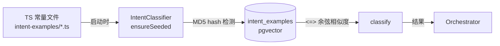
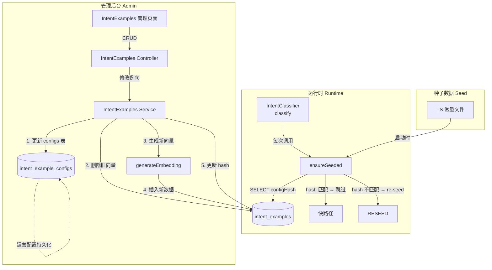
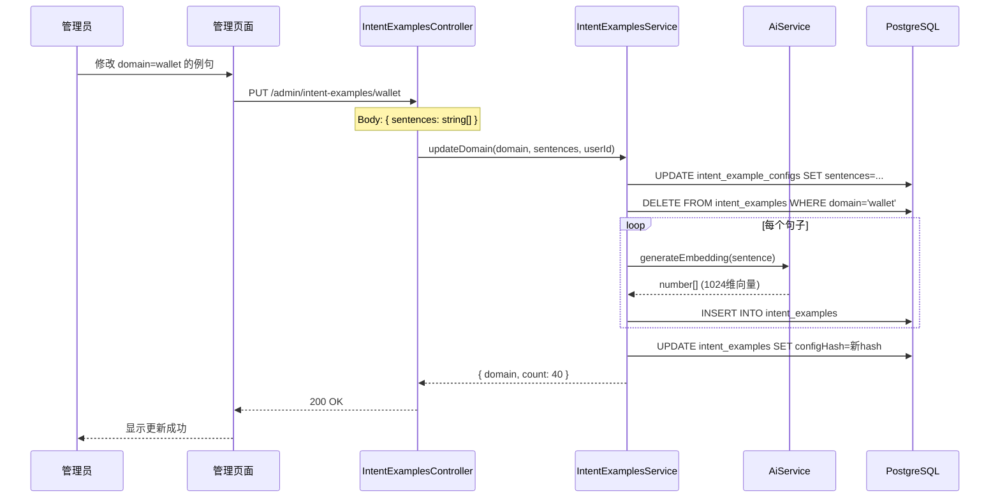
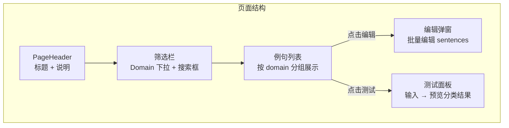
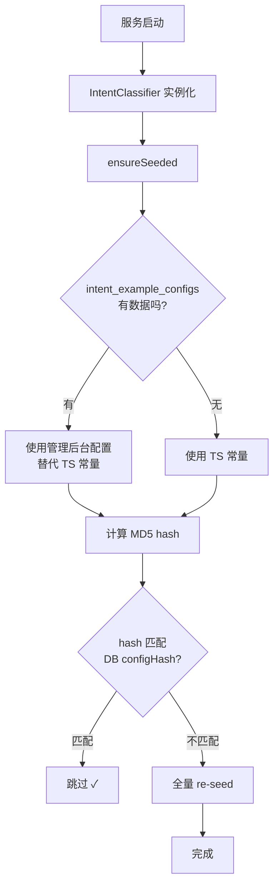
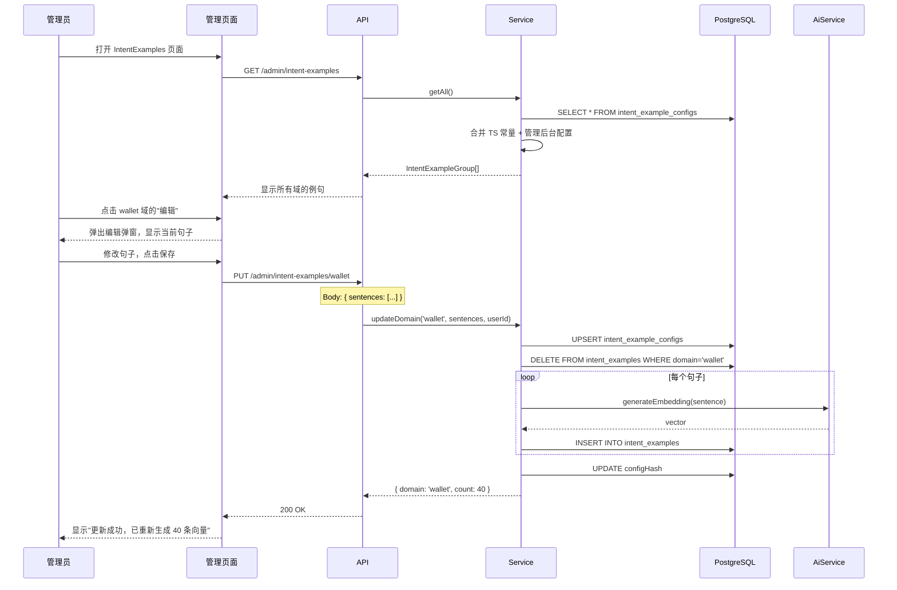

# 55. IntentExamples 后台管理规格说明书

## 目录

1. [背景与现状](#1-背景与现状)
2. [需求分析](#2-需求分析)
3. [架构设计](#3-架构设计)
4. [后端设计](#4-后端设计)
5. [前端设计](#5-前端设计)
6. [数据流](#6-数据流)
7. [文件清单](#7-文件清单)
8. [实现步骤](#8-实现步骤)
9. [边界情况](#9-边界情况)
10. [验收标准](#10-验收标准)

---

## 1. 背景与现状

### 1.1 当前架构

IntentExamples 是 AI Customer 意图分类系统的核心数据源。当前工作流程：



**关键文件：**

| 文件 | 作用 |
|------|------|
| [`intent-examples/index.ts`](../../apps/api/src/client/ai-customer/graph/agents/prompts/intent-examples/index.ts) | 统一入口，定义 `INTENT_EXAMPLE_GROUPS` |
| [`intent-examples/wallet.ts`](../../apps/api/src/client/ai-customer/graph/agents/prompts/intent-examples/wallet.ts) | 各域例句（9 个域各一个文件） |
| [`intent-classifier.ts`](../../apps/api/src/client/ai-customer/graph/utils/intent-classifier.ts) | `ensureSeeded()` + `classify()` 核心逻辑 |
| [`schema.prisma`](../../apps/api/prisma/schema.prisma#1696) | `IntentExample` 模型定义 |

### 1.2 当前痛点

1. **无后台管理** — 例句只能通过修改 TS 文件 + 重启服务来更新
2. **运营无法干预** — 无法在线增删改例句来优化分类准确率
3. **无版本管理** — 修改后无法回滚
4. **无预览/测试** — 修改例句后无法立即测试分类效果

### 1.3 技术约束

- `intent_examples` 表同时被 `ensureSeeded()` 的 TS hash 机制管理
- 例句需要生成 1024 维 embedding 向量（通过 Ollama bge-m3）
- 分类时使用 pgvector `<=>` 余弦距离运算符
- `ensureSeeded()` 在每次 `classify()` 调用时都会执行（快路径：仅查 hash）

---

## 2. 需求分析

### 2.1 功能需求

| # | 需求 | 优先级 | 说明 |
|---|------|--------|------|
| F1 | 例句列表 | P0 | 按 domain 分组展示所有例句，支持分页/搜索 |
| F2 | 新增例句 | P0 | 选择 domain，输入句子文本 |
| F3 | 编辑例句 | P0 | 修改句子文本 |
| F4 | 删除例句 | P0 | 删除单条例句 |
| F5 | 批量新增 | P1 | 一次粘贴多个句子，自动分配到指定 domain |
| F6 | 重新生成向量 | P0 | 例句变更后触发 embedding 重新生成 |
| F7 | 分类测试 | P1 | 输入用户问题，预览分类结果 |
| F8 | 操作日志 | P1 | 记录谁在何时修改了例句 |

### 2.2 非功能需求

| # | 需求 | 说明 |
|---|------|------|
| N1 | 不影响运行时性能 | 管理端操作不阻塞 `classify()` 调用 |
| N2 | 向量生成异步 | 重新生成 embedding 时使用后台队列 |
| N3 | 向后兼容 | 现有 TS 文件仍可作为"种子数据"来源 |
| N4 | 权限控制 | 仅 SUPER_ADMIN / ADMIN 可修改，VIEWER 只读 |

---

## 3. 架构设计

### 3.1 核心设计决策

**决策 1：DB 作为 Source of Truth，TS 文件作为 Seed**

当前 `ensureSeeded()` 使用 MD5 hash 检测 TS 文件是否变化。引入管理后台后：

- **DB 成为 Source of Truth** — 所有运行时分类查询都从 DB 读取
- **TS 文件保留为 Seed** — 首次部署或重置时，从 TS 文件 seeding
- **管理后台修改后** — 更新 `configHash`，使 `ensureSeeded()` 跳过（因为 hash 匹配）
- **TS 文件修改后** — hash 不匹配，触发 re-seed（覆盖管理后台修改）

> **⚠️ 冲突处理**：如果运营在后台修改了例句，然后开发者修改了 TS 文件并部署，TS 的 hash 会覆盖后台修改。这是有意设计——代码变更优先级高于运营配置。

**决策 2：新增 `intent_example_configs` 表存储管理后台的配置**

不直接修改 `intent_examples` 表，而是新增一个配置表来跟踪管理后台的状态：

```prisma
model IntentExampleConfig {
  id            String   @id @default(cuid()) @db.VarChar(32)
  domain        String   @unique @db.VarChar(32)
  sentences     String   @db.Text  // JSON array of strings
  configHash    String   @db.VarChar(64)
  updatedAt     DateTime @updatedAt
  updatedBy     String?  @db.VarChar(32)
}
```

**决策 3：管理后台修改 → 直接操作 `intent_examples` 表 + 更新 configHash**

当运营在后台修改例句时：

1. 更新 `intent_example_configs` 表
2. 删除该 domain 在 `intent_examples` 表中的旧数据
3. 重新生成 embedding 并插入新数据
4. 更新 `intent_examples` 表的 `configHash` 为新的 hash

这样 `ensureSeeded()` 的 hash 检测机制仍然有效——管理后台的 hash 与 TS 的 hash 不同，但 `ensureSeeded()` 检测到 hash 匹配（因为管理后台更新了 hash），所以跳过。

### 3.2 整体架构



### 3.3 数据流：修改例句



---

## 4. 后端设计

### 4.1 Prisma Schema 变更

**新增模型：**

```prisma
// ============================================================
// IntentExampleConfig — 管理后台的例句配置
// 独立于 intent_examples 表，用于持久化运营配置
// ============================================================
model IntentExampleConfig {
  /// Primary key
  id String @id @default(cuid()) @db.VarChar(32)

  /// Intent domain: wallet, order, coupon, user, product, lucky-draw, kyc, rag, general
  domain String @unique @db.VarChar(32)

  /// JSON array of sentences, e.g. ["Check my balance", "How much..."]
  sentences String @db.Text

  /// MD5 hash of JSON.stringify(sentences) for change detection
  configHash String @db.VarChar(64)

  /// Last update timestamp
  updatedAt DateTime @updatedAt

  /// Who made the change (admin user ID)
  updatedBy String? @db.VarChar(32)

  @@map("intent_example_configs")
}
```

**现有模型不变：**

[`IntentExample`](../../apps/api/prisma/schema.prisma#1696) — 保持现有结构不变。

### 4.2 API 端点

| 方法 | 路径 | 权限 | 说明 |
|------|------|------|------|
| `GET` | `/admin/intent-examples` | ADMIN/VIEWER | 获取所有域的例句配置 |
| `GET` | `/admin/intent-examples/:domain` | ADMIN/VIEWER | 获取指定域的例句 |
| `PUT` | `/admin/intent-examples/:domain` | ADMIN/SUPER_ADMIN | 更新指定域的例句 |
| `POST` | `/admin/intent-examples/:domain/reindex` | ADMIN/SUPER_ADMIN | 重新生成指定域的向量 |
| `POST` | `/admin/intent-examples/test` | ADMIN/VIEWER | 测试分类效果 |

### 4.3 DTO 定义

```typescript
// update-intent-examples.dto.ts
export class UpdateIntentExamplesDto {
  @IsArray()
  @IsString({ each: true })
  @ArrayMinSize(1)
  @ArrayMaxSize(200)
  sentences: string[];
}

// test-intent-classification.dto.ts
export class TestIntentClassificationDto {
  @IsString()
  @IsNotEmpty()
  input: string;
}
```

### 4.4 Service 核心逻辑

```typescript
@Injectable()
export class IntentExamplesService {
  constructor(
    private readonly prisma: PrismaService,
    private readonly aiService: AiService,
  ) {}

  /**
   * 获取所有域的例句配置
   * 优先从 intent_example_configs 读取，如果没有则从 TS 常量读取
   */
  async getAll(): Promise<IntentExampleGroup[]> {
    const configs = await this.prisma.intentExampleConfig.findMany();
    const configMap = new Map(configs.map(c => [c.domain, c]));

    return INTENT_EXAMPLE_GROUPS.map(group => {
      const config = configMap.get(group.name);
      return {
        name: group.name,
        examples: config
          ? JSON.parse(config.sentences)
          : group.examples,
        requiredTags: group.requiredTags,
        hasAdminOverride: !!config,
        updatedAt: config?.updatedAt ?? null,
      };
    });
  }

  /**
   * 更新指定域的例句
   * 1. 保存配置到 intent_example_configs
   * 2. 删除旧向量
   * 3. 生成新向量
   * 4. 更新 configHash
   */
  async updateDomain(
    domain: string,
    sentences: string[],
    userId?: string,
  ): Promise<{ domain: string; count: number }> {
    const newHash = md5(JSON.stringify(sentences));

    // 1. 保存配置
    await this.prisma.intentExampleConfig.upsert({
      where: { domain },
      create: {
        domain,
        sentences: JSON.stringify(sentences),
        configHash: newHash,
        updatedBy: userId,
      },
      update: {
        sentences: JSON.stringify(sentences),
        configHash: newHash,
        updatedBy: userId,
      },
    });

    // 2. 删除旧向量
    await this.prisma.$executeRawUnsafe(
      `DELETE FROM intent_examples WHERE domain = $1`,
      domain,
    );

    // 3. 生成新向量并插入
    for (const sentence of sentences) {
      const vec = await this.aiService.generateEmbedding(sentence);
      if (!vec || vec.length === 0) {
        logger.warn(`Failed to embed "${sentence.slice(0, 40)}..."`);
        continue;
      }
      const vectorStr = `[${vec.join(',')}]`;
      await this.prisma.$executeRawUnsafe(
        `INSERT INTO intent_examples (id, domain, sentence, embedding, "configHash")
         VALUES ($1, $2, $3, $4::vector, $5)`,
        this.generateId(),
        domain,
        sentence,
        vectorStr,
        newHash,
      );
    }

    return { domain, count: sentences.length };
  }

  /**
   * 测试分类效果
   */
  async testClassification(input: string): Promise<{
    intent: string;
    labels: { label: string; score: number }[];
    method: string;
    rawTop5: { domain: string; similarity: number }[];
  }> {
    const classifier = new IntentClassifier(
      this.aiService,
      this.prisma,
    );
    return classifier.classify(input);
  }
}
```

### 4.5 IntentClassifier 修改

[`intent-classifier.ts`](../../apps/api/src/client/ai-customer/graph/utils/intent-classifier.ts) 的 `ensureSeeded()` 需要修改：

**当前逻辑：**
1. 计算 `INTENT_EXAMPLE_GROUPS` 的 MD5 hash
2. 对比 DB 中的 `configHash`
3. 匹配 → 跳过；不匹配 → 全量 re-seed

**修改后逻辑：**
1. 检查 `intent_example_configs` 表是否有管理后台配置
2. 如果有配置 → 使用配置中的 sentences 替代 TS 常量
3. 计算最终 sentences 的 MD5 hash
4. 对比 DB 中的 `configHash`
5. 匹配 → 跳过；不匹配 → re-seed

```typescript
async ensureSeeded(): Promise<void> {
  // 1. 检查管理后台是否有配置覆盖
  const adminConfigs = await this.prismaService.intentExampleConfig.findMany();
  const adminConfigMap = new Map(adminConfigs.map(c => [c.domain, c]));

  // 2. 构建最终的数据源（管理后台配置优先）
  const effectiveGroups = INTENT_EXAMPLE_GROUPS.map(group => {
    const adminConfig = adminConfigMap.get(group.name);
    return {
      ...group,
      examples: adminConfig
        ? JSON.parse(adminConfig.sentences)
        : group.examples,
    };
  });

  // 3. 计算 hash
  const currentHash = md5(JSON.stringify(effectiveGroups));

  // 4. 对比 DB hash
  const rows = await this.prismaService.$queryRaw<{ hash: string }[]>(
    `SELECT "configHash" AS hash FROM intent_examples LIMIT 1`,
  );

  if (rows.length > 0 && rows[0].hash === currentHash) {
    logger.log(`IntentExamples already seeded (hash match)`);
    return;
  }

  // 5. hash 不匹配 → re-seed（使用 effectiveGroups）
  // ... 后续逻辑与现有代码相同，但使用 effectiveGroups 替代 INTENT_EXAMPLE_GROUPS
}
```

### 4.6 Module 注册

```typescript
// intent-examples.module.ts
@Module({
  imports: [PrismaModule],
  controllers: [IntentExamplesController],
  providers: [IntentExamplesService],
})
export class IntentExamplesModule {}
```

在 [`admin.module.ts`](../../apps/api/src/admin/admin.module.ts) 中注册。

---

## 5. 前端设计

### 5.1 页面路由

```
/admin/intent-examples → IntentExamples 管理列表页
```

### 5.2 页面布局



### 5.3 组件树

```
IntentExamplesPage (page.tsx)
└── IntentExamplesClient
    ├── PageHeader
    ├── DomainFilter (select dropdown)
    ├── ExampleList
    │   ├── DomainCard (per domain)
    │   │   ├── DomainHeader (name, count, edit button, reindex button)
    │   │   └── SentenceList
    │   │       └── SentenceItem (text, delete button)
    │   └── EmptyState
    ├── EditModal
    │   ├── DomainSelector
    │   ├── TextArea (批量编辑，每行一个句子)
    │   └── Save / Cancel buttons
    └── TestPanel
        ├── Input (用户输入)
        ├── TestButton
        └── ResultDisplay (intent, labels, rawTop5)
```

### 5.4 关键组件说明

**EditModal：**
- 使用 textarea 批量编辑，每行一个句子
- 支持从 TS 文件内容直接粘贴
- 保存时自动去重、过滤空行
- 保存后触发向量重新生成（显示 loading 状态）

**TestPanel：**
- 输入用户问题，调用 `POST /admin/intent-examples/test`
- 显示分类结果：intent、labels、method、rawTop5
- 用于验证修改后的分类效果

### 5.5 API 对接

在 [`apps/admin-next/src/api/index.ts`](../../apps/admin-next/src/api/index.ts) 中新增：

```typescript
intentExamples: {
  getAll: () => get('/admin/intent-examples'),
  getByDomain: (domain: string) => get(`/admin/intent-examples/${domain}`),
  updateDomain: (domain: string, data: { sentences: string[] }) =>
    put(`/admin/intent-examples/${domain}`, data),
  reindex: (domain: string) =>
    post(`/admin/intent-examples/${domain}/reindex`),
  test: (data: { input: string }) =>
    post('/admin/intent-examples/test', data),
},
```

### 5.6 类型定义

在 [`apps/admin-next/src/type/types.ts`](../../apps/admin-next/src/type/types.ts) 中新增：

```typescript
export interface IntentExampleGroup {
  name: string;
  examples: string[];
  requiredTags?: string[];
  hasAdminOverride: boolean;
  updatedAt: string | null;
}

export interface TestClassificationResult {
  intent: string;
  labels: { label: string; score: number }[];
  method: 'embedding' | 'llm_fallback';
  rawTop5: { domain: string; similarity: number }[];
}
```

### 5.7 路由注册

在 [`apps/admin-next/src/routes/index.ts`](../../apps/admin-next/src/routes/index.ts) 中新增：

```typescript
{
  path: '/intent-examples',
  name: 'intentExamples',
  icon: Sparkles,
  group: 'Customer Service',
},
```

放在 `/ai-prompt` 路由之后。

---

## 6. 数据流

### 6.1 启动流程



### 6.2 管理后台修改流程



---

## 7. 文件清单

### 7.1 后端新增文件（5 个）

| # | 文件路径 | 说明 |
|---|----------|------|
| 1 | `apps/api/src/admin/intent-examples/intent-examples.module.ts` | Module 定义 |
| 2 | `apps/api/src/admin/intent-examples/intent-examples.controller.ts` | REST Controller |
| 3 | `apps/api/src/admin/intent-examples/intent-examples.service.ts` | 业务逻辑 |
| 4 | `apps/api/src/admin/intent-examples/dto/update-intent-examples.dto.ts` | 更新 DTO |
| 5 | `apps/api/src/admin/intent-examples/dto/test-intent-classification.dto.ts` | 测试 DTO |

### 7.2 后端修改文件（3 个）

| # | 文件路径 | 修改内容 |
|---|----------|----------|
| 1 | `apps/api/prisma/schema.prisma` | 新增 `IntentExampleConfig` 模型 |
| 2 | `apps/api/src/client/ai-customer/graph/utils/intent-classifier.ts` | `ensureSeeded()` 增加管理后台配置检测 |
| 3 | `apps/api/src/admin/admin.module.ts` | 注册 `IntentExamplesModule` |

### 7.3 前端新增文件（2 个）

| # | 文件路径 | 说明 |
|---|----------|------|
| 1 | `apps/admin-next/src/app/(dashboard)/intent-examples/page.tsx` | 页面入口 |
| 2 | `apps/admin-next/src/components/intent-examples/IntentExamplesClient.tsx` | 主组件 |

### 7.4 前端修改文件（3 个）

| # | 文件路径 | 修改内容 |
|---|----------|----------|
| 1 | `apps/admin-next/src/api/index.ts` | 新增 `intentExamples` API 方法 |
| 2 | `apps/admin-next/src/type/types.ts` | 新增 `IntentExampleGroup` 等类型 |
| 3 | `apps/admin-next/src/routes/index.ts` | 新增 `/intent-examples` 路由 |

---

## 8. 实现步骤

### Step 1: Prisma Schema 变更

- 在 [`schema.prisma`](../../apps/api/prisma/schema.prisma) 中新增 `IntentExampleConfig` 模型
- 运行 `yarn workspace @lucky/api prisma migrate dev --create-only --name add_intent_example_configs`
- 运行 `yarn workspace @lucky/api prisma generate`

### Step 2: 后端 — 新增 IntentExamplesModule

- 创建 `apps/api/src/admin/intent-examples/` 目录
- 创建 DTO 文件
- 创建 Service（核心逻辑：getAll, updateDomain, testClassification）
- 创建 Controller（CRUD 端点）
- 创建 Module
- 在 `admin.module.ts` 中注册

### Step 3: 后端 — 修改 IntentClassifier

- 修改 [`intent-classifier.ts`](../../apps/api/src/client/ai-customer/graph/utils/intent-classifier.ts) 的 `ensureSeeded()`
- 增加管理后台配置检测逻辑
- 使用 `effectiveGroups` 替代直接使用 `INTENT_EXAMPLE_GROUPS`

### Step 4: 前端 — 类型和 API

- 在 [`types.ts`](../../apps/admin-next/src/type/types.ts) 中新增类型
- 在 [`api/index.ts`](../../apps/admin-next/src/api/index.ts) 中新增 API 方法

### Step 5: 前端 — 创建页面

- 创建 `apps/admin-next/src/app/(dashboard)/intent-examples/page.tsx`
- 创建 `apps/admin-next/src/components/intent-examples/IntentExamplesClient.tsx`
- 实现：DomainFilter, ExampleList, EditModal, TestPanel

### Step 6: 前端 — 注册路由

- 在 [`routes/index.ts`](../../apps/admin-next/src/routes/index.ts) 中新增 `/intent-examples` 路由

### Step 7: 端到端测试

- 测试管理后台 CRUD
- 测试向量重新生成
- 测试分类效果
- 测试 TS 文件变更后的冲突处理

---

## 9. 边界情况

### 9.1 TS 文件变更 vs 管理后台修改

**场景：** 开发者修改了 TS 文件并部署，同时运营在后台修改了例句。

**处理策略：** TS 文件优先级高于管理后台。当 `ensureSeeded()` 检测到 TS hash 不匹配时，会使用 TS 数据覆盖管理后台的修改。

**缓解方案：** 在部署流程中加入检查——如果 `intent_example_configs` 有数据，提示开发者确认是否覆盖。

### 9.2 向量生成失败

**场景：** `generateEmbedding()` 返回 null（网络问题、API key 失效）。

**处理策略：** 
- 跳过失败的句子，继续处理剩余的
- 返回结果中告知用户有多少条向量生成失败
- 提供"重新生成"按钮让用户重试

### 9.3 空 domain

**场景：** 用户删除了某个 domain 的所有例句。

**处理策略：** 
- 不允许删除最后一个句子（`@ArrayMinSize(1)`）
- 如果确实需要清空，建议禁用该 domain 而不是删除所有例句

### 9.4 并发修改

**场景：** 两个管理员同时修改同一个 domain 的例句。

**处理策略：** 
- 使用 `upsert` 操作，最后保存的覆盖之前的
- 前端在保存前显示"数据已过期，请刷新"的提示（通过对比 `updatedAt`）

### 9.5 大量例句

**场景：** 某个 domain 有 200+ 条例句。

**处理策略：**
- 批量生成向量时使用 `Promise.allSettled()` 并发控制（每次 5 条）
- 前端显示进度条

---

## 10. 验收标准

### 10.1 功能验收

| # | 验收项 | 预期结果 |
|---|--------|----------|
| 1 | 打开 IntentExamples 页面 | 显示 9 个 domain 的例句列表 |
| 2 | 编辑 wallet domain 的例句 | 保存后页面显示更新后的句子 |
| 3 | 删除一条例句 | 该例句消失，向量重新生成 |
| 4 | 批量新增 10 条例句 | 全部保存成功，向量生成成功 |
| 5 | 测试分类效果 | 输入"Check my balance"返回 wallet domain |
| 6 | 重启服务 | 管理后台的修改仍然生效 |

### 10.2 性能验收

| # | 验收项 | 预期结果 |
|---|--------|----------|
| 1 | 修改 40 条例句的向量生成时间 | < 30 秒 |
| 2 | `classify()` 调用不受管理后台影响 | 延迟无变化 |
| 3 | 页面加载时间 | < 2 秒 |

### 10.3 兼容性验收

| # | 验收项 | 预期结果 |
|---|--------|----------|
| 1 | 修改 TS 文件后重启 | TS 数据覆盖管理后台修改 |
| 2 | 删除 `intent_example_configs` 表 | 回退到 TS 数据源 |
| 3 | VIEWER 角色 | 只能查看，不能编辑 |
