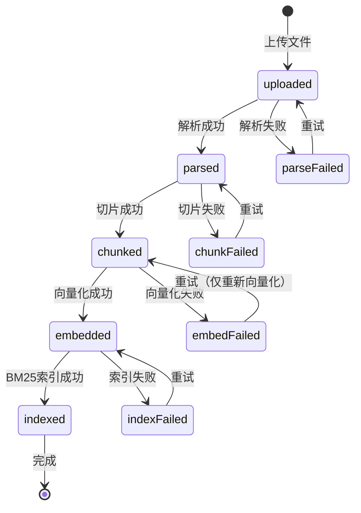

# 59. 企业级文档处理流水线设计

> **状态**: 架构设计
> **日期**: 2026-07-09
> **目标**: Admin 面板一键上传 → 解析 → 切片 → 向量化 → BM25 索引

---

## 一、设计原则

| 原则 | 说明 |
|:-----|:------|
| **零 SSH** | Admin 无需登录服务器执行命令，一切在 UI 完成 |
| **自愈** | 服务不可用时自动提示，恢复后自动继续 |
| **可恢复** | 任何步骤失败不丢数据，可重试/跳过 |
| **可见** | 每一步的状态、耗时、错误信息清晰可见 |
| **安全** | 并发控制、幂等性、数据一致性 |

---

## 二、整体架构

```
┌─────────────────────────────────────────────────────────┐
│                    Admin 面板 (Next.js)                   │
│  ┌──────────┐ ┌──────────┐ ┌──────────┐ ┌──────────┐   │
│  │  上传    │ │  解析    │ │  向量化  │ │  索引    │   │
│  └──────────┘ └──────────┘ └──────────┘ └──────────┘   │
│         │           │           │           │           │
└─────────┼───────────┼───────────┼───────────┼───────────┘
          │           │           │           │
          ▼           ▼           ▼           ▼
┌─────────────────────────────────────────────────────────┐
│                    Backend API (NestJS)                   │
│                                                          │
│  ┌────────────────────────────────────────────────────┐  │
│  │          Pipeline Orchestrator                     │  │
│  │  ┌──────┐  ┌──────┐  ┌──────┐  ┌──────┐          │  │
│  │  │上传  │→ │解析  │→ │切片  │→ │向量化│→ 完成    │  │
│  │  │      │  │      │  │      │  │+索引  │          │  │
│  │  └──────┘  └──────┘  └──────┘  └──────┘          │  │
│  └────────────────────────────────────────────────────┘  │
│                                                          │
│  ┌─────────────────┐  ┌─────────────────┐               │
│  │  Service Health  │  │  Audit Logger   │               │
│  │  - ollama 状态   │  │  - 每步记录     │               │
│  │  - meilisearch   │  │  - 错误追踪     │               │
│  │  - unstructured  │  │  - 耗时统计     │               │
│  └─────────────────┘  └─────────────────┘               │
└─────────────────────────────────────────────────────────┘
          │           │           │
          ▼           ▼           ▼
   ┌──────────┐ ┌──────────┐ ┌──────────┐
   │ Ollama   │ │Unstructured│ │Meili-   │
   │ (bge-m3) │ │ (PDF解析) │ │search   │
   └──────────┘ └──────────┘ └──────────┘
```

---

## 三、后端 API 设计

### 3.1 服务健康检查

```typescript
GET /api/v1/admin/services/health

Response:
{
  "ollama": {
    "available": true,
    "model": "bge-m3",
    "memory": "2.1GB"
  },
  "unstructured": {
    "available": false,    // 未启动
    "neededFor": "PDF解析"
  },
  "meilisearch": {
    "available": true,
    "documents": 285
  },
  "infinity": {
    "available": false,
    "neededFor": "Rerank优化"
  }
}
```

前端根据此接口显示服务指示灯。

### 3.2 文档处理状态

```typescript
GET /api/v1/admin/rag/documents/:id/status

Response:
{
  "id": "doc-123",
  "processStatus": "parsed",         // uploaded → parsed → chunked → embedded → indexed
  "history": [
    { "step": "uploaded", "at": "2026-07-09T02:33:00Z", "duration": "1.2s" },
    { "step": "parsed",   "at": "2026-07-09T02:34:00Z", "duration": "26s", "service": "unstructured" },
    { "step": "chunked",  "at": null, "error": null },
    { "step": "embedded", "at": null, "error": null },
    { "step": "indexed",  "at": null, "error": null }
  ],
  "chunks": { "total": 12, "embedded": 0, "pending": 12 },
  "canRetry": false
}
```

### 3.3 执行步骤

```typescript
POST /api/v1/admin/rag/documents/:id/process/:step
// step: parse | chunk | embed | index

// 成功
{ "success": true, "step": "chunked", "chunksCreated": 12, "duration": "0.5s" }

// 服务不可用
{ "success": false, "step": "embed", "error": "ollama_not_available",
  "message": "Ollama 未运行，请先启动: make start-ollama",
  "requiredService": "ollama" }

// 失败
{ "success": false, "step": "parse", "error": "parse_failed",
  "message": "PDF 解析失败: 文件可能损坏",
  "canRetry": true }
```

---

## 四、Admin UI 设计

### 4.1 服务状态栏（全局顶部）

```
┌─────────────────────────────────────────────────────────┐
│  📚 知识库管理           [全部服务正常运行 ✅]          │
│                           Ollama ✅ | Meilisearch ✅     │
│                           Infinity ⏸ | Unstructured ⏸   │
│                           (按需启动)                    │
├─────────────────────────────────────────────────────────┤
```

### 4.2 文档列表行（增强）

```
┌─────────────────────────────────────────────────────────────┐
│ 📄 退               wallet  P1  en  6    ⏳ 已切片  [处理]  │
│ 📄 取               wallet  P1  en  12   ✅ 已索引  [处理]  │
│ 📄 简历             general P2  en  0    ⬜ 待解析  [处理]  │
└─────────────────────────────────────────────────────────────┘

[处理] 按钮弹出详情面板
```

### 4.3 文档详情面板（弹窗/页面）

```
┌─────────────────────────────────────────────────────────┐
│  Senior Frontend Engineer-Kehang wei.pdf                │
│  ─────────────────────────────────────────────────────── │
│                                                          │
│  📋 处理流水线                                           │
│                                                          │
│  ┌──────┐   ┌──────┐   ┌──────┐   ┌──────┐   ┌──────┐  │
│  │ 上传  │   │ 解析  │   │ 切片  │   │ 向量化│   │ 索引  │  │
│  │ ✅   │   │ ✅   │   │ ⏳   │   │ ⬜   │   │ ⬜   │  │
│  │ 1.2s  │   │ 26s   │   │      │   │      │   │      │  │
│  └──────┘   └──────┘   └──────┘   └──────┘   └──────┘  │
│                                                          │
│  ┌────────────────────────────────────────────────────┐  │
│  │ 🔔 下一步: 切片                                      │  │
│  │ 切片不需要额外服务，点击即可执行                       │  │
│  │                                                      │  │
│  │  [▶️ 执行切片]  ← 可用状态                        │  │
│  └────────────────────────────────────────────────────┘  │
│                                                          │
│  ┌────────────────────────────────────────────────────┐  │
│  │ 🔔 后续步骤需要:                                     │  │
│  │ 向量化 需要: Ollama (当前: ✅ 运行中)               │  │
│  │ 索引   需要: Meilisearch (当前: ✅ 运行中)           │  │
│  └────────────────────────────────────────────────────┘  │
│                                                          │
│  📊 Chunks: 12/12 已切片                                 │
│  Token: 3,456                                            │
│  ─────────────────────────────────────────────────────── │
│  操作: [下载原文] [编辑] [删除] [重新处理]                │
└─────────────────────────────────────────────────────────┘
```

### 4.4 边缘情况处理

| 场景 | UI 表现 |
|:-----|:---------|
| Ollama 未运行 | 步骤按钮禁用，显示 "需要启动 Ollama" + 红色指示灯 |
| 解析失败（文件损坏） | 步骤显示 ❌，可重试，建议替换文件 |
| 处理中刷新页面 | 重新加载状态，不会重复执行（幂等） |
| 同时处理多文档 | 队列模式，显示 "3个文档等待处理" |
| 服务中途断开 | 步骤状态变为 "失败"，显示错误时间，可重试 |
| 文档已是最新 | 按钮禁用，显示 "所有步骤已完成" |

---

## 五、状态机定义



## 六、异常场景

### 6.1 服务不可用

```
用户点"向量化" → 后端检查 Ollama → 不可用
  → 返回 { success: false, requiredService: "ollama" }
  → UI 显示: "Ollama 未运行，请先启动"
  → 按钮旁显示启动命令和指示灯
```

### 6.2 文件损坏

```
用户上传损坏 PDF → Unstructured 解析返回空
  → 后端检测 content 为空
  → 返回 { success: false, error: "empty_content" }
  → UI 显示: "解析结果为空，文件可能损坏或不支持"
  → 提供"替换文件"和"强制继续"两个选项
```

### 6.3 部分完成

```
切片成功(12个chunk) → 向量化到第7个时 Ollama 崩溃
  → 记录已完成的7个向量
  → 状态: "embedded" (7/12)
  → UI 显示: "向量化部分完成(7/12)，Ollama 中断"
  → Ollama恢复后点"继续" → 重新处理未完成的5个
```

---

## 七、实现步骤

| 步骤 | 内容 | 工作量 |
|:-----|:------|:------:|
| 1 | 后端: Service Health API | ~0.5天 |
| 2 | 后端: 状态机增强 + 历史记录 | ~1天 |
| 3 | 后端: 错误类型标准化 | ~0.5天 |
| 4 | 前端: 服务状态栏 | ~0.5天 |
| 5 | 前端: 文档详情面板 | ~1天 |
| 6 | 前端: 步骤按钮 + 状态切换 | ~1天 |
| 7 | 前端: 错误/边缘情况处理 | ~0.5天 |
| 8 | 联调测试 | ~1天 |
