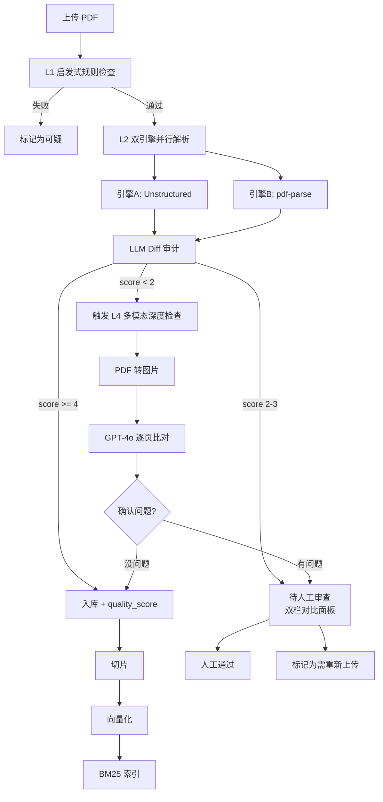

# 61. 企业级文档解析质量保障 — 实施计划

> **状态**: 架构设计，待实施  
> **日期**: 2026-07-09  
> **前置文档**: [60-Enterprise-Parse-Quality-Assurance.md](60-Enterprise-Parse-Quality-Assurance.md)  
> **目标**: 在现有文档处理流水线上叠加 4 层质量保障

---

## 一、架构总览



---

## 二、P0: 启发式规则检查（Heuristic Checker）

### 2.1 新增文件

| 文件 | 说明 |
|:-----|:------|
| [`apps/api/src/admin/rag/rag-quality.service.ts`](../../apps/api/src/admin/rag/rag-quality.service.ts) | 质量检查服务 |
| [`apps/api/src/admin/rag/dto/quality-check.dto.ts`](../../apps/api/src/admin/rag/dto/quality-check.dto.ts) | 质量检查结果 DTO |

### 2.2 QualityCheckResult 类型

```typescript
// rag-quality.service.ts

export interface QualityCheckResult {
  passed: boolean;
  heuristic: {
    truncation: { passed: boolean; detail: string };    // 截断检测
    retentionRate: { passed: boolean; rate: number };    // 字符保留率
    encoding: { passed: boolean; detail: string };       // 编码检测
    emptyContent: { passed: boolean; detail: string };   // 空内容检测
  };
  overallScore: number;  // 0-100
  suggestions: string[];  // 改进建议
}
```

### 2.3 检查规则实现

**规则 1: 截断检测**
```
输入: 提取的文本内容
逻辑: 
  1. 取最后 200 个字符
  2. 正则检测是否以完整句子结尾 (/[.!?。！？]\s*$/)
  3. 如果不完整 → truncation.failed
原因: 如果末尾被截断，说明解析引擎可能没读完文件
```

**规则 2: 字符保留率**
```
输入: 提取文本长度 / 原始文件大小
逻辑:
  1. 计算 ratio = extractedChars / fileSizeBytes
  2. 如果 ratio < 0.01 (1%) → 可能提取失败
  3. 如果 ratio > 0.80 (80%) → 可能文件本身是纯文本
原因: PDF 通常压缩率高，纯文本占原始大小 10-60%
      如果提取内容几乎等于文件大小，说明可能只是把字节转成了文本
```

**规则 3: 编码检测**
```
输入: 提取的文本内容
逻辑:
  1. 检测是否包含连续非 ASCII 字符
  2. 检测是否包含常见乱码字符 (�, â, �, etc.)
  3. 如果乱码比例 > 1% → encoding.failed
原因: 编码不匹配会导致中文/特殊字符变成乱码
```

**规则 4: 空内容检测**
```
输入: 提取的文本内容 (trimmed)
逻辑:
  1. 如果 content.length === 0 → emptyContent.failed
  2. 如果 content.length < 50 → 可能是无意义内容
原因: 解析失败时最常见的结果就是空内容
```

### 2.4 集成点

在 [`rag-sync.service.ts`](../../apps/api/src/admin/rag/rag-sync.service.ts) 的 [`uploadFile()`](../../apps/api/src/admin/rag/rag-sync.service.ts:317) 方法中，解析完成后、入库前调用：

```typescript
// rag-sync.service.ts — uploadFile() 内部

// 第 2 步之后: 提取完成
const doc = await extractor.extract(file);

// === P0: 启发式规则检查 ===
const qualityService = new RagQualityService();
const checkResult = qualityService.check(doc.content, file.buffer.length);

if (!checkResult.passed) {
  this.logger.warn(
    `Quality check failed for ${file.originalname}: ${checkResult.suggestions.join('; ')}`
  );
  // 仍然入库，但标记为可疑
  // 可以通过 processStatus 扩展为 "flagged"
}
```

### 2.5 数据库变更

KnowledgeDocument 模型增加字段：

```prisma
model KnowledgeDocument {
  // ... 现有字段 ...
  qualityScore    Int?     @map("quality_score") @db.SmallInt  // 0-100
  qualityFlags    String?  @map("quality_flags") @db.VarChar(200)  // 逗号分隔的标记
  
  @@map("knowledge_documents")
}
```

### 2.6 验收标准

| # | 场景 | 预期 |
|---|------|------|
| 1 | 上传完整 PDF | qualityScore >= 80, pass |
| 2 | 上传空 PDF | qualityScore = 0, emptyContent.failed |
| 3 | 上传截断的 PDF | truncation.failed, qualityScore < 50 |
| 4 | 上传乱码 PDF | encoding.failed, qualityScore < 50 |

---

## 三、P1: 双引擎并行解析 + LLM Diff 审计

### 3.1 改造目标

当前 [`PdfExtractor`](../../apps/api/src/admin/rag/rag-sync.service.ts:174) 是串行的（Unstructured → fallback pdf-parse），
需要改为**并行执行 + LLM 对比选优**。

### 3.2 新增/修改文件

| 文件 | 操作 | 说明 |
|:-----|:------|:------|
| [`apps/api/src/admin/rag/rag-sync.service.ts`](../../apps/api/src/admin/rag/rag-sync.service.ts) | 修改 `PdfExtractor` | 并行双引擎 + LLM 审计 |
| [`apps/api/src/admin/rag/rag-quality.service.ts`](../../apps/api/src/admin/rag/rag-quality.service.ts) | 新增 `llmDiffAudit()` | LLM 对比方法 |
| [`apps/api/src/admin/rag/dto/quality-check.dto.ts`](../../apps/api/src/admin/rag/dto/quality-check.dto.ts) | 扩展 DTO | 增加 Diff 审计结果 |

### 3.3 并行解析逻辑

```typescript
// PdfExtractor.extract() — 改造后

async extract(file: Express.Multer.File): Promise<ExtractedDoc> {
  const title = file.originalname.replace(/\.pdf$/i, '');

  // ── 并行执行两个引擎 ──
  const [unstructuredResult, pdfParseResult] = await Promise.all([
    this.extractWithUnstructured(file).catch(() => null),
    this.extractWithPdfParse(file).catch(() => null),
  ]);

  // ── 两个引擎都失败 ──
  if (!unstructuredResult && !pdfParseResult) {
    throw new BadRequestException(
      'PDF parsing failed: both engines returned empty. File may be corrupted or encrypted.',
    );
  }

  // ── 只有一个引擎成功：直接使用 ──
  if (!unstructuredResult || !pdfParseResult) {
    const content = unstructuredResult || pdfParseResult!;
    return { title, content, metadata: { needsMetadata: true } };
  }

  // ── 两个引擎都成功：LLM Diff 审计 ──
  const diffResult = await this.llmDiffAudit(
    unstructuredResult,
    pdfParseResult,
  );

  // 如果 LLM 判断需要审查，记录审计结果
  if (diffResult.verdict === 'needs_review') {
    this.logger.warn(
      `[Quality] Document "${title}" needs review: ${diffResult.issues.join('; ')}`,
    );
  }

  return {
    title,
    content: diffResult.selectedContent,  // LLM 选择的最优结果
    metadata: {
      needsMetadata: true,
      qualityScore: diffResult.score * 20,  // 1-5 → 20-100
      qualityFlags: diffResult.issues.join(','),
      qualityVerdict: diffResult.verdict,
    },
  };
}
```

### 3.4 LLM Diff 审计方法

```typescript
// rag-quality.service.ts

interface DiffAuditResult {
  selected: 'A' | 'B';
  selectedContent: string;
  score: number;        // 1-5
  reasoning: string;
  issues: string[];
  verdict: 'approved' | 'needs_review';
}

async llmDiffAudit(
  engineAResult: string,
  engineBResult: string,
): Promise<DiffAuditResult> {
  // 调用 DeepSeek 做 Diff 审计
  // 使用 60-Enterprise-Parse-Quality-Assurance.md 中的 Prompt 模板
  
  const prompt = `...`; // 见文档 60 的 Prompt 模板
  
  const response = await this.aiService.generateText(prompt);
  return JSON.parse(response);
}
```

### 3.5 验收标准

| # | 场景 | 预期 |
|---|------|------|
| 1 | Unstructured 和 pdf-parse 结果一致 | score >= 4, approved |
| 2 | 表格文档，Unstructured 更好 | selected: A, score >= 3 |
| 3 | 纯文字 PDF，两个引擎接近 | selected: A or B, score >= 3 |
| 4 | 特殊编码 PDF，两个引擎都差 | score < 3, needs_review |

---

## 四、P2: Admin 质量评分展示 + 双栏对比审核 UI

### 4.1 新增/修改文件

| 文件 | 操作 | 说明 |
|:-----|:------|:------|
| [`apps/admin-next/src/components/knowledge/QualityBadge.tsx`](../../apps/admin-next/src/components/knowledge/QualityBadge.tsx) | 新增 | 质量评分徽章组件 |
| [`apps/admin-next/src/components/knowledge/QualityReviewPanel.tsx`](../../apps/admin-next/src/components/knowledge/QualityReviewPanel.tsx) | 新增 | 双栏对比审核弹窗 |
| [`apps/admin-next/src/components/knowledge/KnowledgeBaseClient.tsx`](../../apps/admin-next/src/components/knowledge/KnowledgeBaseClient.tsx) | 修改 | 扩展文档列表列 |
| [`apps/api/src/admin/rag/dto/rag-doc-response.dto.ts`](../../apps/api/src/admin/rag/dto/rag-doc-response.dto.ts) | 修改 | 增加 qualityScore/qualityFlags |
| [`apps/api/src/admin/rag/rag.controller.ts`](../../apps/api/src/admin/rag/rag.controller.ts) | 新增 | GET /quality-stats 端点 |
| [`apps/api/src/admin/rag/rag.service.ts`](../../apps/api/src/admin/rag/rag.service.ts) | 修改 | 新增 quality stats 方法 |

### 4.2 质量徽章 (QualityBadge)

```
分数范围     显示                颜色
90-100       🟢 优秀 (Excelllent)   green
70-89        🟡 良好 (Good)         amber
50-69        🟠 一般 (Fair)         orange
0-49         🔴 可疑 (Suspicious)   red
null         ⚪ 未检查 (Unchecked)   gray
```

### 4.3 审核队列 API

```typescript
GET /api/v1/admin/rag/quality-stats?status=pending

Response:
{
  "total": 150,
  "needReview": 3,         // qualityScore < 50 或 verdict = needs_review
  "byScore": {
    "excellent": 120,      // 90-100
    "good": 20,            // 70-89
    "fair": 7,             // 50-69
    "suspicious": 3        // 0-49
  },
  "recentFlags": [
    {
      documentId: "doc-123",
      title: "退款政策.pdf",
      score: 35,
      flags: "truncation,encoding_issue",
      parsedAt: "2026-07-09T02:34:00Z"
    }
  ]
}
```

### 4.4 文档列表行增强

在现有文档列表表格中增加一列：

```
现状:
┌──────┬──────────┬──────┬──────┬──────┬──────────┬────────┐
│ Title│ Domain   │ Loc. │ Pri. │ Chks │ Status   │ Actions│
├──────┼──────────┼──────┼──────┼──────┼──────────┼────────┤
│ ...  │          │      │      │      │          │        │

改造后:
┌──────┬──────────┬──────┬──────┬──────┬──────────┬────────┬────────┐
│ Title│ Domain   │ Loc. │ Pri. │ Chks │ Status   │ Quality│ Actions│
├──────┼──────────┼──────┼──────┼──────┼──────────┼────────┼────────┤
│ ...  │          │      │      │      │          │ 🟢 95  │        │
│ ...  │          │      │      │      │          │ 🔴 35  │ 审查 ▶ │
```

### 4.5 双栏对比审核面板 (QualityReviewPanel)

这是人工审核的核心 UI，左侧显示**原文**，右侧显示**提取文本**，让操作员一目了然对比差异。

```
┌──────────────────────────────────────────────────────────────────┐
│ 📋 质量审查 · 退款政策.pdf                        [关闭]  [最小化] │
├───────────────────────────────┬──────────────────────────────────┤
│ 📄 原文                        │ ✏️ 提取文本                      │
│                               │                                  │
│  ┌─────────────────────────┐  │  ┌──────────────────────────┐   │
│  │ 退款政策                  │  │  │ # 退款政策                 │   │
│  │                         │  │  │                          │   │
│  │ 1. 30天内可全额退款       │  │  │ 1. 30天内可全额退款        │   │
│  │ 2. 需提供订单号和交易截图  │  │  │ 2. 需提供订单号和交易截图   │   │
│  │                         │  │  │                          │   │
│  │ 联系方式:                 │  │  │ 联系方式:                   │   │
│  │   Email: support@xxx    │  │  │  Email: support@xxx       │   │
│  │   Phone: +63 2 1234     │  │  │  Phone: +63 2 1234        │   │
│  │                         │  │  │                          │   │
│  │ ╔════════════════════╗   │  │  │                          │   │
│  │ ║ 表格: 退款金额一览    ║   │  │  │ 退款金额一览:             │   │
│  │ ║ ┌──────┬──────┐  ║   │  │  │ 7天内 100%               │   │
│  │ ║ │ 时间  │ 比例  │  ║   │  │  │ 14天内 50%               │   │
│  │ ║ ├──────┼──────┤  ║   │  │  │ 30天内 30%               │   │
│  │ ║ │ 7天   │ 100% │  ║   │  │  │                          │   │
│  │ ║ │ 14天  │ 50%  │  ║   │  │  │                          │   │
│  │ ║ │ 30天  │ 30%  │  ║   │  │  │                          │   │
│  │ ║ └──────┴──────┘  ║   │  │  │                          │   │
│  │ ╚════════════════════╝   │  │  │                          │   │
│  └─────────────────────────┘  │  └──────────────────────────┘   │
│                               │                                  │
│  文件: 245KB · 3页            │  提取字符: 1,234                  │
│  引擎: Unstructured           │  字符保留率: 12.5% ✅            │
├───────────────────────────────┴──────────────────────────────────┤
│ ⚠️ 质量问题:                                                    │
│  🔴 表格串行 — 提取文本中表格结构丢失，内容合并为纯文本           │
│                                                                  │
│ ┌─────────────────────────────────────────────────────────────┐  │
│ │ L2 LLM Diff 评分: 2/5                                       │  │
│ │ 引擎 A (Unstructured): 表格保留较好，但多栏排版顺序有误       │  │
│ │ 引擎 B (pdf-parse): 表格完全丢失，但文字顺序正确              │  │
│ └─────────────────────────────────────────────────────────────┘  │
│                                                                  │
│ 操作:                                                           │
│ [✓ 通过]       提取内容正确，确认入库                            │
│ [🔄 重新上传]  文件有问题，用户重新上传                           │
│ [⏭️ 忽略标记]   入库但保留质量标记，不阻塞流程                    │
│ [📥 下载原文]   下载原始 PDF 文件本地查看                        │
└──────────────────────────────────────────────────────────────────┘
```

#### UI 状态说明

| 状态 | 左侧原文 | 右侧提取文本 | 操作按钮 |
|:-----|:---------|:-------------|:---------|
| 正常 | PDF 渲染/文件内容 | 显示提取文本 | [通过] 可用 |
| 有差异 | PDF 渲染 (高亮差异区域) | 显示提取文本 (差异行标记黄色) | [通过] [忽略] 可用 |
| 严重问题 | PDF 渲染 | 提取文本为空/乱码 | [重新上传] 高亮 |
| 加载中 | Skeleton | Skeleton | 全部禁用 |
| 错误 | 无法加载原文 | 无法加载提取文本 | [重新上传] |

#### 技术实现

```
原文预览策略:
  对于 .md 文件: 直接在左侧显示原始 content（纯文本，不需要额外处理）
  对于 .pdf 文件:
    方案A（简化）: 左侧显示上传时的原始文件内容（如果有 buffer）
    方案B（完整）: 使用 <iframe> 或 react-pdf 嵌入 PDF 预览
    
  建议: 先做方案A（简化版），右侧显示提取文本，左侧显示文件原始 buffer 转文本
```

### 4.6 验收标准

| # | 场景 | 预期 |
|---|------|------|
| 1 | 文档列表显示质量分数 | 每行有 QualityBadge |
| 2 | 质量 < 50 的文档 | 显示🔴，行背景高亮 |
| 3 | 点击审查 | 弹出 QualityReviewPanel |
| 4 | 审查面板显示 LLM Diff 详情 | 显示两个引擎结果对比 |

---

## 五、P3: 按需多模态深度检查

### 5.1 触发条件

多模态检查**不**是定时任务，而是在上传流程中按需触发：

```
上传 PDF → L1 启发式 → L2 双引擎 + LLM Diff
                                        │
                      ┌──────────────────┼──────────────────┐
                      │                  │                  │
                      ▼                  ▼                  ▼
                 score >= 4          score 2-3          score < 2
                      │                  │                  │
                      ▼                  ▼                  ▼
                 直接入库           人工审核面板       自动触发多模态
                     ✅          双栏对比审查        PDF转图片→GPT-4o
                                                    确认问题→标记
```

### 5.2 新增文件

| 文件 | 说明 |
|:-----|:------|
| [`apps/api/src/admin/rag/rag-audit.service.ts`](../../apps/api/src/admin/rag/rag-audit.service.ts) | 多模态审计服务 |
| [`apps/api/src/admin/rag/rag-audit.processor.ts`](../../apps/api/src/admin/rag/rag-audit.processor.ts) | BullMQ 定时审计处理器 |

### 5.3 按需触发流程

```
上传 PDF → L1+L2 检查完成
    │
    └── LLM Diff score < 2?
            │
            ├── 否 → 走人工审核面板（P2）
            │
            └── 是 → 触发多模态深度检查
                        │
                        ▼
                1. 从上传 buffer 获取原始 PDF
                2. 使用 pdf2img 将 PDF 转成图片 (page1.png, page2.png...)
                3. 调用 GPT-4o/Gemini API 做多模态逐页比对
                   - 输入: page N image + 提取的文本
                   - 输出: accuracy_score per page, issues[]
                4. 结果写入 quality_audit_logs 表
                5. 如果确认有问题 → 进入人工审核面板
                6. 如果多模态判定没问题 → 直接入库
```

### 5.3 多模态审计结果表 (可选)

```prisma
model QualityAuditLog {
  id           String   @id @default(cuid()) @db.VarChar(32)
  documentId   String   @map("document_id") @db.VarChar(32)
  method       String   @map("method") @db.VarChar(20)  // "multimodal" | "llm_diff"
  pageNumber   Int?     @map("page_number") @db.SmallInt
  accuracyScore Int?    @map("accuracy_score") @db.SmallInt  // 0-100
  issues       String?  @map("issues") @db.Text
  rawResponse  String?  @map("raw_response") @db.Text
  createdAt    DateTime @default(now()) @map("created_at")

  document KnowledgeDocument @relation(fields: [documentId], references: [id], onDelete: Cascade)
  
  @@index([documentId])
  @@map("quality_audit_logs")
}
```

### 5.5 验收标准

| # | 场景 | 预期 |
|---|------|------|
| 1 | L2 评分 < 2 时自动触发多模态 | 上传流程自动调用 GPT-4o，结果入库 |
| 2 | 多模态确认有问题 | 文档进入人工审核队列 |
| 3 | 多模态判定没问题 | 文档直接入库，不阻塞流程 |
| 4 | GPT-4o API Key 未配置 | 跳过多模态，直接进入人工审核 |

---

## 六、完整实施步骤

### Step 1: Prisma 迁移 (P0)

```
1. qualityScore 和 qualityFlags 字段加到 KnowledgeDocument
2. 可选: QualityAuditLog 模型（P3 需要时再加）
3. 生成迁移: yarn workspace @lucky/api prisma migrate dev --create-only
4. 部署: yarn workspace @lucky/api prisma migrate deploy
```

### Step 2: RagQualityService (P0)

```
1. 新建 apps/api/src/admin/rag/rag-quality.service.ts
2. 实现 QualityCheckResult 接口
3. 实现 4 个启发式规则方法
4. 实现 check() 入口方法
5. 写单元测试
```

### Step 3: 集成到 upload 流程 (P0)

```
1. 修改 rag-sync.service.ts uploadFile()
2. 解析完成后调用 qualityService.check()
3. 结果写入 knowledgeDocument.qualityScore + qualityFlags
4. 如果 check 失败，log 警告但仍入库
```

### Step 4: 双引擎并行改造 (P1)

```
1. 修改 PdfExtractor.extract() 为 Promise.all 并行
2. 实现 llmDiffAudit() 方法
3. LLM 选择最优结果返回
4. 审计结果写入 metadata
```

### Step 5: Admin 前端质量展示 (P2)

```
1. 创建 QualityBadge 组件
2. 创建 QualityReviewPanel 组件
3. 修改 KnowledgeBaseClient 增加质量列
4. 添加质量统计数据 API 端点
```

### Step 6: 按需多模态深度检查 (P3)

```
1. 创建 RagAuditService（集成 GPT-4o/Gemini API）
2. pdf2img 将 PDF 转图片
3. 在 L2 LLM Diff score < 2 时触发多模态
4. 结果写入 quality_audit_logs 表
5. 环境变量控制开关（无 API Key 时跳过，直接走人工审核）
```

---

## 七、风险与注意事项

| 风险 | 影响 | 缓解措施 |
|:-----|:------|:---------|
| LLM Diff 审计增加解析时间 | 用户体验下降 | 设超时 (15s)，超时则使用 Unstructured 结果 |
| DeepSeek 输出非 JSON | 审计失败 | 用正则提取 JSON，失败则降级到默认选 Unstructured |
| GPT-4o API Key 未配置 | P3 不可用 | P3 设计为可选，环境变量控制开关 |
| 双引擎同时翻车 | 质量评分虚假高分 | 启发式规则做前置过滤，捕获明显问题 |
| qualityScore 字段为 null | 旧文档无评分 | 显示 "未检查" 而不是 0 |

---

## 八、文件变更清单

### 后端新增

| 文件 | 阶段 |
|:-----|:-----|
| `apps/api/src/admin/rag/rag-quality.service.ts` | P0 |
| `apps/api/src/admin/rag/dto/quality-check.dto.ts` | P0 |
| `apps/api/src/admin/rag/rag-audit.service.ts` | P3 |
| `apps/api/src/admin/rag/rag-audit.processor.ts` | P3 |

### 后端修改

| 文件 | 变更 | 阶段 |
|:-----|:------|:-----|
| `apps/api/prisma/schema.prisma` | +qualityScore, +qualityFlags | P0 |
| `apps/api/src/admin/rag/rag-sync.service.ts` | 集成 quality check + 并行解析 | P0/P1 |
| `apps/api/src/admin/rag/rag-sync.service.ts` | PdfExtractor 并行 + LLM Diff | P1 |
| `apps/api/src/admin/rag/rag.controller.ts` | +GET /quality-stats | P2 |
| `apps/api/src/admin/rag/rag.service.ts` | +quality stats 方法 | P2 |
| `apps/api/src/admin/rag/dto/rag-doc-response.dto.ts` | +qualityScore, +qualityFlags | P0 |
| `apps/api/src/admin/rag/rag.module.ts` | +RagQualityService 注册 | P0 |

### 前端新增

| 文件 | 阶段 |
|:------|:-----|
| `apps/admin-next/src/components/knowledge/QualityBadge.tsx` | P2 |
| `apps/admin-next/src/components/knowledge/QualityReviewPanel.tsx` | P2 |

### 前端修改

| 文件 | 变更 | 阶段 |
|:------|:------|:-----|
| `apps/admin-next/src/components/knowledge/KnowledgeBaseClient.tsx` | +质量列 | P2 |
| `apps/admin-next/src/type/types.ts` | +qualityScore/flags | P0 |
| `apps/admin-next/src/api/index.ts` | +qualityStats API | P2 |
| `apps/admin-next/src/i18n/en.json` | +质量相关国际化 | P2 |

---

## 九、验收总表

| ID | 需求 | 阶段 | 验收标准 |
|:---|:-----|:-----|:---------|
| QA-01 | 上传 PDF 后自动执行启发式检查 | P0 | qualityScore 和 qualityFlags 写入数据库 |
| QA-02 | 截断/乱码/空内容被检测 | P0 | 上传空 PDF → qualityScore = 0 |
| QA-03 | 双引擎并行解析 | P1 | 两个引擎同时执行，耗时 ≈ max(A, B) 不是 A+B |
| QA-04 | LLM Diff 审计选择最优结果 | P1 | 表格文档选中 Unstructured 结果 |
| QA-05 | 质量评分在 Admin 列表可见 | P2 | 每个文档行显示 QualityBadge |
| QA-06 | 可疑文档可审查 | P2 | 点击审查弹出对比面板 |
| QA-07 | 质量统计概览 | P2 | API 返回 byScore 分布 |
| QA-08 | 按需多模态深度检查 | P3 | L2 score < 2 时自动触发，结果入库 |
| QA-09 | 双栏对比审核面板 | P2 | 左侧原文/右侧提取文本，差异一目了然 |
