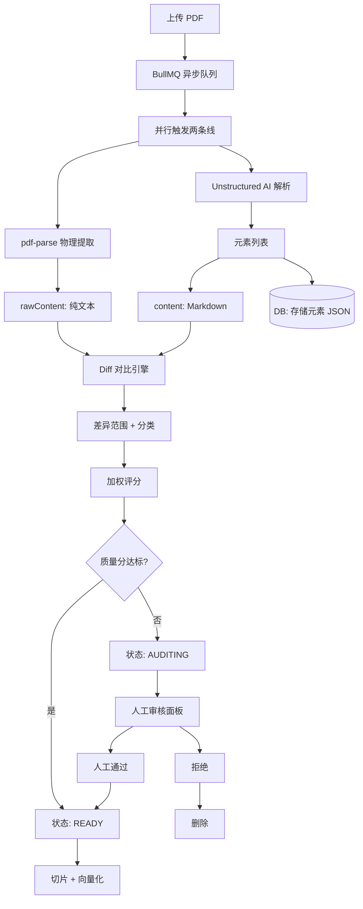

# 62. 企业级文档解析质量审计架构 — 双源对撞流水线

> **状态**: 架构设计  
> **日期**: 2026-07-09  
> **前置文档**: [60-Enterprise-Parse-Quality-Assurance.md](60-Enterprise-Parse-Quality-Assurance.md), [61-Enterprise-Parse-QA-Implementation-Plan.md](61-Enterprise-Parse-QA-Implementation-Plan.md)  
> **目标**: 在企业自建 Unstructured 架构下，构建双源对比 + Diff 高亮的质量审计系统

---

## 一、核心思想：双源对撞

企业级文档解析质量审计的核心秘密：**用一个绝对不会撒谎、最死板的传统工具（pdf-parse）当"照妖镜"，去照 Unstructured 解析出来的成果。**

```
原始 PDF
    │
    ├─ pdf-parse（老实人基准线）→ rawContent
    │   ✓ 绝不漏字、绝不瞎编
    │   ✓ 100% 物理真实
    │   ✗ 排版乱、表格散、页码混杂
    │
    ├─ Unstructured（AI 解析线）→ content
    │   ✓ 排版漂亮、表格规整、标题清晰
    │   ✗ 偶尔看走眼（5000→500）
    │   ✗ 可能漏掉复杂表格
    │
    └─ diff 算法对比两者 → 找出差异
        相同 = 解析正确
        不同 = 标出来人工审核
```

### 为什么 pdf-parse 是"照妖镜"？

| 特性 | pdf-parse | Unstructured |
|:-----|:----------|:-------------|
| AI 模型 | ❌ 纯代码 | ✅ hi_res + OCR |
| 会漏字吗 | ❌ 不会 | ⚠️ 可能 |
| 会看错数字吗 | ❌ 不会 | ⚠️ 可能 |
| 会瞎编吗 | ❌ 不会 | ⚠️ 可能 |
| 排版好看吗 | ❌ 乱 | ✅ 漂亮 |
| 能识别表格吗 | ❌ 不能 | ✅ 能 |

pdf-parse 虽然"笨"，但它的输出是**物理真实**。拿它做基准去撞 Unstructured 的输出，差异就是 AI 可能犯错的地方。

---

## 二、整体架构



---

## 三、数据模型

### 3.1 文档状态机

```
UPLOADED ──→ PARSING ──→ AUDITING ──→ READY
                │            │
                │            ├── 人工通过 → READY
                │            └── 人工拒绝 → DELETED
                │
                └── 质量分 >= 门槛 → READY
```

### 3.2 KnowledgeDocument 扩展

```prisma
model KnowledgeDocument {
  // ... 现有字段 ...
  
  /// 存储 Unstructured 原始元素列表（JSON 数组）
  /// 每个元素: { type, text, metadata: { page, bbox } }
  elements       Json?     @map("elements")
  
  /// 双源对比结果（JSON）
  /// { diffRanges: [], wer: number, score: number }
  auditResult    Json?     @map("audit_result")
  
  /// 文档审计状态: pending → approved → rejected
  auditStatus    String?   @default("pending") @map("audit_status") @db.VarChar(20)
}
```

### 3.3 DiffRange 类型

```typescript
interface DiffRange {
  type: 'equal' | 'added' | 'removed' | 'modified';
  leftText?: string;    // pdf-parse 的文本
  rightText?: string;   // Unstructured 的文本
  leftLine: number;
  rightLine: number;
  severity?: 'critical' | 'minor' | 'ignore';
  elementType?: string; // 对应的 Unstructured 元素类型
  pageNumber?: number;
}
```

---

## 四、核心算法

### ⚠️ 重要：为什么不能直接做行级 diff

pdf-parse 和 Unstructured 的输出**格式完全不同**，直接逐行对比会全部标红：

```
pdf-parse 输出（纯文本，一行到底）:
"退款政策 30天内可全额退款 需提供订单号 时间 比例 7天 100% 14天 50%"

Unstructured 输出（Markdown，有格式）:
"# 退款政策\n\n30天内可全额退款\n\n需提供订单号\n\n| 时间 | 比例 |\n| 7天 | 100% |\n| 14天 | 50% |"

直接 diffLines() → 每一行都不同 → 100% 误报 ❌
```

### 4.1 正确做法：内容提取对比（Content Extraction Diff）

不做行对比，而是**提取所有正文内容，去掉格式后对比**：

```typescript
function extractPlainText(text: string): string {
  return text
    .replace(/#{1,6}\s/g, '')         // 去掉 Markdown 标题标记
    .replace(/\|/g, ' ')               // 去掉表格分隔符
    .replace(/[-]{3,}/g, '')           // 去掉表格分割线
    .replace(/[`*_~]/g, '')            // 去掉 Markdown 强调符号
    .replace(/\n+/g, ' ')              // 换行→空格
    .replace(/\s+/g, '')               // 去掉所有空白
    .trim();
}

// 对比归一化后的纯文本内容
const raw = extractPlainText(pdfParseOutput);
const parsed = extractPlainText(unstructuredOutput);

if (raw === parsed) {
  // 内容完全一致 → 解析正确 ✅
} else {
  // 内容不一致 → 找出哪里不同
  const diff = diffChars(raw, parsed);  // 用字级 diff，不是行级
}
```

### 4.2 分片内容对比

对长文本，Unstructured 的元素列表提供天然的分片方式——按元素类型提取内容后再对比：

```typescript
function contentDiffByElements(
  rawText: string,
  elements: UnstructuredElement[]
): DiffResult {
  // 1. 从 pdf-parse 提取全部纯文本内容
  const rawPlain = extractPlainText(rawText);
  
  // 2. 从 Unstructured 元素提取全部文本内容
  const parsedPlain = elements
    .filter(el => el.type !== 'Header' && el.type !== 'Footer' && el.type !== 'PageNumber')
    .map(el => el.text)
    .join('');
  
  // 3. 按字符级 diff（检测漏字/多字/错字）
  const changes = diffChars(rawPlain, parsedPlain);
  
  // 4. 只关注实际内容差异（忽略格式变化）
  return {
    contentMatch: rawPlain === parsedPlain,
    missingText: extractMissing(rawPlain, parsedPlain),   // 漏了哪些字
    extraText: extractExtra(rawPlain, parsedPlain),       // 多了哪些字
    wer: calculateWER(changes),                           // 字错率
  };
}
```

### 4.3 数字专项检测

```typescript
function detectNumberErrors(raw: string, parsed: string): NumberError[] {
  // 从两边提取所有数字
  const rawNums = raw.match(/\d+[\d,.]*/g) || [];
  const parsedNums = parsed.match(/\d+[\d,.]*/g) || [];
  
  // 逐位对比
  const errors: NumberError[] = [];
  const maxLen = Math.max(rawNums.length, parsedNums.length);
  for (let i = 0; i < maxLen; i++) {
    if (rawNums[i] !== parsedNums[i]) {
      errors.push({
        raw: rawNums[i],
        parsed: parsedNums[i],
        index: i,
        severity: 'critical',
      });
    }
  }
  return errors;
}
```

### 总结：对比策略

| 策略 | 检测能力 | 误报率 | 实现难度 |
|:-----|:---------|:-------|:---------|
| ❌ 行级 diffLines | 格式变化 | 极高 | 🟢 低 |
| ✅ **内容提取 diffChars** | **漏字/多字/错字** | **低** | **🟢 低** |
| ✅ **数字专项检测** | **5000→500** | **极低** | **🟢 低** |
| 🟡 元素级对比 | 按表格/段落定位 | 低 | 🟡 中 |

### 4.3 差异分类 + 加权评分

```typescript
interface ScoreConfig {
  critical: number;  // 权重 5-10
  minor: number;     // 权重 1-2
  ignore: number;    // 权重 0
}

function classifyChanges(changes: Change[]): ClassifiedChange[] {
  return changes.map(c => {
    // 如果是数字变化 → critical
    if (isNumberChange(c.left, c.right)) {
      return { ...c, severity: 'critical' };
    }
    // 如果是空格/换行变化 → ignore
    if (isWhitespaceOnly(c.left, c.right)) {
      return { ...c, severity: 'ignore' };
    }
    // 其他 → minor
    return { ...c, severity: 'minor' };
  });
}

function calculateScore(
  changes: ClassifiedChange[],
  totalLength: number,
  config: ScoreConfig
): number {
  let penalty = 0;
  for (const c of changes) {
    if (c.severity === 'critical') penalty += c.count * config.critical;
    if (c.severity === 'minor')     penalty += c.count * config.minor;
  }
  return Math.max(0, 100 * (1 - penalty / totalLength));
}
```

---

## 五、评分标准

| 等级 | 权重 | 示例 |
|:-----|:-----|:------|
| **致命 (Critical)** | 5-10 | 数字错误（5000→500）、否定词丢失（"不"）、表格整行丢失 |
| **次要 (Minor)** | 1-2 | 表头加粗丢失、段落换行截断、顺序微调 |
| **忽略 (Ignore)** | 0 | 多余空格、全半角差异、页眉页脚被正常过滤 |

**质量分门槛**：
- >= 95 分 → 自动通过，进入知识库
- 80-94 分 → 自动通过，但标记需关注
- < 80 分 → 进入人工审核队列

---

## 六、前端双栏对比面板

### 6.1 差异高亮

```typescript
// 后端返回的 diffRanges
interface DiffRange {
  type: 'equal' | 'added' | 'removed' | 'modified';
  leftText: string;
  rightText: string;
  severity?: 'critical' | 'minor' | 'ignore';
}

// 前端渲染
{changes.map((change, i) => (
  change.type === 'equal' ? (
    <Collapsible label={`${change.count} identical lines`}>
      <pre>{change.leftText}</pre>
    </Collapsible>
  ) : (
    <div className={`diff-${change.type} diff-${change.severity}`}>
      <div className="left-pane">{change.leftText}</div>
      <div className="right-pane">{change.rightText}</div>
    </div>
  )
))}
```

### 6.2 面板布局

```
┌────────────────────────────────────────────────────────────┐
│ 📋 Quality Review                            相似度: 97%   │
│ [⚡ 只看差异] [📊 只看表格] [🔢 只看数字]                  │
├─────────────────────────┬──────────────────────────────────┤
│ 📄 pdf-parse (基准)      │ ✏️ Unstructured (AI 解析)        │
│                         │                                  │
│  ≡ 42 lines identical   │  ≡ 42 lines identical            │ ← 折叠
│ ─────────────────────── │                                  │
│  净利润 5000 万元         │  净利润 500 万元                  │ ← 标红 CRITICAL
│ ─────────────────────── │ ────────────────────────         │
│  （一大段表格数据...）     │  （空白）                        │ ← 标红 疑似丢失
│ ─────────────────────── │                                  │
│  页脚: 第12页            │                                  │ ← 标绿 正常过滤
├─────────────────────────┴──────────────────────────────────┤
│ 🔴 2 critical · 🟡 3 minor · ⚪ 12 ignored                 │
│ 质量分: 82/100 ⚠️ 建议人工复核                             │
└────────────────────────────────────────────────────────────┘
```

---

## 七、实施路径

| 阶段 | 内容 | 时间 | 依赖 |
|:-----|:------|:-----|:------|
| **P0** 🔴 | rawContent 改为 pdf-parse 输出 | ~30min | 无 |
| **P0** 🔴 | 后端 diff 接口 + 差异返回 | ~1h | `diff` npm |
| **P0** 🔴 | 前端差异高亮 + 折叠 | ~1.5h | 后端接口 |
| **P1** 🟡 | 差异分类（critical/minor/ignore）| ~1h | P0 |
| **P1** 🟡 | 加权评分公式 | ~1h | P1 分类 |
| **P2** 🟢 | 元素 JSON 存储 | ~2h | P0 |
| **P2** 🟢 | 只看差异/只看表格 过滤 | ~1h | P1 |
| **P3** ⚪ | 异步状态机（AUDITING 状态）| ~3h | P2 |

---

## 八、与当前架构的关系

```
当前架构（已实现）:
Upload → Parse → P0检查 → 入库 → Chunk → Embed → Index

双源对撞架构（本次设计）:
Upload → 双源Parse → Diff → 评分 → AUDITING → (人工/自动) → READY → Chunk → Embed
                │                    │
            pdf-parse             < 80分 → 人工审核
            Unstructured          >= 80分 → 自动通过
```

当前架构缺了 **AUDITING** 状态和"审核通过才入知识库"的卡点。这是后续可以逐步加上的。

---

## 九、文件变更清单

### 后端

| 文件 | 变更 |
|:-----|:------|
| `rag-sync.service.ts` | rawContent 存 pdf-parse 输出；R2 上传单独存 |
| `rag-quality.service.ts` | +computeDiff() +calculateScore() |
| `rag.controller.ts` | +GET /:id/diff |
| `rag.service.ts` | +getDiff(documentId) |
| `schema.prisma` | +elements Json?, +auditResult Json?, +auditStatus |

### 前端

| 文件 | 变更 |
|:-----|:------|
| `QualityReviewPanel.tsx` | +Diff 高亮渲染 + 折叠 + 只看差异模式 |
| `types.ts` | +DiffRange 类型 |
| `api/index.ts` | +getDiff API |

### 依赖

| 包 | 用途 |
|:---|:------|
| `diff` | Node.js 文本差异算法 |
