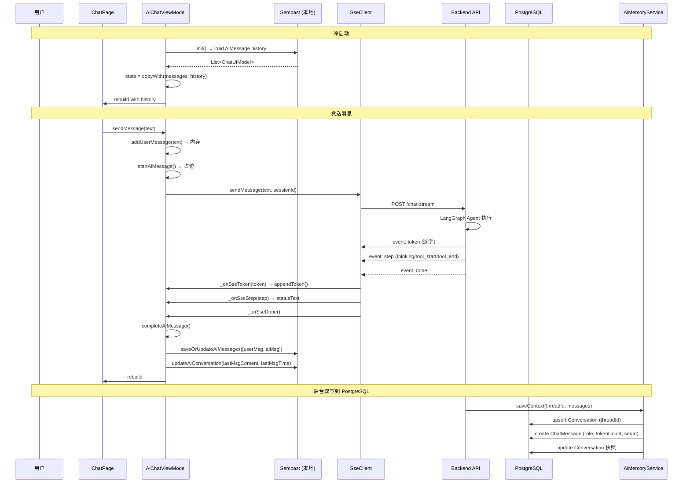

# AI 长期记忆持久化与 IM 系统数据融合方案

> **日期**: 2026-07-11
> **作者**: Zoo (Architect)
> **状态**: Phase 1（Prisma）已完成，待实施 Phase 2（AiMemoryService）

---

## 1. 问题陈述

目前两个系统各自为政：

| 系统                           | 数据层                                                                                 | 消息模型                          | 持久化                               | 会话管理                  |
| ------------------------------ | -------------------------------------------------------------------------------------- | --------------------------------- | ------------------------------------ | ------------------------- |
| **IM 系统** (Flutter ↔ NestJS) | Server: `Conversation` + `ChatMessage` (PostgreSQL)<br/>Client: `sembast` NoSQL (本地) | `ChatUiModel` (type=0~6, 99)      | Server + Client 双写                 | ConversationList + Socket |
| **AI 聊天** (独立页面)         | 无持久化<br/>仅 `AiChatState` 内存                                                     | `ChatUiModel` (type=8 ai, 9 card) | ❌ 仅 SharedPreferences 存 sessionId | 独立 AiChatPage           |

**目标**: 将 AI 聊天嵌入 IM 系统的 ChatPage，且 AI 对话需要长期记忆持久化。

---

## 2. 现有数据模型全景

### 2.1 后端 Prisma (PostgreSQL)

**IM 会话** — [`apps/api/prisma/schema.prisma:1182`](/apps/api/prisma/schema.prisma:1182)

```prisma
model Conversation {
  id              String         @id @default(cuid())
  type            ConversationType // GROUP | DIRECT | SUPPORT | BUSINESS
  businessId      String?        @unique           // 业务钩子
  lastMsgContent  String?                           // 列表快照
  lastMsgType     Int?           @default(0)
  lastMsgTime     DateTime?
  lastMsgSeqId    Int            @default(0)       // 全局 SeqID 发号器
  messages        ChatMessage[]
  members         ChatMember[]
}
```

**IM 消息** — [`apps/api/prisma/schema.prisma:1259`](/apps/api/prisma/schema.prisma:1259)

```prisma
model ChatMessage {
  id              String       @id @default(cuid())
  conversationId  String                          // FK → Conversation
  senderId        String?                         // null = 系统消息
  type            Int          @default(0)        // 0:Text, 1:Image, ...
  content         String                          // 文本或 URL
  meta            Json?                           // {w, h, duration, ...}
  seqId           Int                             // 序列号（IM 发号器）
  clientTempId    String?                         // 客户端 UUID（去重）
  isRecalled      Boolean      @default(false)
  createdAt       DateTime     @default(now())
}
```

### 2.2 Flutter 客户端 (sembast)

**LocalDatabaseService** — [`local_database_service.dart`](/Users/porter/Developer/JoyMini_Flutter_App/lib/ui/chat/services/database/local_database_service.dart)

5 个 Store:
| Store | Key | Value | 用途 |
|-------|-----|-------|------|
| `messages` | msgId | `ChatUiModel.toJson()` | 消息记录 |
| `conversations` | convId | `Conversation.toJson()` | 会话列表 |
| `conversation_details` | convId | `ConversationDetail.toJson()` | 会话详情 |
| `contacts` | userId | `ChatUser.toJson()` | 联系人 |
| `search_index` | keyword | `List<Object?>` | 搜索索引 |

**ChatUiModel** — [`chat_ui_model.dart`](/Users/porter/Developer/JoyMini_Flutter_App/lib/ui/chat/models/chat_ui_model.dart)

```dart
class ChatUiModel extends Equatable {
  final String id;
  final int? seqId;           // IM seqId
  final String content;
  final MessageType type;     // text(0), image(1), ..., ai(8), card(9), system(99)
  final bool isMe;
  final MessageStatus status; // sending, success, failed, read, pending
  final int createdAt;        // ms timestamp
  final String conversationId;
  // ... resource fields (localPath, previewBytes, etc.)
  final Map<String, dynamic>? meta;
}
```

### 2.3 现有 AI 聊天状态

**AiChatState** — [`ai_chat_state.dart`](/Users/porter/Developer/JoyMini_Flutter_App/lib/core/store/ai_chat/ai_chat_state.dart)

```dart
class AiChatState {
  final List<ChatUiModel> messages;      // 内存中的消息列表
  final bool isReceiving;                 // SSE 流进行中
  final String currentStreamContent;      // 打字机累积内容
  final String currentAiMessageId;        // 当前 AI 消息 ID
  final String sessionId;                 // LangGraph threadId
  final String statusText;                // "正在查余额..."
  final String? error;
  final bool isStreamComplete;
}
```

### 2.4 Spec #30 提出的 AiMemory 模型

**`AiConversation` + `AiMessage`** (未实现):

```prisma
model AiConversation {
  id        String   @id @default(cuid())
  threadId  String   @unique               // LangGraph thread_id
  userId    String?                         // 可选关联用户
  title     String?
  metadata  Json?                           // {locale, agentType, ...}
  messages  AiMessage[]
}

model AiMessage {
  id             String         @id @default(cuid())
  conversationId String         // FK → AiConversation (cascade)
  role           String         // "user" | "assistant" | "system" | "tool"
  content        String
  tokenCount     Int?           // 用于上下文裁剪
  metadata       Json?          // {tool_calls, tool_call_id, ...}
}
```

---

## 3. 架构分析：三种融合方案

### 方案 A: 完全独立 — AiConversation 专用表 ❌

| 维度     | 后端                                        | Flutter 客户端                                |
| -------- | ------------------------------------------- | --------------------------------------------- |
| 存储     | `AiConversation` + `AiMessage` (PostgreSQL) | 继续用 `AiChatState` 内存 + SharedPreferences |
| 查询     | 后端 `AiMemoryService` API                  | 每次打开需请求后端                            |
| 离线     | ❌ 不可用                                   | ❌ 无法离线查看历史                           |
| 对话列表 | ❌ AI 会话不出现在 IM 列表                  | ❌ 需单独维护 AI 列表                         |
| 一致性   | 单写                                        | 仅读缓存                                      |

**结论**: 不可行。用户无法在对话列表中看到 AI 历史、无法离线访问、需要额外 API。

### 方案 B: 完全复用 IM 表 — 所有 AI 消息用 ChatMessage ✅ (推荐)

| 维度     | 后端                                                    | Flutter 客户端                                  |
| -------- | ------------------------------------------------------- | ----------------------------------------------- |
| 存储     | 用 `Conversation`(type=AI) + `ChatMessage`(type=8)      | 用现有 `messages` store + `conversations` store |
| 查询     | 复用 `ChatMessage` 已有查询                             | 复用 `MessageRepository.getHistory()`           |
| 离线     | 自动支持                                                | 自动支持 (sembast 已存)                         |
| 对话列表 | AI 会话自然出现在列表                                   | 注入 `Conversation(id='ai_chat')`               |
| 一致性   | 单表                                                    | 单 store                                        |

**但存在缺口**:

- ❌ `ChatMessage` 没有 `role` 字段 (user/assistant/system/tool)
- ❌ `ChatMessage` 没有 `tokenCount` 用于上下文裁剪
- ❌ LangGraph checkpointer 仍然只存 graph 状态，不存对话文本
- ❌ SeqID 发号器: AI 消息不走 IM Socket，seqId 由谁分配？

### 方案 C: 混合 — 双写策略 🟡

| 层级           | 存储                                        | 用途                                           |
| -------------- | ------------------------------------------- | ---------------------------------------------- |
| **AI 引擎层**  | `AiConversation` + `AiMessage` (PostgreSQL) | LangGraph 上下文管理、token 裁剪、Redis 热缓存 |
| **用户展示层** | `ChatMessage` (PostgreSQL) + sembast (本地) | 对话列表、历史记录、离线访问                   |
| **同步桥**     | 后端 Service 层双写                         | AI 回复完成后，同时写入两个表                  |

**代价**:

- 数据冗余 (同一份对话存两份)
- 双写一致性风险
- 需要同步桥逻辑

---

## 4. 推荐方案: B (增强现有 IM 表)

**核心思路**: 增强 IM 现有表以支持 AI 场景，避免双写复杂性。

### 4.1 后端改动

#### 4.1.1 扩展 Conversation — 增加 AI 专用字段

```prisma
model Conversation {
  // ... 现有字段保持不变 ...

  // [新增] AI 专用
  threadId        String?   @unique @map("thread_id")  // LangGraph thread_id
  aiTitle         String?   @map("ai_title")           // AI 自动生成的会话标题
  aiMetadata      Json?     @map("ai_metadata")        // {locale, agentType, ...}
}
```

这样 AI 会话用独立的 `ConversationType.AI` 存储，**不与 SUPPORT（客服）混淆**。新增枚举值不需要数据迁移。

**Prisma 枚举新增**:
```prisma
enum ConversationType {
  GROUP    @map("group")
  DIRECT   @map("direct")
  SUPPORT  @map("support")
  BUSINESS @map("business")
  AI       @map("ai")         // [新增] AI 对话，独立于客服
}
```

**Flutter 同步新增**:
```dart
@JsonValue('AI') ai,  // ConversationType 枚举
```

#### 4.1.2 扩展 ChatMessage — 增加 AI 专用字段

```prisma
model ChatMessage {
  // ... 现有字段保持不变 ...

  // [新增] AI 专用
  role            String?   @default("user")            // "user" | "assistant" | "system" | "tool"
  tokenCount      Int?      @map("token_count")         // 上下文裁剪用
  source          String?   @default("user")            // "user" | "ai" | "human_agent" — 消息来源
  // 注意: 现有 meta Json? 字段已可承载 tool_calls 等额外信息
}
```

**source 字段用途**:

| source | 含义 | senderId | 展示样式 |
|--------|------|----------|---------|
| `"user"` | 普通用户发送 | 用户ID | 用户气泡 |
| `"ai"` | AI 自动回复 | `null` 或 `'ai_bot'` | AI 打字机气泡 |
| `"human_agent"` | 人工客服回复 | 客服ID | 客服气泡 |

> **设计决策**: 每条消息打标而非依赖会话级字段。好处是：
> 1. 消息自说明，查询简单 (`WHERE source = 'ai'`)
> 2. 转人工后无需修改任何已有消息
> 3. 即使以后 AI 和人工混合回复同一轮，也能区分

> **设计决策 (向量化)**: `ChatMessage` 表不添加向量字段。原因：
> 1. 每条消息算 embedding 成本过高（用户说"嗯"也算一次）
> 2. 历史消息检索走结构化查询就够了（`WHERE source='ai'` + 时间范围）
> 3. 真要语义检索 → 建独立的 `AiMemoryVector` 摘要表，按对话摘要向量化，不是按每条消息
> 4. 现有 LLM 上下文窗口（128k）已能装几十轮对话，短期记忆不需要外部检索

#### 4.1.3 AiMemoryService 适配 IM 表

现有 [`spec #30 的 AiMemoryService`](docs/AI-joymini/30-实现-AiConversation长期记忆持久化.md) 改为操作 `Conversation` + `ChatMessage` 表：

```typescript
@Injectable()
export class AiMemoryService {
  async saveContext(threadId: string, messages: BaseMessage[]): Promise<void> {
    // 1. 查找 Conversation 通过 threadId
    const conversation = await this.prisma.conversation.findUnique({
      where: { threadId },
    });
    if (!conversation) throw new NotFoundException("AI conversation not found");

    // 2. 批量创建 ChatMessage (type=8 ai, 或 type=0 text 分 scenario)
    //    使用 clientTempId 去重
    await this.prisma.chatMessage.createMany({
      data: messages.map((m, i) => ({
        conversationId: conversation.id,
        senderId: null, // AI 消息不关联用户
        type: this.mapRoleToType(m._getType()), // "user" → 0 text, "assistant" → 8 ai
        content: this.serializeContent(m),
        role: m._getType(), // 新字段
        tokenCount: this.estimateTokens(m),
        // 使用 Redis INCR 原子发号，避免并发冲突
        // 见 "7.1 原子 SeqID" 说明
        seqId: 0, // 占位，见后文 updateSeqId 重写步骤
        meta: m.additionalkwargs ?? {},
      })),
    });

    // 3. 原子更新 Conversation 快照（同一事务内）
    //    替代 lastMsgSeqId + offset，避免并发冲突
    await this.prisma.$executeRaw`
      UPDATE "Conversation"
      SET "lastMsgSeqId" = "lastMsgSeqId" + ${messages.length},
          "lastMsgContent" = ${this.getLastMsgContent(messages)},
          "lastMsgType" = 8,
          "lastMsgTime" = NOW()
      WHERE id = ${conversation.id}
    `;

    // 4. Redis 热缓存 (最近 5 条，1 小时 TTL)
    await this.updateHotCache(threadId, messages);
    await this.redisService.expire(`ai:hot:${threadId}`, 3600);
  }
}
```

#### 4.1.4 AI 会话的创建时机

当用户首次点击 "AI 智能客服" 时：

```typescript
// AiCustomerService
async createOrGetAiConversation(userId: string) {
  const businessId = `ai_chat:${userId}`;
  const existing = await this.prisma.conversation.findUnique({
    where: { businessId },
  })
  if (existing) return existing

  return this.prisma.conversation.create({
    data: {
      id: `ai_chat_${userId}`, // 每个用户独立 ID
      type: ConversationType.AI, // 使用独立枚举
      name: 'AI 智能客服',
      threadId: uuidv4(),
      businessId,
    },
  })
}
```

### 4.2 Flutter 客户端改动

#### 4.2.1 AiChatViewModel — 集成 LocalDatabaseService

遵循 [`doc #67 的 AiChatViewModel 设计`](docs/AI-joymini/67-AI-Chat-ChatPage-Integration-Plan.md)：

```dart
class AiChatViewModel extends StateNotifier<AiChatState> {
  final MessageRepository _repo;

  // SSE 流期间: 仅操作内存 AiChatState (打字机效果)
  // SSE 流完成 (done 事件): 一次性持久化 user_msg + ai_msg 到 sembast

  Future<void> _onSseDone() async {
    // 1. 完成 AI 消息内容
    state = state.completeAiMessage();

    // 2. 取最后两条: user message + ai message
    final userMsg = state.messages[state.messages.length - 2];
    final aiMsg = state.messages.last;

    // 3. 批量写入 local DB (sembast)
    await _repo.saveOrUpdateAiMessages([userMsg, aiMsg]);

    // 4. 更新 conversation 快照
    await _repo.updateAiConversation(
      lastMsgContent: aiMsg.content,
      lastMsgTime: DateTime.now().millisecondsSinceEpoch,
    );
  }
}
```

#### 4.2.2 ConversationList 内注入 AI 条目

`ConversationList` 使用 `@Riverpod(keepAlive: true)` + `riverpod_generator`，无法从外部注入。改为**在 `build()` 方法内部加载 AI Conversation 并追加到列表头部**：

```dart
// conversation_provider.dart — 在 build() 方法内加载 AI 条目
@Riverpod(keepAlive: true)
class ConversationList extends _$ConversationList {
  @override
  FutureOr<List<Conversation>> build() async {
    // ... 原有逻辑：加载 IM 会话列表 ...

    final list = await _loadImConversations();

    // [新增] 加载 AI 会话条目，追加到列表顶部
    final aiConv = await _loadAiConversation();
    if (aiConv != null) {
      list.insert(0, aiConv);
    }

    return list;
  }

  /// 加载 AI 会话条目（本地缓存的最后一条消息 + 时间）
  Future<Conversation?> _loadAiConversation() async {
    final repo = ref.read(messageRepositoryProvider);
    final aiConv = await repo.getConversation('ai_chat_{userId}');
    return aiConv ?? Conversation(
      id: 'ai_chat_{userId}',
      type: ConversationType.ai,
      name: 'AI 智能客服',
      lastMsgContent: '点击开始 AI 对话',
      lastMsgTime: 0,
      isPinned: true,
    );
  }
}
```

#### 4.2.3 冷启动加载历史 + 旧版迁移

```dart
Future<void> init() async {
  // 1. 从 SharedPreferences 恢复 sessionId
  await _restoreSessionId();

  // 2. [迁移] 旧版用户：检查 AiChatState 内存中是否有消息未持久化
  //    这是第一次启动新版时的数据迁移，只执行一次
  await _migrateLegacyMessagesIfNeeded();

  // 3. 从本地 DB 加载历史 AI 消息
  final history = await _repo.getAiMessages();
  if (history.isNotEmpty) {
    state = state.copyWith(messages: history);
  }
}

/// 迁移旧版 AiChatState 内存消息到 sembast
/// 使用 SharedPreferences 标记迁移完成
Future<void> _migrateLegacyMessagesIfNeeded() async {
  final prefs = await SharedPreferences.getInstance();
  final migrated = prefs.getBool('ai_messages_migrated');
  if (migrated == true) return;

  // 当前 AiChatState 中若有消息，写入 sembast
  if (state.messages.isNotEmpty) {
    await _repo.saveOrUpdateAiMessages(state.messages);
  }

  await prefs.setBool('ai_messages_migrated', true);
}
```

### 4.3 数据流全景



---

## 5. 详细改动清单

### Phase 1: 后端 Prisma 扩展 (预计 ~0.5 天)

| 文件                            | 改动                                                         | 说明          |
| ------------------------------- | ------------------------------------------------------------ | ------------- |
| `apps/api/prisma/schema.prisma` | `Conversation` 增加 `threadId`, `aiTitle`, `aiMetadata` 字段 | AI 专用字段   |
| `apps/api/prisma/schema.prisma` | `ChatMessage` 增加 `role`, `tokenCount`, `source` 字段        | AI 上下文管理 |
| `apps/api/prisma/schema.prisma` | `ConversationType` 枚举新增 `AI @map("ai")` 值               | 独立类型      |
| `apps/api/prisma/schema.prisma` | 删除原 `AiConversation` + `AiMessage` 模型 (如已存在)        | 避免重复      |
| 迁移                            | `npx prisma migrate dev --name extend_conversation_for_ai`   | 新迁移        |

### Phase 2: 后端 AiMemoryService 改造 (预计 ~1 天)

| 文件                                                        | 改动                                           | 说明       |
| ----------------------------------------------------------- | ---------------------------------------------- | ---------- |
| `apps/api/src/common/ai/ai-memory.service.ts`               | 改为操作 `Conversation` + `ChatMessage`        | 复用 IM 表 |
| `apps/api/src/common/ai/ai-memory.module.ts`                | 注册 (同原方案)                                | 不变       |
| `apps/api/src/client/ai-customer/ai-customer.service.ts`    | SSE 流完成后调 `AiMemoryService.saveContext()` | 流式写入   |
| `apps/api/src/client/ai-customer/ai-customer.controller.ts` | `POST /chat-stream` 确保传 `userId`            | 关联用户   |

### Phase 3: Flutter 本地持久化 (预计 ~1.5 天)

| 文件                                               | 改动                                                                         | 说明             |
| -------------------------------------------------- | ---------------------------------------------------------------------------- | ---------------- |
| `lib/core/store/ai_chat/ai_chat_view_model.dart`   | 新建 — 集成 SSE + DB 持久化                                                  | 核心 ViewModel   |
| `lib/ui/chat/repository/message_repository.dart`   | 新增 `saveOrUpdateAiMessages()`, `getAiMessages()`, `updateAiConversation()` | AI 专用方法      |
| `lib/ui/chat/providers/conversation_provider.dart` | 注入 `Conversation(id='ai_chat')` 条目                                       | 列表顶部 AI 入口 |
| `lib/ui/chat/chat_room/chat_page.dart`             | `isAiChat` 分支 → `AiChatViewModel`                                          | ChatPage 集成    |

### Phase 4: 后续优化 (延期)

| 功能                    | 说明                           |
| ----------------------- | ------------------------------ |
| `action_card` SSE 事件  | 金融操作安全隔离               |
| PostgreSQL Checkpointer | LangGraph 状态持久化           |

---

## 6. 核心设计决策

| 决策               | 选择                                                | 依据                                    |
| ------------------ | --------------------------------------------------- | --------------------------------------- |
| **AI 会话表**      | 复用 `Conversation` + `ChatMessage` (方案 B)                | 避免双写，对话列表自动包含 AI，离线可用 |
| **AI 字段**        | 加 `threadId`, `role`, `tokenCount` 到现有表        | 最小侵入，现有 IM 查询不受影响          |
| **Flutter 持久化** | 现有 `sembast` messages store + `MessageRepository` | 复用 IM 的全部离线/缓存基础设施         |
| **AI 条目 ID**     | `businessId = 'ai_chat:{userId}'`                   | 每个用户独立，避免数据泄露              |
| **Redis 热缓存**   | 保留 — `ai:hot:{threadId}` 前缀，1h TTL             | 提升冷启动加载速度                      |
| **SeqID**          | `$executeRaw` 原子递增 + Redis INCR 兜底             | 避免并发冲突，不与 IM Socket 抢发号器   |
| **sessionId**      | SharedPreferences (冷) + AiChatState (热)           | 无需后端调用即可恢复                    |
| **ConversationType** | 新增 `AI` 枚举值                                   | 不与 SUPPORT 客服混淆                   |

---

## 7. 风险与缓解

| 风险                                   | 影响               | 缓解措施                               |
| -------------------------------------- | ------------------ | -------------------------------------- |
| 🔴 AI 消息 seqId 与 IM Socket 冲突     | 消息排序异常       | `$executeRaw` 原子递增 `lastMsgSeqId` + Redis INCR 兜底 |
| 🟡 `ChatMessage.role` 为 null 的旧数据 | 查询报错           | role 默认 `"user"`，新写入才有值       |
| 🟡 AI 对话过大 (1000+ 条)              | Flutter 加载慢     | AiChatState 分页加载，只加载最近 50 条 |
| 🟡 用户数据隔离                        | 跨用户数据泄露     | `businessId: 'ai_chat:{userId}'` 独立 Conversation |
| 🟢 `action_card` 无 SSE 事件           | 金融操作无安全确认 | 延期处理，当前纯文本可用               |

---

## 8. 验证标准

1. **冷启动**: 关闭 App 重新打开 → AI 历史消息还在，打字机可继续
2. **发送消息**: SSE 流正常 → `done` 事件后消息写入本地 DB
3. **对话列表**: "AI 智能客服" 条目在列表顶部，显示最后一条消息预览
4. **后端查询**: `SELECT * FROM chat_messages WHERE conversation_id LIKE 'ai_chat_%'` 可查到 AI 对话
5. **Redis 热缓存**: 第二次打开同一会话，最近 5 条走缓存
6. **离线**: 断网后仍可查看已持久化的 AI 历史消息

---

## 总结

**推荐方案 B**: 增强现有 `Conversation` + `ChatMessage` 表，增加少量 AI 专用字段 (`threadId`, `role`, `tokenCount`, `source`)，新增 `ConversationType.AI` 枚举值，`AiMemoryService` 改为操作这两个表而非新建表。Flutter 侧用现有 `sembast` store + `MessageRepository` 做本地持久化。

**关键收益**:

- 没有双写复杂性
- 对话列表自然包含 AI 条目
- 离线访问自动支持
- 现有 IM 基础设施完全复用


## 9. 实施顺序

按依赖关系分 5 步推进。**Flutter 侧的重构和表扩展可以并行**，但建议先从后端开始。

### Step 1: Prisma schema 扩展 (Phase 1)
| 文件 | 改动 |
|------|------|
| `apps/api/prisma/schema.prisma` | Conversation 加 threadId/aiTitle/aiMetadata |
| `apps/api/prisma/schema.prisma` | ChatMessage 加 role/tokenCount/source |
| `apps/api/prisma/schema.prisma` | ConversationType 枚举加 AI |
| `apps/api/prisma/schema.prisma` | 删除 AiConversation + AiMessage 模型（如存在） |
| `apps/api/prisma/schema.prisma` | Flutter ConversationType 同步加 @JsonValue('AI') ai |

### Step 2: 后端 AiMemoryService 改造 (Phase 2)
依赖 Step 1 完成。
- 改 `AiMemoryService` 写 Conversation + ChatMessage
- SSE 流完成后调 saveContext()
- POST /chat-stream 传 userId

### Step 3: Flutter AiChatViewModel 重构 (Phase 3 前半)
- 新建 SessionService + SseStreamService
- 重构 AiChatNotifier 为纯编排
- 改完不影响现有 AiChatPage 运行

### Step 4: Flutter 本地持久化 + ConversationList 注入 (Phase 3 后半)
- MessageRepository 加 saveOrUpdateAiMessages / getAiMessages
- AiChatViewModel 集成 LocalDatabaseService
- ConversationList.build() 加载 AI 条目
- ChatPage isAiChat 分支

### Step 5: 后续优化 (Phase 4)
- action_card SSE 事件
- PostgreSQL Checkpointer
- Redis 热缓存优化
