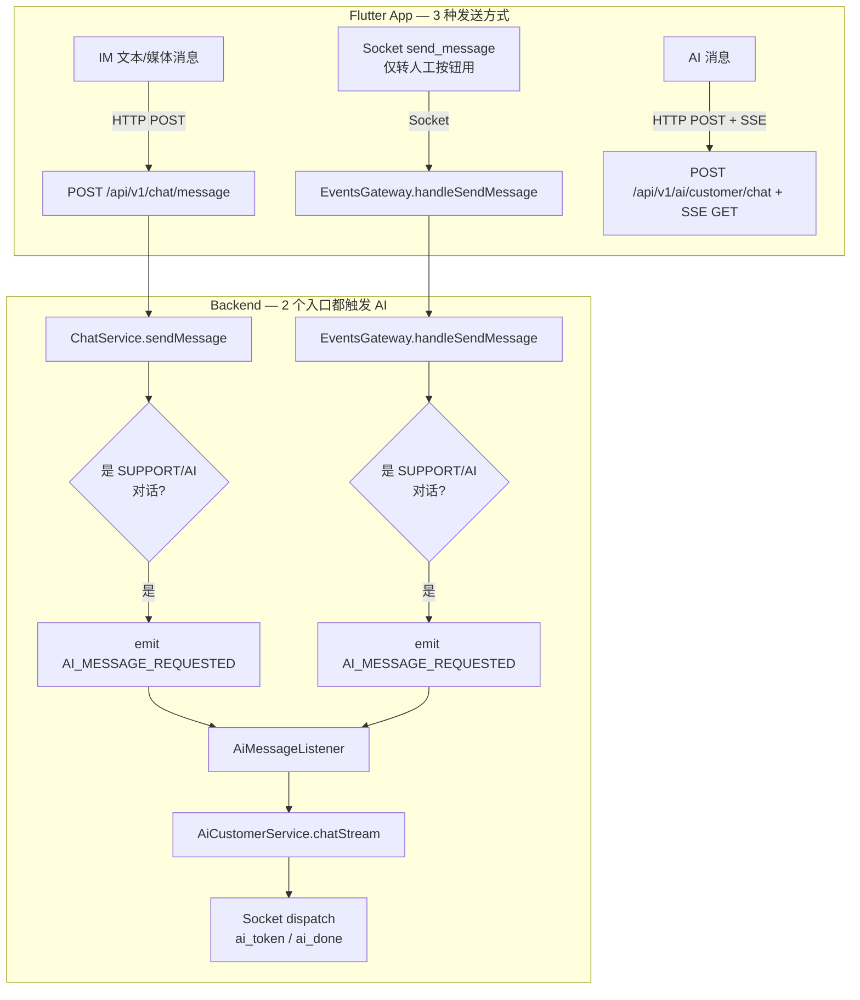

# Flutter + Backend AI Socket 统一分析报告

> 日期: 2026-07-16
> 背景: 用户反馈 Flutter 和 AI 没有统一走 Socket，AI 走了独立路线

---

## 一、当前架构总览 — 实际上有 **3 条发送路径**

### 1.1 后端消息路径



### 1.2 后端基础设施

| 组件                                                                                                | 位置           | 说明                                                                            |
| --------------------------------------------------------------------------------------------------- | -------------- | ------------------------------------------------------------------------------- |
| [`EventsGateway`](../apps/api/src/common/events/events.gateway.ts:70)                               | Socket Gateway | namespace `/events`，`dispatch()` 统一出口                                      |
| [`ChatService.sendMessage`](../apps/api/src/common/chat/chat.service.ts:61)                         | HTTP 入口      | IM 消息通过 `POST /api/v1/chat/message` 发送，**已触发 AI 路由** (line 189-194) |
| [`EventsGateway.handleSendMessage`](../apps/api/src/common/events/events.gateway.ts:314)            | Socket 入口    | Socket `send_message`，**也触发 AI 路由** (line 405-409)，但 Flutter 几乎不用   |
| [`AiCustomerService.chatStream`](../apps/api/src/client/ai-customer/ai-customer.service.ts:186-248) | AI 服务        | 双推 SSE + Socket `ai_token`/`ai_done`                                          |
| [`AiMessageListener`](../apps/api/src/client/ai-customer/ai-message.listener.ts:14)                 | AI 监听        | 接收 `AI_MESSAGE_REQUESTED` 触发 LangGraph                                      |

### 1.3 Flutter 端 — 3 条路径互不连通

| 路径                    | 发送方式                                | 后端入口                            | 接收方式              | UI 状态                 |
| ----------------------- | --------------------------------------- | ----------------------------------- | --------------------- | ----------------------- |
| **IM 文本/媒体**        | HTTP `POST /chat/message`               | `ChatService.sendMessage()`         | Socket `chat_message` | `ChatViewModel` (DB 流) |
| **AI 消息**             | HTTP `POST /ai/customer/chat` + SSE GET | `AiCustomerService.chatStream()`    | SSE stream            | `AiChatState` (内存)    |
| **Socket send_message** | Socket 极少用                           | `EventsGateway.handleSendMessage()` | Socket `chat_message` | `ChatViewModel` (DB 流) |

#### IM 路径 (HTTP 发 → Socket 收):

```
SyncStep → Api.sendMessage() → HTTP POST /api/v1/chat/message
  → Backend ChatService.sendMessage()
    → Prisma 落库 + seqId 递增
    → EventEmitter MESSAGE_CREATED → SocketListener → Socket dispatch 'chat_message'
    → 如果 SUPPORT/AI → AI_MESSAGE_REQUESTED → AiMessageListener → LangGraph
  → Flutter SocketService → ChatEventHandler._onSocketMessage()
    → LocalDatabaseService → DB 流 → ChatViewModel → UI
```

#### AI 路径 (HTTP + SSE — 完全独立):

```
AiChatViewModel.sendMessage()
  → POST /api/v1/ai/customer/chat (获取 streamId)
  → GET /ai/customer/chat/stream/:streamId (SSE 流)
  → SseClient → AiChatState (内存管理消息)
  → SSE done → MessageRepository.saveBatch() (写本地 DB)
```

---

## 二、关键发现

### 发现 1: IM 消息走 **HTTP** 而非 Socket

[`SyncStep`](pipeline_steps.dart:335) 调的是 [`Api.sendMessage()`](lucky_api.dart:814) — `HTTP POST /api/v1/chat/message`。

Socket `send_message` 虽然在后端有完整实现（`EventsGateway.handleSendMessage`），但 Flutter 只在"转人工"按钮里用它。

### 发现 2: IM 的 HTTP 路径**已经触发 AI**

[`ChatService.sendMessage()`](../apps/api/src/common/chat/chat.service.ts:189) 在保存消息后判断：

```typescript
if (conversationMeta.type === 'SUPPORT' || conversationMeta.type === 'AI') {
  this.eventEmitter.emit(CHAT_EVENTS.AI_MESSAGE_REQUESTED, ...);
}
```

所以如果 SUPPORT 对话的 IM 消息通过 HTTP 发送，**后端已经在跑 AI 处理了**。但 Flutter 端 AI 模式不走这个路径，它走的 SSE 完全独立。

### 发现 3: Socket 通道已就绪但 Flutter UI 不用

Socket 端的 AI 事件通道：

- `Flutter SocketChatMixin._onAiEvent()` → `aiEventStream` ✅ 已实现
- `Flutter ChatEventHandler._onAiEvent()` → 累积 token + 写 DB ✅ 已实现
- `Flutter SocketEvents.aiToken/aiDone` ✅ 已定义
- `Backend EventsGateway` 双推 ai_token/ai_done ✅ 已实现

但 ChatPage 的 **AI 模式使用 SSE 完全不经过 Socket**。

---

## 三、核心问题

| #   | 问题                                   | 位置                                                    | 说明                            |
| --- | -------------------------------------- | ------------------------------------------------------- | ------------------------------- |
| 1   | **`useAiMode` 分支**                   | [`chat_page.dart:119`](../chat_room/chat_page.dart:119) | 两套 UI/状态/logic              |
| 2   | **AI 消息不走 IM 通道**                | SSE vs HTTP/Socket                                      | 绕过 ChatService 正常管道       |
| 3   | **Socket AI 事件已有但 ChatPage 不用** | 全链路已就绪                                            | ChatPage AI 模式走 SSE          |
| 4   | **两套消息状态**                       | `AiChatState` vs `ChatViewModel`                        | 内存 vs DB 流，转人工历史不连续 |
| 5   | **转人工体验割裂**                     | 砍 SSE → 切 Socket                                      | 两段不连续的消息历史            |

---

## 四、目标架构 — 全走 HTTP + Socket

由于 IM 消息本身就走 HTTP，AI 消息也应当走 HTTP 统一入口：

```text
用户发消息 (所有类型)
  → ChatActionService.sendText() → SyncStep → Api.sendMessage()
  → HTTP POST /api/v1/chat/message
  → Backend ChatService.sendMessage()
    ├─ 保存消息 + seqId
    ├─ Socket dispatch 'chat_message' → 其他人收到
    └─ 如果 SUPPORT/AI → AI_MESSAGE_REQUESTED
       → AiMessageListener → AiCustomerService.chatStream()
       → Socket dispatch 'ai_token' / 'ai_done'
       → Flutter ChatEventHandler._onAiEvent()
       → LocalDatabaseService → DB 流 → ChatViewModel → UI
```

**变化**:

1. AI 消息不再走 SSE，改走 HTTP `POST /chat/message`（和 IM 统一）
2. AI 回复通过 Socket `ai_token`/`ai_done` 推送（已有的 `ChatEventHandler`）
3. 去掉 `useAiMode` 分支，所有对话用 `ChatViewModel`
4. 打字机效果通过 `ChatViewModel` 暴露 streaming 状态

---

## 五、实施步骤

### Phase A: Flutter 去掉 SSE 独立路径

| #   | 任务                              | 文件                                                                  | 说明                              |
| --- | --------------------------------- | --------------------------------------------------------------------- | --------------------------------- |
| A1  | 移除 `useAiMode` 分支             | [`chat_page.dart`](../chat_room/chat_page.dart:119)                   | 统一走 `ChatViewModel`            |
| A2  | `ChatViewModel` 加 streaming 状态 | [`chat_view_model.dart`](../chat_room/providers/chat_view_model.dart) | `isAiStreaming`, `currentAiToken` |
| A3  | `ChatBubble` 加 AI streaming 渲染 | [`chat_bubble.dart`](../chat_room/components/chat_bubble.dart)        | 打字机效果                        |
| A4  | 删除 `AiChatViewModel`            | `ai_chat_view_model.dart`                                             | 不再需要                          |
| A5  | 删除 `AiChatState`                | `ai_chat_state.dart`                                                  | 不再需要                          |
| A6  | 删除 SSE client 代码              | `core/services/ai/*`                                                  | 不再需要                          |

### Phase B: SUPPORT 对话发消息统一走 HTTP

| #   | 任务                                           | 文件                                                                           | 说明                       |
| --- | ---------------------------------------------- | ------------------------------------------------------------------------------ | -------------------------- |
| B1  | AI 模式输入栏调 `ChatActionService.sendText()` | [`chat_page.dart`](../chat_room/chat_page.dart:230)                            | 不走 AiChatViewModel       |
| B2  | `ChatEventHandler._onAiEvent` 完善打字机       | [`chat_event_handler.dart`](../chat_room/handlers/chat_event_handler.dart:167) | 用回调通知 `ChatViewModel` |
| B3  | SUPPORT 对话功能限制                           | `chat_action_service.dart`                                                     | 禁语音/视频/文件/位置      |

### Phase C: 后端无改动

SSE 端点保留（Blog 前端用 Web EventSource），后端已正确触发 AI。

---

## 六、影响范围

### 删除（~7 个 Flutter 文件）

- `core/store/ai_chat/ai_chat_state.dart`
- `core/store/ai_chat/ai_chat_view_model.dart`
- `core/services/ai/sse_client.dart`
- `core/services/ai/sse_client_io.dart`
- `core/services/ai/sse_client_dio.dart`
- `core/services/ai/sse_client_v2.dart`
- `core/services/ai/sse_types.dart`

### 修改（4 个 Flutter 文件）

- `chat_page.dart` — 移除 `useAiMode`
- `chat_view_model.dart` — 加 AI streaming 状态
- `chat_event_handler.dart` — 改进打字机效果
- `chat_bubble.dart` — 加 AI streaming 气泡
