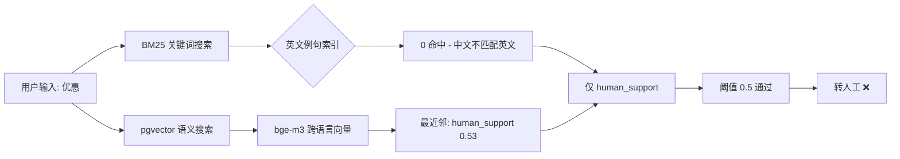
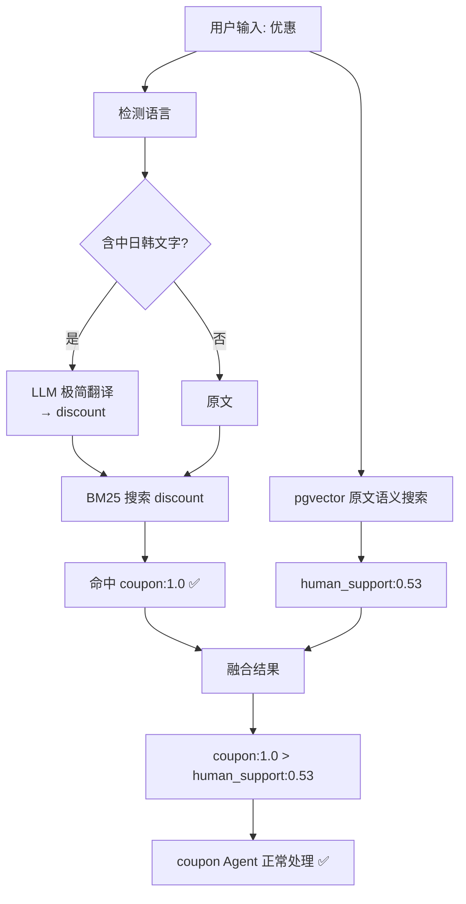

# 多语言意图分类修复方案

## 问题回顾

用户发中文消息（如"优惠"）时：

1. **BM25** 在所有英文例句中找不到匹配 → 0 命中
2. **pgvector** 用 bge-m3 做语义搜索 → 误匹配到 `human_support`（相似度 0.51~0.53）
3. 没有 BM25 结果来纠正 → `human_support` 通过阈值 → 转人工

## 当前架构



## 方案：翻译用户输入 → 专供 BM25

### 核心思路

**只翻译 BM25 搜索的输入（用极简 LLM prompt），不翻译 pgvector 的输入。**

- bge-m3 原生支持中文 → pgvector 直接用原文
- BM25 索引全是英文 → 翻译后再搜索才能匹配
- 翻译并发执行（与 pgvector 同时），不增加总耗时

### 翻译 prompt

不用现有的 `AiService.translateText()`（100+ 行 prompt，包含大量技术术语规则）。用极简 prompt：

```typescript
const TRANSLATE_PROMPT = `Translate to English. 
Reply with only the translated text, no explanation.

{input}`;
```

### 改动点

只改 [`IntentClassifier`](apps/api/src/client/ai-customer/graph/utils/intent-classifier.ts) 一个文件。

**1. 新增翻译方法：**

```typescript
private needsTranslation(text: string): boolean {
  // 检测是否含非 ASCII 字符（中文、日文、韩文等）
  return /[\u4e00-\u9fff\u3040-\u309f\uac00-\ud7af]/.test(text);
}

private async translateToEnglish(
  text: string,
  llmConfig: LlmProviderConfig,
): Promise<string> {
  if (!this.needsTranslation(text)) return text;

  try {
    const model = createLLM(llmConfig, { temperature: 0, maxOutputTokens: 64 });
    const result = await model.invoke(
      `Translate to English. Reply with only the translated text, no explanation.\n\n${text}`,
    );
    const translated = typeof result.content === 'string' ? result.content.trim() : '';
    return translated || text;
  } catch {
    return text; // 翻译失败回退到原文
  }
}
```

**2. 修改 classify() 中的 BM25 搜索：**

```typescript
// 翻译非英文输入，供 BM25 关键词搜索
const bm25Input = await this.translateToEnglish(normalizedInput, llmConfig);

const [bm25Result, embeddingResult] = await Promise.allSettled([
  this.meilisearchService.searchIntentExamples(bm25Input, 10), // ← 用翻译后的文本
  this.aiService.generateEmbedding(normalizedInput, {
    // ← 原文（bge-m3 支持中文）
    task: "retrieval.passage",
  }),
]);
```

### 3. 翻译失败的兜底

如果 LLM 翻译失败（AiService 不可用），回退到原文。中文原文 BM25 会 0 命中，此时启用 **BM25 human_support 惩罚**：

```typescript
// 在 BM25 + pgvector 融合后（约第 338 行），加 human_support 惩罚
if (domainMap.has("human_support") && !bm25DomainMap.has("human_support")) {
  const originalScore = domainMap.get("human_support")!;
  const penalized = Math.round(originalScore * 0.7 * 10000) / 10000;
  domainMap.set("human_support", penalized);
  logger.log(
    `[IntentClassifier] human_support BM25 penalty: ${originalScore} → ${penalized} (BM25 didn't match keywords)`,
  );
}
```

### 效果预估

| 场景          | 翻译                | BM25 结果            | pgvector 结果      | 最终              |
| ------------- | ------------------- | -------------------- | ------------------ | ----------------- |
| "优惠"        | → discount          | coupon:1.0 ✅        | human_support:0.53 | **coupon**        |
| "便宜的商品"  | → cheap goods       | product:1.0 ✅       | human_support:0.54 | **product**       |
| "KYC状态"     | KYC 已是英文        | rag:1.0, kyc:0.89    | human_support:0.48 | **kyc**（不变）   |
| "转人工"      | → transfer to human | human_support:1.0 ✅ | human_support:0.85 | **human_support** |
| "transfer me" | 已是英文            | human_support:1.0    | human_support:0.85 | **human_support** |

### 修复后的完整流程



## 工作量

- 修改 1 个文件：`intent-classifier.ts`
- 新增 ~30 行代码
- 需注入 `LlmProviderConfig` 到 IntentClassifier（或直接在方法内传参）
- 翻译延迟 < 200ms（用 gemini 或 deepseek 最快模型）
- 翻译与 pgvector 并发执行 → 不增加总耗时
