# AI 客服项目 — 进度

> 项目文档: `docs/AI-joymini/` 系列
> 知识图谱: 搜索 `AI客服项目-当前进度`

## 📋 16 项工作流挑战检查清单

> 每次执行代码任务前，对照此清单检查方案是否覆盖这些挑战。

| # | 挑战 | 优先级 | 当前状态 | 检查要点 |
|---|------|--------|:--------:|----------|
| 01 | **State 设计** — 状态定义是否合理？字段是否跨轮污染？ | P0 | ✅ | merge reducer 是否清除旧 key？ |
| 02 | **条件路由** — 条件边是否正确？是否有节点未统一路由？ | P0 | ⚠️ | agentDoneRouter 是否覆盖所有 Agent？ |
| 03 | **循环终止** — 是否有死循环保护？maxRounds 是否合理？ | P0 | ✅ | supervisorRouter 有 maxRounds=5 |
| 04 | **并行合并** — 是否需要并行执行？合并策略是否正确？ | P0 | ⚠️ | 方案 B 后不再需要 |
| 05 | **节点容错** — Agent/工具异常是否有 try-catch？fallback 是否合理？ | P0 | ⚠️ | 基础 try-catch，无重试 |
| 06 | **工具稳定性** — 工具是否有超时/重试？返回格式是否一致？ | P2 | ❌ | 缺少文档和测试 |
| 07 | **幂等性** — 写操作是否可重复调用不产生副作用？ | P0 | ✅ | wallet 提现 30s 窗口 |
| 08 | **持久化** — Checkpointer 是否就绪？生产环境是否需迁移？ | P1 | ⚠️ | MemorySaver 已实现，待迁移 PostgreSQL |
| 09 | **结构化输出** — LLM 输出是否有类型约束？JSON 解析是否健壮？ | P2 | ❌ | 代码有类型，缺少文档 |
| 10 | **工具选择错误** — LLM 是否会选错工具/Agent？ | P1 | ✅ | 方案 B 解决 |
| 11 | **HITL** — 写操作是否需要用户确认？中断后能否恢复？ | P1 | ⚠️ | 已设计未实现 |
| 12 | **可视化** — 是否有 Graph 执行可视化？调试是否方便？ | P2 | ⚠️ | 已规划未实现 |
| 13 | **中间步骤展示** — 用户能否看到 Agent 思考过程？ | P2 | ❌ | agentSteps 存在，缺少文档 |
| 14 | **可视化工作流编辑器** — 是否需要 GUI 编排工具？ | — | ❌ | 不适用于当前场景 |
| 15 | **延迟优化** — 首 Token 时间？是否有缓存/流式优化？ | P3 | ❌ | 缺少文档和实现 |
| 16 | **成本优化** — Token 消耗是否有监控？模型选择是否最优？ | P3 | ❌ | 缺少文档和实现 |

> 详细对标文档见 [`33-工作流型智能体16挑战对标.md`](docs/AI-joymini/33-工作流型智能体16挑战对标.md)

## 📋 13 项对话式机器人检查清单

> 第 1 类智能体基础能力。执行涉及前端/流式/多轮对话的代码任务前，对照此清单。

| # | 挑战 | 层面 | 当前状态 | 文件/说明 |
|---|------|:----:|:--------:|-----------|
| 01 | **多轮对话上下文丢失** — LLM 能否记住前几轮内容？ | 后端 | ✅ | MemorySaver + intentGateway + FLOW_INTENTS |
| 02 | **流式输出内容过多导致页面卡顿** — SSE 数据量过大时前端是否冻结？ | 前端 | ❌ | SSE 端点未实现，useAiChat 钩子 TODO |
| 03 | **上下文越长 token 成本和首字延迟** — 历史窗口是否限制了？ | 后端 | ⚠️ | slice(-6) 窗口已做，无成本监控 |
| 04 | **多轮对话里的指代消解** — 用户说"那个"能理解吗？ | 后端 | ⚠️ | intentGateway 部分解决，纯数字/姓名仍需改进 |
| 05 | **流式 Markdown 实时解析的闪烁与卡顿** — 渲染 Markdown 时是否闪烁？ | 前端 | ❌ | 前端未实现 |
| 06 | **历史消息过多导致会话列表卡顿** — 聊天记录列表性能？ | 前端 | ❌ | 前端会话管理未实现 |
| 07 | **用户中途停止生成** — 点击停止按钮能否立即终止？ | 前端 | ⚠️ | http.ts 有 AbortController 基础设施，未接入 AI 聊天 |
| 08 | **连续快速发多条请求竞态** — 快速连发时是否覆盖正确？ | 前端 | ❌ | 无前端防抖/竞态处理 |
| 09 | **流式中途报错/断线重连** — SSE 断开后能否自动重连？ | 前端 | ❌ | 无 SSE 错误重连逻辑 |
| 10 | **幻觉问题（业务问答场景）** — LLM 编造不存在的数据？ | 后端 | ✅ | Bug 5 已验证 + 3 层防御 + 方案 B |
| 11 | **重复问题反复消耗 token（语义缓存）** — 同一问题是否重复调 LLM？ | 后端 | ❌ | 未实现语义缓存 |
| 12 | **多模型切换与降级** — 主模型宕机是否自动降级？ | 后端 | ⚠️ | LLM Factory 支持手动切换，无自动降级 |
| 13 | **打字机效果与真实流式的平滑输出** — 流式渲染是否平滑？ | 前端 | ❌ | 前端未实现 |

> 详细对标文档见 [`34-对话式机器人13挑战对标.md`](docs/AI-joymini/34-对话式机器人13挑战对标.md)

## 📋 19 项通用型智能体检查清单

> 第 2 类智能体核心能力。执行涉及 Agent 规划/推理/编排的代码任务前，对照此清单。

| # | 挑战 | 类别 | 当前状态 | 检查要点 |
|---|------|:----:|:--------:|----------|
| 01 | **复杂目标的自主拆解** — LLM 能否将大目标拆成可执行的子任务？ | 规划 | ⚠️ | Supervisor LLM 分解有 Bug 5 幻觉；方案B 改为单轮单 Agent 不再需要 |
| 02 | **规划的动态调整（重规划）** — 计划执行中发现错误能否重新规划？ | 规划 | ❌ | 无重规划机制，方案B 后意图路由固定 |
| 03 | **ReAct 推理-行动循环稳定性** — ReAct 循环是否稳定不跳出边界？ | 执行 | ✅ | createReactAgent 生产就绪 |
| 04 | **死循环 / 原地打转** — 是否有循环检测机制？ | 执行 | ⚠️ | supervisorRound 上限 3 轮，无通用循环检测 |
| 05 | **失控的资源消耗** — 是否有 Token 预算/超时/步数限制？ | 执行 | ❌ | 无 Token 预算，无单步超时 |
| 06 | **目标偏离 / 任务漂移** — Agent 是否会偏离原始任务目标？ | 规划 | ❌ | Bug 5 根因，方案B 修复中 |
| 07 | **危险动作的护栏** — 写操作是否有确认/回滚机制？ | 安全 | ⚠️ | 钱包 OTP 确认有 HITL，无通用护栏 |
| 08 | **短期工作记忆管理** — 当前会话上下文是否完整？ | 记忆 | ✅ | currentMessages 字段管理 |
| 09 | **长期记忆存取** — 跨会话记忆是否生效？ | 记忆 | ✅ | MemorySaver Checkpointer 已实现 |
| 10 | **记忆的取舍与遗忘** — 状态累积后如何清洗旧数据？ | 记忆 | ⚠️ | Bug 4 taskResults 双重置是 workaround |
| 11 | **大量工具中的自主选择** — Agent 如何从多个工具中选择正确工具？ | 推理 | ⚠️ | 每个 Agent 独立工具集（3-7 个），当前可控 |
| 12 | **工具调用结果的理解与纠错** — 工具返回错误时 LLM 能正确处理？ | 推理 | ⚠️ | ReAct 内建重试，无结构化纠错 |
| 13 | **多智能体的角色分工与编排** — 多 Agent 如何协作不冲突？ | 编排 | ⚠️ | Supervisor Pattern 已实现但 Bug 5 幻觉 |
| 14 | **智能体间的通信与冲突** — Agent 间共享状态如何不污染？ | 编排 | ⚠️ | taskResults 共享，Bug 4 合并冲突 |
| 15 | **多智能体协作的成本与收敛** — 多 Agent 调用是否成本可控？ | 编排 | ❌ | 无成本追踪，round 上限 3 |
| 16 | **结果质量不稳定 / 不可复现** — 相同输入是否稳定输出？ | 质量 | ⚠️ | LLM 路由非确定性，方案B 减少 LLM 依赖 |
| 17 | **执行过程的可观测与可干预** — 能否看到 Agent 执行到哪里？ | 运维 | ⚠️ | HITL 中断存在，无可视化仪表盘 |
| 18 | **Agent 思考过程的实时展示** — 用户能否看到 Agent 正在思考？ | 体验 | ❌ | 无 SSE 流式思考输出 |
| 19 | **长任务的进度感知与随时干预** — 长任务能否查看进度并干预？ | 体验 | ❌ | 无进度追踪 |

> 详细对标文档见 [`35-通用型智能体19挑战对标.md`](docs/AI-joymini/35-通用型智能体19挑战对标.md)
> 学习资料: [`study/LLM/general-agent/`](../../study/LLM/general-agent/) 系列 19 篇文档

## 📋 企业级运维与运营检查清单

> 第 3 类企业级能力。涉及监控/日志/成本/面板的代码或配置任务前，对照此清单。

| # | 能力 | 类别 | 当前状态 | 说明 |
|---|------|:----:|:--------:|------|
| 01 | **APM / 性能追踪** — 端到端调用链是否有追踪？ | 可观测 | ❌ | 无 Sentry/Datadog/Prometheus |
| 02 | **日志聚合** — 日志是否集中可检索？ | 可观测 | ⚠️ | NestJS Logger 已用但分散在 stdout，无 ELK/Loki |
| 03 | **错误追踪** — 未处理异常是否自动捕获？ | 可观测 | ❌ | 无 Sentry |
| 04 | **节点级耗时追踪** — 每个 Agent 节点耗时是否可观测？ | 可观测 | ❌ | 无 OTel 埋点 |
| 05 | **Token 成本仪表盘** — 每次 LLM 调用的成本是否有统计？ | 成本 | ❌ | ai.service.ts 有基础统计，无 dashboard |
| 06 | **告警体系** — 连续失败/高延迟/成本异常是否有通知？ | 运维 | ❌ | 无 AlertManager |
| 07 | **HTTP 限流** — ThrottlerGuard 是否已配置？ | 安全 | ✅ | @nestjs/throttler 60 req/60s |
| 08 | **Provider 限流** — AI Provider 级别限流是否生效？ | 安全 | ✅ | 多 Key 轮询 + 429 冷却 + 指数退避 |
| 09 | **熔断器** — AiService 3 级降级是否正常工作？ | 可靠性 | ✅ | FULL→ESSENTIAL→MINIMAL→DISABLED |
| 10 | **管理员运营面板** — 对话检索/用户分析/服务概览？ | 运营 | ❌ | 未实现 |
| 11 | **用户反馈循环** — 点赞/踩 + 原因采集？ | 运营 | ❌ | 未实现 |
| 12 | **审计日志** — 写操作/HITL 审批是否有记录？ | 运营 | ❌ | 未实现 |
| 13 | **A/B 测试框架** — Prompt/Model 对比测试？ | 运营 | ❌ | 未实现 |
| 14 | **SLA 监控** — 可用性/响应时间/错误率？ | 运营 | ❌ | 未实现 |

> 详细对标文档见 [`36-企业级运维与运营规划.md`](docs/AI-joymini/36-企业级运维与运营规划.md)

## 📋 AI 学习路线 17 步覆盖检查清单

> 学习路线覆盖度。执行代码任务时，可对照此清单确认涉及的技术在 JoyMini 项目中是否已实现。

| # | 学习步骤 | 覆盖 | JoyMini 对应实现 |
|:-:|---------|:----:|-----------------|
| 01 | **AI 大模型基本原理 / DeepSeek 部署** | ✅ | [`llm-factory.ts`](apps/api/src/client/ai-customer/graph/llm-factory.ts) ChatOpenAI(DeepSeek) + [`deepseek.provider.ts`](apps/api/src/common/ai/providers/deepseek.provider.ts) 多 Key 轮询 |
| 02 | **Prompt 工程：设计与优化** | ✅ | [`intent-router.node.ts`](apps/api/src/client/ai-customer/graph/nodes/intent-router.node.ts) 分类 prompt + Agent system prompt |
| 03 | **GPU 与 CPU：计算硬件与大模型训练** | ❌ 不适用 | JoyMini 是 NestJS API 服务，不涉及 GPU 硬件 |
| 04 | **API 基础与通过 API 调用大模型** | ✅ | [`AiCustomerController`](apps/api/src/client/ai-customer/ai-customer.controller.ts) + [`AiService`](apps/api/src/common/ai/ai.service.ts) 多 Provider |
| 05 | **Cursor 编程 - 从入门到精通** | ✅ | 项目用 Spec-Coding 方法论构建，[`spec-coding/`](study/LLM/spec-coding/) 17 篇 |
| 06 | **Embeddings 和向量数据库** | ⚠️ Phase 1 桩 | [`rag.node.ts`](apps/api/src/client/ai-customer/graph/nodes/rag.node.ts) 静态加载 + [`ai.service.ts:641`](apps/api/src/common/ai/ai.service.ts:641) stub |
| 07 | **RAG 技术与应用** | ⚠️ Phase 1 桩 | [`rag.node.ts`](apps/api/src/client/ai-customer/graph/nodes/rag.node.ts) + KnowledgeDocument 模型已建，pgvector Phase 3 |
| 08 | **LlamaIndex：知识管理与信息检索** | ❌ 未使用 | JoyMini 用 LangChain，非 LlamaIndex |
| 09 | **LangChain：多任务应用开发** | ✅ **⭐ 核心** | [`customer.graph.ts`](apps/api/src/client/ai-customer/graph/customer.graph.ts) + [`state.ts`](apps/api/src/client/ai-customer/graph/state.ts) + `createReactAgent` |
| 10 | **Function Calling 与跨模型协作** | ✅ **⭐ 核心** | [`order-tools.ts`](apps/api/src/client/ai-customer/graph/tools/order-tools.ts) + [`wallet-tools.ts`](apps/api/src/client/ai-customer/graph/tools/wallet-tools.ts) |
| 11 | **Agent 智能体系的设计与应用** | ✅ **⭐ 核心** | Multi-Agent Supervisor + 4 Agents + 3 挑战对标文档(33/34/35) |
| 12 | **Fine-tuning 技术与大模型优化** | ❌ 未涉及 | JoyMini 用预训练模型 API，不需要微调 |
| 13 | **Coze 工作原理、应用实例、插件开发** | ❌ 未使用 | 无集成 |
| 14 | **Dify 本地化部署和应用** | ❌ 未使用 | 无集成 |
| 15 | **PyTorch 基础与应用** | ❌ 无关 | JoyMini 是 TypeScript/NestJS，非 Python |
| 16 | **TensorFlow 基础与深度学习实战** | ❌ 无关 | JoyMini 是 TypeScript/NestJS，非 Python |
| 17 | **模型能力评估与项目实战** | ✅ 项目本身 | JoyMini AI 客服 = 实战产出 + [`testChat`](apps/api/src/client/ai-customer/ai-customer.controller.ts:40) 验证 |

## ✅ 已完成

| # | 文档 | 状态 |
|---|------|------|
| 01 | AiService + Ollama 集成 | ✅ 含故障排查 |
| 02 | LangGraph 依赖安装 | ✅ |
| 03 | AiCustomerModule + GraphState | ✅ |
| 04 | 9 Intent 路由节点 | ✅ **API 验证通过** |
| 05 | AnswerSynthesizer + Graph 组装 | ✅ **6 个文件已创建** |
| 06 | orderAgent (ReAct Agent) | ✅ **3 文件新建 + 2 文件修改** |
| 07 | 📦 LLM Factory 封装 | ✅ **统一 createLLM()，支持 Ollama/DeepSeek 切换** |
| — | **FieldMeta Phase 1** — 装饰器 + toLLM | ✅ **14 字段，已验证 Working** |
| — | **FieldMeta Phase 2** — Swagger 元数据注入 | ✅ **description + x-field-meta，验证通过** |
| — | **FieldMeta Phase 3** — 前端类型生成 | ✅ **2 文件 17 字段自动生成** |
| — | **FieldMeta classNameMap 优化** | ✅ **消除 DTO 注册表，零维护** |
| — | **ToolRegistry 架构 — OnApplicationBootstrap 编程式注册** | ✅ **@Global ToolRegistryModule + registerMany()** |
| — | **TaggedTool 标签系统** | ✅ **Agent 只拿自己标签的工具** |
| — | **Wallet Agent 取提现 Phase 1 MVP** | ✅ **5 Tools + 2-phase confirmation，实测通过** |
| — | **PaymentChannel DTO 字段标准化** | ✅ **@FieldMeta + @Expose + @DecimalToString** |
| — | **Bug 4 — taskResults 跨轮污染** | ✅ **merge reducer {…a,…b} 不删旧 key → intentRouter + answerSynthesizer 双重重置** |
| — | **Bug 5 — Supervisor 幻觉诊断** | ✅ **无排除规则 + 无 CoT + 无安全退出 → 选方案 B** |
| — | **方案 B — 单轮单 Agent 架构** | ✅ **企业标准 Router Pattern：意图分类 → 选一个 Agent → 执行 → 验证 → 输出** |
| — | **16 挑战对标文档** | ✅ **33-工作流型智能体16挑战对标.md + 24-Supervisor架构完整总结.md 更新** |
| — | **13 对话式机器人挑战对标** | ✅ **34-对话式机器人13挑战对标.md + PROGRESS.md 第 2 检查清单** |
| — | **19 通用型智能体挑战对标** | ✅ **35-通用型智能体19挑战对标.md + PROGRESS.md 第 3 检查清单** |
| — | **企业级运维与运营规划** | ✅ **36-企业级运维与运营规划.md + PROGRESS.md 第 4 检查清单** |
| — | **Bug 6 — Supervisor 上下文污染** | ✅ **filterAgentMessages 共享函数 + 3 Agent 统一过滤 AI 纯文本，tsc 零错误** |
| — | **38-Agent潜在风险分析与最佳实践.md** | ✅ **文档创建，覆盖 Supervisor 上下文污染分析与企业级 5 种隔离方案对比** |
| — | **Bug 7 — stripToolResult() 工具结果包装** | ✅ **tool-result.ts 新增 stripToolResult() + 3 Agent 应用，tsc 零错误** |
| — | **Bug 8 — filterAgentMessages 丢失 tool_calls 上下文** | ✅ **索引回溯扫描保留最后 AI(tool_calls) 消息，修复 INVALID_TOOL_RESULTS** |
| — | **Bug 9 — answerSynthesizer intent 重置遗漏** | ✅ **intent 清除移到条件外，所有模式统一重置** |
| — | **Bug 10 — taskResults merge vs replace 模式混乱** | ✅ **state.ts reducer 改为 merge-with-clear: 空对象=清空，非空=合并** |
| — | **Bug 11 — intentRouter 上下文缺失（"确认"无法路由）** | ✅ **conversationContext 从 state.messages 提取近 4 条传给 LLM prompt** |
| — | **Bug 12 — isSupervised / pendingTasks 冗余** | ✅ **移除 isSupervised，filter-messages.ts 改用 pendingTasks.length > 0** |
| — | **3 场景端到端验证** | ✅ **"领券+确认" / "优惠券+存款切换" / "优惠券+余额多域" 全部通过** |

### Doc 04 验证

```bash
POST /api/v1/ai-customer/test-intent
{"message":"I want to check my order status"} → {"intent":"order"}  # 9/9 正确
```

### Doc 05 创建的文件

```bash
apps/api/src/client/ai-customer/
├── graph/
│   ├── state.ts                          # +agentOutput + userId 字段
│   ├── customer.graph.ts                 # StateGraph 组装
│   └── nodes/
│       ├── answer-synthesizer.node.ts    # 3 种情况合成
│       ├── general-chat.node.ts          # 闲聊节点
│       └── rag.node.ts                   # 知识库 Phase 1 占位
├── ai-customer.service.ts                # +OnModuleInit 启动编译
└── ai-customer.module.ts                 # Provider 注册
```

### Doc 06 — orderAgent (ReAct Agent)

**新建文件 (3):**
| 文件 | 内容 |
|------|------|
| [`order-agent.node.ts`](apps/api/src/client/ai-customer/graph/nodes/order-agent.node.ts) | stub + `createOrderAgentNode` 工厂 |
| [`order-tools.ts`](apps/api/src/client/ai-customer/graph/tools/order-tools.ts) | `getUserOrders` + `getOrderInfo`（方案A: userId 在 Zod schema） |

**修改文件 (2):**
| 文件 | 变更 |
|------|------|
| [`customer.graph.ts`](apps/api/src/client/ai-customer/graph/customer.graph.ts) | 注册 `orderAgent` 节点 + 路由 |
| [`state.ts`](apps/api/src/client/ai-customer/graph/state.ts) | 新增 `userId` 字段 |

**生产就绪修复 (2026-06-27):**

| 优先级 | 问题 | 修复 |
|--------|------|------|
| **P0** | `lastCall` vs `lastToolCall` 变量名不匹配 → 运行时 ReferenceError | 统一命名为 `lastToolCall` |
| **P0** | 无 `maxIterations` 限制 → 工具无限循环 | 替换 `createAgent` 为手动 `llm.bindTools(tools)` + `while` 循环，`MAX_ITERATIONS = 3` |
| **P0** | `BizException` 通过工具传播 → HTTP 400 | 两个 tool 函数内加 try-catch，返回 JSON 错误字符串给 LLM |
| **P1** | Agent 节点无 try-catch 兜底 | 外层 `while` 循环加 try-catch，异常时返回 fallback 消息 |
| **P1** | systemPrompt 无错误处理指引 | 增加规则 #7：工具返回错误时指导 LLM 回应 |
| **P2** | 对话历史无限增长 | `state.messages.slice(-6)` 窗口限制 |
| **P2** | `console.log` / `console.error` | 替换为 `Logger` from `@nestjs/common` |

**关键架构决策:** `createAgent` (langchain) → 手动 Agent 循环
- `langchain` 包的 `createAgent` 类型定义不支持 `maxIterations`
- `@langchain/langgraph/prebuilt` 的 `createReactAgent` 已弃用
- 最终方案: `llm.bindTools(tools)` + `while` 循环，精确控制迭代次数

**验证结果:**
```bash
POST /api/v1/ai-customer/test-chat
{"message":"Show my orders"} → code: 10000 ✅
# debug.toolCalls: 1 (maxIterations 生效)
# 返回格式化订单详情表格
```

**清理工作:**
- 修复 tsconfig.json 的 `moduleResolution`（commonjs + paths 映射解决 `@langchain/langgraph/prebuilt` 导入问题）
- 清理 ~1113 个意外生成的 `.js`/`.d.ts` 文件
- 删除重复注释块（方案A注释重复了两遍）

### Doc 07 — 📦 LLM Factory 封装

**问题背景:** Graph 节点直接硬编码 `ChatOllama`（本地 `http://ollama:11434`），导致：
- 部署时 LLM 不可用（Ollama 未运行）→ 全系统瘫痪
- AiService（用 DeepSeek API）和 Graph（用 Ollama）用两套不同 Provider，响应慢（55s 含 AI 超时）
- 开发环境必须启动 Ollama Docker，本地调试成本高

**解决方案:** 创建 [`llm-factory.ts`](apps/api/src/client/ai-customer/graph/llm-factory.ts)，通过 `AI_LLM_PROVIDER=deepseek|ollama` 环境变量统一切换 Provider，所有 Graph 节点通过 `createLLM()` 获取 LLM 实例。

**新建文件 (1):**
| 文件 | 内容 |
|------|------|
| [`graph/llm-factory.ts`](apps/api/src/client/ai-customer/graph/llm-factory.ts) | `createLLM()` 工厂函数（`ChatOpenAI`/`ChatOllama` 二选一） |

**新增依赖:**
| 包名 | 版本 | 用途 |
|------|------|------|
| `@langchain/openai` | ^1.5.3 | DeepSeek API（OpenAI 兼容） |
| `langchain` | 1.5.2 | `createAgent`（已弃用 → 替换为手动 Agent 循环） |

**修改文件 (5):**
| 文件 | 变更 |
|------|------|
| [`intent-router.node.ts`](apps/api/src/client/ai-customer/graph/nodes/intent-router.node.ts) | 改用 `createLLM()` 替代 direct `ChatOllama` |
| [`order-agent.node.ts`](apps/api/src/client/ai-customer/graph/nodes/order-agent.node.ts) | 改用 `createLLM()` + `createAgent` from `langchain`（`model`/`systemPrompt` 新 API） |
| [`general-chat.node.ts`](apps/api/src/client/ai-customer/graph/nodes/general-chat.node.ts) | 改用 `createLLM()` 替代 direct `ChatOllama` |
| [`answer-synthesizer.node.ts`](apps/api/src/client/ai-customer/graph/nodes/answer-synthesizer.node.ts) | 改用 `createLLM()` 替代 direct `ChatOllama` |
| [`apps/api/.env`](apps/api/.env) | 新增 `AI_LLM_PROVIDER=deepseek` |

**当前 Graph 节点流程:**
```
User Input → [intentRouter(createLLM)] → [orderAgent(createLLM+createAgent) / ragNode / generalChat(createLLM)] → [answerSynthesizer(createLLM)] → Response
```

所有节点统一通过 `createLLM()` 获取 LLM 实例，Provider 切换只需改 `.env` 一行配置。

### ToolRegistry 架构 — OnApplicationBootstrap 编程式注册 + @Global ToolRegistryModule + TaggedTool 标签系统

**问题背景:** 最初 ToolRegistry 是手动 `register()` 模式，每个 domain 工具需要在 `ai-customer.service.ts` 里手动调用 `createOrderTools(this.orderService, this.registry)`。用户指出："为什么要在运行之前调用？那这里不是很庞大" —— 手动调用只是把代码从 graph 文件搬到了 service 文件，没有根本解决扩展性问题。

**解决方案演进 (4 个阶段):**

| 阶段 | 方案 | 问题 |
|------|------|------|
| Phase 1 | 手动 `register()` | 手动调用只是代码搬迁 |
| Phase 2 | **NestJS `multi:true` 自动注入** | ✅ 零手动调用，但 Agent 拿到所有工具 |
| Phase 3 | **+ TaggedTool 标签系统** | ✅ Agent 只拿自己标签的工具；但发现**钻石依赖作用域隔离问题** |
| Phase 4 | **`OnApplicationBootstrap` 编程式注册 + `@Global ToolRegistryModule`** | ✅ 完全避免 DI scope 限制 |

> **坑：多模块钻石依赖** — 当 `AiCustomerModule` 同时导入 `OrderModule` 和 `WalletModule`，且 `OrderModule` 也导入 `WalletModule`，NestJS 的 `multi:true` provider 会被缓存消费，导致 `WalletModule` 的工具无法到达 `ToolRegistryService`。详见架构文档 [推荐路径] 的警告说明。

**最终架构:**

```mermaid
flowchart LR
    subgraph ToolRegistryModule["🌐 @Global ToolRegistryModule"]
        TR[ToolRegistryService<br/>registerMany&#40;&#41;]
    end

    subgraph WalletModule["📦 WalletModule"]
        WM[WalletModule] -->|onApplicationBootstrap| R1["registerMany&#40;createWalletTools&#40;...&#41;&#41;"]
    end

    subgraph OrderModule["📦 OrderModule"]
        OM[OrderModule] -->|onApplicationBootstrap| R2["registerMany&#40;createOrderTools&#40;...&#41;&#41;"]
    end

    R1 --> TR
    R2 --> TR

    TR -->|getToolsByTag&#40;'order'&#41;| ORD["→ Order 工具"]
    TR -->|getToolsByTag&#40;'wallet'&#41;| WAL["→ Wallet 工具"]
```



**核心文件:**

| 文件 | 操作 | 说明 |
|------|------|------|
| [`tool-registry.service.ts`](apps/api/src/client/ai-customer/graph/tools/tool-registry.service.ts) | 改造 | 移除 `@Inject(AI_TOOLS)`，添加 `registerMany()` |
| [`tool-registry.module.ts`](apps/api/src/client/ai-customer/graph/tools/tool-registry.module.ts) | **新建** | `@Global()` 模块，提供 `ToolRegistryService` 全局单例 |
| [`wallet.module.ts`](apps/api/src/client/wallet/wallet.module.ts) | 改造 | 实现 `OnApplicationBootstrap`，调用 `registerMany(createWalletTools(...))` |
| [`order.module.ts`](apps/api/src/client/orders/order.module.ts) | 改造 | 实现 `OnApplicationBootstrap`，替换 `multi:true` provider 为 `registerMany()` |
| [`ai-customer.module.ts`](apps/api/src/client/ai-customer/ai-customer.module.ts) | 简化 | 移除 `AI_TOOLS` provider，恢复干净 |
| [`client.module.ts`](apps/api/src/client/client.module.ts) | 修改 | 导入 `ToolRegistryModule` |
| [`ai-customer.service.ts`](apps/api/src/client/ai-customer/ai-customer.service.ts) | 未变 | 不再需要手动注册工具 |
| [`customer.graph.ts`](apps/api/src/client/ai-customer/graph/customer.graph.ts) | 未变 | 仍通过 `registry.getToolsByTag('order')` 获取 |

**关键概念解释:**

| 概念 | 说明 |
|------|------|
| `ToolRegistryModule (@Global)` | `@Global()` 模块，任何模块无需 import 即可注入 `ToolRegistryService` |
| `registerMany()` | 各 domain 模块在 `OnApplicationBootstrap` 钩子中调用此方法注册工具 |
| `OnApplicationBootstrap` | NestJS 生命周期钩子，在所有模块初始化完成后执行 |
| `TaggedTool` | `{ tool: DynamicStructuredTool, tags: string[] }` — 给工具打标签，按标签过滤 |
| `getToolsByTag('order')` | Agent 节点只拿自己需要的工具，不污染 LLM 上下文 |

**Bug 修复记录:**

| 问题 | 根因 | 修复 |
|------|------|------|
| `UnknownDependenciesException` (早期) | `OrderModule` 未 `exports: ['AI_TOOLS']` | 添加 `exports: [OrderService, 'AI_TOOLS']` |
| **Wallet Agent toolCalls=0，LLM 退化为 XML 标签调用** | **NestJS `multi:true` 钻石依赖：WalletModule 被 OrderModule 和 AiCustomerModule 同时导入，AI_TOOLS 被 Order 作用域"消费"** | **从 `multi:true` DI 迁移到 `OnApplicationBootstrap` 编程式注册 + `@Global ToolRegistryModule`** |

**验证结果:**
```bash
cd apps/api && npx tsc --noEmit   # ✅ 零错误
# testChat API: toolCalls: 1 ✅ 返回真实钱包余额数据
```

**未来扩展（3 步加一个 domain）:**

1. 创建 `xxx-tools.ts` 返回 `TaggedTool[]`（标签 `'xxx'`）
2. 在 `xxx.module.ts` 实现 `OnApplicationBootstrap`，注入 `ToolRegistryService`，在钩子中调用 `this.toolRegistry.registerMany(createXxxTools(...))`
3. 在对应的 Agent node 使用 `registry.getToolsByTag('xxx')`

**不需要修改的文件:** `ai-customer.service.ts`, `customer.graph.ts`, `ai-customer.module.ts`

### FieldMeta Phase 1 — 装饰器 + toLLM

**设计文档:** [`docs/AI-joymini/field-meta-architecture.md`](docs/AI-joymini/field-meta-architecture.md)

**核心文件:**
| 文件 | 操作 | 说明 |
|------|------|------|
| [`packages/shared/src/decorators/field-meta.ts`](packages/shared/src/decorators/field-meta.ts) | 新增 | `@FieldMeta` 装饰器 + WeakMap/classNameMap 双存储 |
| [`apps/api/src/common/ai/utils/to-llm.ts`](apps/api/src/common/ai/utils/to-llm.ts) | 新增 | `toLLM()` 通用 AI 序列化器 |
| [`apps/api/src/client/orders/dto/order-item.dto.ts`](apps/api/src/client/orders/dto/order-item.dto.ts) | 修改 | 14 字段加 `@FieldMeta` 装饰器 |
| [`apps/api/src/client/ai-customer/graph/tools/order-tools.ts`](apps/api/src/client/ai-customer/graph/tools/order-tools.ts) | 修改 | 两个 tool 函数改用 `toLLM()` |

**验证结果:**
```bash
yarn workspace @lucky/api build        # ✅ 构建成功
# 调用 /test-chat 验证输出语义化数据  # ✅ Working
```

### FieldMeta Phase 2 — Swagger 元数据注入

**问题:** `@ApiProperty({ description: 'orderStatus' })` 只有字段名没有语义描述，Swagger UI 不可读。

**方案:** 创建 `applyFieldMetaToSwagger()` 纯函数，在 Swagger 导出时遍历 schema，通过 `classNameMetadata` 自动匹配 `@FieldMeta` 元数据，注入 `description` + `x-field-meta` OpenAPI Extension。

**新增/修改文件:**
| 文件 | 操作 | 说明 |
|------|------|------|
| [`apps/api/src/common/ai/utils/apply-field-meta.ts`](apps/api/src/common/ai/utils/apply-field-meta.ts) | 新增 | `applyFieldMetaToSwagger()` — 遍历 schema 注入 description + x-field-meta |
| [`apps/api/src/main.ts`](apps/api/src/main.ts) | 修改 | 在 createDocument 后调用 |
| [`apps/api/scripts/cli/export-swagger.ts`](apps/api/scripts/cli/export-swagger.ts) | 修改 | 导出时同样调用 |

**验证结果:**
```bash
cd apps/api && yarn export:swagger:full
# ✅ 14 个 x-field-meta 字段注入成功
# 示例: orderStatus.description = "订单状态 (1=待支付, 2=已支付...)"
```

### FieldMeta Phase 3 — 前端类型生成

**问题:** 前端需要手动复制 Swagger 类型，繁琐且易错。

**方案:** 创建 `gen-types.ts` CLI 脚本，读取 Phase 2 导出的 `swagger-spec.json`（含 `x-field-meta`），自动生成 TypeScript 类型文件到 `packages/shared/src/types/gen/`。

**新增/修改文件:**
| 文件 | 操作 | 说明 |
|------|------|------|
| [`apps/api/scripts/cli/gen-types.ts`](apps/api/scripts/cli/gen-types.ts) | 新增 | 从 swagger-spec.json 的 `x-field-meta` 生成 `.generated.ts` |
| [`apps/api/package.json`](apps/api/package.json) | 修改 | 添加 `gen-types` / `gen-types:full` script |
| [`packages/shared/src/types/gen/order-item-dto.generated.ts`](packages/shared/src/types/gen/order-item-dto.generated.ts) | 生成 | 14 字段自动生成 |

**验证结果:**
```bash
cd apps/api && yarn export:swagger:full && yarn gen-types
# ✅ 2 个文件，17 个字段
# ✅ order-item-dto.generated.ts: 14 fields
# ✅ treasure-d-to.generated.ts: 3 fields
```

### FieldMeta classNameMap 优化（消除注册表）

**问题:** 最初需要手动维护 `dto-registry.ts`（`DTO_MAP = new Map(...)`），每新增一个 DTO 都要手动注册。

**方案:** 在 `FieldMeta()` 装饰器中新增 `classNameMetadata` Map，通过 `target.constructor?.name` 自动按类名索引。Swagger/gen-types 通过 `getFieldMetasByClassName("OrderItemDto")` 直接查询，无需手动注册。

**修改文件:**
| 文件 | 操作 | 说明 |
|------|------|------|
| [`packages/shared/src/decorators/field-meta.ts`](packages/shared/src/decorators/field-meta.ts) | 增强 | 新增 `classNameMetadata` + 查询函数 |
| [`apps/api/src/common/ai/utils/apply-field-meta.ts`](apps/api/src/common/ai/utils/apply-field-meta.ts) | 简化 | 移除 `dtoMap` 参数 |
| [`apps/api/src/main.ts`](apps/api/src/main.ts) | 简化 | 移除 `DTO_MAP` import |
| [`apps/api/scripts/cli/export-swagger.ts`](apps/api/scripts/cli/export-swagger.ts) | 简化 | 移除 `DTO_MAP` import |
| [`apps/api/src/common/dto/dto-registry.ts`](apps/api/src/common/dto/dto-registry.ts) | **删除** | 不再需要 |

**当前工作流:** 开发者只需在 DTO 属性上加 `@FieldMeta()`，其余全部自动完成。

## 📖 经验总结（LLM Factory 封装）

### 问题根因
Graph 各节点直接硬编码 `ChatOllama`，和 `AiService`（DeepSeek）是两套独立的 AI 调用链路，导致：
1. **Ollama 不可用 → Graph 全挂**：上线后若 Ollama 未部署或资源不足，所有 Agent 节点直接报错
2. **响应延迟翻倍**：AiService 55s 超时等待 → Graph 再 55s → 用户等 110s
3. **开发环境负担重**：本地必须起 Ollama Docker，macOS 资源吃紧

### Factory Pattern 解决思路
```
┌─────────────────────────────────┐
│        createLLM(options)       │
│                                 │
│  AI_LLM_PROVIDER=deepseek ──────┤──→ ChatOpenAI (DeepSeek API)
│  AI_LLM_PROVIDER=ollama ────────┤──→ ChatOllama (local)
└─────────────────────────────────┘
```
- 6 个节点原来各自 `new ChatOllama(...)` → 全部改为 `createLLM({ temperature })`
- `.env` 一行 `AI_LLM_PROVIDER=deepseek` 即可切换 Provider
- 开发用 Ollama，生产用 DeepSeek，互不干扰

### createAgent API 迁移教训
`@langchain/langgraph/prebuilt` 的 `createReactAgent` 已被弃用，迁移到 `langchain` 包的 `createAgent`：

| 旧 API | 新 API |
|--------|--------|
| `import { createReactAgent } from '@langchain/langgraph/prebuilt'` | `import { createAgent } from 'langchain'` |
| 参数: `llm` | 参数: `model` |
| 参数: `messageModifier` / `prompt` | 参数: `systemPrompt` |

### 依赖安装教训
Monorepo 中安装 LangChain 相关包必须用 `yarn workspace`：
```bash
yarn workspace @lucky/api add @langchain/core @langchain/langgraph   # 核心
yarn workspace @lucky/api add @langchain/openai                      # 用于 DeepSeek
yarn workspace @lucky/api add langchain                              # 用于 createAgent (1.5.2)
```
⚠️ 注意：`@langchain/ollama` 的 `peerDependencies` 不自动安装 `@langchain/core` 和 `@langchain/langgraph`，需显式安装。
⚠️ `langchain` 包（~3.12 MiB）需手动安装，`createAgent` 不会通过其他包传递进来。

### VSCode 缓存陷阱
VSCode 可能显示不存在的文件路径（如 `graph/graph/llm-factory.ts`）——实际文件在 `graph/llm-factory.ts`。这是由于 VSCode TS 缓存 + 错误路径引用导致。用 `ls` 确认磁盘真实目录结构即可解决。

## 🎯 技术总结 & 面试准备

### 当前完成: OrderAgent 生产就绪

**Bug 修复 (7 项, P0-P2):** ✅ 全部完成并实测验证
**关键架构决策:** `createAgent` → 手动 `llm.bindTools(tools)` + `while` 循环
**验证:** POST /test-chat → code: 10000 ✅, debug.toolCalls: 1

### 面试 Q&A 文档

创建于 [`docs/study/interview-ai-agent-order-system.md`](docs/study/interview-ai-agent-order-system.md)

### 当前架构数据流

```
启动时:
  NestJS 初始化所有模块:
    OrderModule.onApplicationBootstrap()
      → this.toolRegistry.registerMany(createOrderTools(orderService))
      → TaggedTool[{ tool: getUserOrders, tags: ['order'] }, { tool: getOrderInfo, tags: ['order'] }] 存入 registry

    WalletModule.onApplicationBootstrap()
      → this.toolRegistry.registerMany(createWalletTools(walletService, clientWalletService, kycService))
      → TaggedTool[{ tool: getWalletBalance, tags: ['wallet'] }, ...] 存入 registry

  AiCustomerService.onApplicationBootstrap()
    → buildCustomerGraph(llmConfig, registry)
    → createOrderAgentNode(llmConfig, registry)
    → registry.getToolsByTag('order')  → 拿到 Order 工具
    → llm.bindTools(orderTools)        → LLM 只看到 Order 工具

运行时:
  User: "Show my orders"
    → intentRouter → orderAgent
    → LLM 从绑定的 Order 工具中选择调用 getUserOrders
    → 返回订单数据
```

### Wallet Agent — 取提现 Phase 1 MVP (2026-06-28)

**背景:** 用户要求 Wallet Agent 支持取提现功能。作为架构师分析后，选择 Phase 1 MVP 方案（两阶段确认模式，无额外安全验证）。

**实现功能（5 个 Tool）:**

| Tool | 功能 | 说明 |
|------|------|------|
| `getWalletBalance` | 查余额 | 现金余额 ₱908.00，金币余额 0 coins |
| `getWalletTransactions` | 交易记录 | 充值/提现记录，支持分页 |
| `getKycStatus` | 查 KYC | 实名认证状态 + 风险等级 |
| `getPaymentChannels` | 查提现渠道 | GCash (₱100-₱50k, 费₱5), Bank (₱200-₱100k, 费₱10) |
| `applyWithdraw` | 申请提现 | 两阶段确认，内部 KYC + balance + 幂等性检查 |

**修改文件（6 个）:**

| 文件 | 变更 |
|------|------|
| [`wallet-tools.ts`](apps/api/src/client/ai-customer/graph/tools/wallet-tools.ts) | +getPaymentChannels + applyWithdraw 工具，内存 30s 幂等性，修复 kyc.status → kyc.kycStatus |
| [`wallet-agent.node.ts`](apps/api/src/client/ai-customer/graph/nodes/wallet-agent.node.ts) | System Prompt 增加两阶段提现流程（Preview → Confirm & Execute） |
| [`payment-channel.dto.ts`](apps/api/src/client/payment-channel/dto/payment-channel.dto.ts) | 8 字段加 @FieldMeta，@Expose({ name: 'feeFixed' }) 映射 fee，@DecimalToString() |
| [`withdraw-apply-response.dto.ts`](apps/api/src/client/wallet/dto/withdraw-apply-response.dto.ts) | @FieldMeta 标注（withdrawId, withdrawNo, withdrawAmount, withdrawStatus） |
| [`recharge.dto.ts`](apps/api/src/client/wallet/dto/recharge.dto.ts) | RechargeHistoryItemDto 加 @FieldMeta（修复历史记录为空 bug） |
| [`wallet.module.ts`](apps/api/src/client/wallet/wallet.module.ts) | 注入 PaymentChannelService，4 参数传给 createWalletTools |

**验证结果:**
```bash
POST /api/v1/ai-customer/test-chat
{"message":"帮我取款100,Gcash账户:09451297266,账户姓名:porter，信息正确，提交该提现申请"}
# → code: 10000 ✅
# → toolCalls: 3 (getWalletBalance + getKycStatus + getPaymentChannels)
# → 正确展示渠道信息: GCash ₱100-₱50k, Bank ₱200-₱100k 不符合
# → 两阶段确认: 展示预览，问用户确认 → 用户确认后执行
```

**已解决的 UX 问题:**

| 问题 | 修复 | 状态 |
|------|------|:----:|
| 展示不符合金额的渠道 | getPaymentChannels Zod schema 补上 amount 参数，函数内部按金额过滤 | ✅ 已修复 |
| 矛盾系统提示 | 删除第 89 行 "提现功能暂不支持" 残留语句 | ✅ 已修复 |
| 无意义三元表达式 | `lastMessage.content` → `JSON.stringify(lastMessage.content)` | ✅ 已修复 |

### Wallet Agent Phase 2 — OTP 验证 (2026-06-29)

**背景:** 用户要求 Phase 2 安全加强。分析后选择 OTP 方案—提现流程增加 OTP 验证步骤。

**新增/修改文件 (5):**

| 文件 | 操作 | 说明 |
|------|------|------|
| [`otp.service.ts`](apps/api/src/client/otp/otp.service.ts) | 修复 | `create()` 方法 `CODE_TYPE.LOGIN` 硬编码 → `codeType` 参数传递 |
| [`wallet-tools.ts`](apps/api/src/client/ai-customer/graph/tools/wallet-tools.ts) | 新增 | `requestWithdrawOtp` + `verifyWithdrawOtp` 工具，系统提示增加 OTP 说明 |
| [`wallet.module.ts`](apps/api/src/client/wallet/wallet.module.ts) | 修改 | imports 添加 `OtpModule`，`createWalletTools` 注入 `OtpService` |
| [`wallet-agent.node.ts`](apps/api/src/client/ai-customer/graph/nodes/wallet-agent.node.ts) | 修改 | System Prompt 增加 OTP VERIFICATION 区块 |
| [`agent-types.ts`](apps/api/src/client/ai-customer/graph/types/agent-types.ts) | 修改 | 添加 `satisfies` 类型检查 |

**工具变化:**

| Tool | Phase 1 | Phase 2 |
|------|---------|---------|
| `getWalletBalance` | ✅ | ✅ |
| `getWalletTransactions` | ✅ | ✅ |
| `getKycStatus` | ✅ | ✅ |
| `getPaymentChannels` | ✅ | ✅ |
| `applyWithdraw` | ✅ 两阶段确认 | ✅ |
| `requestWithdrawOtp` | — | ✅ 新: 发 OTP 到绑定手机 |
| `verifyWithdrawOtp` | — | ✅ 新: 验证 OTP 后执行提现 |

**提现流程演进:**

```
Phase 1 (两阶段确认):
  用户 → 选渠道+填信息 → 预览 → 确认 → applyWithdraw

Phase 2 (OTP 验证):
  用户 → 选渠道+填信息 → requestWithdrawOtp → 输入 OTP → verifyWithdrawOtp
                                                    (内部调用 applyWithdraw)
```

**修复记录:**

| 问题 | 修复 |
|------|------|
| `otp.service.ts:64` 硬编码 `CODE_TYPE.LOGIN` | 改为 `codeType: codeType`，使用传入参数 |
| `wallet.module.ts` 缺 `OtpModule` import | 添加 `imports: [KycModule, OtpModule]` |
| `wallet-tools.ts` 缺 `OtpService` import | 添加 `imports` |
| `wallet-tools.ts:138` `!isProd` 编译错误 | 删除 `devCode` 行 |

### ToolRegistry 去重增强 (2026-06-29)

**问题:** `registerMany()` 多次调用可能注册同名工具，导致工具膨胀。

**修复:** 在 [`tool-registry.service.ts:27-32`](apps/api/src/client/ai-customer/graph/tools/tool-registry.service.ts:27) 添加 `registerMany()` 去重逻辑:

```typescript
registerMany(tools: TaggedTool[]): void {
  const existingNames = new Set(this.allTaggedTools.map((t) => t.tool.name));
  const newTools = tools.filter((t) => !existingNames.has(t.tool.name));
  this.allTaggedTools.push(...newTools);
}
```

### currentMessages 审计 + 多轮对话修复 (2026-06-29)

**背景:** 架构师审计时发现 Agent 节点返回 `state.messages` 而不是 `currentMessages`，导致 ToolMessage 在跨消息时丢失。

**发现的问题 (3 个):**

| # | 问题 | 位置 | 修复 |
|---|------|------|------|
| 1 | Agent nodes 返回 `state.messages` | [`wallet-agent.node.ts:177`](apps/api/src/client/ai-customer/graph/nodes/wallet-agent.node.ts:177) | 改为 `currentMessages.slice(1)` — 跳过 system prompt |
| 2 | Agent nodes 返回 `state.messages` | [`order-agent.node.ts:129`](apps/api/src/client/ai-customer/graph/nodes/order-agent.node.ts:129) | 同上 |
| 3 | answerSynthesizer 覆盖而非追加 | [`answer-synthesizer.node.ts:89,104`](apps/api/src/client/ai-customer/graph/nodes/answer-synthesizer.node.ts:89) | 改为 `[...state.messages, new AIMessage(result)]` |

**问题 1 的详细分析:**

```
// ❌ 错误: 返回 state.messages（不含本轮 ToolMessage）
return {
  messages: state.messages,  // 只包含上轮的 Human+AIMessage
  agentOutput: ...,
  agentSteps: ...
};

// ✅ 正确: 返回 currentMessages.slice(1)（含本轮所有消息，但排除 system prompt）
const currentMessages = [system, ...state.messages.slice(-6)];
// ... agent loop 往 currentMessages 追加 ToolMessage ...
return {
  messages: currentMessages.slice(1),  // 包含 Human+Tool+AIMessage
  agentOutput: ...,
  agentSteps: ...
};
```

### MemorySaver Checkpointer — 多轮状态持久化 (2026-06-29)

**背景:** LangGraph 默认 `invoke()` 每次创建新 state。要实现多轮对话，需要 Checkpointer 跨调用持久化 state。

**问题:** 用户问 "state 不是全局的吗？" — 实际上，每次 `compiledGraph.invoke()` 都是独立执行，state 不会自动跨调用保留。

**解决方案:** MemorySaver 内存存储 checkpointer。

**修改文件 (2):**

| 文件 | 变更 |
|------|------|
| [`customer.graph.ts:80-83`](apps/api/src/client/ai-customer/graph/customer.graph.ts:80) | `return workflow.compile({ checkpointer: new MemorySaver() })` |
| [`ai-customer.service.ts:86-100`](apps/api/src/client/ai-customer/graph/../ai-customer.service.ts:86) | `invoke()` 传入 `{ configurable: { thread_id: userId } }` |

```typescript
// ai-customer.service.ts
const result = await this.compiledGraph.invoke(
  { messages: [new HumanMessage(message)], intent: '', ... },
  { configurable: { thread_id: userId } }  // ← thread_id 是关键
);
```

**验证结果:** Turn 1 "我要取款200" → wallet ✅ → Turn 2 "Bank Transfer" → wallet ✅（MemorySaver 成功保留 state）

### Intent Router 上下文缺失 Bug — 多轮分类失败 (2026-06-29)

**背景:** 通过 MemorySaver 实现多轮后，运行时测试发现提现流程在第 3-4 轮中断。

**测试结果:**

| Turn | User Input | Expected | Actual | 原因 |
|------|-----------|----------|--------|------|
| 1 | "我要去取款200" | `wallet` ✅ | `wallet` | 语义明确 |
| 2 | "Bank Transfer" | `wallet` ✅ | `wallet` | 语义关联 |
| 3 | "9977773453455" | `wallet` ❌ | `order` | 纯数字 → LLM 以为是订单号 |
| 4 | "porter" | `wallet` ❌ | `user` | 姓名 → LLM 以为是个人信息 |

**根因分析:**

```
3 层分析:
  Level 1: intent-router.node.ts:165 只传 { input: userInput }，无上下文
  Level 2: customer.graph.ts:49 每次从 START → intentRouter（无条件），覆盖 state.intent
  Level 3: 最初为单轮设计，不匹配多轮对话的路由需求
```

**专业术语:** **Context-free Intent Classification**（无上下文意图分类）/ **Dialogue State Tracking Failure**（对话状态追踪失败）。

**修复方案 (方案 C — 意图网关 Intent Gateway Pattern):**

修改 2 个文件:

1. [`customer.graph.ts`](apps/api/src/client/ai-customer/graph/customer.graph.ts): 新增 `intentGateway()` 函数，从 `.addEdge(START, 'intentRouter')` 改为条件路由:

```
START → Gateway → 如果 state.intent 是 wallet/order 等 → 直接路由到对应 Agent
                → 如果 state.intent 是 ''/general/unknown → intentRouter 重新分类
```

2. [`intent-router.node.ts`](apps/api/src/client/ai-customer/graph/nodes/intent-router.node.ts): Prompt 增加 `{previousIntent}` 变量作为兜底:

```
Previous conversation context: user's previous intent was "{previousIntent}".
Only change intent if the user explicitly switches to a new topic.
```

**预期效果:**

| Turn | Input | 原结果 | 修复后 |
|------|-------|--------|--------|
| 3 | "9977773453455" | `order` ❌ | `wallet` ✅（Gateway 跳过路由器） |
| 4 | "porter" | `user` ❌ | `wallet` ✅（Gateway 跳过路由器） |

### Bug 修复记录 — 架构审计 (2026-06-30)

#### Bug 4: taskResults 跨轮污染

**现象:** 多轮对话中，上一轮的 taskResults 残留到下一轮。例如问"我要买手机和看看有什么优惠券"后，再问"取款"时 wallet agent 输出里混入了订单数据。

**根因 (双层):**
1. **merge reducer** `(a, b) => ({...a, ...b})` — 只合并不删除旧 key，taskResults 累积不清理
2. **MemorySaver** 持久化 state — 跨轮 state 保留，taskResults 不会自动重置

**修复:** [`intent-router.node.ts`](apps/api/src/client/ai-customer/graph/nodes/intent-router.node.ts) + [`answer-synthesizer.node.ts`](apps/api/src/client/ai-customer/graph/nodes/answer-synthesizer.node.ts) 无条件重置 `taskResults: {}` — 新的一轮开始就清空。

#### Bug 5: Supervisor LLM 幻觉

**现象:** 用户输入"购买商品订单和优惠券"时，Supervisor LLM 应分解为 `[orderAgent, couponAgent]`，但实际输出 `[walletAgent, orderAgent, generalChat]`。

**根因 (4 因素):**

| 因素 | 说明 |
|------|------|
| 语义近似混淆 | "购买商品"→ wallet（需付款）而非 order，"优惠券"→ generalChat（通用） |
| 无排除规则 | prompt 未定义"不要输出不存在/无关的 Agent" |
| Helpfulness Bias | LLM 倾向"多输出几个"覆盖用户需求 |
| 直接输出无 CoT | 没有 Chain-of-Thought 校验环节 |

**解决方案 — 方案 B (单轮单 Agent / 企业标准 Router Pattern):**

```
User Input → 意图分类 → 选择 ONE Agent → 执行 → 验证 → 输出
多领域需求 → 拆成多次对话
```

| 变更 | 说明 |
|------|------|
| [`supervisor.node.ts`](apps/api/src/client/ai-customer/graph/nodes/supervisor.node.ts) | 去掉 LLM 分解代码，保留 round 递增 |
| [`intent-router.node.ts`](apps/api/src/client/ai-customer/graph/nodes/intent-router.node.ts) | prompt 加入多领域检测规则 → 只输出主意图 |
| 新建 [`coupon-agent.node.ts`](apps/api/src/client/ai-customer/graph/nodes/) | 创建优惠券 Agent 节点 |
| [`customer.graph.ts`](apps/api/src/client/ai-customer/graph/customer.graph.ts) | FLOW_INTENTS 加 'coupon' + agentDoneRouter 统一 |
| taskResults 重置 | Bug 4 已修复：intentRouter + answerSynthesizer 无条件重置 |

**完整分析:** 参见 [`33-工作流型智能体16挑战对标.md`](docs/AI-joymini/33-工作流型智能体16挑战对标.md)

#### Bug 7: stripToolResult() — 工具返回 { ok, data } 包装混淆 LLM

**现象:** 工具返回 `{ ok: true, data: { balance: 500 } }`，LLM 误以为 `ok` 和 `data` 是业务字段，输出混乱。

**根因:** toLLM() 序列化后套了一层 `{ ok, data }` 结构，LLM 不理解这个包装。

**修复:** [`tool-result.ts`](apps/api/src/client/ai-customer/graph/tools/tool-result.ts) 新增 `stripToolResult()`，提取 `data` 中的实际内容。3 个 Agent 节点在创建 ToolMessage 前调用:
- [`coupon-agent.node.ts`](apps/api/src/client/ai-customer/graph/nodes/coupon-agent.node.ts) — 应用 stripToolResult
- [`wallet-agent.node.ts`](apps/api/src/client/ai-customer/graph/nodes/wallet-agent.node.ts) — 应用 stripToolResult
- [`order-agent.node.ts`](apps/api/src/client/ai-customer/graph/nodes/order-agent.node.ts) — 应用 stripToolResult

#### Bug 8: filterAgentMessages 丢失 tool_calls 上下文

**现象:** Supervisor 多 Agent 模式下，`INVALID_TOOL_RESULTS` 错误 — 工具调用结果消息被删除，但对应的 AI(tool_calls) 消息残留。

**根因:** [`filter-messages.ts`](apps/api/src/client/ai-customer/graph/utils/filter-messages.ts) 正向过滤时，先删了 ToolMessage 才看到 AI(tool_calls)，导致 orphan tool_calls。

**修复:** 改写为**索引回溯扫描** — 先标记 ToolMessage 位置，往前找最近的 AI(tool_calls) 也保留。详见 [`filter-messages.ts:54-80`](apps/api/src/client/ai-customer/graph/utils/filter-messages.ts)。

#### Bug 9: answerSynthesizer intent 重置遗漏

**现象:** 非 Supervisor 模式下，`answerSynthesizer` 不清空 `state.intent`，导致下一轮对话 intentGateway 跳过 intentRouter，直接路由到错误的 Agent。

**根因:** `intent: ''` 重置放在了 `if (state.isSupervised)` 条件内，普通模式未执行。

**修复:** [`answer-synthesizer.node.ts`](apps/api/src/client/ai-customer/graph/nodes/answer-synthesizer.node.ts) 将 `intent: ''` 移到条件外，所有模式统一重置。

#### Bug 10: taskResults merge vs replace 模式混乱

**现象:** Supervisor 多 Agent 执行后，后执行的 Agent 结果覆盖前一个 Agent 的结果。

**根因:** [`state.ts`](apps/api/src/client/ai-customer/graph/state.ts) `taskResults` reducer 使用 `(a, b) => b`（替换模式），当 supervisorRouter 依次调用多个 Agent 时，后一个结果覆盖前一个。

**修复:** 改为 **merge-with-clear 模式** `(a, b) => { if (Object.keys(b).length === 0) return {}; return { ...a, ...b }; }` — 空对象=清空，非空=合并。同时 intentRouter 和 answerSynthesizer 返回 `taskResults: {}` 触发清空。

#### Bug 11: intentRouter 上下文缺失（"确认"无法路由）

**现象:** 用户说"领取优惠券"后说"确认"，intentRouter 把"确认"分类为 `general` 或 `unknown`。

**根因:** [`intent-router.node.ts`](apps/api/src/client/ai-customer/graph/nodes/intent-router.node.ts) 的 `ChatPromptTemplate` 只收到 `{ input: "确认", previousIntent: "coupon" }`，LLM 没有对话上下文，无法理解"确认"是领取优惠券的后续操作。

**修复:** 从 `state.messages.slice(-5, -1)` 提取最近 4 条历史消息，构建 `conversationContext` 字符串，作为第 3 个模板变量传给 LLM prompt。PROMPT 增加规则：如果用户输入很短（如"确认""好的"），参考上下文保持之前的意图。

关键代码 — [`intent-router.node.ts:219-249`](apps/api/src/client/ai-customer/graph/nodes/intent-router.node.ts):
```typescript
// Before: LLM only saw { input: "确认", previousIntent: "coupon" }
// After: LLM sees context of previous conversation
const contextMessages = state.messages.slice(-5, -1);
const conversationContext = contextMessages.map(msg => ...).join('\n');
const raw = await chain.invoke({
  input: userInput,
  previousIntent: state.intent || 'none',
  conversationContext: conversationContext || '(no recent history)',
});
```

#### Bug 12: isSupervised / pendingTasks 冗余

**现象:** `state.isSupervised`（boolean）和 `state.pendingTasks`（array）同时存在，维护两套逻辑容易不同步。

**根因:** 最初 supervisor 模式用 `isSupervised` 标记，后来加 `pendingTasks` 时保留了旧字段。

**修复:**
- [ `state.ts`](apps/api/src/client/ai-customer/graph/state.ts) — 移除 `isSupervised` 字段
- [`filter-messages.ts`](apps/api/src/client/ai-customer/graph/utils/filter-messages.ts) — 参数从 `isSupervised: boolean` 改为 `pendingTasks: Array<...>`，内部计算 `isSupervised = pendingTasks.length > 0`
- 3 个 Agent 节点 — `state.isSupervised` → `state.pendingTasks`
- [`answer-synthesizer.node.ts`](apps/api/src/client/ai-customer/graph/nodes/answer-synthesizer.node.ts) — `state.isSupervised` → `state.pendingTasks.length > 0`
- [`customer.graph.ts`](apps/api/src/client/ai-customer/graph/customer.graph.ts) — `state.isSupervised` → `state.pendingTasks`

#### 端到端验证 (2026-06-30)

3 个场景全部通过:

| 场景 | 输入 | 预期 | 结果 |
|------|------|------|:----:|
| 后续确认 | "领取优惠券" → "确认" | couponAgent 领券成功 | ✅ |
| 主题切换 | "查看优惠券" → "再帮我查存款记录" | couponAgent → walletAgent | ✅ |
| 多域 Supervisor | "查优惠券和余额" | supervisor 同时查优惠券+余额 | ✅ |

**修改文件汇总 (8 个):**

| 文件 | Bug 7 | Bug 8 | Bug 9 | Bug 10 | Bug 11 | Bug 12 |
|------|:-----:|:-----:|:-----:|:------:|:------:|:------:|
| [`state.ts`](apps/api/src/client/ai-customer/graph/state.ts) | | | | ✅ | | ✅ |
| [`intent-router.node.ts`](apps/api/src/client/ai-customer/graph/nodes/intent-router.node.ts) | | | | ✅ | ✅ | ✅ |
| [`answer-synthesizer.node.ts`](apps/api/src/client/ai-customer/graph/nodes/answer-synthesizer.node.ts) | | | ✅ | ✅ | | ✅ |
| [`customer.graph.ts`](apps/api/src/client/ai-customer/graph/customer.graph.ts) | | | | | | ✅ |
| [`filter-messages.ts`](apps/api/src/client/ai-customer/graph/utils/filter-messages.ts) | | ✅ | | | | ✅ |
| [`coupon-agent.node.ts`](apps/api/src/client/ai-customer/graph/nodes/coupon-agent.node.ts) | ✅ | | | | | ✅ |
| [`order-agent.node.ts`](apps/api/src/client/ai-customer/graph/nodes/order-agent.node.ts) | ✅ | | | | | ✅ |
| [`wallet-agent.node.ts`](apps/api/src/client/ai-customer/graph/nodes/wallet-agent.node.ts) | ✅ | | | | | ✅ |

### 未来扩展方向

| 方向 | 说明 |
|------|------|
| Promise.all 并行 tool 调用 | 当 LLM 一次返回多个 tool_calls 时并行执行，降低延迟 |
| SSE 流式输出 | 把 Agent 思考过程（调用了什么工具、拿到了什么数据）流式推给前端 |
| 缓存策略 | 相同用户的订单列表短时缓存，减少 DB 查询 |
| 更多 Agent | walletAgent、couponAgent、userAgent 等已预留路由，待接入 |
| PostgreSQL Checkpointer | 生产环境从 MemorySaver 迁移到数据库持久化 checkpointer |

## ⏳ 待优化

| # | 项目 | 内容 | 状态 |
|---|------|------|:----:|
| 01 | ~~渠道过滤~~ | ~~getPaymentChannels 加 amount 过滤，只返回符合金额的渠道~~ | ~~✅~~ ⛔ Zod schema 漏了 amount 参数 — 已修复 |
| 02 | 确认流程优化 | System Prompt 识别"提交"关键词跳过预览步骤 | ✅ 代码已准备 |
| ~~03~~ | ~~多轮记忆~~ | ~~实现 Checkpointer，支持跨消息上下文~~ | ✅ **MemorySaver 已实现** — 2026-06-29 |
| ~~04~~ | ~~Phase 2 安全~~ | ~~OTP 验证~~ | ✅ **OTP 已实现** — 2026-06-29 |
| 05 | **意图网关** | **Intent Gateway: state.intent 跳过路由器** | ✅ **已实现 2026-06-29** |
| 06 | PostgreSQL Checkpointer | 生产环境数据库 checkpointer | ❌ 未开始 |
| 07 | Agent 间上下文共享 | wallet agent 完成提现后，数据传递到 other agent | ❌ 未开始 |
| 08 | ~~金额幻觉~~ | ~~wallet-tools.ts fixedAmounts 暴露 + prompt 缺金额追踪~~ | ✅ 已修复 2026-06-29 |
| 09 | ~~INVALID_TOOL_RESULTS~~ | ~~filter 删除 ToolMessage 导致孤儿 tool_calls~~ | ✅ 已修复 2026-06-29 |
| 10 | ~~session 隔离~~ | ~~testChat 缺 sessionId 参数~~ | ✅ 已修复 2026-06-29 |
| 11 | Intent Routing 分类改进 | INTENT_PROMPT 加语义轴定义修复部分误判 | ✅ 已实施 |
| 12 | **Supervisor Pattern** | **指针式多 Agent 协作** | ✅ **已实施 2026-06-30，方案 B 后降级为纯计数器** |
| 13 | **方案 B — couponAgent** | **创建 coupon-agent.node.ts** | ✅ **已实现** |
| 14 | **方案 B — agentDoneRouter 统一** | **统一所有节点使用 agentDoneRouter** | ✅ **已实现** |
| 15 | **方案 B — intentRouter 多领域检测** | **prompt 加入多领域检测，只输出主意图** | ✅ **已实现** |
| 16 | **16 挑战对标补齐** | **#06 工具稳定性 + #09 结构化输出 + #13 中间步骤展示 + #15 延迟 + #16 成本** | 🟡 文档已完成，代码待实施 |

## 🔧 基础设施

| 组件 | 状态 | 说明 |
|------|------|------|
| Ollama | Docker Compose 内运行 | qwen3.5:0.8b + mxbai-embed-large |
| Backend | http://ollama:11434 | Docker 内部网络通信 |
| CSRF | 非生产环境跳过 | NODE_ENV 环境门控 |
| tsconfig paths | `@langchain/langgraph/prebuilt` | paths 映射解决 exports subpath 问题 |
| LLM Factory | `AI_LLM_PROVIDER=deepseek\|ollama` | 通过 `.env` 一行配置切换 Provider |
| AI 依赖 | `@langchain/openai` + `langchain` | 新增包：DeepSeek API 兼容 + createAgent |
| **FieldMeta 元数据体系** | **✅ Phase 1/2/3 完成** | **WeakMap + classNameMap 双存储，自动注册，零维护** |
