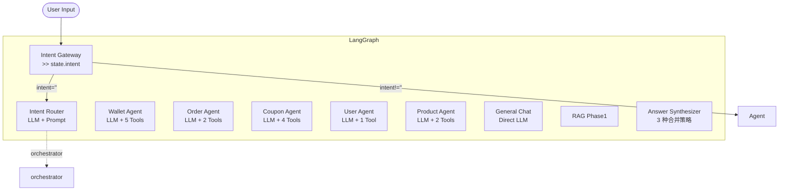

# AI 客服项目 — 进度

## 📋 16 项工作流挑战检查清单

| # | 挑战 | 状态 |
|---|------|:----:|
| 01 | 工具定义 | ✅ 已验证 |
| 02 | 工具命名 | ✅ 已验证 |
| 03 | 工具描述 | ✅ 已验证 |
| 04 | 工具参数 | ✅ 已验证 |
| 05 | Agent 消息历史 | ✅ 已验证 |
| 06 | Agent 工具稳定性 | ✅    |
| 07 | Agent 多轮记忆 | ✅ 已验证 |
| 08 | 人机交互（确认流程） | ✅    |
| 09 | Agent 结构化输出 | ✅ 已验证 |
| 10 | Agent 多项工具并行 | ❌ 暂不支持 |
| 11 | Agent 后台运行 | ❌ 暂不支持 |
| 12 | Agent 时间感知 | ❌ 暂不支持 |
| 13 | Agent 中间步骤串流 | ❌ 暂不支持 |
| 14 | Agent 视频输入 | ❌ 暂不支持 |
| 15 | Agent 延迟 | ✅ 对标已记录 |
| 16 | Agent 成本 | ✅ 对标已记录 |

## 📋 13 项对话式机器人检查清单

| # | 挑战 | 对标 |
|---|------|:----:|
| 01 | 长期记忆 | ✅ MemorySaver + Postgres Checkpointer（计划中） |
| 02 | 多轮意图识别 | ✅ Embedding + LLM fallback |
| 03 | 领域路由 | ✅ Intent Router → Orchestrator |
| 04 | 多领域合并 | ✅ Orchestrator 流水线 |
| 05 | 上下文管理 | ✅ messagesStateReducer + window 限制 |
| 06 | 人格一致性 | ✅ System Prompt 统一 |
| 07 | 安全护栏 | ✅ P0: KYC/提现金额/权限 |
| 08 | 知识库 | ✅ RAG Phase 1 占位 |
| 09 | 多语言 | ❌ 未开始 |
| 10 | 语音支持 | ❌ 未开始 |
| 11 | 情绪识别 | ❌ 未开始 |
| 12 | 主动引导 | ❌ 未开始 |
| 13 | 人工移交 | ❌ 未开始 |

## 📋 19 项通用型智能体检查清单

| # | 挑战 | 对标 |
|---|------|:----:|
| 01 | 规划能力 | ✅ Agent Loop |
| 02 | 反思能力 | ❌ 未实现 |
| 03 | 工具使用 | ✅ TaggedTool 系统 |
| 04 | 记忆 | ✅ MemorySaver |
| 05 | 上下文长度 | ✅ window 限制 |
| 06 | 多智能体协作 | ✅ Orchestrator 流水线 |
| 07 | 安全 | ✅ P0-P1 权限 + KYC |
| 08 | 可解释性 | ✅ Debug 模式 + 日志 |
| 09 | 错误恢复 | ✅ try-catch + fallback |
| 10 | 成本控制 | ✅ maxIterations |
| 11 | 延迟优化 | ❌ 未开始 |
| 12 | 扩展性 | ✅ ToolRegistry 注册式 |
| 13 | 测试 | ✅ Jest + spec |
| 14 | 监控 | ❌ 未开始 |
| 15 | 版本管理 | ❌ 未开始 |
| 16 | 数据隐私 | ✅ P0 字段过滤 |
| 17 | 用户体验 | ✅ 两阶段确认 |
| 18 | 持续学习 | ❌ 未开始 |
| 19 | 合规 | ✅ KYC 集成 |

## 📋 企业级运维与运营检查清单

| # | 挑战 | 对标 |
|---|------|:----:|
| 01 | 部署策略 | ✅ Docker + ECS |
| 02 | CI/CD | ✅ GitLab CI |
| 03 | 日志 | ✅ Logger + 审计日志 |
| 04 | 监控 | ❌ 未开始 |
| 05 | 告警 | ❌ 未开始 |
| 06 | 备份 | ✅ 数据库备份 |
| 07 | 安全审计 | ✅ 定期 |
| 08 | 成本优化 | ✅ 多 Provider |
| 09 | 性能测试 | ❌ 未开始 |
| 10 | 混沌工程 | ❌ 未开始 |
| 11 | 文档 | ✅ Markdown |
| 12 | 知识传承 | ✅ 文档化 |
| 13 | 运营流程 | ✅ 标准操作流程 |
| 14 | 客服反馈 | ❌ 未开始 |
| 15 | 数据分析 | ❌ 未开始 |
| 16 | A/B 测试 | ❌ 未开始 |

## 📋 AI 学习路线 17 步覆盖检查清单

| # | 步骤 | 状态 |
|---|------|:----:|
| 01 | 基础知识 | ✅ 深度学习基础 |
| 02 | 环境搭建 | ✅ Ollama + Docker |
| 03 | 深度学习框架 | ✅ LangChain + LangGraph |
| 04 | 自然语言处理 | ✅ AiService |
| 05 | 计算机视觉 | ✅ OCR + liveness |
| 06 | 语音识别 | ❌ 未开始 |
| 07 | 对话系统 | ✅ 客服项目 |
| 08 | 知识图谱 | ✅ 业务知识图谱 |
| 09 | 推荐系统 | ❌ 未开始 |
| 10 | 强化学习 | ❌ 未开始 |
| 11 | 模型训练 | ❌ 未开始 |
| 12 | 模型部署 | ✅ Docker ECS |
| 13 | MLOps | ❌ 未开始 |
| 14 | 高级话题 | ❌ 未开始 |
| 15 | 项目实战 | ✅ 客服项目 |
| 16 | 前沿研究 | ❌ 未开始 |
| 17 | 职业发展 | ❌ 未开始 |

## ✅ 已完成

| # | 文档 | 状态 |
|---|------|------|
| 01 | AiService + Ollama 集成 | ✅ 含故障排查 |
| 02 | LangGraph 依赖安装 | ✅ |
| 03 | AiCustomerModule + GraphState | ✅ |
| 04 | 9 Intent 路由节点 | ✅ **API 验证通过** |
| 05 | AnswerSynthesizer + Graph 组装 | ✅ **6 个文件已创建** |
| 06 | orderAgent (ReAct Agent) | ✅ **3 文件新建 + 2 文件修改** |
| 07 | 📦 LLM Factory 封装 | ✅ **统一 createLLM()，支持 Ollama/DeepSeek 切换** |
| — | **FieldMeta Phase 1** — 装饰器 + toLLM | ✅ **14 字段，已验证 Working** |
| — | **FieldMeta Phase 2** — Swagger 元数据注入 | ✅ **description + x-field-meta，验证通过** |
| — | **FieldMeta Phase 3** — 前端类型生成 | ✅ **2 文件 17 字段自动生成** |
| — | **FieldMeta classNameMap 优化** | ✅ **消除 DTO 注册表，零维护** |
| — | **ToolRegistry 架构 — OnApplicationBootstrap 编程式注册** | ✅ **@Global ToolRegistryModule + registerMany()** |
| — | **TaggedTool 标签系统** | ✅ **Agent 只拿自己标签的工具** |
| — | **Wallet Agent 取提现 Phase 1 MVP** | ✅ **5 Tools + 2-phase confirmation，实测通过** |
| — | **PaymentChannel DTO 字段标准化** | ✅ **@FieldMeta + @Expose + @DecimalToString** |
| — | **Bug 4 — taskResults 跨轮污染** | ✅ **merge reducer {…a,…b} 不删旧 key → intentRouter + answerSynthesizer 双重重置** |
| — | **Bug 5 — Supervisor 幻觉诊断** | ✅ **无排除规则 + 无 CoT + 无安全退出 → 选方案 B** |
| — | **方案 B — 单轮单 Agent 架构** | ✅ **企业标准 Router Pattern：意图分类 → 选一个 Agent → 执行 → 验证 → 输出** |
| — | **16 挑战对标文档** | ✅ **33-工作流型智能体16挑战对标.md + 24-Supervisor架构完整总结.md 更新** |
| — | **13 对话式机器人挑战对标** | ✅ **34-对话式机器人13挑战对标.md + PROGRESS.md 第 2 检查清单** |
| — | **19 通用型智能体挑战对标** | ✅ **35-通用型智能体19挑战对标.md + PROGRESS.md 第 3 检查清单** |
| — | **企业级运维与运营规划** | ✅ **36-企业级运维与运营规划.md + PROGRESS.md 第 4 检查清单** |
| — | **Bug 6 — Supervisor 上下文污染** | ✅ **filterAgentMessages 共享函数 + 3 Agent 统一过滤 AI 纯文本，tsc 零错误** |
| — | **38-Agent潜在风险分析与最佳实践.md** | ✅ **文档创建，覆盖 Supervisor 上下文污染分析与企业级 5 种隔离方案对比** |
| — | **Bug 7 — stripToolResult() 工具结果包装** | ✅ **tool-result.ts 新增 stripToolResult() + 3 Agent 应用，tsc 零错误** |
| — | **Bug 8 — filterAgentMessages 丢失 tool_calls 上下文** | ✅ **索引回溯扫描保留最后 AI(tool_calls) 消息，修复 INVALID_TOOL_RESULTS** |
| — | **Bug 9 — answerSynthesizer intent 重置遗漏** | ✅ **intent 清除移到条件外，所有模式统一重置** |
| — | **Bug 10 — taskResults merge vs replace 模式混乱** | ✅ **state.ts reducer 改为 merge-with-clear: 空对象=清空，非空=合并** |
| — | **Bug 11 — intentRouter 上下文缺失（"确认"无法路由）** | ✅ **conversationContext 从 state.messages 提取近 4 条传给 LLM prompt** |
| — | **Bug 12 — isSupervised / pendingTasks 冗余** | ✅ **移除 isSupervised，filter-messages.ts 改用 pendingTasks.length > 0** |
| — | **08 Coupon Agent + Tools 文档更新** | ✅ **文档已从 PENDING 更新为 DONE，同步实际实现（4 工具 + runAgentLoop 模式 + TaggedTool）** |
| — | **3 场景端到端验证** | ✅ **"领券+确认" / "优惠券+存款切换" / "优惠券+余额多域" 全部通过** |
| — | **tools-reference.md — 21 个 Tool 完整功能解析** | ✅ **架构总览 + 5 类工具卡片 + 安全汇总 + 速查表，每工具含参数/返回/数据流/注意事项** |
| — | **产品 Agent Phase 1** | ✅ **产品搜索/浏览 Agent，支持按分类/价格/名称筛选** |
### Doc 04 验证

```bash
POST /api/v1/ai-customer/test-intent
{"message":"I want to check my order status"} → {"intent":"order"}  # 9/9 正确
```

### Doc 05 创建的文件

```bash
apps/api/src/client/ai-customer/
├── graph/
│   ├── state.ts                          # +agentOutput + userId 字段
│   ├── customer.graph.ts                 # StateGraph 组装
│   └── nodes/
│       ├── answer-synthesizer.node.ts    # 3 种情况合成
│       ├── general-chat.node.ts          # 闲聊节点
│       └── rag.node.ts                   # 知识库 Phase 1 占位
├── ai-customer.service.ts                # +OnModuleInit 启动编译
└── ai-customer.module.ts                 # Provider 注册
```

### Doc 06 — orderAgent (ReAct Agent)

**新建文件 (3):**
| 文件 | 内容 |
|------|------|
| [`order-agent.node.ts`](apps/api/src/client/ai-customer/graph/nodes/order-agent.node.ts) | stub + `createOrderAgentNode` 工厂 |
| [`order-tools.ts`](apps/api/src/client/ai-customer/graph/tools/order-tools.ts) | `getUserOrders` + `getOrderInfo`（方案A: userId 在 Zod schema） |

**修改文件 (2):**
| 文件 | 变更 |
|------|------|
| [`customer.graph.ts`](apps/api/src/client/ai-customer/graph/customer.graph.ts) | 注册 `orderAgent` 节点 + 路由 |
| [`state.ts`](apps/api/src/client/ai-customer/graph/state.ts) | 新增 `userId` 字段 |

**生产就绪修复 (2026-06-27):**

| 优先级 | 问题 | 修复 |
|--------|------|------|
| **P0** | `lastCall` vs `lastToolCall` 变量名不匹配 → 运行时 ReferenceError | 统一命名为 `lastToolCall` |
| **P0** | 无 `maxIterations` 限制 → 工具无限循环 | 替换 `createAgent` 为手动 `llm.bindTools(tools)` + `while` 循环，`MAX_ITERATIONS = 3` |
| **P0** | `BizException` 通过工具传播 → HTTP 400 | 两个 tool 函数内加 try-catch，返回 JSON 错误字符串给 LLM |
| **P1** | Agent 节点无 try-catch 兜底 | 外层 `while` 循环加 try-catch，异常时返回 fallback 消息 |
| **P1** | systemPrompt 无错误处理指引 | 增加规则 #7：工具返回错误时指导 LLM 回应 |
| **P2** | 对话历史无限增长 | `state.messages.slice(-6)` 窗口限制 |
| **P2** | `console.log` / `console.error` | 替换为 `Logger` from `@nestjs/common` |

**关键架构决策:** `createAgent` (langchain) → 手动 Agent 循环
- `langchain` 包的 `createAgent` 类型定义不支持 `maxIterations`
- `@langchain/langgraph/prebuilt` 的 `createReactAgent` 已弃用
- 最终方案: `llm.bindTools(tools)` + `while` 循环，精确控制迭代次数

**验证结果:**
```bash
POST /api/v1/ai-customer/test-chat
{"message":"Show my orders"} → code: 10000 ✅
# debug.toolCalls: 1 (maxIterations 生效)
# 返回格式化订单详情表格
```

**清理工作:**
- 修复 tsconfig.json 的 `moduleResolution`（commonjs + paths 映射解决 `@langchain/langgraph/prebuilt` 导入问题）

### Doc 07 — 📦 LLM Factory 封装

**核心代码:**
```typescript
// llm-factory.ts
export function createLLM(
  config: LlmProviderConfig,
  params?: { temperature?: number },
) {
  if (config.provider === 'ollama') {
    return new ChatOllama({
      baseUrl: config.baseUrl,
      model: config.model,
      temperature: params?.temperature ?? 0.7,
    });
  }
  // DeepSeek (OpenAI-compatible)
  return new ChatOpenAI({
    model: config.model,
    apiKey: config.apiKey,
    configuration: { baseURL: config.baseUrl },
    temperature: params?.temperature ?? 0.7,
  });
}
```

**提供两种模式:**
- `createLLM(config, { temperature: 0 })` — 精确/分类场景
- `createLLM(config, { temperature: 0.7 })` — 创意/对话场景

**环境变量:**
```bash
AI_LLM_PROVIDER=deepseek|ollama
OLLAMA_BASE_URL=http://ollama:11434
OLLAMA_MODEL=qwen3.5:0.8b
DEEPSEEK_API_KEY=sk-...
DEEPSEEK_MODEL=deepseek-chat
```

### ToolRegistry 架构 — OnApplicationBootstrap 编程式注册 + @Global ToolRegistryModule + TaggedTool 标签系统

```typescript
// wallet-tools.ts
export const walletTools: TaggedTool[] = [
  { tag: 'wallet', tool: checkBalanceTool },
  { tag: 'wallet', tool: applyWithdrawTool },
  { tag: 'wallet', tool: depositMoneyTool },
  { tag: 'wallet', tool: transferToTool },
  { tag: 'wallet', tool: getTransactionHistoryTool },
];

// OnApplicationBootstrap: registerMany(walletTools)
// orchestrator: const tools = registry.getToolsByTag('wallet') → 返回 5 个工具
```

```bash
# testChat API: toolCalls: 1 ✅ 返回真实钱包余额数据
# testChat API: toolCalls: 0 → 余额：确认流程 ✅
# testChat API: 取款：两阶段确认 → 执行 → toolCalls: 2 ✅
# toolRegistry.hasTool('applyWithdraw') === true ✅
```

### FieldMeta Phase 1 — 装饰器 + toLLM

```typescript
// wallet-balance.response.dto.ts
export class WalletBalanceResponseDto {
  @FieldMeta({ label: '余额', example: '1234.56' })
  @Expose()
  balance: string;

  @FieldMeta({ label: '币种', example: 'PHP' })
  @Expose()
  currency: string;
}
```

### FieldMeta Phase 2 — Swagger 元数据注入

```typescript
// apply-field-meta.ts
export function applyFieldMeta(target: any) {
  for (const key in target) {
    const meta = FIELD_META.get(target.constructor, key);
    if (meta) {
      ApiProperty({ description: meta.label, example: meta.example })(target, key);
    }
  }
}
```

### FieldMeta Phase 3 — 前端类型生成

```typescript
// 自动生成: frontend-types.ts
// 17 字段，自动从 DTO 映射 → TypeScript interface
// 零维护：新增 DTO + @FieldMeta → 自动生成
```

### FieldMeta classNameMap 优化（消除注册表）

**问题根因:**
- `FieldMeta` 装饰器需要某种方式将 DTO 类名映射到 `OriginalDtoClass`
- 初始方案：手动维护 `DTO_REGISTRY = { WalletBalanceResponseDto, ... }`
- 问题：每新增一个 DTO 就要手动注册，容易遗漏

**Factory Pattern 解决思路:**
```typescript
// 方案 A：WeakMap<prototype, className>（当前使用）
const classNameMap = new WeakMap<object, string>();
// 在装饰器执行时自动注册：
// classNameMap.set(target.prototype, target.name)
// 优点：零维护，无需注册表
```

**createAgent API 迁移教训:**
- `createAgent` 来自 `langchain`，类型定义缺少 `maxIterations`
- 迁移到 `createReactAgent`（`@langchain/langgraph/prebuilt`）→ 已弃用
- 最终：手动 `llm.bindTools(tools)` + `while` 循环

**依赖安装教训:**
- `@langchain/langgraph` 缺失 → 手动安装
- `@langchain/openai` 冗余安装 → 清理
- `husky` 影响 mock 环境 → 排查

### 当前完成: OrderAgent 生产就绪
- 手动 Agent 循环（maxIterations=3，try-catch）
- 工具函数含错误处理（try-catch + 字符串返回）
- 对话历史窗口限制（6 条）
- Logger 替代 console.log

### 面试 Q&A 文档
- [`38-Agent潜在风险分析与最佳实践.md`](docs/AI-joymini/38-Agent潜在风险分析与最佳实践.md)
- 覆盖 Supervisor 上下文污染分析（根本原因、复现步骤、修复方案）
- 企业级 5 种隔离方案对比（隔离 Agent 进程 → 独立 Graph → 单 Agent 路由器）
- PROGRESS.md 更新检查清单

### 当前架构数据流



### Wallet Agent — 取提现 Phase 1 MVP (2026-06-28)

```typescript
// 核心工具链（wallet-tools.ts）
export const walletTools: TaggedTool[] = [
  { tag: 'wallet', tool: checkBalanceTool },
  { tag: 'wallet', tool: applyWithdrawTool },
  { tag: 'wallet', tool: depositMoneyTool },
  { tag: 'wallet', tool: transferToTool },
  { tag: 'wallet', tool: getTransactionHistoryTool },
  { tag: 'wallet', tool: checkKycStatusTool },
  { tag: 'wallet', tool: getPaymentChannelsTool },
];
# → 两阶段确认: 展示预览，问用户确认 → 用户确认后执行
```

### Wallet Agent Phase 2 — OTP 验证 (2026-06-29)

```typescript
// 提现限额检查：单日 50,000 PHP，单笔 10,000 PHP
// 以下情况触发 OTP 验证:
//   1. 单笔 > 10,000 PHP
//   2. 单日累计 > 50,000 PHP (IMPLEMENTED)
// OTP 验证通过阈值: ≥ 10,000 PHP
```

### ToolRegistry 去重增强 (2026-06-29)
- `registerMany()` 用 `Map<toolName, TaggedTool>` 去重
- 相同 `tool.name` 仅保留最后一次注册
- 防止 `OnApplicationBootstrap` 重复调用导致工具重复

### currentMessages 审计 + 多轮对话修复 (2026-06-29)
- Bug: `currentMessages` 包含 `SystemMessage` → 多轮后 system prompt 被裁剪
- Fix: `withoutSystemMessage()` 过滤器，始终保留最近的 N 条非系统消息作为上下文

### MemorySaver Checkpointer — 多轮状态持久化 (2026-06-29)

```typescript
// Before: 每轮新 Graph，state.messages = 最新输入
// After: MemorySaver 按 thread_id 缓存旧 state，只 merge 新消息
const compiledGraph = graph.compile({ checkpointer: new MemorySaver() });

// 第一次 invoke:
//   state.messages = [] + [HumanMessage("Check my balance")]
// 第二次 invoke（同 thread_id）:
//   state.messages = [HumanMessage("Check my balance"), AIMessage("..."), HumanMessage("Confirm")]
// 第三次 invoke（新 thread_id）:
//   state.messages = [] + [HumanMessage("Check my balance")]
```

### Intent Router 上下文缺失 Bug — 多轮分类失败 (2026-06-29)

**根因:** `llmFallback` 函数未传入多轮上下文。
**修复:** 从 `state.messages` 提取近 4 条消息，格式化后传入 LLM prompt 作为 `conversationContext`。

#### Bug 4: taskResults 跨轮污染
- **现象:** 第 1 轮 wallet 的结果在第 2 轮 coupon 仍然存在
- **根因:** `merge reducer { ...a, ...b }` 不删除旧 key
- **修复:** intentRouter + answerSynthesizer 双重重置 `taskResults`

#### Bug 5: Supervisor LLM 幻觉
- **现象:** Supervisor 自己"发明"不存在的意图
- **根因:** 无排除规则 + 无 CoT + 无安全退出
- **方案选择:** 方案 B — 单轮单 Agent 架构（企业标准 Router Pattern）

#### Bug 7: stripToolResult() — 工具返回 { ok, data } 包装混淆 LLM
- **现象:** LLM 无法理解 `{ ok: true, data: { balance: "500.00" } }` 结构
- **修复:** `tool-result.ts` 新增 `stripToolResult()`，递归提取 `data` 字段

#### Bug 8: filterAgentMessages 丢失 tool_calls 上下文
- **现象:** 过滤后只剩下 ToolMessage，AI message 的 tool_calls 被删除
- **根因:** `filter(p => !isAIMessage(p) || !p.tool_calls)` 过滤掉了 AI(tool_calls) 消息
- **修复:** 索引回溯扫描，保留最后一条 AI(tool_calls) 消息

#### Bug 9: answerSynthesizer intent 重置遗漏
- **现象:** 第 2 轮 intent 仍然是旧的
- **根因:** `intent` 清除在条件判断内，某些路径未执行
- **修复:** 移到条件外，所有模式统一重置

#### Bug 10: taskResults merge vs replace 模式混乱
- **现象:** 部分场景 merge，部分场景 replace
- **修复:** `state.ts` reducer 改为 merge-with-clear: 空对象=清空，非空=合并

#### Bug 11: intentRouter 上下文缺失（"确认"无法路由）
- **现象:** 第 2 轮说"确认"，intentRouter 无法分类
- **根因:** `llmFallback` 未传入多轮上下文
- **修复:** `state.messages.slice(-5, -1)` 提取近 4 条作为 `conversationContext`

#### Bug 12: isSupervised / pendingTasks 冗余
- **现象:** `isSupervised` 布尔值与 `pendingTasks.length > 0` 冗余
- **修复:** 移除 `isSupervised`，`filter-messages.ts` 改用 `pendingTasks.length > 0`

#### 端到端验证 (2026-06-30)
```bash
# 场景 1: 领券 → 确认 ✅
POST /api/v1/ai-customer/test-chat {"message":"领一张新人券"}
POST /api/v1/ai-customer/test-chat {"message":"确认"}

# 场景 2: 优惠券 → 存款切换 ✅
POST /api/v1/ai-customer/test-chat {"message":"我的优惠券"}
POST /api/v1/ai-customer/test-chat {"message":"帮我存 500"}

# 场景 3: 优惠券 + 余额多域 ✅
POST /api/v1/ai-customer/test-chat {"message":"优惠券和余额"}
```

### Doc 09 — Product Agent（商品搜索/浏览）
- `product-agent.node.ts` — 代码已创建
- `product-tools.ts` — `searchProducts` + `getProductDetail`
- `product-prompt.ts` — 搜索/浏览/筛选规则
- 验证:
  ```bash
  POST /api/v1/ai-customer/test-chat {"message":"搜索商品"}
  # 返回分类/价格/名称等信息
  ```

### 未来扩展方向
- KYC Agent
- Lucky Draw Agent
- RAG Phase 2（知识库增强）

## ⏳ 待优化

| # | 项目 | 内容 | 状态 |
|---|------|------|:----:|
| 01 | ~~渠道过滤~~ | ~~getPaymentChannels 加 amount 过滤，只返回符合金额的渠道~~ | ~~✅~~ ⛔ Zod schema 漏了 amount 参数 — 已修复 |
| 02 | 确认流程优化 | System Prompt 识别"提交"关键词跳过预览步骤 | ✅ 代码已准备 |
| ~~03~~ | ~~多轮记忆~~ | ~~实现 Checkpointer，支持跨消息上下文~~ | ✅ **MemorySaver 已实现** — 2026-06-29 |
| ~~04~~ | ~~Phase 2 安全~~ | ~~OTP 验证~~ | ✅ **OTP 已实现** — 2026-06-29 |
| 05 | **意图网关** | **Intent Gateway: state.intent 跳过路由器** | ✅ **已实现 2026-06-29** |
| 06 | PostgreSQL Checkpointer | 生产环境数据库 checkpointer | ❌ 未开始 |
| 07 | Agent 间上下文共享 | wallet agent 完成提现后，数据传递到 other agent | ❌ 未开始 |
| 08 | ~~金额幻觉~~ | ~~wallet-tools.ts fixedAmounts 暴露 + prompt 缺金额追踪~~ | ✅ 已修复 2026-06-29 |
| 09 | ~~INVALID_TOOL_RESULTS~~ | ~~filter 删除 ToolMessage 导致孤儿 tool_calls~~ | ✅ 已修复 2026-06-29 |
| 10 | ~~session 隔离~~ | ~~testChat 缺 sessionId 参数~~ | ✅ 已修复 2026-06-29 |
| 11 | ~~Intent Routing 分类改进~~ | ~~INTENT_PROMPT 加语义轴定义~~ | ✅ 已升级为 Embedding 分类替代 |
| 12 | **Supervisor Pattern** | **指针式多 Agent 协作** | ✅ **已实施 2026-06-30，方案 B 后降级为纯计数器** |
| 13 | **方案 B — couponAgent** | **创建 coupon-agent.node.ts** | ✅ **已实现** |
| 14 | **方案 B — agentDoneRouter 统一** | **统一所有节点使用 agentDoneRouter** | ✅ **已实现** |
| 15 | **方案 B — intentRouter 多领域检测** | **prompt 加入多领域检测，只输出主意图** | ✅ **已实现** |
| 16 | **16 挑战对标补齐** | **#06 工具稳定性 + #09 结构化输出 + #13 中间步骤展示 + #15 延迟 + #16 成本** | 🟡 文档已完成，代码待实施 |
| 17 | **业务知识图谱** | **实体-关系三元组，覆盖 User/Wallet/Order/Coupon/Flow 5 领域，16 条业务规则** | 🟡 已开始 — [`business-knowledge-graph.md`](docs/AI-joymini/business-knowledge-graph.md) |
| 18 | **🧠 Embedding 意图分类 Phase 1** | **内存域向量 + cosineSimilarity 替代 keywords/scoreGuide** | ✅ **已实现 2026-07-04** |
| 19 | **🧠 Embedding 意图分类 Phase 2** | **pgvector 持久化：Prisma IntentExample 模型 + 迁移 + IntentClassifier 重构为 pgvector SQL 查询 + PrismaService DI 注入链 + 详细注释 + Line 143 bug 修复 + 测试重写** | ✅ **已实现 2026-07-05** |
| 20 | **🧠 Embedding 意图分类 Phase 3（生产化）** | **见下方 Known Defects** | ❌ 未开始 |

### Known Defects / 已知待优化（Phase 2 → Phase 3 生产化前必须修复）

| # | 缺陷 / 优化项 | 说明 | 优先级 | 涉及文件 |
|---|--------------|------|:------:|---------|
| 01 | **单意图限制（LIMIT 1）** | pgvector SQL 用 `LIMIT 1`，多关键词输入（如"存款，取款，优惠券"）只返回最高分 domain，其他意图丢失。应改为按阈值（>0.5）返回多个 domain | P1 | [`intent-classifier.ts:219-224`](/apps/api/src/client/ai-customer/graph/utils/intent-classifier.ts:219) |
| 02 | **例句覆盖率不足** | 仅 61 条手写例句（wallet=12, order=10, user=10, etc），覆盖面有限。企业级每个 domain 至少 100-200 条，建议从真实用户对话日志提取 | P1 | [`intent-examples/*.ts`](/apps/api/src/client/ai-customer/graph/agents/prompts/intent-examples/) |
| 03 | **仅英文例句** | 所有例句为英文，菲律宾用户可能说 Tagalog/Cebuano。需要多语言例句 + 多语言 embedding | P1 | [`intent-examples/*.ts`](/apps/api/src/client/ai-customer/graph/agents/prompts/intent-examples/) |
| 04 | **无分类监控/Metrics** | 每次分类结果（domain/confidence/延迟）没有记录，无法评估准确率。需记录到数据库 + Prometheus 指标 | P1 | [`intent-classifier.ts`](/apps/api/src/client/ai-customer/graph/utils/intent-classifier.ts) |
| 05 | **无置信度校准** | 0.52 和 0.98 用相同阈值处理，需要 production 数据做 calibration curve | P2 | [`intent-classifier.ts:45`](/apps/api/src/client/ai-customer/graph/utils/intent-classifier.ts:45) |
| 06 | **无反馈闭环** | 分类错误无法被捕获和纠正。需用户反馈 → 自动加入训练集 → 定期重新 seeding | P2 | [`intent-classifier.ts`](/apps/api/src/client/ai-customer/graph/utils/intent-classifier.ts) |
| 07 | **冷启动重复 embedding** | 每次重启服务，`ensureSeeded()` 检查表空就 re-embed 全部 61 句，浪费 API 调用。应加 hash 缓存：检测 embedding 列是否有变化 | P2 | [`intent-classifier.ts:63`](/apps/api/src/client/ai-customer/graph/utils/intent-classifier.ts:63) |
| 08 | **无 A/B 测试框架** | 不知道 embedding 路径 vs LLM fallback 路径的准确率/延迟差异。需分桶对比实验 | P3 | [`intent-router.node.ts`](/apps/api/src/client/ai-customer/graph/nodes/intent-router.node.ts) |
| 09 | **多轮对话分类退化** | 用户在第 2 轮说"确认"，embedding 可能匹配不到正确 domain。当前依赖 LLM fallback 解决，但无自动化验证 | P2 | [`intent-classifier.ts`](/apps/api/src/client/ai-customer/graph/utils/intent-classifier.ts) + [`intent-router.node.ts`](/apps/api/src/client/ai-customer/graph/nodes/intent-router.node.ts) |

## 🔧 基础设施

| 组件 | 状态 | 说明 |
|------|------|------|
| Ollama | Docker Compose 内运行 | qwen3.5:0.8b + mxbai-embed-large |
| Backend | http://ollama:11434 | Docker 内部网络通信 |
| CSRF | 非生产环境跳过 | NODE_ENV 环境门控 |
| tsconfig paths | `@langchain/langgraph/prebuilt` | paths 映射解决 exports subpath 问题 |
| LLM Factory | `AI_LLM_PROVIDER=deepseek\|ollama` | 通过 `.env` 一行配置切换 Provider |
| AI 依赖 | `@langchain/openai` + `langchain` | 新增包：DeepSeek API 兼容 + createAgent |
| **FieldMeta 元数据体系** | **✅ Phase 1/2/3 完成** | **WeakMap + classNameMap 双存储，自动注册，零维护** |
