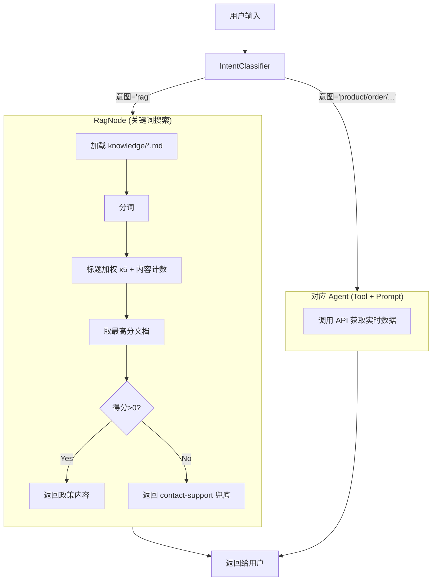
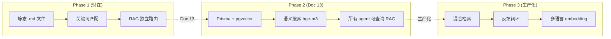

# 12. 政策知识文档 + RAG Stub — 完整架构分析

> 文档编号: Doc 12 (更新版)
> 状态: 📋 规划完成
> 创建日期: 2026-07-06
> 目录: `docs/AI-joymini/RAG/`

---

## 📋 目录

1. [背景与现状](#1-背景与现状)
2. [深度分析：每个 Domain 的 RAG 真实需求](#2-深度分析每个-domain-的-rag-真实需求)
3. [RAG vs Tool 边界定义](#3-rag-vs-tool-边界定义)
4. [最终文档清单：16 个文档](#4-最终文档清单16-个文档)
5. [文档格式标准](#5-文档格式标准)
6. [目录结构与文件命名规范](#6-目录结构与文件命名规范)
7. [Phase 1 实现步骤](#7-phase-1-实现步骤)
8. [RAG 架构演进路线](#8-rag-架构演进路线)
9. [验证清单](#9-验证清单)

---

## 1. 背景与现状

### 1.1 之前的 Doc 12 有什么问题？

原版 [`docs/AI-joymini/12-政策知识文档与RAGStub.md`](../12-政策知识文档与RAGStub.md) 规划了 **8 个政策文档** + 关键词搜索 RagNode。但存在以下问题：

| 问题 | 说明 |
|:----|:------|
| 文档数量不足 | 只覆盖了纯政策类，缺少操作指南和故障排查 |
| 未做边界分析 | 没有分析每个 Agent 的 prompt 已知道什么，导致部分文档重复 |
| Product domain 判断错误 | 把 flash-sale 和 group-buying 归入 product，实际属于其他 domain |
| 缺少文档格式标准 | 没有 frontmatter、没有文档类型分类 |
| 缺少兜底文档 | 没有 `contact-support.md` 作为 RAG 查不到时的最终引导 |

### 1.2 本次更新的核心改进

1. **读完了所有 6 个 Agent 的 Prompt**，逐 domain 分析已有什么知识
2. **重新定义 RAG 边界**：只放 Agent **无法通过工具获取**的静态知识
3. **文档从 26 个 → 16 个**，每个都有明确的必要性理由
4. **新增文档格式标准**：YAML frontmatter + 统一结构
5. **新增兜底机制**：RAG 查不到时引导用户联系人工

---

## 2. 深度分析：每个 Domain 的 RAG 真实需求

> 分析基于实际读取的 Agent Prompt 代码，非推测。

### 2.1 `product` Domain — RAG 需求：3 个文档

> ⚠️ **本文档已更新**：之前的版本（"RAG 需求 ≈ 0"）分析不足。经过深入的商品域分析后修正。详见 [`product-domain-complete-architecture.md`](../product-domain-complete-architecture.md)

**Prompt 文件**: [`apps/api/src/client/ai-customer/graph/agents/prompts/product-prompt.ts`](/apps/api/src/client/ai-customer/graph/agents/prompts/product-prompt.ts:64)

**Prompt 已知道的内容**：
- 所有商品字段含义（`unitAmount`=拼团价、`marketAmount`=市场价、`buyQuantityRate`=销量进度）
- 如何理解用户用语："cheap→sort by lower price"、"popular→high buyQuantityRate"
- 如何使用 search、getProductDetail、getRecommendedProducts 等工具
- scope 限制（不能处理 wallet/orders/coupon/lucky-draw）

**Prompt 不知道的内容（→ 需要 RAG）**：

商品域不仅是"查价格、搜商品"，还需要回答**政策类、指引类**问题。参考大型电商实践（Amazon、Pinduoduo），以下场景无法通过工具查询解决：

| 场景 | 用户问题举例 | 工具能否解决 |
|:----|:------------|:-----------:|
| 拼团机制 | "怎么拼团？""成团需要几个人？""拼团失败会退款吗？" | ❌ — 拼团规则是静态政策，非实时数据 |
| 商品真伪 | "你们卖的是正品吗？""怎么验证真伪？" | ❌ — 无验证接口 |
| 尺码选择 | "衣服尺码怎么选？""M码适合多高的人？" | ❌ — 无尺码表接口 |

**新增的 3 个 RAG 文档**：

| 文档 | 优先级 | 类型 | 参考来源 |
|:----|:-----:|:----|:--------|
| `group-buying-guide.md` | **P0** | how-to | Pinduoduo 拼团模式 |
| `product-authenticity.md` | P1 | policy | Shopee Mall 正品保障 |
| `size-guide.md` | P2 | reference | 通用电商尺码指南 |

> **为什么需要 group-buying-guide？** JoyMini 的商业模式核心是社交电商拼团。用户最常问的问题如"成团需要多少人"、"拼团失败怎么办"无法通过查询商品数据得到答案——这些是静态政策，必须写入 RAG 文档。

**结论**：Product Agent 的 Prompt 提供字段含义和工具使用知识。但 **拼团规则、正品保障、尺码指南** 属于静态政策知识，必须由 RAG 文档覆盖。

### 2.2 `wallet` Domain — RAG 需求：4 个文档

**Prompt 文件**: [`apps/api/src/client/ai-customer/graph/agents/prompts/wallet-prompt.ts`](/apps/api/src/client/ai-customer/graph/agents/prompts/wallet-prompt.ts:78)

**Prompt 已知道**：余额类型（现金 vs 金币）、提现两步流程、OTP 验证、KYC 状态查询

**Prompt 未知道 → 需要 RAG**：

| 文档 | 类型 | 覆盖的客服场景 |
|:----|:----:|:--------------|
| `deposit-guide.md` | how-to | "How to deposit using GCash?", "How to top up?" |
| `withdrawal-guide.md` | how-to | "How to withdraw?", "What's the withdrawal limit?" |
| `wallet-troubleshooting.md` | troubleshooting | "I deposited but not credited", "Withdrawal failed" |
| `wallet-overview.md` | reference | Fee schedule, limits, processing times |

### 2.3 `order` Domain — RAG 需求：6 个文档

**Prompt 文件**: [`apps/api/src/client/ai-customer/graph/agents/prompts/order-prompt.ts`](/apps/api/src/client/ai-customer/graph/agents/prompts/order-prompt.ts:62)

**Prompt 已知道**：订单字段（orderNo/total/status/items）、如何理解 "recent/big/refunding"

**Prompt 未知道 → 需要 RAG**：

| 文档 | 类型 | 覆盖的客服场景 |
|:----|:----:|:--------------|
| `refund-policy.md` | policy | "How to return?", "Refund process", "How long for refund?" |
| `shipping-policy.md` | policy | "When will my order ship?", "Shipping fee?", "Tracking" |
| `cod-payment.md` | how-to | "How does COD work?", "What if I'm not home?" |
| `order-management.md` | how-to | "How to cancel?", "Change address", "Report issue" |
| `order-status.md` | reference | "What does 'processing' mean?" |
| `order-troubleshooting.md` | troubleshooting | "Order is stuck", "Payment failed" |

### 2.4 `coupon` Domain — RAG 需求：2 个文档

**Prompt 文件**: [`apps/api/src/client/ai-customer/graph/agents/prompts/coupon-prompt.ts`](/apps/api/src/client/ai-customer/graph/agents/prompts/coupon-prompt.ts:76)

**Prompt 已知道**：券字段（discountValue/minPurchase/validEndAt）、如何理解 "best/smallest/expiring"

**Prompt 未知道 → 需要 RAG**：

| 文档 | 类型 | 覆盖的客服场景 |
|:----|:----:|:--------------|
| `coupon-rules.md` | policy | Usage conditions, stacking rules, refund rules |
| `coupon-faq.md` | faq | "Why can't I use coupon?", "Coupon not showing" |

### 2.5 `kyc` Domain — RAG 需求：2 个文档

**Prompt 文件**: [`apps/api/src/client/ai-customer/graph/agents/prompts/kyc-prompt.ts`](/apps/api/src/client/ai-customer/graph/agents/prompts/kyc-prompt.ts:76)

**Prompt 已知道**：KYC 状态含义（0=draft/1=pending/2=approved/3=rejected）、ID 类型说明、不能提交资料的限制

**Prompt 未知道 → 需要 RAG**：

| 文档 | 类型 | 覆盖的客服场景 |
|:----|:----:|:--------------|
| `kyc-rules.md` | policy | Requirements, methods, process, privacy |
| `kyc-troubleshooting.md` | troubleshooting | "Why was my KYC rejected?", "Document expired" |

### 2.6 `lucky-draw` Domain — RAG 需求：1 个文档

**Prompt 文件**: [`apps/api/src/client/ai-customer/graph/agents/prompts/lucky-prompt.ts`](/apps/api/src/client/ai-customer/graph/agents/prompts/lucky-prompt.ts:73)

**Prompt 已知道**：票字段、奖品类型映射（1=coupon/2=coins/3=cash/4=no-win）、闪购场次和商品字段

**Prompt 未知道 → 需要 RAG**：

| 文档 | 类型 | 覆盖的客服场景 |
|:----|:----:|:--------------|
| `lucky-draw-rules.md` | policy | Qualifications, method, prizes, distribution |

> **注意**：考虑将 `lucky-draw-rules.md`、`group-rules.md` 以及 flash-sale 规则 **合并为 `activity-rules.md`**，减少文档数量。

### 2.7 `user` Domain — RAG 需求：3 个文档

**Prompt 文件**: [`apps/api/src/client/ai-customer/graph/agents/prompts/user-prompt.ts`](/apps/api/src/client/ai-customer/graph/agents/prompts/user-prompt.ts)

| 文档 | 类型 | 覆盖的客服场景 |
|:----|:----:|:--------------|
| `account-management.md` | how-to | Registration, login, password, 2FA |
| `vip-benefits.md` | policy | Membership tiers, benefits, upgrade/downgrade |
| `account-troubleshooting.md` | troubleshooting | "OTP not received", "Account locked", "Can't login" |

### 2.8 `rag` Domain（通用政策）— RAG 需求：6 个文档

| 文档 | 类型 | 优先级 | 覆盖的客服场景 |
|:----|:----:|:------:|:--------------|
| `refund-policy.md` | policy | P0 | 退货/退款政策和流程 |
| `shipping-policy.md` | policy | P0 | 发货时效、运费、物流追踪 |
| `privacy-policy.md` | policy | P0 | 法律合规 |
| `contact-support.md` | reference | **P0** | 兜底文档—查不到时引导联系人工 |
| `platform-rules.md` | policy | P1 | 禁售商品、封号规则 |
| `dispute-resolution.md` | policy | P2 | 投诉流程、chargeback |

### 2.9 `general` Domain — RAG 需求：0

| 被排除的文档 | 理由 |
|:------------|:-----|
| `app-guide.md` | App 操作问题可通过对话引导，无需静态文档 |
| `faq-general.md` | 各 domain 的 FAQ 已覆盖 |

---

## 3. RAG vs Tool 边界定义

### 3.1 核心原则

```
Tool = 实时操作 + 查数据库
RAG = 静态规则 + 操作指南 + 故障排查
```

| 场景 | 走 Tool | 走 RAG |
|:----|:-------:|:------:|
| "搜索 iPhone" | ✅ `searchProducts` | ❌ |
| "查订单 #123" | ✅ `getOrderDetail` | ❌ |
| "我的余额" | ✅ `getBalance` | ❌ |
| "如何退货" | ❌ Agent 无法查"规则" | ✅ `refund-policy.md` |
| "怎么用 GCash 充值" | ❌ Agent 无法执行"教学" | ✅ `deposit-guide.md` |
| "充值没到账" | ❌ Agent 无法查"为什么" | ✅ `wallet-troubleshooting.md` |
| "收不到 OTP" | ❌ Agent 无法查"原因" | ✅ `account-troubleshooting.md` |

### 3.2 边界决策树

```
用户问题
  │
  ├─ 需要查实时数据？────→ Tool（Agent 执行 API 调用）
  │
  ├─ 需要执行操作？──────→ Tool（如 draw/claim/withdraw）
  │
  ├─ 询问规则/政策？────→ RAG（RagNode 返回政策文档）
  │
  ├─ 询问操作步骤？─────→ RAG（RagNode 返回 How-to 文档）
  │
  ├─ 故障排查？─────────→ RAG（RagNode 返回 Troubleshooting 文档）
  │
  └─ 以上都不是？───────→ RAG → 兜底 contact-support
```

### 3.3 常见误判场景

| 用户问题 | 错误路由 | 正确路由 | 说明 |
|:--------|:--------:|:--------:|:-----|
| "怎么参加闪购" | product Agent | **rag** (RAG) | 规则问题，非商品查询 |
| "帮我查闪购 #5 还有货吗" | product Agent | **lucky-draw** Agent | 实时数据，走 tool |
| "为什么用不了优惠券" | coupon Agent | **rag** (RAG) | 规则解释，非领券操作 |
| "查一下我的券" | rag | **coupon** Agent | 实时数据，走 tool |

---

## 4. 最终文档清单：16 个文档

### 4.1 总览

```mermaid
flowchart TD
    subgraph "P0 — 必须 8个"
        P0a[refund-policy]
        P0b[shipping-policy]
        P0c[coupon-rules]
        P0d[lucky-draw-rules]
        P0e[kyc-rules]
        P0f[vip-benefits]
        P0g[privacy-policy]
        P0h[contact-support]
    end
    
    subgraph "P1 — 高优 6个"
        P1a[deposit-guide]
        P1b[withdrawal-guide]
        P1c[cod-payment]
        P1d[order-management]
        P1e[account-troubleshooting]
        P1f[wallet-troubleshooting]
    end
    
    subgraph "P2 — 中优 2个"
        P2a[kyc-troubleshooting]
        P2b[platform-rules]
    end
    
    P0a & P0b & P0c & P0d & P0e & P0f & P0g & P0h --> Phase1[Phase 1 MVP]
    P1a & P1b & P1c & P1d & P1e & P1f --> Phase2[Phase 2 扩充]
    P2a & P2b --> Phase3[Phase 3 完善]
```



### 4.2 P0 — 必须（8 个文档）

这 8 个是 AI 客服知识库的 MVP，**已有设计** 5 个 + **新增** 3 个。

| # | 文件名 | 已有设计 | Domain | 类型 | 客服场景 |
|:-:|:------|:-------:|:------:|:----:|:---------|
| 1 | `refund-policy.md` | ✅ [Doc 12](../12-政策知识文档与RAGStub.md:57) | rag | policy | 退货/退款条件和流程 |
| 2 | `shipping-policy.md` | ✅ [Doc 12:84](../12-政策知识文档与RAGStub.md:84) | rag | policy | 发货时效、运费、物流 |
| 3 | `coupon-rules.md` | ✅ [Doc 12:110](../12-政策知识文档与RAGStub.md:110) | coupon | policy | 券的使用条件和限制 |
| 4 | `lucky-draw-rules.md` | ✅ [Doc 12:162](../12-政策知识文档与RAGStub.md:162) | lucky-draw | policy | 抽奖资格和规则 |
| 5 | `kyc-rules.md` | ✅ [Doc 12:194](../12-政策知识文档与RAGStub.md:194) | kyc | policy | 认证要求和流程 |
| 6 | `vip-benefits.md` | ✅ [Doc 12:220](../12-政策知识文档与RAGStub.md:220) | user | policy | 会员等级和权益 |
| 7 | `privacy-policy.md` | ✅ [Doc 12:247](../12-政策知识文档与RAGStub.md:247) | rag | policy | 数据收集和隐私保护 |
| 8 | `contact-support.md` | **新增** | rag | reference | **兜底文档** |

### 4.3 P1 — 高优（6 个文档）

这 6 个覆盖日常高频客服场景。

| # | 文件名 | Domain | 类型 | 客服场景 |
|:-:|:------|:------:|:----:|:---------|
| 9 | `deposit-guide.md` | wallet | how-to | GCash/Maya/Card 充值步骤 |
| 10 | `withdrawal-guide.md` | wallet | how-to | 提现流程、限额、手续费 |
| 11 | `cod-payment.md` | order | how-to | **菲律宾特色**—COD 支付 |
| 12 | `order-management.md` | order | how-to | 取消/改地址/报告问题 |
| 13 | `account-troubleshooting.md` | user | troubleshooting | **高频问题**—OTP、登录、锁定 |
| 14 | `wallet-troubleshooting.md` | wallet | troubleshooting | 充值未到账、提现失败 |

### 4.4 P2 — 中优（2 个文档）

| # | 文件名 | Domain | 类型 | 客服场景 |
|:-:|:------|:------:|:----:|:---------|
| 15 | `kyc-troubleshooting.md` | kyc | troubleshooting | 认证被拒、文件过期 |
| 16 | `platform-rules.md` | rag | policy | 禁售商品、封号规则 |

### 4.5 被排除的文档及原因

| 被排除的文档 | 最初作者误列 | 排除原因 |
|:------------|:----------:|:---------|
| `product-search.md` | ✅ | Product Agent prompt 已涵盖搜索知识 |
| `flash-sale-guide.md` | ✅ | 属于 lucky-draw 域，规则可并入 `lucky-draw-rules.md` |
| `group-buying-guide.md` | ✅ | 已有 `group-rules.md`，实时数据缺 Tool |
| `promotion-rules.md` | ✅ | 需要运营团队定义，非技术文档 |
| `order-troubleshooting.md` | ✅ | 低频，P3 再考虑 |
| `wallet-overview.md` | ✅ | Wallet Agent prompt 已涵盖余额类型 |
| `order-status.md` | ✅ | Tool 返回值已包含 status，Agent 可解释 |
| `coupon-faq.md` | ✅ | Coupon Agent prompt 已涵盖券字段解释 |
| `dispute-resolution.md` | ✅ | 低频法律问题，P3 |
| `app-guide.md` | ✅ | 不属于 AI 客服知识库 |
| `faq-general.md` | ✅ | 各 domain FAQ 已覆盖 |

---

## 5. 文档格式标准

### 5.1 YAML Frontmatter

每个文档头部必须包含以下元数据：

```yaml
---
id: deposit-guide
domain: wallet
type: how-to
version: 1.0.0
last_updated: 2026-07-06
tags: [deposit, gcash, maya, payment, top-up]
languages: [en, tl, ceb]
related_tools: [wallet-tools]
priority: P1
---
```

### 5.2 Frontmatter 字段规范

| 字段 | 必须 | 说明 | 取值 |
|:-----|:----:|:-----|:-----|
| `id` | ✅ | 文档唯一标识 | `kebab-case`，与文件名一致 |
| `domain` | ✅ | 所属意图域 | `wallet` / `order` / `coupon` / `user` / `lucky-draw` / `kyc` / `rag` |
| `type` | ✅ | 文档类型 | `policy` / `how-to` / `faq` / `troubleshooting` / `reference` |
| `version` | ✅ | 语义化版本 | `1.0.0` |
| `tags` | ✅ | 搜索标签 | 至少 3 个 |
| `languages` | ✅ | 可用语言 | `[en, tl, ceb]` |
| `related_tools` | 推荐 | 关联工具标签 | 如 `[wallet-tools]` |
| `priority` | 推荐 | Phase 优先级 | `P0` / `P1` / `P2` |

### 5.3 文档类型定义

| 类型 | 用途 | 内容风格 | 更新频率 |
|:----|:-----|:--------|:--------|
| `policy` | 规则声明 | 条款式，用 `##` 分节 | 极少（法律变更时） |
| `how-to` | 操作指南 | 步骤式（1. 2. 3.），带截图说明 | 随 UI 改版 |
| `troubleshooting` | 问题排查 | 问题→原因→解决方案 | 随客服数据更新 |
| `reference` | 参考手册 | 表格/列表 | 随业务变更 |
| `faq` | 常见问题 | 问答式 | 按需更新 |

### 5.4 文档内容结构

每种类型文档的推荐结构：

**Policy 文档**：
```markdown
# Title (English)
## 适用范围 / Scope
## 核心规则 / Core Rules
## 例外情况 / Exceptions
## 联系方式 / Contact
```

**How-to 文档**：
```markdown
# Title (English)
## 前提条件 / Prerequisites
## 操作步骤 / Step-by-Step
## 注意事项 / Notes
## 常见问题 / Common Issues
```

**Troubleshooting 文档**：
```markdown
# Title (English)
## 问题 1: [Issue] — 原因 → 解决方案
## 问题 2: [Issue] — 原因 → 解决方案
## 仍然无法解决? / Still Need Help?
```

---

## 6. 目录结构与文件命名规范

### 6.1 按 Domain 分目录

```
apps/api/src/client/ai-customer/knowledge/
├── rag/
│   ├── refund-policy.en.md
│   ├── shipping-policy.en.md
│   ├── privacy-policy.en.md
│   ├── contact-support.en.md
│   └── platform-rules.en.md
├── wallet/
│   ├── deposit-guide.en.md
│   ├── withdrawal-guide.en.md
│   └── wallet-troubleshooting.en.md
├── order/
│   ├── cod-payment.en.md
│   ├── order-management.en.md
│   ├── order-status.en.md
│   └── order-troubleshooting.en.md
├── coupon/
│   └── coupon-rules.en.md
├── lucky-draw/
│   └── lucky-draw-rules.en.md
├── kyc/
│   ├── kyc-rules.en.md
│   └── kyc-troubleshooting.en.md
└── user/
    ├── account-management.en.md
    ├── account-troubleshooting.en.md
    └── vip-benefits.en.md
```

### 6.2 文件命名规则

```
{domain}/{document-id}.{language-code}.md
```

| 组件 | 规则 | 示例 |
|:-----|:-----|:-----|
| domain | 小写 `kebab-case` | `wallet`, `lucky-draw` |
| document-id | 小写 `kebab-case` | `deposit-guide`, `cod-payment` |
| language-code | ISO 639-1 | `en`, `tl` (Tagalog), `ceb` (Cebuano) |

### 6.3 多语言策略（Phase 1）

Phase 1 只做英文版本（`.en.md`），后续 Phase 2 按热度添加 Tagalog 和 Cebuano。

| 优先翻译的文档 | 理由 |
|:--------------|:-----|
| `refund-policy.tl.md` | 退款政策高频 |
| `cod-payment.tl.md` | COD 用户多为菲律宾本地 |
| `account-troubleshooting.tl.md` | OTP 问题高频 |
| `contact-support.tl.md` | 兜底文档必须多语言 |

---

## 7. Phase 1 实现步骤

### Step 1: 创建目录结构

```bash
mkdir -p apps/api/src/client/ai-customer/knowledge/{rag,wallet,order,coupon,lucky-draw,kyc,user}
```

### Step 2: 创建 8 个 P0 文档

从原 Doc 12 复制已设计的 7 个 policy 文档，添加 frontmatter：

- `rag/refund-policy.en.md` — 退货/退款政策（[已有设计](../12-政策知识文档与RAGStub.md:57)）
- `rag/shipping-policy.en.md` — 发货/物流政策（[已有设计:84](../12-政策知识文档与RAGStub.md:84)）
- `coupon/coupon-rules.en.md` — 优惠券规则（[已有设计:110](../12-政策知识文档与RAGStub.md:110)）
- `lucky-draw/lucky-draw-rules.en.md` — 抽奖规则（[已有设计:162](../12-政策知识文档与RAGStub.md:162)）
- `kyc/kyc-rules.en.md` — KYC 认证规则（[已有设计:194](../12-政策知识文档与RAGStub.md:194)）
- `user/vip-benefits.en.md` — VIP 会员权益（[已有设计:220](../12-政策知识文档与RAGStub.md:220)）
- `rag/privacy-policy.en.md` — 隐私政策（[已有设计:247](../12-政策知识文档与RAGStub.md:247)）
- `rag/contact-support.en.md` — **新增兜底文档**

### Step 3: 实现 RagNode

代码已在原 Doc 12 中写好（`rag.node.ts`），需要：

1. 修改目录读取逻辑：从 `knowledge/` 递归读取所有 `.en.md` 文件
2. 关键词搜索保持原设计（标题加权 x5 + 内容计数）
3. 实现单例模式（文档只加载一次）

```typescript
// RagNode 核心修改：递归读取所有子目录
const knowledgeDir = path.join(__dirname, '../../knowledge');
const files = this.findMdFilesRecursive(knowledgeDir);
```

### Step 4: 集成 orchestrator

修改 [`orchestrator.node.ts:336-340`](/apps/api/src/client/ai-customer/graph/nodes/orchestrator.node.ts:336)：

```typescript
// Before: 跳过
} else {
  logger.warn(`[orchestrator] direct handler not implemented for: ${label}`);
  continue;
}

// After: 调用 RagNode
} else if (label === 'rag') {
  const ragResult = await ragNodeInstance.query(lastUserMessage);
  if (ragResult) {
    agentOutputs.push({ label: 'rag', content: ragResult });
  } else {
    // 兜底：引导联系人工
    agentOutputs.push({
      label: 'rag',
      content: 'I couldn\'t find the answer in our knowledge base. Please contact our support team for further assistance.',
    });
  }
}
```

### Step 5: 验证

```bash
# 1. 检查知识文档
ls -la apps/api/src/client/ai-customer/knowledge/**/*.en.md

# 2. 编译检查
yarn workspace @lucky/api build

# 3. 测试关键词匹配
curl -X POST /ai/customer/test-chat \
  -H "Content-Type: application/json" \
  -d '{"message": "How to return an item?"}'
# 预期：返回 refund-policy.md 内容

# 4. 测试兜底
curl -X POST /ai/customer/test-chat \
  -H "Content-Type: application/json" \
  -d '{"message": "What is the meaning of life?"}'
# 预期：返回 contact-support.md 内容
```

---

## 8. RAG 架构演进路线

### 8.1 当前架构（Phase 1 — 本步骤）



### 8.2 演进路线



### 8.3 Phase 1 已知局限性

| 局限 | 说明 | 缓解方案 |
|:----|:-----|:--------|
| 仅关键词匹配 | 同义词无法识别（"退还" vs "退货"） | 在文档中添加同义词标签 |
| 单一文档返回 | 复杂问题需要多文档 | Agent 可补充工具查询结果 |
| 无语义理解 | "怎么把我买的东西退回去" vs "退货"不同表达 | 由 intent classifier 先分类 |
| 仅英文 | 菲律宾用户 TL/CEB 输入无法匹配 | Phase 1 先验证，Phase 2 加多语言 |
| Agent 无 RAG 访问 | Product Agent 无法查闪购规则 | 由 intent classifier 路由到 rag |

---

## 9. 验证清单

| # | 验证项 | 预期结果 | 验证方法 |
|:-:|:-------|:--------|:--------|
| 1 | 8 个 P0 文档已创建 | 文件存在 | `ls knowledge/**/*.en.md` |
| 2 | 目录结构正确 | 按 domain 分目录 | `ls -R knowledge/` |
| 3 | 每个文档有 frontmatter | YAML 元数据完整 | 头 5 行检查 |
| 4 | 编译通过 | 0 errors | `yarn workspace @lucky/api build` |
| 5 | "如何退货"正确匹配 | 返回 refund-policy.md | curl test |
| 6 | "发货多久"正确匹配 | 返回 shipping-policy.md | curl test |
| 7 | 未知问题正确兜底 | 返回 contact-support.md | curl test |
| 8 | 非 RAG 问题不走 RAG | "搜索 iPhone"走 product agent | curl test |
| 9 | 文档编辑后重启生效 | 修改 conten 后重启服务 | curl test |
| 10 | TypeScript 类型检查 | `tsc --noEmit` 通过 | CI |

---

## 🔜 下一步

1. **实施 Phase 1**：创建 8 个 P0 文档 + 实现 RagNode + 集成 orchestrator
2. **Doc 13 — Prisma Knowledge 模型**：定义 KnowledgeDocument + KnowledgeEmbedding
3. **Phase 2**：创建 6 个 P1 文档（deposit-guide, withdrawal-guide 等）
4. **Tagalog 翻译**：优先翻译 top-4 高频文档
