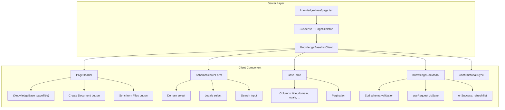

# 15. Admin-Next Frontend Architecture Analysis & Design Tokens

> 根据用户要求，在写 RAG Knowledge Document 管理页面之前，先分析 admin-next 现有的架构设计模式和设计 token，确保新页面完全符合现有代码风格和约定。

---

## 1. Project Overview

```mermaid
graph TD
    subgraph "Framework Layer"
        A[Next.js App Router] --> B[Route Group: dashboard]
        B --> C[Server Component Layout]
        C --> D[Client Component Page]
    end
    subgraph "State Layer"
        E[Zustand Stores] --> F[useAppStore]
        E --> G[useAuthStore]
        E --> H[useToastStore]
    end
    subgraph "API Layer"
        I[HttpClient] --> J[api/index.ts]
        J --> K[Domain API Objects]
    end
    subgraph "UI Layer"
        L[@repo/ui] --> M[Button, Modal, Table, Form]
        N[components/scaffold] --> O[BaseTable, SchemaSearchForm, PageHeader]
        P[components/ui] --> Q[Button, Modal, ConfirmModal, PageSkeleton]
    end
    subgraph "Data Fetching"
        R[ahooks useRequest] --> S[Primary Pattern]
        T[@tanstack/react-query] --> U[Secondary Pattern]
    end
    D --> E
    D --> R
    D --> N
    D --> P
```

---

## 2. Route System

### 2.1 Route Configuration

File: [`apps/admin-next/src/routes/index.ts`](../../apps/admin-next/src/routes/index.ts)

- **8 RouteGroups**: `Overview`, `Users`, `Catalog`, `Commerce`, `Marketing`, `Customer Service`, `Analytics`, `System`
- **Interface**: `RouteConfig` with `path`, `name` (i18n key), `icon` (lucide-react component), `group`, optional `hidden`
- **Pattern**: Each route `name` maps to a top-level i18n key in [`en.json`](../../apps/admin-next/src/i18n/en.json)
- Example: `{ path: '/lucky-draw', name: 'luckyDrawMgmt', icon: Sparkles, group: 'Marketing' }`

### 2.2 Directory Structure

```
src/app/(dashboard)/           # Authenticated route group
  layout.tsx                   # Server component: cookie check + DashboardLayout
  page.tsx                     # Dashboard home
  lucky-draw/
    page.tsx                   # Server page -> Suspense + PageSkeleton -> Client component
  products/
    page.tsx
  ...
src/app/login/                 # Public routes
```

### 2.3 Page Pattern (Canonical)

Every page follows this exact pattern:

1. **Server page** (`page.tsx`):
   ```tsx
   import type { Metadata } from 'next';
   import React, { Suspense } from 'react';
   import { LuckyDrawManagement } from '@/components/lucky-draw/LuckyDrawClient';
   import { PageSkeleton } from '@/components/ui/PageSkeleton';

   export const metadata: Metadata = { title: 'Lucky Draw' };

   export default function LuckyDrawPage() {
     return (
       <Suspense fallback={<PageSkeleton />}>
         <LuckyDrawManagement />
       </Suspense>
     );
   }
   ```

2. **Client component** (e.g., [`LuckyDrawClient.tsx`](../../apps/admin-next/src/components/lucky-draw/LuckyDrawClient.tsx)):
   - `'use client'` directive
   - `useRequest()` from ahooks for data fetching
   - `useTranslation()` for i18n
   - Embedded modal components (not separate files)
   - `PageHeader` for title + action buttons
   - Inline modals with `AnimatePresence`

---

## 3. UI Component Architecture

### 3.1 Layer Structure

| Layer | Source | Components |
|-------|--------|------------|
| Shared UI Package | `@repo/ui` | `Button`, `Modal`, `Table`, `Form` components, `cn`, `Checkbox` |
| Project Scaffold | `components/scaffold/` | `BaseTable`, `SchemaSearchForm`, `PageHeader`, `Pagination` |
| Project UI Primitives | `components/ui/` | `Button.tsx`, `Modal.tsx`, `ConfirmModal.tsx`, `PageSkeleton.tsx`, `ClientDate.tsx`, `SmartImage.tsx` |
| Legacy UI Kit | `components/UIComponents.tsx` | `Card`, `Breadcrumbs`, `Badge`, `Switch`, `Select`, `Input`, `Textarea`, `ImageUpload`, `Dropdown`, `Toast`, `ExportButton`, `DateRangePicker` |

### 3.2 Key Component Details

#### Button ([`components/ui/Button.tsx`](../../apps/admin-next/src/components/ui/Button.tsx))
- `motion.button` with `whileTap` scale animation
- **Variants**: `primary` (default), `secondary`, `danger`, `ghost`, `outline`
- **Sizes**: `sm`, `md` (default), `lg`
- **Props**: `isLoading` with `Loader2` spinner, plus all native button props

#### Modal ([`components/ui/Modal.tsx`](../../apps/admin-next/src/components/ui/Modal.tsx))
- `AnimatePresence` + `motion.div`
- Backdrop blur, click-away-to-close
- **Sizes**: `sm` (max-w-sm), `md` (max-w-lg), `lg` (max-w-2xl), `xl` (max-w-4xl)
- Close button with X icon

#### ConfirmModal ([`components/ui/ConfirmModal.tsx`](../../apps/admin-next/src/components/ui/ConfirmModal.tsx))
- Wraps `Modal`, `AlertTriangle` icon, danger + cancel buttons
- Used via `ModalManager.confirm()` pattern in complex pages

#### PageSkeleton ([`components/ui/PageSkeleton.tsx`](../../apps/admin-next/src/components/ui/PageSkeleton.tsx))
- **No `'use client'` directive** — safe for server components
- Composed of: `HeaderSkeleton` + `FilterSkeleton` + `TableSkeleton(rows=6)`

### 3.3 Scaffold Components

#### PageHeader ([`components/scaffold/PageHeader.tsx`](../../apps/admin-next/src/components/scaffold/PageHeader.tsx))
- Flexible page header with: title, description, breadcrumbs, back button, search bar (middle), action buttons (right)
- Supports: `buttonText`+`buttonOnClick`, `secondaryButtonText`, `tertiaryButtonText`

#### BaseTable ([`components/scaffold/BaseTable.tsx`](../../apps/admin-next/src/components/scaffold/BaseTable.tsx))
- **Generic**: `<TData>` with typed columns `ColumnDef<TData, unknown>[]`
- Uses `@tanstack/react-table` for core table logic
- **Features**: sorting, pagination, row selection, expandable rows, drag-and-drop (`@dnd-kit`)
- `MemoizedRow` for performance optimization
- **Props**: `enableSorting`, `enableSelection`, `enableExpand`, `enableDrag`, `renderSubComponent`, `PaginationProps`

#### SchemaSearchForm ([`components/scaffold/SchemaSearchForm.tsx`](../../apps/admin-next/src/components/scaffold/SchemaSearchForm.tsx))
- **Generic**: `<T extends Record<string, any>>`
- Schema-driven: `SearchFieldSchema<T>[]` array defines fields
- **Field types**: `'input'` | `'select'` | `'date'`
- Uses `react-hook-form` + `@repo/ui` Form components
- `cleanValues()` helper filters out empty/undefined values before submission

---

## 4. API Layer

### 4.1 HttpClient

File: [`apps/admin-next/src/api/http.ts`](../../apps/admin-next/src/api/http.ts)

- Custom `HttpClient` class wrapping axios
- **Key features**:
  - 3 retries with exponential backoff (1s, 2s, 4s)
  - Inflight GET deduplication (`Map<string, Promise<unknown>>`)
  - Duplicate POST/PUT/DELETE abort
  - 401 auto-refresh with single-flight token refresh
  - 403 silent handling (VIEWER role)
  - `ApiResponse<T>` unwrap: returns `res.data.data`
  - SSR-safe baseURL detection
  - Methods: `get<T>()`, `post<T>()`, `put<T>()`, `patch<T>()`, `delete<T>()`, `upload<T>()`, `download()`

### 4.2 API Types

File: [`apps/admin-next/src/api/types.ts`](../../apps/admin-next/src/api/types.ts)

```typescript
interface ApiResponse<T = unknown> {
  code: number; message: string; data: T; timestamp?: number;
}
interface PaginatedResponse<T> {
  list: T[]; total: number; page: number; pageSize: number; totalPages: number;
}
interface PaginationParams {
  page?: number; pageSize?: number; sortBy?: string; sortOrder?: 'asc' | 'desc';
}
interface RequestConfig {
  showLoading?: boolean; showError?: boolean; customErrorHandler?: ...;
}
```

### 4.3 API Definitions Pattern

File: [`apps/admin-next/src/api/index.ts`](../../apps/admin-next/src/api/index.ts)

- **Pattern**: Each domain has a named export object (e.g., `luckyDrawApi`)
- Each method calls `http.get<T>()`, `http.post<T>()`, etc.
- **Complex page example** - luckyDrawApi uses normalization wrappers:
  - API response types: `LuckyDrawPrizeResponse`, `LuckyDrawActivityResponse`, `LuckyDrawResultResponse`
  - Normalization: `toTimestamp()`, `toLuckyDrawNumber()`, `normalizeLuckyDrawPrize()`
  - Methods: `listActivities(params?)`, `getActivity(id)`, `createActivity(data)`, `updateActivity(id, data)`, `deleteActivity(id)`, `listPrizes(activityId)`, `createPrize(data)`, `updatePrize(id, data)`, `deletePrize(id)`, `listResults(params)`

---

## 5. State Management

### 5.1 Zustand Stores

| Store | File | State | Persist |
|-------|------|-------|---------|
| `useAppStore` | `store/useAppStore.ts` | `theme`, `lang`, `sidebar` | Yes (localStorage) |
| `useAuthStore` | `store/useAuthStore.ts` | `token`, `user`, `role`, `isLoggingOut` | Yes (localStorage) |
| `useToastStore` | (not read) | toast messages | No |

### 5.2 Data Fetching

- **Primary**: `ahooks` `useRequest` (used in LuckyDrawClient, most CRUD pages)
- **Secondary**: `@tanstack/react-query` (available via `Providers.tsx` with `staleTime: 30s`, `retry: 1`)

---

## 6. Types System

File: [`apps/admin-next/src/type/types.ts`](../../apps/admin-next/src/type/types.ts) (1600+ lines)

- All domain types defined as interfaces
- **Pattern**: Entity interfaces, `Create*Payload`/`Update*Payload`/`*ListParams`/`*SearchForm` types
- Example for LuckyDraw:
  ```typescript
  interface LuckyDrawActivity { id, name, type, status, startTime, endTime, prizes, ... }
  interface CreateLuckyDrawActivityPayload { name, type, startTime, endTime, ... }
  interface QueryLuckyDrawResultsParams extends PaginationParams { activityId?, prizeId?, ... }
  ```

File: [`apps/admin-next/src/type/search.ts`](../../apps/admin-next/src/type/search.ts)

- `SearchFieldSchema<T>` generic type with `field` (keyof T), `label`, `type` ('input'|'select'|'date'), `options?` (for select)

---

## 7. i18n System

- **Library**: `next-intl`
- **Locales**: en, zh, ja, ko, fr, de (JSON files in [`src/i18n/`](../../apps/admin-next/src/i18n/))
- **Key pattern**: Module-prefixed keys (e.g., `luckyDrawMgmt`, `products_pageTitle`, `products_productName`)
- **Hook**: `useTranslation()` returning `TFunc`
- **Route name** → i18n mapping in [`routes/index.ts`](../../apps/admin-next/src/routes/index.ts)

---

## 8. Canonical Complex Page Analysis: LuckyDrawManagement

File: [`apps/admin-next/src/components/lucky-draw/LuckyDrawClient.tsx`](../../apps/admin-next/src/components/lucky-draw/LuckyDrawClient.tsx) (1150 lines)

### Structure Breakdown

```
LuckyDrawManagement (exported)
├── useRequest hooks (listActivities, listResults, deleteActivity, etc.)
├── useEffect (initial load)
├── handleDeleteActivity
├── Tab system: ['activities', 'results']
├── grid layout: [main content | sidebar]
│   ├── Main: activity cards with status badges, edit/delete buttons
│   └── Sidebar: PrizesPanel (when activity selected)
│       └── Prize list → PrizeModal (create/edit)
├── ActivityModal (create/edit activity)
└── PrizeModal (create/edit prize - conditional fields by prizeType)

ActivityModal (embedded)
├── useMemo → zod schema with superRefine
├── useEffect → populate form on edit
├── useRequest → doSave
├── Form fields: input, textarea, select, datetime-local
└── onSuccess → refresh parent list

PrizeModal (embedded)
├── Same pattern as ActivityModal
├── Conditional fields: prizeType === 'physical' → show shipping fields
└── onSuccess → refresh prizes

PrizesPanel (embedded)
├── useRequest → listPrizes
├── handleDelete → ModalManager.confirm
├── Loading state → skeletons
├── Empty state → "No prizes yet"
└── Prize list → PrizeModal trigger

ResultsPanel (embedded)
├── Params state for pagination/filtering
├── Paginated table
├── Filter: activity select
└── Empty state: "Select an activity"
```

### Key Design Tokens Extracted

| Token | LuckyDraw Usage | Rule for New Pages |
|-------|----------------|--------------------|
| **Data Fetching** | `useRequest(fn, { onSuccess })` | Use `useRequest` as primary pattern |
| **Form Validation** | `zod` schema + `superRefine` | Use `zod` for validation |
| **Form Pattern** | `useEffect` to populate on edit, `onSuccess` to close+refresh | Same pattern |
| **Modal Pattern** | Embedded components, `modalState: false | FormData` | Same pattern |
| **Confirm Delete** | `ModalManager.confirm({ title, description, onConfirm })` | Use `ModalManager.confirm` or `ConfirmModal` |
| **Loading State** | `loading && items.length === 0` → skeleton | Check both loading + empty |
| **Empty State** | `items.length === 0` → "No data" message | Same pattern |
| **Grid Layout** | `grid gap-6 xl:grid-cols-[minmax(0,1.1fr)_minmax(360px,0.9fr)]` | Use grid for list+detail layouts |
| **Styling** | `rounded-2xl border border-gray-100 bg-white p-5 dark:...` | Use card container pattern |
| **Page Header** | `<PageHeader title={t('luckyDrawMgmt')} buttonText={...} />` | Use `PageHeader` component |
| **API Call Pattern** | `http.get<ApiResponse<...>>(...)` → normalize → return | API functions in `api/index.ts` |
| **Refresh Pattern** | Callback passed to modals: `handleRefresh = useCallback(async () => {...})` | Same callback pattern |

---

## 9. Knowledge Document Page Design (Based on Tokens)

### 9.1 Route Configuration

```typescript
// In routes/index.ts, add to 'System' group (or a new 'Content' group):
{ path: '/knowledge-base', name: 'knowledgeBaseMgmt', icon: BookOpen, group: 'System' },
```

### 9.2 Type Definitions (`type/types.ts`)

```typescript
interface KnowledgeDocument {
  id: string;
  title: string;
  domain: string;
  docId: string;
  keywords: string[];
  locale: string;
  contentType: string;
  priority: string;
  content: string;
  isActive: boolean;
  version: number;
  createdAt: string;
  updatedAt: string;
}

interface KnowledgeDocumentListParams extends PaginationParams {
  domain?: string;
  locale?: string;
  isActive?: boolean;
  search?: string;
}

interface CreateKnowledgeDocumentPayload {
  title: string;
  domain: string;
  docId: string;
  keywords: string[];
  locale: string;
  contentType: string;
  priority: string;
  content: string;
  isActive?: boolean;
}

interface UpdateKnowledgeDocumentPayload extends Partial<CreateKnowledgeDocumentPayload> {}
```

### 9.3 API Definitions (`api/index.ts`)

```typescript
export const knowledgeBaseApi = {
  list: (params?: KnowledgeDocumentListParams) =>
    http.get<PaginatedResponse<KnowledgeDocument>>('/admin/knowledge-base', { params }),
  getById: (id: string) =>
    http.get<KnowledgeDocument>(`/admin/knowledge-base/${id}`),
  create: (data: CreateKnowledgeDocumentPayload) =>
    http.post<KnowledgeDocument>('/admin/knowledge-base', data),
  update: (id: string, data: UpdateKnowledgeDocumentPayload) =>
    http.patch<KnowledgeDocument>(`/admin/knowledge-base/${id}`, data),
  delete: (id: string) =>
    http.delete<void>(`/admin/knowledge-base/${id}`),
  syncFromFiles: () =>
    http.post<{ synced: number; created: number; updated: number }>('/admin/knowledge-base/sync'),
};
```

### 9.4 i18n Keys (`en.json`)

```json
{
  "knowledgeBaseMgmt": "Knowledge Base",
  "knowledgeBase_pageTitle": "Knowledge Document Management",
  "knowledgeBase_pageDescription": "Manage knowledge documents used by AI customer service RAG system.",
  "knowledgeBase_title": "Documents",
  "knowledgeBase_domain": "Domain",
  "knowledgeBase_allDomains": "All Domains",
  "knowledgeBase_locale": "Language",
  "knowledgeBase_allLocales": "All Languages",
  "knowledgeBase_searchTitle": "Search title or ID...",
  "knowledgeBase_create": "Create Document",
  "knowledgeBase_edit": "Edit Document",
  "knowledgeBase_detail": "Document Detail",
  "knowledgeBase_sync": "Sync from Files",
  "knowledgeBase_syncSuccess": "Synced {synced} documents: {created} created, {updated} updated",
  // ... more keys
}
```

### 9.5 Page Structure

```
src/app/(dashboard)/knowledge-base/
  page.tsx                          # Server page - Suspense + PageSkeleton

src/components/knowledge-base/
  KnowledgeBaseListClient.tsx        # Main list page (like LuckyDrawManagement)
    ├── PageHeader (title + Create + Sync buttons)
    ├── SchemaSearchForm (domain, locale, search, status)
    ├── BaseTable (sortable, selectable, paginated)
    │   └── Columns: title, domain, locale, priority, contentType, isActive, updatedAt, actions
    ├── KnowledgeDocModal (create/edit - embedded)
    │   ├── Zod schema with title, domain select, docId, keywords tags input, locale select
    │   ├── Content textarea (or markdown editor in Phase 2)
    │   └── Priority select, isActive toggle
    └── SyncConfirmModal (confirm sync action)
```

### 9.6 Component Tree



---

## 10. Design Tokens Summary (Checklist for New Pages)

| # | Rule | Source |
|---|------|--------|
| 1 | Server `page.tsx` → `Suspense` + `PageSkeleton` → Client component | LuckyDraw page pattern |
| 2 | Use `'use client'` directive on all interactive components | All pages |
| 3 | Use `useRequest()` from ahooks for data fetching | LuckyDrawClient |
| 4 | Use `useTranslation()` for i18n | All components |
| 5 | Use `PageHeader` component for page title + actions | LuckyDrawClient |
| 6 | Use `zod` schema + `superRefine` for form validation | LuckyDrawClient |
| 7 | Use embedded modal components (not separate files) | LuckyDrawClient |
| 8 | Use `ModalManager.confirm()` or `ConfirmModal` for delete confirm | LuckyDrawClient |
| 9 | Check `loading && items.length === 0` for loading state | LuckyDrawClient |
| 10 | Check `items.length === 0` for empty state | LuckyDrawClient |
| 11 | Use `grid gap-6 xl:grid-cols-[...]` for list+detail layouts | LuckyDrawClient |
| 12 | Use `rounded-2xl border border-gray-100 bg-white p-5 dark:...` for cards | LuckyDrawClient |
| 13 | API methods in `api/index.ts` with typed returns | api/index.ts pattern |
| 14 | Types in `type/types.ts` with `*Payload`/`*Params` pattern | type/types.ts pattern |
| 15 | i18n keys prefixed by module name | i18n/en.json pattern |
| 16 | Route in `routes/index.ts` with lucide-react icon | routes/index.ts pattern |
| 17 | Use `@repo/ui` components (Button, Modal, Table, Form) | Project convention |
| 18 | Use BaseTable for data tables, SchemaSearchForm for search forms | Scaffold components |

---

*Document generated as architectural foundation for implementing RAG Knowledge Document admin pages.*
