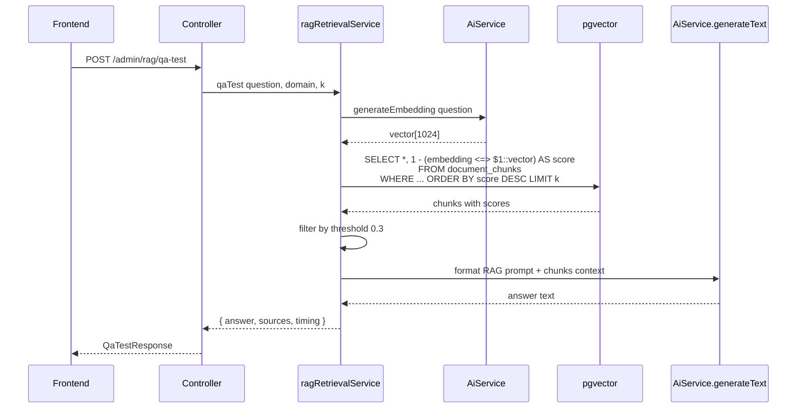

# 54. Admin Knowledge Base 管理页面 — 完整 UI 设计（v2 — 含向量管道 + QA 测试面板）

> 文档编号: Doc 54 v2
> 状态: 📋 设计完成
> 创建日期: 2026-07-06 (v2: 2026-07-06)
> 目录: `docs/AI-joymini/RAG/`

---

## 📋 目录

1. [现状与目标](#1-现状与目标)
2. [页面布局总览](#2-页面布局总览)
3. [功能区详解](#3-功能区详解)
4. [弹窗 (Modals) 设计](#4-弹窗-modals-设计)
5. [Prisma 模型设计](#5-prisma-模型设计)
6. [API 端点设计](#6-api-端点设计)
7. [数据流](#7-数据流)
8. [前端文件结构](#8-前端文件结构)
9. [后端文件结构](#9-后端文件结构)
10. [实施阶段](#10-实施阶段)
11. [参考来源](#11-参考来源)

---

## 1. 现状与目标

### 1.1 当前状态

| 维度 | 状态 | 说明 |
|------|------|------|
| Prisma `KnowledgeDocument` 模型 | ✅ 已迁移 | 16 个文档已入库 |
| Admin CRUD DTOs (5 个) | ✅ 已完成 | create, update, query, response, upload |
| Admin CRUD Service (`rag.service.ts`) | ✅ 已完成 | CRUD + 分页 + 版本号 |
| Admin Sync/Upload Service (`rag-sync.service.ts`) | ✅ 已完成 | MarkdownExtractor + PdfExtractor 策略模式 |
| Admin Controller (`rag.controller.ts`) | ✅ 已完成 | 7 个端点: CRUD + upload + domains |
| Admin Module (`rag.module.ts`) | ❌ 未创建 | 需注册所有 service |
| Admin Module 注册 (`admin.module.ts`) | ❌ 未创建 | 需导入 RagModule |
| **Prisma `DocumentChunk` 模型 + pgvector** | ❌ 未创建 | **P0 - 向量存储核心** |
| **Chunk Service (`rag-chunk.service.ts`)** | ❌ 未创建 | **P0 - RecursiveCharacterTextSplitter** |
| **Embedding Service (`rag-embedding.service.ts`)** | ❌ 未创建 | **P0 - AiService.generateEmbedding() + pgvector** |
| **Retrieval Service (`rag-retrieval.service.ts`)** | ❌ 未创建 | **P0 - QA 测试检索** |
| **QA Test 端点 + 来源标注** | ❌ 未创建 | **P0 - 你看到的「标注」功能** |
| 前端管理页面 (admin-next) | ❌ 未开始 | 含 RagQATestPanel |
| 前端 API 定义 + 路由 + i18n | ❌ 未开始 | |
| Client-facing RAG (orchestrator stub) | ❌ stub | 需替换为 pgvector 检索 |

### 1.2 设计目标

参考 `study/LLM/project/workmind7/` 的 KnowledgeView 模式（uploader + list + chat 三栏布局），结合 admin-next 现有设计 token（doc 15），设计一个完整的 Knowledge Base 文档管理页面。

### 1.3 参考来源

| 来源 | 参考内容 |
|------|----------|
| [`docs/AI-joymini/RAG/15-admin-next-architecture-analysis.md`](../15-admin-next-architecture-analysis.md) | admin-next 设计 token：PageHeader、BaseTable、SchemaSearchForm、Modal 模式 |
| [`study/LLM/project/workmind7/frontend/src/components/rag/DocumentUploader.vue`](../../../../study/LLM/project/workmind7/frontend/src/components/rag/DocumentUploader.vue) | 拖拽上传 .md 文件 + 粘贴文本模式 |
| [`study/LLM/project/workmind7/frontend/src/components/rag/DocumentList.vue`](../../../../study/LLM/project/workmind7/frontend/src/components/rag/DocumentList.vue) | 文档列表 + 分类筛选 + 删除 |
| [`study/LLM/project/workmind7/frontend/src/components/rag/RagChat.vue`](../../../../study/LLM/project/workmind7/frontend/src/components/rag/RagChat.vue) | RAG QA 聊天界面（来源标注 + 流式回答） |
| [`study/LLM/project/workmind7/frontend/src/views/KnowledgeView.vue`](../../../../study/LLM/project/workmind7/frontend/src/views/KnowledgeView.vue) | 整体布局：左侧面板 + 右侧聊天 |
| [`study/LLM/project/workmind7/server/src/routes/knowledge.js`](../../../../study/LLM/project/workmind7/server/src/routes/knowledge.js) | 后端路由：文件上传 + 文本内容 + 列表 + 删除 |
| [`apps/api/src/admin/lucky-draw/`](../../../apps/api/src/admin/lucky-draw/) | admin-next 现有管理页面模式 |

---

## 2. 页面布局总览

### 2.1 整体布局

```
┌─────────────────────────────────────────────────────────────────────────────┐
│ PageHeader: "Knowledge Base"                [📤 Upload .md] [🔄 Sync] [+ New] │
├─────────────────────────────────────────────────────────────────────────────┤
│ SchemaSearchForm                                                             │
│ ┌──────────────────┐ ┌──────────┐ ┌──────────┐ ┌──────────┐ ┌────────────┐ │
│ │ 🔍 Search title  │ │Domain ▼  │ │Priority ▼│ │Locale ▼  │ │  Reset     │ │
│ │    or content... │ │          │ │          │ │          │ │            │ │
│ └──────────────────┘ └──────────┘ └──────────┘ └──────────┘ └────────────┘ │
├─────────────────────────────────────────────────────────────────────────────┤
│ BaseTable: Knowledge Documents                                              │
│ ┌──┬──────────┬────────┬──────────┬────────┬──────┬──────┬────────────────┐ │
│ │# │ Title    │ Domain │ DocId    │ Locale │ Prio │Status│   Actions      │ │
│ ├──┼──────────┼────────┼──────────┼────────┼──────┼──────┼────────────────┤ │
│ │1 │Refund    │ order  │refund-   │ en     │ P0🔥 │ ✅   │ 👁 ✏ 🗑         │ │
│ │  │Policy    │        │policy    │        │      │Active│                │ │
│ ├──┼──────────┼────────┼──────────┼────────┼──────┼──────┼────────────────┤ │
│ │2 │Group     │product │group-    │ en     │ P1   │ ✅   │ 👁 ✏ 🗑         │ │
│ │  │Buying    │        │buying    │        │      │Active│                │ │
│ │  │Guide     │        │          │        │      │      │                │ │
│ ├──┼──────────┼────────┼──────────┼────────┼──────┼──────┼────────────────┤ │
│ │3 │Account   │ user   │account-  │ en     │ P2   │ ❌   │ 👁 ✏ 🗑         │ │
│ │  │Guide     │        │guide     │        │      │Inact.│                │ │
│ └──┴──────────┴────────┴──────────┴────────┴──────┴──────┴────────────────┘ │
│ Pagination: [<] 1 2 3 4 5 ... [>]                        Total: 16 docs    │
├─────────────────────────────────────────────────────────────────────────────┤
│ SyncStatusBar                                                                 │
│ 📁 16 files on disk  |  🗄️ 20 docs in DB  |  ⏱️ Last sync: 2 mins ago       │
│ [🔄 Sync Now]                                           [📋 View Details]    │
└─────────────────────────────────────────────────────────────────────────────┘
```

### 2.2 Tab 切换设计

页面使用 **Tab 切换** 布局，分为两个 Tab：

| Tab | 组件 | 说明 |
|-----|------|------|
| 📄 **Documents** | 文档列表 + 筛选 + 表格 | 管理知识文档 CRUD |
| 🧪 **QA Test** | RagQATestPanel | **测试 RAG 检索，带来源标注（你看到的「标注」）** |

### 2.3 布局规范

| 区域 | Tab | 组件 | 说明 |
|------|-----|------|------|
| 顶部 | 共用 | `PageHeader` | 标题 + 3 个 action button |
| 筛选 | 📄 Documents | `SchemaSearchForm` | 4 个筛选字段：search, domain, priority, locale |
| 主列表 | 📄 Documents | `BaseTable` | 可排序表格，7 列 |
| QA 面板 | 🧪 QA Test | `RagQATestPanel` | 问题输入 + 来源标注 + AI 回答 |
| 底部 | 共用 | `SyncStatusBar` | 同步状态信息栏 |

---

## 3. 功能区详解

### 3.1 PageHeader

使用 admin-next 的 [`PageHeader`](../../../apps/admin-next/src/components/scaffold/PageHeader.tsx) 组件：

```tsx
<PageHeader
  title={t('knowledgeBase_pageTitle')}
  description={t('knowledgeBase_pageDescription')}
  buttonText={t('knowledgeBase_uploadMd')}
  buttonOnClick={() => setUploadModalOpen(true)}
  secondaryButtonText={t('knowledgeBase_sync')}
  secondaryButtonOnClick={handleSync}
  tertiaryButtonText={t('knowledgeBase_create')}
  tertiaryButtonOnClick={() => setModalState('create')}
/>
```

### 3.2 SchemaSearchForm

使用 admin-next 的 [`SchemaSearchForm`](../../../apps/admin-next/src/components/scaffold/SchemaSearchForm.tsx) 组件：

```typescript
const searchFields: SearchFieldSchema<QueryKnowledgeDocumentForm>[] = [
  { field: 'search', label: t('knowledgeBase_searchTitle'), type: 'input' },
  {
    field: 'domain',
    label: t('knowledgeBase_domain'),
    type: 'select',
    options: domains.map(d => ({ value: d, label: d })),
  },
  {
    field: 'priority',
    label: t('knowledgeBase_priority'),
    type: 'select',
    options: [
      { value: '', label: t('knowledgeBase_allPriorities') },
      { value: 'P0', label: 'P0 🔥' },
      { value: 'P1', label: 'P1' },
      { value: 'P2', label: 'P2' },
    ],
  },
  {
    field: 'locale',
    label: t('knowledgeBase_locale'),
    type: 'select',
    options: [
      { value: '', label: t('knowledgeBase_allLocales') },
      { value: 'en', label: 'English' },
      { value: 'zh', label: '中文' },
      { value: 'ja', label: '日本語' },
      { value: 'ko', label: '한국어' },
    ],
  },
];
```

### 3.3 BaseTable

使用 admin-next 的 [`BaseTable`](../../../apps/admin-next/src/components/scaffold/BaseTable.tsx) 组件：

**列定义：**

| 列 | 宽度 | 排序 | 渲染 |
|----|------|------|------|
| `#` | 50px | 否 | 行号 |
| `Title` | auto | 是 | 纯文本 + 点击查看详情 |
| `Domain` | 120px | 是 | Badge 标签 |
| `DocId` | 140px | 是 | monospace 字体 |
| `Locale` | 80px | 是 | 国旗 emoji + 语言代码 |
| `Priority` | 80px | 是 | P0🔥/P1/P2 Badge |
| `Status` | 80px | 是 | ✅ Active / ❌ Inactive |
| `Actions` | 120px | 否 | 👁 查看 ✏ 编辑 🗑 删除 |

**交互行为：**
- 点击行 → 打开 DocDetailModal
- 点击 👁 → 打开 DocDetailModal
- 点击 ✏ → 打开 DocFormModal (edit mode)
- 点击 🗑 → 打开 ConfirmDeleteModal

### 3.4 SyncStatusBar

固定在表格底部的状态栏，显示：

```tsx
<div className="flex items-center gap-4 px-5 py-3 border-t border-gray-100 text-sm text-gray-500">
  <span>📁 {fileCount} files on disk</span>
  <span className="text-gray-300">|</span>
  <span>🗄️ {dbCount} docs in DB</span>
  <span className="text-gray-300">|</span>
  <span>⏱️ Last sync: {formatTimeAgo(lastSync)}</span>
  <div className="ml-auto flex gap-2">
    <Button variant="ghost" size="sm" onClick={handleSync} isLoading={syncing}>
      🔄 Sync Now
    </Button>
    <Button variant="ghost" size="sm" onClick={() => setShowSyncDetail(true)}>
      📋 View Details
    </Button>
  </div>
</div>
```

---

## 4. 弹窗 (Modals) 设计

### 4.1 Create/Edit Document Modal (DocFormModal)

| 属性 | 值 |
|------|-----|
| Size | `md` (max-w-lg) |
| Title | "Create Document" / "Edit Document" |
| Trigger | [+ New] 按钮 / ✏ 按钮 |
| 表单验证 | zod schema + superRefine |

**表单字段：**

```
┌────────────────────────────────────────────┐
│ ✏️ Create Document                    [✕]  │
├────────────────────────────────────────────┤
│                                            │
│ Title * ────────────────────────────────── │
│ [________________________________________] │
│                                            │
│ DocId * ────────────────────────────────── │
│ [______________________] (auto-slugify)    │
│                                            │
│ Domain * ──── Locale * ──── ContentType * │
│ [order    ▼]  [en       ▼]  [policy   ▼]  │
│                                            │
│ Priority * ─────────────────────────────── │
│ [P1                    ▼]                  │
│                                            │
│ Keywords ───────────────────────────────── │
│ [refund] [return] [money back] [✕]        │
│ [type to add...                    ][+]   │
│                                            │
│ Content * ──────────────────────────────── │
│ ┌────────────────────────────────────────┐ │
│ │ ## Refund Policy                       │ │
│ │                                         │ │
│ │ Items can be returned within 30 days... │ │
│ │                                         │ │
│ └────────────────────────────────────────┘ │
│                                            │
│ Active ───────────────────── [🔘 On]      │
│                                            │
│        [Cancel]          [💾 Save]         │
└────────────────────────────────────────────┘
```

**表单验证规则 (zod schema)：**

```typescript
const docSchema = z.object({
  title: z.string().min(1, 'Title is required').max(200),
  docId: z.string().min(1, 'DocId is required').max(100)
    .regex(/^[a-z0-9-]+$/, 'Only lowercase letters, numbers, and hyphens'),
  domain: z.string().min(1, 'Domain is required'),
  locale: z.string().min(1, 'Locale is required'),
  contentType: z.string().min(1, 'Content type is required'),
  priority: z.string().min(1, 'Priority is required'),
  keywords: z.array(z.string()),
  content: z.string().min(1, 'Content is required'),
  isActive: z.boolean().default(true),
});
```

**交互细节：**
- Create 模式：DocId 自动从 title slugify 生成，可手动修改
- Edit 模式：所有字段预填充，DocId 不可修改（因为是唯一键的一部分）
- 关键词 tag input：输入后按 Enter 或点击 [+] 添加，点击 tag 上的 ✕ 删除

### 4.2 Document Detail Modal (DocDetailModal)

| 属性 | 值 |
|------|-----|
| Size | `xl` (max-w-4xl) |
| Title | 文档标题 |
| Trigger | 行点击 / 👁 按钮 |

```
┌────────────────────────────────────────────────┐
│ Refund Policy                             [✕]  │
│ order / P0🔥 / en / policy / v3                │
├────────────────────────────────────────────────┤
│                                                │
│ 📎 ref: refund-policy                          │
│ 🏷️ refund, return, refund policy, money back   │
│                                                │
│ ─── Content ────────────────────────────────── │
│                                                │
│ # Refund Policy                                │
│                                                │
│ ## Return Conditions                           │
│ - Items can be returned within **30 days**...   │
│ - Items must be **unused**...                   │
│                                                │
│ ## Refund Process                              │
│ 1. Go to **My Orders** page...                 │
│                                                │
│ ────────────────────────────────────────────── │
│                                                │
│ [✏️ Edit]                    [🗑 Delete]       │
└────────────────────────────────────────────────┘
```

**功能：**
- Metadata 以 badges 形式展示在标题下方
- Content 用 markdown 渲染（使用 marked 或 similar）
- Edit 按钮 → 切换到 DocFormModal edit mode
- Delete 按钮 → 弹出 ConfirmDeleteModal

### 4.3 Upload .md Modal (UploadModal)

| 属性 | 值 |
|------|-----|
| Size | `md` (max-w-lg) |
| Title | "Upload Knowledge Document" |
| Trigger | [📤 Upload .md] 按钮 |

**参考：** [`workmind7/DocumentUploader.vue`](../../../../study/LLM/project/workmind7/frontend/src/components/rag/DocumentUploader.vue)

```
┌────────────────────────────────────────────┐
│ 📤 Upload Knowledge Document          [✕]  │
├────────────────────────────────────────────┤
│                                            │
│ ┌────────────────────────────────────────┐ │
│ │                                        │ │
│ │      📂 Drag & drop .md file here      │ │
│ │         or click to select             │ │
│ │                                        │ │
│ │    Supported: .md  |  Max: 10MB        │ │
│ │                                        │ │
│ └────────────────────────────────────────┘ │
│                                            │
│ ── Or paste content directly ──           │
│ [📝 Paste text]                            │
│                                            │
│ Domain override (optional):               │
│ [Auto-detect from path ▼]                  │
│                                            │
│ Locale override (optional):               │
│ [Auto-detect from filename ▼]              │
│                                            │
│        [Cancel]          [📥 Import]       │
└────────────────────────────────────────────┘
```

**上传后处理流程：**

```
Upload .md file
     │
     ▼
┌─────────────────┐
│ Parse YAML      │  ← 客户端解析 frontmatter 用于预览
│ frontmatter     │
└────────┬────────┘
         │
         ▼
┌─────────────────┐
│ Show Preview    │  显示: title, domain, docId, content 前 200 字
│ for Confirmation│
└────────┬────────┘
         │
    [Confirm]
         │
         ▼
┌─────────────────┐
│ POST /admin/rag │  ← 上传文件内容 + 可选 override
│ /upload         │
└────────┬────────┘
         │
         ▼
┌─────────────────┐
│ Server parses   │  ← 服务端重新解析 frontmatter
│ frontmatter     │    合并 override
│ Upsert to DB    │    返回完整文档
└────────┬────────┘
         │
         ▼
┌─────────────────┐
│ Close modal     │
│ Refresh list    │
└─────────────────┘
```

### 4.4 Sync Result Modal (SyncResultModal)

| 属性 | 值 |
|------|-----|
| Size | `sm` (max-w-sm) |
| Title | "Sync Result" |
| Trigger | Sync 完成后自动弹出 |

```
┌────────────────────────────────┐
│ 📋 Sync Result           [✕]  │
├────────────────────────────────┤
│                                │
│  ✅ Created:  3               │
│  📝 Updated:  12               │
│  ⏭️ Skipped:  1                │
│  ❌ Errors:   0                │
│                                │
│  [▶ Show skipped files]       │
│    • refund-policy.en.md      │
│      (missing docId)          │
│                                │
│          [✓ Done]             │
└────────────────────────────────┘
```

**颜色编码：**
- Created: green
- Updated: blue
- Skipped: yellow/orange
- Errors: red

### 4.5 Confirm Delete Modal

| 属性 | 值 |
|------|-----|
| Size | `sm` (max-w-sm) |
| Title | "Delete Document" |
| Trigger | 🗑 按钮 |

使用 admin-next 的 [`ConfirmModal`](../../../apps/admin-next/src/components/ui/ConfirmModal.tsx) 组件：

```tsx
<ConfirmModal
  isOpen={deleteModalOpen}
  onClose={() => setDeleteTarget(null)}
  onConfirm={handleDelete}
  title={t('knowledgeBase_deleteConfirmTitle')}
  description={t('knowledgeBase_deleteConfirmDesc', { title: deleteTarget?.title })}
  confirmText={t('common.delete')}
  cancelText={t('common.cancel')}
  variant="danger"
/>
```

### 4.6 QA Test Panel (RagQATestPanel) — 带来源标注

> 🔑 **这是「标注」功能的核心实现**，参考 [`workmind7/RagChat.vue`](../../../../study/LLM/project/workmind7/frontend/src/components/rag/RagChat.vue:58) sources-panel 和 [`workmind7/query.js`](../../../../study/LLM/project/workmind7/server/src/services/rag/query.js:42) retrieveDocs 模式。

| 属性 | 值 |
|------|-----|
| Tab | 🧪 QA Test |
| Size | 全宽（替换表格区域） |
| 参考 | [`workmind7/RagChat.vue`](../../../../study/LLM/project/workmind7/frontend/src/components/rag/RagChat.vue) |

**布局：**

```
┌──────────────────────────────────────────────────────────────────┐
│ 🧪 QA Test — 测试 RAG 知识库检索                                  │
├──────────────────────────────────────────────────────────────────┤
│                                                                  │
│ Domain filter (optional):   [All Domains        ▼]               │
│ Top-K:                    [4]                                    │
│                                                                  │
│ ┌──────────────────────────────────────────────────────────────┐ │
│ │ 输入问题...                                    [🔍 Search]  │ │
│ └──────────────────────────────────────────────────────────────┘ │
│                                                                  │
│ ┌─ 来源标注（sources-panel）───────────────────────────────────┐ │
│ │ 📎 参考文档（3 条）                                            │ │
│ │ ┌──────────────────────────────────────────────────────────┐ │ │
│ │ │ [1] Refund Policy                         92%  ▼        │ │ │
│ │ │     ┌────────────────────────────────────┐               │ │ │
│ │ │     │ If you are not satisfied with...   │               │ │ │
│ │ │     └────────────────────────────────────┘               │ │ │
│ │ │ [2] Shipment FAQ                         85%  ▼        │ │ │
│ │ │ [3] Return Guide                         67%  ▼        │ │ │
│ │ └──────────────────────────────────────────────────────────┘ │ │
│ └──────────────────────────────────────────────────────────────┘ │
│                                                                  │
│ ┌─ AI 回答 ───────────────────────────────────────────────────┐ │
│ │                                                                 │
│ │ 根据退款政策，您可以在收货后 30 天内申请退款...                  │ │
│ │                                                                 │
│ │ 【来源：Refund Policy】                                         │ │
│ │                                                                 │
│ └──────────────────────────────────────────────────────────────┘ │
│                                                                  │
│ 📊 检索详情: 用时 1.2s | 检索 4 个 chunks | 相似度阈值 0.30     │
└──────────────────────────────────────────────────────────────────┘
```

**来源标注交互（参考 RagChat.vue lines 58-85）：**

```tsx
// 每条 source 的结构
interface QASource {
  chunkId: string;
  documentId: string;
  docId: string;
  title: string;           // 文档标题
  content: string;         // chunk 原文
  preview: string;         // 前 80 字符预览
  score: number;           // 余弦相似度 (0-1)
}

// 展开/收起逻辑
const [expandedSources, setExpandedSources] = useState<Record<string, boolean>>({});

const toggleSource = (index: number) => {
  setExpandedSources(prev => ({
    ...prev,
    [`qa_${index}`]: !prev[`qa_${index}`],
  }));
};

// 渲染来源列表
{sources.map((src, i) => (
  <div key={i} className="source-item">
    <span className="source-num">[{i + 1}]</span>
    <span className="source-title">{src.title}</span>
    <span className="source-score">{(src.score * 100).toFixed(0)}%</span>
    <button onClick={() => toggleSource(i)}>
      {expandedSources[`qa_${i}`] ? '▲' : '▼'}
    </button>
    {expandedSources[`qa_${i}`] && (
      <div className="source-content">{src.content}</div>
    )}
  </div>
))}
```

**API 调用：**

```typescript
const { data, loading } = useRequest(
  () => knowledgeBaseApi.qaTest({ question, domain, k }),
  { manual: true },
);
```

**响应格式：**

```typescript
interface QaTestResponse {
  answer: string;           // LLM 生成的回答
  sources: QASource[];      // 带分数的来源标注
  timing: {
    retrieval: number;      // 检索耗时 ms
    generation: number;     // 生成耗时 ms
    total: number;          // 总耗时 ms
  };
}
```

**RAG 系统提示（参考 workmind7 query.js line 54）：**

```
你是 JoyMini AI 知识库助手。
规则：
1. 只根据下方提供的参考文档回答问题，不使用文档之外的知识
2. 如果文档中没有相关内容，明确说"知识库中未找到相关内容"
3. 回答要准确、简洁，必要时列出要点
4. 在回答末尾用 【来源：文档名】 标注使用了哪些文档
```

---

### 4.7 Chunk List Modal (ChunkListModal)

| 属性 | 值 |
|------|-----|
| Size | `lg` (max-w-2xl) |
| Title | "Document Chunks — {title}" |
| Trigger | 文档详情中的「查看切片」按钮 |

**显示文档的所有切片及其向量化状态：**

```
┌────────────────────────────────────────────────────────────┐
│ 📄 Document Chunks — Refund Policy                   [✕]  │
├────────────────────────────────────────────────────────────┤
│                                                            │
│ Total: 12 chunks | Model: bge-m3 1024d                    │
│                                                            │
│ ┌────┬──────────────────────────┬────────┬────────────────┐│
│ │ #  │ Content Preview          │ Tokens │ Embedding      ││
│ ├────┼──────────────────────────┼────────┼────────────────┤│
│ │ 1  │ ## Return Conditions...  │ 120    │ ✅ vectorized  ││
│ │ 2  │ Items can be returned... │ 95     │ ✅ vectorized  ││
│ │ 3  │ ## Refund Process...     │ 88     │ ✅ vectorized  ││
│ │ 4  │ 1. Go to My Orders...    │ 110    │ ✅ vectorized  ││
│ │ 5  │ ## Refund Amount...      │ 76     │ ✅ vectorized  ││
│ │ ...│                          │        │                ││
│ └────┴──────────────────────────┴────────┴────────────────┘│
│                                                            │
│                        [🔄 Reindex All]                    │
└────────────────────────────────────────────────────────────┘
```

---

## 5. Prisma 模型设计

### 5.1 DocumentChunk 模型

新增 `DocumentChunk` 模型，用于存储文档切片及其向量 Embedding。

```prisma
/// 文档切片 — 用于 pgvector 相似度检索
model DocumentChunk {
  /// 主键
  id          String   @id @default(cuid()) @map("id") @db.VarChar(32)
  /// 所属文档 ID
  documentId  String   @map("document_id") @db.VarChar(32)
  /// 切片序号（从 0 开始）
  chunkIndex  Int      @map("chunk_index") @db.SmallInt
  /// 切片正文
  content     String   @map("content") @db.Text
  /// 向量 Embedding (1024 维，Ollama bge-m3)
  embedding   Unsupported("vector(1024)")?
  /// Token 数量（用于统计）
  tokenCount  Int?     @map("token_count") @db.SmallInt
  /// 创建时间
  createdAt   DateTime @default(now()) @map("created_at")

  /// 关联文档（级联删除）
  document    KnowledgeDocument @relation(fields: [documentId], references: [id], onDelete: Cascade)

  @@index([documentId])
  @@map("document_chunks")
}
```

### 5.2 pgvector 迁移

```sql
-- 1. 启用 pgvector 扩展
CREATE EXTENSION IF NOT EXISTS vector;

-- 2. 创建 document_chunks 表（由 Prisma 自动生成）
-- 3. 添加 IVFFlat 索引（余弦距离）
CREATE INDEX idx_document_chunks_embedding
ON document_chunks
USING ivfflat (embedding vector_cosine_ops)
WITH (lists = 100);
```

> **IVFFlat 参数**: `lists = 100` 适用于约 10K 条记录。后续可根据数据量调整为 `sqrt(n)`。
>
> **向量维度**: 1024 维，与 `AiService.generateEmbedding()` 使用的 Ollama bge-m3 模型一致。

---

## 6. API 端点设计

### 6.1 端点总览

| 方法 | 路径 | 角色 | 说明 |
|------|------|------|------|
| GET | `/admin/rag/documents` | VIEWER+ | 分页列表 + search/domain/priority/locale 筛选 |
| GET | `/admin/rag/documents/:id` | VIEWER+ | 获取单篇文档（含全文 content） |
| POST | `/admin/rag/documents` | EDITOR+ | 创建文档 |
| PATCH | `/admin/rag/documents/:id` | EDITOR+ | 更新文档（version++） |
| DELETE | `/admin/rag/documents/:id` | ADMIN+ | 软删除（isActive=false） |
| POST | `/admin/rag/upload` | EDITOR+ | 上传 .md/.pdf -> 解析 frontmatter -> upsert -> **自动切片+向量化** |
| POST | `/admin/rag/sync` | ADMIN+ | 从服务器 knowledge/ 目录同步 |
| GET | `/admin/rag/sync/status` | VIEWER+ | 同步状态（fileCount vs dbCount） |
| GET | `/admin/rag/domains` | VIEWER+ | 获取所有 domain 列表 |
| | | | |
| **POST** | **`/admin/rag/qa-test`** | **VIEWER+** | **QA 测试：embed 问题 -> pgvector 检索 -> LLM 回答 + 来源标注** |
| **GET** | **`/admin/rag/documents/:id/chunks`** | **VIEWER+** | **获取文档的所有切片（含 vector 状态）** |
| **POST** | **`/admin/rag/documents/:id/reindex`** | **EDITOR+** | **重新切片+向量化指定文档** |
| **GET** | **`/admin/rag/embedding/status`** | **VIEWER+** | **向量化统计：总 chunks / 已向量化 / 待向量化** |

### 6.2 新端点详情

#### POST `/admin/rag/qa-test` — QA 测试（带来源标注）

**Request Body:**
```typescript
interface QaTestDto {
  question: string;    // 用户问题
  domain?: string;     // 可选：限定 domain
  k?: number;          // 可选：返回 top-K (默认 4)
}
```

**处理流程：**



**Response:**
```typescript
interface QaTestResponse {
  answer: string;
  sources: Array<{
    chunkId: string;
    documentId: string;
    docId: string;
    title: string;
    content: string;        // chunk 原文
    preview: string;         // 前 80 字符
    score: number;           // 0-1 余弦相似度
  }>;
  timing: {
    retrieval: number;       // ms
    generation: number;      // ms
    total: number;           // ms
  };
}
```

#### GET `/admin/rag/documents/:id/chunks`

**Response:**
```typescript
interface ChunkListResponse {
  documentId: string;
  total: number;
  vectorized: number;
  chunks: Array<{
    id: string;
    chunkIndex: number;
    content: string;
    tokenCount: number | null;
    hasEmbedding: boolean;
    createdAt: string;
  }>;
}
```

#### POST `/admin/rag/documents/:id/reindex`

**处理流程：** 删除该文档的所有旧 chunks -> 重新切片 -> 重新向量化 -> 存储

**Response:**
```typescript
interface ReindexResponse {
  documentId: string;
  chunksCreated: number;
  chunksVectorized: number;
}
```

#### GET `/admin/rag/embedding/status`

**Response:**
```typescript
interface EmbeddingStatusResponse {
  totalDocuments: number;
  totalChunks: number;
  vectorizedChunks: number;
  pendingChunks: number;
  byDomain: Array<{
    domain: string;
    documents: number;
    chunks: number;
    vectorized: number;
  }>;
}
```

### 6.3 权限矩阵（更新版）

| 端点 | SUPER_ADMIN | ADMIN | EDITOR | VIEWER |
|------|:-----------:|:-----:|:------:|:------:|
| GET /documents | ✅ | ✅ | ✅ | ✅ |
| GET /documents/:id | ✅ | ✅ | ✅ | ✅ |
| POST /documents | ✅ | ✅ | ✅ | ❌ |
| PATCH /documents/:id | ✅ | ✅ | ✅ | ❌ |
| DELETE /documents/:id | ✅ | ✅ | ❌ | ❌ |
| POST /upload | ✅ | ✅ | ✅ | ❌ |
| POST /sync | ✅ | ✅ | ❌ | ❌ |
| GET /sync/status | ✅ | ✅ | ✅ | ✅ |
| GET /domains | ✅ | ✅ | ✅ | ✅ |
| **POST /qa-test** | ✅ | ✅ | ✅ | ✅ |
| **GET /documents/:id/chunks** | ✅ | ✅ | ✅ | ✅ |
| **POST /documents/:id/reindex** | ✅ | ✅ | ✅ | ❌ |
| **GET /embedding/status** | ✅ | ✅ | ✅ | ✅ |

### 5.1 端点总览

| 方法 | 路径 | 角色 | 说明 |
|------|------|------|------|
| GET | `/admin/rag/documents` | VIEWER+ | 分页列表 + search/domain/priority/locale 筛选 |
| GET | `/admin/rag/documents/:id` | VIEWER+ | 获取单篇文档（含全文 content） |
| POST | `/admin/rag/documents` | EDITOR+ | 创建文档 |
| PATCH | `/admin/rag/documents/:id` | EDITOR+ | 更新文档（version++） |
| DELETE | `/admin/rag/documents/:id` | ADMIN+ | 软删除（isActive=false） |
| **POST** | **`/admin/rag/upload`** | EDITOR+ | **上传 .md 文件 → 解析 frontmatter → upsert** |
| **POST** | **`/admin/rag/sync`** | ADMIN+ | **从服务器 knowledge/ 目录同步** |
| **GET** | **`/admin/rag/sync/status`** | VIEWER+ | **同步状态（fileCount vs dbCount）** |
| **GET** | **`/admin/rag/domains`** | VIEWER+ | **获取所有 domain 列表（用于筛选下拉）** |

### 5.2 端点详情

#### GET `/admin/rag/documents`

**Query Parameters:**
```typescript
interface QueryRagDocDto {
  page?: number;       // default: 1
  pageSize?: number;   // default: 20
  domain?: string;     // filter: exact match
  search?: string;     // search in title + content (case-insensitive)
  priority?: string;   // filter: P0/P1/P2
  locale?: string;     // filter: en/zh/ja/ko/fr/de
  isActive?: boolean;  // filter: true/false
}
```

**Response:**
```typescript
{
  page: 1,
  pageSize: 20,
  total: 16,
  list: [
    {
      id: "clx...",
      title: "Refund Policy",
      domain: "order",
      docId: "refund-policy",
      keywords: ["refund", "return"],
      locale: "en",
      contentType: "policy",
      priority: "P0",
      content: "## Return Conditions\n...",  // ⚠️ 列表接口不返回全文（content 截取前 200 字）
      isActive: true,
      version: 3,
      createdAt: "2026-07-06T00:00:00Z",
      updatedAt: "2026-07-06T00:00:00Z",
    },
  ],
}
```

> **注意**: 列表接口的 `content` 字段只返回前 200 字预览。完整内容在 GET /:id 返回。

#### GET `/admin/rag/documents/:id`

**Response:** 同上，但 `content` 返回全文。

#### POST `/admin/rag/documents`

**Request Body:**
```typescript
{
  title: "New Document",
  docId: "new-doc",
  domain: "order",
  keywords: ["keyword1"],
  locale: "en",
  contentType: "policy",
  priority: "P1",
  content: "## Content\n...",
  isActive?: true,
}
```

**Response:** 创建后的完整文档对象。

#### PATCH `/admin/rag/documents/:id`

**Request Body:** 同上，但所有字段可选。

**Response:** 更新后的完整文档对象（version 自增 1）。

#### DELETE `/admin/rag/documents/:id`

**Response:** `{ success: true }`

> 软删除：设置 `isActive = false`，数据不删除。

#### POST `/admin/rag/upload`

**Request:** `multipart/form-data`

| Field | Type | Required | Description |
|-------|------|----------|-------------|
| `file` | File | Yes | .md 文件 |
| `domain` | string | No | 覆盖 frontmatter 中的 domain |
| `locale` | string | No | 覆盖 frontmatter 中的 locale |

**处理流程:**
1. 读取文件内容
2. 解析 YAML frontmatter: title, docId, domain, keywords, locale, contentType, priority
3. 合并 override: domain/locale 如有上传参数则覆盖
4. 检查 docId 是否缺失 → 跳过
5. Upsert: `prisma.knowledgeDocument.upsert({ where: { docId_locale } })`
6. 返回完整文档对象

**Response:**
```typescript
{
  document: { /* full KnowledgeDocument */ },
  action: 'created' | 'updated',
}
```

#### POST `/admin/rag/sync`

**处理流程:**
1. 递归扫描 `apps/api/src/client/ai-customer/knowledge/` 目录下的所有 `.md` 文件
2. 对每个文件：读取 → 解析 frontmatter → upsert 到 knowledge_documents 表
3. 以 `docId + locale` 为唯一键

**Response:**
```typescript
{
  created: 3,
  updated: 12,
  skipped: 1,
  errors: [
    { file: "invalid.md", reason: "Missing docId in frontmatter" },
  ],
}
```

#### GET `/admin/rag/sync/status`

**Response:**
```typescript
{
  fileCount: 16,    // knowledge/ 目录下的 .md 文件数量
  dbCount: 20,      // DB 中的文档总数
  lastSync: "2026-07-06T10:00:00Z",  // 最近一次 sync 时间
}
```

#### GET `/admin/rag/domains`

**Response:**
```typescript
{
  domains: ["order", "wallet", "coupon", "product", "user", "kyc", "lucky-draw", "common"],
}
```

> 从 DB 中 `SELECT DISTINCT domain` 获取，用于前端筛选下拉菜单。

---

## 7. 数据流

### 6.1 完整数据流图

```
┌─────────────────────────────────────────────────────────────────────┐
│                      admin-next (Frontend)                           │
│                                                                     │
│  KnowledgeBaseClient.tsx                                            │
│    ├─ useRequest(knowledgeBaseApi.list, params)                     │
│    ├─ useRequest(knowledgeBaseApi.getSyncStatus)                    │
│    ├─ handleCreate → knowledgeBaseApi.create → refresh              │
│    ├─ handleEdit   → knowledgeBaseApi.update → refresh              │
│    ├─ handleDelete → knowledgeBaseApi.delete → refresh              │
│    └─ handleSync   → knowledgeBaseApi.sync → show result            │
│                                                                     │
│  UploadModal.tsx                                                    │
│    └─ handleUpload → http.upload('/admin/rag/upload', formData)     │
│                                                                     │
│  SyncStatusBar.tsx                                                  │
│    └─ useRequest(knowledgeBaseApi.getSyncStatus, { pollingInterval })│
└──────────────────────────┬──────────────────────────────────────────┘
                           │ HTTP (axios)
                           ▼
┌─────────────────────────────────────────────────────────────────────┐
│                      NestJS API (Backend)                            │
│                                                                     │
│  rag.controller.ts                                                  │
│    ├─ @Get('documents')         → ragService.list(query)           │
│    ├─ @Get('documents/:id')     → ragService.getById(id)            │
│    ├─ @Post('documents')        → ragService.create(dto)            │
│    ├─ @Patch('documents/:id')   → ragService.update(id, dto)        │
│    ├─ @Delete('documents/:id')  → ragService.delete(id)             │
│    ├─ @Post('upload')           → ragSyncService.uploadFile(file)   │
│    ├─ @Post('sync')             → ragSyncService.syncFromFiles()    │
│    ├─ @Get('sync/status')       → ragSyncService.getSyncStatus()    │
│    └─ @Get('domains')           → ragService.getDistinctDomains()   │
│                                                                     │
│  rag.service.ts (CRUD)                                              │
│  rag-sync.service.ts (Sync + Upload)                                │
└──────────────────────────┬──────────────────────────────────────────┘
                           │ Prisma
                           ▼
┌─────────────────────────────────────────────────────────────────────┐
│                      PostgreSQL                                      │
│                                                                     │
│  knowledge_documents table                                          │
│    ├─ id (UUID, PK)                                                 │
│    ├─ docId + locale (UNIQUE)                                       │
│    ├─ domain + isActive (INDEX)                                     │
│    └─ ...                                                           │
└─────────────────────────────────────────────────────────────────────┘
```

### 7.1 上传 + 切片 + 向量化完整数据流

```mermaid
flowchart TD
    Upload[用户上传 .md/.pdf] --> Parse[ragSyncService.uploadFile]
    Parse --> Upsert[Upsert KnowledgeDocument to DB]
    Upsert --> Chunk[ragChunkService.chunkDocument]
    Chunk --> Split[RecursiveCharacterTextSplitter<br/>chunkSize=500, overlap=50]
    Split --> Chunks[生成 DocumentChunk 列表]
    Chunks --> Embed[ragEmbeddingService.vectorizeChunks]
    Embed --> Gen[调用 AiService.generateEmbedding<br/>每个 chunk 生成 vector[1024]]
    Gen --> Store[批量 INSERT document_chunks<br/>含 pgvector 字段]
    Store --> Done[返回完整文档 + chunk 统计]
    
    QA[用户输入测试问题] --> QEmbed[ragRetrievalService.qaTest]
    QEmbed --> QGen[AiService.generateEmbedding 问题]
    QGen --> Search[pgvector <=> 余弦相似度搜索<br/>TOP-K 取 threshold > 0.3]
    Search --> Format[格式化 chunks + RAG prompt]
    Format --> LLM[AiService.generateText]
    LLM --> Result[返回 answer + sources 标注]
```

### 7.2 状态管理

使用 `ahooks` 的 `useRequest` 进行数据获取：

```typescript
// 文档列表
const { data, loading, refresh } = useRequest(
  () => knowledgeBaseApi.list({ page, pageSize, domain, search, priority, locale }),
  { refreshDeps: [page, pageSize, domain, search, priority, locale] },
);

// 同步状态（轮询）
const { data: syncStatus } = useRequest(
  knowledgeBaseApi.getSyncStatus,
  { pollingInterval: 30000 },
);

// Domains 列表（缓存）
const { data: domains } = useRequest(knowledgeBaseApi.getDomains);

// QA 测试（手动触发）
const { data: qaResult, loading: qaLoading, run: runQaTest } = useRequest(
  (params: QaTestDto) => knowledgeBaseApi.qaTest(params),
  { manual: true },
);

// Embedding 状态（轮询）
const { data: embedStatus } = useRequest(
  knowledgeBaseApi.getEmbeddingStatus,
  { pollingInterval: 60000 },
);
```

---

## 8. 前端文件结构

```
apps/admin-next/src/
├── api/
│   └── index.ts                                    ← 添加 knowledgeBaseApi + QA API
├── app/(dashboard)/
│   └── knowledge-base/
│       └── page.tsx                                 ← Server page
├── components/
│   └── knowledge-base/
│       ├── KnowledgeBaseClient.tsx                  ← Main client component with Tab 切换
│       ├── DocFormModal.tsx                         ← Create/Edit modal
│       ├── DocDetailModal.tsx                       ← Read-only detail modal + chunk list
│       ├── UploadModal.tsx                          ← Upload .md/.pdf modal
│       ├── SyncResultModal.tsx                      ← Sync result modal
│       ├── SyncStatusBar.tsx                        ← Sync status indicator
│       ├── RagQATestPanel.tsx                       ← 🧪 QA 测试面板（含来源标注）
│       └── ChunkListModal.tsx                       ← 📄 切片列表模态框
├── i18n/
│   ├── en.json                                      ← knowledgeBase_* + qaTest_* keys
│   └── zh.json
├── type/
│   └── types.ts                                     ← KnowledgeDocument + QaTest + Chunk types
└── routes/
    └── index.ts                                     ← 添加路由配置
```

### 8.1 API 定义 — 新增 QA 和 Chunk 方法

```typescript
// 在 knowledgeBaseApi 中添加:

export const knowledgeBaseApi = {
  // ... 原有方法 ...

  // === NEW: QA Test ===
  qaTest: (data: QaTestDto) =>
    http.post<QaTestResponse>('/admin/rag/qa-test', data),

  // === NEW: Chunks ===
  getChunks: (documentId: string) =>
    http.get<ChunkListResponse>(`/admin/rag/documents/${documentId}/chunks`),

  reindex: (documentId: string) =>
    http.post<ReindexResponse>(`/admin/rag/documents/${documentId}/reindex`),

  // === NEW: Embedding Status ===
  getEmbeddingStatus: () =>
    http.get<EmbeddingStatusResponse>('/admin/rag/embedding/status'),
};
```

### 8.2 新增类型定义

```typescript
// QA Test
interface QaTestDto {
  question: string;
  domain?: string;
  k?: number;
}

interface QASource {
  chunkId: string;
  documentId: string;
  docId: string;
  title: string;
  content: string;
  preview: string;
  score: number;
}

interface QaTestResponse {
  answer: string;
  sources: QASource[];
  timing: { retrieval: number; generation: number; total: number };
}

// Chunks
interface DocumentChunk {
  id: string;
  chunkIndex: number;
  content: string;
  tokenCount: number | null;
  hasEmbedding: boolean;
  createdAt: string;
}

interface ChunkListResponse {
  documentId: string;
  total: number;
  vectorized: number;
  chunks: DocumentChunk[];
}

interface ReindexResponse {
  documentId: string;
  chunksCreated: number;
  chunksVectorized: number;
}

// Embedding Status
interface EmbeddingStatusResponse {
  totalDocuments: number;
  totalChunks: number;
  vectorizedChunks: number;
  pendingChunks: number;
  byDomain: Array<{
    domain: string;
    documents: number;
    chunks: number;
    vectorized: number;
  }>;
}
```

### 8.3 新增 i18n Keys

```json
{
  "qaTest_title": "QA Test",
  "qaTest_description": "Test RAG retrieval with source annotations",
  "qaTest_inputPlaceholder": "Enter your question...",
  "qaTest_search": "Search",
  "qaTest_domainFilter": "Domain",
  "qaTest_allDomains": "All Domains",
  "qaTest_topK": "Top-K",
  "qaTest_sourcesLabel": "Reference documents ({count})",
  "qaTest_answerLabel": "Answer",
  "qaTest_noResults": "No relevant documents found in knowledge base.",
  "qaTest_timing": "Retrieval: {retrieval}ms | Generation: {generation}ms | Total: {total}ms",
  "qaTest_threshold": "Similarity threshold: 0.30",
  "chunkList_title": "Document Chunks",
  "chunkList_total": "Total: {count} chunks",
  "chunkList_vectorized": "Vectorized: {count}",
  "chunkList_reindexAll": "Reindex All",
  "embedding_status": "Embedding Status",
  "embedding_totalChunks": "Total Chunks",
  "embedding_vectorized": "Vectorized",
  "embedding_pending": "Pending",
}
```

---

## 9. 后端文件结构（更新版）

```
apps/api/src/admin/rag/
├── dto/
│   ├── create-rag-doc.dto.ts       ✅ DONE
│   ├── update-rag-doc.dto.ts       ✅ DONE
│   ├── query-rag-doc.dto.ts        ✅ DONE
│   ├── rag-doc-response.dto.ts     ✅ DONE
│   ├── upload-rag-doc.dto.ts       ✅ DONE
│   ├── qa-test.dto.ts              ❌ NEW — 问题输入
│   ├── qa-test-response.dto.ts     ❌ NEW — 带来源标注的回答
│   └── chunk-response.dto.ts       ❌ NEW — 切片列表
├── rag.service.ts                  ✅ DONE (CRUD)
├── rag-sync.service.ts             ✅ DONE (extract + upsert, 需添加 chunk+embed 调用)
├── rag-chunk.service.ts            ❌ NEW — RecursiveCharacterTextSplitter
├── rag-embedding.service.ts        ❌ NEW — AiService.generateEmbedding + pgvector
├── rag-retrieval.service.ts        ❌ NEW — pgvector 检索 + LLM QA
├── rag.controller.ts               ✅ DONE (需添加 4 个新端点)
├── rag.module.ts                   ❌ NEW — 注册所有 service
```

### 9.1 新增 Service 详解

#### `rag-chunk.service.ts` — 文档切片

```typescript
@Injectable()
export class RagChunkService {
  private readonly chunkSize = 500;
  private readonly chunkOverlap = 50;
  
  // RecursiveCharacterTextSplitter with Markdown heading awareness
  async splitDocument(documentId: string, content: string): Promise<DocumentChunk[]> {
    // separators 优先级: ## → ### → \n\n → \n → 。； → ，
    const splitter = new RecursiveCharacterTextSplitter({
      chunkSize: this.chunkSize,
      chunkOverlap: this.chunkOverlap,
      separators: ['\n## ', '\n### ', '\n\n', '\n', '。', '；', '，', ' ', ''],
    });
    // 生成 chunks → 批量 INSERT → 返回
  }
}
```

**参数参考：** [`workmind7/ingest.js`](../../../../study/LLM/project/workmind7/server/src/services/rag/ingest.js:188) `chunkSize=500, overlap=50`

#### `rag-embedding.service.ts` — 向量化 + pgvector 存储

```typescript
@Injectable()
export class RagEmbeddingService {
  constructor(
    private readonly aiService: AiService,
    private readonly prisma: PrismaService,
  ) {}

  async vectorizeChunks(chunks: { id: string; content: string }[]): Promise<number> {
    let vectorized = 0;
    for (const chunk of chunks) {
      const vector = await this.aiService.generateEmbedding(chunk.content);
      if (vector) {
        // pgvector raw SQL (参考 intent-classifier.ts 模式)
        await this.prisma.$executeRawUnsafe(
          `UPDATE document_chunks SET embedding = $1::vector WHERE id = $2`,
          `[${vector.join(',')}]`,
          chunk.id,
        );
        vectorized++;
      }
    }
    return vectorized;
  }
}
```

**向量维度：** 1024（Ollama bge-m3），与 [`AiService.generateEmbedding()`](../../../apps/api/src/common/ai/ai.service.ts:650) 一致

#### `rag-retrieval.service.ts` — pgvector 检索 + QA

```typescript
@Injectable()
export class RagRetrievalService {
  private readonly SIMILARITY_THRESHOLD = 0.3;  // 参考 workmind7 query.js
  private readonly DEFAULT_TOP_K = 4;

  async qaTest(question: string, domain?: string, k = this.DEFAULT_TOP_K): Promise<QaTestResponse> {
    const startTime = Date.now();
    
    // 1. Embed question
    const vector = await this.aiService.generateEmbedding(question);
    if (!vector) throw new BadRequestException('Embedding service unavailable');
    
    // 2. pgvector similarity search (参考 intent-classifier.ts <=> 模式)
    const vectorStr = `[${vector.join(',')}]`;
    const rows = await this.prisma.$queryRawUnsafe<ChunkWithScore[]>(
      `SELECT dc.id, dc.content, dc.document_id, kd.title, kd.doc_id,
              1 - (dc.embedding <=> $1::vector) AS score
       FROM document_chunks dc
       JOIN knowledge_documents kd ON kd.id = dc.document_id
       WHERE dc.embedding IS NOT NULL
         ${domain ? `AND kd.domain = $2` : ''}
       ORDER BY score DESC
       LIMIT $${domain ? 3 : 2}`,
      vectorStr,
      ...(domain ? [domain, k] : [k]),
    );
    
    // 3. Filter by threshold
    const relevant = rows.filter(r => r.score > this.SIMILARITY_THRESHOLD);
    
    if (relevant.length === 0) {
      return { answer: '知识库中未找到相关内容', sources: [], timing: { ... } };
    }
    
    // 4. Format RAG context + call LLM
    const context = relevant.map((doc, i) =>
      `[参考${i + 1}] 来源：${doc.title}\n${doc.content}`
    ).join('\n\n---\n\n');
    
    const ragPrompt = `...RAG_SYSTEM...\n\n参考文档：\n${context}\n\n问题：${question}`;
    const answer = await this.aiService.generateText(ragPrompt);
    
    // 5. Return with source annotations
    return {
      answer,
      sources: relevant.map(r => ({
        chunkId: r.id,
        documentId: r.document_id,
        docId: r.doc_id,
        title: r.title,
        content: r.content,
        preview: r.content.slice(0, 80).replace(/\n/g, ' ') + '...',
        score: Math.round(r.score * 1000) / 1000,
      })),
      timing: { retrieval: ..., generation: ..., total: ... },
    };
  }
}
```

### 9.2 修改 uploadFile() — 添加 chunk+embed 调用

在 [`rag-sync.service.ts`](../../../apps/api/src/admin/rag/rag-sync.service.ts:121) 的 `uploadFile()` 方法中，在 upsert 成功后添加：

```typescript
async uploadFile(file: Express.Multer.File, overrides?: UploadRagDocDto) {
  // 1. Extract text + frontmatter (existing)
  const extracted = await this.extractor.extract(file);
  // 2. Upsert to DB (existing)
  const doc = await this.ragService.createOrUpdate(/* ... */);
  
  // === NEW: Chunk + Embed pipeline ===
  // 3. 删除旧 chunks
  await this.prisma.documentChunk.deleteMany({ where: { documentId: doc.id } });
  // 4. 切片
  const chunks = await this.ragChunkService.splitDocument(doc.id, doc.content);
  // 5. 向量化（异步非阻塞）
  this.ragEmbeddingService.vectorizeChunks(chunks).catch(err =>
    this.logger.error(`vectorizeChunks failed for doc ${doc.id}`, err)
  );
  
  return { document: doc, action: 'created' };
}
```

---

## 10. 实施阶段

### Phase 1: Prisma + 迁移 (P0)
1. 添加 `DocumentChunk` model 到 `schema.prisma`
2. 创建 pgvector 迁移：`CREATE EXTENSION vector` + IVFFlat 索引
3. 运行 `npx prisma generate`

### Phase 2: 切片 + 向量化服务 (P0)
1. 创建 `rag-chunk.service.ts` — RecursiveCharacterTextSplitter
2. 创建 `rag-embedding.service.ts` — AiService.generateEmbedding + pgvector
3. 创建 DTO: `qa-test.dto.ts`, `qa-test-response.dto.ts`, `chunk-response.dto.ts`

### Phase 3: 修改 upload 流程 (P0)
1. 修改 `rag-sync.service.ts` — `uploadFile()` 调用 chunk + embed
2. 添加异常处理 + 异步向量化

### Phase 4: QA 测试 + 检索服务 (P0)
1. 创建 `rag-retrieval.service.ts` — pgvector 检索 + LLM
2. 添加 controller 端点: `POST /qa-test`, `GET /:id/chunks`, `POST /:id/reindex`, `GET /embedding/status`

### Phase 5: 模块注册 (P0)
1. 创建 `rag.module.ts` — 注册所有 service
2. 修改 `admin.module.ts` — 导入 RagModule

### Phase 6: 前端页面 (P0)
1. API 定义 + 类型 + 路由 + i18n
2. `KnowledgeBaseClient.tsx` — Tab 切换 (Documents | QA Test)
3. `DocFormModal`, `DocDetailModal`, `UploadModal`, `SyncResultModal`
4. **`RagQATestPanel.tsx` — 带来源标注的 QA 测试面板** ← 你看到的「标注」
5. `ChunkListModal`, `SyncStatusBar`

### Phase 7: Client-facing RAG (P1)
1. 替换 [`orchestrator.node.ts`](../../../apps/api/src/client/ai-customer/graph/nodes/orchestrator.node.ts:336) RAG stub
2. 接入 pgvector 检索 + 来源标注
3. SSE 流式输出（sources 事件 → token 事件）

---

## 11. 参考来源

| 文档/文件 | 参考内容 |
|-----------|----------|
| [`docs/AI-joymini/RAG/15-admin-next-architecture-analysis.md`](../15-admin-next-architecture-analysis.md) | admin-next 设计 token、PageHeader、BaseTable、SchemaSearchForm、Modal 模式 |
| [`docs/AI-joymini/RAG/12-知识文档RAG架构分析.md`](../12-知识文档RAG架构分析.md) | RAG 文档架构、16 个文档清单、frontmatter 格式标准 |
| [`study/LLM/project/workmind7/server/src/services/rag/ingest.js`](../../../../study/LLM/project/workmind7/server/src/services/rag/ingest.js) | RecursiveCharacterTextSplitter, chunkSize=500, overlap=50 |
| [`study/LLM/project/workmind7/server/src/services/rag/query.js`](../../../../study/LLM/project/workmind7/server/src/services/rag/query.js) | retrieveDocs 返回 sources with score, RAG_SYSTEM prompt, similarity_threshold=0.3 |
| [`study/LLM/project/workmind7/frontend/src/components/rag/RagChat.vue`](../../../../study/LLM/project/workmind7/frontend/src/components/rag/RagChat.vue) | **来源标注 sources-panel** 显示 [N] title score% expandable content |
| [`study/LLM/project/jisu-ai-customer/server/src/chains/rag-chain.js`](../../../../study/LLM/project/jisu-ai-customer/server/src/chains/rag-chain.js) | ragChainWithSources pattern: return { answer, sources } |
| [`apps/api/src/client/ai-customer/graph/utils/intent-classifier.ts`](../../../apps/api/src/client/ai-customer/graph/utils/intent-classifier.ts) | pgvector `<=>` cosine distance query + raw SQL pattern |
| [`apps/api/src/common/ai/ai.service.ts`](../../../apps/api/src/common/ai/ai.service.ts) | AiService.generateEmbedding 返回 vector[1024] |
| [`apps/api/src/admin/lucky-draw/`](../../../apps/api/src/admin/lucky-draw/) | admin-next 现有 CRUD 管理页面模式参考 |
