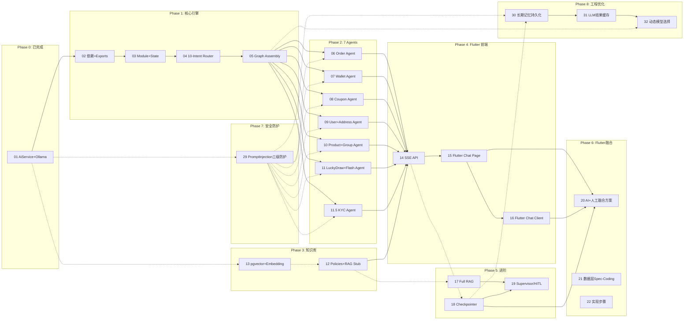

# JoyMini AI 客服助手 — Step-by-Step Spec-Code Guide

> 本目录包含 JoyMini AI 客服助手的完整开发文档，按照功能点拆分为多个 step-by-step 文档，每个文档涵盖：配置、引入、开发背景、Spec-Code 实现步骤。

---

## 文档地图

### Phase 0: 基础设施 Foundation（1 文档，已完成）

| # | 文档 | 状态 | 依赖 |
|---|------|------|------|
| 01 | [AiService + Ollama 集成](01-配置-AiService与Ollama集成.md) | ✅ 已完成 | - |

### Phase 1: 核心引擎 Core Engine（4 文档）

| # | 文档 | 前置依赖 | 涉及文件 |
|---|------|---------|---------|
| 02 | 安装 LangGraph 依赖 + 修复 Module Exports | 01 | `package.json`, `order.module.ts`, `coupon.module.ts`, `treasure.module.ts`, `kyc.module.ts` |
| 03 | 创建 AiCustomerModule + Graph State 定义 | 02 | `ai-customer.module.ts`, `graph/state.ts` |
| 04 | 10-Intent 路由节点（含 KYC） | 03 | `graph/nodes/intent-router.node.ts` |
| 05 | Answer Synthesizer + Graph 组装 | 04 | `graph/nodes/answer-synthesizer.node.ts`, `graph/customer.graph.ts`, `ai-customer.service.ts`, `ai-customer.controller.ts` |

### Phase 2: 7 个 ReAct Agent（7 文档）

| # | 文档 | Agent 工具 | 文件 |
|---|------|-----------|------|
| 06 | Order Agent + Tools | 3 tools: orderList, orderDetail, applyRefund | `graph/tools/order-tools.ts`, `graph/nodes/order-agent.node.ts` |
| 07 | Wallet Agent + Tools | 4 tools: balance, transactions, applyWithdraw, **kyc_status** | `graph/tools/wallet-tools.ts`, `graph/nodes/wallet-agent.node.ts` |
| 08 | Coupon Agent + Tools | 3 tools: myCoupons, claimableCoupons, claimCoupon | `graph/tools/coupon-tools.ts`, `graph/nodes/coupon-agent.node.ts` |
| 09 | User+Address Agent + Tools | 3 tools: userProfile, addressList, addressDetail | `graph/tools/user-tools.ts`, `graph/nodes/user-agent.node.ts` |
| 10 | Product+Group Agent + Tools | 4 tools: treasureList, treasureDetail, groupList, groupDetail | `graph/tools/product-tools.ts`, `graph/nodes/product-agent.node.ts` |
| 11 | LuckyDraw+Flash Agent + Tools | 5 tools: myTickets, myResults, draw, flashSessions, flashProducts | `graph/tools/lucky-tools.ts`, `graph/nodes/lucky-agent.node.ts` |
| 11.5 | [KYC Agent + Tools](11.5-KYC-Agent与Tools.md) | 3 tools: kycStatus, kycIdTypes, kycCreateSession | `graph/tools/kyc-tools.ts`, `graph/nodes/kyc-agent.node.ts` |

### Phase 3: 知识库 Knowledge Base（2 文档）

| # | 文档 | 说明 | 文件 |
|---|------|------|------|
| 12 | 政策知识文档 + RAG Stub 节点 | 8 个政策规则文档 + 基础 RAG 节点 | `knowledge/*.md`, `graph/nodes/rag.node.ts` |
| 13 | Prisma Knowledge 模型 + pgvector 设置 | 向量存储 + 嵌入 | Prisma schema, `prisma/migrations` |

### Phase 4: 前端聊天 UI（3 文档 — Flutter 版）

| # | 文档 | 涉及 Flutter 文件 |
|---|------|-------------------|
| 14 | [AI Chat API + Controller + SSE](14-AIChatAPI与ControllerSSE.md) | 后端 API（NestJS） |
| 15 | [Flutter AI Chat 页面集成](15-Flutter-AI-Chat页面集成.md) | `ChatPage`, `CustomerServiceHelper`, `ChatViewModel`, `ChatUiModel` |
| 16 | [Flutter AI Chat Client + Socket 集成](16-Flutter-AI-ChatClient与Socket集成.md) | `SocketChatMixin`, `ChatRoomController`, `AiBubble`, `ModernChatInputBar` |

### Phase 5: 进阶能力 Advanced（3 文档）

| # | 文档 | 说明 |
|---|------|------|
| 17 | Full RAG Node（向量搜索替代 Stub） | 替换 Phase 3 的 Stub 节点 |
| 18 | PostgreSQL Checkpointer（持久化记忆） | 跨会话对话历史 |
| 19 | Multi-Agent Supervisor / HITL | 高阶多 Agent 编排 |

### Phase 6: Flutter AI + 人工融合（3 文档）

| # | 文档 | 说明 |
|---|------|------|
| 20 | [Flutter AI + 人工客服融合方案](20-Flutter-AI-人工融合方案.md) | 整体架构设计、AI Agent 转人工判断、Socket 双通道 |
| 21 | [数据层 Spec-Coding 深度分析](21-数据层融合方案-SpecCoding分析.md) | 同表融合验证、Prisma/ChatUiModel/Sembast 逐字段兼容性分析 |
| 22 | [数据层融合实现步骤](22-数据层融合实现步骤.md) | 8 步实施指南：MessageType 枚举 → AiBubble → 双通道 Socket → Server 端持久化 |

### Phase 7: 安全防护 Security & Safety（1 文档）

| # | 文档 | 说明 | 涉及文件 |
|---|------|------|---------|
| 29 | [Prompt Injection 三级纵深防护](29-实现-PromptInjection三级防护.md) | 输入过滤层 → Prompt 护栏层 → 输出校验层，5 类攻击模式检测 + 风险评分 | `PromptInjectionGuard`, `AiService`, `AiGuardsModule` |

### Phase 8: 工程优化 Engineering Optimization（3 文档，已完成）

| # | 文档 | 核心能力 | 面试亮点 |
|---|------|---------|---------|
| 30 | [AiConversation 长期记忆持久化](30-实现-AiConversation长期记忆持久化.md) | Prisma AiConversation+AiMessage 模型 + Redis 热缓存 + Token 裁剪 | "LangGraph checkpointer 存状态，我们存文本，互补方案" |
| 31 | [LLM 结果缓存](31-实现-LLM结果缓存.md) | 场景化 TTL + Cache-Aside + 管理后台清除 | "三级缓存降本，省 40-60% API 费用" |
| 32 | [动态模型选择路由](32-实现-动态模型选择路由.md) | 三级分类 + auto/strict 模式 | "策略模式多 Provider，Groq 免费处理简单查询" |

### Phase 9: 企业级架构 Enterprise Architecture（2 文档 — 路线图 + 问题排查）

| # | 文档 | 说明 | 优先级 |
|---|------|------|--------|
| 42 | [企业级架构规划与路线图](42-Enterprise-Architecture-Roadmap.md) | Phase 1→3 完整路线图：RAG → 监控 → 人工兜底 → K8s → GPU 集群 | 📌 进行中 |

---

## 架构总览

## 当前进度

| 阶段 | 总计 | 已完成 | 待编写 |
|------|------|--------|--------|
| Phase 0 基础设施 | 1 | 1 | 0 |
| Phase 1 核心引擎 | 4 | 4 | 0 |
| Phase 2 ReAct Agents | 7 | 7 | 0 |
| Phase 3 知识库 | 2 | 2 | 0 |
| Phase 4 前端 UI（Flutter） | 3 | 3 | 0 |
| Phase 5 进阶能力 | 3 | 3 | 0 |
| Phase 6 Flutter AI+人工 | 3 | 3 | 0 |
| Phase 7 安全防护 | 1 | 1 | 0 |
| Phase 8 工程优化 | 3 | 3 | 0 |
| **合计** | **27** | **27** | **0** |

> **全部 27 份文档已完成！** 可以进入实施阶段。
