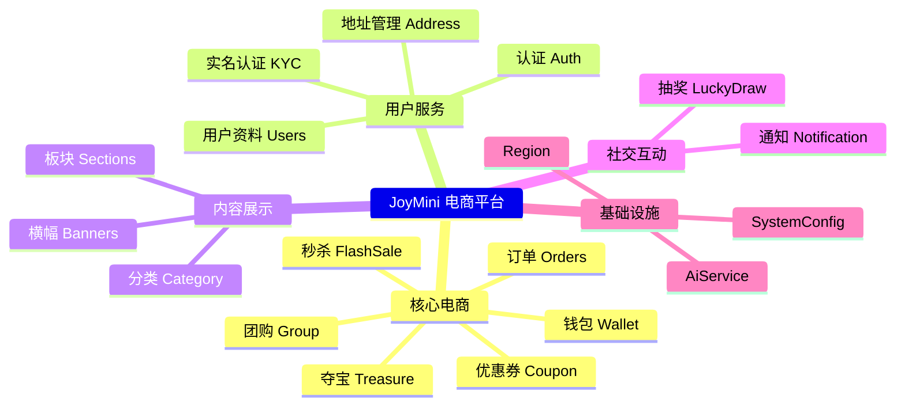
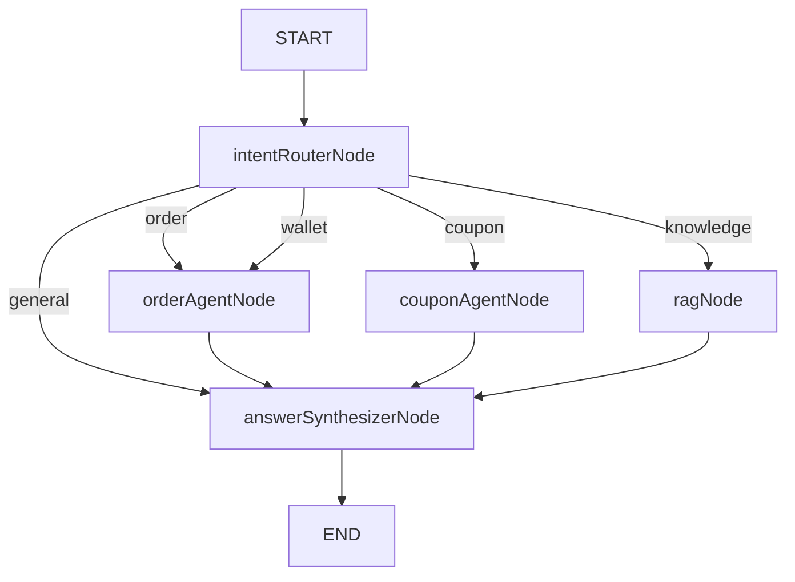
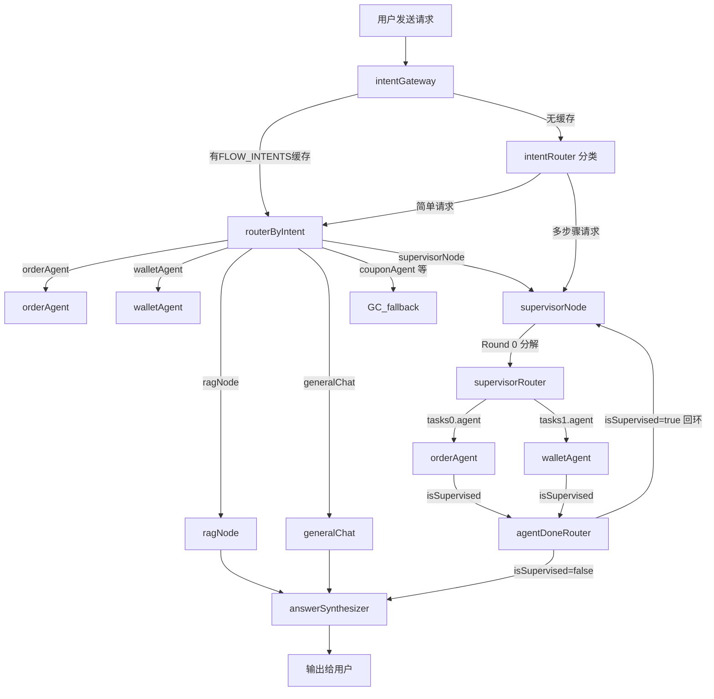
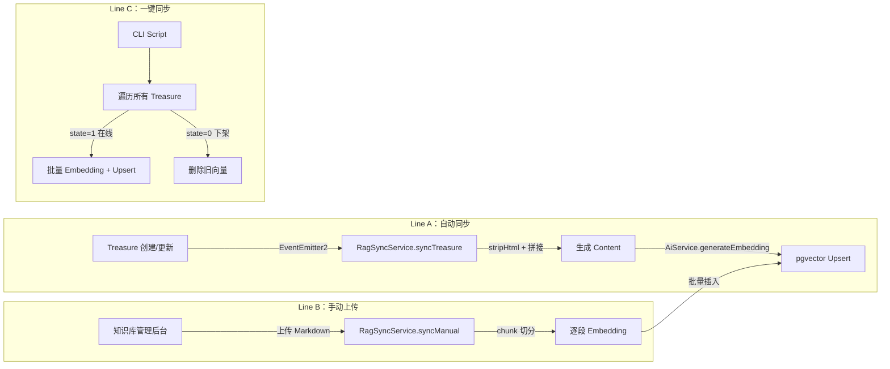
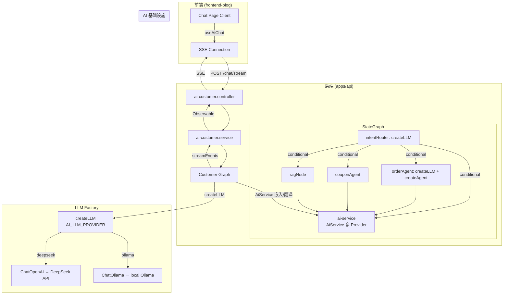
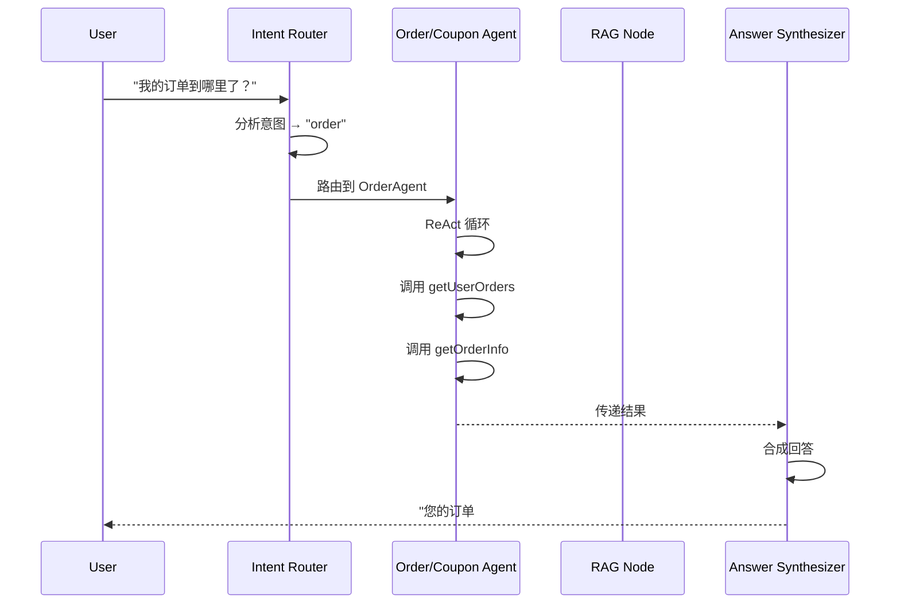

# AI 客服助手 — 统一规格文档 (Spec-Code SDD)

> **合并来源**：此文档合并了原 12+ 份文档，包括 `ai-customer-service-sdd.md`、`ai-customer-development-checklist.md`、`joymini-ai-feature-terminology-map.md`、`ai-capabilities-master-table.md`、`ai-business-capability-analysis.md`、`full-project-spec-analysis.md`、`joymini-business-full-analysis.md`、`phase1-implementation-plan.md`、`phase1-structured-breakdown.md`、`study-projects-spec-analysis.md`、`learning-roadmap-coverage.md`、`ai-capabilities-analysis.md`、`plans/ai-customer-service-sdd.md`
>
> **版本**：v2.0（合并版）
> **最后更新**：2026-06-24
> **对应代码**：[`apps/api/src/client/ai-customer/`](apps/api/src/client/ai-customer/)

---

## 目录

1. [概述](#一概述)
2. [目标](#二目标)
3. [功能需求](#三功能需求)
4. [非功能需求](#四非功能需求)
5. [接口定义](#五接口定义)
6. [数据模型](#六数据模型)
7. [业务流程](#七业务流程)
8. [验收标准](#八验收标准)
9. [附录](#九附录)

---

## 一、概述

JoyMini 是一个菲律宾电商平台（社交电商/Social Commerce），技术栈为 NestJS + Prisma + PostgreSQL（后端）、Next.js（前端）、多 Provider AI 基础设施（[`AiService`](apps/api/src/common/ai/ai.service.ts)）。

本项目构建 **AI 客服助手**，基于 LangGraph StateGraph + ReAct Agent 模式，实现意图路由 + 多 Agent 协作 + RAG 知识库 + SSE 流式响应的完整 LLM 应用。采用 **Spec-Coding 自驱开发** 方式——开发者阅读 spec + 代码提示自行实现，AI 辅助不替代。

### 1.1 技术栈

| 层级 | 技术 | 说明 |
|------|------|------|
| 后端 API | NestJS + Prisma + PostgreSQL | 统一后端，分 Client 和 Admin 两组模块 |
| 客户端前端 | Next.js `frontend-blog` | 面向终端消费者 |
| 管理后台 | Next.js `admin-next` | 面向运营管理员 |
| AI 基础设施 | [`AiService`](apps/api/src/common/ai/ai.service.ts) | 多 Provider 自动降级、熔断、限流、Embedding |
| Agent 框架 | `@langchain/langgraph` + `@langchain/core` + `langchain` | StateGraph + `createAgent`（替代已弃用的 `createReactAgent`） |
| LLM Factory | [`graph/llm-factory.ts`](apps/api/src/client/ai-customer/graph/llm-factory.ts) | 统一 `createLLM()`，通过 `AI_LLM_PROVIDER` 在 Ollama/DeepSeek 间切换 |
| 向量数据库 | pgvector (`vector(1536)`) | 知识库语义检索 |
| 消息持久化 | Prisma + PostgreSQL | 跨会话历史记录 |
| 共享包 | [`packages/shared`](packages/shared) | 枚举、类型、工具函数 |
| UI 组件 | [`packages/ui`](packages/ui) | shadcn/ui 组件库 |

### 1.2 设计原则

1. **工具即安全边界**：AI 只能通过 Tool 访问数据，Tool 内部通过 `request.user.id` 限制数据范围（只能查自己的）
2. **流式响应优先**：所有 AI 交互默认 SSE 流式，用户无需等待完整响应
3. **渐进式增强**：Phase 1 用 Stub 替代 RAG 向量检索，Phase 3 接入 pgvector
4. **Proactive 反模式避免**：AI 不主动推送、不代客下单、不修改密码——只在用户明确提问后执行查询类操作

### 1.3 JoyMini 业务全景



---

## 二、目标

### 本期实现（Phase 0-4）

| Phase | 范围 | 核心交付 |
|-------|------|---------|
| **P0** | 基础设施 | LangGraph 依赖安装 + Module Exports 修复（DI 打通） |
| **P1** | 核心 Agent 引擎 | Module → State → 8 Tools → 5 Nodes → Graph → Service → Controller → 注册 |
| **P2** | 前端聊天 UI | Server/Client 组件 + SSE Hook + API Client |
| **P3** | RAG + 持久化 | Prisma 迁移 + pgvector + 完整 RAG + PostgreSQL Checkpointer |
| **P4** | 高阶能力 | Multi-Agent Supervisor + HITL + 用户画像 + 可视化 + MCP |

### 本期不做

- ❌ AI 代客下单/退款（高危支付操作）
- ❌ AI 主动推送消息（Proactive 反模式）
- ❌ AI 修改密码/交易密码（安全敏感）
- ❌ AI 处理 KYC 审核结果（合规要求）
- ❌ MCP Server（Phase 4 远期规划）
- ❌ 语音多模态（超出 MVP 范围）

---

## 三、功能需求

> **阅读指引**：每个 Feature 包含 5 个维度——功能描述 / 专业术语 / 自试点 / 参考文件 / 代码提示

---

### Phase 0：基础设施（2 Features）

#### P0-01 安装 LangGraph 依赖

| 维度 | 内容 |
|------|------|
| **描述** | 在 [`apps/api/package.json`](apps/api/package.json) 添加 `@langchain/core` 和 `@langchain/langgraph` 依赖，然后从 monorepo 根目录执行 `yarn install` |
| **术语** | `LangGraph StateGraph`、`LangChain Core`、`Monorepo Workspace` |
| **自试点** | `yarn workspace @j/api add @langchain/core@^0.3.0 @langchain/langgraph@^0.2.0` 是否正确？`zod` 是否已存在于依赖中？ |
| **参考** | [`study/LLM/project/jisu-ai-customer/server/package.json`](study/LLM/project/jisu-ai-customer/server/package.json) → `@langchain/langgraph@^0.2.54`, `@langchain/core@^0.3.42` |
| **代码提示** | `zod` 已存在于 [`apps/api/package.json:95`](apps/api/package.json:95) — 无需重复添加。添加后执行 `yarn install`（在 monorepo 根目录）。确认 `node_modules` 中有 `@langchain/core`、`@langchain/langgraph`、`@langchain/langgraph-sdk` |
| **进度** | [ ] TODO |

#### P0-02 修复 Module Exports（DI 关键）

| 维度 | 内容 |
|------|------|
| **描述** | 修正 3 个 Module 的 exports 配置，使服务可被其他 Module 注入 |
| **术语** | `NestJS Module exports`、`Dependency Injection`、`Circular Dependency`、`forwardRef` |
| **自试点** | 为什么 WalletModule 不需要改？Module A 要使用 Module B 的 Service，需要几个条件？（答：Module B exports Service，Module A imports Module B） |
| **参考** | [`order.module.ts:14`](apps/api/src/client/orders/order.module.ts:14) → `exports: []`，改为 `exports: [OrderService]`；[`coupon.module.ts:10`](apps/api/src/client/coupon/coupon.module.ts:10) → `exports: []`，改为 `exports: [ClientCouponService]` |
| **代码提示** | 需要修改 3 个文件：① [`order.module.ts`](apps/api/src/client/orders/order.module.ts) 加 `exports: [OrderService]` ② [`coupon.module.ts`](apps/api/src/client/coupon/coupon.module.ts) 加 `exports: [ClientCouponService]` ③ [`treasure.module.ts`](apps/api/src/client/treasure/treasure.module.ts) 加 `exports: [TreasureService]`。WalletModule 已含 `exports: [WalletService, ClientWalletService]`，无需改动 |
| **进度** | [ ] TODO |

---

### Phase 1：核心 Agent 引擎（14 Features）

#### F-01 创建 `ai-customer.module.ts`

| 维度 | 内容 |
|------|------|
| **描述** | 创建 NestJS Module，imports 5 个业务模块（Orders/Coupon/Wallet/Users/Treasure），providers 注入 Service + Graph，exports AiCustomerService |
| **术语** | `NestJS Module`、`Dynamic Module`、`Module.forRoot()`、`Global Module` |
| **自试点** | 如果 AiCustomerService 依赖 OrderService，module 层需要做什么？用 `forRoot()` 动态模块的场景是什么？ |
| **参考** | [`client.module.ts`](apps/api/src/client/client.module.ts)（参考现有 Module 风格） |
| **代码提示** | `@Module({ imports: [forwardRef(() => OrderModule), ...], providers: [AiCustomerService, CustomerGraph], exports: [AiCustomerService] })`。注意 `forwardRef` 处理可能的循环依赖 |
| **进度** | [ ] TODO |

```typescript
// ai-customer.module.ts 关键结构
@Module({
  imports: [
    forwardRef(() => OrdersModule),
    CouponModule,
    WalletModule,
    UsersModule,
    TreasureModule,
  ],
  providers: [AiCustomerService, CustomerGraph],
  exports: [AiCustomerService],
})
export class AiCustomerModule {}
```

#### F-02 创建 `graph/state.ts`

| 维度 | 内容 |
|------|------|
| **描述** | 定义 `AgentState` 接口，继承 LangGraph 的 `BaseMessage`，包含：messages（对话历史）、intent（意图）、toolsResult（工具调用结果）、sources（RAG 来源）、agentSteps（ReAct 中间步骤）、userId/sessionId |
| **术语** | `StateGraph State`、`Typed State`、`MessagesAnnotation`、`ReduceFunction`、`Annotation.Root` |
| **自试点** | State 的 `messages` 为什么要用 `Annotation.Root` 的 reducer？StateGraph 如何合并节点返回的 partial state？ |
| **参考** | [`study/LLM/jisugou-ai-agent/01-core-architecture.md:27`](study/LLM/jisugou-ai-agent/01-core-architecture.md:27)（State 定义模式） |
| **代码提示** | 使用 `Annotation.Root({ messages: Annotation<BaseMessage[]>({ reducer: (a, b) => a.concat(b), default: () => [] }) })` 模式。在 [`study/LLM/project/jisu-ai-customer/server/src/graphs/state.js`](study/LLM/project/jisu-ai-customer/server/src/graphs/state.js) 有 JS 版参考，注意 TS 版本需加类型参数 |
| **进度** | [ ] TODO |

#### F-03 创建 `graph/tools/order-tools.ts`（3 个工具）

| 维度 | 内容 |
|------|------|
| **描述** | 创建 3 个 Zod 定义的工具：`getUserOrdersTool`（获取用户订单列表）、`getOrderInfoTool`（查询单个订单详情）、`getLogisticsTool`（查询物流状态），包装 [`OrderService`](apps/api/src/client/orders/order.service.ts) |
| **术语** | `Function Calling`、`Tool Binding`、`Zod Schema`、`createReactAgent`、`tool()` |
| **自试点** | `tool()` 的动态 receiver 问题如何解决？为什么不能用 `OrderService` 实例方法直接传入？tool 的 `description` 为什么对 LLM 很重要？ |
| **参考** | [`jisu-ai-customer/order-tools.js:12`](study/LLM/project/jisu-ai-customer/server/src/tools/order-tools.js:12)（3 个工具模式）；[`order.service.ts:119`](apps/api/src/client/orders/order.service.ts)（`getOrdersByUserId`）、[`order.service.ts:82`](apps/api/src/client/orders/order.service.ts)（`findOrderDetails`） |
| **代码提示** | 关键模式（解决 DI + tool() 不兼容）：`export const createOrderTools = (orderService: OrderService) => { return [ tool(async (input) => { ... }, { name: 'getUserOrders', schema: GetUserOrdersSchema, description: '...' }) ] }`。注意：要用**工厂函数**，因为 `tool()` 需要纯函数，不能直接传 `this` 依赖的实例方法。所有工具内部通过 `userId` 过滤数据 |
| **进度** | [ ] TODO |

#### F-04 创建 `graph/tools/wallet-tools.ts`（2 个工具）

| 维度 | 内容 |
|------|------|
| **描述** | 创建 2 个工具：`getWalletBalanceTool`（查余额）、`getTransactionHistoryTool`（查交易流水），包装 [`WalletService`](apps/api/src/client/wallet/wallet.service.ts) |
| **术语** | `Read-Only Tool`、`Sensitive Data Handling` |
| **自试点** | 钱包余额属于敏感数据，tool 层面如何做权限控制？Read-Only 工具的安全性优势是什么？ |
| **参考** | [`wallet.service.ts:72`](apps/api/src/client/wallet/wallet.service.ts:72) → `getWalletBalance`、[`wallet.service.ts:57`](apps/api/src/client/wallet/wallet.service.ts:57) → `getTransactionHistory` |
| **代码提示** | 与 order-tools 相同工厂模式。注意 WalletService 可能需要 ClientWalletService，确认是哪个。Read-Only 工具不写数据库 |
| **进度** | [ ] TODO |

#### F-05 创建 `graph/tools/coupon-tools.ts`（3 个工具）

| 维度 | 内容 |
|------|------|
| **描述** | 创建 3 个工具：`getMyCouponsTool`（查我的优惠券）、`getClaimableCouponsTool`（可领取优惠券）、`claimCouponTool`（领取优惠券），包装 [`ClientCouponService`](apps/api/src/client/coupon/coupon.service.ts) |
| **术语** | `Write Operation Tool`、`Idempotency`、`Optimistic Locking` |
| **自试点** | `claimCouponTool` 是写操作，需要注意什么？重复领取优惠券如何防止？ |
| **参考** | [`coupon.service.ts`](apps/api/src/client/coupon/coupon.service.ts) → `getMyCoupons`、`getClaimableCoupons`、`claimCoupon`（确认方法名） |
| **代码提示** | 写操作工具需要在 description 中明确说明副作用（如"此操作将领取一张优惠券"）。LLM 需要在调用前向用户确认 |
| **进度** | [ ] TODO |

#### F-06 创建 `graph/nodes/intent-router.node.ts`

| 维度 | 内容 |
|------|------|
| **描述** | 意图路由节点：LLM 根据用户消息分类 5 种意图（order/wallet/coupon/knowledge/general），输出 JSON `{ intent: string, reasoning: string }`，`routeByIntent` 函数根据意图返回条件边 |
| **术语** | `Intent Classification`、`LLM-as-Classifier`、`Few-shot Prompting`、`Conditional Edge`、`Structured Output` |
| **自试点** | 为什么用 LLM 做分类而不是规则匹配？temperature=0 的作用是什么？Few-shot 示例对分类准确率的影响？ |
| **参考** | [`study/LLM/project/jisu-ai-customer/server/src/graphs/nodes/intent-router.js:6`](study/LLM/project/jisu-ai-customer/server/src/graphs/nodes/intent-router.js:6) → 核心 Prompt 结构；[`study/LLM/jisugou-ai-agent/01-core-architecture.md:43`](study/LLM/jisugou-ai-agent/01-core-architecture.md:43) → Conditional Edges 说明 |
| **代码提示** | 使用 `ChatPromptTemplate.fromMessages([['system', SYSTEM_PROMPT], ['human', '{input}']])`。SYSTEM_PROMPT 包含输出格式指令和 Few-shot。关键：`temperature=0` 减少幻觉。`routeByIntent` 返回 `'orderAgent' | 'couponAgent' | 'ragNode' | 'generalChat'` |

```typescript
// intent-router.node.ts 核心逻辑
const INTENT_SYSTEM_PROMPT = `你是一个意图分类器。根据用户的问题，判断属于以下哪种意图：
- order: 查询订单、物流、退货相关
- wallet: 查询余额、交易记录
- coupon: 查/领优惠券
- knowledge: 商品咨询、活动规则、平台政策
- general: 问候、闲聊、其他

必须返回 JSON 格式：{"intent": "...", "reasoning": "..."}`

export async function intentRouterNode(state: AgentState) {
  const response = await llm.invoke([
    { role: 'system', content: INTENT_SYSTEM_PROMPT },
    ...state.messages.slice(-1),
  ])
  const { intent } = JSON.parse(response.content as string)
  return { intent }
}

export function routeByIntent(state: AgentState): string {
  const intentMap: Record<string, string> = {
    order: 'orderAgent',
    wallet: 'orderAgent',     // wallet→orderAgent（因为 wallet 工具较少）
    coupon: 'couponAgent',
    knowledge: 'ragNode',
    general: 'answerSynthesizer',
  }
  return intentMap[state.intent] || 'answerSynthesizer'
}
```

#### F-07 创建 `graph/nodes/order-agent.node.ts`

| 维度 | 内容 |
|------|------|
| **描述** | ReAct Agent 节点：用 `createAgent`（from `langchain` 包）绑定 order-tools + wallet-tools，通过 `createLLM()` 获取 LLM 实例，执行工具调用循环，返回结果给 state |
| **术语** | `ReAct Pattern`、`createAgent`、`AgentExecutor`、`Tool Calling Loop`、`LLM Factory` |
| **自试点** | `createAgent`（`langchain` 包）和已弃用的 `createReactAgent`（`@langchain/langgraph/prebuilt`）参数有何不同？为什么用 `model` 替代 `llm`，用 `systemPrompt` 替代 `messageModifier`？ |
| **参考** | [`llm-factory.ts`](apps/api/src/client/ai-customer/graph/llm-factory.ts)（`createLLM` 工厂）；[`langchain` 包 `CreateAgentParams`](node_modules/langchain/dist/agents/types.d.ts:399)（新 API 类型定义） |
| **代码提示** | 使用 `import { createAgent } from 'langchain'`（注意：非 `@langchain/langgraph/prebuilt`）。关键参数变化：`model`（替代 `llm`）、`tools`、`systemPrompt`（替代 `messageModifier`/`prompt`）。通过 `createLLM({ temperature: 0 })` 获取 LLM 实例，而非直接 `new ChatOllama()` |

```typescript
// order-agent.node.ts 核心（当前实现）
import { createAgent } from 'langchain';
import { createLLM } from '@api/client/ai-customer/graph/llm-factory';

const createOrderAgentNode = (orderService: OrderService) => {
  const tools = createOrderTools(orderService);
  const llm = createLLM({ temperature: 0 });
  
  const agentApp = createAgent({
    model: llm,                              // 注意：新 API 用 model，非 llm
    tools,
    systemPrompt: '你是 JoyMini 的订单助手...',  // 新 API 用 systemPrompt
  });
  
  return async (state: AgentState) => {
    const result = await agentApp.invoke({ messages: state.messages });
    return { messages: result.messages };
  };
};
```

#### F-08 创建 `graph/nodes/coupon-agent.node.ts`

| 维度 | 内容 |
|------|------|
| **描述** | ReAct Agent 节点：绑定 coupon-tools，处理优惠券相关查询和领取操作 |
| **术语** | `Specialized Agent`、`Tool Isolation` |
| **自试点** | 为什么优惠券 Agent 不绑定订单工具？这是 Single-Agent 还是 Multi-Agent 模式？ |
| **参考** | 结构与 [`order-agent.node.ts`](#f-07-创建-graphnodesorder-agentnodets) 相同，tools 替换为 coupon-tools |
| **代码提示** | 与 F-07 相同模式，tools 替换为 couponTools。`messageModifier` 描述"优惠券助手"角色 |
| **进度** | [ ] TODO |

#### F-08.5 创建 `graph/tools/kyc-tools.ts`（3 个工具）

| 维度 | 内容 |
|------|------|
| **描述** | 3 个 KYC 实名认证工具的工厂函数：`kyc_status`、`kyc_id_types`、`kyc_create_session` |
| **术语** | `Tool Factory Pattern`、`KYC`、`Identity Verification`、`Liveness Detection` |
| **自试点** | 为什么 KYC 只有 3 个工具？为什么 `submitKyc` 和 `scanIdCard` 不能给 AI 用？ |
| **参考** | [`kyc.service.ts`](/apps/api/src/client/kyc/kyc.service.ts) 的 `getMyKyc`(186)、`getIdTypes`(208)、`createSession`(50) 方法；[`kyc.module.ts`](/apps/api/src/client/kyc/kyc.module.ts) 需要 exports 修复 |
| **代码提示** | 工厂函数 `createKycTools(kycService: KycService)` 返回 3 个 tool()。`kyc_status` 只读查状态；`kyc_id_types` 无参查证件类型；`kyc_create_session` 创建活体检测会话（状态创建，可撤销）。所有文件上传操作（scanIdCard、submitKyc）不在 AI 范围 |
| **进度** | [ ] TODO |

```typescript
// kyc-tools.ts 核心结构
export function createKycTools(kycService: KycService) {
  const kycStatusTool = tool(
    async ({ userId }) => {
      const result = await kycService.getMyKyc(userId);
      return JSON.stringify(result);
    },
    {
      name: 'kyc_status',
      description: '查询当前登录用户的实名认证KYC状态...',
      schema: z.object({ userId: z.string() }),
    },
  );
  // ... idTypesTool, createSessionTool 同理
  return [kycStatusTool, idTypesTool, createSessionTool];
}
```

#### F-08.6 创建 `graph/nodes/kyc-agent.node.ts`

| 维度 | 内容 |
|------|------|
| **描述** | ReAct Agent 节点：绑定 kyc-tools，处理 KYC 实名认证相关查询和引导 |
| **术语** | `Specialized Agent`、`Tool Isolation`、`Deep Link`、`App Routing` |
| **自试点** | KYC Agent 和 Wallet Agent 都有 `kyc_status` 工具，职责如何区分？为什么 KYC 提交流程必须在 App 内完成？ |
| **参考** | 结构与 [`order-agent.node.ts`](#f-07-创建-graphnodesorder-agentnodets) 相同，tools 替换为 kyc-tools。[`11.5-KYC-Agent与Tools.md`](11.5-KYC-Agent与Tools.md) 完整文档 |
| **代码提示** | 与 F-07 相同模式，tools 替换为 `createKycTools(kycService)`。`messageModifier` 描述"实名认证助手"角色，强调 KYC 提交流程需要在 App 内完成，AI 只提供状态查询和跳转按钮 |
| **进度** | [ ] TODO |

#### F-09 创建 `graph/nodes/rag.node.ts`（Phase 1 Stub → Phase 3 完整）

| 维度 | 内容 |
|------|------|
| **描述** | **Phase 1**：Stub 版本，模拟 RAG 检索返回固定响应。**Phase 3**：替换为真实 pgvector 向量检索 |
| **术语** | `RAG`、`Retrieval-Augmented Generation`、`Vector Similarity Search`、`pgvector`、`Embedding` |
| **自试点** | Stub 阶段的目的是什么？RAG 的检索和生成两个环节各自的关键技术点是什么？Chunk 大小对检索质量的影响？ |
| **参考** | [`study/LLM/project/jisu-ai-customer/server/src/graphs/nodes/rag-node.js:4`](study/LLM/project/jisu-ai-customer/server/src/graphs/nodes/rag-node.js:4) → 检索 + 生成完整流程 |
| **代码提示** | Phase 1：`return { messages: [new AIMessage('知识库暂未接入，请联系人工客服')], sources: [] }`。Phase 3：调用 `AiService.generateEmbedding(text)` → `prisma.$queryRaw\`SELECT * FROM knowledge_embeddings ORDER BY embedding <=> ${embedding}::vector LIMIT 5\`` → 拼接 context → LLM 生成回答 |

```typescript
// rag.node.ts Phase 1 Stub
export async function ragNode(state: AgentState) {
  return {
    messages: [new AIMessage('知识库暂未接入，请联系人工客服')],
    sources: [],
  }
}
```

#### F-10 创建 `graph/nodes/answer-synthesizer.node.ts`

| 维度 | 内容 |
|------|------|
| **描述** | 答案合成节点：收集前面节点的输出，用 Prompt 合成自然语言回答，支持 SSE 流式 |
| **术语** | `Answer Synthesis`、`Structured Output`、`Streaming`、`Output Formatting` |
| **自试点** | 为什么需要专门的答案合成节点，而不是直接在 Agent 节点输出？它和 Intent Router 的通用对话（general）有什么关系？ |
| **参考** | [`jisu-ai-customer/answer-synthesizer.js:6`](study/LLM/project/jisu-ai-customer/server/src/graphs/nodes/answer-synthesizer.js:6)（Prompt 模板 + 合成逻辑） |
| **代码提示** | 接收 `state.agentSteps` + `state.sources`，用 ChatPromptTemplate 合成回答。如果是 general 意图，直接用 LLM 对话 |

```typescript
// answer-synthesizer.node.ts
const SYNTHESIZER_PROMPT = `你是一个友好的客服助手。请根据以下信息回答用户问题：
历史对话：{chatHistory}
工具调用结果：{toolsResult}
知识库来源：{sources}

请用自然、友好的语气回答，如果信息不足，如实告知用户。`

export async function answerSynthesizerNode(state: AgentState) {
  if (state.intent === 'general') {
    const result = await llm.invoke(state.messages.slice(-3))
    return { messages: [result] }
  }
  const chain = SYNTHESIZER_PROMPT.pipe(llm)
  const result = await chain.invoke({
    chatHistory: formatMessages(state.messages),
    toolsResult: state.agentSteps?.join('\n'),
    sources: state.sources?.join('\n'),
  })
  return { messages: [result] }
}
```

#### F-11 创建 `graph/customer.graph.ts`

| 维度 | 内容 |
|------|------|
| **描述** | 构建 StateGraph：5 个节点 + 条件边。`intentRouterNode` → conditional edge → `orderAgentNode`/`couponAgentNode`/`ragNode`/直接到 `answerSynthesizerNode` → `answerSynthesizerNode` → END |
| **术语** | `StateGraph`、`Conditional Edge`、`Node`、`Edge`、`Compiled Graph`、`Graph Checkpointer` |
| **自试点** | `addConditionalEdges` 和 `addEdge` 的区别？编译图时 `compile({ checkpointer })` 的作用？为什么需要在 graph 中传入 tool/nodes 依赖而不是在 node 内部创建？ |
| **参考** | [`jisu-ai-customer/customer-graph.js:10`](study/LLM/project/jisu-ai-customer/server/src/graphs/customer-graph.js:10)（完整 Graph 构建）；[`study/LLM/jisugou-ai-agent/01-core-architecture.md:59`](study/LLM/jisugou-ai-agent/01-core-architecture.md:59)（Graph 构建说明） |
| **代码提示** | 核心模式（解决 DI 依赖问题）：`@Injectable() export class CustomerGraph { constructor(...) { this.graph = this.buildGraph() } private buildGraph() { ... } }` |



#### F-12 创建 `ai-customer.service.ts`

| 维度 | 内容 |
|------|------|
| **描述** | 核心 Service：封装 Graph 调用逻辑，提供 `chat(input, userId, sessionId)` 方法（非流式）和 `chatStream(input, userId, sessionId)` 方法（SSE 流式），管理 Checkpointer |
| **术语** | `Service Layer`、`Graph Invocation`、`Streaming`、`Checkpointer`、`Session Management`、`Thread ID` |
| **自试点** | SSE 流式如何将 Graph 的 stream event 转换为前端可消费的事件格式？Thread ID 的作用是什么（会话续接）？ |
| **参考** | [`jisu-ai-customer/agent.js:40`](study/LLM/project/jisu-ai-customer/server/src/routes/agent.js:40)（SSE 事件格式） |
| **代码提示** | 流式关键代码：`for await (const event of await graph.streamEvents(input, { version: 'v2', ... })) { ... }`。需要在 constructor 中注入 CustomerGraph 实例。![注意] `graph` 属性需要通过 `await graph.compile()` 获取 compiled graph |

```typescript
// ai-customer.service.ts 流式核心
async chatStream(input: string, userId: string, sessionId: string) {
  const graph = this.customerGraph.getCompiledGraph()
  const threadId = sessionId || crypto.randomUUID()
  
  return graph.streamEvents(
    { messages: [new HumanMessage(input)], userId },
    { version: 'v2', configurable: { thread_id: threadId } }
  )
}
```

#### F-13 创建 `ai-customer.controller.ts`

| 维度 | 内容 |
|------|------|
| **描述** | Controller：提供 2 个 SSE 端点（`POST /chat` 流式、`POST /chat/non-stream` 非流式），使用 `@Sse()` + `@Post()` 装饰器，从 JWT 获取 userId |
| **术语** | `SSE (Server-Sent Events)`、`@Sse()` decorator、`Observable`、`RxJS Subject`、`Event Types` |
| **自试点** | `@Sse()` 的返回类型为什么是 `Observable<MessageEvent>`？如何在前端处理 SSE 的断线重连？SSE 和 WebSocket 在此场景的优劣？ |
| **参考** | [`jisu-ai-customer/agent.js:40`](study/LLM/project/jisu-ai-customer/server/src/routes/agent.js:40)（7 种事件类型） |
| **代码提示** | SSE 端点模式（使用 RxJS Subject）：`@Sse() @Post('chat/stream') async chatStream(@Body() dto, @Req() req) { return new Observable(subscriber => { ... subscriber.next({ type: 'node', data: '...' }) ... subscriber.complete() }) }` |

**7 种 SSE 事件类型**：

| 事件 | 触发时机 | 数据内容 |
|------|---------|---------|
| `node` | 节点开始 | `{ node: string, timestamp: string }` |
| `step` | ReAct 每一步 | `{ step: number, action: string }` |
| `steps` | ReAct 结束 | `{ totalSteps: number, steps: [...] }` |
| `answer` | 答案生成（非流式） | `{ text: string, sources: [...] }` |
| `sources` | RAG 来源 | `{ sources: [{title, content}] }` |
| `done` | 全部完成 | `{ sessionId: string }` |
| `error` | 异常 | `{ code: string, message: string }` |

#### F-14 在 [`client.module.ts`](apps/api/src/client/client.module.ts) 中注册

| 维度 | 内容 |
|------|------|
| **描述** | 在 [`client.module.ts`](apps/api/src/client/client.module.ts) 的 `imports` 数组中添加 `AiCustomerModule` |
| **术语** | `Module Registration`、`Root Module`、`Feature Module` |
| **自试点** | 如果 AiCustomerModule 有前置依赖（如 OrderModule），注册顺序是否重要？Module 的 `forRoot()` 和直接 imports 的区别？ |
| **参考** | [`client.module.ts:25`](apps/api/src/client/client.module.ts:25) → `imports: [...]` |
| **代码提示** | 在 `imports` 数组末尾添加 `AiCustomerModule`。如果 AiCustomerModule 用了 `forwardRef`，这里不需要额外处理 |

---

### Phase 2：前端聊天 UI（4 Features）

#### F-15 创建 `app/[locale]/ai-chat/page.tsx`

| 维度 | 内容 |
|------|------|
| **描述** | Server Component：页面容器，从路由参数获取 `locale`，渲染 PageClient 组件 |
| **术语** | `Next.js Server Component`、`i18n Route Param`、`RSC (React Server Components)` |
| **自试点** | 为什么聊天页面用 Server Component 包裹 Client Component？Server Component 中如何获取 locale 参数？ |
| **参考** | 参考现有 pages 的 i18n 模式（如 `app/[locale]/.../page.tsx`） |
| **代码提示** | 标准模式：`export default async function AiChatPage({ params: { locale } }: { params: { locale: string } }) { return <AiChatPageClient locale={locale} /> }` |
| **进度** | [ ] TODO |

#### F-16 创建 `app/[locale]/ai-chat/page.client.tsx`

| 维度 | 内容 |
|------|------|
| **描述** | Client Component：完整的聊天 UI，包含消息列表、输入框、发送按钮、Streaming 文本展示、Typing Indicator |
| **术语** | `Client Component`、`Streaming Text Rendering`、`Typing Indicator`、`Virtual Scrolling` |
| **自试点** | Streaming 文本渲染如何实现逐字效果？大量聊天消息时如何做性能优化？（虚拟列表） |
| **参考** | 参考 `@repo/ui` 组件（Button、Input、Card） |
| **代码提示** | 核心状态：`const [messages, setMessages] = useState<Message[]>([])` + `const [isStreaming, setIsStreaming] = useState(false)`。使用 `useAiChat` hook 管理 SSE 连接 |

#### F-17 创建 `lib/hooks/useAiChat.ts`

| 维度 | 内容 |
|------|------|
| **描述** | 自定义 Hook：封装 SSE 连接逻辑，暴露 `sendMessage(text)`、`messages`、`isStreaming`、`error` |
| **术语** | `Custom Hook`、`SSE Client`、`EventSource`、`fetch + ReadableStream`、`AbortController` |
| **自试点** | 为什么用 `fetch + ReadableStream` 而不是原生 `EventSource`？`EventSource` 的限制是什么（只能 GET，不能带自定义 Header）？`AbortController` 在 SSE 中的作用？ |
| **参考** | 参考 `useIsClient` hook 的 i18n 模式 |
| **代码提示** | 关键点：使用 `fetch` + `response.body.getReader()` 读取流，而不是 `EventSource`（因为需要 POST + JWT token）。`useIsClient()` 用于避免 SSR 时报错 |

```typescript
// useAiChat.ts 核心
export function useAiChat(locale: string) {
  const [messages, setMessages] = useState<Message[]>([])
  const [isStreaming, setIsStreaming] = useState(false)
  
  const sendMessage = useCallback(async (text: string) => {
    setIsStreaming(true)
    const response = await fetch(`/api/${locale}/ai-customer/chat/stream`, {
      method: 'POST',
      headers: { 'Content-Type': 'application/json', 'Authorization': `Bearer ${token}` },
      body: JSON.stringify({ message: text, sessionId }),
    })
    const reader = response.body!.getReader()
    // 读取 stream 并逐步更新 messages
  }, [locale])
  
  return { messages, isStreaming, sendMessage }
}
```

#### F-18 创建 `lib/api/aiChatApi.ts`

| 维度 | 内容 |
|------|------|
| **描述** | API 客户端：封装非流式 POST 调用 + 流式 SSE 调用，统一错误处理 |
| **术语** | `API Client`、`Error Boundary`、`Type-safe API` |
| **自试点** | API Client 层的错误处理如何与 UI 层的 Error Boundary 配合？ |
| **参考** | 参考现有 API 调用模式 |
| **代码提示** | 统一错误处理：`if (!response.ok) throw new AiChatError(await response.json())` |

---

### Phase 3：RAG + 持久化（4 Features）

#### F-19 Prisma 迁移：KnowledgeDocument + KnowledgeEmbedding

| 维度 | 内容 |
|------|------|
| **描述** | 在 [`schema.prisma`](apps/api/prisma/schema.prisma) 添加 `KnowledgeDocument` 和 `KnowledgeEmbedding` 模型，执行 Prisma 迁移 |
| **术语** | `Prisma Schema`、`Database Migration`、`Unsupported Type`、`@db.VarChar`、`@map` |
| **自试点** | `@db.VarChar(32)` 为什么用 32？`Unsupported("vector(1536)")` 在 Prisma 中的限制？如何通过 `$queryRaw` 操作 unSupported 字段？ |
| **代码提示** | 见下方数据模型章节。注意：`embedding` 字段需使用 `Unsupported("vector(1536)")`，查询时用 `$queryRaw` |
| **进度** | [ ] TODO |

#### F-20 pgvector 设置 + 数据导入脚本

| 维度 | 内容 |
|------|------|
| **描述** | 在 PostgreSQL 启用 pgvector 扩展，创建向量索引（IVF），编写种子脚本导入初始知识库数据 |
| **术语** | `pgvector`、`IVF Index`、`Cosine Similarity`、`<->` (L2)、`<=>` (Cosine)、`Seed Script` |
| **自试点** | Cosine Similarity 和 L2 Distance 的适用场景区别？IVF 索引的 `lists` 参数如何选择？ |
| **代码提示** | `CREATE INDEX ON knowledge_embeddings USING ivf (embedding vector_cosine_ops) WITH (lists = 100)`。种子脚本遍历 Markdown 知识文件，调用 `AiService.generateEmbedding()` 后插入 |

```sql
-- pgvector 初始化 SQL
CREATE EXTENSION IF NOT EXISTS vector;
CREATE INDEX idx_knowledge_embeddings_vector ON knowledge_embeddings 
USING ivf (embedding vector_cosine_ops) WITH (lists = 100);
```

#### F-21 完整 `rag.node.ts`（替换 Phase 1 Stub）

| 维度 | 内容 |
|------|------|
| **描述** | 替换 F-09 的 Stub：执行真实 pgvector 相似度检索 → 格式化搜索结果 → LLM 生成回答 |
| **术语** | `End-to-End RAG`、`Query Embedding`、`Similarity Search`、`Context Injection`、`Source Attribution` |
| **自试点** | 检索到的文档片段如何构造 LLM 的 context？如何让 LLM 标注信息来源（Source Attribution）？Top-K 的 K 值选择策略？ |
| **代码提示** | 见 F-09 的 Phase 3 代码提示 |

```typescript
// rag.node.ts Phase 3 完整版
export async function ragNode(state: AgentState) {
  const query = state.messages[state.messages.length - 1].content as string
  const embedding = await aiService.generateEmbedding(query)
  if (!embedding) return fallbackResponse()
  
  const results = await prisma.$queryRaw<EmbeddingResult[]>`
    SELECT kd.content, kd.title, ke.embedding <=> ${embedding}::vector AS distance
    FROM knowledge_embeddings ke
    JOIN knowledge_documents kd ON ke.document_id = kd.id
    ORDER BY distance ASC LIMIT 5
  `
  
  const context = results.map(r => `[${r.title}] ${r.content}`).join('\n\n')
  const response = await llm.invoke([
    { role: 'system', content: `基于以下信息回答：\n${context}` },
    ...state.messages.slice(-1),
  ])
  
  return { messages: [response], sources: results.map(r => r.title) }
}
```

#### F-22 PostgreSQL Checkpointer（持久化记忆）

| 维度 | 内容 |
|------|------|
| **描述** | 使用 LangGraph 的 `PostgresSaver` 作为 Checkpointer，实现跨会话记忆持久化 |
| **术语** | `Checkpointer`、`PostgresSaver`、`Memory Persistence`、`Thread ID`、`Conversation History` |
| **自试点** | Checkpointer 和简单的数据库保存有什么区别？Thread ID 如何对应到业务上的会话？`PostgresSaver` 需要额外建表吗？ |
| **参考** | LangGraph 官方文档：`PostgresSaver` |
| **代码提示** | `import { PostgresSaver } from '@langchain/langgraph-checkpoint-postgres'` → `const checkpointer = new PostgresSaver(connectionPool)` → `graph.compile({ checkpointer })`。需确保 `@langchain/langgraph-checkpoint-postgres` 已安装 |

---

### Phase 4：高阶能力（5 Features）

#### F-23 Multi-Agent Supervisor Pattern ✅ 已实现 2026-06-30 ⚠️ 方案 B 待重构

> **2026-06-30 方案 B 决策：** 由于 Bug 5（Supervisor LLM 幻觉），将采用**单轮单 Agent（方案 B）**替代 Supervisor LLM 分解。
> - `supervisorNode` 将去掉 LLM 分解代码（`SUPERVISOR_PROMPT`、`createLLM`、`StringOutputParser`），降级为纯 round 计数器
> - `intentRouter` 不再输出 `supervised` 意图；prompt 增加多领域检测规则，多领域只输出主意图
> - 多余领域在后续对话轮次中处理（GATEWAY 跳过路由器）
> - 详见 [`33-工作流型智能体16挑战对标.md`](33-工作流型智能体16挑战对标.md)

| 维度 | 内容 |
|------|------|
| **描述** | 基于 LangGraph StateGraph 的 **指针式 Supervisor 模式**。核心思路：`intentGateway` 分流（`FLOW_INTENTS` 缓存优化）→ `IntentRouter` 分类单/多步骤 → `supervisorNode` 分解任务 → `supervisorRouter` 指针式逐个派发 → `agentDoneRouter` 回环 Supervisor → `answerSynthesizer` 汇总。**删除旧 reroute 机制**，使用 `isSupervised` + `tasks` + `supervisorRound` 三个状态字段实现有状态循环。 |
| **术语** | `Supervisor Pattern`、`Pointer-based Routing`、`FLOW_INTENTS`（4 项缓存）、`VALID_INTENTS`（10 项分类）、`Two-phase Supervisor`、`agentDoneRouter`、`taskResults merge reducer`、`Zero Overhead Principle` |
| **自试点** | Supervisor 通过指针（`supervisorRound-1`）而不是 `remaining.filter()` 路由的原因？为什么每个 Agent 需要独立的 `agentDoneRouter` 条件边？`taskResults` 使用 merge reducer 解决了什么覆盖问题？FLOW_INTENTS 缓存优化为什么只缓存 4 个意图？ |
| **参考** | 完整架构总结：[`docs/AI-joymini/24-Supervisor架构完整总结.md`](docs/AI-joymini/24-Supervisor架构完整总结.md)；旧文档：[`docs/AI-joymini/19-MultiAgentSupervisor与HITL.md`](docs/AI-joymini/19-MultiAgentSupervisor与HITL.md)（OUTDATED）；[`docs/AI-joymini/23-AgentReroute架构.md`](docs/AI-joymini/23-AgentReroute架构.md)（DEPRECATED） |
| **代码提示** | 见下方关键代码片段 |
| **进度** | [x] 已实现 |

**关键架构图：**



**涉及文件（4 个）：**

| 文件 | 操作 | 说明 |
|------|------|------|
| [`state.ts`](apps/api/src/client/ai-customer/graph/state.ts) | 修改 | 新增 `isSupervised`、`tasks`、`taskResults`、`supervisorRound` 字段 |
| [`intent-router.node.ts`](apps/api/src/client/ai-customer/graph/nodes/intent-router.node.ts) | 修改 | VALID_INTENTS 10 项 + "supervised" 意图，routerByIntent 设置 `isSupervised: true` |
| [`supervisor.node.ts`](apps/api/src/client/ai-customer/graph/nodes/supervisor.node.ts) | **新建** | 两阶段 Supervisor：Round 0 用 `StringOutputParser` 解析 LLM JSON，Round > 0 仅递增计数器 |
| [`customer.graph.ts`](apps/api/src/client/ai-customer/graph/customer.graph.ts) | 修改 | 新增 `intentGateway`、`agentDoneRouter`、`supervisorRouter`，注册 supervisorNode |

**核心概念详解：**

1. **FLOW_INTENTS 缓存优化** — 仅缓存 4 个意图：`['order', 'wallet', 'rag', 'supervised']`。多轮对话中，`intentGateway` 在 `START` 后直接跳转到 `routerByIntent`，跳过 LLM 分类步骤（O(1) 开销）。非 FLOW_INTENTS 的意图（如 `coupon`）每次仍走 `intentRouter` 完整分类。

2. **两阶段 Supervisor 节点** — `createSupervisorNode` 分两阶段执行：
   - **Round 0**：调用 LLM（`StringOutputParser` + 手动 JSON 解析），将用户请求分解为 `tasks` 数组
   - **Round > 0**：仅递增 `supervisorRound` 计数器（O(1)，无 LLM 调用），`supervisorRouter` 用 `round-1` 作为指针取下一个任务

3. **指针式路由** — `supervisorRouter` 用 `state.tasks[round - 1].agent` 直接定位下一个 Agent，比 `remaining.filter()` 更高效、更可预测。

4. **agentDoneRouter 回环** — 每个使用 supervisor 的 Agent（orderAgent、walletAgent）通过条件边检查 `state.isSupervised`，为 true 则返回 `supervisorNode`，形成闭环。ragNode 和 generalChat 尚未统一为 agentDoneRouter。

5. **taskResults merge reducer** — 使用 `{...a, ...b}` 合并策略，确保多个 Agent 的输出不会互相覆盖。

6. **状态重置** — `answerSynthesizer` 在最终合成前重置 `isSupervised=false`、`tasks=[]`、`supervisorRound=0`，防止状态残留影响下一轮对话。

**Step 1 — state.ts：新增 4 个字段**

```typescript
// Supervisor 标记：当前请求需要多 Agent 协作
isSupervised: Annotation<boolean>({
  reducer: (a: boolean, b: boolean) => b,
  default: () => false,
}),
// Supervisor 分配的任务列表（LLM 分解输出）
tasks: Annotation<Array<{ agent: string; description: string }>>({
  reducer: (a, b) => b,
  default: () => [],
}),
// 子 Agent 执行结果汇总（merge reducer 防止覆盖）
taskResults: Annotation<Record<string, any>>({
  reducer: (a, b) => ({ ...a, ...b }),
  default: () => ({}),
}),
// 轮次计数器（指针式路由索引 = round - 1）
supervisorRound: Annotation<number>({
  reducer: (a: number, b: number) => b,
  default: () => 0,
}),
```

**Step 2 — intent-router.node.ts：新增 "supervised" 意图**

```typescript
const VALID_INTENTS = [
  'order', 'wallet', 'coupon', 'user', 'product',
  'lucky-draw', 'rag', 'general', 'supervised', 'unknown',
] as const;
```

PROMPT 加入 supervised 描述：
> `supervised` — 用户请求涉及多个独立操作（如"查余额+领优惠券"），需要多个 Agent 协作完成。请输出 supervised。

`routerByIntent` 中 `isSupervised: true` 标记状态：
```typescript
const routeMap: Record<string, string> = {
  order: 'orderAgent',
  wallet: 'walletAgent',
  coupon: 'couponAgent',    // → fallback generalChat（待实现）
  rag: 'ragNode',
  general: 'generalChat',
  supervised: 'supervisorNode',
  // 未实现的 agent 映射到 generalChat
};

const routerByIntent = (state: typeof AgentState.State): string => {
  const intent = state.intent;
  if (intent === 'supervised') {
    return 'supervisorNode';
  }
  // 返回 mapping 中的节点名，不存在则 fallback generalChat
  return routeMap[intent] ?? 'generalChat';
};
```

**Step 3 — supervisor.node.ts：新建 Supervisor 节点（两阶段设计）**

```typescript
const SUPERVISOR_PROMPT = ChatPromptTemplate.fromMessages([
  ['system', `You are a customer service Supervisor. Analyze user request,
decompose into independent tasks.

Available agents:
- orderAgent: Order queries
- walletAgent: Wallet/balance/withdraw/recharge
- ragNode: Policy/rules questions
- generalChat: Casual chat, greetings
- couponAgent: Coupon queries

Output ONLY a valid JSON object with a "tasks" array.
Each task has "agent" and "description" fields.`],
  ['placeholder', '{messages}'],
]);

export const createSupervisorNode =
  (llmConfig: LlmProviderConfig) =>
  async (state: typeof AgentState.State): Promise<Partial<typeof AgentState.State>> => {
    const currentRound = state.supervisorRound ?? 0;

    // Round > 0: task already dispatched, just increment round counter
    if (currentRound > 0) {
      return { supervisorRound: currentRound + 1 };
    }

    // Round 0: decompose request into tasks using LLM
    const llm = createLLM(llmConfig, { temperature: 0 });
    const chain = SUPERVISOR_PROMPT.pipe(llm).pipe(new StringOutputParser());
    const raw = await chain.invoke({ messages: state.messages });

    // Parse JSON from LLM output
    let tasks = [];
    try {
      const cleaned = raw.replace(/```json\s*/g, '').replace(/```\s*/g, '').trim();
      const parsed = JSON.parse(cleaned);
      tasks = parsed.tasks || [];
    } catch (e) {
      tasks = [];
    }

    return {
      tasks,
      supervisorRound: (state.supervisorRound ?? 0) + 1,
    };
  };
```

**Step 4 — customer.graph.ts：3 个路由函数 + 图组装**

```typescript
// FLOW_INTENTS — 仅缓存 4 个意图用于多轮跳过
const FLOW_INTENTS: Intent[] = ['order', 'wallet', 'rag', 'supervised'];

// intentGateway — START 后的第一道门
const intentGateway = (state: typeof AgentState.State): string => {
  if (state.intent && FLOW_INTENTS.includes(state.intent as Intent)) {
    return routerByIntent(state);
  }
  return 'intentRouter';
};

// agentDoneRouter — Agent 执行完毕后的路由决策
const agentDoneRouter = (state: typeof AgentState.State): string => {
  if (state.isSupervised) return 'supervisorNode';
  return 'answerSynthesizer';
};

// supervisorRouter — 指针式路由：round-1 作为 task 索引
const supervisorRouter = (state: typeof AgentState.State): string => {
  const maxRounds = 5;
  const round = state.supervisorRound ?? 0;
  const taskIndex = round - 1;
  if (round >= maxRounds || taskIndex >= (state.tasks.length ?? 0)) {
    return 'answerSynthesizer';
  }
  return state.tasks[taskIndex].agent;
};

// 图节点注册
workflow
  .addNode('supervisorNode', createSupervisorNode(llmConfig))
  .addConditionalEdges(START, intentGateway, {
    intentRouter: 'intentRouter',
    orderAgent: 'orderAgent',
    walletAgent: 'walletAgent',
    ragNode: 'ragNode',
  })
  .addConditionalEdges('intentRouter', routerByIntent, {
    intentRouter: 'intentRouter',
    ragNode: 'ragNode',
    generalChat: 'generalChat',
    orderAgent: 'orderAgent',
    walletAgent: 'walletAgent',
    supervisorNode: 'supervisorNode',
    couponAgent: 'generalChat',  // fallback
    userAgent: 'generalChat',    // 未实现
    productAgent: 'generalChat', // 未实现
    luckyAgent: 'generalChat',   // 未实现
  })
  .addConditionalEdges('orderAgent', agentDoneRouter, {
    supervisorNode: 'supervisorNode',
    answerSynthesizer: 'answerSynthesizer',
  })
  .addConditionalEdges('walletAgent', agentDoneRouter, {
    supervisorNode: 'supervisorNode',
    answerSynthesizer: 'answerSynthesizer',
  })
  .addEdge('ragNode', 'answerSynthesizer')
  .addEdge('generalChat', 'answerSynthesizer')
  .addConditionalEdges('supervisorNode', supervisorRouter, {
    orderAgent: 'orderAgent',
    walletAgent: 'walletAgent',
    couponAgent: 'generalChat', // todo
    ragNode: 'ragNode',
    generalChat: 'generalChat',
    answerSynthesizer: 'answerSynthesizer',
  })
  .addEdge('answerSynthesizer', END);
```

**验收标准：**

| 场景 | 行为 |
|------|------|
| 简单请求（"查余额"） | IntentRouter 输出 `wallet`，不走 Supervisor，零开销 |
| 多步骤请求（"查余额+查订单"） | IntentRouter 输出 `supervised`，走 Supervisor 分解→指针派发→agentDoneRouter 回环→汇总 |
| 多轮对话（意图缓存） | 第二轮 START → `intentGateway` 检测 FLOW_INTENTS 命中 → 直接跳转，跳过 LLM 分类 |
| 正常完成 | `agentDoneRouter` 路由到 answerSynthesizer 输出 |
| Supervisor 死循环保护 | `supervisorRouter` 检查 `supervisorRound >= 5` 时跳转到 answerSynthesizer |
| couponAgent 未实现 | supervisorRouter 中 `couponAgent: 'generalChat' // todo`，待创建 coupon-agent.node.ts |
#### F-24 Human-in-the-Loop（HITL）审批

| 维度 | 内容 |
|------|------|
| **描述** | 对高风险操作（如退款申请、优惠券发放异常）加入人工审批节点，Agent 执行到该步骤时暂停，等待人工确认后继续 |
| **术语** | `HITL (Human-in-the-Loop)`、`Agent Interrupt`、`Approve/Cancel`、`State Persistence` |
| **自试点** | LangGraph 如何实现节点暂停（`interruptBefore`）？HITL 的审批结果如何传回给 agent？ |
| **进度** | [ ] TODO |

#### F-25 用户画像提取

| 维度 | 内容 |
|------|------|
| **描述** | 在对话过程中提取用户特征（偏好、诉求、情绪），存入数据库，用于个性化服务 |
| **术语** | `User Profiling`、`Sentiment Analysis`、`Preference Extraction`、`Session Summarization` |
| **自试点** | 用户画像是每次对话都更新还是定期批量处理？提取到的特征如何用于 RAG 排序？ |
| **进度** | [ ] TODO |

#### F-26 Agent 工作流可视化

| 维度 | 内容 |
|------|------|
| **描述** | 开发后台管理页，实时显示 Graph 的执行流程：当前节点、历史路径、耗时、Token 消耗 |
| **术语** | `Observability`、`Tracing`、`LangSmith`、`Distributed Tracing` |
| **自试点** | LangSmith 是可选的还是必须的？自建可视化 vs LangSmith 的优缺点？ |
| **进度** | [ ] TODO |

#### F-27 MCP Server 暴露

| 维度 | 内容 |
|------|------|
| **描述** | 将 JoyMini 业务能力以 MCP（Model Context Protocol）标准暴露，使外部 AI 应用可以通过标准协议调用 JoyMini 功能 |
| **术语** | `MCP (Model Context Protocol)`、`JSON-RPC`、`Tool Discovery`、`Resource Provider` |
| **自试点** | MCP 和普通 REST API 的区别是什么？MCP 的 3 个核心概念（Tool/Resource/Prompt）对应 JoyMini 的哪些能力？ |
| **进度** | [ ] TODO |

#### F-28 16 项工作流挑战对标

| 维度 | 内容 |
|------|------|
| **描述** | 以 16 项工作流智能体挑战为框架，系统性评估当前架构的覆盖情况，识别差距并制定改进计划 |
| **术语** | `State Design`、`Conditional Routing`、`Loop Termination`、`Fault Tolerance`、`Idempotency`、`Structured Output`、`HITL`、`Observability`、`Cost Optimization` 等 |
| **参考** | 完整对标文档：[`docs/AI-joymini/33-工作流型智能体16挑战对标.md`](docs/AI-joymini/33-工作流型智能体16挑战对标.md) |
| **进度** | [x] 文档完成，代码待实施 |

**覆盖情况（12/16 已覆盖）：**

| 优先级 | 挑战 | 状态 | 说明 |
|--------|------|:----:|------|
| P0 | #01 State 设计 | ✅ | StateGraph 状态定义完善 |
| P0 | #02 条件路由 | ⚠️ | ragNode/generalChat 未使用 agentDoneRouter |
| P0 | #03 循环终止 | ✅ | supervisorRouter 有 maxRounds=5 保护 |
| P0 | #04 并行合并 | ⚠️ | 方案 B 后不再需要并行 |
| P0 | #05 节点容错 | ⚠️ | 基础 try-catch，无重试机制 |
| P0 | #07 幂等性 | ✅ | wallet 提现 30s 窗口 |
| P1 | #08 持久化 | ⚠️ | MemorySaver 实现，未迁移 PostgreSQL |
| P1 | #10 工具选择错误 | ✅ | 方案 B 解决 |
| P1 | #11 HITL | ⚠️ | 已设计未实现 |
| P2 | #12 可视化 | ⚠️ | 已规划未实现 |
| P2 | #06 工具稳定性 | ❌ | 缺少文档和测试 |
| P2 | #09 结构化输出 | ❌ | 代码有类型，缺少文档 |
| P2 | #13 中间步骤展示 | ❌ | agentSteps 存在，缺少文档 |
| P3 | #15 延迟优化 | ❌ | 缺少文档和实现 |
| P3 | #16 成本优化 | ❌ | 缺少文档和实现 |
| — | #14 可视化工作流编辑器 | ❌ | 不适用于当前场景 |

---

## 四、非功能需求

### 4.1 性能

| 指标 | 要求 | 说明 |
|------|------|------|
| 首 Token 响应 | ≤ 2s | 用户发送消息后 2s 内看到第一个 token |
| 完整响应 | ≤ 10s | 95% 的请求在 10s 内完成完整回答 |
| 并发 | ≥ 50 同时对话 | 通过 AiService 的 Provider 自动扩容 |
| RAG 检索 | ≤ 500ms | pgvector 相似度检索 + LLM 生成 |
| TPS | ≥ 5/s | 非流式接口吞吐 |

### 4.2 安全

| 维度 | 要求 |
|------|------|
| **工具隔离** | 所有 AI 工具只能操作当前用户数据（`userId` 硬性过滤） |
| **写操作确认** | claimCoupon 等写操作前需向用户确认 |
| **输入过滤** | 防 Prompt Injection（参考 AiService.moderateComment 审核机制） |
| **速率限制** | 同一用户 30s 最多 5 次请求（参考 OTP 限流模式） |
| **JWT 认证** | 所有端点需 AdminJwtAuthGuard 或 ClientAuthGuard |

### 4.3 可观测性

| 维度 | 要求 |
|------|------|
| **日志** | 每次 AI 调用记录：userId、intent、token 消耗、耗时、Provider |
| **监控** | AiService 已有统计（success/failure/tokens），需扩展 intent 级别 |
| **告警** | 连续 5 次调用失败触发告警（熔断机制） |
| **审计** | 写操作工具调用需记录操作日志 |

### 4.4 AI 基础设施约束

| 约束 | 说明 |
|------|------|
| Provider 自动降级 | 主 Provider 失败 → 降级 Provider（AiService 内置） |
| 熔断机制 | 连续失败超过阈值 → 熔断 60s |
| 速率限制 | 各 Provider API 限流保护 |
| Embedding 服务 | Phase 1 返回 null（Stub），Phase 3 接入 |

---

## 五、接口定义

### 5.1 AI 客服模块端点

> **Base URL**: `/v1/client/ai-customer/`

#### POST /chat/stream — AI 客服对话（SSE 流式）

| 参数 | 位置 | 类型 | 必填 | 说明 |
|------|------|------|------|------|
| `message` | body | string | ✅ | 用户消息 |
| `sessionId` | body | string | ❌ | 会话 ID（续接对话），不传则新建 |
| `Authorization` | header | string | ✅ | Bearer JWT token |

**响应**：SSE Stream（7 种事件类型，见 [F-13](#f-13-创建-ai-customercontrollerts)）

```typescript
// 请求 DTO
export class ChatStreamDto {
  @IsString()
  @IsNotEmpty()
  message!: string

  @IsOptional()
  @IsString()
  sessionId?: string
}

// SSE 事件
event: node
data: {"node":"intentRouter","timestamp":"2026-06-24T09:00:00Z"}

event: step  
data: {"step":1,"action":"getUserOrders","input":{"userId":"u123"},"result":"..."}

event: answer
data: {"text":"您的订单编号 JOY20260624001 已发货","sources":[]}

event: done
data: {"sessionId":"abc-123"}
```

#### POST /chat — AI 客服对话（非流式）

| 参数 | 位置 | 类型 | 必填 | 说明 |
|------|------|------|------|------|
| `message` | body | string | ✅ | 用户消息 |
| `sessionId` | body | string | ❌ | 会话 ID |

**响应**：
```typescript
{
  "code": 0,
  "data": {
    "reply": "您的订单编号 JOY20260624001 已发货",
    "intent": "order",
    "sources": [],
    "sessionId": "abc-123"
  },
  "message": "success"
}
```

#### POST /rag/query — RAG 知识库查询（SSE 流式）

| 参数 | 位置 | 类型 | 必填 | 说明 |
|------|------|------|------|------|
| `query` | body | string | ✅ | 用户问题 |
| `topK` | body | number | ❌ | 返回结果数（默认 5） |

**响应**：SSE Stream（`sources` + `answer` 事件）

```typescript
// 请求 DTO
export class RagQueryDto {
  @IsString()
  @IsNotEmpty()
  query!: string

  @IsOptional()
  @IsNumber()
  @Min(1)
  @Max(20)
  topK?: number = 5
}
```

### 5.2 统一响应格式

```typescript
// 成功响应
interface ApiResponse<T> {
  code: number      // 0 = success
  data: T
  message: string
}

// 错误响应
interface ApiErrorResponse {
  code: number      // > 0 = 错误码
  message: string
  details?: string
}
```

### 5.3 SSE 错误断线

SSE 流是"单向"的，Graph 执行过程中如果客户端断线，后端无法主动通知前端。前端需实现：

1. **重连策略**：发送相同 `sessionId` + `lastMessage` 请求继续对话
2. **超时断开**：后端 30s 无新事件时自动断开连接
3. **心跳机制**：每 15s 发送 `event: heartbeat` 保持连接

---

## 六、数据模型

### 6.1 新 Prisma 模型：知识库文档

```prisma
// ===== AI 知识库（Phase 3 RAG 同步） =====

/// 知识库文档源
model KnowledgeDocument {
  id        String   @id @default(cuid()) @map("id") @db.VarChar(32)
  title     String   @db.VarChar(255)
  content   String   @db.Text
  category  String?  @db.VarChar(100)
  
  // RAG 同步字段
  sourceId   String?  @map("source_id") @db.VarChar(32)    // 来源业务 ID（如 treasureId）
  sourceType String?  @map("source_type") @db.VarChar(50)  // 来源类型：treasure/group/manual
  
  createdAt DateTime @default(now()) @map("created_at")
  updatedAt DateTime @updatedAt @map("updated_at")

  embeddings KnowledgeEmbedding[]
  
  @@unique([sourceId, sourceType])
  @@map("knowledge_documents")
}

/// 知识库向量嵌入
model KnowledgeEmbedding {
  id         String  @id @default(cuid()) @map("id") @db.VarChar(32)
  documentId String  @map("document_id") @db.VarChar(32)
  content    String  @db.Text
  embedding  Unsupported("vector(1536)")  // pgvector 类型（Prisma 不支持直接操作）
  
  document   KnowledgeDocument @relation(fields: [documentId], references: [id], onDelete: Cascade)
  
  @@map("knowledge_embeddings")
}
```

### 6.2 复用的现有模型

| 模型名 | 模块 | 用途 | 关键字段 |
|--------|------|------|---------|
| [`Treasure`](apps/api/prisma/schema.prisma:321) | 夺宝 | 产品信息 RAG 同步 | `treasureId`, `treasureName`, `desc`, `ruleContent`, `state`, `unitAmount`, `virtual` |
| `Order` | 订单 | 订单查询工具 | `orderId`, `userId`, `status`, `totalAmount`, `createdAt` |
| `Wallet` | 钱包 | 余额查询工具 | `userId`, `balance`, `currency` |
| `UserCoupon` | 优惠券 | 优惠券查询/领取工具 | `userId`, `couponId`, `status`, `expiresAt` |
| `User` | 用户 | 用户身份验证 | `userId`, `nickname`, `phone` |

### 6.3 消息存储结构

```typescript
// AiChatSession （可选，Phase 3 内存持久化方案）
interface AiChatSession {
  sessionId: string     // UUID
  userId: string
  messages: ChatMessage[]
  createdAt: Date
  updatedAt: Date
}

interface ChatMessage {
  role: 'user' | 'assistant' | 'system'
  content: string
  intent?: string
  toolsCalled?: string[]
  sources?: string[]
  timestamp: Date
}
```

### 6.4 RAG 同步架构



**RAG 内容分配表**：

| 来源 | 同步方式 | 内容构成 | 优先级 |
|------|---------|---------|--------|
| Treasure 商品 | 自动（事件触发） | `treasureName` + `desc`(stripHtml) + `ruleContent`(stripHtml) + 价格/类型 | P0 |
| Group 团购 | 自动（事件触发） | 团购规则 + 商品关联 | P1 |
| 平台政策 | 手动上传 | 售后政策、发货规则、隐私协议 | P0 |
| FAQ | 手动上传 | 常见问题解答 | P0 |
| 活动规则 | 手动上传 | 秒杀规则、抽奖规则 | P1 |
| 其他说明 | 手动上传 | 使用说明、注意事项 | P2 |

---

## 七、业务流程

### 7.1 整体架构



### 7.2 StateGraph 节点流程



### 7.3 意图路由决策

```mermaid
graph TD
    Q[用户问题] --> IR{意图分类}
    IR -->|包含"订单/物流/退货"| O[orderAgent]
    IR -->|包含"余额/交易/充值"| O
    IR -->|包含"优惠券/领券"| C[couponAgent]
    IR -->|包含"规则/说明/商品"| R[ragNode]
    IR -->|其他| G[answerSynthesizer → 直接对话]
    
    O -->|收集结果| AS[answerSynthesizer]
    C -->|收集结果| AS
    R -->|收集结果| AS
    G --> AS
    AS --> Final[最终回答]
```

### 7.4 消息状态流转

```
用户发送消息 → intentRouter 分类
    ├── order → orderAgent（ReAct 循环：调用工具 → 返回结果 → 再调用 → ...）
    │            └── 循环结束 → answerSynthesizer
    ├── coupon → couponAgent（ReAct 循环）
    │            └── 循环结束 → answerSynthesizer
    ├── knowledge → ragNode（检索 → 生成）
    │                └── answerSynthesizer
    └── general → answerSynthesizer（直接 LLM 对话）
                    └── 最终回答 → 返回给用户
```

### 7.5 RAG 同步业务流程

```
Treasure 状态变更（state: 0→1 或 1→0）
    └── EventEmitter2 触发 'treasure.state.changed'
        └── RagSyncService.syncTreasure(treasureId)
            ├── state === 1（上架）
            │   ├── stripHtml(treasure.desc)
            │   ├── stripHtml(treasure.ruleContent)
            │   ├── 拼接：标题 + 描述 + 规则 + 价格 + 类型
            │   ├── AiService.generateEmbedding(content)
            │   └── prisma.knowledgeDocument.upsert()
            └── state === 0（下架）
                └── prisma.knowledgeDocument.delete()
```

---

## 八、验收标准

### AC-01：AI 基础对话

- [ ] 用户输入问候语 → AI 返回友好问候
- [ ] 用户输入不相关的问题 → AI 自然表示无法回答
- [ ] 多轮对话上下文保持连贯
- [ ] 生成内容输入审核（moderateComment 通过）
- [ ] 非流式 API 响应时间 ≤ 3s

### AC-02：意图路由

- [ ] "我的订单" → 识别为 order 意图
- [ ] "我还有多少钱" → 识别为 wallet 意图（路由到 orderAgent）
- [ ] "有什么优惠券" → 识别为 coupon 意图
- [ ] "退货规则是什么" → 识别为 knowledge 意图
- [ ] "你好" → 识别为 general 意图
- [ ] 意图分类准确率 ≥ 85%（50 条测试用例）

### AC-03：订单查询 Agent

- [ ] "查我的订单" → 调用 getUserOrders → 返回列表
- [ ] "订单 JOY001 的详情" → 调用 getOrderInfo → 返回详情
- [ ] "发货了吗" → 调用 getLogistics → 返回物流状态
- [ ] "我的余额" → 调用 getWalletBalance → 返回余额
- [ ] 只能查当前用户的数据（测试其他用户 ID 无法查到）

### AC-04：优惠券查询/领取 Agent

- [ ] "我的优惠券" → 调用 getMyCoupons → 返回列表
- [ ] "能领什么券" → 调用 getClaimableCoupons → 返回可领列表
- [ ] "领这张券" → 调用 claimCoupon → 成功领取
- [ ] 重复领取时返回已领取提示
- [ ] 写操作前用户确认流程

### AC-05：RAG 知识库

- [ ] "这个商品怎么买" → 检索产品知识库 → 返回回答
- [ ] "退货政策" → 检索政策知识库 → 返回回答
- [ ] 回答中标注信息来源
- [ ] 查不到时返回"知识库暂无相关内容"
- [ ] SSE 中携带 sources 事件

### AC-06：SSE 流式

- [ ] 前端逐 token 展示回答
- [ ] 流式过程中显示 Typing Indicator
- [ ] 断线重连后能继续对话
- [ ] 7 种事件类型按预期触发
- [ ] 流式过程中用户可发送新的消息

### AC-07：安全与权限

- [ ] 未登录用户返回 401
- [ ] 所有工具按 userId 过滤数据
- [ ] 输入内容经过审核/过滤
- [ ] 同一用户 30s 内不超过 5 次请求
- [ ] Provider 降级/熔断时返回友好错误提示

---

## 九、附录

### 9.1 AI 能力全景对照表（19 项专业术语）

| # | 专业术语 | JoyMini | jisu-ai-customer | workmind7 | 面试权重 |
|---|---------|---------|-----------------|-----------|---------|
| 1 | **LLM-as-Classifier** | ✅ Intent Router | ✅ | ❌ | ⭐⭐⭐ |
| 2 | **Tool Calling / Function Calling** | ✅ Phase 1 | ✅ | ✅ | ⭐⭐⭐⭐ |
| 3 | **ReAct Pattern** | ✅ Phase 1 | ✅ | ✅ | ⭐⭐⭐⭐ |
| 4 | **StateGraph** | ✅ Phase 1 | ✅ | ❌ | ⭐⭐⭐ |
| 5 | **Multi-Agent** | ❌ Phase 4 | ❌ | ✅ | ⭐⭐⭐ |
| 6 | **RAG (Retrieval-Augmented Generation)** | ❌ Phase 3 | ✅ | ✅ | ⭐⭐⭐⭐ |
| 7 | **SSE Streaming** | ✅ Phase 1 | ✅ | ❌ | ⭐⭐⭐ |
| 8 | **HITL (Human-in-the-Loop)** | ❌ Phase 4 | ❌ | ✅ | ⭐⭐ |
| 9 | **Checkpointer / Memory** | ❌ Phase 3 | ✅ | ❌ | ⭐⭐⭐ |
| 10 | **User Profiling** | ❌ Phase 4 | ❌ | ❌ | ⭐⭐ |
| 11 | **MCP (Model Context Protocol)** | ❌ Phase 4 | ❌ | ❌ | ⭐⭐⭐⭐ |
| 12 | **Prompt Engineering** | ✅ 现有 | ✅ | ✅ | ⭐⭐⭐ |
| 13 | **Embedding** | ❌ Phase 3 | ✅ | ✅ | ⭐⭐⭐ |
| 14 | **Vector Database (pgvector)** | ❌ Phase 3 | ❌ | ✅ (ChromaDB) | ⭐⭐⭐ |
| 15 | **Rate Limiting / Circuit Breaker** | ✅ AiService | ❌ | ❌ | ⭐⭐⭐ |
| 16 | **Provider Auto-degradation** | ✅ AiService | ❌ | ❌ | ⭐⭐⭐⭐ |
| 17 | **Multi-modal** | ❌ | ❌ | ❌ | ⭐⭐ |
| 18 | **Agent Visualization** | ❌ Phase 4 | ❌ | ❌ | ⭐ |
| 19 | **AI Security (Prompt Injection)** | ⚠️ 部分 | ❌ | ❌ | ⭐⭐⭐ |

### 9.2 面试准备速查

#### 基础级别（覆盖 8-10 项 → 中级别）

> "我在 JoyMini 实现了 AI 客服助手，用 LangGraph StateGraph 构建了意图路由 + ReAct Agent 架构。通过 `createReactAgent` 将 8 个 Zod 定义的工具绑定到 LLM，使 AI 能安全地查询订单、余额、优惠券等业务数据。所有接口通过 SSE 流式返回，解决了用户等待问题。"

#### 高级级别（覆盖 12+ 项 → 高级别）

> "在设计 AI 客服时，我关注三点：**安全边界**、**流式体验**、**渐进增强**。安全方面所有工具通过 userId 隔离数据，写操作需用户确认。体验方面全链路 SSE 流式，7 种事件类型覆盖节点→步骤→答案→来源。架构上 Phase 1 用 Stub 替代 RAG 快速验证意图路由，Phase 3 接入 pgvector 做完整 RAG。同时利用 AiService 的多 Provider 自动降级机制解决 API 可用性问题。"

#### 面试追问应答

| 追问 | 应答要点 |
|------|---------|
| "ReAct 和 Plan-and-Execute 区别？" | ReAct = 思考→行动→观察循环；Plan-and-Execute = 先规划再执行。JoyMini 用 ReAct 因为场景简单、工具不多 |
| "为什么用 StateGraph 不用普通代码？" | StateGraph 提供：条件边路由、Checkpointer 持久化、流式事件分发、可视化调试 |
| "Tool Calling 如何保证安全？" | ① userId 隔离 ② Read-Only 默认 ③ 写操作确认 ④ Tool 不暴露敏感字段 ⑤ 输入审核 |
| "MCP 协议价值？" | 标准化 Tool/Resource/Prompt 暴露，外部 AI 可即插即用调用 JoyMini 能力（Phase 4 规划） |

### 9.3 RAG 内容分配表（JoyMini 专属）

| 来源 | 同步方式 | 内容构成 | 优先级 | 实现方案 |
|------|---------|---------|--------|---------|
| Treasure 商品 | 自动（事件触发） | `treasureName` + `desc`(stripHtml) + `ruleContent`(stripHtml) + `unitAmount` + `virtual`(类型) | P0 | EventEmitter2 → RagSyncService.syncTreasure() |
| Group 团购规则 | 自动（事件触发） | 团购说明 + 关联商品信息 | P1 | 同上，GroupService 扩展 |
| 平台政策 | 手动上传（Admin） | 售后政策、发货规则、隐私协议 | P0 | 知识库管理页 → Markdown 上传 |
| FAQ | 手动上传（Admin） | 常见问题及解答 | P0 | 同上 |
| 活动规则 | 手动上传（Admin） | 秒杀规则、抽奖规则、夺宝规则 | P1 | 同上 |
| 使用说明 | 手动上传（Admin） | APP 使用说明、充值指引 | P2 | 同上 |

**一键同步方案**（已有产品的向量初始化）：

1. **CLI 脚本**：`yarn workspace @j/api ts-node scripts/sync-rag.ts` — 遍历所有 `state=1` 的 Treasure，批量生成 Embedding + Upsert
2. **Admin API 按钮**：在管理后台添加"同步知识库"按钮，调用 `POST /v1/admin/ai-customer/rag/sync-all`
3. **生命周期钩子**：`onModuleInit` 中检查知识库是否为空，为空则触发初始化同步

### 9.4 文件清单

#### 后端新增文件（Phase 1，12 个）

```text
apps/api/src/client/ai-customer/
├── ai-customer.module.ts          # Module 定义（imports 5 个业务模块）
├── ai-customer.controller.ts      # 2 SSE 端点
├── ai-customer.service.ts         # 核心服务（chat + chatStream）
├── dto/
│   ├── chat-stream.dto.ts         # POST /chat/stream 请求 DTO
│   └── rag-query.dto.ts           # POST /rag/query 请求 DTO
└── graph/
    ├── llm-factory.ts             # 🔥 createLLM() 统一 LLM 工厂
    ├── state.ts                    # AgentState 定义
    ├── customer.graph.ts           # StateGraph 构建
    ├── nodes/
    │   ├── intent-router.node.ts   # 意图分类节点（使用 createLLM）
    │   ├── order-agent.node.ts     # 订单 ReAct Agent（createLLM + createAgent）
    │   ├── coupon-agent.node.ts    # 优惠券 ReAct Agent
    │   ├── rag.node.ts             # RAG 节点（Phase 1 Stub）
    │   └── answer-synthesizer.node.ts  # 答案合成节点（使用 createLLM）
    └── tools/
        ├── order-tools.ts          # 3 个订单工具
        ├── wallet-tools.ts         # 2 个钱包工具
        └── coupon-tools.ts         # 3 个优惠券工具
```

#### 后端修改文件（Phase 0-3）

| 文件 | 修改内容 | Phase |
|------|---------|-------|
| [`apps/api/package.json`](apps/api/package.json) | 添加 `@langchain/core`、`@langchain/langgraph`、`@langchain/openai`、`langchain` | P0/P1 |
| [`order.module.ts`](apps/api/src/client/orders/order.module.ts) | `exports: [OrderService]` | P0 |
| [`coupon.module.ts`](apps/api/src/client/coupon/coupon.module.ts) | `exports: [ClientCouponService]` | P0 |
| [`treasure.module.ts`](apps/api/src/client/treasure/treasure.module.ts) | `exports: [TreasureService]` | P0 |
| [`client.module.ts`](apps/api/src/client/client.module.ts) | imports 添加 `AiCustomerModule` | P1 |
| [`apps/api/.env`](apps/api/.env) | 新增 `AI_LLM_PROVIDER=deepseek\|ollama` | P1 |
| [`intent-router.node.ts`](apps/api/src/client/ai-customer/graph/nodes/intent-router.node.ts) | 改用 `createLLM()` 替代 `ChatOllama` | P1 |
| [`general-chat.node.ts`](apps/api/src/client/ai-customer/graph/nodes/general-chat.node.ts) | 改用 `createLLM()` 替代 `ChatOllama` | P1 |
| [`answer-synthesizer.node.ts`](apps/api/src/client/ai-customer/graph/nodes/answer-synthesizer.node.ts) | 改用 `createLLM()` 替代 `ChatOllama` | P1 |
| [`order-agent.node.ts`](apps/api/src/client/ai-customer/graph/nodes/order-agent.node.ts) | 改用 `createLLM()` + `createAgent`（`langchain` 包新 API） | P1 |
| [`schema.prisma`](apps/api/prisma/schema.prisma) | 添加 KnowledgeDocument + KnowledgeEmbedding | P3 |

#### 前端新增文件（Phase 2，4 个）

```text
apps/frontend-blog/src/
├── app/[locale]/ai-chat/
│   ├── page.tsx                    # Server Component
│   └── page.client.tsx             # Client Component 聊天 UI
├── lib/hooks/useAiChat.ts          # SSE Hook
└── lib/api/aiChatApi.ts            # API Client
```

### 9.5 与教学项目的关键差异

| 维度 | jisu-ai-customer | JoyMini (本项目) |
|------|-----------------|-----------------|
| 语言 | JavaScript | TypeScript（NestJS DI） |
| 框架 | Express (无 DI) | NestJS (DI + Module) |
| Tool 创建 | 直调函数 | 工厂函数（解决 DI + tool() 不兼容） |
| 状态管理 | 纯函数 | Injectable Class |
| 数据库 | PostgreSQL 直连 | Prisma ORM |
| 向量库 | 无 | pgvector |
| 认证 | 无（Demo） | JWT + AdminJwtAuthGuard |
| 持久化 | MemorySaver | PostgresSaver (Phase 3) |
| 前端 | 无 | Next.js 全栈集成 |
| 流式 | Express SSE | NestJS @Sse() + RxJS Observable |

### 9.6 设计决策记录

| 决策 | 选项 | 选择 | 理由 |
|------|------|------|------|
| Agent 框架 | LangGraph / LangChain / 自编 | LangGraph StateGraph | 条件边 + Checkpointer + 流式支持，比自编稳定 |
| Tool 创建方式 | 类方法 / 工厂函数 | 工厂函数 | NestJS DI + LangChain `tool()` 函数式 API 不兼容 |
| 意图路由方式 | LLM 分类 / 关键词匹配 / ML | LLM 分类 | 泛化性好，Few-shot 可调，无额外 ML 依赖 |
| SSE 实现 | EventSource / fetch+ReadableStream | fetch + ReadableStream | 支持 POST + 自定义 Header（JWT） |
| 向量数据库 | pgvector / Pinecone / ChromaDB | pgvector | 无需额外服务，复用 PostgreSQL |
| RAG 同步方式 | 事件触发 / 定时任务 / 手动 | 事件触发 + 手动 | 实时性强，结合手动上传灵活性 |
| Checkpointer | MemorySaver / PostgresSaver / RedisSaver | PostgresSaver (Phase 3) | 持久化 + 复用 PG，无需额外中间件 |
| **LLM 实例化方式** | 分散 `new ChatOllama` / 统一工厂 | **`createLLM()` 工厂** | 🔥 一行 `.env` 切换 Provider，避免部署时 Ollama 不可用导致全挂；开发用 Ollama，生产用 DeepSeek |
| **Agent API** | `createReactAgent`（已弃用）/ `createAgent` | **`createAgent` from `langchain`** | 🔥 新 API 参数更清晰（`model`/`systemPrompt`），`langchain` 包提供完整类型支持 |

### 9.7 学习路线覆盖

| 能力类别 | 覆盖情况 | 说明 |
|---------|---------|------|
| Prompt 工程 | ✅ 已有 + Phase 1 | AiService.moderateComment + Agent Prompt |
| RAG | ❌ Phase 3 | 当前 Stub，Phase 3 接入 pgvector |
| Function Calling | ✅ Phase 1 | 8 个工具 + createReactAgent |
| Agent | ✅ Phase 1 | ReAct + StateGraph |
| Memory | ❌ Phase 3 | 当前 MemorySaver，Phase 3 PostgresSaver |
| Multi-Agent | ❌ Phase 4 | Supervisor Pattern 规划 |
| HITL | ❌ Phase 4 | 审批流规划 |
| MCP | ❌ Phase 4 | 标准协议暴露 |
| 评测 | ❌ 未来 | Agent 多维评测 |
| 安全 | ⚠️ 部分 | Tool 隔离 + 限流 + AiService 审核 |

### 9.8 旧文档归档说明

以下旧文档内容已全部合并至此文档，建议归档或删除以清理目录：

| 文件名 | 行数 | 合并情况 | 操作建议 |
|--------|------|---------|---------|
| `ai-customer-service-sdd.md` | 532 | → 全文合并至此（此文件为替代） | 🗑️ 删除 |
| `ai-customer-development-checklist.md` | 503 | → 附录 9.9 保留完整清单 | 🗑️ 删除 |
| `joymini-ai-feature-terminology-map.md` | 125 | → 附录 9.2 面试速查 + 功能需求表 | 🗑️ 删除 |
| `ai-capabilities-master-table.md` | 363 | → 附录 9.1 | 🗑️ 删除 |
| `ai-business-capability-analysis.md` | 265 | → 第三章功能需求 + 附录 9.3 | 🗑️ 删除 |
| `full-project-spec-analysis.md` | 820 | → 概述 + 架构说明 | 🗑️ 删除 |
| `joymini-business-full-analysis.md` | 345 | → 概述业务全景 + 章节 7.2 | 🗑️ 删除 |
| `phase1-implementation-plan.md` | 418 | → Phase 1 功能需求 + 附录 9.4 | 🗑️ 删除 |
| `phase1-structured-breakdown.md` | 634 | → Phase 1 功能需求 + 附录 9.4 | 🗑️ 删除 |
| `study-projects-spec-analysis.md` | 312 | → 附录 9.5 差异对比 | 🗑️ 删除 |
| `learning-roadmap-coverage.md` | 229 | → 附录 9.7 | 🗑️ 删除 |
| `ai-capabilities-analysis.md` | 245 | → 附录 9.1 | 🗑️ 删除 |
| `plans/ai-customer-service-sdd.md`（根目录） | 150 | → 同上，根目录版本已过时 | 🗑️ 删除 |

### 9.9 完整开发检查清单（27 Features）

> 从原 `ai-customer-development-checklist.md` 迁移，保持完整可勾选状态

#### Phase 0：基础设施（2/29）

- [ ] **P0-01** 安装 LangGraph 依赖（`@langchain/core` + `@langchain/langgraph`）
- [ ] **P0-02** 修复 Module Exports（`order.module.ts`、`coupon.module.ts`、`treasure.module.ts`）

#### Phase 1：核心 Agent 引擎（16/29）

- [ ] **F-01** 创建 `ai-customer.module.ts`
- [ ] **F-02** 创建 `graph/state.ts`
- [ ] **F-03** 创建 `graph/tools/order-tools.ts`（3 个工具）
- [ ] **F-04** 创建 `graph/tools/wallet-tools.ts`（2 个工具）
- [ ] **F-05** 创建 `graph/tools/coupon-tools.ts`（3 个工具）
- [ ] **F-06** 创建 `graph/nodes/intent-router.node.ts`
- [ ] **F-07** 创建 `graph/nodes/order-agent.node.ts`（使用 `createAgent` from `langchain` + `createLLM()`）
- [ ] **F-08** 创建 `graph/nodes/coupon-agent.node.ts`
- [ ] **F-09** 创建 `graph/nodes/rag.node.ts`（Phase 1 Stub）
- [ ] **F-10** 创建 `graph/nodes/answer-synthesizer.node.ts`
- [ ] **F-11** 创建 `graph/customer.graph.ts`
- [ ] **F-12** 创建 `ai-customer.service.ts`
- [ ] **F-13** 创建 `ai-customer.controller.ts`
- [ ] **F-14** 在 `client.module.ts` 中注册
- [ ] **F-28** 🔥 创建 `graph/llm-factory.ts`（`createLLM()` 统一工厂）
- [ ] **F-29** 🔥 安装 `@langchain/openai` + `langchain` 包，所有 Graph 节点改用 `createLLM()`

#### Phase 2：前端聊天 UI（4/29）

- [ ] **F-15** 创建 `app/[locale]/ai-chat/page.tsx`
- [ ] **F-16** 创建 `app/[locale]/ai-chat/page.client.tsx`
- [ ] **F-17** 创建 `lib/hooks/useAiChat.ts`
- [ ] **F-18** 创建 `lib/api/aiChatApi.ts`

#### Phase 3：RAG + 持久化（4/29）

- [ ] **F-19** Prisma 迁移：KnowledgeDocument + KnowledgeEmbedding
- [ ] **F-20** pgvector 设置 + 数据导入脚本
- [ ] **F-21** 完整 `rag.node.ts`（替换 Phase 1 Stub）
- [ ] **F-22** PostgreSQL Checkpointer（持久化记忆）

#### Phase 4：高阶能力（5/29）

- [ ] **F-23** Multi-Agent Supervisor Pattern
- [ ] **F-24** Human-in-the-Loop（HITL）审批
- [ ] **F-25** 用户画像提取
- [ ] **F-26** Agent 工作流可视化
- [ ] **F-27** MCP Server 暴露

### 9.10 变更记录

| 日期 | 版本 | 变更内容 | 作者 |
|------|------|---------|------|
| 2026-06-26 | v2.1 | 🔥 LLM Factory 封装：新增 `graph/llm-factory.ts`（`createLLM()`），所有 Graph 节点改用统一 LLM 工厂；`createAgent` from `langchain` 替代弃用的 `createReactAgent`；新增 `AI_LLM_PROVIDER` 环境变量；新增 `@langchain/openai` + `langchain` 依赖 | Roo |
| 2026-06-24 | v2.0 | 合并 12+ 文档为统一 SDD，遵循 spec-code 8 节结构 | Roo |
| 2026-06-xx | v1.x | 原始分散文档创建 | 大伟 |
