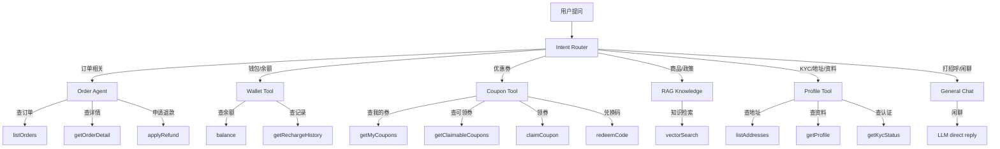

# AI 客服助手 — 业务能力分析

> 基于现有 15 个 Client 模块，分析 AI 能做什么、不能做什么

---

## 一、AI 能做的业务（按模块分类）

### 1. 订单模块 — OrderService

| 业务场景 | AI 能力 | 安全等级 | 说明 |
|---------|---------|---------|------|
| 查询订单列表 | ✅ 可查 | 安全 | 按状态筛选（全部/已支付/未支付/已退款/已取消） |
| 查询订单详情 | ✅ 可查 | 安全 | 含商品明细、支付信息、物流信息 |
| 查询退款状态 | ✅ 可查 | 安全 | 仅查询，不操作 |
| 申请退款 | ⚠️ 辅助 | 敏感 | AI 可代填信息，但需用户最终确认 |
| 下单 | ❌ 不可 | 高风险 | 涉及支付，AI 不能操作 |

**调用的 Service 方法：**
```typescript
// 已有方法（直接调用）
orderService.listOrders(userId, { status, page, pageSize })
orderService.getOrderDetail(userId, orderId)

// ⚠️ 可选暴露（需谨慎）
orderService.applyRefund(userId, { orderId, reason })
```

### 2. 钱包模块 — WalletService + ClientWalletService

| 业务场景 | AI 能力 | 安全等级 | 说明 |
|---------|---------|---------|------|
| 查询余额 | ✅ 可查 | 安全 | 显示现金余额、金币余额、冻结金额 |
| 查询充值记录 | ✅ 可查 | 安全 | 分页查询充值历史 |
| 查询提现记录 | ✅ 可查 | 安全 | 分页查询提现历史 |
| 查询交易流水 | ✅ 可查 | 安全 | 查询交易明细 |
| 充值 | ❌ 不可 | 高风险 | 资金操作，AI 不能碰 |
| 提现 | ❌ 不可 | 高风险 | 资金操作，AI 不能碰 |
| 扣款消费 | ❌ 不可 | 高风险 | 资金操作，AI 不能碰 |

**调用的 Service 方法：**
```typescript
// 已有方法（直接调用）
walletService.balance(userId)
clientWalletService.getRechargeHistory(userId, { page, pageSize, status })
clientWalletService.getWithdrawalHistory(userId, { page, pageSize, status })
```

### 3. 优惠券模块 — ClientCouponService

| 业务场景 | AI 能力 | 安全等级 | 说明 |
|---------|---------|---------|------|
| 查询我的优惠券 | ✅ 可查 | 安全 | 按状态筛选（未使用/已使用/已过期） |
| 查询可领券列表 | ✅ 可查 | 安全 | 领券中心大厅 |
| 领券 | ⚠️ 辅助 | 低风险 | AI 可引导用户领券，直接调 claimCoupon |
| 兑换码兑换 | ⚠️ 辅助 | 低风险 | AI 可帮用户输入兑换码 |

**调用的 Service 方法：**
```typescript
// 已有方法（直接调用）
clientCouponService.getMyCoupons(userId, { status, page, pageSize })
clientCouponService.getClaimableCoupons(userId)
clientCouponService.claimCoupon(userId, couponId)
clientCouponService.redeemCode(userId, code)
```

### 4. KYC 实名认证模块 — KYC Service

| 业务场景 | AI 能力 | 安全等级 | 说明 |
|---------|---------|---------|------|
| 查询认证状态 | ✅ 可查 | 安全 | 查看是否已认证、认证等级 |
| 查询可用的证件类型 | ✅ 可查 | 安全 | 查看支持哪些证件 |
| 提交认证 | ❌ 不可 | 高风险 | 需要上传证件图像，AI 不能处理 |
| 查询 OCR 结果 | ✅ 可查 | 安全 | 查看识别后的信息 |

### 5. 地址模块 — AddressService

| 业务场景 | AI 能力 | 安全等级 | 说明 |
|---------|---------|---------|------|
| 查询地址列表 | ✅ 可查 | 安全 | 查看已有收货地址 |
| 新增地址 | ⚠️ 辅助 | 低风险 | AI 引导填写，直接调 service |
| 修改地址 | ⚠️ 辅助 | 低风险 | 同上 |
| 删除地址 | ⚠️ 辅助 | 低风险 | 需用户确认 |

### 6. 用户模块 — UsersService

| 业务场景 | AI 能力 | 安全等级 | 说明 |
|---------|---------|---------|------|
| 查询个人资料 | ✅ 可查 | 安全 | 用户名、手机号、VIP 等级等 |
| 修改资料 | ⚠️ 辅助 | 低风险 | 如修改昵称等 |

### 7. 秒杀模块 — Flash Sale

| 业务场景 | AI 能力 | 安全等级 | 说明 |
|---------|---------|---------|------|
| 查询秒杀活动 | ✅ 可查 | 安全 | 查看正在进行的秒杀 |
| 参与秒杀 | ❌ 不可 | 高风险 | 涉及支付和抢购，AI 不能操作 |

### 8. 团购/夺宝模块 — Treasure + Group

| 业务场景 | AI 能力 | 安全等级 | 说明 |
|---------|---------|---------|------|
| 查询商品详情 | ✅ 可查 | 安全 | 查看团购商品信息 |
| 查询团购进度 | ✅ 可查 | 安全 | 查看成团进度 |
| 参团 | ❌ 不可 | 高风险 | 涉及支付 |

### 9. RAG 知识库（新建）

| 业务场景 | AI 能力 | 安全等级 | 说明 |
|---------|---------|---------|------|
| 查询商品知识 | ✅ RAG 检索 | 安全 | 商品介绍、规格说明 |
| 查询平台政策 | ✅ RAG 检索 | 安全 | 退换货政策、运费说明等 |
| 查询常见问题 | ✅ RAG 检索 | 安全 | FAQ |

---

## 二、AI 意图路由总图



---

## 三、AI 工具清单（对应 Zod Schema）

每个工具都需定义输入参数（Zod schema），参考 jisu-ai-customer 模式：

### Phase 1 工具（P0）

```typescript
// 1. 订单详情查询
getOrderInfo: {
  orderId: z.string().describe('订单 ID')
}

// 2. 订单列表查询
getUserOrders: {
  status: z.enum(['all','paid','unpaid','refunded','cancelled']).optional(),
  page: z.number().optional()
}

// 3. 余额查询
getBalance: {}  // 无需参数，自动获取当前用户

// 4. 充值记录查询
getRechargeHistory: {
  page: z.number().optional()
}

// 5. 优惠券查询
getMyCoupons: {
  status: z.number().optional()  // 0-未使用 1-已使用 2-已过期
}

// 6. 可领券查询
getClaimableCoupons: {}

// 7. 领券
claimCoupon: {
  couponId: z.string().describe('优惠券 ID')
}

// 8. 知识库检索
searchKnowledge: {
  query: z.string().describe('用户的提问/搜索内容')
}
```

### Phase 2 工具（P1）

```typescript
// 9. 兑换码兑换
redeemCode: {
  code: z.string().describe('兑换码')
}

// 10. 地址列表
getAddresses: {}

// 11. 退款申请
applyRefund: {
  orderId: z.string(),
  reason: z.string()
}

// 12. KYC 状态查询
getKycStatus: {}

// 13. 交易流水查询
getTransactionHistory: {
  page: z.number().optional()
}

// 14. 提现记录查询
getWithdrawalHistory: {
  page: z.number().optional()
}
```

---

## 四、不适合 AI 的业务

这些业务涉及**资金安全**或**敏感操作**，AI 不应直接操作：

| 业务 | 原因 |
|------|------|
| 下单 checkout | 涉及支付，高风险 |
| 充值 creditCash | 资金操作 |
| 扣款 debitCash | 资金操作 |
| 提交 KYC 认证 | 涉及身份证图像等敏感信息 |
| 秒杀抢购 | 并发高，AI 延迟会导致不公平 |
| 修改密码 | 安全敏感 |
| 注销账号 | 不可逆操作 |

---

## 五、Phase 1 MVP 范围（最小可行产品）

基于以上分析，Phase 1 只需要覆盖 **前 4 个意图**：

```
意图:  order | wallet | coupon | knowledge | general
工具:  6 个查询类工具（order info, order list, balance, coupons, claimable, search knowledge）
       + 1 个操作类工具（claim coupon）
       + 1 个 RAG 知识库
```

这正是从 jisu-ai-customer 的 5 节点 StateGraph 映射过来的：
- `intentRouter` → 判断走哪个分支
- `orderAgent` → 调用 order/wallet/coupon 工具
- `ragNode` → 知识库检索
- `generalChat` → 闲聊
- `answerSynthesizer` → 整合结果

