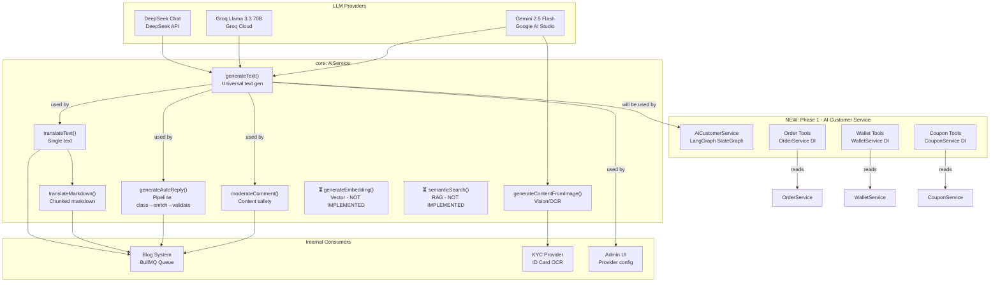

# AI Capabilities & API Analysis — JoyMini Monorepo

## Overview

This document catalogs **every AI capability** currently in the JoyMini project and maps them to the underlying AI APIs (LLM providers, methods, and internal APIs). This is the foundation for understanding what we already have and what new capabilities the AI Customer Service Assistant will add.

---

## 1. AI Infrastructure: [`AiService`](apps/api/src/common/ai/ai.service.ts)

The core AI service is registered as `@Global()` in [`AiModule`](apps/api/src/common/ai/ai.module.ts), meaning it's available everywhere without importing the module.

### Factory Methods (Public API)

| Method | Line | Level | Description |
|--------|------|-------|-------------|
| `generateText()` | 363 | FULL | Universal text generation — routes to configured provider with fallback |
| `generateTextWithRetry()` | 457 | FULL | Same as above with exponential backoff (1s, 2s, 4s) |
| `generateContentFromImage()` | 505 | FULL | Image understanding — Gemini only (vision model) |
| `moderateComment()` | 548 | ESSENTIAL | Comment safety score (0-100), category detection, auto-reply suggestion |
| `generateAutoReply()` | 620 | FULL | Full pipeline: classify → enrich → build prompt → generate → validate |
| `generateEmbedding()` | 641 | ⏳ RESERVED | Vector embeddings — currently returns `null` (marked for future) |
| `semanticSearch()` | 649 | ⏳ RESERVED | Semantic search — currently returns `[]` (marked for future) |
| `translateText()` | 656 | FULL | Text translation to any target language |
| `translateMarkdown()` | 731 | FULL | Markdown-aware translation with H2/H3 chunking for large docs |

### Infrastructure Features

| Feature | Detail |
|---------|--------|
| **3 Providers** | Gemini (vision), Groq (Llama 3.3 70B), DeepSeek (DeepSeek Chat) |
| **Circuit Breaker** | 10 failures → 5min cooldown |
| **Rate Limiting** | 12 RPM / 800K TPM shared across all providers |
| **Auto-degradation** | FULL → ESSENTIAL → MINIMAL → DISABLED |
| **Daily Reset** | Midnight counter reset for all providers |
| **DeepSeek Bypass** | Paid DeepSeek bypasses rate limits entirely |

### Provider Config Strategy

```
DB (system_config table) → AI_TRANSLATION_PROVIDER
  ↓ exists → strict mode (no fallback)
  ↓ empty → env auto-detect:
    1. DEEPSEEK_API_KEY → deepseek-chat
    2. GROQ_API_KEY → llama-3.3-70b-versatile
    3. (fallback) → gemini-2.5-flash
```

---

## 2. Blog AI System (HEAVIEST AI USER)

This is the **current primary consumer** of AI capabilities. All blog-related AI runs through [`BlogAiProcessor`](apps/api/src/blog/processors/blog-ai.processor.ts) (BullMQ queue, 5 concurrent, 100/min rate limit).

### Blog Translation (Bulk)

| Capability | AI Method Used | Entry Points |
|-----------|---------------|--------------|
| Article content translation | `translateMarkdown()` | [`blog.controller.ts`](apps/api/src/blog/blog.controller.ts) — `POST /articles/:id/translate` |
| Article excerpt translation | `translateText()` | [`blog-ai.processor.ts`](apps/api/src/blog/processors/blog-ai.processor.ts:226) |
| Article tags translation | `translateText()` | [`blog.service.ts`](apps/api/src/blog/blog.service.ts:1403) |
| Article categories translation | `translateText()` | [`blog.service.ts`](apps/api/src/blog/blog.service.ts:1432) |
| Article names/descriptions | `translateText()` | [`blog-ai.processor.ts`](apps/api/src/blog/processors/blog-ai.processor.ts:1822) |
| Category names/descriptions | `translateText()` | [`blog-ai.processor.ts`](apps/api/src/blog/processors/blog-ai.processor.ts:2006) |

### Blog Comments (AI Moderation)

| Capability | AI Method Used | Flow |
|-----------|---------------|------|
| Comment content moderation | `moderateComment()` | Called from [`blog-ai.processor.ts:993`](apps/api/src/blog/processors/blog-ai.processor.ts:993) |
| Auto-reply generation | `generateAutoReply()` | Pipeline: [`comment-classifier`](apps/api/src/common/ai/auto-reply/comment-classifier.ts) → [`context-enricher`](apps/api/src/common/ai/auto-reply/context-enricher.ts) → prompt builder → [`generateText()`](apps/api/src/common/ai/auto-reply/auto-reply.service.ts:107) → [`reply-validator`](apps/api/src/common/ai/auto-reply/reply-validator.ts) |

### Blog Admin UI Controls

| Endpoint | Controller | Purpose |
|----------|-----------|---------|
| `GET /admin/blog/ai-status` | [`blog.controller.ts:243`](apps/api/src/blog/blog.controller.ts:243) | Get service level, usage stats, circuit breaker status |
| `GET /admin/blog/ai-providers` | [`blog.controller.ts:261`](apps/api/src/blog/blog.controller.ts:261) | List available providers and their models |
| `POST /admin/blog/ai-provider` | [`blog.controller.ts:270`](apps/api/src/blog/blog.controller.ts:270) | Set active provider via DB config |
| `PATCH /admin/blog/ai-provider` | [`blog.controller.ts:284`](apps/api/src/blog/blog.controller.ts:284) | Update provider config |

---

## 3. KYC System (Identity Verification)

| Capability | AI Method Used | Detail |
|-----------|---------------|--------|
| ID Card OCR | `generateContentFromImage()` | Gemini vision model extracts text from ID card images |
| Anti-fraud detection | Included in prompt | Prompts include anti-fraud instructions |
| Budget/rate limited | Via AiService | Uses AiService's daily budget + rate limiting |

Called from [`KycProviderService`](apps/api/src/common/kyc-provider/kyc-provider.service.ts:202):
```typescript
const text = await this.aiService.generateContentFromImage(prompt, imageBuffer);
```

---

## 4. Admin Chat System (Human Support)

The admin chat system uses AI **indirectly** — it routes admin replies through a **robot user** account to the conversation.

| Capability | AI? | Detail |
|-----------|-----|--------|
| Conversation management | ❌ | Manual admin replies via [`AdminChatService.replyToConversation()`](apps/api/src/admin/chat/admin-chat.service.ts:162) |
| Support bot user | ❌ | Bot user is just a placeholder identity (`isRobot: true`) — admin types the actual reply |
| Message recall | ❌ | Manual force-recall by admin |
| Upload tokens | ❌ | File upload for sharing images in chat |

The admin chat system does **NOT** use AI for generating replies — it's purely human-to-human support. The `isRobot` flag on the bot user is used for routing, not AI generation.

---

## 5. Admin Chat Controller (Client-Facing Chat)

The client-facing chat system in [`ChatController`](apps/api/src/common/chat/chat.controller.ts) and [`ChatService`](apps/api/src/common/chat/chat.service.ts) supports:

| Capability | AI? | Detail |
|-----------|-----|--------|
| Send message | ❌ | User-to-user messaging, plain Prisma transaction |
| Recall message | ❌ | 2-minute recall window |
| Forward message | ❌ | Standard message forwarding |
| Group chat | ❌ | Create/join/leave groups |
| Business chat | ❌ | Support channel conversations |
| WebRTC ICE servers | ❌ | VoIP calling support |

**No AI is used in the chat system.** This is pure IM infrastructure.

---

## 6. What's NOT Yet Using AI (Gaps)

| Module | AI Potential | Current Status |
|--------|-------------|----------------|
| **Customer Service** (new) | **AI chat assistant** | ❌ **DOES NOT EXIST** — This is the new module in Phase 1 |
| Order queries | Tool-based retrieval | ❌ No AI agent integration |
| Wallet/balance | Tool-based retrieval | ❌ No AI agent integration |
| Coupon management | Tool-based retrieval + claim | ❌ No AI agent integration |
| RAG knowledge base | Semantic search | ❌ `generateEmbedding()` returns `null` — not implemented |
| Product recommendations | Vector similarity | ❌ Not implemented |
| Flash sale queries | Read-only retrieval | ❌ Not implemented (P2 in plan) |
| Lucky draw queries | Read-only retrieval | ❌ Not implemented (P2 in plan) |
| Treasure/Group queries | Read-only retrieval | ❌ Not implemented (P2 in plan) |

---

## 7. API Architecture Map



---

## 8. Existing API Endpoints (AI-related)

### Admin-facing AI endpoints
| Method | Path | Controller | Purpose |
|--------|------|-----------|---------|
| GET | `/admin/blog/ai-status` | [`BlogController`](apps/api/src/blog/blog.controller.ts:243) | AI service health + usage stats |
| GET | `/admin/blog/ai-providers` | [`BlogController`](apps/api/src/blog/blog.controller.ts:261) | Available providers list |
| POST | `/admin/blog/ai-provider` | [`BlogController`](apps/api/src/blog/blog.controller.ts:270) | Set active provider |
| PATCH | `/admin/blog/ai-provider` | [`BlogController`](apps/api/src/blog/blog.controller.ts:284) | Update provider config |

### Client-facing non-AI chat endpoints
| Method | Path | Controller | Purpose |
|--------|------|-----------|---------|
| GET | `/client/chat/conversations` | [`ChatController`](apps/api/src/common/chat/chat.controller.ts:74) | List conversations |
| GET | `/client/chat/messages` | [`ChatController`](apps/api/src/common/chat/chat.controller.ts:88) | Get messages |
| POST | `/client/chat/message` | [`ChatController`](apps/api/src/common/chat/chat.controller.ts:103) | Send message |
| POST | `/client/chat/recall` | [`ChatController`](apps/api/src/common/chat/chat.controller.ts:121) | Recall message |

### NEW endpoints needed (Phase 1)
| Method | Path | Controller | Purpose |
|--------|------|-----------|---------|
| POST | `/client/ai-customer/chat` | [`AiCustomerController`](plans/joymini-nest-monorepo/phase1-implementation-plan.md) | Non-streaming chat |
| GET | `/client/ai-customer/chat/stream` | [`AiCustomerController`](plans/joymini-nest-monorepo/phase1-implementation-plan.md) | SSE streaming chat |

---

## 9. Summary

| Capability | AI Provider | Service Level | Read/Write | Consumer |
|-----------|-------------|---------------|------------|----------|
| Text generation | Gemini/Groq/DeepSeek | FULL | R | All consumers |
| Image understanding | Gemini only | FULL | R | KYC system |
| Content moderation | Any provider | ESSENTIAL | R | Blog comments |
| Auto-reply | Any provider | FULL | R→W | Blog comments |
| Translation | Any provider | FULL | R→W | Blog system |
| Vector embeddings | ⏳ Coming soon | — | — | — |
| Semantic search | ⏳ Coming soon | — | — | — |
| **AI Customer Service** | **Any provider** | **FULL** | **Read (P0)** | **New Phase 1** |

**Key Insight**: The project already has a robust, production-grade AI infrastructure with multi-provider support, circuit breaker, rate limiting, and auto-degradation. What's missing is the **AI agent layer** (LangGraph + tools) that connects this AI power to the **business data** (orders, wallet, coupons). That's exactly what Phase 1 builds.
