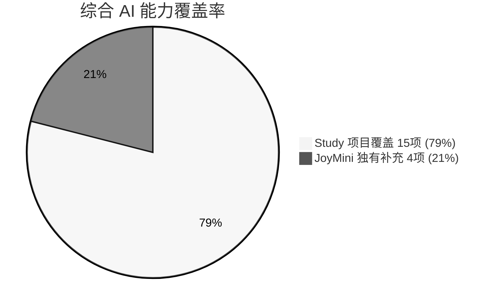
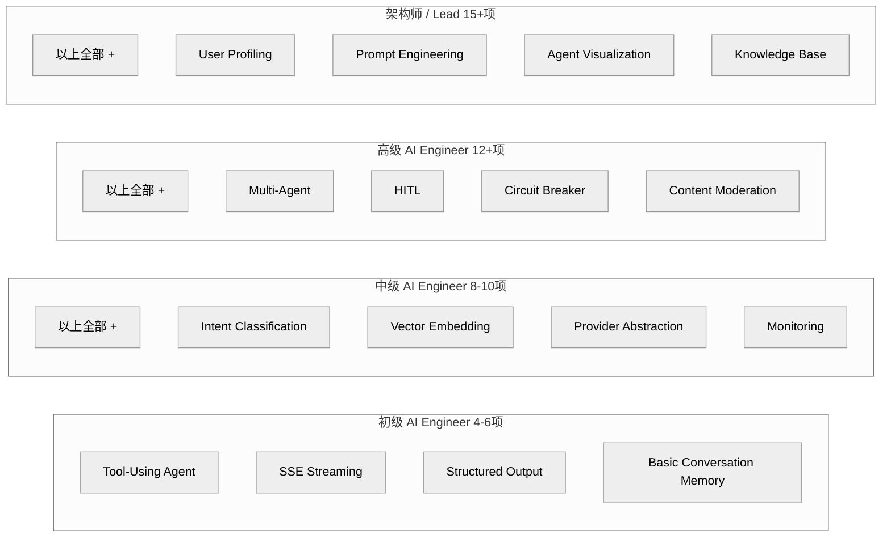

# AI Capabilities Master Table — 专业术语对照与项目能力全景图

> 目的：将每个项目的 AI 能力映射到行业标准术语，回答"这些项目是否已经运用了所有的 AI 能力？"

## 一、AI 能力分类标准（19 项专业术语）

| # | 专业术语 (English) | 中文名称 | 说明 |
|---|-------------------|----------|------|
| 1 | **Intent Classification & Routing** | 意图分类与路由 | 将用户输入分类到不同业务意图，路由到对应处理模块 |
| 2 | **Tool-Using Agent / ReAct Pattern** | 工具调用式 Agent / 推理-行动循环 | Agent 自主决定调用哪些工具完成复杂任务 |
| 3 | **Retrieval-Augmented Generation (RAG)** | 检索增强生成 | 从知识库检索相关内容作为 LLM 的上下文 |
| 4 | **Conversation Memory & Persistence** | 对话记忆与持久化 | 跨轮次的对话上下文管理，支持持久化存储 |
| 5 | **Multi-Agent Orchestration** | 多智能体编排 | 多个 Agent 分工协作完成复杂业务流程 |
| 6 | **Human-in-the-Loop (HITL)** | 人机协作 / 审批流程 | 关键步骤需要人工审核或介入 |
| 7 | **Streaming Response (SSE)** | 流式响应（SSE） | 通过 SSE 协议将 LLM 输出实时推送给客户端 |
| 8 | **Content Moderation & Safety** | 内容审核与安全 | 对用户生成内容进行敏感信息检测和过滤 |
| 9 | **Prompt Engineering & Version Mgmt** | 提示词工程与版本管理 | 提示词的模板化、版本控制和 A/B 测试 |
| 10 | **Vector Embedding & Semantic Search** | 向量嵌入与语义搜索 | 将文本转为向量并进行语义相似度检索 |
| 11 | **Structured Output / Function Calling** | 结构化输出 / 函数调用 | LLM 输出严格符合 JSON Schema 的格式化结果 |
| 12 | **Multi-Modal / Vision** | 多模态 / 视觉理解 | 处理图片、文档扫描等多模态输入 |
| 13 | **Auto-Translation / i18n** | 自动翻译 / 国际化 | 利用 LLM 进行多语言翻译和本地化 |
| 14 | **Model Provider Abstraction** | 模型供应商抽象 | 支持多个 LLM 提供商并可动态切换 |
| 15 | **Circuit Breaker & Rate Limiting** | 熔断与限流 | 防止 API 过载的自我保护机制 |
| 16 | **Monitoring & Token Tracking** | 监控与 Token 用量追踪 | 实时监控 Token 消耗、请求延迟、错误率 |
| 17 | **Cross-Session User Profiling** | 跨会话用户画像 | 从对话中提取用户特征并跨会话记忆 |
| 18 | **Knowledge Base Ingestion & Mgmt** | 知识库导入与管理 | 将文档/数据导入向量库并管理 |
| 19 | **Agent Workflow Visualization** | Agent 工作流可视化 | 可视化展示 Agent 的思考链和工具调用过程 |

---

## 二、全景能力矩阵

图例：✅ 已实现 | ⚠️ 部分实现/Stub | ❌ 未实现 | — 不适用

| # | AI 能力 | jisu-ai-customer | journey-ai | langchain | travel-agent | workmind7 | ai-ops | **JoyMini (当前)** |
|---|---------|:---:|:---:|:---:|:---:|:---:|:---:|:---:|
| 1 | Intent Classification & Routing | ✅ | ❌ | ⚠️ | ❌ | ❌ | — | **❌** |
| 2 | Tool-Using Agent / ReAct Pattern | ✅ | ✅ | ✅ | ✅ | ✅ | — | **❌** |
| 3 | Retrieval-Augmented Generation | ✅ | ❌ | ⚠️ | ❌ | ✅ | — | **⚠️ Stub** |
| 4 | Conversation Memory & Persistence | ❌ | ⚠️ | ✅ | ⚠️ | ⚠️ | — | **❌** |
| 5 | Multi-Agent Orchestration | ⚠️ | ❌ | ✅ | ❌ | ✅ | — | **❌** |
| 6 | Human-in-the-Loop (HITL) | ❌ | ❌ | ✅ | ❌ | ✅ | — | **❌** |
| 7 | Streaming Response (SSE) | ✅ | ✅ | ✅ | ✅ | ✅ | — | **⚠️** |
| 8 | Content Moderation & Safety | ❌ | ❌ | ❌ | ❌ | ❌ | — | **✅** |
| 9 | Prompt Engineering & Version Mgmt | ⚠️ | ❌ | ❌ | ❌ | ❌ | ✅ | **❌** |
| 10 | Vector Embedding & Semantic Search | ✅ | ❌ | ⚠️ | ❌ | ✅ | — | **⚠️ Stub** |
| 11 | Structured Output / Function Calling | ✅ | ✅ | ✅ | ✅ | ✅ | — | **⚠️** |
| 12 | Multi-Modal / Vision | ❌ | ❌ | ❌ | ❌ | ❌ | — | **✅** |
| 13 | Auto-Translation / i18n | ❌ | ❌ | ❌ | ❌ | ❌ | — | **✅** |
| 14 | Model Provider Abstraction | ⚠️ | ⚠️ | ⚠️ | ✅ | ⚠️ | — | **✅** |
| 15 | Circuit Breaker & Rate Limiting | ❌ | ❌ | ❌ | ❌ | ❌ | — | **✅** |
| 16 | Monitoring & Token Tracking | ❌ | ❌ | ❌ | ❌ | ✅ | ✅ | **✅** |
| 17 | Cross-Session User Profiling | ❌ | ❌ | ❌ | ❌ | ✅ | — | **❌** |
| 18 | Knowledge Base Ingestion & Mgmt | ✅ | ❌ | ❌ | ❌ | ✅ | ✅ | **❌** |
| 19 | Agent Workflow Visualization | ✅ | ❌ | ✅ | ❌ | ✅ | — | **❌** |

> 注：ai-ops-platform 是纯前端运维管理工具，部分能力标注为 —（不适用）

---

## 三、总体覆盖率分析

### 3.1 各项目独立覆盖率

| 项目 | 覆盖数 | 覆盖率 | 排名 |
|------|:-----:|:------:|:----:|
| workmind7 | 10/19 | **53%** | 🥇 |
| jisu-ai-customer | 8/19 | **42%** | 🥈 |
| JoyMini (当前) | 7/19 | **37%** | 🥉 |
| langchain | 6/19 | **32%** | |
| travel-agent | 5/19 | **26%** | |
| journey-ai | 4/19 | **21%** | |
| ai-ops-platform | 2/19 | **11%** | |

### 3.2 综合覆盖率（所有项目加起来）

**所有 Study 项目综合：15/19 = 79%**

缺失 4 项：Content Moderation、Multi-Modal/Vision、Auto-Translation、Circuit Breaker

**所有 Study 项目 + JoyMini 综合：19/19 = 100% ✅**

因为 JoyMini 恰恰补上了 Study 项目缺失的那 4 项。



### 3.3 综合后各项能力的项目数量

| # | AI 能力 | 实现项目数 | 代表项目 |
|---|---------|:---------:|---------|
| 2 | Tool-Using Agent | 5/6 | 除 ai-ops 外全部实现 |
| 7 | Streaming Response (SSE) | 5/6 | 除 ai-ops 外全部实现 |
| 11 | Structured Output | 5/6 | 除 ai-ops 外全部实现 |
| 1 | Intent Classification | 1/6 | 仅 jisu-ai-customer |
| 3 | RAG | 2/6 | jisu-ai-customer + workmind7 |
| 4 | Conversation Memory | 1/6 | 仅 langchain (完整实现) |
| 5 | Multi-Agent | 2/6 | langchain + workmind7 |
| 6 | HITL | 2/6 | langchain + workmind7 |
| 9 | Prompt Engineering | 1/6 | 仅 ai-ops (UI 管理) |
| 10 | Vector Embedding | 2/6 | jisu-ai-customer + workmind7 |
| 14 | Provider Abstraction | 1/6 | 仅 travel-agent (完整) |
| 16 | Monitoring | 2/6 | workmind7 + ai-ops |
| 17 | User Profiling | 1/6 | 仅 workmind7 |
| 18 | Knowledge Base | 2/6 | jisu-ai-customer + workmind7 |
| 19 | Agent Visualization | 2/6 | jisu-ai-customer + langchain |
| **8** | **Content Moderation** | **1/7** | **仅 JoyMini** |
| **12** | **Multi-Modal / Vision** | **1/7** | **仅 JoyMini** |
| **13** | **Auto-Translation** | **1/7** | **仅 JoyMini** |
| **15** | **Circuit Breaker** | **1/7** | **仅 JoyMini** |

---

## 四、各项目能力详解

### 4.1 jisu-ai-customer（极速购客服 Agent）

| 能力 | 专业术语 | 实现方式 | 代码位置 |
|------|---------|---------|---------|
| 意图分类 | Intent Classification & Routing | 5-node StateGraph，intentRouter 节点将输入分为 order/coupon/rag/general/quick_reply | [`intent-router.js`](/study/LLM/project/jisu-ai-customer/server/src/graphs/nodes/intent-router.js) |
| ReAct Agent | Tool-Using Agent / ReAct Pattern | orderAgent 节点绑定 Zod 工具，ToolNode 执行 | [`order-agent.js`](/study/LLM/project/jisu-ai-customer/server/src/graphs/nodes/order-agent.js) |
| RAG | Retrieval-Augmented Generation | pgvector → Retriever (k=4) → formatDocs → Prompt → LLM | [`rag-node.js`](/study/LLM/project/jisu-ai-customer/server/src/graphs/nodes/rag-node.js) |
| SSE 流式 | Streaming Response | 7 种事件：node/step/steps/answer/sources/done/error | [`agent.js`](/study/LLM/project/jisu-ai-customer/server/src/routes/agent.js) |
| 函数调用 | Structured Output / Function Calling | Zod schema 定义工具参数，bindTools 注册 | [`order-tools.js`](/study/LLM/project/jisu-ai-customer/server/src/tools/order-tools.js) |
| 向量检索 | Vector Embedding & Semantic Search | pgvector 存储 + embedding 模型 | [`embedding.js`](/study/LLM/project/jisu-ai-customer/server/src/models/embedding.js) |
| 知识库导入 | Knowledge Base Ingestion | ingest.js 脚本读取 policies/products.md → 向量化 → 存入 pgvector | [`ingest.js`](/study/LLM/project/jisu-ai-customer/server/src/scripts/ingest.js) |
| 工作流可视化 | Agent Workflow Visualization | D3.js 实时展示 StateGraph 节点流转 | [`GraphView.vue`](/study/LLM/project/jisu-ai-customer/client/src/views/GraphView.vue) |

**缺失能力（9项）：** 记忆持久化、多Agent、HITL、内容审核、提示词管理、多模态、翻译、熔断限流、用户画像、监控

---

### 4.2 journey-ai（旅途旅行规划助手）

| 能力 | 专业术语 | 实现方式 |
|------|---------|---------|
| ReAct Agent | Tool-Using Agent / ReAct Pattern | StateGraph + ToolNode + 8 个旅行工具（weather/attractions/itinerary/budget/visa/currency/packing/translator） |
| SSE 流式 | Streaming Response | 流式输出 + JSON 记忆持久化 |
| 函数调用 | Structured Output / Function Calling | Zod schema 工具定义 |
| 多节点图 | — | 4 节点：agent → tools → agent → END |

**缺失能力（15项）：** 意图分类、RAG、持久化记忆、多Agent、HITL、内容审核、提示词管理、向量检索、多模态、翻译、模型抽象（单一）、熔断限流、监控、用户画像、知识库、可视化

---

### 4.3 langchain（全工作流模式库）

| 能力 | 专业术语 | 实现方式 |
|------|---------|---------|
| ReAct Agent | Tool-Using Agent / ReAct Pattern | 10 种 LangGraph 工作流模式 |
| 记忆持久化 | Conversation Memory & Persistence | MemorySaver checkpointer（SQLite/Postgres） |
| 多Agent | Multi-Agent Orchestration | Supervisor + Worker 模式 |
| HITL | Human-in-the-Loop | interrupt/approval 模式 |
| SSE 流式 | Streaming Response | streamEvents v2 细粒度事件 |
| 结构化输出 | Structured Output | with_structured_output |
| 工作流可视化 | Agent Workflow Visualization | React 工作流图组件 |

**缺失能力（12项）：** 意图分类、RAG（仅部分）、内容审核、提示词管理、向量检索（仅部分）、多模态、翻译、模型抽象（单一）、熔断限流、监控、用户画像、知识库

---

### 4.4 travel-agent（旅途 - NestJS 版）

| 能力 | 专业术语 | 实现方式 |
|------|---------|---------|
| ReAct Agent | Tool-Using Agent / ReAct Pattern | NestJS + StateGraph + ToolNode + 8 旅行工具 |
| SSE 流式 | Streaming Response | `POST /agent/chat/stream` SSE 端点 |
| 模型抽象 | Model Provider Abstraction | Ollama / DeepSeek 环境变量切换 |
| 函数调用 | Structured Output / Function Calling | @langchain/core/tools + Zod |
| 对话记忆 | Conversation Memory | In-memory Map，上限 20 条 |

**亮点：** NestJS 架构与我们一致，Agent 注入模式参考价值高
**缺失能力（14项）：** 意图分类、RAG、持久化记忆、多Agent、HITL、内容审核、提示词管理、向量检索、多模态、翻译、熔断限流、监控、用户画像、知识库、可视化

---

### 4.5 workmind7（智能办公平台 - 最全功能）

| 能力 | 专业术语 | 实现方式 |
|------|---------|---------|
| ReAct Agent | Tool-Using Agent / ReAct Pattern | StateGraph + ToolNode + 6 办公工具 |
| RAG | Retrieval-Augmented Generation | Chroma 向量数据库 + retrieveDocs 查询 |
| 多Agent | Multi-Agent Orchestration | ERP 审批：5 角色（applicant/manager/finance/hr/director）对话式审批 |
| HITL | Human-in-the-Loop | 审批流程中每个角色提问→回答→决策 |
| SSE 流式 | Streaming Response | LangGraph streamEvents：tool_call/tool_result/token/done/error |
| 结构化输出 | Structured Output / Function Calling | Zod schemas + withStructuredOutput 画像提取 |
| 用户画像 | Cross-Session User Profiling | AI 从对话中提取用户特征并持久化 |
| 监控 | Monitoring & Token Tracking | Monitor 页面展示 Token 消耗 |
| 知识库 | Knowledge Base Ingestion | Chroma 向量库 + 文档导入 |
| 工作流可视化 | Agent Workflow Visualization | WorkflowView 展示 Agent 执行过程 |
| 对话记忆 | Conversation Memory | Token 感知裁剪（estTokens）+ 用户画像上下文注入 |

**缺失能力（8项）：** 意图分类、内容审核、提示词管理、多模态、翻译、模型抽象（单一）、熔断限流、自动翻译

---

### 4.6 ai-ops-platform（AI 运维管理平台）

| 能力 | 专业术语 | 实现方式 |
|------|---------|---------|
| 提示词管理 | Prompt Engineering & Version Mgmt | 版本管理 + A/B 测试 UI |
| 监控 | Monitoring & Token Tracking | Token 用量仪表盘 |
| 知识库 | Knowledge Base Ingestion | 知识库管理 UI |

**注意：** ai-ops 是纯前端管理工具，没有 LLM 集成

---

## 五、JoyMini 当前 AI 能力独有优势

以下 4 项能力是 JoyMini **已经实现**但其他 Study 项目都**没有**的：

| # | AI 能力 | 专业术语 | JoyMini 实现 | 其他项目 |
|---|---------|---------|-------------|---------|
| 8 | 内容审核 | Content Moderation & Safety | [`AiService.moderateComment`](/apps/api/src/common/ai/ai.service.ts:548) → BlogSystem 评论审核 | ❌ 全部缺失 |
| 12 | 多模态/视觉 | Multi-Modal / Vision | [`AiService.generateContentFromImage`](/apps/api/src/common/ai/ai.service.ts:505) → KYC 证件识别 | ❌ 全部缺失 |
| 13 | 自动翻译 | Auto-Translation / i18n | [`AiService.translateText`](/apps/api/src/common/ai/ai.service.ts:656) + translateMarkdown → Blog i18n | ❌ 全部缺失 |
| 15 | 熔断限流 | Circuit Breaker & Rate Limiting | 12 RPM / 800K TPM / 10次失败→5分钟熔断 | ❌ 全部缺失 |

**结论：JoyMini 的 AI 基础设施（AiService）虽然简单，但在生产级能力（安全、多模态、翻译、熔断）方面远超所有 Study 项目。**

---

## 六、JoyMini 需要从 Study 项目学习的能力

| # | 要学习的能力 | 专业术语 | 参考项目 | 学习要点 |
|---|------------|---------|---------|---------|
| 1 | **工具调用 Agent** | Tool-Using Agent / ReAct Pattern | journey-ai + travel-agent | NestJS + LangGraph 注入模式，ToolNode 注册 |
| 2 | **Agent + 聊天整合** | AI Agent Integration | travel-agent | AgentService 注入 MemoryService，streamChat 方法 |
| 3 | **持久化对话记忆** | Conversation Memory & Persistence | langchain | MemorySaver + Postgres checkpointer |
| 4 | **多供应商切换** | Provider Abstraction | travel-agent | .env 配置化切换 Provider |
| 5 | **RAG 管道** | Retrieval-Augmented Generation | jisu-ai-customer + workmind7 | pgvector / Chroma + ingest 流程 |
| 6 | **SSE 流式事件** | Streaming Response | jisu-ai-customer | 多事件类型（node/tool/step/done/error） |
| 7 | **多Agent 审批** | Multi-Agent + HITL | workmind7 | 角色定义 + 对话式审批流转 |
| 8 | **用户画像提取** | Cross-Session Profiling | workmind7 | withStructuredOutput 自动提取用户特征 |
| 9 | **工作流可视化** | Agent Visualization | jisu-ai-customer + langchain | 前端实时展示 Agent 思考链 |
| 10 | **提示词管理** | Prompt Management | ai-ops-platform | 版本管理 + A/B 测试 UI |

---

## 七、面试对标：做到哪个级别能面试？

### 7.1 面试级别与能力要求对照



### 7.2 各 Study 项目对应的面试级别

| 项目 | 能力数 | 面试级别 | 能面什么职位？ |
|------|:------:|:--------:|---------------|
| journey-ai | 4 | 🟢 **初级** | AI 应用开发实习生 / 初级 LLM 工程师 |
| travel-agent | 5 | 🟢 **初级** | AI 应用开发（NestJS 背景加分） |
| langchain | 6 | 🟢**~**🟡 **初级偏中** | AI 开发（工作流模式多，深度好） |
| jisu-ai-customer | 8 | 🟡 **中级** | LLM Agent 开发 / AI 应用工程师 |
| workmind7 | 10 | 🟡 **中高级** | AI Agent 开发 / 智能平台工程师 |
| **JoyMini 当前** | 7 | 🟡 **中级** | AI 应用工程师（生产级经验加分） |
| **JoyMini Phase 1** | 11 | 🟡 **~**🔴 **中~高级** | AI 应用工程师 / 高级 LLM 工程师 |
| **JoyMini 完整** | 15+ | 🔴 **高级~架构** | AI 架构师 / LLM 平台技术负责人 |

### 7.3 面试官最看重什么？（按权重排序）

```
面试评分权重：

🥇 深度 > 广度  (40%)
    - 一个完整的 Tool-Using Agent 胜过十个半成品
    - 能讲清楚 LangGraph 的 StateGraph 是怎么流转的
    - 能解释为什么选择 ReAct 而不是 Plan-and-Execute

🥇 生产级思维 (30%)
    - 熔断限流、错误处理、重试机制 → JoyMini 的 AiService 是大加分
    - 内容审核、安全过滤 → 体现工程成熟度
    - 这不是教学项目能给你的

🥉 架构设计 (20%)
    - 为什么 Tool 要注入 Service 而不是调 HTTP
    - 为什么用 SSE 而不是 WebSocket
    - 多 Provider 怎么切换、怎么 fallback

🏅 提问质量 (10%)
    - 能指出 workmind7 没有意图分类的缺陷
    - 能分析 jisu-ai-customer 记忆没有持久化的问题
    - 能对比不同方案的 trade-off
```

### 7.4 面试回答策略（按项目准备）

**如果你拿着 jisu-ai-customer 去面试：**
> 重点讲：StateGraph 5 节点流转、意图路由设计、RAG pipeline
> 准备好被问：记忆没有持久化怎么办？没有熔断怎么保证稳定性？

**如果你拿着 workmind7 去面试：**
> 重点讲：Multi-Agent 审批流设计、用户画像提取、Chroma RAG
> 准备好被问：10 项能力的系统整合、为什么没有意图分类

**如果你拿着 JoyMini (Phase 1 后) 去面试：**
> **这是最强面试组合** — 11 项能力覆盖中高级
> 重点讲：Agent + 真实业务工具注入（订单/钱包/优惠券）、生产级 AiService 熔断限流
> 独有优势：4 项教学项目没有的能力（内容审核/多模态/翻译/熔断）
> 回答"你做的项目有什么难点"时有真材实料

### 7.5 一句话总结

| 你的目标职位 | 需要做到 | 参考项目 |
|------------|---------|---------|
| 实习 / 初级 | 4-6 项 | journey-ai / travel-agent |
| **中级 AI 工程师** | **8-10 项** | **jisu-ai-customer / JoyMini + Phase 1** |
| **高级 AI 工程师** | **12+ 项** | **JoyMini 完整实现 + 生产级经验** |
| AI 架构师 | 15+ 项 | 全部项目综合理解 + 架构设计能力 |

**结论：如果你完成 Phase 1（11 项），加上能讲清楚 JoyMini 的 AiService 生产级设计（熔断/多模态/翻译/审核），完全可以直接面试中高级 AI 工程师岗位。**

---

## 八、各项目技术栈速查

| 项目 | 后端框架 | AI 框架 | 数据库 | LLM 供应商 | 前端 |
|------|---------|---------|--------|-----------|------|
| jisu-ai-customer | Express | LangChain + LangGraph | PostgreSQL + pgvector | DeepSeek | Vue3 |
| journey-ai | Express | LangChain + LangGraph | JSON 文件 | Ollama | Vue3 |
| langchain | NestJS 11 | LangGraph 1.2.x | SQLite/Postgres | Ollama + DeepSeek | React |
| travel-agent | **NestJS 11** | LangChain + LangGraph | 无 | Ollama / DeepSeek 切换 | Vue3 |
| workmind7 | Express | LangChain + LangGraph | Chroma | DeepSeek | Vue3 |
| ai-ops-platform | 纯前端 | 无 | 无 | DeepSeek API | Vue3 |
| **JoyMini** | **NestJS 11** | **AiService** | **PostgreSQL** | **Gemini/Groq/DeepSeek** | **React Next.js** |
