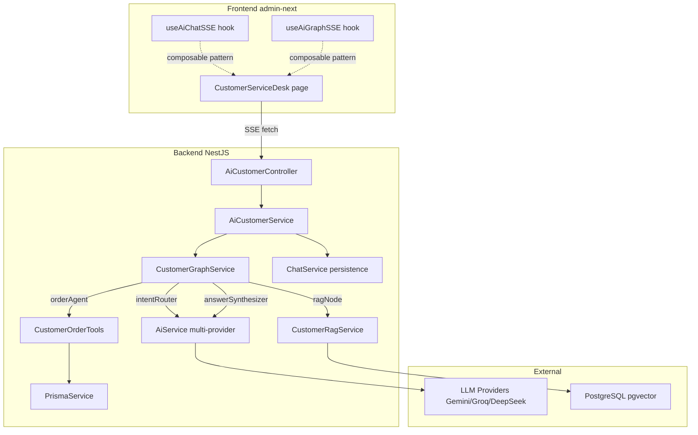
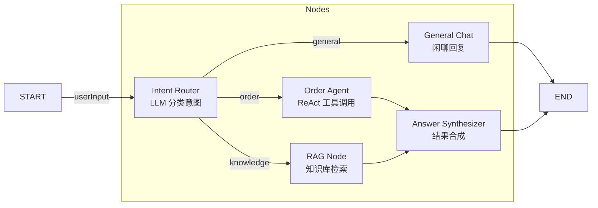
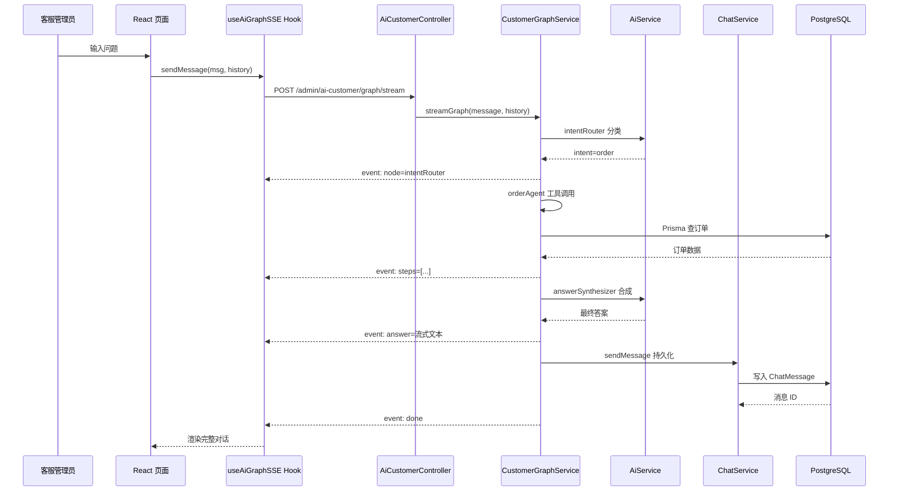
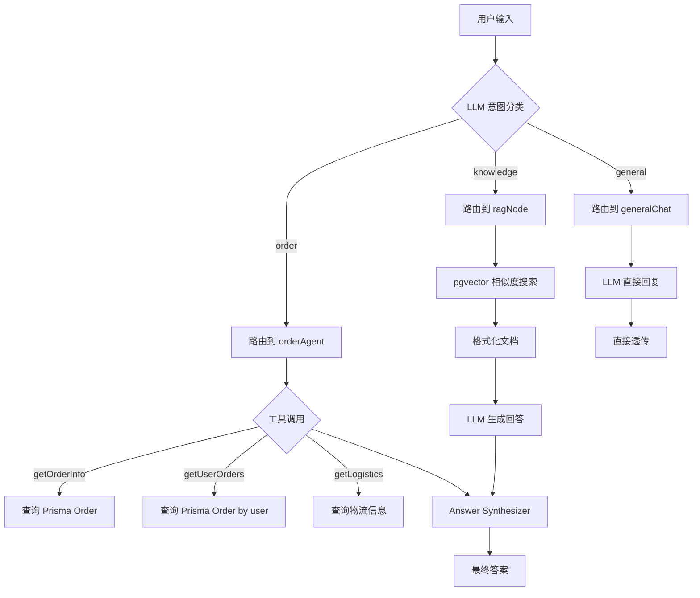

# AI 客服助手 — SDD 规格文档

> **项目**: JoyMini Nest Monorepo
> **状态**: 规划中
> **版本**: v1.0
> **基于**: `study/LLM/jisu-ai-customer` LLM 架构 + 现有 NestJS/React 企业基础设施

---

## 一、概述

### 1.1 背景

当前 monorepo 已有完整的 IM 客服系统（[`AdminChatService`](apps/api/src/admin/chat/admin-chat.service.ts) + [`ChatService`](apps/api/src/common/chat/chat.service.ts)），支持客服人工回复用户咨询。但缺少 **AI 自动应答**能力。

教学项目 [`study/LLM/jisu-ai-customer`](study/LLM/jisu-ai-customer) 已验证了完整的 LLM 客服架构：
- LangGraph StateGraph 5 节点编排
- LLM 意图路由（订单/知识/闲聊）
- ReAct Agent 工具调用（订单查询）
- RAG 知识库检索
- 答案合成
- SSE 流式输出

目标：**将 jisu-ai-customer 的 LLM 架构迁移到 monorepo 的 NestJS + React 企业架构中**，复用现有的 AiService（多供应商）、ChatService（消息持久化）、Prisma（订单数据）、JWT 认证等基础设施。

### 1.2 设计原则

| 原则 | 说明 |
|------|------|
| **保留 LLM 架构** | jisu-ai-customer 的 StateGraph、意图路由、ReAct Agent、RAG、答案合成全部保留 |
| **复用企业基础设施** | AiService、ChatService、Prisma、JWT Auth、@repo/ui 直接用 |
| **替换教学实现** | mock 数据 → Prisma 真实订单；单 DeepSeek → 多供应商 AiService；无认证 → 已有 JWT；Vue 3 → React |
| **最小改动** | 不修改现有 admin-chat 流程，新增 AI 模块作为独立 Controller + 前端 Tab |

---

## 二、目标

| 目标 | 描述 |
|------|------|
| G-01 | 在 admin-next 中为客服提供 AI 自动应答助手页面 |
| G-02 | 保留 jisu-ai-customer 的 5 节点 StateGraph 架构（意图路由→Agent/RAG/闲聊→合成） |
| G-03 | 复用 AiService 实现多供应商 LLM 调用（含熔断、限流、自动降级） |
| G-04 | 复用 ChatService 实现消息持久化（不丢失对话上下文） |
| G-05 | 用 Prisma 真实订单数据替换 mock 数据 |
| G-06 | 支持知识库 RAG 检索（公司政策、产品信息） |
| G-07 | 支持 SSE 流式输出，前端实时展示 AI 思考过程 |
| G-08 | 使用现有 admin-next 布局 + @repo/ui 组件，保持 UI 一致性 |

---

## 三、功能需求

### F-01：AI 自动应答（基础对话）

| 项目 | 内容 |
|------|------|
| **描述** | 客服在 AI 助手页面输入问题，AI 返回流式回答 |
| **触发条件** | 用户在 AI 助手页面输入消息并发送 |
| **LLM 架构** | 直接走 basic-chat LCEL 链（`customerServiceChain`/`customerServiceStreamChain`） |
| **输出** | SSE 流，含 `content`, `done`, `error` 事件 |
| **来源代码** | [`study/LLM/jisu-ai-customer/server/src/chains/basic-chat.js`](study/LLM/jisu-ai-customer/server/src/chains/basic-chat.js) |

### F-02：意图路由 + 多 Agent 路由

| 项目 | 内容 |
|------|------|
| **描述** | AI 分析用户问题意图，路由到不同处理节点 |
| **意图分类** | `order` — 订单查询 → orderAgent；`knowledge` — 知识问答 → ragNode；`general` — 闲聊 → generalChat |
| **LLM 架构** | LangGraph StateGraph + `routeByIntent` 条件边 |
| **来源代码** | [`study/LLM/jisu-ai-customer/server/src/graphs/nodes/intent-router.js`](study/LLM/jisu-ai-customer/server/src/graphs/nodes/intent-router.js)、[`study/LLM/jisu-ai-customer/server/src/graphs/customer-graph.js`](study/LLM/jisu-ai-customer/server/src/graphs/customer-graph.js) |

### F-03：订单查询 Agent

| 项目 | 内容 |
|------|------|
| **描述** | ReAct Agent 通过工具调用查询真实订单数据 |
| **工具** | `getOrderInfo` — 按订单号查询；`getUserOrders` — 按用户查询；`getLogistics` — 按运单号查物流 |
| **数据源** | Prisma `Order` 模型（替代 mock 数据） |
| **LLM 架构** | LangChain `createReactAgent` + Zod 工具定义 |
| **来源代码** | [`study/LLM/jisu-ai-customer/server/src/tools/order-tools.js`](study/LLM/jisu-ai-customer/server/src/tools/order-tools.js)、[`study/LLM/jisu-ai-customer/server/src/agents/customer-agent.js`](study/LLM/jisu-ai-customer/server/src/agents/customer-agent.js) |

### F-04：RAG 知识库检索

| 项目 | 内容 |
|------|------|
| **描述** | 基于公司政策/产品文档的检索增强生成 |
| **数据源** | PostgreSQL + pgvector 向量存储 |
| **LLM 架构** | LCEL `RunnableSequence`：Retriever → formatDocs → Prompt → LLM |
| **来源代码** | [`study/LLM/jisu-ai-customer/server/src/chains/rag-chain.js`](study/LLM/jisu-ai-customer/server/src/chains/rag-chain.js) |

### F-05：答案合成

| 项目 | 内容 |
|------|------|
| **描述** | 汇总 orderAgent/ragNode 的结果，合成自然语言答案 |
| **LLM 架构** | 带结果的 Prompt → LLM（general 意图直接透传） |
| **来源代码** | [`study/LLM/jisu-ai-customer/server/src/graphs/nodes/answer-synthesizer.js`](study/LLM/jisu-ai-customer/server/src/graphs/nodes/answer-synthesizer.js) |

### F-06：SSE 流式显示

| 项目 | 内容 |
|------|------|
| **描述** | 前端实时展示 AI 处理过程：节点追踪、工具调用步骤、答案流式输出 |
| **SSE 事件** | `node` — 当前执行的节点名；`steps` — Agent 工具调用步骤；`answer` — 最终答案流；`sources` — RAG 来源；`done` — 结束；`error` — 错误 |
| **来源代码** | [`study/LLM/jisu-ai-customer/server/src/routes/graph.js`](study/LLM/jisu-ai-customer/server/src/routes/graph.js)、[`study/LLM/jisu-ai-customer/client/src/composables/useGraph.js`](study/LLM/jisu-ai-customer/client/src/composables/useGraph.js) |

### F-07：消息历史持久化

| 项目 | 内容 |
|------|------|
| **描述** | 所有 AI 对话记录持久化到数据库，刷新页面不丢失 |
| **机制** | 复用 [`ChatService.sendMessage()`](apps/api/src/common/chat/chat.service.ts:60) 的 Prisma 事务写入 |
| **数据模型** | 复用已有 `Conversation` + `ChatMessage`（新增 `ai_agent` 消息类型） |

---

## 四、非功能需求

| 类别 | 需求 | 说明 |
|------|------|------|
| 性能 | SSE 响应 ≤ 3s（首 token） | AiService 已有多供应商容错 |
| 性能 | 流式输出不阻塞其他请求 | NestJS 异步事件驱动 |
| 安全 | 仅管理员可访问 | 复用 `AdminJwtAuthGuard` + `RolesGuard` |
| 安全 | 敏感数据脱敏 | 订单返回前过滤敏感字段 |
| 可观测 | AI 调用日志 | 复用 `OperationLogService` |
| 可观测 | LLM 调用统计 | AiService 已有 `getUsageStats()` |
| 扩展 | 知识库文档管理 | 后续通过 admin 后台上传 |
| 扩展 | 支持切换 LLM 供应商 | AiService 已支持 Gemini/Groq/DeepSeek |

---

## 五、API 设计

### 5.1 AI 客服模块端点

所有端点均在 `admin/ai-customer` 路径下，受 `AdminJwtAuthGuard` + `RolesGuard` 保护。

#### POST /v1/admin/ai-customer/chat — AI 基础对话（非流式）

```typescript
// Request
{
  "message": "你好，我想查询订单",
  "history": [
    { "role": "user", "content": "你好" },
    { "role": "assistant", "content": "您好！我是 AI 客服助手" }
  ]
}

// Response 200
{
  "content": "您好！请提供您的订单号，我来帮您查询。"
}
```

#### POST /v1/admin/ai-customer/chat/stream — AI 基础对话（SSE 流式）

```typescript
// Request (same as non-streaming)
{
  "message": "你好",
  "history": [...]
}

// SSE Response
// event: data
data: {"content": "您"}

data: {"content": "好"}

data: {"content": "！"}

data: {"done": true}
```

#### POST /v1/admin/ai-customer/agent/stream — ReAct Agent（SSE 流式）

```typescript
// Request
{
  "message": "查询订单 ORD-001 的物流信息",
  "history": [...]
}

// SSE Response
data: {"step": {"action": "getOrderInfoTool", "input": "{\"orderId\": \"ORD-001\"}", "output": "..."}}

data: {"step": {"action": "getLogisticsTool", "input": "{\"trackingNo\": \"SF1234567890\"}", "output": "..."}}

data: {"answer": "您的订单 ORD-001 当前物流状态是..."}

data: {"done": true}
```

#### POST /v1/admin/ai-customer/graph/stream — StateGraph 全流程（SSE 流式）

```typescript
// Request
{
  "message": "我想查询我的订单",
  "history": [...]
}

// SSE Response
data: {"node": "intentRouter"}

data: {"node": "orderAgent"}

data: {"steps": [{"action": "getUserOrdersTool", ...}]}

data: {"answer": "您有以下订单..."}

data: {"sources": []}

data: {"done": true}
```

#### POST /v1/admin/ai-customer/rag/query — RAG 知识库查询（SSE 流式）

```typescript
// Request
{
  "question": "退货政策是什么？"
}

// Response
data: {"sources": [{"title": "退货政策", "content": "..."}]}

data: {"answer": "根据我们的退货政策..."}

data: {"done": true}
```

### 5.2 统一响应格式

遵循 monorepo 现有规范，由 `ResponseWrapInterceptor` 包装：

```typescript
{
  "code": 200,
  "message": "success",
  "data": { ... },       // 实际响应数据
  "timestamp": 1700000000000
}
```

错误响应：
```typescript
{
  "code": 500,
  "message": "AI 服务暂时不可用",
  "data": null,
  "timestamp": 1700000000000
}
```

---

## 六、数据模型

### 6.1 新 Prisma 模型：知识库文档

```prisma
model KnowledgeDocument {
  id        String   @id @default(cuid()) @db.VarChar(32)
  title     String   @db.VarChar(255)       // 文档标题
  content   String   @db.Text               // 文档内容
  category  String?  @db.VarChar(100)        // 分类：policy/product/faq
  createdAt DateTime @default(now()) @map("created_at")
  updatedAt DateTime @updatedAt @map("updated_at")

  embeddings KnowledgeEmbedding[]

  @@map("knowledge_documents")
}

model KnowledgeEmbedding {
  id           String             @id @default(cuid()) @db.VarChar(32)
  documentId   String             @map("document_id") @db.VarChar(32)
  content      String             @db.Text           // 分块后的文本片段
  embedding    Unsupported("vector(1536)")           // pgvector
  document     KnowledgeDocument  @relation(fields: [documentId], references: [id], onDelete: Cascade)
  createdAt    DateTime           @default(now()) @map("created_at")

  @@index([documentId], map: "idx_knowledge_embedding_doc")
  @@map("knowledge_embeddings")
}
```

### 6.2 复用的现有模型

| 模型 | 用途 | 文件位置 |
|------|------|---------|
| [`User`](apps/api/prisma/schema.prisma:12) | 订单查询中的用户信息 | `prisma/schema.prisma` |
| [`Order`](apps/api/prisma/schema.prisma) | 真实订单数据（替代 mock） | `prisma/schema.prisma` |
| [`Conversation`](apps/api/prisma/schema.prisma) | AI 对话会话 | `prisma/schema.prisma` |
| [`ChatMessage`](apps/api/prisma/schema.prisma) | AI 对话消息持久化 | `prisma/schema.prisma` |
| [`SupportChannel`](apps/api/prisma/schema.prisma:82) | AI 客服渠道配置 | `prisma/schema.prisma` |

### 6.3 消息存储结构

AI 消息复用 ChatMessage 模型，通过 `senderId === botUserId` 区分 AI 消息：

```typescript
// AI 消息存储到 ChatMessage
{
  conversationId: "conv_xxx",    // 关联到 AI 客服会话
  senderId: "bot_ai_customer",  // AI Bot 用户 ID
  content: "您好！请提供订单号",  // AI 回复内容
  messageType: 0,               // MSG_TYPE_TEXT
  metadata: {
    intent: "order",            // 意图分类
    nodes: ["intentRouter", "orderAgent", "answerSynthesizer"],
    sources: [],                // RAG 来源
    steps: []                   // 工具调用步骤
  }
}
```

---

## 七、业务流程

### 7.1 整体架构



### 7.2 StateGraph 节点流程



### 7.3 用户请求处理流程



### 7.4 意图路由决策



---

## 八、验收标准

### AC-01：AI 基础对话
- [ ] 发送文本消息，AI 能在 3 秒内返回首 token
- [ ] SSE 流式输出逐字显示，无卡顿
- [ ] 非流式接口一次性返回完整结果

### AC-02：意图路由
- [ ] "查一下我的订单" → 路由到 orderAgent
- [ ] "退货政策是什么" → 路由到 ragNode
- [ ] "今天天气怎么样" → 路由到 generalChat
- [ ] 路由决策在 2 秒内完成

### AC-03：订单查询 Agent
- [ ] "查询订单 ORD-xxx" → 返回真实订单信息
- [ ] "查用户 xxx 的订单" → 返回该用户订单列表
- [ ] 工具调用步骤在前端实时展示
- [ ] 使用 Prisma 真实数据，非 mock

### AC-04：RAG 知识库
- [ ] 知识问题返回带来源的答案
- [ ] 来源信息在前端可点击查看
- [ ] 无匹配时友好提示"未找到相关信息"

### AC-05：消息持久化
- [ ] 刷新页面后历史对话完整恢复
- [ ] 历史消息在 ChatMessage 表中可查
- [ ] 支持分页加载历史

### AC-06：前端集成
- [ ] `/customer-service` 页面增加 AI 助手 Tab
- [ ] 复用 admin-next 布局和导航样式
- [ ] 使用 @repo/ui 组件（Button、Card、Badge 等）
- [ ] 响应式布局，支持桌面端
- [ ] 与现有 IM 客服 Tab 可切换

### AC-07：安全与权限
- [ ] 未登录用户无法访问
- [ ] 普通角色（VIEWER）可查看，EDITOR 以上可发送
- [ ] 敏感数据（用户手机号等）不返回

---

## 九、附录

### 9.1 文件清单：后端新增/修改

| 文件路径 | 操作 | 说明 |
|---------|------|------|
| `apps/api/src/admin/ai-customer/ai-customer.module.ts` | 新增 | AI 客服模块 |
| `apps/api/src/admin/ai-customer/ai-customer.controller.ts` | 新增 | SSE + REST 端点 |
| `apps/api/src/admin/ai-customer/ai-customer.service.ts` | 新增 | 业务编排 |
| `apps/api/src/admin/ai-customer/customer-graph.service.ts` | 新增 | LangGraph StateGraph 封装 |
| `apps/api/src/admin/ai-customer/customer-graph.state.ts` | 新增 | GraphState 类型定义 |
| `apps/api/src/admin/ai-customer/nodes/intent-router.ts` | 新增 | 意图路由节点 |
| `apps/api/src/admin/ai-customer/nodes/order-agent.ts` | 新增 | ReAct Agent 节点 |
| `apps/api/src/admin/ai-customer/nodes/rag-node.ts` | 新增 | RAG 检索节点 |
| `apps/api/src/admin/ai-customer/nodes/general-chat.ts` | 新增 | 闲聊节点 |
| `apps/api/src/admin/ai-customer/nodes/answer-synthesizer.ts` | 新增 | 答案合成节点 |
| `apps/api/src/admin/ai-customer/tools/order-tools.ts` | 新增 | Prisma 订单查询工具 |
| `apps/api/src/admin/ai-customer/prompts/customer-service.ts` | 新增 | LLM Prompts |
| `apps/api/src/admin/ai-customer/dto/ai-customer.dto.ts` | 新增 | 请求/响应 DTO |
| `apps/api/prisma/schema.prisma` | 修改 | 新增 KnowledgeDocument + KnowledgeEmbedding |
| `apps/api/src/app.module.ts` | 修改 | 注册 AiCustomerModule |

### 9.2 文件清单：前端新增/修改

| 文件路径 | 操作 | 说明 |
|---------|------|------|
| `apps/admin-next/src/hooks/useAiChatSSE.ts` | 新增 | 基础对话 SSE Hook |
| `apps/admin-next/src/hooks/useAiAgentSSE.ts` | 新增 | Agent SSE Hook（含 steps） |
| `apps/admin-next/src/hooks/useAiGraphSSE.ts` | 新增 | Graph SSE Hook（含 nodes） |
| `apps/admin-next/src/hooks/useAiRagSSE.ts` | 新增 | RAG SSE Hook（含 sources） |
| `apps/admin-next/src/views/customer-service/ai-assistant.tsx` | 新增 | AI 助手主页面 |
| `apps/admin-next/src/views/customer-service/components/AiChatMessage.tsx` | 新增 | AI 消息气泡 |
| `apps/admin-next/src/views/customer-service/components/AiStreamingText.tsx` | 新增 | 流式文本组件 |
| `apps/admin-next/src/views/customer-service/components/AiToolSteps.tsx` | 新增 | 工具调用步骤展示 |
| `apps/admin-next/src/views/customer-service/components/AiGraphTrace.tsx` | 新增 | 节点执行追踪 |
| `apps/admin-next/src/views/customer-service/components/AiSourceTag.tsx` | 新增 | RAG 来源标签 |
| `apps/admin-next/src/routes/index.ts` | 修改 | 增加 AI 助手路由或子 Tab |

### 9.3 设计决策记录

| 决策 ID | 决策 | 理由 |
|---------|------|------|
| D-01 | 新增独立 AiCustomerModule，不修改 admin-chat | 已有 IM 客服是人工回复流程，AI 助手是独立功能 |
| D-02 | SSE 端点复用 admin 路由前缀 `/v1/admin/ai-customer/*` | 遵循现有 admin 路由规范 |
| D-03 | 知识库用 pgvector 而非外部向量数据库 | 复用已有 PostgreSQL，降低运维成本 |
| D-04 | 保留 4 种 SSE 模式（chat/agent/graph/rag） | 教学项目中已验证的灵活架构 |
| D-05 | AI 消息通过 botUserId="ai_customer_bot" 存入 ChatMessage | 复用现有消息持久化机制 |
| D-06 | 前端使用 4 个独立 Hook 而非单一 Hook | 保持关注点分离，与 Vue composable 模式对齐 |

### 9.4 与教学项目的关键差异

| 维度 | 教学项目 jisu-ai-customer | 企业化方案 |
|------|--------------------------|-----------|
| 框架 | Express.js | NestJS Module |
| 语言 | JavaScript | TypeScript |
| AI 调用 | 手写 DeepSeek 封装 | AiService 多供应商 + 熔断 + 限流 |
| 订单数据 | mock.js 硬编码 3 条 | Prisma Order 真实数据 |
| 消息存储 | 无（前端 ref[]） | ChatService Prisma 事务 |
| 认证 | 无 | AdminJwtAuthGuard + RolesGuard |
| 前端 | Vue 3 + Vite | React + Next.js + admin-next |
| UI 组件 | 手写 CSS | @repo/ui shadcn 组件 |
| 知识库文档 | 本地 markdown 文件 | Prisma KnowledgeDocument 表 |

### 9.5 变更记录

| 版本 | 日期 | 变更内容 |
|------|------|---------|
| v1.0 | 2026-06-23 | 初始版本 |
